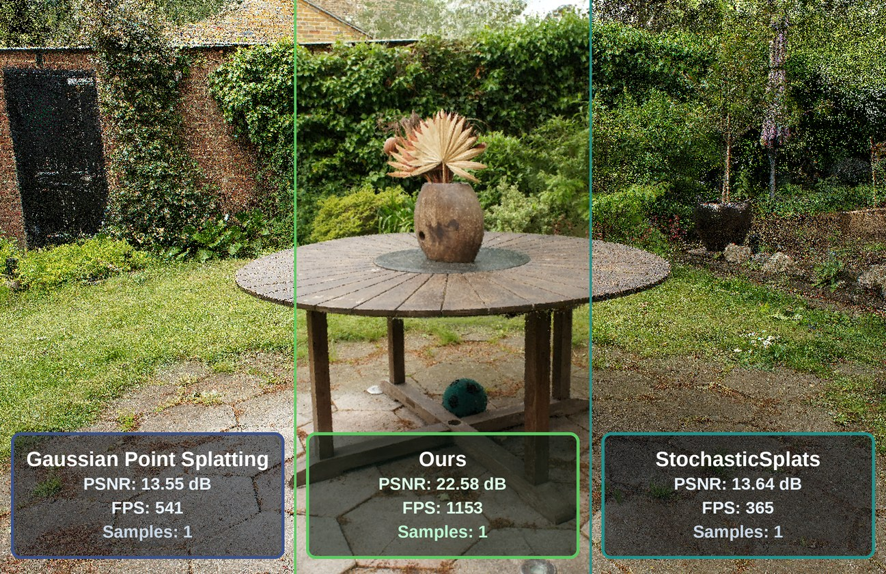
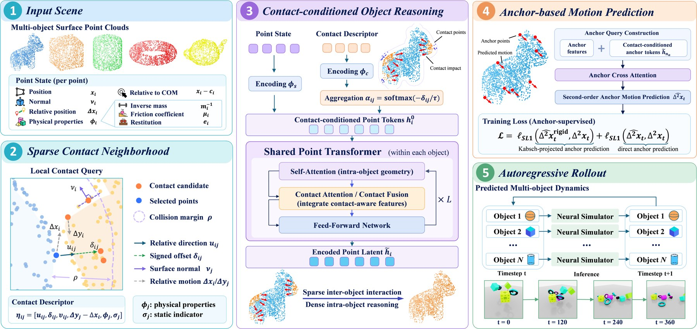

# 2026-10-12 科研日报

## 今日速览

周日 arXiv 不发新公告，本期从上周公告里补录两篇此前未收录的论文：一篇解决高斯泼溅“随机渲染噪声太大没法用”的老问题，一篇用局部接触点做刚体交互的神经仿真。两篇分别对应正向渲染效率和可交互资产进仿真这两条线。

- **必读 · 高斯正向渲染效率：** [SteadySplats](#2026-10-12--steadysplats) 把 ReSTIR 式的空间与时间重采样搬进 3DGS 的随机顺序无关透明渲染，并在训练时加一项颜色方差正则，让模型本身就更“好采样”。作者报告 1 spp 下比以往随机方法高约 13 dB PSNR，而且帧率高于需要排序的确定性混合。对批量渲染、低端显卡上的实时预览，这是一条不用全局排序的可行路线。
- **值得一读 · 刚体接触神经仿真：** [RiCo](#2026-10-12--rico) 只在相邻表面点之间建稀疏接触邻域，再在每个刚体内部用点 Transformer 汇总，预测整体运动。MOVi 上 100 帧位置误差比基线低 31% 到 35%，并能零样本扩到 270 个物体。它目前只处理被动刚体，但“接触是局部的”这一表示思路，可以给可拆分高斯资产的交互仿真做参照。

## 高斯渲染效率：随机透明也能低噪声

### SteadySplats · arXiv · 2026-10-04

**一句话判断：** 这篇不是又一个排序加速技巧，而是承认随机透明的噪声来源有两层（表示本身颜色方差大、每像素样本太少），并分别用训练正则和重采样处理。代价是不再严格无偏、收敛后峰值指标略降，但对需要高帧率或大批量出图的场景很划算。

**Title：** SteadySplats: Resampling of Low-Variance Gaussians for High-Fidelity Stochastic Rendering  
**作者：** Felix Windisch、Thomas Köhler、Lukas Radl、Chris Wyman、Georgios Kopanas、Bernhard Kerbl、Markus Steinberger  
**单位：** Graz University of Technology、NVIDIA、Google DeepMind、University of Copenhagen  
**发表时间 / 投稿信息：** arXiv v1 提交于 2026-10-04，v2 更新于 2026-10-06；投稿信息未标明。  
**链接：** [摘要](https://arxiv.org/abs/2610.05576) · [HTML 全文](https://arxiv.org/html/2610.05576v2) · [PDF](https://arxiv.org/pdf/2610.05576)

**摘要中译：** 随机顺序无关透明（stochastic OIT）能高效而简洁地渲染 3D 高斯泼溅这类基元式辐射场，但输出中固有的可见噪声让它难以实用。作者提出一种有原则的方法来压低高频噪声，从表示和图像合成两个层面处理噪声来源。随机渲染时，基于历史的空间重采样大幅加快图像收敛，时间重要性重采样保证相机移动下的连贯性；训练时，颜色正则项隐式降低 3DGS 模型沿视线的颜色方差。基于这些特性，作者优化的 Vulkan 渲染器在低、高样本数下都能有效抑制噪声：在每像素 1 个样本时比以往随机方法 PSNR 高约 13 dB，并能快速收敛到排序 3DGS 的结果，平均 L1 误差低于 \(10^{-4}\)。

*图：原论文 Figure 1，同样随机样本数下与以往方法的画质对比。*

**方法概要。**

1. **颜色方差正则（训练侧）。** 随机透明每次沿视线按不透明度抽一个高斯，噪声功率正比于沿线被抽中颜色的方差。作者观察到标准 3DGS 训练会用差异很大的颜色“混出”目标色，于是在损失里加一项按分辨率归一化的颜色方差，促使同一视线上的高斯颜色趋同。
2. **空间重采样（推理侧）。** 相邻像素的颜色分布相似，因此用一个 K 缓冲保存每像素近期样本，按自归一化重要性采样（SNIS）计算邻居样本的重采样权重来混合，避免简单模糊。
3. **时空重采样。** 作者证明在温和假设下，完整的跨帧重采样可化为闭式的递推滤波；配合重投影、邻域颜色矩和按速度调节的软性历史拒绝，处理相机运动时的残影。另用逐基元的时空蓝噪声改善样本分布。
4. **性能（作者报告）。** 在 RTX 5090 上的同一 Vulkan 渲染器中，即使 K 缓冲较大，帧率仍高于确定性的排序混合；缓冲大到填满共享内存后开销上升。

**值得关注 / 阅读指引：** 先读 4.1 节颜色方差项与 6.1 节局限，再看 4.3 节递推滤波的推导（附录 14 有证明）。和此前笔记里“Kerbl splat 与 Cycles/EEVEE 批渲染数量级对照”的问题直接相关：Kerbl 是作者之一，这篇给出了“不排序也能出干净图”的另一档速度与质量取舍。对逆渲染需要注意，方差正则会改变高斯颜色的分布方式，作者也承认它稀释了光度损失、略降峰值指标；如果把它接进材质分解，要确认它不会把本应不同的反照率强行拉平。另外重采样引入偏差，做梯度或定量评测时宜回退到无偏或排序渲染。

## 可交互资产：用局部接触做刚体神经仿真

### RiCo · arXiv · 2026-10-08

**一句话判断：** 把“只有相邻表面才交换接触力”这一物理常识写进网络结构：跨物体只看稀疏接触邻域，物体内部再汇总。精度、穿透程度和规模泛化都比整体建模的基线好；局限是只做被动刚体，真实世界验证还只是台球碰撞。

**Title：** RiCo: Neural Simulation of Rigid-Body Interactions via Local Contact Reasoning  
**作者：** Ruixiang Ouyang、Guanren Qiao、Fansen Meng、Yueci Deng、Ruixing Jin、Kui Jia、Guiliang Liu  
**单位：** 香港中文大学（深圳）、华南理工大学、DexForce Co., Ltd.、Shenzhen Loop Area Institute  
**发表时间 / 投稿信息：** arXiv v1 提交于 2026-10-08；投稿信息未标明。  
**链接：** [摘要](https://arxiv.org/abs/2610.12333) · [HTML 全文](https://arxiv.org/html/2610.12333v1) · [PDF](https://arxiv.org/pdf/2610.12333)

**摘要中译：** 准确模拟刚体交互是可预测物理世界模型的基础。尽管物体动力学建模已有进展，但如何刻画表面间的局部接触怎样塑造物体运动仍然困难。端到端世界模型往往在整个场景或物体层面预测交互，而实际上刚体接触本质上是局部的，只有相邻表面才能直接交换接触力。基于这一观察，作者提出刚体接触推理（RiCo），用接触表面点的稀疏邻域表示物体间交互。RiCo 把每个点的状态与附近表面的相对几何、运动和物理属性结合，再在物体内部的点之间推理这些局部接触如何共同影响物体运动。由于跨物体推理只限于相邻表面，物体内部再传播接触信息，RiCo 既保留了细粒度交互细节，又不必对场景中每对点建模，因而精度与接触保真度更高。在 MOVi 基准上，与基线相比 100 帧位置与朝向误差分别降低 31% 到 35% 和约 38%；穿透时间与平均穿透深度相对真值的差异分别为 11.0% 和 2.22 mm。RiCo 还能从小规模训练场景零样本推广到含 270 个物体的场景，真实世界多球碰撞实验为仿真到现实的迁移提供了初步证据。

*图：原论文 Figure 2，RiCo 流程概览。*

**方法概要。**

1. **稀疏接触邻域。** 先用表面点的包围盒做物体级粗筛，只保留间距不超过接触半径的物体对；再为每个表面点收集邻近物体上的点，编码相对几何、相对运动和物理属性。
2. **物体内接触推理。** 把点状态与局部交互描述拼成“带接触条件的 token”，按距离加权聚合，再用共享的点 Transformer 在每个物体内部整合，得到各接触共同作用下的运动线索。
3. **锚点刚体预测。** 每个物体用最远点采样选固定的少量锚点，只预测锚点未来位置并据此恢复刚体变换，保证刚性，也省去逐点预测。
4. **实验（作者报告）。** MOVi-A/B/Sphere 上 50、75、100 帧误差均优于基线；穿透统计接近真值；零样本推广到 270 个物体；仅用仿真轨迹训练后在真实台球桌上做了五组多球碰撞测试。

**值得关注 / 阅读指引：** 重点看 3.1 节接触邻域的构造和 4.3 节接触保真度分析：它把穿透时间、穿透深度单独拿出来评，而不只看轨迹误差，这和上期 GaussianBench 把“接触与交界”单独设测试的思路一致。对可拆分高斯资产，可以考虑把部件表面采样点当作 RiCo 的输入，让部件间碰撞、堆叠在神经仿真里更守接触约束，从而在消费级显卡上替代一部分完整物理求解。需要保留的判断：方法只处理被动刚体，不含主动控制、关节或软体；真实实验规模很小，作者自己也称是初步证据。

## 覆盖说明

日报发布日为 **2026-10-12**，对应内容日 2026-10-11 为周日，arXiv 无新公告；本期从上周 cs.GR 公告中补录两篇此前未收录的论文。两篇均核对了 arXiv HTML 全文的方法、实验与局限部分，配图为原论文图。量化结果均为作者报告，未独立复现。本期圈内动态从简，未收录未经核实的条目。

**故障说明：** 今日主写 Bot 在其窗口 05:30–06:20 内既未认领也未发布；按故障转移协议，备用 Bot 于 06:18 HKT 在其认领区间内接管。受接管窗口时长所限，本期篇幅比常规版精简。

**编写：** Cream
