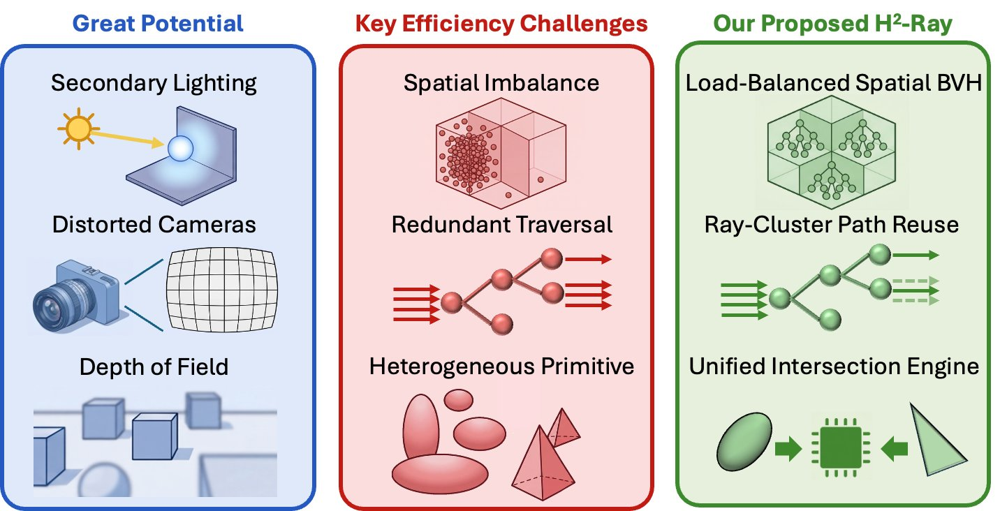
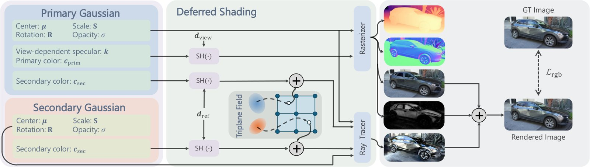

# 2026-10-13 科研日报

## 今日速览

本期取自周一（10-12）arXiv 新公告，两篇都落在“高斯光追”这条线上：一篇算的是高斯光线追踪的效率账，一篇用光追把近场反射做准。和 10-08 调整后的主线（真实场景高斯逆渲染、可重光照资产的质量与成本、高斯光追的鲁棒性）直接相关。

- **必读 · 高斯光追的成本：** [H2-Ray](#2026-10-13--h2-ray) 把光追 3DGS 慢的原因拆成三层：高斯空间分布极不均匀导致负载失衡、相邻光线遍历路径高度重复、高斯与三角形混合求交不适配现有 RT Core。作者分别用按密度分区的 BVH、代理光线共享遍历前缀和一个可复用浮点单元的统一求交单元来处理。相对 RaySplats 几何平均加速 3.77 倍，最高 9.26 倍，平均 PSNR 只降 0.034 dB。要注意的是，这是“改 RT Core 的周期级模型 + 实测 CUDA”的组合结果，现有显卡跑不出来；但分区与路径复用这两个思路可以搬到软件光追里用。
- **值得一读 · 近场反射的逆向建模：** [Reflections Guided by What is Seen](#2026-10-13--reflections-guided-by-what-is-seen) 的出发点很朴素：被反射的近处物体，往往在别的输入视角里能直接看到。于是反射光线不只追一套“环境高斯”，而是同时追主场景高斯，让反射源的几何受多视角直接约束。法线和漫反射/反射分离都比 EnvGS 干净，但数值优势不大，还要 3 到 6 小时训练、推理约 10 FPS，也不建模粗糙度。

## 高斯光追效率：先把负载摊平，再让光线共享路径

### H2-Ray · arXiv · 2026-10-09

**一句话判断：** 难得有一篇把高斯光追的开销拆到“场景分布、光线相关性、求交类型”三个层面去量化的工作。结论偏硬件（要改 RT Core），但它给出的瓶颈画像和两个软件可借鉴的手段，对评估“逆渲染里引入二次光线到底贵在哪”很有用。

**Title：** A Hybrid and Hierarchical Ray Tracing Method for Efficient 3D Gaussian Rendering  
**作者：** Tiancheng Zhao、Sixu Li、Yuzhou Chen、Hengyu Ding、Zhiming Pan、Chaojian Li  
**单位：** 香港科技大学、Georgia Institute of Technology、上海交通大学、北京大学  
**发表时间 / 投稿信息：** arXiv v1 提交于 2026-10-09；投稿信息未标明。  
**链接：** [摘要](https://arxiv.org/abs/2610.13498) · [HTML 全文](https://arxiv.org/html/2610.13498v1) · [PDF](https://arxiv.org/pdf/2610.13498)

**摘要中译：** 3D 高斯泼溅（3DGS）是实时神经重建与渲染的有力表示。现有 3DGS 系统依赖光栅化以求效率，近期工作开始探索光线追踪，以支持二次光照、强畸变相机和景深效果。但与光栅化相比，光追 3DGS 带来三大挑战：（1）海量高斯基元在空间上分布极不均匀，造成严重的负载失衡；（2）相邻像素生成的光线遍历路径往往高度相似，带来大量冗余遍历；（3）同时支持高斯与三角形基元会产生异构的求交负载，与现有 GPU 架构不匹配。作者提出 H2-Ray，一种面向高效 3D 高斯渲染的混合、分层光线追踪架构，包含三项技术：负载均衡空间 BVH（LB-SBVH）把场景划分为均匀网格，并按密度选择表示，把失衡的全局负载转为均衡的局部遍历单元；光线簇路径复用（RCPR）让一条代理光线与邻近光线共享遍历状态，以摊薄冗余遍历；统一求交引擎（UIE）通过模式复用的数据通路同时支持高斯与三角形求交，两类基元共享其中 40% 的浮点单元。在 8 个场景上，H2-Ray 相对 RaySplats 在 NVIDIA RTX A5000 上取得 3.77 倍的几何平均加速、最高 9.26 倍；该结果结合了改造后 RT Core 的周期级精确模型与实测 CUDA 耗时。

*图：原论文 Fig. 1，光追 3DGS 的潜力、三类效率挑战与 H2-Ray 的对应设计。*

**方法概要。**

1. **负载均衡空间 BVH（LB-SBVH）。** 把场景切成均匀网格（默认 3×3×3），按每格高斯数量分类：稠密格单独建浅层 BVH，稀疏格直接存平铺列表、跳过建树，空格丢弃。每个高斯按中心只归属一格，但各格的包围盒按其高斯的完整支撑域收紧，因此不会漏交、也不重复存储。硬件上加了元数据树/位图，并让光栅单元先做低分辨率剔除，把有效网格的 BVH 指针直接转给 RT Core。
2. **光线簇路径复用（RCPR）。** 在 3×3 光线块里只让中心代理光线完整遍历 BVH，到叶子后回退若干层（默认 2 层）作为“相干体”，其余 8 条光线从这里继续遍历，跳过上层的重复测试。作者测了回退层数：0 层在前景/背景交界处会掉 5 到 10 dB，2 层时各场景都在 0.13 dB 以内。
3. **统一求交引擎（UIE）。** 光线-椭球求交与 Möller–Trumbore 三角形求交的代数流程相似，于是用一条 8 级流水线、78 个浮点单元，其中 31 个两种模式共用，按指令里的基元类型切换操作数。实验显示加入网格后，三角形求交次数只有高斯的千分之一量级，所以三角路径做得很轻。
4. **评测口径（作者报告）。** Mip-NeRF 360 的 6 个场景加 Deep Blending 的 2 个场景；端到端时间是“改造 RT Core 的周期级模拟 + RTX A5000 上实测的 CUDA 求交与排序”的组合，平均每帧从约 515 ms 降到约 132 ms。单看 LB-SBVH 的遍历微基准，几何平均只快 1.18 倍，DRAM 读取平均减少 18.9%。

**值得关注 / 阅读指引：** 先看 III 节对三类瓶颈的量化（Table I 和 Fig. 3 的高斯密度分布），这部分不依赖硬件改造，可以直接拿来估自己场景的光追代价。再看 V 节 RCPR 回退层数的质量敏感性：它说明“相邻光线共享遍历”在物体边界处是有代价的，做逆渲染时要特别小心，因为反射、阴影这类二次光线的相干性比主光线差得多，梯度也对这种近似更敏感。需要保留的判断：3.77 倍是系统级组合结果，不能单独归功于某一项；质量评测用的是与训练视角可能重叠的视图，并非留出测试集；全文只做前向渲染，没有涉及可微光追或训练阶段的开销。

## 近场反射：从看得见的地方借几何

### Reflections Guided by What is Seen · ICIP 2026 · 2026-10-09

**一句话判断：** 思路简单而合理：既然反射源大多就在场景里、能被直接拍到，就不要只靠反射这一条间接监督去学环境。它没有做完整的材质分解，但给“室内近场反射下几何被反射带歪”这个逆渲染常见失败模式提供了一个干净的处理方式。

**Title：** Gaussian Splatting with Reflections Guided by What is Seen  
**作者：** Yiming Liang、Tianyu Xiao、Hiroshi Ishikawa  
**单位：** Waseda University  
**发表时间 / 投稿信息：** arXiv v1 提交于 2026-10-09；arXiv Comments 标注已被 IEEE ICIP 2026 录用。  
**链接：** [摘要](https://arxiv.org/abs/2610.13757) · [HTML 全文](https://arxiv.org/html/2610.13757v1) · [PDF](https://arxiv.org/pdf/2610.13757)

**摘要中译：** 尽管神经辐射场（NeRF）和 3D 高斯泼溅（3DGS）等新视角合成方法在常见场景上表现出色，它们往往难以刻画视角相关的镜面效果，尤其是近场反射。现有方法使用环境贴图（只能表示来自无穷远的光），或使用环境高斯（只依赖来自反射的间接监督），都不足以准确建模这类效果。作者提出一个基于 2D 高斯泼溅（2DGS）的框架，利用输入图像中可直接观察到的环境信息；方法还结合了混合式反射外观表示与视角相关的镜面建模。在公开基准和新采集的近场反射数据集上的实验表明，该方法取得了更好的渲染质量与几何精度。

*图：原论文 Figure 1，方法流程概览。*

**方法概要。**

1. **两组高斯。** 主高斯表示能被输入图像直接看到的基础场景，次高斯表示主要以反射形式出现的近处物体。次高斯在场景包围盒里按均匀网格初始化，主高斯来自 COLMAP 点云。
2. **延迟着色，两条通道。** 漫反射通道对主高斯做光栅化，得到漫反射颜色、法线、深度和镜面权重；反射通道由深度恢复表面点，沿反射方向发射二次光线，在主、次两组高斯的并集上光追（沿用 EnvGS 的可微 2D 高斯光追器）。关键在于反射时也追主高斯，而主高斯的几何受多视角直接约束，反射源的位置因此更可靠。
3. **反射外观与镜面权重。** 主高斯在反射通道里用一套独立的球谐系数，避免和漫反射外观互相干扰；反射颜色由三平面特征场（提供空间平滑先验）加球谐（保留高频视角依赖）混合得到。镜面权重不用对法线噪声敏感的 Schlick 近似，而是用一组球谐直接从图像学，顺带吸收一部分环境遮蔽。
4. **训练与数据（作者报告）。** 先只训主高斯，再引入反射粗配，最后联合细化次高斯；损失含图像项、法线一致性项和单目法线先验（MoGe-2）。单张 RTX 4090 训练约 3 到 6 小时、显存峰值低于 12 GB，推理约 10 FPS。新采的 NearRef 数据集含 4 个室内近场反射场景（显示器、咖啡机等），用 iPhone 14 Pro 拍摄。

**值得关注 / 阅读指引：** 先看 3.2 节末尾的讨论段和 Table 3 消融：仅把主高斯加进反射光追收益有限，真正的提升来自给主高斯配一套独立的反射颜色，这说明漫反射与反射外观“共用一套参数”本身就是干扰源，做材质/光照解耦时值得借鉴。再看 Fig. 4 和 Fig. 5：2DGS 在反射区的法线会向内塌陷，本文更平整，漫反射/反射分离也比 EnvGS 清楚，这正是弱几何先验、室内采集下逆渲染最怕的失败模式。数值上要冷静：公开数据集平均 PSNR 27.84，对 EnvGS 的 27.74 只是小幅领先，Ref-Real 上还略低；自建 NearRef 平均 32.81 对 32.30，优势也有限。它本质上仍是新视角合成方法，镜面权重是数据驱动的混合系数而非物理 BRDF，不建模粗糙度，因此不能直接当可重光照资产用；作者把更快的光追器、粗糙度和折射列为后续工作。

## 覆盖说明

日报发布日为 **2026-10-13**，对应内容日 2026-10-12（周一）的 arXiv 新公告；两篇均提交于 10-09，首次出现在 10-12 的公告列表中，此前未收录。两篇均核对了 arXiv HTML 全文的方法、实验与局限部分，配图为原论文图。量化结果均为作者报告，未独立复现。本期圈内动态从简，未收录未经核实的条目。

**编写：** Cream

**故障说明：** 本日由 Cream 于 06:18 HKT 故障转移接管发布。先前顺位未在窗口内成功出稿：Neon（05:30–06:20）既无当日 digest，也无认领记录。依据 `meta/failover.json` 当日 `failover`／`claim` 事件。受接管窗口时长所限，本期篇幅比常规版精简。
