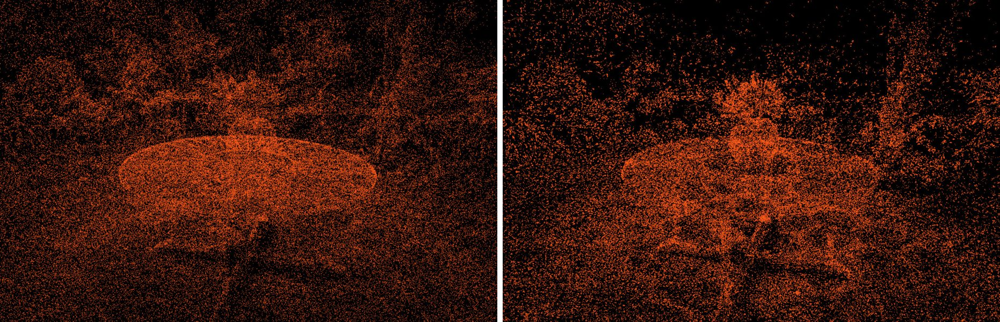
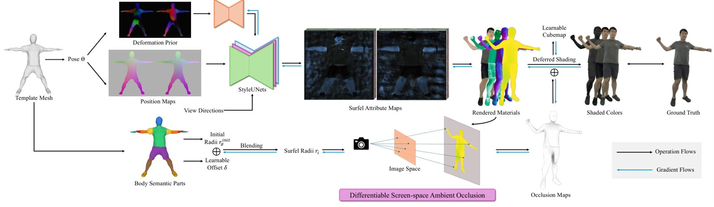

# 2026-10-14 科研日报

## 今日速览

截至发稿，arXiv 还没有放出 10-13 的新公告，本期从 10-12（周一）公告里前一期没收的部分挑了两篇。两篇问的都是“资源和信号该花在哪里”：一篇是固定基元预算下新高斯该放到哪，一篇是可见性怎么便宜地估出来、还能和材质一起优化。和当前主线（真实场景高斯逆渲染的几何质量、可重光照资产的成本）都有关联，但都不是正面的场景逆渲染论文。

- **必读 · 固定预算下的致密化：** [Confidence-Aware Densification](#2026-10-14--confidence-aware-densification) 指出 3DGS-MCMC 按不透明度采样和重定位，会把新基元集中送到前景（多视角都看得到、不透明度偏高），背景因此欠重建。作者改成按图像误差放基元：主要看屏幕空间梯度，并偏向学到的置信度低的基元；同时按最大混合权重挑出贡献最小的基元让位。24 个场景、100k 到 2M 各档预算下三项指标都优于 3DGS-MCMC，500k 起 PSNR/SSIM 在固定预算方法里最高，而且不需要任何先验网络。对逆渲染的启发是，“哪里还没解释好”这个信号很便宜，可以拿来指导弱观测区域的致密化。
- **值得一读 · 便宜的可见性：** [ARS-Avatar](#2026-10-14--ars-avatar) 是可驱动、可重光照的面元人体化身。值得借鉴的是它的可微屏幕空间环境遮蔽：几何输入固定，只优化各身体部位的遮蔽半径，用有限差分求梯度，从而不让遮蔽项反向把几何拉歪。场景是受控棚拍的人体，SSAO 也只是局部近似，训练要 4+2 天，可以当作“可见性近似如何与材质联合优化”的一个工程样例来读。

## 致密化：按误差而不是按不透明度放基元

### Confidence-Aware Densification · arXiv · 2026-10-09

**一句话判断：** 把 3DGS-MCMC 的一个系统性偏差说得很清楚，修法也很轻：只多一个逐基元置信度和一条损失。只评新视角合成指标、不测几何和光追代价，但“固定预算下基元往哪放”同时决定着背景几何质量和后续光追要相交的高斯数，值得放进工具箱。

**Title：** Efficient Confidence-Aware Densification for 3DGS  
**作者：** Manuel Hofer、Thomas Köhler、Felix Windisch、Bernhard Kerbl、Markus Steinberger、Lukas Radl  
**单位：** Graz University of Technology、University of Copenhagen、Huawei Technologies  
**发表时间 / 投稿信息：** arXiv v1 提交于 2026-10-09；投稿信息未标明。  
**链接：** [摘要](https://arxiv.org/abs/2610.13541) · [HTML 全文](https://arxiv.org/html/2610.13541v1) · [PDF](https://arxiv.org/pdf/2610.13541)

**摘要中译：** 3DGS-MCMC 用基于不透明度的采样与重定位取代了原版 3DGS 由梯度驱动的密度控制，已成为固定基元预算下无先验致密化的事实标准。但重建良好的区域不透明度始终偏高，这种采样会把大部分新基元送往前景，导致背景欠重建。低预算时，ConeGS、EDGS 等依赖先验的方法表现更好，代价是需要预训练辐射场或稠密图像匹配，外加单独的初始化阶段。作者主张在固定预算的 MCMC 框架内回到误差驱动的致密化：保留固定预算与逐步增长，但按图像误差而非不透明度放置基元。新基元主要放在屏幕空间梯度大的位置，并偏向学到的置信度低的基元；同时把对渲染贡献最小的基元重定位到这些位置。在 24 个场景上平均，该方法在 100k 到 2M 的每档预算下 PSNR、SSIM、LPIPS 均优于 3DGS-MCMC；100k 预算时，无需先验和初始化阶段，就追回了 ConeGS 对 3DGS-MCMC 1.05 dB 领先中的 0.84 dB；500k 起在所有固定预算方法（含 ConeGS、EDGS）中 PSNR 与 SSIM 最高。该方法也能利用先验：从 ConeGS/EDGS 的初始化出发，100k 时与 ConeGS 持平，500k 时三项指标均最好。

*图：原论文 Fig. 1，左：本文；右：3DGS-MCMC。显示致密化时被抽中的源基元分布。*

**方法概要。**

1. **诊断。** 3DGS-MCMC 按不透明度抽源基元、按不透明度阈值（≤0.005）选重定位对象，两条规则都不与图像误差挂钩。作者把 Mip-NeRF 360 户外场景按深度拆开看：500k 预算下，本文相对 MCMC 的提升在最远 25% 像素上约 +1.20 dB，前景只有约 +0.23 dB，说明偏差主要伤在背景。
2. **采样分布。** 80% 的源基元按“绝对屏幕空间梯度的秩 × 低置信度偏置”抽取，置信度沿用 CoMe 式的逐基元学习；用秩而非原值，避免尺度和离群值主导。置信度在前几千步还没有信息量，所以偏置权重在前 5000 步从 0 渐增到 1。另外 20% 按逐基元分摊的结构误差（1−SSIM）抽取，补上 L1 主导时漏掉的结构误差。
3. **重定位。** 用训练视图中的最大混合权重（含透射率，天然考虑遮挡，不可见即为 0）挑选让位的基元，替代不透明度阈值。每 400 步一次，前期只动完全不可见的基元，之后逐步放宽，到 25k 步结束。
4. **初始化细节。** 关掉 MCMC 的连续位置噪声（作者认为它在背景和大场景里反而扰乱优化）；新基元位置从源高斯分布中一次性采样；颜色用首个合适训练视图的 GT 颜色反设 SH 直流项，并重置优化器动量。
5. **消融与成本（作者报告）。** 误差驱动采样和按贡献重定位单独使用几乎都没有提升，两者合用才有效。RTX 5090 上 Mip-NeRF 360 500k 预算平均训练约 2.8 分钟，ConeGS 约 14 分钟（含 2.2 分钟的 iNGP 初始化）；部分速度差来自本文基于 Faster-GS 的实现，基线用的是官方代码。

**值得关注 / 阅读指引：** 先读第 3 节和 Fig. 1/2 的诊断，这部分最容易迁移；再看 Table 1 的前景/背景拆分和 5.2 节消融。对逆渲染而言，室内不完整采集里“常见区域吸走资源、弱观测区几何变差”是同一类现象，置信度加最大混合权重是很便宜的“哪里还没解释好”的信号，可以拿来做逆渲染阶段的致密化与修剪。结合前一期 H2-Ray 对高斯密度不均的分析，基元分布也直接影响光追开销。需要冷静看待的地方：只报 PSNR/SSIM/LPIPS，没有几何或法线误差；100k 的最低预算下仍追不平更好的初始化；允许超出预算增长时峰值显存上升，增长到 3 倍反而变差；增长与重定位的日程是手调的。

## 可重光照化身：只放开一个低维参数去学可见性

### ARS-Avatar · arXiv · 2026-09-23

**一句话判断：** 领域是棚拍人体化身，不是真实室内场景，但它处理的是逆渲染里很实际的一环：高斯面元上的可见性怎么便宜地估，还能和材质一起优化而不把几何带歪。思路可以和用高斯光追查可见性的路线（如 IRGS）对照，后者更物理也更贵。

**Title：** ARS-Avatar: Animatable and Relightable Surfel Avatars with Learnable Ambient Occlusion  
**作者：** Jiateng Liu、Hao Gao、Junxin Sun、Mengqi Liu、Jiu-Cheng Xie、Jucheng Song、Feng Xu  
**单位：** 南京邮电大学、Macao Polytechnic University、清华大学  
**发表时间 / 投稿信息：** arXiv v1 提交于 2026-09-23，v3 更新于 2026-10-09；投稿信息未标明。  
**链接：** [摘要](https://arxiv.org/abs/2609.27600) · [HTML 全文](https://arxiv.org/html/2609.27600v3) · [PDF](https://arxiv.org/pdf/2609.27600) · [项目页](https://arsavatar.github.io/)

**摘要中译：** 从多视角图像构建可驱动、可重光照的人体化身仍然困难，因为姿态相关的形变、材质与光的可见性在图像中紧密耦合。本文提出 ARS-Avatar，以高斯面元（Gaussian Surfels）为表示，在未知光照下从多视角图像重建高质量、可驱动、可重光照的人体化身。为了忠实地估计面元，作者从模板网格中提取“形变位移”和“相对参数化人体模型的偏差”两种先验，刻画局部形变的复杂程度并作为辅助输入。材质用延迟着色估计 BRDF；作者还提出可微的屏幕空间环境遮蔽（SSAO），通过有限差分对各身体部位的遮蔽半径做梯度优化，以高效近似光的可见性，并与化身联合优化。实验表明，该方法在辐射重建的多项指标上具有竞争力或更优，在所评测的 PBR 重光照基线上一致领先，支持新姿态与新光照下的动画和重光照。

*图：原论文 Fig. 2，方法流程。*

**方法概要。**

1. **表示与驱动。** 在 SMPL-X 标准空间建化身，驱动姿态编码成 position map，由多个 StyleUNet 预测面元属性。面元是贴合表面的各向异性基元，深度和法线比普通 3DGS 干净（Fig. 8 消融）。
2. **形变先验。** 从模板网格算逐顶点的形变位移和相对 SMPL-X 的偏差，作为两张先验图辅助预测姿态相关细节，对手、脚和四肢帮助最大；去掉后 PSNR 从 31.75 降到 30.95（作者报告）。
3. **材质与光照。** 延迟着色，Disney BRDF（albedo + roughness），入射光是可学习的 HDR cube map；最终颜色为遮蔽项乘以漫反射与镜面项之和。
4. **可微 SSAO（核心）。** 可见性用渲染深度与法线算出的 SSAO 近似。为避免优化遮蔽时反向改动几何，只开放“遮蔽半径”这一条优化通路，几何输入固定：身体分 9 个语义部位，各有初始半径与可学习偏移，面元半径按蒙皮权重混合；对半径做正负小扰动分别渲染并跑 SSAO，用中心差分近似遮蔽对半径的导数，其余部分走自动微分。
5. **数据与成本。** AvatarReX（4 人）与 ActorsHQ（2 人），均为受控工作室多视角采集；单张 RTX 3090 上辐射重建约 4 天、PBR 着色估计约 2 天。

**值得关注 / 阅读指引：** 先读 3.4 节和 Fig. 6：和需要抽网格再用 BVH 光追的 AO 相比，精度相当而耗时显著更少；和事后计算、不能联合优化的遮蔽相比，自遮挡区更准。这种“固定几何、只放开一个低维物理参数、用有限差分求导”的做法，是避免遮蔽项把几何拉歪的一个可借鉴手段。再看 Table 2 的 PBR 对比，作者报告在两个数据集上均领先 MeshAvatar 与 Relighting4D，但读时要核实指标口径，它更接近 PBR 重建质量，不等同于新光照下与真值的对比。局限也很明确：SSAO 看不到屏幕外和背面的遮挡，不算投射阴影，也不含间接光；环境光是单一远场 cube map；训练开销很重。

## 覆盖说明

日报发布日为 **2026-10-14**。截至发稿，arXiv 尚无 10-13 的新公告列表，本期取自 10-12（周一）公告中前一期未收录的两篇：Confidence-Aware Densification 的 v1 提交于 10-09；ARS-Avatar 的 v1 提交于 09-23，v3 于 10-09 更新并出现在 10-12 的替换列表中，此前未收录。两篇均核对了 arXiv HTML 全文的方法、实验与局限部分，配图为原论文图。量化结果均为作者报告，未独立复现。本期圈内动态从简，未收录未经核实的条目。

**编写：** Cream

**故障说明：** 本日由 Cream 于 06:18 HKT 故障转移接管发布。先前顺位未在窗口内成功出稿：Neon（05:30–06:20）既无当日 digest，也无认领记录。依据 `meta/failover.json` 当日 `failover`／`claim` 事件。受接管窗口时长所限，本期篇幅比常规版精简。
