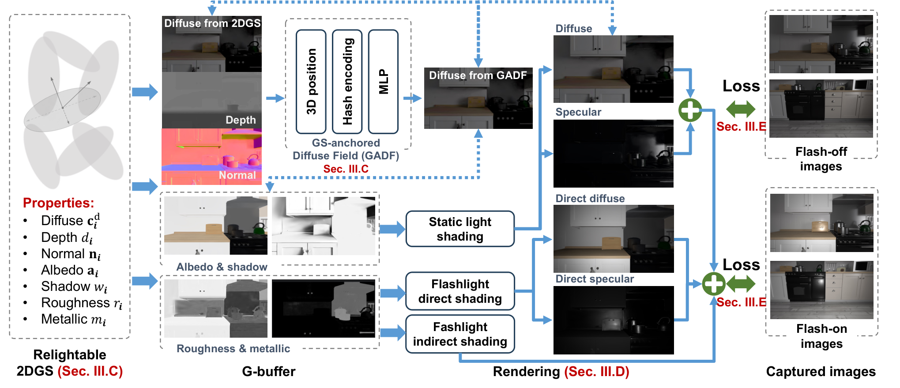
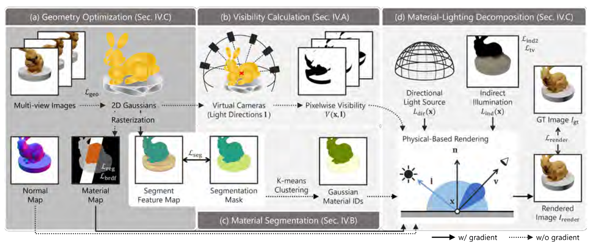

# 2026-10-15 科研日报

## 今日速览

室内逆渲染最容易出现的假进步，是图像更像了，材质却把光照错误一起记住。今天围绕这个问题补读两篇此前只作动态提及、尚未展开的方法：一篇给拍摄增加闪光灯观测，另一篇在单一光照下约束材质的一致性。它们都值得对照，也都不能证明“普通室内拍摄、没有可靠几何先验”已经解决。

- **必读：[Casual Flash](#2026-10-15--casual-flash)。** 闪光与非闪光照片不必同机位配对；关键是用世界坐标下的漫反射场，限制高斯混合把闪光信号吸收到外观里。需要一起看法线先验消融：拿掉先验，反照率与粗糙度都明显变差。
- **对照阅读：[Shadow-Aware GS](#2026-10-15--shadow-aware)。** 逐像素、逐方向估可见性，再强制同一材质区共享反照率，让阴影不能轻易变成“深色材料”。反照率改善很大，但重光照 PSNR 低于 IRGS，分区约束还会抹平真实纹理。
- **圈内动态：** Grok Voice 3.0 的任务指标与对话体验需要分开看；Hermes Agent 更新涉及定时执行与结果投递；NEURA 发布多感官机器人模型，长任务演示仍有待现场及独立验证。

## 室内材质分解：增加观测，也限制表示的自由度

### Casual Flash · arXiv · 2026-10-05

**一句话判断：** 最值得学的是“额外光照信号进入优化之后，怎样防止它被自由外观参数吸收”；这比单纯增加闪光照片更接近方法的核心。

**Title：** Casual Flash Lighting for Gaussian Splat Inverse Rendering  
**作者：** Jiamin Xu、Dongheng Wei、Jiarong Zhao、Qi Wang、James Tompkin、Weiwei Xu、Gang Xu  
**单位：** 杭州电子科技大学、华北电力大学、Brown University、浙江大学  
**发表时间 / 投稿信息：** arXiv v1 于 2026-10-05 提交；未标明已录用会议或期刊。本期为主线补读，不是昨日新发论文。  
**链接：** [摘要](https://arxiv.org/abs/2610.06035) · [HTML 全文](https://arxiv.org/html/2610.06035v1) · [PDF](https://arxiv.org/pdf/2610.06035)；此次未确认作者正式代码仓库。

**摘要中译（压缩转述）：** 单一静态光照难以唯一确定几何、材质和照明。本文结合室内非配对的闪光与非闪光照片，以表面二维高斯（2DGS）重建几何，借助高斯深度锚定的漫反射场改善跨视角一致性，再共同利用环境与闪光着色约束材质。作者在五个合成场景和三个真实场景上评估，报告材质分解及重光照改善。

*原论文 Fig. 2，[来源](https://arxiv.org/html/2610.06035v1#S2.F2)。从左往右看：高斯先输出深度、法线和材质；深度反投影到世界坐标，供漫反射场查询；静态光、闪光直接光及近似间接光共同组成预测。虚线代表损失约束，不表示这些通道完全相同。*

**方法与原理。** 输入是带相机位姿的两组照片，闪光开启和关闭时可以从不同位置拍、数量也可不同。真实采集固定曝光、白平衡和闪光功率；输出是带反照率、粗糙度及金属度的可重光照 2DGS。BRDF 即双向反射分布函数，规定入射光怎样随材质、法线和观察方向变成出射光。

第一步，把高斯属性光栅化成深度、法线和材质缓冲，再逐像素着色，即延迟渲染。普通高斯即使每个基元的漫反射颜色固定，同一表面附近的像素也会因视角不同而混合不同基元、采用不同权重；优化器因此仍能用外观漂移解释本应来自闪光的变化。作者另设一个只接受世界位置的多分辨率哈希编码网络，用它约束高斯渲染出的漫反射颜色：

$$
\widehat{C}^{d}(u)=\operatorname{sigmoid}\!\left(f_{\theta}(x(D(u)))\right).
$$

这里 \(u\) 是像素，\(D(u)\) 是高斯混合深度，\(x\) 将其反投影成三维点，\(f_{\theta}\) 是预测漫反射颜色的网络。它不接受观察方向，因而减少了跨视角随意改变颜色的空间。但它依然要求深度对应得足够准；其余材质属性保留在高斯上，全部改成位置场反而损失细节。

第二步，分别解释两类照明。静态光用空间网格中的多张局部环境贴图表示，对邻近八个网格的光照贡献插值；漫反射与镜面贴图独立优化。闪光近似为与相机共址的点光源，直接项包含距离平方衰减、学习得到的角向强度和 BRDF。闪光间接项则利用“实拍闪光图减去同视角渲染的非闪光图”的残差：在已提取且固定的网格上求交，投回闪光图取值，预计算后复用。这里**不是两张实拍照片直接相减**；视野外贡献被忽略，间接闪光只保留漫反射近似。

第三步，先用静态照片优化 18,000 步，再用一张非闪光图加邻近闪光图组成批次，优化至 25,000 步。图像损失之外，还有漫反射分解、镜面区域、语义分区和几何正则。MVInverse 提供法线与反照率先验，法线边界处降权；闪光残差帮助材质估计，并没有替代这些先验。

**结果与代价（作者报告）。** Table I 的合成场景重光照 PSNR 为 25.89 dB，IRIS 为 21.72 dB；PSNR 衡量图像误差，越高越好。改用 SAM2 自动分割后为 24.38 dB。单张 RTX 5090、640×360 图像下总优化约 40 分钟；论文没有给出同质量下前向、反向、预计算和峰值显存的完整拆账。FIPT、IRIS 使用真值网格和分割，还补充了场景视图，输入条件不同，不能把这个表直接当作统一条件的速度排名。重光照评估使用预测的逐视图缓冲及屏幕空间光追（SSRT）；真实场景主要是定性展示。

**值得关注。** Table II 中去掉法线先验，反照率 PSNR 从 24.14 降到 21.71，粗糙度平均绝对误差从 0.1554 升到 0.2563；去掉闪光，粗糙度误差同样升到 0.2568。两种信息都重要。本文值得对照“不完整几何下怎样获得稳定材质信号”，但还要区分逐视图重光照好看与完整资产可迁移：高光饱和、精细粗糙度变化、视野外间接光，以及深度不一致仍是边界。上述判断来自论文第 III–VI 节，不代表独立复现。

## 阴影解耦：让可见性承担遮挡，让材质承担反射

### Shadow-Aware GS · IEEE OJSP · 2026-09（作者列示月份）

**一句话判断：** 很适合检查“阴影是不是被材质吃掉”，但分区常量反照率的收益与损失必须同时看，不能只引用很高的反照率 PSNR。

**Title：** Shadow-Aware Inverse Rendering in Gaussian Splatting  
**作者：** Kotoka Matsunaga、Xuening Tian、Hideo Saito、Dieter Schmalstieg、Shohei Mori  
**单位：** Keio University、VISUS / University of Stuttgart、Graz University of Technology  
**发表时间 / 投稿信息：** IEEE Open Journal of Signal Processing，2026。[作者列表](https://mugichoko445.github.io/publications.html) 标注 2026.09 接收，[IEEE 栏目](https://signalprocessingsociety.org/publications-resources/ieee-open-journal-signal-processing/2026/10/shadow-aware-inverse-rendering-gaussian-splatting) 归入 2026 年 10 月；具体上线日未确认，公开作者稿仍有模板日期，不据此编造日期。  
**链接：** [DOI](https://doi.org/10.1109/OJSP.2026.3735472) · [作者公开 PDF](https://schmalstieg.github.io/pdf/Schmalstieg_461.pdf)；此次未确认正式代码仓库。

**摘要中译（压缩转述）：** 高斯逆渲染常把原始阴影写入反照率，换光后旧阴影仍在、新阴影又叠加。本文从重建几何估计像素级方向可见性，并用材质分割约束明暗区域的反照率一致性，把遮挡造成的变化交给光照解释。

*原论文 Fig. 2，裁取自[作者稿第 3 页](https://schmalstieg.github.io/pdf/Schmalstieg_461.pdf)。上路由几何生成方向可见性；下路学习分割特征并聚类成材质区域；两条约束共同进入材质与光照分解。*

**方法与原理。** 输入为单一光照下的多视角图像，另需物体掩码和用于材质分组的分割信息。先训练 2DGS，用图像重建、法线一致性、深度畸变及物体掩码损失得到表面几何。这里的法线一致性是几何内部约束，不等同于外部真值法线；但物体掩码和分割仍是实际输入条件。

随后沿采样光照方向布置虚拟相机，渲染深度。将当前像素反投影为三维点，再投到虚拟视图，比较该点深度与虚拟深度图；相对深度差超过阈值就判为遮挡。这样估计的可见性落在像素和方向上，能比粗体素或逐高斯可见性更细地表达投射阴影。它仍受重建几何、采样方向与阈值影响，并非精确的连续光线求交。

另一条支路让每个高斯携带分割特征：同一掩码中的像素特征相近、不同掩码的特征分开，训练后用 K-means 聚类得到高斯材质分组。材料光照优化时，每步后对同组材料参数取平均，主要作用在反照率。于是同一块表面跨过阴影边界时，优化器不能随意把暗处改成深色材料。光照模型写为：

$$
L_{\mathrm{in}}(x,\omega)=V(x,\omega)L_{\mathrm{dir}}(\omega)+L_{\mathrm{ind}}(x).
$$

\(V\) 是方向可见性，\(L_{\mathrm{dir}}\) 是直接光，\(L_{\mathrm{ind}}\) 是作者用球谐表示的间接照明项；再通过 BRDF 积分形成像素颜色。图像误差优化材质和照明，另用幅值、平滑项限制间接光随意补偿。作者假设白色照明，不能直接外推到任意彩色、近场复杂室内光照。

**结果与代价（作者报告）。** Table 1 的反照率 PSNR 为 34.02，IRGS 为 19.98；阴影区域交并比为 0.811 对 0.408，衡量预测阴影与真值的重合程度。但重光照 PSNR 为 **17.20 对 18.10**，本文更低，SSIM / LPIPS 仅略好。单张 RTX A6000 总训练约 50 分钟，200 个测试视图渲染约 1.7 分钟，IRGS 约 11.1 分钟；这是该实验的前向渲染比较，不是逆向优化快 6.5 倍的证据。未给出同等质量、统一实现下的前后向与显存拆分。

**值得关注。** 去掉分割，反照率 PSNR 从 34.02 降到 21.94，但重光照 PSNR 反而从 17.20 升到 17.37。这说明“材质去阴影”与“重光照图像误差”不是同一评价。分组数按场景手设，SAM3 的物体分割不等于材质分割；真实纹理、多材质区域可能被平均掉。真实验证还是近暗室、单白光条件，距离随手拍室内场景有明显差距。复现时宜同时检查原阴影残留、真实纹理保留和新光照误差，不能只看其中一项。

## 放在一起读：鲁棒性收益到底来自哪里

| 对照问题 | Casual Flash | Shadow-Aware GS |
|---|---|---|
| 新增信息或约束 | 闪光观测、位置漫反射场、法线与反照率先验 | 方向可见性、掩码与材质分组、组内反照率共享 |
| 几何不准的影响 | 世界点查询不一致，固定网格的间接闪光也会出错 | 深度比较产生错误遮挡，阴影可能被错误解释 |
| 真实验证范围 | 三个室内场景，主要定性材质与重光照展示 | 近暗室、单白光下的物体场景 |
| 资产使用仍要检查 | 逐视图缓冲的效果能否迁移到完整资产 | 去阴影是否同时损失纹理与材质边界 |

**编辑判断：** 两篇分别用更多观测和更强约束缩小分解歧义。读这类系统时，应把新增输入、表示限制、光传输近似和优化成本分开记账，再判断哪个模块真正贡献了稳健性。新视角拟合、材质准确度和可重光照资产可用性，需要独立证据。

## 圈内新闻与社区反应

### Grok Voice 3.0：综合任务分数与自然对话体验不是同一个问题

**事实（官方公告日期 10-14）：** [Grok Voice 3.0](https://x.ai/news/grok-voice-3) 是可听、说并调用工具的语音模型，已进入 Voice Agent API；官方称沿用前代价格，并自动更新使用 latest 别名的应用。公告列出综合语音指标、任务完成率与交互延迟；客服解决率属于厂商运营数据，不能当作公开独立复测。

**社区反应：** [r/grok 的 10-14 讨论](https://www.reddit.com/r/grok/comments/1x5xxmg/introducing_grok_voice_30/)里，有读者认可准确度提升；也有人指出“成本更低”是相对竞品而非前代，原评论者随后更正。另一些回复关心人格和对话体验的变化，未给出受控测试。这些是少量原帖观点，不构成模型能力的总体结论。

**编辑判断：** 做语音 Agent 时，任务是否完成、说话是否自然、响应是否及时应分别测试；默认别名自动换模型也意味着原有评测需要重跑。

### Hermes Agent v0.22.1：长期任务的完成信号也在修

**事实（发布说明日期 10-14，本次白天补充）：** [官方 release](https://github.com/NousResearch/hermes-agent/releases/tag/v0.22.1) 涉及模型默认参数、插件和运行时修复，其中包含工具超时保留、定时结果投递和重复通知处理。Hermes 是可连接模型与工具执行任务的 Agent 软件；这些更新处理的是执行基础设施，不能推导为推理能力提升。

**社区反应：** 发布条目列出了社区贡献者，但贡献记录不等于用户验收；此次未找到足以支持稳定性结论的该版本独立使用反馈。

**编辑判断：** 评估长任务 Agent，需要记录实际产物和投递状态，不能只统计它是否返回“完成”。

### NEURA Neuron AI：多感官与记忆进入动作模型，长任务效果仍待验证

**事实（10-14）：** [NEURA 官方公告](https://neura-robotics.com/neura-robotics-introduces-neuron-ai/)介绍其感知—语言—动作（PLA）模型，宣称联合三维视觉、触觉、声音、机器人状态和记忆，训练结合真实机器人数据、仿真扩增与人类演示。公司计划于 10-20 至 10-22 展示约 11 分钟的衣物处理流程；这是未来演示计划，不是已经核验的连续自主成功记录。

**社区反应：** 暂未找到可核实的独立复现或系统性实测。公告不足以确认泛化成功率、重置次数与人工干预成本。

**编辑判断：** 对策略研究更有用的后续证据，是遮挡后能否保留任务状态、接触失败怎样恢复，以及同一任务重复执行的成功分布。

## 覆盖说明

发布日为 **2026-10-15**，新闻主要覆盖 **2026-10-14**，并纳入白天改稿时核实的后续信息。已检查图形学、LLM、Agent 与具身方向；图形学部分以两篇逆渲染方法补读为主，不把旧论文包装成昨日新稿。Casual Flash 的原始提交日为 10-05；Shadow-Aware 的作者列表列示 9 月、IEEE 栏目归档为 10 月，具体上线日未确认。两篇均核对原文方法、关键实验与局限，配图均为原论文 Fig. 2；数字为作者报告，未独立复现。

本次按维护者要求覆盖更新今日正文与时间轴摘要；早间 Cream 版本保留在 Git 历史中。

**编写：** Neon
