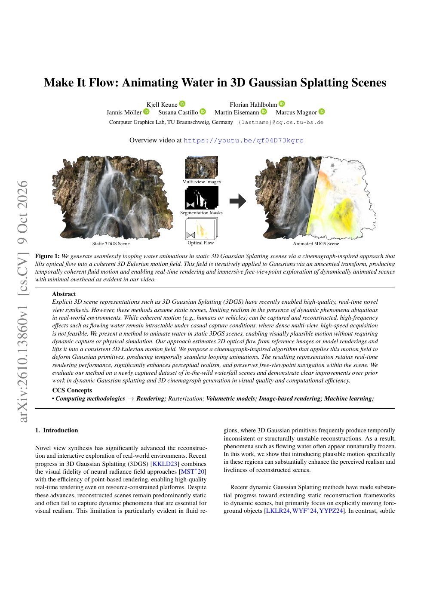
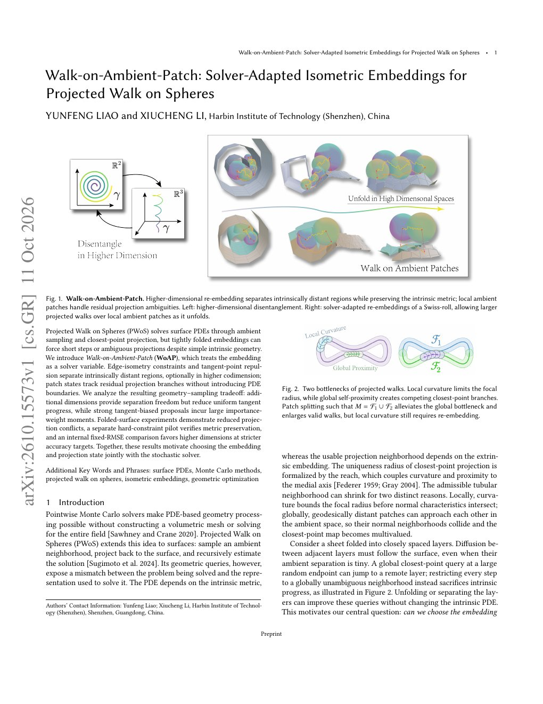

# 2026-10-15 科研日报

## 今日速览

本期覆盖 arXiv **10-14（周三）** 公告中与可编辑动态高斯、无网格蒙特卡洛几何求解相关的两篇。一条线是：静态 3DGS 场景里如何只给水区域「补上」可循环的流动，而不做完整动态重建；另一条线是：表面 PDE 的投影 Walk-on-Spheres 能不能把**嵌入本身**当成求解器变量，用更高维等距重嵌减小投影冲突。主线仍是真实场景高斯逆渲染与正向效率，这两篇分别从「可编辑动态资产」和「网格无关 MC 几何」侧提供对照。

- **必读 · 静态高斯场景里的水：** [Make It Flow](#2026-10-15--make-it-flow) 把多视角光流抬成体素欧拉运动场，再用对称变形让高斯像拉格朗日粒子一样循环流动。不需要动态采集、不重训、也不做物理仿真，仍保持实时渲染与自由视点。对「可编辑动态资产」的启发是：运动场可以和场景表示解耦，只动需要动的那一块。
- **值得一读 · 把嵌入交给求解器：** [Walk-on-Ambient-Patch](#2026-10-15--walk-on-ambient-patch) 针对折叠表面的投影 WoS：层与层在环境空间贴得太近时，大步会跳到错误分支。作者用边长约束下的排斥重嵌 + 投影状态分区，再分析更高维带来的切向进度损失与重要性加权方差，说明「清间隙」不能单独当目标。

## 可编辑动态：给静态 3DGS 的水补上循环流动

### Make It Flow · arXiv · 2026-10-12

**一句话判断：** 把 2D cinemagraph 的思路搬到 3DGS：光流 → 一致的 3D 欧拉场 → 高斯体积感知变形，得到可循环、可自由视点的水流动画。不做物理仿真、不依赖同步多视角动态采集，更贴近「已有静态重建再补运动」的工程路径；局限是运动贴在可见水面附近，几何差时会带着走。

**Title：** Make It Flow: Animating Water in 3D Gaussian Splatting Scenes  
**作者：** Kjell Keune、Florian Hahlbohm、Jannis Möller、Susana Castillo、Martin Eisemann、Marcus Magnor  
**单位：** TU Braunschweig（Computer Graphics Lab）  
**发表时间 / 投稿信息：** arXiv v1 出现在 2026-10-14 公告（提交约 2026-10-12）；投稿信息未标明。  
**链接：** [摘要](https://arxiv.org/abs/2610.13860) · [HTML 全文](https://arxiv.org/html/2610.13860) · [PDF](https://arxiv.org/pdf/2610.13860) · [视频](https://youtu.be/qf04D73kgrc)

**摘要中译：** 3D 高斯泼溅已能高质量、实时地做新视角合成，但多数方法默认场景静态。人物、车辆等连贯运动可以重建，瀑布、溪流等高频流体在随意采集条件下仍难处理。本文提出在**静态** 3DGS 场景中动画水的方法：无需动态捕捉或物理仿真，也能得到视觉上可信的流动。做法是从参考图或模型渲染估计 2D 光流，抬升为一致的 3D 欧拉运动场，再以类 cinemagraph 的算法用该场变形高斯基元，生成时间上无缝衔接的循环动画。表示仍保持实时渲染，感知真实感明显增强，并保留自由视点浏览。作者在新采集的野外瀑布数据集上评测，相对动态高斯与 3D cinemagraph 前作，在视觉质量与计算效率上均有清晰提升。

*图：原论文首页 / teaser 页渲染（PDF 第 1 页）。*

**方法概要。**

1. **光流估计。** 输入是静态训练图（可加用户视角渲染）。在 3D 里交互放运动提示，投影到各视角；用 SAM 类分割限定「水」区域；稀疏提示插值成稠密场后，经预训练流体光流网络细化。
2. **多视角抬升为欧拉场。** 用 3DGS 渲染深度，把各视角光流反投影，在体素上累积线性化的重投影方程并求解；再用「静态命中 / 动态命中」比与视角命中阈值清掉误标到固体上的运动。结果存成稀疏速度场，整段动画共用。
3. **高斯当拉格朗日粒子。** 在运动非零处标动态高斯；用 Unscented Transform 按场迭代更新均值与协方差（体积感知，而非只搬中心）。为循环：正/反方向各算一条关键帧序列，不透明度按 \(\sin^2\) 交叉淡入淡出，保持局部密度；再给每个高斯随机时间相位，打散重复图案。
4. **渲染。** 在优化过的 3DGS 渲染器上虚实例化动态高斯，关键帧间线性插值；静态部分不动。作者报告平均约 333 FPS、约 3.8 GiB，预处理约 55 秒。

**值得关注 / 阅读指引：** 先看 Fig. 1 管线与 Fig. 3 的场景流着色对比——相对 LoopGaussian，方向性更接近真实水流。再看 3.2–3.3：解耦「运动场」与「场景高斯」比整场景 4D 重建更轻。对可编辑动态资产的启发是：局部流体可以后处理补上，而不必重做动态重建。冷静点：依赖静态重建深度；强反光水面高斯稀时运动场会坏；运动基本贴在可见表面，不能恢复被平均掉的高频水花细节；评测以定性与效率为主，没有物理真值。

## 无网格几何：投影 Walk 的嵌入也是求解变量

### Walk-on-Ambient-Patch · arXiv · 2026-10-13

**一句话判断：** 把「表面 PDE 用环境采样 + 最近点投影」这条线往前推了一步：折叠几何下投影冲突时，先改等距嵌入再分区跟踪投影分支，并给出切向进度与重要性权重的维数权衡。不是逆渲染论文，但对网格无关 MC、以及将来在曲面/高斯代理上做局部 PDE 求解的人有方法论价值。

**Title：** Walk-on-Ambient-Patch: Solver-Adapted Isometric Embeddings for Projected Walk on Spheres  
**作者：** Yunfeng Liao、Xiucheng Li  
**单位：** 哈尔滨工业大学（深圳）  
**发表时间 / 投稿信息：** arXiv v1 出现在 2026-10-14 公告（提交约 2026-10-13）；投稿信息未标明。  
**链接：** [摘要](https://arxiv.org/abs/2610.15573) · [HTML 全文](https://arxiv.org/html/2610.15573) · [PDF](https://arxiv.org/pdf/2610.15573)

**摘要中译：** 投影 Walk on Spheres（PWoS）用环境采样与最近点投影解表面 PDE，但紧折叠的嵌入会迫使步长变短，或在内禀几何其实简单时仍出现歧义投影。本文提出 Walk-on-Ambient-Patch（WoAP）：把嵌入当作求解器变量。边等距约束与切点排斥把内禀上远离的区域在环境空间拉开，可选用更高余维；局部环境 patch 状态跟踪剩余的投影分支，而不引入 PDE 边界。分析表明额外维提供分离自由度，但会降低均匀方向的切向进度，强切向偏置又会放大重要性权重矩。折叠表面实验显示投影冲突减少；硬约束小样例验证度量保持；在固定 RMSE 目标下，更高维在更严精度时更划算。结论是：嵌入与投影状态应与随机求解器一起选择。

*图：原论文首页 / Fig. 1 所在页渲染（PDF 第 1 页）。*

**方法概要。**

1. **问题。** PWoS 的可用步长受 reach / 管状邻域限制：局部曲率与全局「层贴层」都会让最近点多值。内禀扩散必须沿面走，大半径环境终点却可能跳到另一层。
2. **求解器适配嵌入。** 固定网格边长，优化顶点外禀坐标：切点能量排斥非局部贴近的面片对；梯度投影到等距约束流形（大规模用近似边投影）。更高维零填充初始化后再扰动，利用多余自由度。
3. **投影状态。** 残留冲突用相场分 owner；快速面片上做 owner 受限最近点，过渡带用同一样本的确定性延续跨过 patch。不新增 PDE 边界。
4. **采样权衡。** 均匀环境方向的期望切向能量为 \(m/D\)；切向偏置的 vMF 混合提高进度但路径 ESS 下降。固定精度比较显示：松目标偏 \(D=3\)，严目标偏向更高 \(D\)。

**值得关注 / 阅读指引：** 先读引言与 Fig. 2 的两个瓶颈，再跳到 §5 的几何–采样权衡——这是最可迁移的部分。对熟悉 Walk on Spheres / 网格无关几何处理的读者，这是「表示服务于随机求解器」的明确例子。与高斯光追/逆渲染的交叉是间接的：若将来用表面对齐的高斯或网格代理做局部 PDE（可见性、辐射缓存边界、材质扩散等），投影冲突与步长选择会再次出现。局限：主实验用近似边投影；定量补偿扫描场景偏少；预处理成本未计入固定 RMSE 时间。

## 圈内动态

- **Real2Sim 工具链：** [RoboSimStudio](https://arxiv.org/abs/2610.18835)（Berkeley / NVIDIA 等，10-14 交叉列表）把 Newton 多物理仿真做成人类与编码 Agent 可交互调参的工作室，试点用手机视频做海绵擦拭的 Real2Sim2Real；与 Astra / 可执行孪生同向，但具身优先级仍次要，此处只作入口。
- **逆渲染周边（未单独成篇）：** IEEE SPS 站点转载 [Shadow-Aware Inverse Rendering in Gaussian Splatting](https://signalprocessingsociety.org/index%2Ephp/publications-resources/ieee-open-journal-signal-processing/2026/10/shadow-aware-inverse-rendering-gaussian-splatting)（显式拆投射阴影与 albedo）；Radiance Fields 站同步介绍 [Casual Flash Lighting for Gaussian Splat Inverse Rendering](https://radiancefields.com/papers/casual-flash-lighting-for-gaussian-splat-inverse-rendering)（闪光+静态光协同分解材质）。两者与主线相关，细节待对照全文后再决定是否升格。
- **ASTRA 仓：** `hku-sail/Real2Sim_GPT6_ASTRA` tip 仍为 `a1624d6`，自上次日报以来无新 commit。

## 覆盖说明

日报发布日为 **2026-10-15**。内容覆盖 arXiv **2026-10-14（周三）** 公告中新出现、且与兴趣加权对齐的两篇：Make It Flow（2610.13860）、Walk-on-Ambient-Patch（2610.15573）。两篇均核对了 arXiv HTML/PDF 的方法与局限；配图为原 PDF 首页渲染。量化与速度数字均为作者报告，未独立复现。H2-Ray（2610.13498）等已在 10-13 收录，本期不重提。圈内仅列高信号入口。

**编写：** Cream

**故障说明：** 本日由 Cream 于 06:18 HKT 故障转移接管发布。先前顺位未在窗口内成功出稿：Neon（05:30–06:20）既无当日 digest，也无认领记录。依据 `meta/failover.json` 当日 `failover`／`claim` 事件。受接管窗口时长所限，本期篇幅比常规版精简。
