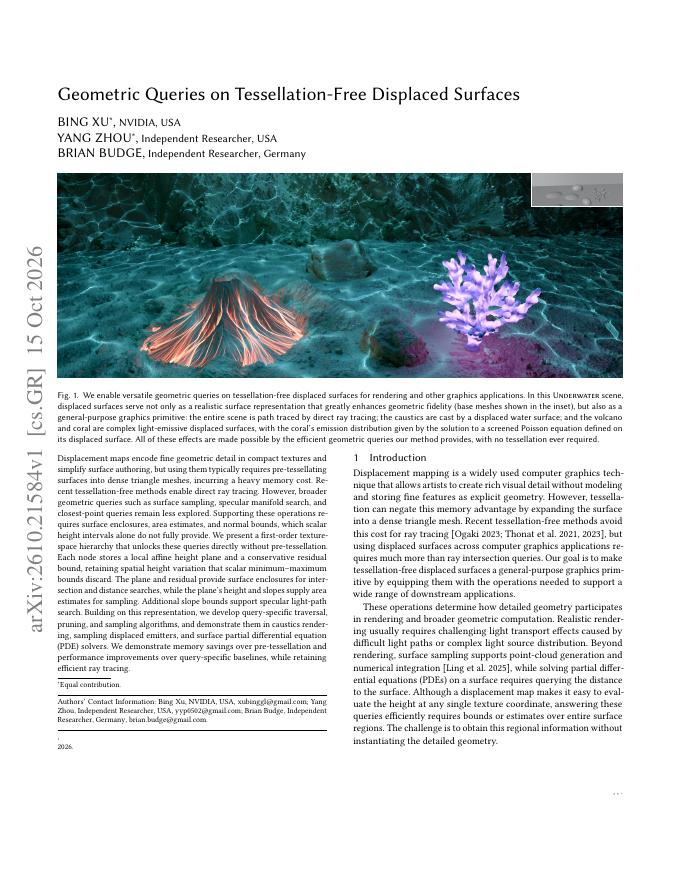
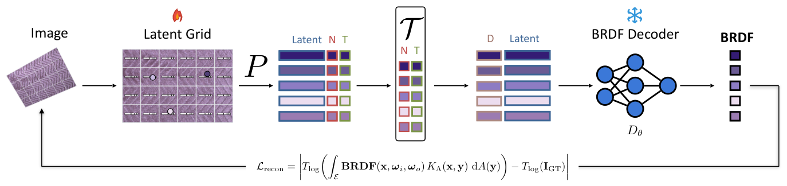

# 2026-10-17 科研日报

## 今日速览

周五这批 cs.GR 里，和逆渲染主线最贴近的两篇恰好分别落在“几何查询”和“材质先验”两端：一篇把位移贴图从“只能被光线求交”的细节纹理，升级成能做采样、焦散路径搜索和最近点查询的通用几何图元；另一篇用双机械臂系统采了 500 种真实布料，证明真实、覆盖充分的观测能学出比现有测量数据集更好的神经材质先验。

- **必读：[Displaced Surface Queries](#2026-10-17--displaced-surface-queries)。** 每个纹理层次节点存一个仿射高度平面加保守残差，而不只是最小/最大高度区间；这一点点“一阶信息”就同时给出包围、面积估计和法线界。228 组网格–位移贴图上，光线求交平均比 NRT 快 3.404 倍，几何与加速结构几何平均 10.3 MB，而预细分估计约 544 MB。它还在位移曲面上解 screened Poisson 方程，和蒙特卡洛 PDE 的最近点查询直接相关。
- **对照阅读：[RoboCloth](#2026-10-17--robocloth)。** 两条机械臂分别拿 HDR 相机与标定面光源，每种布料约 580 帧，覆盖视角–光照半球；在共享解码器上学到的布料先验，迁移到独立的 UBO2014 基准时比解析 PBR 拟合平均高 3.7 dB。价值在“数据覆盖决定先验质量”的证据，局限是只针对近平面织物。
- **同日其他值得一扫：** 草图驱动的可重光照服装重建、复用整体 3D 先验的部件分解生成（与 3D 生成轻度兴趣相关），见文末简列。

## 几何与光传输：让位移曲面回答不止“光线打到哪”

### Displaced Surface Queries · arXiv · 2026-10-15

**一句话判断：** 这是一篇把“免细分位移曲面”推向通用图元的系统工作：核心贡献不是更快的求交本身，而是证明一个带残差的局部平面层次，足以支撑采样、镜面路径搜索与距离查询这些以前必须先细分成三角网格才能做的操作。

**Title：** Geometric Queries on Tessellation-Free Displaced Surfaces  
**作者：** Bing Xu、Yang Zhou（共同一作）、Brian Budge  
**单位：** NVIDIA（Bing Xu）；Independent Researcher（Yang Zhou、Brian Budge）  
**发表时间 / 投稿信息：** arXiv v1 于 2026-10-15 挂出；Comments 未标注会议或期刊，投稿信息未标明。  
**链接：** [摘要](https://arxiv.org/abs/2610.21584) · [PDF](https://arxiv.org/pdf/2610.21584)（发稿时暂无 HTML 全文）

**摘要中译（压缩转述）：** 位移贴图用紧凑纹理编码精细几何，但通常要预先细分成稠密三角网格，内存代价很高。近年的免细分方法已能直接光追，但表面采样、镜面流形搜索和最近点查询仍缺乏支持——这些操作需要曲面包围、面积估计与法线界，单纯的标量高度区间给不全。作者提出一阶纹理空间层次：每个节点存局部仿射高度平面与保守残差界，保留了最小–最大界丢弃的空间变化信息。平面加残差给出求交与距离搜索所需的包围；平面高度与斜率给出采样所需的面积估计；额外的斜率界支持镜面光路搜索。在此基础上设计了各查询专用的遍历、剪枝与采样算法，并在焦散渲染、位移发光体采样和曲面 PDE 求解中演示。

*原论文 PDF 首页渲染，[来源](https://arxiv.org/pdf/2610.21584)。Fig. 1 中整个场景直接光追、水面位移曲面投射焦散、火山与珊瑚是位移发光体，珊瑚的发光分布来自定义在其位移曲面上的 screened Poisson 方程解；全程没有细分。*

**方法概要。**

1. **从“区间”到“一阶”高度模型。** 以往 TFDM/RMIP 一类方法在纹理层次每个节点只存 \([h_{\min},h_{\max}]\)，只知道高度范围，不知道高度随位置怎么变。本文在每个区域用仿射平面 \(\hat H(u,v)=h_c+g_u(u-u_c)+g_v(v-v_c)\) 近似高度，再存残差 \(r\) 保守包住真实高度。这个层次按位移贴图建一次，所有用同一贴图的三角形共享。
2. **一个表示，四种查询。** 求交时把纹理空间里的非线性光线用分段直线近似，换成廉价的网格步进与“高度带”测试；镜面路径搜索用高度与斜率的一阶界剪掉不可能满足镜面约束的区域，并为局部约束求解器提供初值；表面采样用平面高度和斜率估计每个区域的面积，做层次采样（发光体采样另有加权）；最近点查询推导世界空间距离下界，引导搜索并细化到给定容差。
3. **存储裁剪。** 存储的求交层次止于 4×4 texel 块，省掉最细两级，块内仍做逐 texel 测试。

**结果与成本（作者报告，RTX 6000 Ada）。** 九个画廊场景中，与 NRT 对照的命中位置、法线和图像差异检查均通过，LPIPS 最大 0.004；PDM 的默认步长设置在四个场景更快，但细结构处有可见伪影。在更广的 228 组网格–位移贴图上，平均比 NRT 快 3.404 倍；几何与加速数据几何平均 10.3 MB，NRT/TFDM 保留完整最小–最大金字塔需 32.3 MB，PDM 不建纹理层次只要 4.8 MB；按每 texel 一个微四边形预细分估计需约 544 MB（含 BVH），约为本文的 53 倍。注意作者明确说各方法曲面重建方式不同，速度比较不等于等精度比较。

**值得关注 / 阅读指引。** 对正向渲染效率这条线，它展示的是“给几何层次多存一点导数信息，换来多种查询共用加速结构”的思路——这和给高斯或辐射缓存层次附加梯度/方差界、以便同时做求交和重要性采样的想法同构。对蒙特卡洛 PDE 背景尤其值得看最近点查询那节：Walk on Spheres 依赖到边界的距离，本文给出了不展开几何就能保守估计距离的做法，正好接上 10-15 收录的 Walk-on-Ambient-Patch 讨论的“表示服务于随机求解器”。建议顺序：Fig. 2 → §4 一阶层次构造 → 最近点查询与镜面搜索两节 → Table 1 与内存段。局限在于分段直线近似依赖光线在纹理空间里偏离不大，作者把填充与边界计算放进了补充材料。

## 材质先验：真实布料的大规模、全半球观测

### RoboCloth · arXiv · 2026-10-15

**一句话判断：** 这篇的方法本身是标准的“共享解码器 + 每材质潜纹理”两阶段神经 BRDF，但它给出了一个很干净的证据：在同一训练流程下，只换训练数据来源，真实且视角–光照覆盖充分的数据学出的先验明显更好、也更能迁移到别的采集系统。

**Title：** RoboCloth: A Large-Scale Real Cloth Material Dataset for Neural Reflectance Reconstruction  
**作者：** Zhen Li、Haoran Qin、Francesco Di Sario、Daniel Rebain、Andrea Tagliasacchi  
**单位：** 论文 HTML 未列出作者单位；代码与数据托管于 GitHub / Hugging Face 组织 theialab。  
**发表时间 / 投稿信息：** arXiv v1 于 2026-10-15 挂出；Comments 仅注明项目页、代码、数据集与「16 页含补充材料」，投稿信息未标明。  
**链接：** [摘要](https://arxiv.org/abs/2610.21090) · [HTML 全文](https://arxiv.org/html/2610.21090v1) · [项目页](https://theialab.github.io/robocloth/) · [代码](https://github.com/theialab/robocloth) · [数据集](https://huggingface.co/datasets/theialab/RoboCloth)

**摘要中译（压缩转述）：** RoboCloth 包含 500 种真实布料，采集时相机与光源都由机器人控制、构型灵活且经过标定。每种材料约 580 帧 HDR 图像，覆盖宽广的视角–光照半球；相机位姿经运动恢复结构优化并对齐到机器人坐标系，得到每种材料的稀疏表面几何和逐点结构化反射观测，可直接用于神经材质训练。作者用两阶段神经重建展示数据价值：第一阶段在整个语料上训练共享 MLP 解码器以学习布料材质先验；第二阶段冻结解码器，为每个目标材料拟合 2048×2048 的稠密潜纹理。在自有留出材料和独立的 UBO2014 基准上，用该数据训练的解码器优于用现有测量反射数据集训练的解码器和解析 PBR 拟合，且无需修改即可迁移到未见过的采集系统。数据、标定文件、观测张量与划分以 CC BY 4.0 发布在 Hugging Face。

*原论文 Figure 3，[来源](https://arxiv.org/html/2610.21090v1)。火焰标记为优化量（每材质稠密潜纹理），雪花标记为冻结的共享解码器；第一阶段（Figure 2）则联合优化解码器与逐点潜码、法线、切线。*

**方法概要。**

1. **采集系统。** 两条机械臂一条拿 HDR 相机、一条拿标定 LED 面光源，加电动转台；视角与光照方向可在两个半球上自由采样，而不是被固定的硬件阵列锁死。手眼标定与转台轴标定把 SfM 位姿对齐到机器人坐标系。
2. **第一阶段：学先验。** 共享 BRDF 解码器与逐点潜码表、法线、切线联合优化（auto-decoder）；法线与切线经 Gram–Schmidt 正交化成局部 TBN 坐标系，方向在局部坐标中编码后送入解码器。
3. **第二阶段：重建单一材质。** 冻结解码器，为目标材料拟合 2048×2048 的潜几何纹理；视差感知查找用一个小网络依据入射/出射方向修正纹理坐标，模拟织物的细微起伏。

**结果与成本（作者报告）。** UBO2014 上随机抽 12 种材料，RoboCloth 训练的解码器在全部 12 种上 PSNR 最高，平均领先解析 PBR 拟合 3.7 dB、领先 Bonn（UBOFAB19）训练的解码器 4.5 dB，且第一阶段从未见过 UBO2014 样本。高分辨率稠密潜纹理拟合最长要在 RTX 6000 Ada 上训练约一天，因此评测只抽了少量材料（UBO2014 12 种、自有测试集 5 种、Bonn 测试集 5 种）。局限：只针对近平面织物，不推广到三维物体或非织物材质；每种材料约 20 分钟，需人工换样。

**值得关注 / 阅读指引。** 对逆渲染真实感这条线，它是“材质先验从哪里来”的一个可量化答案：同一解码器和损失，只换数据，跨系统迁移就能拉开数 dB，说明真实感瓶颈很多时候在观测覆盖而不在网络结构。掠射角监督的消融（Figure 4 的 BRDF 极坐标图）值得细看——掠射角正是高斯逆渲染里最容易被欠约束的区域。和具身方向的交叉在于用机械臂做可编程采集，但这里只作材质数据工具看。建议顺序：Figure 1 采集系统 → Figure 2/3 两阶段 → Table 2 UBO2014 迁移 → 掠射角消融与局限。

## 同日其他值得一扫

- [From Sketch to Scene: Relightable Garment Reconstruction from Marked Sketches](https://arxiv.org/abs/2610.21865)：从带标记的草图重建可重光照服装，和今天 RoboCloth 的布料材质可对照阅读，本期未展开。
- [Seeing Both the Forest and the Trees: Reusing Holistic 3D Priors for Part-Decomposed Generation](https://arxiv.org/abs/2610.21850)：复用整体 3D 生成先验做部件分解生成，和可拆分/可编辑资产、3D 生成轻度兴趣相关，本期未展开。

## 覆盖说明

日报发布日为 **2026-10-17（周六）**。内容覆盖 arXiv cs.GR **2026-10-16（周五）** 新列表中与兴趣加权对齐的两篇：Displaced Surface Queries（2610.21584，读 PDF 正文与实验段）与 RoboCloth（2610.21090，读 HTML 方法、实验与局限）。配图为原 PDF 首页渲染与原 HTML Figure 3。所有数字均为作者报告，未独立复现。本期未单独检索圈内媒体动态，同日列表中的两篇只作入口简列。

**编写：** Cream

**故障说明：** 本日由 Cream 于 06:18 HKT 故障转移接管发布。先前顺位未在窗口内成功出稿：Neon（05:30–06:20）既无当日 digest，也无认领记录。依据 `meta/failover.json` 当日 `failover`／`claim` 事件。受接管窗口时长所限，本期篇幅比常规版精简。
