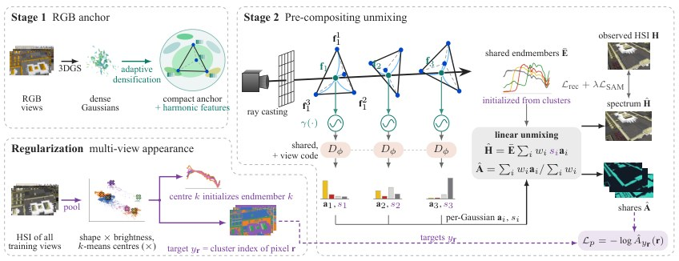
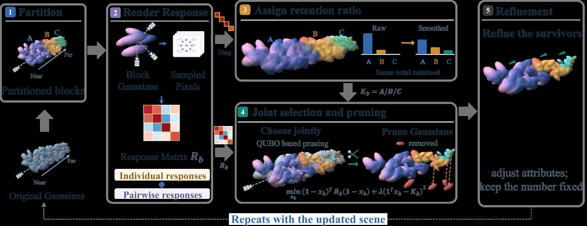

# 2026-10-18 科研日报

## 今日速览

周末 arXiv 没有新公告，本期从本周 cs.GR 列表里补录两篇此前未收录、和逆渲染与正向效率两条线都能对上的论文：一篇把“材质是什么”这个问题放进高斯渲染内部，在每个光线交点上先解混再合成；另一篇把 3DGS 剪枝从“按单个高斯打分取 Top‑K”改成“分区配额 + 联合删除效应”的组合优化。

- **必读：[Spectral World Renderer](#2026-10-18--spectral-world-renderer)。** 几何用 RGB 训好的 3DGS 锚定并冻结，每个高斯只带与波段数无关的特征；共享解码器在每个交点把特征解成场景级端元（材料光谱）上的丰度，再用同一组可见性权重同时渲染光谱和材料图。更值得看的是它的评测思路：由代码智能体生成可执行 3D 场景、用实测光谱渲染，因此每张高光谱图都有精确到亚像素的材料组成真值。
- **对照阅读：[SplatQ](#2026-10-18--splatq)。** 用不透明度扰动下代表像素颜色的响应，构造“单删 + 成对删”的二次近似，把块内保留哪些高斯写成 QUBO（二次无约束二值优化）。在 90% 剪枝下，5 个基准的宏平均 PSNR 为 28.43 dB，高于最强基线 MesonGS 的 28.20 dB（未剪枝 3DGS 为 28.79 dB）。价值在“删除是联合效应”这个建模，而不在量子硬件求解器本身。
- **本周其他值得一扫：** 交互式 Real2Sim 机器人仿真工具、带连续 LoD 的大视图合成模型场景表示，见文末简列。

## 材料先验：在交点处解混，而不是合成之后

### Spectral World Renderer · arXiv · 2026-10-14

**一句话判断：** 方法层面是“冻结几何 + 每高斯特征 + 共享解码器”的熟悉组合，真正新的是两件事：把解混放到合成之前，避免已混合光谱再被拆；以及用可执行世界生成带精确材料组成的多视角数据，让“材料分解对不对”第一次可以直接核验。

**Title：** Spectral World Renderer: Unified 3D Hyperspectral Unmixing  
**作者：** Chia-Ming Lee、Yu-Jou Hsiao、Ming-Ching Chang、Xin Li、Yu-Lun Liu、Chih-Chung Hsu  
**单位：** 论文 HTML 列出 University at Albany, State University of New York；National Yang Ming Chiao Tung University；National Cheng Kung University（逐人对应以原文为准）  
**发表时间 / 投稿信息：** arXiv v1 于 2026-10-14 挂出；Comments 仅列项目页、代码与数据集，投稿信息未标明。  
**链接：** [摘要](https://arxiv.org/abs/2610.19520) · [HTML 全文](https://arxiv.org/html/2610.19520v1) · [项目页](https://ming053l.github.io/Spectral-World-Renderer/) · [代码](https://github.com/ming053l/Spectral-World-Renderer) · [SWR-Bench 数据集](https://huggingface.co/datasets/ming0531/SWR-Bench)

**摘要中译（压缩转述）：** 相机和基于相机的基础模型能认出场景里有什么，却认不出东西是什么做的：同色表面可能是不同材料。高光谱解混把每条光谱解释为若干材料特征光谱（端元）的混合，但在三维里，它要么在多视角合成后的图像上做，要么绑定缓慢的隐式场，而且没有已知组成的多视角数据可供检验。作者提出 Spectral World Renderer（SWR），把世界生成与解混统一起来：代码智能体搭建可执行的 3D 世界，并用实测光谱渲染，因此每张高光谱图都附带精确标签与亚像素比例；由此得到含八个室内外世界的 SWR-Bench。SWR 在渲染内部解混：紧凑 3D 表示中的每个高斯在合成前被解码成材料丰度，一次渲染同时得到光谱与材料图，任意表面都可按材料名、点击像素或参考光谱查询。不用材料标签时，SWR 在全部八个世界中材料识别最好，在真实采集上平均 PSNR 最高，训练比解混基线快 3.7–12.9 倍，每秒渲染 34.9 张带标签视图，并能分开同色材料。

*原论文 Figure 4，[来源](https://arxiv.org/html/2610.19520v1)。同一组可见性权重同时累积光谱与丰度；多视角外观聚类用于初始化端元并约束其分配。*

**方法概要。**

1. **几何与光谱分开学。** 先在配准的 RGB 图上训练 3DGS 作为几何锚（用 FastGS 的致密化与剪枝），丢掉颜色后冻结几何。高光谱观测噪声大、随光照变化，作者认为直接用它来学几何会把几何也拖坏。
2. **每个高斯存特征而非光谱。** 每个高斯带一个神经谐波纹理：四个 12 维顶点特征，光线在高斯内最大响应点处按四面体重心坐标插值，因此同一个高斯内部也能有变化。每个高斯固定 11 个几何值加 48 个特征值，存储不随波段数 \(L\) 增长。
3. **合成前解码。** 交点特征经正弦编码，与 2 阶球谐方向码一起送入共享 MLP，输出 \(K\) 个丰度（softmax）和一个强度（softplus），去混合场景级端元字典 \(\bar{\mathbf E}\in\mathbb R^{L\times K}\)。之后才做 alpha 合成，所以一次渲染同时给出光谱和材料图。
4. **多视角外观正则。** 用多视角外观聚类初始化端元并约束分配，专门处理“亮度差很多但光谱形状接近”的材料（原文例：白色大理石比灰色砖石亮约四倍，光谱形状只差约 3.8°）。

**结果与成本（作者报告）。** 在 City 世界上，SWR 训练 6 分 37 秒，UnMix-NeRF 约 24 分钟，3DGS 渲染后再做 VCA/NNLS 解混约 85 分钟；在 960×540×64 波段下渲染平均 34.9 FPS，两者分别为 0.18 与 3.6 FPS。真实采集（NeSpoF、HS-NeRF 等）上 PSNR 均为最好。局限由作者自述：光传输与传感器模型较简化，附录中“用真值端元做 NNLS”的参考指标在室内世界与 NVIDIA HQ 上未定义，因为固定字典表示不了这些场景的光传输；稀有材料仍难分配（如 Study 场景中的墨迹），更丰富的光传输与传感器模型、稀有材料端元分配和动态场景留待后续。

**值得关注 / 阅读指引。** 对逆渲染真实感这条线，最有用的是“先冻结几何、再在交点处解码材质”的结构，以及它对“解码在合成前还是合成后”的消融：在 Market 上改成合成后解码，PSNR 从 33.72 升到 34.37 dB，材料 mIoU 却从 0.47 掉到 0.37——光线平均后的特征把不同表面混在一起，图像更像了，分解反而更错。这正是高斯逆渲染里材质被混叠的根源之一，也提醒只看渲染 PSNR 评价材质分解是不够的。第二个值得借鉴的是 SWR-Bench 的造数据方式：用可执行场景加实测光谱，给材料分解提供可核验真值；同样的思路可以搬到 RGB 下的 BRDF/反照率分解评测。需要保留的判断：它解的是光谱端元丰度，不是完整 BRDF，直接迁移到 PBR 材质分解时还需要另行处理着色与光照。建议顺序：Figure 4 → §3.2 合成前解码 → Figure 5 外观聚类 → §4.2 消融（含 Table S7）→ Table 4/5 效率与真实采集 → 附录 D 解码器分析。

## 正向效率：剪枝是联合删除，不是逐个打分

### SplatQ · arXiv · 2026-10-09

**一句话判断：** 这篇点出了一个常被忽略的事实：一起删掉的两个高斯，对图像的影响不等于各删一个之和；作者用不透明度响应构造二次近似，把这一点做成了可解的组合优化，同时用分区配额防止预算全被前景吃掉。

**Title：** SplatQ: Interaction-Aware Pruning of 3D Gaussian Splatting via Quadratic Selection  
**作者：** Hongbin Ye、Haixu Liu、Shenwei Kang、Wenxiu Wei、Tinglan Wang、Hongdong Zhu、Fan Tang、Qi Gao、Yin Ma、Kai Wen、Hai Wei、Nuo Qian、Wei-Shi Zheng、Shaobo Chen、Fa-Ting Hong、Jingke Meng  
**单位：** 论文 HTML 未列出作者单位。  
**发表时间 / 投稿信息：** arXiv v1 于 2026-10-09 挂出；Comments 自述「Under review at ICLR 2027」，即在投，尚未录用。  
**链接：** [摘要](https://arxiv.org/abs/2610.13503) · [HTML 全文](https://arxiv.org/html/2610.13503v1) · [PDF](https://arxiv.org/pdf/2610.13503)

**摘要中译（压缩转述）：** 现有 3DGS 剪枝方法主要基于各自独立的重要性分数做全局 Top‑K 选择，既缺乏区域预算控制，也忽略联合删除效应，因此无法保证场景各处重建质量均衡。作者提出组合式剪枝算法 SplatQ，在固定预算下协调区域预算分配与高斯联合选择：按空间邻近与外观相似把高斯划分为大小受限的块，把全局选择拆成固定规模的子问题；再平滑基于重要性的块保留配额，防止预算过度集中；最后用代表像素颜色对高斯不透明度变化的响应，构造联合删除效应的二次近似。单体响应、成对交互与配额惩罚一起写成 QUBO 目标，用模拟退火或相干伊辛机求解。在 5 个基准上，SplatQ 的总体重建质量、空间质量均衡和渲染速度均优于现有剪枝方法；消融表明预算平滑改善局部细节，交互建模提升固定预算下的选择质量。

*原论文 Figure 2，[来源](https://arxiv.org/html/2610.13503v1)。*

**方法概要。**

1. **相似性分块。** 从预训练 3DGS 出发，按空间邻近和外观相似把高斯分成至多 512 个一组的块，全局“保留 K 个”拆成若干块内子问题。
2. **不透明度响应矩阵。** 给每个高斯一个 \([0,1]\) 的不透明度乘子，在所有训练视角的降采样图上，对每块最多采 256 个代表像素，线性化颜色对这些乘子的响应，得到块响应矩阵 \(R_b\)。对角项衡量单删代价，非对角项衡量成对删除的交互。
3. **平滑配额。** 用 \(R_b\) 的对角分数决定各块保留数 \(K_b\)（满足 \(\sum_b K_b=K\)），并做平滑，避免预算集中到少数高重要性区域，导致远景或细结构整片丢失。
4. **块内二次选择与微调。** 单体项、成对项与配额惩罚写成 QUBO，用模拟退火（默认）或相干伊辛机求解，之后只微调保留高斯的属性，不再改变数量。

**结果与成本（作者报告）。** 27 个场景、5 个基准（Mip-NeRF 360、Deep Blending、Tanks and Temples、NeRF Synthetic、Ref-NeRF/Shiny Blender），所有方法都从同一个 30k 迭代的 3DGS 出发，两轮剪枝加微调，最终删除 90%。按消融表（Table 2）的五数据集宏平均：全局 Top‑K 为 28.0 dB，SplatQ（模拟退火）28.43 dB，相干伊辛机变体 28.49 dB；Table 1 中最强基线 MesonGS 为 28.20 dB，未剪枝 3DGS 为 28.79 dB。不使用原始训练照片（只用预训练模型自渲染图微调）时，SplatQ 宏平均 28.25 dB，仍比 MesonGS 高 0.238 dB；五个数据集上渲染 FPS 都是剪枝方法里最高。另提出把测试图分成 16×16 块、看块 PSNR 方差与极差的“空间质量均衡”指标。作者自述含远景区域的数据集上仍有改进空间。

**值得关注 / 阅读指引。** 对正向效率这条线，可借鉴的是“删除代价的二阶交互”：在高斯逆渲染或可编辑资产里，删掉一组重叠高斯后常出现空洞或透出背景，单体重要性正好看不到这种效应；把响应矩阵改成对材质/法线缓冲而不只是 RGB 的响应，就能做“保物理属性”的剪枝。分区配额对场景级重建也有意义：精简后远景与细结构不至于被一刀切。相干伊辛机部分只当求解器后端的可行性演示即可，不是重点。建议顺序：Figure 1 质量不均问题 → §3.2 响应矩阵推导（附录 A.3、A.5）→ Table 2 组件消融 → Figure 3 高斯体积分布与 FPS 的关系。

## 本周其他值得一扫

- [RoboSimStudio: An Interactive Toolkit for Human and Agent Rapid Real2Sim of Robot Manipulation Tasks](https://arxiv.org/abs/2610.18835)：基于开源 Newton 物理引擎，让人和编码智能体按观测到的物理行为显式调整求解器、接触模型与参数，做 Real2Sim2Real；与具身次要方向相关，本期未展开。
- [GLoD-LVSM: Learning Geometry-Grounded Continuous-LoD Scene Representations for Large View Synthesis Models](https://arxiv.org/abs/2610.20254)：为大视图合成模型学连续 LoD 的几何锚定场景 token，作者报告无损时 token 减少 33.4%、渲染快 1.23 倍；与前馈重建的效率问题相关，本期未展开。

## 覆盖说明

日报发布日为 **2026-10-18（周日）**。周六、周日 arXiv 无新公告，本期从本周 cs.GR 列表中补录两篇此前未收录的论文：Spectral World Renderer（2610.19520）与 SplatQ（2610.13503），均核对了 arXiv HTML 全文的方法、实验与局限。配图为两篇原论文的方法总览图。所有数字均为作者报告，未独立复现。本期未单独检索圈内媒体动态，文末两篇只作入口简列。

**编写：** Cream

**故障说明：** 本日由 Cream 于 06:18 HKT 故障转移接管发布。先前顺位未在窗口内成功出稿：Neon（05:30–06:20）既无当日 digest，也无认领记录。依据 `meta/failover.json` 当日 `failover`／`claim` 事件。受接管窗口时长所限，本期篇幅比常规版精简。
