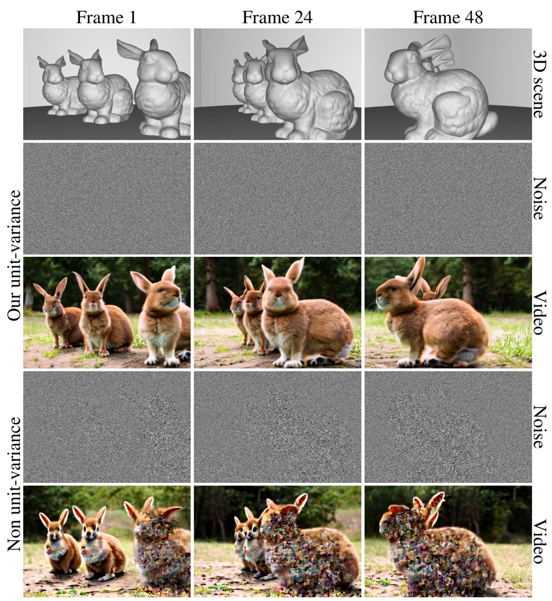
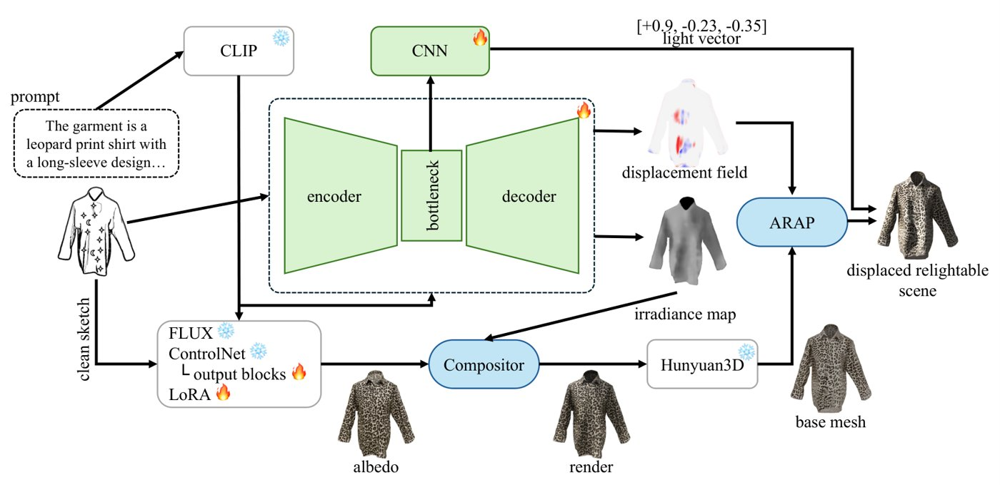

# 2026-10-19 科研日报

## 今日速览

周一早上 arXiv 还没有新公告，本期继续从过去一周的 cs.GR 列表里补录两篇此前未收录的论文。两篇都和“光照/着色不该被烤进纹理或噪声里”有关，只是一篇在生成端，一篇在采样端。

- **必读：[Tabula Rasa](#2026-10-19--tabula-rasa)（SIGGRAPH Asia 2026）。** 把“生成随时间相关、但每帧仍是单位方差的高斯噪声”写成一次蒙特卡洛像素重建：像素是噪声场上若干子区域的凸组合，方差等于各子区域面积的平方和，作者借数据库里的 sketching（基数估计）在不知道子区域个数和形状的情况下把它估出来，再做方差校正。因为相关性来自 3D 光传输而不是 2D 光流，遮挡、反射和折射都能保持一致；实现可以在光栅器里跑、并对时间并行。对熟悉蒙特卡洛估计的人来说，这是少见的“估计器设计直接服务生成模型”的例子。
- **对照阅读：[From Sketch to Scene](#2026-10-19--sketch-to-scene)。** 设计师在服装草图上画星（高光）和月（阴影），系统预测一束显式方向光，再用位移场把“月”标记处的布面真的折进阴影里，而不是把阴影涂成深色纹理。思路上是把着色从反照率里拆出来、交给几何与光照去解释，和逆渲染里“烘焙阴影污染材质”的问题是同一件事的生成版。
- **本周其他值得一扫：** 分离深度与外观的扩散世界模型、GPU 可微 IPC 接触动力学，见文末简列。

## 采样端：让噪声跟着光传输走，又不丢方差

### Tabula Rasa · SIGGRAPH Asia 2026 · 2026-10-08

**一句话判断：** 方法的最终形式很简单——渲染噪声时数清每个像素用到了多少个独立随机变量，再按平方根和除法重新缩放方差；难点和贡献在于证明并高效估计这个量。它把视频扩散的“噪声扭曲”问题从 2D 光流搬到了 3D 光传输。

**Title：** Tabula Rasa: Monte Carlo estimation of unit-variance noise with controlled spatio-temporal correlation  
**作者：** Tobias Ritschel、Yang Zhou、Nick Milef、Mikhail Dereviannykh、Chen Liu、Christophe Hery、Carl Marshall  
**单位：** 论文 HTML 未能逐人解析出单位；代码托管在 facebookresearch 组织下。  
**发表时间 / 投稿信息：** arXiv v1 于 2026-10-08 挂出；Comments 写明 SIGGRAPH Asia 2026 Conference Papers。  
**链接：** [摘要](https://arxiv.org/abs/2610.11653) · [HTML 全文](https://arxiv.org/html/2610.11653v1) · [代码](https://github.com/facebookresearch/Tabula-Rasa)

**摘要中译：** 我们提出一种方法，生成方差受控、时间相关性受控的时变高斯噪声，用于多种需要时间控制和时间一致性的下游任务。核心技术思想是把这个问题表述为对两件事的联合蒙特卡洛估计：经典的像素重建，以及借用数据库文献中“sketching”概念的方差估计。我们展示该方法能以比既有方法更简单、更快的代码实现下游任务的时间控制。

*原论文 Figure 1，[来源](https://arxiv.org/html/2610.11653v1)。保持噪声图案的时间相关性是控制视频生成的关键，而保持单位方差是生成质量的前提。*

**方法概要。**

1. **像素即随机变量。** 每帧的每个像素被看作对一个随机噪声场在像素足迹上的积分，就像路径追踪重建像素，只是被积函数是噪声；换随机种子就得到新的实现。若噪声场定义在 3D 世界里，同一表面点在不同帧、不同像素上自然取同一个值，遮挡后再出现也不会“记错”。
2. **方差为什么会掉。** 假设噪声场是分片常数，像素足迹被划分成若干子区域，每块对应一个独立的单位方差变量；像素值是它们按面积加权的凸组合，方差等于面积平方和，因此一般小于 1。子区域的形状和个数取决于几何、遮挡、透视乃至反射折射，事先无法知道。
3. **用 sketching 估面积平方和。** 作者借 Flajolet–Martin 一类基数/唯一计数估计器的思路，在像素采样时对“碰到了哪些随机变量”做紧凑统计，从而在不枚举子区域的前提下估出方差，再用平方根与除法把像素拉回单位方差。论文还讨论了预滤波、截断与三线性插值等工程问题。
4. **实现。** 有 JAX 实现和带硬件光栅器的 WebGPU 实现；作者强调它对时间并行、可随机访问任意帧，而既有的噪声扭曲方法多需按帧顺序递推。

**结果（作者报告）。** 在既有噪声扭曲基准上，前四项指标与原方法相当，PSNR 与 WRP-E 略有领先，3D WRP-E 上全局时间一致性提升明显；LPIPS 与 SSIM 上两者都没有明显优于平凡基线。应用包括基于 Go-with-the-Flow 的视频生成控制、风格化着色、动画纹理合成、隐写和跨视角相关。一个有意思的实验是“光传输一致性”：分别用漫反射、镜面、玻璃场景诱导噪声相关性，并配上对应文字提示，匹配的组合（对角线）结果最好。作者自述该方法有偏，来源是估计器的非线性变换和有限直方图；无偏版本留待后续。

**值得关注 / 阅读指引。** 对正向效率与蒙特卡洛这条线，它提供了一个可复用的视角：随机数本身也可以被当成需要“重建”的信号，其统计量（这里是方差）可以和像素值一起估计。对高斯渲染和扩散先验结合的工作，它给出了一种在 3D 中定义、与可见性一致的噪声，可用于多视角或时序一致的生成式补全与重照明。需要保留的判断：它保证的是单位方差和来自几何的相关性，空间谱特性目前只针对白噪声（作者把蓝噪声等列为未来方向）；有偏性对下游扩散模型的影响主要靠实验说明。建议顺序：Figure 2 子区域示意 → §3.2 方差推导 → §3.3 预滤波 → Figure 4 性能 → §5.1 光传输一致性实验 → 结论中的偏差讨论。

## 生成端：阴影交给几何和光，不交给纹理

### From Sketch to Scene · arXiv · 2026-10-15

**一句话判断：** 交互设计上很巧——只用星和月两种符号表达光影意图；技术上的看点是让网络同时预测辐照度、光方向和褶皱场，再用位移把阴影“做”出来，使结果能重照明。系统大量拼装现成模型，单篇创新集中在“标记—光—几何”这一段。

**Title：** From Sketch to Scene: Relightable Garment Reconstruction from Marked Sketches  
**作者：** Ahmet Neçirvan Doğan、Eren Acar Başaran、Metin Sezgin、Zahra Montazeri（前两位共同一作）  
**单位：** 论文 HTML 未能解析出作者单位。  
**发表时间 / 投稿信息：** arXiv v1 于 2026-10-15 挂出；Comments 仅注明 11 页、5 图与共同一作，投稿信息未标明。  
**链接：** [摘要](https://arxiv.org/abs/2610.21865) · [HTML 全文](https://arxiv.org/html/2610.21865v1)

**摘要中译：** 草图是人们表达视觉想法最自然的方式之一。与当今多数生成系统依赖的文本提示不同，草图直接表达空间结构与意图，包括设计者希望高光和阴影出现在哪里。但现有草图转 3D 流程没有表达这种意图的输入：它们把画出的明暗当成深色颜料烘焙进纹理，光也无法移动。我们提出一个系统，把带稀疏标注（星表示高光、月表示阴影）的服装粗草图和一段描述纹理的短文本，转换为带显式方向光的带纹理 3D 网格，即一个生成后仍可重照明、可编辑的场景。这两个符号是对美术学生做的意向调查中最常被提出的方案。系统从带标记的草图预测场景的方向光，并另行预测一个位移场，使表面弯折，让月标记区域在该光照下落入阴影，而不是在纹理里涂暗。

*原论文 Figure 2，[来源](https://arxiv.org/html/2610.21865v1)。*

**方法概要。**

1. **辐照度与光方向。** U-Net 只以标记草图为图像输入，经冻结 CLIP 文本编码器做交叉注意力条件；输出一张辐照度图，训练目标是把训练场景中的服装改成白色哑光后重渲染得到的“只含到达光照（含阴影）”的图。一个小型光 CNN 读 U-Net 瓶颈，回归方向光单位向量。
2. **褶皱场。** 同一网络再输出一个带符号的场，描述哪里应该起褶。
3. **反照率与网格。** FLUX ControlNet 从干净草图和文本画出反照率；反照率与辐照度合成后交给 Hunyuan3D-2.1 重建网格。
4. **位移做阴影。** 预测的褶皱场与按预测光方向放置的“脊”组合成位移场施加到网格上，使月标记处在该光下真正背光；最终导出网格与光源，可后续重照明与编辑。

**评测与局限（作者报告）。** 在 DeepFashion3D 上按服装划分训练/验证/测试，用 Mitsuba 3 在面向相机的随机方向光下渲染，每次渲染各自生成星、月标记（星放在真值辐照度最亮处，月放在参考服装褶皱最深处）。作者评估了光方向误差（对比在训练集上拟合的最佳固定方向）以及月标记被位移压暗的比例。局限由作者自述：褶皱场在 DeepFashion3D 服装上学得，却施加到 Hunyuan3D 的重建上，两者轮廓相同但表面不同；向内位移受壳体厚度限制；每个标记旁的“脊”的大小和距离靠规则设定而非预测；部分渲染有小团块状畸变或内外壁穿插（论文图中排除了这些渲染，但统计中保留）；只假设单一方向光，不含彩色或面光源、半透明和互反射。

**值得关注 / 阅读指引。** 对逆渲染真实感这条线，它是一个“反方向”的提醒：当输入（草图、照片）里的明暗被当作颜色解释时，材质就会被污染；把明暗交给几何与显式光源去解释，才能得到可重照明的资产。辐照度目标的构造方法（同场景白色哑光重渲染）也可直接用于高斯逆渲染里光照/反照率分离的监督数据制作。它的单一方向光、无互反射假设较强，离真实场景还远。建议顺序：Figure 2 → §4.2 辐照度与光方向 → Figure 4 位移效果 → §5.1 评测设置 → Limitations。

## 本周其他值得一扫

- [Decoupling Appearance and Geometry in Diffusion World Models](https://arxiv.org/abs/2610.20625)：两阶段扩散世界模型，先用动作条件扩散 Transformer 预测下一时刻深度，再以该深度为条件、无需动作标签地生成 RGB，作者论证这一错位设计近似联合 RGBD 扩散；实验在 CS:GO Dust 2 数据集。与具身次要方向的世界模型相关，本期未展开。
- [DiffGIPC: Differentiable Mixed-Coordinate Contact Dynamics on GPU](https://arxiv.org/abs/2610.19091)：GPU 上的可微 IPC，把近刚体用仿射体（每体 12 个运动自由度）表示、与 FEM 变形体在每帧一个耦合伴随系统里求梯度，用于静止形状设计、初始状态优化与关节控制。与可微仿真和 Real2Sim 相关，本期未展开。

## 覆盖说明

日报发布日为 **2026-10-19（周一）**。发布时 arXiv 本周首个公告尚未发出，本期从过去一周 cs.GR 列表中补录两篇此前未收录的论文：Tabula Rasa（2610.11653）与 From Sketch to Scene（2610.21865），均核对了 arXiv HTML 全文的方法、实验与局限。配图为两篇原论文插图。所有结果均为作者报告，未独立复现。本期未单独检索圈内媒体动态，文末两篇只作入口简列。

**编写：** Cream

**故障说明：** 本日由 Cream 于 06:18 HKT 故障转移接管发布。先前顺位未在窗口内成功出稿：Neon（05:30–06:20）既无当日 digest，也无认领记录。依据 `meta/failover.json` 当日 `failover`／`claim` 事件。受接管窗口时长所限，本期篇幅比常规版精简。
