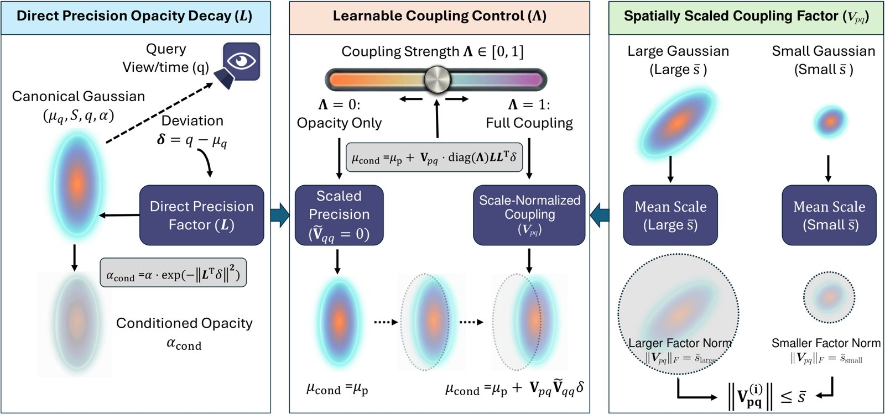
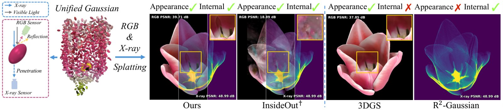

# 2026-10-20 科研日报

## 今日速览

本期来自周一（10-19）的 arXiv 公告。cs.GR 当天新稿很少，结合 cs.CV 的关键词筛选，挑出两篇与高斯表示直接相关、且都已有明确录用信息的论文：一篇讲怎样把高维高斯的“条件切片”做得又快又好训，一篇讲怎样让一套高斯同时解释表面外观和内部结构。

- **必读：[dGS / dBS](#2026-10-20--dgs)（NeurIPS 2026）。** 6DGS、7DGS 这类 N 维高斯在每次渲染时都要对每个基元做矩阵求逆和 Schur 补，才能得到当前视角或时刻下的条件均值和不透明度。作者干脆不再存联合协方差，而是直接学渲染真正要用的量：一个给不透明度用的 Cholesky 精度因子，加一个“查询到位置”的分解回归算子，并证明这套坐标与联合高斯协方差一一对应。结果是条件切片快 6.9–7.7 倍、整帧渲染快 1.25–1.91 倍，质量持平或更好。对关心正向批渲染效率、又在用视角相关或时变高斯的人，这是一个可以直接搬的参数化技巧。
- **对照阅读：[X-Splat](#2026-10-20--x-splat)（SIGGRAPH Asia 2026）。** 同一套高斯共享几何，只有靠近表面的那部分额外携带 RGB 外观，内部基元只管 X 光密度。它的做法和逆渲染里“几何先验约束外观”的思路一致：先用 X 光把几何定下来，再让 RGB 在这个锚点上学外观，并用 X 光导出的表面深度去约束 RGB。对“几何与材质先验从哪里来”这个问题，它给出一个跨成像模态的答案。
- **本期其他值得一扫：** 动态高斯的基元分配策略、双层笼形变的结构亲和度，见文末简列。

## 正向效率：把条件切片从“推导”改成“直接参数化”

### dGS / dBS · NeurIPS 2026 · 2026-10-16

**一句话判断：** 观察很朴素——渲染只需要条件量，却一直在存联合协方差再现场推导；把参数化换到“渲染对齐”的坐标上，就同时省掉了求逆、也把位置和不透明度的耦合交给了优化去决定。贡献的分量在于给出了这套坐标是光滑、全局双射的证明，以及在高斯核与 Beta 核上的成对对照实验。

**Title：** Direct Conditional Parameterization for N-Dimensional Splatting  
**作者：** Zhongpai Gao、Benjamin Planche、Van Nguyen Nguyen、Meng Zheng、Anwesa Choudhuri、Arun Innanje、Terrence Chen、Ziyan Wu  
**单位：** United Imaging Intelligence（Boston, MA, USA）  
**发表时间 / 投稿信息：** arXiv v1 于 2026-10-16 挂出；Comments 写明 Accepted by NeurIPS 2026。  
**链接：** [摘要](https://arxiv.org/abs/2610.22778) · [HTML 全文](https://arxiv.org/html/2610.22778v1)

**摘要中译：** N 维 splatting 在 3D 高斯溅射的基础上引入视角方向和时间，用来建模视角相关效果和动态。每个基元被提升为位置与条件变量的联合分布，在每次渲染查询时做条件切片。N-DGS 和 UBS 分别在高斯核与 Beta 核上共用这一步：要得到条件均值、不透明度和协方差，每次前向都需要逐基元的矩阵求逆和回归乘积。我们提出直接条件参数化，用显式的逐效果参数替代这种由协方差推导的读出：不透明度用一个 Cholesky 精度因子，位置用一个带可学习逐维耦合的分解式“查询到位置”回归算子。不加约束的条件坐标可以还原合法的联合协方差；我们的分解额外加入空间尺度与耦合先验。把这一参数化用于两种核，得到 dGS（高斯）和 dBS（Beta）。在五个静态与动态基准上，它们的质量与对应的协方差推导方法持平或更好，主要的 MCMC 评测中最高提升 1.26 dB。生产环境下的切片比现场协方差推导快 6.9–7.7 倍，完整渲染剖析在四个训练好的场景上给出 1.25–1.91 倍加速。直接条件化为 N 维 splatting 提供了一种结构化、与核无关的替代方案。

*原论文 Figure 2，[来源](https://arxiv.org/html/2610.22778v1)。同一流程换上 Beta 衰减即得到 dBS。*

**方法概要。**

1. **问题出在哪。** N-DGS 把每个基元存成 (3+C) 维的联合协方差（C=3 为视角，C=4 为视角加时间）。渲染时要对查询块求逆、做 Schur 补，才能得到条件均值、条件不透明度和条件空间协方差。这些操作每帧对每个基元都做一遍，场景到百万级基元时代价可观；而且在联合协方差的 Cholesky 坐标里，不透明度精度、位置回归和条件协方差彼此纠缠，查询块病态时还会数值不稳。
2. **不透明度：直接学精度。** 学一个下三角 Cholesky 因子 L（对角线取指数激活），精度矩阵就是 L Lᵀ，天然正定，无需求逆；条件不透明度等于原不透明度乘以 exp(−λ‖Lᵀδ‖²)，其中 δ 是查询相对基元“标准视角/时刻”的偏差，λ 沿用 N-DGS 的 0.35。C=4 时视角与时间的交叉项初始化为零但不加约束。
3. **位置：分解式回归。** 条件均值等于空间均值加 V_pq · diag(Λ) · V_qq · δ。V_pq 写成平均空间尺度乘一个可学习方向，让位移幅度跟着基元大小走；Λ 是逐维耦合系数，Λ=0 时位置与查询无关（只剩不透明度随视角/时间变化），Λ=1 时位置与不透明度共享完整精度，与 N-DGS 的耦合结构一致，中间值由优化自己决定。
4. **理论与实现。** 附录证明“不加约束的条件坐标”是联合高斯协方差的光滑、全局双射坐标卡，有显式逆映射且体积雅可比处处非零，所以换参数化不丢表达能力。工程上作者写了融合、寄存器级的 CUDA 核，并且也为 N-DGS 基线补了 CUDA 实现（原先只有 PyTorch 版），使速度对比公平。

**结果（作者报告）。** 五个数据集覆盖静态（NeRF Synthetic、Mip-NeRF 360、6DGS-PBR）与动态（D-NeRF、7DGS-PBR）。主表中，Mip-NeRF 360 上 dGS 对 N-DGS 为 27.67 对 26.88 dB，dBS 对 UBS 为 28.70 对 28.50 dB；7DGS-PBR 上 dGS 对 N-DGS 为 29.90 对 29.20 dB，dBS 对 UBS 为 31.87 对 30.61 dB；D-NeRF 上 dGS 与 N-DGS 基本持平。速度上，单独的条件切片快 6.9–7.7 倍，但整帧渲染只快 1.25–1.91 倍，因为剩下的时间花在投影、排序和光栅化上。作者自述的局限是评测只覆盖高斯与 Beta 两种核，城市级或驾驶级大场景下的显存、可见性与分块瓶颈尚未验证。

**值得关注 / 阅读指引。** 对正向效率这条线，它的价值不只在“快几倍”，而在于提醒：渲染路径上任何“先存一个大矩阵、每帧再推导出小量”的设计，都值得检查能否直接参数化那个小量。对用视角相关高斯处理高光、或用时变高斯做动态资产的工作，Λ 这个逐维耦合开关也有实用意义：它让每个基元自己决定“随视角/时间是移动还是变透明”，比固定耦合更容易解释。需要注意，切片加速与整帧加速差距较大，真正的瓶颈仍取决于下游的排序与光栅化；在基元很多、每像素叠加很深的场景里，收益可能更接近下限。建议顺序：Table 1 的逐基元开销对比 → Figure 2 → §4.2–4.3 两个参数化 → 附录 C 的双射证明（只看结论即可）→ 主表与附录 H 的端到端剖析。

## 几何先验：一套高斯，外面看颜色，里面看密度

### X-Splat · SIGGRAPH Asia 2026 · 2026-10-16

**一句话判断：** 设计上的关键是“几何共享、外观只给表面”：既避免两套高斯各自长浮点、互相对不齐，又让 X 光这种更强的几何约束去反哺 RGB 外观。它并不处理材质分解或重照明，但为“几何先验从哪来、怎么用来约束外观”提供了一个干净的范例。

**Title：** X-Splat: Unified Gaussian Splatting for Joint RGB and X-ray 3D Reconstruction  
**作者：** Wangze Xu、Chu Zhou、Mae Yamaguchi、Linrui Dai、I-Chao Shen、Takashi Ijiri、Imari Sato  
**单位：** The University of Tokyo；National Institute of Informatics；Shibaura Institute of Technology  
**发表时间 / 投稿信息：** arXiv v1 于 2026-10-16 挂出；Comments 写明 SIGGRAPH Asia 2026 Conference Papers（正文 12 页，附录 7 页）。  
**链接：** [摘要](https://arxiv.org/abs/2610.23237) · [HTML 全文](https://arxiv.org/html/2610.23237v1)

**摘要中译：** 联合重建 RGB 与 X 光可以把外部外观和内部结构联系起来，比单一模态更完整地理解真实物体。但现有方法为每个模态分别训练模型，带来冗余几何、对齐伪影，以及限制跨模态洞察的松散耦合。我们提出一种统一表示：所有高斯基元共享同一组几何参数，只有靠近表面的基元额外携带外观属性。我们通过干净的多视图立体与 X 光几何代理进行跨模态配准，而不是对齐两组已优化的高斯，从而提升对齐稳定性。随后在两种模态的监督下联合优化这一统一表示，并辅以由 X 光几何导出的表面深度一致性损失来引导 RGB 重建。在 InsideOut 数据集和我们的 Flower & Insect 数据集上的实验表明，该框架的跨模态对齐更稳健、RGB 渲染质量更高且不牺牲 X 光重建，表示也比维护两套独立几何更紧凑。

*原论文 Figure 1，[来源](https://arxiv.org/html/2610.23237v1)。*

**方法概要。**

1. **两种成像，一套几何。** RGB 是沿射线按透射率加权的发射积分，信号几乎都来自第一个表面；X 光则按 Beer–Lambert 定律对整条射线上的密度做线积分。每个基元都有共享的位置、旋转、尺度和一个 X 光密度；只有属于“表面子集”的基元再加不透明度和视角相关颜色。
2. **在干净代理上配准。** 对 X 光侧，先做一次粗的 X 光高斯重建，用 Marching Cubes 抽出表面点云；对 RGB 侧，用 MVSFormer 得到多视图立体点云。两者用 PCA 加 ICP 求一个相似变换，把 RGB 相机位姿搬进 X 光坐标系。作者强调，直接对齐两组优化后的高斯会被浮点和优化伪影干扰。
3. **分阶段联合优化。** 第一阶段只用 X 光光度损失从 FDK 初始化出发优化几何与密度，得到可靠的共享几何；第二阶段加入 RGB 光度损失和一个由 X 光（CT）几何导出的表面深度一致性损失，约束 RGB 渲染深度落在 X 光给出的表面上。
4. **双统计的致密化。** 每个基元分别记录 RGB 与 X 光的位置梯度统计；X 光梯度超阈值，或“在表面子集内且 RGB 梯度超阈值”，都会触发克隆或分裂，使任一模态欠拟合都能补基元。

**结果（作者报告）。** 在 InsideOut 数据集和新建的 Flower & Insect 数据集（已有花卉 CT 扫描加新采集的昆虫标本）上，X-Splat 的 RGB 新视角合成优于 3DGS 与 InsideOut 的复现版本，X 光重建与单模态专用方法 R²-Gaussian 持平；附录中仅用 15 个 RGB 视角时，PSNR 平均比 3DGS 高约 4 dB。作者自述三点局限：外观模型假设表面反射主导，不适用于玻璃等透明物体或蜡、生物组织等强次表面散射材料；依赖足够准确的 X 光重建作为几何锚点；联合训练目前只提升 RGB，对 X 光重建没有额外收益。

**值得关注 / 阅读指引。** 对逆渲染真实感这条线，它示范了一个可迁移的结构：外观只挂在可见表面附近的基元上，几何由一个更可靠的信号先定好，再用深度一致性把外观“钉”在几何上。把 X 光换成别的几何来源（深度传感器、前馈几何先验、平面先验），这套“共享几何加表面外观子集”的思路同样成立，也能减少浮点把阴影或高光“烤”进错误位置的情况。它目前只学视角相关颜色，不分解材质和光照，若要用于重照明还需要在表面子集上换成 BRDF 参数。建议顺序：Figure 2 总览 → §4.1 表面子集定义 → §4.2 与 Figure 3 的配准 → §4.3 分阶段与深度损失 → 稀疏视角附录表 → Limitations。

## 本期其他值得一扫

- [Dusting the Phantom: Gaussian Allocation for Fading Dynamic Content](https://arxiv.org/abs/2610.21302)：作者认为动态高斯丢失小而快的物体，瓶颈不在容量而在“基元被分配到哪里、哪一时刻”；提出按时间外观变化与重建误差在多视角可信位置注入新种子，以及用时间分辨的优化信号引导基元重定位，总基元数不变。与可编辑动态资产相关，本期未展开。
- [Structural Affinity: An Algorithm for Coherent Cage-Based Shape Design](https://arxiv.org/abs/2610.23173)：用内外两层笼和均值坐标预计算亲和矩阵，让控制点位移按结构传播，减少笼自交与网格畸变，用于机器人形态协同设计、神经形变迁移和机翼形状优化。与基于笼的绑定和编辑相关，本期未展开。

## 覆盖说明

日报发布日为 **2026-10-20（周二）**，内容来自 2026-10-19（周一）的 arXiv 公告。cs.GR 当日新稿仅一篇，因此结合 cs.CV 新稿做了关键词筛选。正文两篇为 dGS / dBS（2610.22778）与 X-Splat（2610.23237），均核对了 arXiv HTML 全文的方法、实验与局限；配图为两篇原论文插图。所有结果均为作者报告，未独立复现。本期未单独检索圈内媒体动态，文末两篇只作入口简列。

**编写：** Cream

**故障说明：** 本日由 Cream 于 06:18 HKT 故障转移接管发布。先前顺位未在窗口内成功出稿：Neon（05:30–06:20）既无当日 digest，也无认领记录。依据 `meta/failover.json` 当日 `failover`／`claim` 事件。受接管窗口时长所限，本期篇幅比常规版精简。
