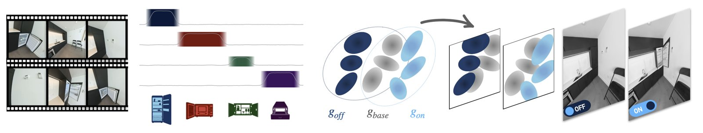
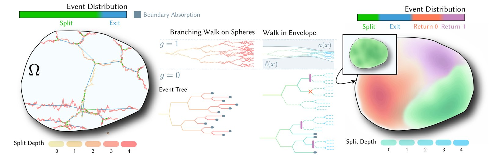

# 2026-10-21 科研日报

## 今日速览

本期来自周二（10-20）的 arXiv 公告。cs.GR 当天新稿五篇、交叉投稿十篇，挑出两篇：一篇是蒙特卡洛 PDE 求解里很硬核的方差与开销问题，一篇是把“物体开关状态”做成可组合高斯资产的 SIGGRAPH Asia 论文。

- **必读：[SwitchSplat](#2026-10-21--switchsplat)（SIGGRAPH Asia 2026）。** 随手拍视频里，人会开门、开冰箱、拉抽屉，4DGS 这类按时间条件化的方法只能回放看过的序列。SwitchSplat 把场景拆成一个共享的静态底座和若干“槽位”，每个槽位为一个可交互物体存“关 / 开”两套高斯；高斯归属哪个槽位是可微的 softmax，槽位在视频里何时打开用一个可学习的时间窗表示。训练完可以任意组合各物体的开关状态，包括采集时从未同时出现过的组合。对“拆分绑定、可编辑资产”这条线，这是一个从视频直接得到离散可控状态的干净方案。
- **对照阅读：[Walk in Envelopes](#2026-10-21--wie)（预印本，哈尔滨工业大学（深圳））。** 带分支的 Walk-on-Spheres 可以无网格地解半线性 PDE，但分支率接近临界值时粒子数会爆炸。作者不去剪已经长出来的树，而是用可证明的上下界（包络）把分支扩散本身变换成一个少分支、可提前终止、仍然无偏的等价过程，并且只用标准的屏蔽 WoS 核加拒绝采样就能精确实现。高分支率下单位精度开销降到原来的几分之一。
- **本期其他值得一扫：** 物理神经蒙皮的泛化版、行扫描卫星图像的神经逆渲染地形重建，见文末简列。

## 可编辑资产：把“开 / 关”从时间轴上拆出来

### SwitchSplat · SIGGRAPH Asia 2026 · 2026-10-17

**一句话判断：** 关键洞察是“状态不等于时间”：时间条件化的动态高斯把“何时被观察到”和“场景处于什么状态”绑在一起，因此无法组合；改成“底座 + 每物体两态槽位”后，组合就变成了渲染时对不透明度的简单门控。代价是只支持二值状态，槽位数和大致交互时段靠 VLM 给初值。

**Title：** SwitchSplat: Learning Discrete Object States from Casually Captured Scenes  
**作者：** Yizheng Xie、Yalda Foroutan、George Shramko、Daniel Rebain、Shrisudhan Govindarajan、Andrea Tagliasacchi  
**单位：** Simon Fraser University；University of British Columbia；Wayve Labs；University of Toronto  
**发表时间 / 投稿信息：** arXiv v1 于 2026-10-17 挂出；Comments 写明 SIGGRAPH Asia 2026 (Conference Papers)，正文页眉给出 ACM DOI 10.1145/3829340.3842325。  
**链接：** [摘要](https://arxiv.org/abs/2610.24812) · [HTML 全文](https://arxiv.org/html/2610.24812v1) · [项目页](https://switchsplat.github.io)

**摘要中译：** 3D 高斯溅射让高保真三维重建变得快速易得，但现有表示都假设世界是静态的。在随手拍摄中这一假设会失效：用户会自然地与环境互动，开门、拨开关、挪动物体，引入现有框架都无法建模的离散状态变化。4DGS 等时间条件化的动态方法把“状态在何时被观察到”与“场景处于什么状态”混为一谈，只能回放看过的序列，无法组合任意的物体配置。我们提出 SwitchSplat，首个通过“底座 + 槽位”分解来解决这一问题的 3DGS 表示：共享的静态底座表示不变的场景，每个槽位独立保存一个可交互物体的两个二值状态（开 / 关）。由于高斯到槽位的分配完全可微，模型能直接从视频中发现每个状态的几何，无需人工标注。推理时，用户可以自由组合各槽位的状态，并从任意视角渲染结果场景。我们在一个新的随手拍数据集上验证了 SwitchSplat，它在新视角合成质量上优于静态与动态基线，并且独有地支持渲染采集时从未见过的状态组合。

*原论文 pipeline 图，[来源](https://arxiv.org/html/2610.24812v1)。*

**方法概要。**

1. **状态感知高斯。** 每个高斯除常规属性外，额外带一个 logit 向量，经 softmax 得到在“底座、槽位 1 关、槽位 1 开……”这些通道上的类别分布。每个槽位用两个通道而不是一个，是因为开门和关门占据的空间不同，单个基元无法同时表示两态。
2. **渲染时的门控。** 给定一组开关配置，每个高斯出现在场景中的概率等于“属于底座”的概率加上“属于当前被选中那一态”的概率，再用这个概率乘到不透明度上，其余照常做体渲染。
3. **可微槽位表。** 训练时需要知道每一帧里每个槽位是开还是关。作者假设每次交互在时间上是紧支撑的，把“槽位在 t 时刻为开”的概率参数化为两个 sigmoid 乘积构成的平滑时间窗，窗的左右端点和温度都可学习，梯度就能从每帧图像传到时间窗和每个高斯的归属分布。
4. **初始化与正则。** 槽位数量和大致的交互起止时间由 VLM 读取视频帧给出初值，并以较高温度起步让早期梯度覆盖更宽的时间范围。损失在常规光度与 SSIM 之外，加一个鼓励高斯默认属于底座的稀疏项，以及一个让同一槽位同一状态的高斯在空间上聚成团的紧凑项，抑制浮点和冗余基元。

**结果（作者报告）。** 作者用消费级 Insta360 X4 双鱼眼相机自采了数据集，模拟非专业用户边走边与物体交互。在十个场景的标准留出视角上，SwitchSplat（3DGUT 版）平均 PSNR 32.65 dB，高于 4DGS 的 30.55 dB、DeGauss 的 30.30 dB 和静态 FullCircle 的约 29 dB；在新相机轨迹和“从未同时出现过的状态组合”两个设定上，定性对比中基线出现模糊、重影或错误状态内容。作者自述局限：只支持二值状态，假设单人单手操作；槽位数量和交互时段依赖 VLM 初始化，完全无监督地发现交互仍是开放问题；目前只做新视角合成，尚未结合物理先验或生成模型做编辑与仿真。

**值得关注 / 阅读指引。** 对拆分绑定这条线，它的价值在于给出一个“状态作为离散槽位”的最小可用表示：底座加两态槽位，渲染时只是门控不透明度，几乎不改光栅化管线，所以很容易和现有 3DGS 或 3DGUT 代码合并。它与关节物体重建是互补关系：这里不建模开门的连续运动，只要两个端点状态；若想得到可交互、可仿真的资产，下一步自然是在两态之间补一个关节或形变模型。对具身方向，“随手拍一段带交互的视频，就得到可切换状态的场景”也直接对应低成本数字孪生的需求。建议顺序：Figure 1 → Figure 3 的状态感知高斯 → §3.2 时间窗参数化与 Figure 4 → Table 1 → 新状态组合的定性图 → 附录中关节类基线的对比与 Limitations。

## 蒙特卡洛 PDE：不剪树，而是让树少长

### Walk in Envelopes · arXiv · 2026-10-18

**一句话判断：** 与常见的“用近似解提前剪枝”不同，它用可证明的上下界对分支布朗运动做广义 Doob 变换，把原先的“繁殖”重新分配成分裂、返回 0、返回 1 三类事件，从源头上少繁殖，同时保持无偏。理论上漂亮，代价在于要先构造可证明的包络，低分支率或查询很少时不划算。

**Title：** Walk in Envelopes: Efficient Branching Walk-on-Spheres via Certified Solution Bounds  
**作者：** Yunfeng Liao、Zhenhao Qiu、Xinyang Chen、Xiucheng Li  
**单位：** 哈尔滨工业大学（深圳）  
**发表时间 / 投稿信息：** arXiv v1 于 2026-10-18 挂出（cs.GR）；Comments 为空，投稿信息未标明。  
**链接：** [摘要](https://arxiv.org/abs/2610.25297) · [HTML 全文](https://arxiv.org/html/2610.25297v1)

**摘要中译：** 带分支的 Walk-on-Spheres（WoS）可以无网格地求解半线性 PDE，但在分支率接近临界值时计算代价急剧增长。我们提出 Walk in Envelopes（WiE），利用可证明的解上下界来变换分支扩散本身，而不是对已生成的树剪枝。该变换抑制繁殖、引入受控的终止，并在依赖包络的方差界下保持无偏。我们借助标准的屏蔽 WoS 核，通过精确的拒绝采样实现这一变换过程，并以可证明的样条包络和自适应采样作为支撑；我们还证明，在合适的调和包络下，即使传统分支布朗运动的期望繁殖数发散，变换后的期望繁殖数仍然有界。

*原论文 Figure 1，[来源](https://arxiv.org/html/2610.25297v1)。*

**方法概要。**

1. **问题。** 半线性方程中的非线性项可以用分支布朗运动表示：粒子在随机时刻分裂成若干后代，解是所有叶子边界值乘积的期望。与 WoS 结合后不用离散时间，但当分支强度逼近区域主 Dirichlet 特征值时，期望粒子总数趋于无穷。
2. **为什么剪枝不够。** 作者先从分支表示推出几条概率上下界，可以在剩余贡献足够小时剪掉子树，但这会引入有界偏差，而且剪枝只作用于已经生成的树，无法阻止多余的繁殖。
3. **包络变换。** 给定可证明的下界 ℓ(x) 与上界 a(x)，把解写成 ℓ 加上 (a−ℓ) 乘以一个取值在 [0,1] 的归一化解，并对归一化解做广义 Doob 变换。变换后的过程里，原来的繁殖被重新分配为“分裂、成功终止（返回 1）、失败终止（返回 0）”，期望的后代数下降。
4. **精确采样。** 变换会引入空间变化的漂移，看似需要新采样器。作者证明可以只用原有的屏蔽 WoS 核加逐点包络评估，通过拒绝采样精确实现每一步转移。包络用单调细化的可证明样条构造，采样端配合自适应筛选、空间自适应的主函数和惰性评估；方法还推广到流形上的投影 WoS 与半线性抛物方程。

**结果（作者报告）。** 在 Engine、Lock 等四个二维场景上，低分支率时预处理开销使 WiE 并不占优（如 Engine 在 0.10 时加速约 1.18 倍）；分支率升到 0.85、0.90、0.95、0.98 时，单位精度开销的加速分别约为 2.37、3.20、5.48、8.46 倍，WiE 的耗时几乎不随分支率上升，而传统方法迅速变慢。包络预处理时间未计入该表。作者自述局限：效率取决于包络质量与拒绝采样接受率；包络预处理在低分支率或查询量少时不划算；临界附近的复杂度保证只约束期望繁殖次数，不直接约束总运行时间；流形上的投影游走会继承几何近似误差。

**值得关注 / 阅读指引。** 这篇和渲染里的“控制变量 + 俄罗斯轮盘”思路很像：用一个便宜且有保证的上下界把被积量夹住，只对夹不住的部分做随机估计。对做过蒙特卡洛 PDE 的读者，Theorem 3.5（只用原 WoS 核即可精确采样变换过程）是最值得细看的一步，它决定了方法能否直接接入现有 WoS 代码。需要注意，实验以二维为主、三维测试放在附录，表中加速也不含包络构造成本；评估时应同时看附录里包络质量与评估代价的那部分。建议顺序：Figure 1 → §3.2 剪枝的界与其局限 → §3.3–3.4 变换与精确转移 → Table 1 → §6 Limitations。

## 本期其他值得一扫

- [PhysSkin++](https://arxiv.org/abs/2610.26067)：用自编码器从静态几何直接预测形变子空间（神经蒙皮场），无需逐物体训练，也不需要仿真轨迹做监督；支持降阶动力学、用户控制与接触，并可直接绑定到网格、点云等表示。与可编辑动态资产的绑定相关，本期未展开。
- [OrTeN](https://arxiv.org/abs/2610.24075)：用神经逆渲染从行扫描卫星图像联合优化带纹理的高度图和轨道相机修正，同时处理整体位姿不一致与高频指向抖动。属于“几何与相机联合逆渲染”的遥感应用，本期未展开。

## 覆盖说明

日报发布日为 **2026-10-21（周三）**，内容来自 2026-10-20（周二）的 arXiv 公告（cs.GR 新稿与交叉投稿）。正文两篇为 SwitchSplat（2610.24812）与 Walk in Envelopes（2610.25297），均核对了 arXiv HTML 全文的方法、实验与局限；配图为两篇原论文插图。所有结果均为作者报告，未独立复现。本期未单独检索圈内媒体动态，文末两篇只作入口简列。

**编写：** Cream

**故障说明：** 本日由 Cream 于 06:18 HKT 故障转移接管发布。先前顺位未在窗口内成功出稿：Neon（05:30–06:20）既无当日 digest，也无认领记录。依据 `meta/failover.json` 当日 `failover`／`claim` 事件。受接管窗口时长所限，本期篇幅比常规版精简。
