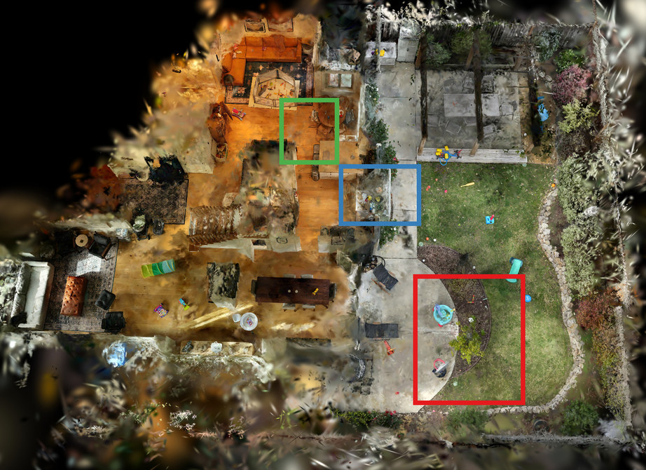
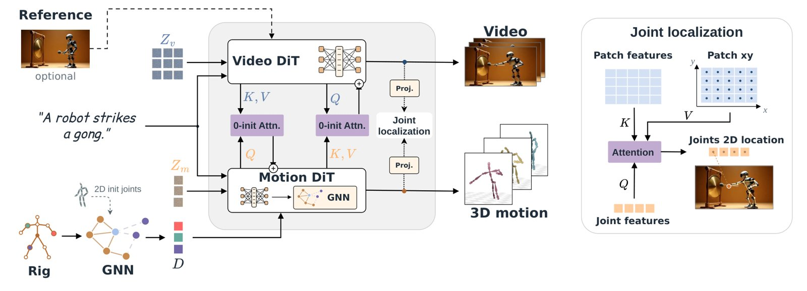

# 2026-10-22 科研日报

## 今日速览

本期来自周三（10-21）的 arXiv 公告。cs.GR 当天新稿约二十篇（含交叉投稿），挑出两篇：一篇修正 3DGS 自适应密度控制里一个被长期忽略的统计偏差，一篇把视频生成模型里的运动“取回”成任意骨架可重放的 3D 动画。

- **必读：[Occlusion-Aware Densification](#2026-10-22--oad)（ACCV 2026 Oral）。** 3DGS 决定是否分裂某个高斯时，用的是“屏幕空间梯度对观测视角数取平均”。但视角计数只做了视锥测试：一个高斯在某视角里被完全挡住，梯度为零，却仍算一次“观测”，平均梯度被稀释，于是越是被遮挡的区域越长不出细节。作者把统计限制在高斯真正贡献了像素的视角，并把分母从视角数换成平均混合权重。改动小、可移植，对多房间室内这类遮挡重的大场景收益最明显，高斯数还少一半以上。
- **对照阅读：[Joints, Camera, Action!](#2026-10-22--jca)（预印本，NVIDIA 等）。** 给定任意拓扑的骨架（人、动物、机器人都行），模型同时生成视频和同步的 3D 关节轨迹，并解出相机把动作放回场景。运动分支先只用运动数据训练，再用少量交叉注意力接到预训练视频模型上。对“可编辑动态资产”和具身数据合成来说，它提供了一条从视频先验拿到可重放骨骼动画的路径。
- **本期其他值得一扫：** 灵巧手“混合模仿”学习、基于 3DGS 自动编辑的在线场景变化检测，见文末简列。

## 3DGS 优化：被挡住的视角不该算数

### Occlusion-Aware Densification · ACCV 2026 · 2026-10-19

**一句话判断：** 问题定位非常准：ADC 的“观测次数”统计对遮挡是盲的，这在小物体环拍数据上不显眼，在室内多房间场景里会系统性地让被遮挡区域欠致密化。修法是两处统计口径的改动，几乎不增加开销，值得直接合进自己的训练框架做对照。

**Title：** Counting Contributions, Not Views: Occlusion-Aware Densification for 3D Gaussian Splatting  
**作者：** Marcel Rogge、René Schuster、Didier Stricker  
**单位：** University Kaiserslautern-Landau (RPTU)；German Research Center for Artificial Intelligence (DFKI)  
**发表时间 / 投稿信息：** arXiv v1 于 2026-10-19 挂出；Comments 写明 Accepted at ACCV 2026 (Oral)，附录含补充材料，代码已开源。  
**链接：** [摘要](https://arxiv.org/abs/2610.27108) · [HTML 全文](https://arxiv.org/html/2610.27108v1) · [代码](https://github.com/MarcelRogge/occlusion-aware-3dgs)

**摘要中译：** 3D 高斯溅射通过自适应密度控制（ADC）从稀疏初始化生长出稠密场景，其依据是渲染过程中收集的逐高斯统计量。这些统计量经过一个基于视锥的可见性过滤器，而该过滤器对遮挡是盲的：被完全遮挡的高斯仍被计为“已观测”，稀释了平均梯度信号，恰恰在几何被遮挡的地方抑制了致密化。我们用一个遮挡感知的过滤器加以修正，只把高斯真正有贡献的视角计入致密化统计，并把判据中原始的视角计数归一化替换为平均贡献归一化。将两者集成到基于 StopThePop 的框架后，在遮挡严重的场景上，所有图像质量指标都优于遮挡盲的基线（LPIPS 最多降低 6%），而所需高斯数不到视角计数归一化方案的一半。在这些大场景所需的更长训练日程下，高斯数量保持有界，而多数判据会发散；在较小的基准上，我们的方法以竞争方法一小部分的高斯数保持了有竞争力的质量。

*原论文 Figure 1，[来源](https://arxiv.org/html/2610.27108v1)。*

**方法概要。**

1. **问题来源。** 标准 3DGS 对每个高斯累计各视角的屏幕空间位置梯度，再除以“被观测视角数”，超过阈值就分裂或克隆。“被观测”只由视锥测试决定，于是透射率在到达它之前就已饱和的高斯也会让计数加一、梯度却是零，平均值被往下拉。
2. **遮挡感知过滤。** 把“被观测”改成二值信号：只有在该视角至少对一个像素有贡献的高斯才计入统计（包括计数和最大半径跟踪）。这个信号在光栅化时可以顺带得到。
3. **平均贡献判据。** 作者把单像素梯度拆成“混合权重 × 与可见度无关的向量”，指出混合权重同时决定了梯度大小和该视角的“观测强度”。因此分母不再是视角数，而是各渲染视角下贡献的累计平均，避免“勉强可见的视角和完全可见的视角权重相同”这一偏差；附录说明分母需要一个下限，否则训练会发散。
4. **集成基线。** 方法搭在 StopThePop 之上，并整合若干已有的 ADC 改进，减少对“场景尺度”这类不可靠启发式的依赖；附录也给了在 2DGS 和原版 3DGS 上的移植结果。

**结果（作者报告）。** 在遮挡严重的 Zip-NeRF 多房间场景上，相比遮挡盲基线所有图像指标都有提升，LPIPS 最多降低约 6%，高斯数不到视角计数归一化方案的一半；拉长训练日程时高斯数保持有界。在 Mip-NeRF360 等小场景上质量与竞争方法相当，但高斯数少得多。作者自述局限：大场景质量仍不及小场景；除遮挡外，Zip-NeRF 的相机覆盖不均也限制了致密化能恢复的内容，可能需要与按区域分组相机的分治策略结合。

**值得关注 / 阅读指引。** 对做室内逆渲染或任何“房间级、遮挡多”的 3DGS 管线来说，这是一个低成本、几乎必做的消融：只要你的训练用的是 ADC，被挡住的墙角、家具背面就可能一直欠致密化，而这些区域在后续材质或光照分解里又常是误差源。建议顺序：Figure 1 → Figure 2（视锥过滤与真实贡献的差别）→ §3.1–3.2 → §4.3–4.4 的两组对照 → 附录 0.D（遮挡率与收益的相关性）和 0.F.2（分母下限）。

## 可编辑动态资产：让视频模型给任意骨架“交出”3D 动作

### Joints, Camera, Action! · arXiv · 2026-10-20

**一句话判断：** 思路是“运动与视频分家、再用细桥连接”：3D 运动单独一个能吃任意骨架的模型，先在纯运动数据上学会骨架如何动，再通过少量零初始化的双向交叉注意力接到冻结的视频模型。这样既能利用视频模型对场景和动作的理解，又不必为每种骨架准备成对视频。训练数据靠视频编辑模型把 Objaverse 动画资产“搬进”合适场景来造，这一点本身也值得借鉴。

**Title：** Joints, Camera, Action! Co-Generating 3D Motion and Video for Arbitrary Rigs  
**作者：** Noam Rotstein、Yoad Tewel、Chen Tessler、Haggai Maron、Gal Chechik、Or Litany、Yoni Kasten、Yuval Atzmon  
**单位：** NVIDIA；Technion – Israel Institute of Technology；Bar-Ilan University  
**发表时间 / 投稿信息：** arXiv v1 于 2026-10-20 挂出；Comments 为空，投稿信息未标明。  
**链接：** [摘要](https://arxiv.org/abs/2610.28632) · [HTML 全文](https://arxiv.org/html/2610.28632v1) · [项目页](https://research.nvidia.com/labs/par/projects/jca/)

**摘要中译：** 视频生成模型如今已能描绘极为逼真的运动，但如何把这种运动用到像素之外仍不清楚：比如驱动一个特定的 3D 资产，并在它所在的 3D 场景中重放这段动画。视频模型可以画出一只猴子跳过横杆，却无法把这一跳作为可重放的 3D 运动放回场景。我们提出一个模型，可为任意给定骨架同时生成视频和 3D 运动，并给出把运动配准到场景的相机。已有的视频—运动模型要么只处理人体骨架、往往额外增加数十亿参数，要么从生成的 2D 姿态图三角化 3D 运动。我们则把 3D 运动放在一个支持任意骨架的独立模型中，并通过一小组交叉注意力层与预训练视频模型相连。这种分离让运动模型可以先从纯运动数据中学习骨架如何运动，这类数据比成对视频更易获取和增广。此外，模型学会在视频帧中定位每个关节，从而恢复相机并把 3D 运动放进场景。为了在大量骨架上训练，我们用生成式视频编辑器把带动画的 3D 资产放入适合其动作的场景，并筛选编辑结果以确保已知运动依然有效；加上人类与机器人视频，共得到近 20 万对训练数据。评估表明，我们的模型根据文本驱动各类骨架时比“先生成视频”的流程更忠实，其运动也会响应周围场景。它还能把视频转成骨架运动、把骨架运动转成视频，并支持基于关键帧控制 3D 运动。

*原论文 Figure 2，[来源](https://arxiv.org/html/2610.28632v1)。*

**方法概要。**

1. **骨架条件化的运动生成。** 每个关节存 6D 旋转、3D 位置及其逐帧变化（共 18 通道）。图编码器结合关节名称的文本嵌入、骨架结构和参考图中的 2D 位置，产出逐关节描述子，用来条件化一个从零训练的 flow-matching 运动去噪器，块内有图注意力沿骨架传播特征。
2. **与视频耦合。** 运动模型先单独训练，再通过零初始化的双向交叉注意力接到预训练视频生成器上，参数增量不大；推理时用一种“桥引导”加强两路信息交互。
3. **关节定位与相机对齐。** 辅助头让每帧的关节特征去注意对应视频帧的 patch，加权得到 2D 关节位置；与生成的 3D 关节配对后，为每段视频拟合一个静态透视相机，从而把动作放回场景。
4. **训练数据。** 把 Objaverse 动画资产在简单环境中渲染，由 VLM 描述动作并提议合适场景，再用生成式视频编辑模型把场景“画进”渲染片段，并筛掉破坏原有运动一致性的编辑；加上人体与机器人视频，共约 20 万对。

**结果（作者报告）。** 在 Puppeteer 测试集随机 20 个资产、各 5 条动作提示共 100 对上，提示遵循度（由 VLM 打分，0–100）为 58.4，高于 ActionMesh 的 43.4、Puppeteer 的 41.1 和 AnimateAnyMesh 的 20.6；网格畸变 0.20%，为各方法最低。作者自述局限：推理时相机对齐假设静态相机；训练骨架偏向双足角色。

**值得关注 / 阅读指引。** 与可编辑动态资产这条线的关系在于“绑定”：已有骨架和蒙皮的资产，可以直接用文本或一段视频拿到可重放的关节动画，而不是逐顶点形变。对具身方向，它也给出了一种从视频先验批量合成“机器人骨架 + 场景视频 + 3D 轨迹”的路径，但生成的运动不保证物理可行，接到仿真或真机前还需要跟踪或重定向。建议顺序：Figure 1 → Figure 2 → §3.3 关节定位与相机拟合 → §3.4 数据构造 → Table 1 → §6 局限。

## 本期其他值得一扫

- [AdaDex（Hybrid Dexterous Mimicking）](https://arxiv.org/abs/2610.28628)：用几秒人类手—物轨迹训练灵巧手技能，同一策略同时在“密集跟踪”与“扰动初态和目标、稀疏成功奖励”两类并行环境中训练，兼顾人类先验与泛化，含仿真间迁移与真机演示。与具身方向相关，本期未展开。
- [Online Bayesian Scene Change Detection](https://arxiv.org/abs/2610.28490)：对参考 3DGS 自动做编辑来生成带标签的“变化”训练视图，离线学证据模型，在线用闭式局部贝叶斯因子更新三维高斯变化场。属于 3DGS 作为场景记忆的用法，本期未展开。

## 覆盖说明

日报发布日为 **2026-10-22（周四）**，内容来自 2026-10-21（周三）的 arXiv 公告（cs.GR 新稿与交叉投稿）。正文两篇为 Occlusion-Aware Densification（2610.27108）与 Joints, Camera, Action!（2610.28632），均核对了 arXiv HTML 全文的方法、实验与局限；配图为两篇原论文插图。所有结果均为作者报告，未独立复现。本期未单独检索圈内媒体动态，文末两篇只作入口简列。

**编写：** Cream

**故障说明：** 本日由 Cream 于 06:18 HKT 故障转移接管发布。先前顺位未在窗口内成功出稿：Neon（05:30–06:20）既无当日 digest，也无认领记录。依据 `meta/failover.json` 当日 `failover`／`claim` 事件。受接管窗口时长所限，本期篇幅比常规版精简。
