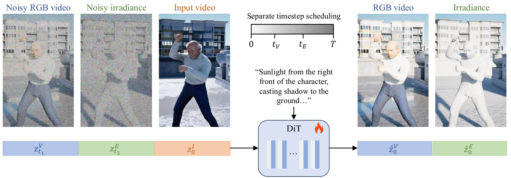
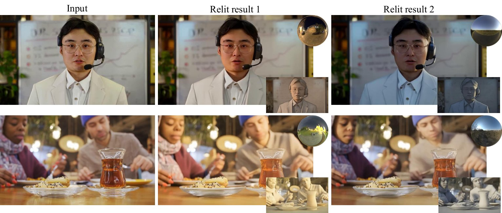

# 2026-10-23 科研日报

## 今日速览

本期来自周四（10-22）的 arXiv 公告。cs.GR 当天只有 1 篇新稿加 3 篇交叉投稿，于是又在 cs.CV 里按重光照、辐射场、高斯等关键词补筛。正文挑出两篇：一篇是把“粗糙的物理光照线索”和视频扩散模型结合起来做人像场景重光照的 SIGGRAPH Asia 论文，一篇是从优化目标本身找稀疏视角重建漂浮物成因的 NeRF 正则。

- **必读：[JointLight](#2026-10-23--jointlight)（SIGGRAPH Asia 2026）。** 想用物理渲染控制光照，就得有几何；单目估出来的几何又破又不连续，直接渲染出的辐照度图满是伪影。作者的观察是：给这张粗辐照度图加上足量高斯噪声后，高频伪影被淹没，低频的光传输结构却还在，此时它和真实辐照度图几乎无法区分。于是让扩散模型同时去噪 RGB 视频与辐照度图、两者用不同噪声时间步，推理时把“加噪后的粗线索”从中途塞进去。这给“弱几何先验下怎样仍然利用物理光传输”提供了一种很干净的思路，值得对照逆渲染里的先验可靠性问题来读。
- **选读：[DriftNeRF](#2026-10-23--driftnerf)（预印本）。** 稀疏视角下，逐光线的渲染损失里没有任何一项比较“不同光线对同一处空间给出的密度”，于是漂浮物可以在每个训练像素都对得上的情况下存在。作者把这种跨光线密度分歧做成训练时可计算的量，再用一个带停止梯度的一致性目标去压它。不依赖深度、法线或预训练模型，与“缺乏可靠几何先验时怎样保住几何”直接相关。
- **本期其他值得一扫：** 文本条件的物理参数预测、强化学习驱动的肌肉动画、流式生成的可交互 3D 世界，见文末简列。
- **圈内：** NVIDIA 开源的智能体沙箱运行时 OpenShell 进入 0.1.x，社区争论集中在默认遥测和权限粒度；一个用小语言模型逐键“模拟”终端的 WorldTUI 项目引来不少关于“神经计算机”的讨论。

## 重光照：让加噪的物理线索替生成模型“指路”

### JointLight · SIGGRAPH Asia 2026 · 2026-10-21

**一句话判断：** 关键不在“用扩散模型重光照”，而在怎样对待一个不可靠的物理条件：既不直接信它（会把几何伪影画进结果），也不丢掉它（失去精确的光照方向控制），而是用加噪强度来决定信多少。这个“噪声即置信度”的处理方式可以迁移到任何“有粗糙物理渲染、但几何不准”的场景。

**Title：** JointLight: Human-Centric Video Relighting with Asynchronous RGB-Irradiance Joint Modeling  
**作者：** Henglei Lv、Bailin Deng、Xiaoqiang Liu、Yichen Wang、Haoxian Zhang、Pengfei Wan、Lin Gao  
**单位：** 中国科学院计算技术研究所；中国科学院大学；Cardiff University；快手科技  
**发表时间 / 投稿信息：** arXiv v1 于 2026-10-21 挂出；HTML 全文标注为 SIGGRAPH Asia 2026 Conference Papers（2026-12，吉隆坡），附 DOI。  
**链接：** [摘要](https://arxiv.org/abs/2610.29780) · [HTML 全文](https://arxiv.org/html/2610.29780v1) · [PDF](https://arxiv.org/pdf/2610.29780)；代码与数据集作者称将公开，暂未找到仓库地址。

**摘要中译：** 理解并建模以人为中心场景中的光传输是一个长期难题。扩散模型的进展推动了重光照研究，但精确的光照控制仍然落后，主要原因是缺乏多样、高质量、标注精确的视频重光照数据集。现有端到端重光照方法用神经网络隐式建模光传输，可控性因此大打折扣。另一些工作改用路径追踪得到的辐照度线索作为光传输的显式蓝图，但这样构造的线索容易带有伪影，直接用作控制信号会损害生成质量。基于“噪声污染会去除高频伪影、保留低频光传输”这一关键观察，我们提出一种异步联合建模范式，以实现细粒度的光照控制。在两阶段训练中，我们让模型以分开的时间步调度联合去噪 RGB 帧与真实辐照度帧；第二阶段采用域匹配策略，弥合辐照度线索与真实辐照度图之间的域差异。推理时，我们提出一种异步“劫持”生成流程，实现灵活的光照控制。训练数据方面，我们用一款强大的游戏引擎构建了带配对辐照度图的多光照高质量合成视频数据集。仅在该数据集上训练，模型就能稳健地泛化到真实场景，在光照保真度和生成质量上均优于已有方法。代码和数据集将公开。

*原论文 Figure 2（训练流程），[来源](https://arxiv.org/html/2610.29780v1)。三路潜变量在帧维拼接后共享时空自注意力，所以模型可以在输入画面、辐照度和重光照结果之间对齐像素；两个独立的时间步是后面“中途劫持”推理的前提。*

**方法与原理。**

先说清两个名词。**辐照度图**（irradiance map）是“把场景所有表面都当成白色漫反射材质、在目标光照下渲染”得到的图，它只记录每个像素接收到多少光，去掉了材质颜色，因此可看作漫反射光传输的蓝图。**扩散模型的时间步** \(t\) 表示当前潜变量里噪声占多少：\(t\) 越大越接近纯噪声。

1. **问题与瓶颈。** 端到端的重光照扩散模型只吃文本或环境贴图，难以精确控制光源方向，物理正确性也没有保证；而若想用物理渲染给出显式控制，就需要几何。真实人像视频的几何只能靠单目估计，得到的是单层表面，物体边界处还有深度跳变，渲染出来的辐照度线索有空洞、错位和闪烁，直接当条件会让生成器把这些伪影照搬进结果。
2. **构造粗辐照度线索（推理和第二阶段训练都用）。** 对每帧用单目点云估计得到度量尺度的几何，转成逐帧网格，用固定阈值删去跨越深度跳变的三角形；赋予统一的白色漫反射材质，用 Mitsuba 3（一个物理渲染器）在目标环境贴图下渲染，得到辐照度线索 \(\mathbf{E}^{\text{cue}}\)。逐帧独立估计避免了全局重建漂移，但时序一致性和边界缺失问题依旧。
3. **用噪声“抹平”伪影。** 对线索做和扩散前向过程相同的线性加噪：

$$
\mathbf{E}^{\text{cue}}_{t}=(1-t)\,\mathbf{E}^{\text{cue}}+t\,\epsilon
$$

   其中 \(\epsilon\) 是标准高斯噪声，\(t\in[0,1]\) 是噪声强度。高频的错位、空洞会先被噪声淹没，而“哪边亮、阴影大致朝哪”这类低频信息在较大 \(t\) 下仍然保留。作者认为简单的补洞或模糊做不到这一点，因为它们无法在几何缺失处重建光传输，还可能抹掉有用的低频结构；联合去噪则让模型自己学会保留多少。
4. **RGB 与辐照度的异步联合去噪（训练）。** 在 Wan2.2-TI2V-5B（一个开源的文本/图像到视频扩散 Transformer）上全量微调：把输入视频、加噪的重光照 RGB 视频、加噪的辐照度视频三路潜变量沿帧维拼接；三者像素对齐，故共用同一套旋转位置编码，再在时间步嵌入上叠加可学习的模态嵌入来区分它们。RGB 与辐照度分别采样各自的时间步 \(t_V,t_E\)，模型因此学会在“两路噪声水平不一致”时去噪。第一阶段辐照度一路用的是合成数据里的真实辐照度图；第二阶段（最后 4K 步）随机把它换成加噪后的粗线索，即“域匹配”，让模型习惯推理时真正会遇到的不完美条件。
5. **“劫持”式异步推理。** 推理时先按步骤 2–3 得到加噪线索 \(\mathbf{E}^{\text{cue}}_{t_h}\)。在时间步到达 \(t_h\) 之前，只更新 RGB 潜变量，辐照度潜变量固定为这张加噪线索；到达 \(t_h\) 之后两者一起去噪。\(t_h\) 就是“信粗线索多少”的旋钮：线索可靠时取小一些保留细节，线索很差时取大一些压伪影；论文所有实验统一用 \(t_h=0.6T\)。

**训练数据。** 作者用游戏引擎在 30 个美术制作的 3D 环境里构建了 6.8K 个动态场景、共 68K 段视频：一个角色在画面中央做随机动作，叠加相机抖动与运动；每个场景在从 821 张 HDR 环境贴图采样的 10 种光照下渲染，其中 20% 为旋转光照，并配有真实辐照度图。

**结果与局限（作者报告）。** 与 DiffusionRenderer、UniRelight、Light-X 等视频重光照方法比较，作者报告在合成测试集、真实视频与 HumanOLAT（一个人体单灯逐次照明采集数据集）上的光照保真度和生成质量都更好，并做了用户研究和消融。耗时方面：A800 单卡上 81 帧 832×480 视频、50 步采样共 223 s，其中深度估计 22.8 s、网格转换 38.2 s、Mitsuba 渲染 18.8 s、神经生成 141.9 s；同设置下 UniRelight、DiffusionRenderer、Light-A-Video 分别为 1077 s、1629 s、1822 s。作者自述局限：辐照度只描述漫反射传输，无法物理地控制高光，抛光金属、镜面、玻璃仍然困难；压制高频线索误差时也会顺带抹平眼口周围等细节。

**值得关注 / 阅读指引。** 对真实场景逆渲染来说，这篇给出的是一个“弱先验”处理范式，而不是可重光照资产：输出是重光照后的视频，没有显式材质或可编辑的几何。可借鉴的是两点：其一，把“先验有多可靠”转成一个连续的噪声强度，而不是在“用”与“不用”之间二选一；其二，§8 的“对几何误差的鲁棒性”讨论，正好可以对照逆渲染里深度/法线先验不可靠时的失效模式。需要注意它只覆盖漫反射，镜面与互反射的正确性无从保证，漂亮的重光照视频也不等于物理正确。建议顺序：Figure 1 → Figure 3（粗线索与真实辐照度的差别、加噪后的效果）→ §5.2–5.3 → 运行时间 → §7 消融 → §8 局限。

*原论文 Figure 1，[来源](https://arxiv.org/html/2610.29780v1)。*

## 稀疏视角几何：不同光线对同一处空间的看法应该一致

### DriftNeRF · arXiv · 2026-10-21

**一句话判断：** 论文最有价值的部分是诊断而不是涨点：把“漂浮物从哪来”落到优化目标里缺了哪一项，并给出训练中可直接测量的指标。正则本身只读采样位置、光线编号和密度，作者也在结尾指出可迁移到显式高斯，适合做 3DGS 稀疏视角或弱先验实验时的低成本对照。

**Title：** DriftNeRF: Cross-Ray Density Drifting for Sparse-View Neural Radiance Fields  
**作者：** Juntang Wang、Yihan Wang、Sheng'en Li、Hao Wu、Dongmian Zou、Shixin Xu  
**单位：** Harvard University；Duke University；昆山杜克大学  
**发表时间 / 投稿信息：** arXiv v1 于 2026-10-21 挂出；Comments 仅写 13 页、6 图、18 表，投稿信息未标明（代码放在匿名仓库，推测处于匿名评审中，未经确认）。  
**链接：** [摘要](https://arxiv.org/abs/2610.29106) · [HTML 全文](https://arxiv.org/html/2610.29106v1) · [匿名代码](https://anonymous.4open.science/r/DriftNeRF-DCF3/)

**摘要中译：** 神经辐射场（NeRF）能从稠密图像集合合成逼真的新视角，但视角很少时质量急剧下降。我们把这一现象归因于目标函数本身一个具体、可测量的缺陷：渲染损失是独立光线之和，其中没有任何一项比较不同光线赋予同一空间区域的密度，因此相邻 3D 点可以落在相互矛盾的密度上，而每个训练像素仍被正确重现。我们在训练中直接测量这种跨光线密度分歧，表明它在原版 NeRF 中一直居高不下，在基于频率的正则下只是附带下降，并且在稀疏情形下与留出视角的质量同步变化。随后我们提出 DriftNeRF 来弥补这一缺口：它是一个即插即用的正则，把漂移场模板用于密度样本——带掩码的指数核从其他光线上的邻近点聚合密度，形成停止梯度的共识目标，由此产生的漂移场惩罚缺乏支持的分歧，同时保留已达成一致的边界。该正则只读取采样位置、光线编号和预测密度，不需要预训练模型、外部几何或额外图像，可在不同场参数化之间迁移。在 NeRF-Synthetic 上它把残余分歧降低一个数量级；在 NeRF-Synthetic、DTU 和 LLFF 上，3 视角 PSNR 比最强的 MLP-NeRF 基线高 0.42–0.65 dB，并在匹配协议下与依赖深度、光流或共视预处理的稀疏视角高斯管线保持竞争力。

**方法与原理。**

1. **问题与瓶颈。** NeRF 的光度损失逐光线监督。视角稠密时，同一处空间被很多方向看到，方程组超定，密度自然一致；视角稀疏时，每条光线的渲染方程可以各自满足，离得很近的两个点可以被两条光线分别“解释”成高密度和零密度——这就是漂浮物（缺乏多视角支持的虚假密度团）。作者把这种失败模式命名为跨光线密度不一致。
2. **带掩码的邻近核。** 一个批次里所有采样点两两计算距离 \(d_{ij}\)，权重为

$$
w_{ij}=\mathbf{1}[r_i\neq r_j]\;\mathbf{1}[d_{ij}\le d_{\max}]\;\exp(-d_{ij}/\tau)
$$

   其中 \(r_i\) 是采样点 \(i\) 所属光线，第一个指示函数排除同一条光线上的点（只看不同观测之间是否一致），\(d_{\max}\) 截掉远处的点，\(\tau\) 是特征作用距离。选指数核而不是高斯核，是因为稀疏批次里跨光线邻居少，较重的尾部能保留中等距离邻居的权重。
3. **冻结的跨光线共识。** 对每个“锚点” \(i\)，用上面的权重对邻居密度做加权平均，得到共识 \(\bar{\sigma}_{\text{cross}}(\mathbf{x}_i)\)；邻居密度经过停止梯度（只当常数用）。没有任何合格邻居的锚点直接不参与平均。
4. **漂移损失。** 漂移场 \(V=\bar{\sigma}_{\text{cross}}-\sigma_i\) 是锚点密度与共识的差，损失是它的平方均值 \(\mathcal{L}_{\text{drift}}=\operatorname{mean}_i V^2\)，与渲染损失相加训练。**为什么停止梯度是关键：** 如果梯度也流向邻居，这一项就退化成图拉普拉斯平滑，把两边密度都拉向中点，边界被抹糊；停止梯度后只有锚点向一个冻结目标移动，一旦多条光线对边界位置达成一致，边界就保持锐利。作者的消融显示去掉停止梯度会损失 0.25 dB，并把这一行同时视作“单纯密度平滑”的对照。

**结果与局限（作者报告）。** 3 视角设置下，在 NeRF-Synthetic、DTU、LLFF 上比最强的 MLP-NeRF 基线高 0.42–0.65 dB（PSNR，越大越好）。稠密视角下正则基本不起作用，与原版差距在 0.15 dB 内，符合“只在欠约束时生效”的设计。开销：A100 上每次迭代从 129.4 ms 增至 138.8 ms（+7.3%），峰值显存从 6.2 GB 增至 6.8 GB。作者承认在 Materials、Ship 等含细薄或高光结构的场景上有退步，原因是各向同性的欧氏核对这些结构不够挑剔，后续可引入局部朝向、可见性或流形线索。

**值得关注 / 阅读指引。** 与逆渲染主线的关系在“几何鲁棒性”：缺少可靠深度/法线先验时，常见做法是借外部预测，而这里的约束完全来自数据自身的多视一致性，没有引入新的先验误差。它在高光结构上的退步也提醒，这类一致性正则与视角相关外观之间存在张力，用在材质分解前要先看反光物体。迁移到 3DGS 只是作者的展望，尚无实验。建议顺序：Figure 1 → Figure 3（分歧量与留出质量的同步变化）→ §3.3 → Table 5 消融 → §4.5 稠密视角 → 结论中的适用范围。

## 本期其他值得一扫

- [AutoPhyX](https://arxiv.org/abs/2610.29517)（[项目页](https://hb-pencil-zero.github.io/AutoPhyX/)）：用文本描述消除“外观看不出材料硬度”的歧义，在体素场上前馈预测空间变化的物理参数，可接网格、点云、3DGS 与 NeRF；训练数据由部件级可控的合成流程生成。与物理仿真资产和具身应用相关，本期未展开。
- [RLMuscle](https://arxiv.org/abs/2610.30033)（[项目页](https://chunleili.github.io/project-page-rlmuscle/)）：强化学习控制器在一维肌肉代理模型上求每块肌肉的激活，再用同一本构律驱动体积肌肉仿真产生形变，配肌电先验与基于四面体笼的 XPBD 多重网格求解器；作者报告 194 块肌肉全身模型在 RTX 4090 上每帧 18 ms。
- [WorldStream](https://arxiv.org/abs/2610.28827)：用分层规划（宏观聚落/生态/交通、微观地块语义）加确定性代码编译出可无限延展的可交互 3D 世界，并用一份世界记录保存编辑与 NPC 状态，返回旧地块时据此重建。属于 Agent 场景生成，本期未展开。

## 圈内新闻与社区反应

**NVIDIA 开源智能体运行时 OpenShell 进入 0.1.x（Agent）。** [OpenShell](https://github.com/NVIDIA/OpenShell) 是 NVIDIA 以 Apache-2.0 开源的“智能体运行时”：每个智能体跑在隔离沙箱里，用户在策略文件里声明它能碰哪些文件、系统调用和网络目标，运行时在内核层对每次访问做检查；智能体看不到真实凭据，只有发往已批准地址的请求才由网关代填。仓库还称会用形式化验证检查一次策略变更会新放开哪些访问，把“带凭据访问新主机”之类的变更交给人审核。README 写明 0.1.x 带来稳定的发布节奏与新的隔离原语。社区反应来自 Hacker News 10-22（UTC）的[讨论串](https://news.ycombinator.com/item?id=50198675)：有人认为“给的权限越多越能干”本身就是矛盾，这类工具只是在两者之间找平衡（[smallnix](https://news.ycombinator.com/item?id=50201244)）；有人指出默认开启匿名遥测，需要手动关闭（[overflowy](https://news.ycombinator.com/item?id=50199017)），并批评默认遥测、认为细粒度权限更像面向企业的需求（[dangoodmanUT](https://news.ycombinator.com/item?id=50199137)）；也有人说若还没把智能体放进容器里跑就太冒险了，这正好是管理容器的好办法（[mfro](https://news.ycombinator.com/item?id=50199193)）。编辑判断：长时间自主运行的科研/写稿 Agent 越来越多，“凭据不进沙箱、按目标地址放行”的设计值得参考，但形式化验证到底覆盖哪些策略语义，README 层面看不出来。

**WorldTUI：用小语言模型“假装”一个终端（LLM / 世界模型）。** Simon Edwardsson 在 2026-10-21 的[博文](https://simedw.com/2026/10/21/world-model-terminal/)里介绍了一个没有真实 shell 和文件系统的终端：每次按键输入模型，模型预测屏幕网格怎样变化，能建文件、跑 vim 和 tmux、玩贪吃蛇，并在几条命令之后通常还记得写过的内容。标题称 360M 参数，正文写明基于 Qwen2.5-Coder-0.5B 在 Docker 中录制的真实终端会话上微调；作者说最大的改进来自教模型修复自己的错误，以及并行解码屏幕各行，浏览器里可用 WebGPU 试玩。Hacker News [讨论串](https://news.ycombinator.com/item?id=50190363)里，有人把它看作研究中“神经计算机”（界面完全由生成模型根据用户输入逐帧预测）的微型实现（[gavinray](https://news.ycombinator.com/item?id=50199895)）；做过类似项目、但直接用前沿模型加长提示的开发者认为，作者的 DAgger 式纠错循环（让模型在自己犯错后的状态上继续学习）比看起来要费功夫得多（[rowbin](https://news.ycombinator.com/item?id=50194980)）。编辑判断：它是“用学习到的模型替代程序本身”这条世界模型思路在字符网格上的低成本版本，对“状态能否长期一致”这一核心难题给了一个可以亲手试的小样本，但离可用的应用还远，作者自己也说不怎么实用。

## 覆盖说明

日报发布日为 **2026-10-23（周五）**，内容来自 2026-10-22（周四）的 arXiv 公告：cs.GR 新稿与交叉投稿，并在 cs.CV 新稿中按重光照、辐射场、高斯等关键词补筛。正文两篇为 JointLight（2610.29780）与 DriftNeRF（2610.29106），均核对了 arXiv HTML 全文的方法、实验与局限；配图为 JointLight 原论文插图，DriftNeRF 的方法示意为矢量图，本期未嵌入。所有结果均为作者报告，未独立复现。对标仓 Real2Sim_GPT6_ASTRA 自上次检查以来无新提交。圈内新闻本期以 Hacker News 当日讨论为主要入口，只核对了项目仓库与作者原文；中文媒体、X 以及图形学与具身领域的新闻本期未单独检索。

**编写：** Cream
