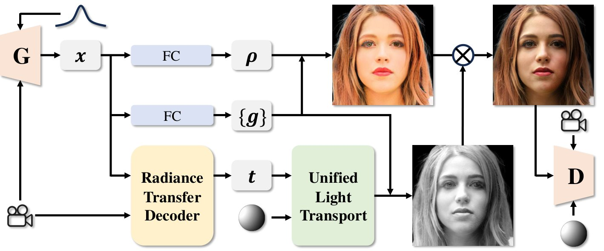
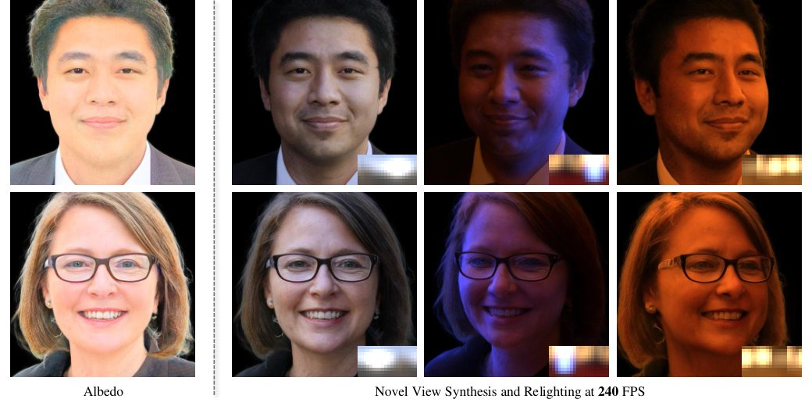
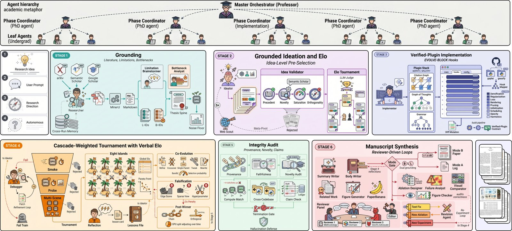

# 2026-10-24 科研日报

## 今日速览

本期来自周五（10-23）的 arXiv 公告。cs.GR 当天只有 2 篇新稿加 3 篇交叉投稿，又在 cs.CV 新稿里按重光照、辐射场、高斯等关键词补筛。正文两篇方向很不一样：一篇把“预计算辐射传输”装进生成式 3D 高斯人头，让重光照变成每个高斯上的一次线性运算；另一篇是 NeurIPS 2026 录用的 3DGS 自动科研系统，把“复现—改进—训练—写论文”整条链交给多智能体，并要求每个数字都能追到训练日志。

- **必读：[GSHeadRelight](#2026-10-24--gsheadrelight)（SIGGRAPH 2025，arXiv 版本周才挂出）。** 关键做法是给每个高斯存一组“与光照无关”的传输系数，渲染时只需和环境光的球谐系数做点积，因此换光不用再跑网络，作者报告 512 分辨率下约 240 FPS。更值得细看的是它怎样在没有光场采集数据、只有野外照片时处理反照率与光照的歧义：训练时假设白光，测试时靠传输的线性推广到彩色光。这是“可重光照资产里光传输应当表示成什么”的一个干净样本，也清楚暴露了球谐低频表示的天花板。和昨天的 JointLight 出自同一团队，可对照着读。
- **选读：[SplatLab](#2026-10-24--splatlab)（NeurIPS 2026）。** 一个专做 3DGS 的自动科研系统：先在已核验能复现原论文指标的插件上做改动，再用真实训练 PSNR 打锦标赛、用“证伪者”压力测试淘汰、用审计强制每个数字绑定日志。作者报告生成的方法相对复现目标提升 0.18–3.78 dB，三篇生成稿进了 CVPR 2026 研讨会。值得看的是它对“Agent 写论文最常见的造假与漂移”给出的工程约束，而非 PSNR 数字本身。
- **本期其他值得一扫：** 面向神经外科的高度场 2D 高斯表面重建、三角网格上保证轨迹不相交的流场定理，见文末简列。
- **圈内：** 月之暗面发布 Kimi K3.1 Pro（开放权重将于 11 月 4 日前放出），宣传点含 3D 建模与游戏引擎协作，社区争议集中在开放权重版刻意移除网络安全数据；另有一个把 Gemma 4 思考长度压掉约四成的蒸馏模型，用户反馈“省 token 但会变笨一点”。

## 可重光照资产：把光传输变成每个高斯上的线性系数

### GSHeadRelight · SIGGRAPH 2025 · 2026-10-22

**一句话判断：** 它的价值不在人头本身，而在于示范了一种“生成一次、任意换光都只做线性组合”的高斯外观表示：把可见性、自遮挡、次表面散射和低频高光都吸收进每个高斯的传输系数里。对真实场景逆渲染来说，这正是“物理参数化 BRDF”与“完全神经化外观”之间的一种折中，好处（实时、对光照线性、可彩色光推广）与代价（只能表达低频、反照率仍会残留高光）都写得很清楚。

**Title：** GSHeadRelight: Fast Relightability for 3D Gaussian Head Synthesis  
**作者：** Henglei Lv、Bailin Deng、Jianzhu Guo、Xiaoqiang Liu、Pengfei Wan、Di Zhang、Lin Gao  
**单位：** 中国科学院计算技术研究所；中国科学院大学；Cardiff University；快手科技  
**发表时间 / 投稿信息：** 已发表于 SIGGRAPH 2025 Conference Papers（2025-08，温哥华），HTML 全文附 ACM DOI；arXiv v1 于 2026-10-22 才挂出。**为何本期收录：** 正式论文早于本日报创建，但 arXiv 版本周首次公开、此前未收录，且与昨天的 JointLight 同一团队、同一“显式光传输 + 学习”思路，适合对照。  
**链接：** [摘要](https://arxiv.org/abs/2610.30619) · [HTML 全文](https://arxiv.org/html/2610.30619v1) · [PDF](https://arxiv.org/pdf/2610.30619) · [项目页](http://www.geometrylearning.com/GSHeadRelight/)；代码仓库暂未找到。

**摘要中译：** 人像的重光照与新视角合成在人像摄影、虚拟现实和增强现实中至关重要。尽管已有进展，3D 感知的人像重光照仍然困难，因为它同时要求照片级真实感、实时性能以及对未见过个体的泛化。现有工作要么依赖有限且昂贵的光场舞台（light stage）采集数据作监督，要么效果欠佳；而且很多工作基于生成式 NeRF，3D 一致性差、实时性低。我们借助生成式 3D 高斯的最新进展，设计了一个基于统一神经辐射传输表示的光照模型，它对入射光呈线性响应。只使用野外图像，我们的方法取得了最先进的重光照效果，渲染速度比以往 3D 感知人像重光照研究快约 12 倍。

*原论文 Figure 2（方法流程），[来源](https://arxiv.org/html/2610.30619v1)。从左到右是一条数据流：同一个高斯嵌入分三路，一路变成反照率，一路变成位置、尺度、旋转、不透明度，一路（加上视角方向）变成传输系数；光照只在“统一光传输”这一格进入，所以换光不需要重跑生成器。*

**方法与原理。**

先解释两个名词。**球谐函数（SH）** 是球面上的一组正交基，可以把“各方向来的光有多强”这样的球面函数压成十几个系数，阶数越低越只能表达模糊、低频的变化。**预计算辐射传输（PRT）** 是实时图形学里的经典技巧：把“某点从各方向接收光、经过遮挡和多次反射后朝外射出多少”这一整套过程，预先算成一组与光照无关的传输系数；运行时光照也展开成同一组球谐系数，出射光就是两组系数的点积。

1. **问题与瓶颈。** 单张照片或稀疏输入下，材质与光照天然有歧义（暗是因为皮肤颜色深还是因为光弱）。已有做法要么用光场舞台采集的真值监督（贵、通常不公开），要么基于生成式 NeRF 加 2D 超分（换视角会闪烁），而且大多每换一次光都要重新跑一遍神经网络，实时性差。
2. **输入与输出。** 训练数据只有 FFHQ 这样的野外人脸照片，加上用现成估计器（DPR）从每张图估出的单色三阶球谐光照标签。生成后得到一个 3D 高斯人头：每个高斯除几何属性外，带一个反照率 \(\rho_p\) 和一个随视角变化的传输向量 \(\mathbf{t}_p(\hat{\mathbf{v}})\)；任何能转成球谐系数的环境光都可以直接用来重光照。
3. **统一辐射传输。** 作者把渲染方程里的可见性、BRDF 和余弦项合并成一个“统一传输函数”，在球谐基下展开，得到

$$
L_{\text{out},p}(\hat{\mathbf{v}})=\rho_p\sum_{i=1}^{n^2} l_{\text{in}}^{i}\,t_p^{i}(\hat{\mathbf{v}})
$$

   其中 \(L_{\text{out},p}\) 是高斯 \(p\) 朝视角方向 \(\hat{\mathbf{v}}\) 发出的颜色，\(l_{\text{in}}^{i}\) 是环境光的第 \(i\) 个球谐系数，\(t_p^{i}\) 是该高斯的传输系数，\(n\) 是球谐阶数（本文 3 阶，共 9 个系数）。经典 PRT 里漫反射只用一个与视角无关的向量，高光需要大得多的传输矩阵；这里让传输系数由一个小 MLP（一层 64 个隐单元）以视角为条件输出，用同样大小的向量同时近似漫反射和低频高光。
4. **怎样学（白光假设）。** 没有反照率真值时，“颜色归反照率还是归光照”无法区分。作者的处理是训练时只用白光：光照和传输都退化成单通道，于是颜色只能由反照率负责，歧义被切断。训练目标就是 3D 高斯 GAN（以 GSGAN 为骨干）的对抗损失，判别器同时看相机位姿和光照条件，迫使生成结果“在这个光照下看起来像真实照片”。在 4 张 H800 上从头训练，共看过 1500 万张图。
5. **怎样用。** 生成一次后，几何、反照率、传输系数都固定下来，可以按普通 3DGS 存储；换光只需把新环境贴图（先做高斯模糊）投影成球谐系数，与传输系数逐通道点积。因为整个模型对入射光是线性的，虽然训练只见过白光，测试时也能逐通道处理彩色光。真实照片则先用 GAN 反演（Pivotal Tuning）投到隐空间再重光照。

**为什么这样设计（作者解释与实验支持分开）。** 作者论证：其一，光照只在最后一步以点积进入，所以重光照不需网络推理，这是速度的来源；其二，线性带来“光传输一致性”，彩色光是免费的推广。消融支持了两点：去掉辐射传输、改为让解码器直接吃光照条件出颜色，光照误差从 0.65 升到 1.23；去掉视角条件，误差升到 0.70，且反照率里残留更多高光。作者还试过两种看似更“物理”的替代方案，结果都更差：用 RGB 光照标签训练，反照率褪色、模型退化成风格迁移，未见光照下失败；把传输拆成漫反射和高光两项，没有显式监督时三者分解错乱、颜色不一致。

**结果与局限（作者报告）。** 512 分辨率、单张 RTX A6000 上约 243 FPS，与无重光照能力的骨干 GSGAN（245 FPS）几乎持平；对比的 NeRFFaceLighting 为 2.8 FPS、Volux-GAN 为 21 FPS（256 分辨率）。生成质量 FID 5.71（越小越好，GSGAN 为 5.60）。光照误差（用现成估计器从生成图里反估光照，与给定光照比距离，越小越好）0.62，与 NeRFFaceLighting 的 0.64 相当，2D 方法 DisCoFaceGAN 更低但生成质量差。作者自述局限：球谐只能表达低频光照，强镜面反射表达不了；部分样本的高光会被学进反照率；从下往上打光看起来不自然，因为野外照片里几乎没有这种光照。

**值得关注 / 阅读指引。** 对“真实场景可重光照 3DGS 资产”而言，这篇提供的是一种外观参数化选项，不是逆渲染管线：它靠 GAN 先验和人脸数据分布来消除歧义，迁移到任意室内场景并不直接成立。可借鉴的是三点：传输系数挂在每个高斯上、光照只在末端线性进入的结构（与光探针、辐射缓存思路同族）；白光假设这种“用数据统计偏好切断歧义”的做法及其失效方式；以及“拆成漫反射+高光反而更差”的负面结果，提醒没有监督时更物理的分解不一定更好。需要注意，光照误差指标依赖第三方估计器，只衡量“看起来像不像这个光”，不衡量物理正确。建议顺序：Figure 2 → §3.2 → Table 4 消融与 Figure 10 → §4.5 两个替代设计 → Figure 11 失败案例。

*原论文 Figure 1，[来源](https://arxiv.org/html/2610.30619v1)。*

## Agent 做 3DGS 研究：把每个数字钉在训练日志上

### SplatLab · NeurIPS 2026 · 2026-10-21

**一句话判断：** 这类“AI 科学家”论文多半难以评价，这篇值得一读是因为它把 3DGS 当成实验场，正面处理了 Agent 科研的三个老问题：基线复现不对、指标与日志对不上、长程运行偏离目标。提升幅度本身要打折看（最大的 3.78 dB 来自作者自采、此前无人做过的星云场景），但“已核验复现的插件 + 真实训练打分 + 强制证据绑定”这套约束，对任何想让 Agent 跑实验的人都有参考价值。

**Title：** SplatLab: Autonomous Scientific Discovery for 3DGS Research  
**作者：** Seemandhar Jain、Manmohan Chandraker  
**单位：** University of California San Diego  
**发表时间 / 投稿信息：** arXiv v1 于 2026-10-21 挂出；Comments 标注已被 NeurIPS 2026 接收。  
**链接：** [摘要](https://arxiv.org/abs/2610.30468) · [HTML 全文](https://arxiv.org/html/2610.30468v1) · [PDF](https://arxiv.org/pdf/2610.30468) · [项目页](https://seemandhar.github.io/splatlab)（作者称代码、全部生成稿与实验台账在此公开）

**摘要中译：** 复现一篇已发表的 3DGS 论文，往往要花数周专家工程，之后才谈得上提出扩展。以往的自主科研系统会读论文、拟假设、写代码，但受限于短小固定的模板、低可执行性和弱可追溯性，且没有一个在活跃的计算机视觉子领域端到端演示过。SplatLab 是面向 3D 高斯泼溅的自主科研系统。给定一句研究提示、一篇目标论文的链接或什么都不给，它会复现一个已发表基线，提出扩展，在 Mip-NeRF 360 与 LLFF 上训练和消融，撰写论文，并把每个报告的数字绑定到一次有日志的训练。五个设计将它与前作区分：(i) 候选方案在“已核验复现、与发表基线对齐”的插件骨干上变异；(ii) 跨八个“岛”的级联加权 Elo 锦标赛，以实测 GPU 上的 PSNR 打分，并提供语言化梯度反馈；(iii) 常驻证伪者在攻击得手时扣减 Elo，把压力测试存活纳入选择；(iv) 每个报告数字绑定到一次训练日志，只要还有无依据的论断运行就不能结束；(v) 七类 3DGS 分类法把 EVOLVE-BLOCK 标记包进与领域对齐、可跨 3DGS 仓库迁移的脚手架。SplatLab 生成的论文相对其复现目标提升 0.18–3.78 dB PSNR，其中 3.78 dB 来自此前没有 3DGS 方法的天文星云渲染。研究周期从研究生数月压缩到几天的、基本自主的计算。代码、全部论文稿、实验台账和跨运行的论文库均在项目页公开。

*原论文 Figure 2（系统流程），[来源](https://arxiv.org/html/2610.30468v1)。阶段 6 的审稿意见可以要求新实验并回到阶段 3–4，这是它与“写完即止”的系统最大的区别。*

**方法与原理。**

几个名词先说清：**Elo** 是国际象棋的等级分，两两比赛后按“意外程度”加减分；**EVOLVE-BLOCK** 是在代码里用成对注释圈出的“允许智能体修改的区域”，区域外的已验证实现保持不动；**Splatify** 是作者团队此前的工作，把 3DGS 论文转成可在 Nerfstudio 框架中训练、并已对齐原论文指标的插件。

1. **问题与瓶颈。** 通用编程智能体在 3DGS 上复现成功率很低（作者引用的 30 篇复现基准里前沿模型约 5%），因为稠密化调度、不透明度重置、球谐激活等细节不会写在提示里。复现不对，所谓“改进”就没有参照；再加上长程运行中上下文膨胀导致目标漂移、论文里出现找不到出处的数字。
2. **阶段 1：定位问题。** 一路读文献，把各论文自述的局限和后续工作的批评交叉整理成编号的“局限条目”；另一路真的去训练已核验插件，记录逐块损失、PSNR 曲线、显存、梯度范数，整理成编号的“瓶颈条目”（例如某场景 PSNR 卡在某值）。后续所有阶段只以这两类条目为依据。
3. **阶段 2–3：提想法并落到代码。** 想法必须声明对应哪条局限、攻击哪条瓶颈、改哪一类模块（稠密化、正则、损失、渲染、剪枝、初始化、调度、不透明度、球谐九个钩子之一），并通过先例、新颖性（拒绝只调超参）、饱和度（该格子失败太多就不再试）、正交性四道检查，再由 LLM 评委两两比较排出初始 Elo。入选想法以结构化 diff 的形式只改 EVOLVE-BLOCK 内的代码，必须通过编译和 100 次迭代的冒烟训练。
4. **阶段 4：用真实训练当裁判。** 候选依次经过冒烟、单场景全长、多场景全长三级评测，对应 Elo 更新权重 0.2、0.5、1.0，避免便宜测试的胜利压过昂贵测试的失败；分数按“基准—问题”对分别记，而非一张总榜。每场比较附 LLM 写的原因分析，汇成“经验文件”喂回提想法的智能体。另有常驻证伪者从极端场景、稀疏视角、超参扰动三方面攻击每个幸存者，每成功攻击一次扣 30 分。
5. **阶段 5–6：审计与写作。** 每个数字通过哈希链追到实验编号、提交和配置；检查实际 diff 是否与声称的机制一致；在算力对齐下重算；把胜出改动移植到第二个 3DGS 代码库验证；任一关键数字对不上就终止。写作阶段多个智能体并行写各节，三位审稿智能体可以要求新训练，直到没有人再提“需要新实验”。

**为什么这样设计（作者解释与消融）。** 作者的核心主张是：瓶颈不在模型能力，而在缺少领域框架、已核验基线、完整迭代闭环和“论断—测量”绑定。消融逐项对应：去掉已核验插件约束，16 个胜者中 9 个无法在 1 dB 内复现；去掉证伪者，5/16 的胜者在留出攻击下失败；去掉审计门，16/16 的稿件含找不到日志的数字；三级权重改为一样，会选出冒烟赛冠军、而它在多场景上只排第五。

**结果与局限（作者报告）。** 16 次运行共训练 198 个实验分支：5 个核验后的正结果、5 个边际结果、5 个非 PSNR 贡献、1 次失败。Table 1 正文列出的四组“改进已发表方法”中，提升为 0.57–2.83 dB（全量范围下限 0.18 dB 见附录），但其中部分对比条件特殊（如限定 50 秒墙钟时间、额外多训 1.5 万步），需要逐行看设置；最大的 3.78 dB 来自作者自采的星云场景、以原版 3DGS 为基线。每次运行墙钟 24–48 小时、2–36 GPU 小时、约 1.1 亿 API token，作者估计 API 费用 150–250 美元。人类盲审中，生成稿总体 3.5（临界），已发表论文 4.1；多智能体审稿反而略偏向生成稿，作者也承认这与 LLM 评委偏好 AI 内容一致。作者还在“广泛影响”中提示可能冲击同行评审的产能。

**值得关注 / 阅读指引。** 与逆渲染主线的直接联系不大（它的优化目标是新视角 PSNR，不涉及材质与光照分解），放在选读是因为两点：一是它把“基线复现正确”作为一切改进的前提并工程化了，这对任何依赖 3DGS 开源基线的研究都适用；二是“经验文件 + 证伪者 + 证据绑定”对长时间运行的科研 Agent 是可借鉴的组织方式。读时注意：PSNR 提升不等于几何或资产质量提升，而且多数比较是“各自目标、各自设置”的成对比较，不是统一基准下的排行。建议顺序：Figure 2 → §3.1 阶段 3–5 → Table 6 消融 → Table 1 逐行设置 → Table 5 人类与 LLM 审稿的分歧 → 广泛影响。

## 本期其他值得一扫

- [H-2DGS](https://arxiv.org/abs/2610.30910)：神经外科场景视角很少，原版 3DGS 会把不透明度摊成一层厚而模糊的带。作者先做鲁棒 3DGS，把深度融合进截断符号距离场（TSDF）得到表面，再用贴着表面、带局部高度场的弯曲 2D 高斯表示它，并可用术后 MRI 深度驱动形变。作者报告 5 例真实手术、模型 7.97 MB、每帧 29–42 ms。与“视角稀疏时怎样得到清晰表面”相关，领域特定，本期未展开。
- [A Tutte-Like Theorem for Injective Flows on Meshes](https://arxiv.org/abs/2610.30149)：在球面网格上解离散调和函数，取其梯度旋转 90° 作为向量场，证明沿它平流的两点轨迹永不相交；求解只需一个稀疏线性系统，且对拉普拉斯矩阵项可微，可在保持单射的前提下做梯度优化。属于几何处理理论，本期未展开。

## 圈内新闻与社区反应

**月之暗面发布 Kimi K3.1 Pro（LLM / Agent）。** 据官方[技术博客](https://www.kimi.ai/blog/kimi-k3-1-pro)，K3.1 Pro 是在 Kimi K3 上投入大得多的后训练算力、跨数百个领域联合做强化学习得到的模型，官方称是其迄今最强的 3T 级开放权重模型，上下文 100 万 token，同时推出约快 2–3 倍的 Highspeed 版；已在 Kimi 产品与 API 上线，完整权重将于 11 月 4 日前放出。厂商自报：Terminal-Bench 4.0 为 65.7%（博客列出 GPT-6 Astra 58.2%、Claude Opus 5.5 66.4%）；在“由多视角渲染图生成 CAD 代码重建 3D”的 BenchCAD 上为 92.7%（带工具）；博客还展示它与 Unity、Unreal、Godot 及 3D 生成工具配合做游戏和 Three.js 场景，并在一个开源人体解剖模型上搭建步行仿真、自行发现并修正 36 处肩部肌肉力臂计算错误。Hacker News 10-23（UTC）的[讨论串](https://news.ycombinator.com/item?id=50212065)里，争议最集中的是开放权重版本刻意移除了网络安全相关训练数据：有人直接引用这段声明并表示失望（[TuxSH](https://news.ycombinator.com/item?id=50212324)），也有人指出官方等于承认“能做得更强但不放”（[rudolftheone](https://news.ycombinator.com/item?id=50212365)）；同一用户注意到博客里幻觉基准从 23.4% 降到 8.3%（[rudolftheone](https://news.ycombinator.com/item?id=50212301)）；还有人感叹各家都在自建一套强化学习环境，好奇行业会不会收敛到少数框架（[wolttam](https://news.ycombinator.com/item?id=50212357)）。截至发稿，讨论里多为对公告的反应，暂未找到可核实的独立评测或复现。编辑判断：对图形学读者，值得留意的是厂商开始把 CAD 重建、游戏引擎协作当成正式卖点，但这些都是自报数字，等权重放出后的第三方评测再下结论。

**ThinkingCap：把 Gemma 4 的思考长度压掉约四成（LLM）。** BottleCap AI 在 10-23 的[博文](https://bottlecapai.com/post/thinkingcap-gemma-4-26b/)中发布对 Google 的 gemma-4-26B-A4B-it（26B 参数、每 token 约 4B 激活的稀疏混合专家模型）再训练的版本，目标是只减少推理时的“思考”token、不改变答案质量。厂商自报：12 个基准上思考 token 平均减少 38.9%、最多 69.1%，平均准确率只降 0.15 个百分点，陷入循环的回答从 3.6% 降到 0.8%；采样设置与服务栈不变，可直接替换。HN [讨论串](https://news.ycombinator.com/item?id=50209907)里有两位用过该系列早先 Qwen 版本的用户给出实际体验：一位说同一任务结果“没那么聪明”，若追求最好结果宁可多花 token（[PaulKeeble](https://news.ycombinator.com/item?id=50213222)）；另一位用了两周，认为比原版“确实笨一些但差得不远”，且审查更严，最后换回原版（[syntaxing](https://news.ycombinator.com/item?id=50213988)）；还有人从原理上评论，小模型是在用更多推理 token 补偿参数里没做的计算（[arjie](https://news.ycombinator.com/item?id=50214535)）。注意这两条使用反馈针对的是早先版本，不是这次的 Gemma 版。编辑判断：基准平均值上的“几乎无损”与长尾任务上的体感退化并不矛盾，用在长程 Agent 里前应在自己的任务上对照测。

**Impossible Machines：给物理机构的“声明式编程”原型（图形学 / 具身）。** [Impossible Machines](https://www.impossiblemachines.xyz) 是 @bhaprayan 做的网页演示，于 10-22 以 Show HN 发布：用户在画面上摆放源头、障碍、铃铛、门等目标，描述“希望世界变成什么样”，系统就生成曲柄、配重、挡块、导轨组成的机构去实现。作者称这是一个思想实验原型，页面未披露生成机构的算法。HN [讨论](https://news.ycombinator.com/item?id=50202746)里有人联想到 Disney 研究院根据用户画的轨迹自动生成连杆机构的工作（[mcphage](https://news.ycombinator.com/item?id=50214170)），也有人追问代码仓库和实现方式（[donalddominko](https://news.ycombinator.com/item?id=50214552)）。编辑判断：目标驱动的机构合成是计算设计的老问题，这个演示的交互形式值得一看，但在原理公开前看不出新意在哪里。

## 覆盖说明

日报发布日为 **2026-10-24（周六）**，内容来自 2026-10-23（周五）的 arXiv 公告：cs.GR 新稿与交叉投稿，并在 cs.CV 新稿中按重光照、辐射场、高斯等关键词补筛。正文两篇为 GSHeadRelight（2610.30619）与 SplatLab（2610.30468），均核对了 arXiv HTML 全文的方法、实验与局限；GSHeadRelight 为 SIGGRAPH 2025 已发表论文的 arXiv 首挂版本，按新收录处理。配图均为原论文插图。所有结果均为作者或厂商报告，未独立复现。对标仓 Real2Sim_GPT6_ASTRA 自上次检查以来无新提交；Blender 主干自 10-22 以来的提交中未见与高斯泼溅相关的新改动。圈内新闻本期以 Hacker News 当日讨论为主要入口，只核对了官方博文与项目页；中文媒体与 X 本期未单独检索。

**编写：** Cream
