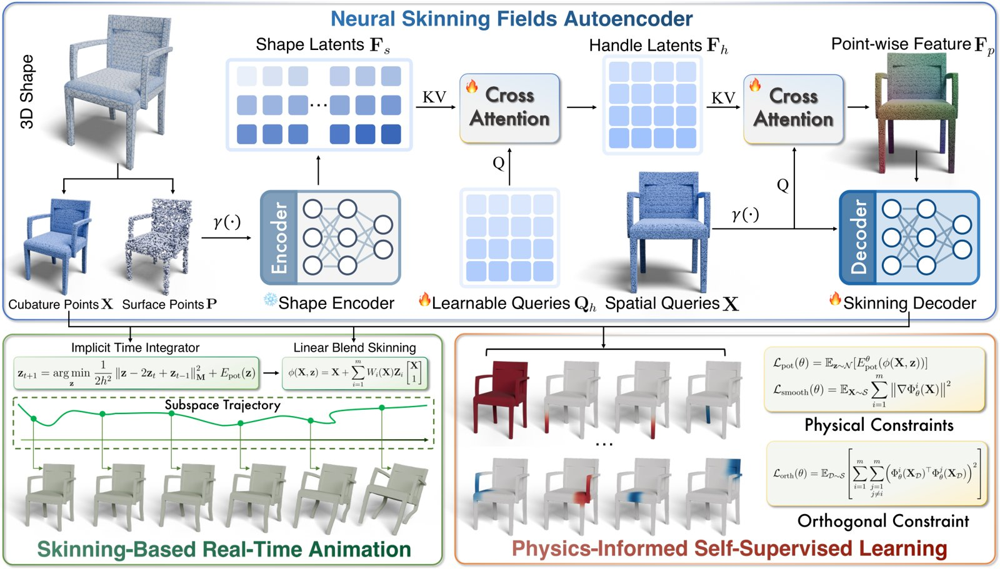
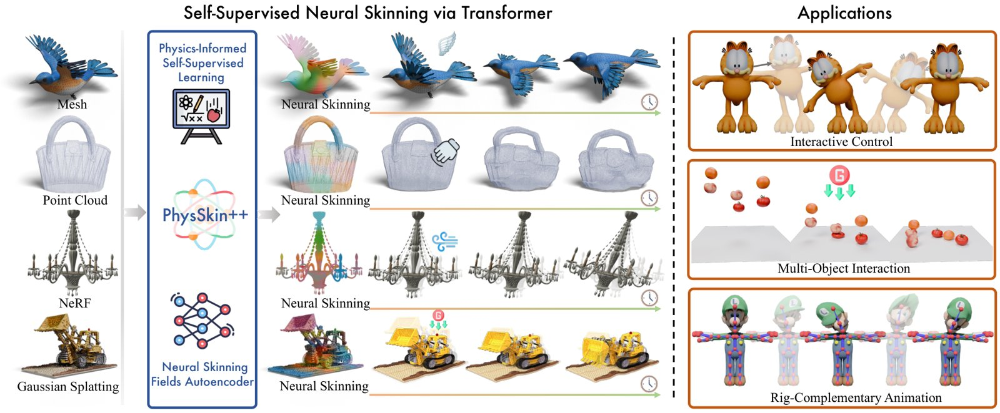
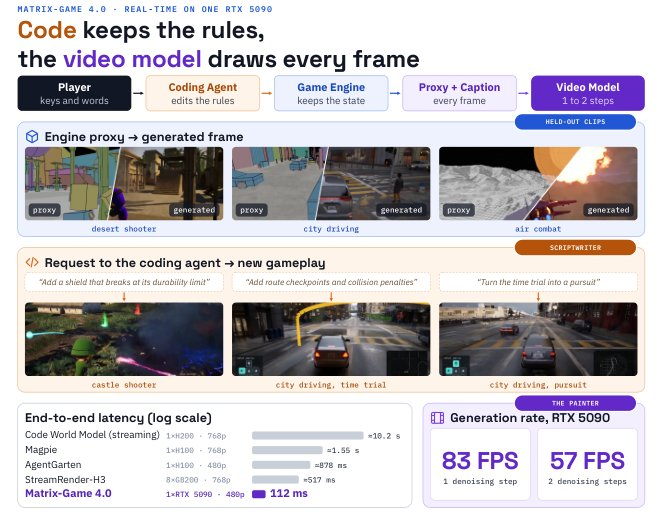

# 2026-10-25 科研日报

## 今日速览

周六没有 arXiv 公告，本期按惯例补录本周（10-19 至 10-23 公告）cs.GR 里此前没来得及收的稿件，并回扫 cs.CV 交叉投稿。挑出的两篇都和“资产能不能动起来、画面能不能实时出”有关：一篇让任意静态网格、点云或 3D 高斯在不训练逐物体网络的情况下直接获得物理可信的变形，另一篇把游戏世界的规则交给引擎、画面交给视频模型，在一张消费级显卡上跑到 60 FPS。

- **必读：[PhysSkin++](#2026-10-25--physskin)（CVPR 2026 会议版 PhysSkin 的扩展，浙江大学等）。** 它只看静态几何，用一个前馈网络预测“蒙皮场”，即一组定义在空间每一点上的变形权重，把物体的弹性变形压进几十个手柄自由度里，再在这个小空间里做隐式时间积分。关键在于完全自监督：不用模拟轨迹、不用蒙皮标注，只靠“随机变形的势能要低、权重要平滑、彼此要正交”三条物理与数学约束训练。新版加上的 3D 高斯绑定，正好回答“重建出来的高斯资产怎样被物理驱动”这个问题：每个高斯在静止中心处查一次蒙皮权重，运行时用局部仿射变换同时更新中心和协方差。值得精读，也要看清它的边界：外观（不透明度、球谐）保持不变，换句话说变形不影响光照。
- **选读：[Matrix-Game 4.0](#2026-10-25--matrixgame4)（昆仑万维 SkyworkAI 等，技术报告，代码与权重已开源）。** 不再让视频模型自己“记住世界”，而是由轻量引擎维护状态、执行规则，再由一个蒸馏到 1–2 步的自回归视频模型把引擎画出的低多边形代理“重绘”成写实画面。作者报告单张 RTX 5090 上 480p、60 FPS，按键到上屏 112 ms。对图形学读者，它是“粗渲染 + 神经重绘”这条实时管线目前做得最工程化的样本之一，也是对“视频模型即世界模型”路线的一次明确反驳。
- **本期其他值得一扫：** 用无重叠的幂图剖分代替高斯来做开放词汇语义提升的 OV-Foam，用半经验反射模型加阴影渲染联合优化地形与相机抖动的 OrTeN，见文末简列。
- **圈内：** Dream Labs 发布号称能零样本控制未见过机器人的“世界动作模型” Dream-1，靠末端执行器位姿作为跨机型统一接口；HN 上质疑集中在演示任务过于入门、离真实自动化很远。另有开源内核模块解锁 RTX 30 系显卡的 BF16 指令吞吐，实测收益远小于宣传。

## 可编辑动态资产：只看几何就学出物理蒙皮场

### PhysSkin++ · arXiv · 2026-10-19

**一句话判断：** 想让重建出来的 3D 资产“能被戳、能被拖、能互相碰撞”，过去要么逐物体训练神经子空间，要么在全空间跑有限元或物质点法（MPM）。这篇把“学变形子空间”做成了跨形状泛化的前馈网络，并且把同一个变形场直接绑到 3D 高斯上，是目前把“几何先验 + 降阶物理 + 高斯资产”串起来最完整的一篇。它不处理外观随变形的变化，也不从视频里估材料参数，这两点恰好是和逆渲染主线对接时要补的部分。

**Title：** PhysSkin++: Real-Time and Generalizable Physics-Based Animation via Self-Supervised Neural Skinning  
**作者：** Yuanhang Lei、Baofei Liu、Xingxuan Li、Tao Cheng、Zixuan Wang、Boming Zhao、Yujun Shen、Siyuan Huang、Ruizhen Hu、Peter Yichen Chen、Hujun Bao、Zhaopeng Cui  
**单位：** 浙江大学 CAD&CG 国家重点实验室；蚂蚁集团；北京通用人工智能研究院；深圳大学；University of British Columbia  
**发表时间 / 投稿信息：** arXiv v1 于 2026-10-19 挂出。会议版 PhysSkin 已发表于 CVPR 2026（见原文参考文献）；本文按 IEEE 期刊格式撰写并带 Index Terms，作者说明是在会议版基础上的四方面扩展，推测为期刊扩展版在投，具体期刊未标明。  
**链接：** [摘要](https://arxiv.org/abs/2610.26067) · [HTML 全文](https://arxiv.org/html/2610.26067v1) · [PDF](https://arxiv.org/pdf/2610.26067) · [项目页](https://zju3dv.github.io/PhysSkin_plus/)

**摘要中译：** 让实时物理动画在多样的 3D 形状和空间离散方式之间泛化仍然困难。本文提出 PhysSkin++，一个物理信息驱动的框架，它从静态几何中学习连续的神经蒙皮场，以构造紧凑的变形子空间。具体而言，我们提出神经蒙皮场自编码器，无需逐物体训练网络即可预测依赖形状的变形子空间。为了在没有模拟轨迹的情况下学习这些子空间，我们设计了物理信息自监督学习策略，结合蒙皮场归一化与冲突感知的梯度校正，在物理约束与正交约束下稳定联合优化。学到的表示支持带用户控制与接触交互的高效降阶动力学，并可直接把动画绑定到网格、点云和 3D 高斯。对于给定骨骼绑定（rig）的动画，我们进一步引入自监督的互补性目标，学习与绑定互补的弹性响应，而无需在运行时强制互补约束。实验展示了所学蒙皮场的跨形状泛化、实时降阶模拟，以及可控、可感知碰撞、与绑定互补的动画应用。

*原论文 Fig. 2（方法流程），[来源](https://arxiv.org/html/2610.26067v1)。上半部分只在训练和“给新物体出蒙皮场”时运行一次；下半部分才是每帧都跑的部分，而它只涉及几十个手柄自由度。*

**方法与原理。**

先说几个名词。**线性混合蒙皮（LBS）** 是角色动画里最常见的变形方式：给每个点一组权重，点的新位置是若干“手柄”变换按权重的加权和。**降阶（子空间）模拟** 是让物体只在少量基底张成的空间里变形，求解的未知数从“每个顶点三个坐标”降到“每个手柄十几个仿射参数”，因此能实时。**cubature 点** 是用来近似体积积分的采样点，这里同时在表面和内部采样，以便计算整块物体的弹性势能。

1. **问题与瓶颈。** 经典降阶方法为某一张网格优化一个线性子空间矩阵，换分辨率、换拓扑就要重算；近年的神经子空间方法（如 Simplicits）能处理任意离散，但每个物体都要单独训练一个网络；直接从模拟轨迹学动力学的 Transformer 方法能泛化，却需要大量轨迹数据，也不显式给出低维子空间。
2. **变形表示。** 物体上任一点 \(\mathbf{X}\) 的变形写成

$$
\phi(\mathbf{X},\mathbf{z})=\mathbf{X}+\sum_{i=1}^{m}W_i(\mathbf{X})\,\mathbf{Z}_i\begin{bmatrix}\mathbf{X}\\1\end{bmatrix}
$$

   其中 \(m\) 是手柄数，\(W_i(\mathbf{X})\) 是第 \(i\) 个手柄在该点的蒙皮权重，\(\mathbf{Z}_i\) 是该手柄的仿射位移（3×4 矩阵），所有 \(\mathbf{Z}_i\) 拼起来就是降阶坐标 \(\mathbf{z}\)。权重不要求非负，所以它更像一组“变形模态”，不是动画师意义上的骨骼权重。
3. **怎样从几何预测权重。** 表面采 4096 个点，送进在 ShapeNet 上以符号距离场重建预训练、随后冻结的 Michelangelo 点云编码器，得到一组形状隐变量；一组可学习的“手柄查询”通过交叉注意力从中读出手柄隐变量；任意空间点再通过第二次交叉注意力读手柄隐变量，拼上位置编码，经 MLP 输出该点的 \(m\) 维权重。最后一层用牛顿迭代正交化模块（ONI）推动各模态互相独立。
4. **怎样自监督训练。** 没有任何标注，目标由三项组成：一是随机采样一批降阶坐标 \(\mathbf{z}\)，要求它们诱导的变形的弹性势能期望尽量低（训练中从线弹性逐步过渡到 Neo-Hookean 超弹性模型），这样子空间里装的就是“低能量、物理上容易发生”的变形；二是权重的空间梯度要小，保证变形平滑；三是不同模态在采样点上的内积要接近零。三项的梯度量级和方向经常冲突，作者用逐列 L2 归一化防止权重尺度漂移，再用 ConFIG 冲突感知梯度校正平衡各项。
5. **运行时怎样动。** 每一步解一个只含 \(\mathbf{z}\) 的隐式积分问题：惯性项加势能项，再按需加外力、狄利克雷边界（固定某些区域）、地面接触罚项和物体之间的 IPC 风格障碍项，因此能做拖拽、坠落、多物体相互挤压。有动画师绑定时，把绑定驱动的运动当作主运动，再学一组与绑定雅可比“正交”的补充模态，只负责肉的晃动、尾巴的甩动这类弹性响应。
6. **绑定到 3D 高斯。** 对每个高斯，只在静止中心 \(\boldsymbol{\mu}_g^0\) 查一次权重，组合出局部仿射变换 \([\mathbf{A}_g\;\mathbf{t}_g]\)，然后中心变为 \(\mathbf{A}_g\boldsymbol{\mu}_g^0+\mathbf{t}_g\)，协方差变为 \(\mathbf{A}_g\Sigma_g^0\mathbf{A}_g^\top\)，不透明度和球谐系数保持不变。这一步和训练无关，任何离散表示都能用同一套降阶状态驱动。

**为什么这样设计（作者解释与实验支持分开）。** 作者的论证是：蒙皮场是空间连续的，所以与网格分辨率和表示形式无关；子空间的“好坏”可以用低势能、平滑、正交三条性质刻画，因此不需要轨迹监督。由于没有蒙皮真值，作者自定义了三项矩阵指标（模态正交程度、格拉姆矩阵条件数、谱熵）来比较，并报告在 RigNet 未见物体和 ShapeNet 上都优于逐物体训练的 Simplicits 和有监督的绑定方法 RigNet、Anymate、Puppeteer 等。消融显示去掉平滑、正交、归一化、ONI 或梯度校正中的任一项，条件数和正交性都会变差；去掉势能项则学不出可解释的蒙皮场。需要注意，这些指标衡量的是“基底是否良态、是否独立”，不直接衡量变形是否像真实材料。

**结果与局限（作者报告）。** 作者与开源 GPU 实现的隐式有限元和显式 MPM 做了同硬件计时对比，称降阶方法时间效率显著更好（具体数字见原文表格）。定性展示包括重力下的固定边界变形、交互拖拽、刚体砸在软体上、多个软体相互堆叠，以及在 Mixamo 动作驱动下给角色加上弹性补充运动。训练用 4 张 RTX 4090。作者自述局限是没有语义先验，复杂几何（比如细长部件很多的物体）上蒙皮场的表达力有限。

**值得关注 / 阅读指引。** 对“拆分绑定、可编辑动态资产”这条线，这篇提供了一个现成的驱动层：重建或生成的高斯资产，只要有一个大致的表面网格或点云，就能前馈地拿到物理子空间，并在几十个自由度里实时仿真，这对消费级硬件上的具身仿真演示是友好的。要接到真实场景，还缺三块：外观不随变形更新（高斯旋转后球谐不跟着转，光照也不变），材料参数是全局设定而非从观测估计，以及物体拆分本身需要上游完成。建议顺序：Fig. 2 → §III-A 式 (1) → §III-C 三项损失与稳定化 → §III-F 高斯绑定 → 消融与 Fig. 14 → Fig. 4、Fig. 5 的交互与碰撞演示。

*原论文 Fig. 1，[来源](https://arxiv.org/html/2610.26067v1)。*

## 实时神经渲染：引擎管规则，视频模型只负责画

### Matrix-Game 4.0 · arXiv · 2026-10-20

**一句话判断：** 这是一份系统报告，不是方法论文，值得看的是架构立场和工程数字：作者明确认为当下的视频生成模型更像“渲染器”而不是世界模型，于是把世界状态、碰撞、计分全部交给一个轻量引擎，视频模型只把引擎画出的“灰盒子世界”逐块重绘成写实画面。对神经渲染方向，它说明了“结构代理 + 少步扩散重绘”在消费级显卡上已经能进入交互帧率；但它的画面一致性完全依赖引擎代理和配对训练数据，换场景就要重新采数据。

**Title：** Matrix-Game 4.0: Harnessing Video Models for Real-Time Playable Game Worlds  
**作者：** Jihai Zhang、Runjia Qian、Kaiqin Kong、Biao Jiang、Puyi Wang、Siru Chen、Tianle Li、Guanjie Chen、Junyi Wu、Chubin Chen、Yuanhang Li、Kaichen Huang、Haobo Zhang、Yangguang Li、Wei Yu、Guibin Chen、Yu Cheng、Yahui Zhou  
**单位：** SkyworkAI；香港中文大学；UC San Diego；中国科学技术大学；上海交通大学；上海人工智能实验室；Nanyang Technological University  
**发表时间 / 投稿信息：** arXiv v1 于 2026-10-20 挂出，自述为技术报告；投稿信息未标明。  
**链接：** [摘要](https://arxiv.org/abs/2610.27999) · [HTML 全文](https://arxiv.org/html/2610.27999v1) · [PDF](https://arxiv.org/pdf/2610.27999) · [项目页](https://matrix-game-v4-0.github.io/page/)（作者称代码、权重和低多边形游戏资产均已放出）

**摘要中译：** 从可控视频走向真正可玩的世界，需要持久的世界状态、可执行的游戏规则和低延迟交互。我们为下一代 Matrix-Game 勾勒了一条路线：通过可执行的游戏外壳（harness）把游戏执行与视觉生成分离，并推出基于这一设计的首个系统 Matrix-Game 4.0。一个轻量游戏引擎维护世界状态并执行交互规则；一个多模态编程智能体把玩家的想法翻译成游戏代码和动态场景描述；一个基于自回归视频模型的渲染器把引擎渲染的低多边形代理转换成细节丰富的画面，并以动态描述和记忆参考为条件。这一框架为视觉生成提供持续引导，并允许用自然语言创建和修改场景与玩法。渲染器在对齐的低多边形与高保真视频对上训练，并蒸馏为以四帧为一块、一到两步去噪的因果生成器。配合针对性的推理优化，Matrix-Game 4.0 在单张 NVIDIA RTX 5090 上实现 480p、60 FPS 游戏，按键到显示延迟 112 ms。单步生成的稳态吞吐为 83 FPS，峰值显存 18.2 GiB；在固定提示词下，RTX 5080 上可达 67 FPS，RTX 5070 Ti 上 58 FPS。我们展示了由引擎保证机制的可定制射击和驾驶游戏，并开放代码、模型权重和低多边形游戏资产。

*原论文 Figure 1，[来源](https://arxiv.org/html/2610.27999v1)。中间一行最能说明它在做什么：左半边是引擎实际“渲染”的灰盒子与描边几何，右半边是视频模型重绘的结果，布局和相机完全跟着代理走。*

**方法与原理。**

1. **问题与瓶颈。** Genie 一类交互式视频世界模型把世界状态隐含在生成的像素和上下文里：视野外的东西没有显式记录，长时间运行会累积误差，游戏规则（血量、碰撞、计分）也无法保证被执行。作者还指出，现有视频模型的“理解力”大多来自上游多模态语言模型或文本编码器，扩散部分更像在做渲染。
2. **架构。** 引擎当“裁判”，维护状态、执行规则，并输出每帧的低多边形代理画面和可见物体列表；编程智能体当“编剧”，把玩家的自然语言需求写成游戏代码，同时把引擎上报的物体实例与语义描述对应起来，生成随状态变化的“动态描述”；视频模型当“画师”，只负责把代理画面加描述画成最终帧。
3. **配对数据。** 在 Unreal Engine 5 里对四类场景（中世纪城堡、沙漠、峡谷空战、CitySample 城市驾驶）同一相机、同一帧各渲染两次：一次是高保真画面，一次是去掉材质、纹理、光照的结构代理（天空纯黑、地面灰色棋盘格、建筑变成纯色方块、树变成圆柱加球、人物变成积木小人，全部描黑边）。共约 11.4 万段、1712 小时视频，留出整段采集会话做验证。
4. **渲染模型与蒸馏。** 以 Wan2.2 一类控制视频模型为基础，把一块噪声隐变量（一帧隐变量对应四帧视频）和用轻量编码器 TAEHV 编码的代理拼成 148 通道输入，30 个因果 DiT 块在 KV 缓存上做自注意力（缓存里有按相机位姿检索的空间记忆帧、参考帧和最近 20 块），对动态描述做交叉注意力。随后沿用 Causal Forcing++ 的三阶段蒸馏：先训练逐块因果的多步教师，再做因果一致性蒸馏得到四步学生，最后在学生自己的长序列滚动输出上做分布匹配蒸馏（DMD），得到每块一到两步的生成器。
5. **推理优化。** 用 CUDA Graphs 消除内核启动开销、融合算子、优化 KV 缓存注意力与解码 I/O，最终在单张 RTX 5090 上单步 83 FPS、两步 57 FPS。

**为什么这样设计（作者解释与证据）。** 作者的论据主要是系统层面的对比：Table 3 列出四个同样“由结构或代码世界驱动视频生成”的系统，端到端延迟从 517 ms 到 10.2 s 不等，且都需要 H100、H200 或 8 张 GB200；Matrix-Game 4.0 为 112 ms，约为次优者的五分之一，也是唯一跑在单张消费级显卡上的。需要注意，各系统分辨率和延迟口径不同（作者在表注中逐一说明了换算方式），这是一张“量级对比”而不是严格同条件评测。定性上，40 秒留出序列里生成画面始终跟随代理的布局、相机和物体运动，角色外观从头到尾保持一致。

**结果与局限（作者报告）。** 用编程智能体在射击游戏里加入血量、弹药、护盾耐久、霰弹枪和失败条件，把驾驶游戏改成带检查点的计时赛或追逐模式，规则全部由引擎执行。正文没有给出画质的定量指标，质量判断主要依赖定性图和视频。作者列出的后续方向包括降低推理成本、提高分辨率、多人一致视角和更精细的视觉控制，并计划在 Steam 发布技术预览。

**值得关注 / 阅读指引。** 与“正向批渲染效率”的关系在于路线对照：传统做法是在物理渲染里用 ReSTIR、辐射缓存等降低每帧采样代价，这里则把光照、材质、特效全部交给学到的重绘器，引擎只出几何。好处是帧时间与场景光照复杂度脱钩，代价是画面不可编辑、不保证物理一致、只在训练分布的场景风格里有效。对具身方向，“代理几何由引擎保证、外观由生成模型补”也是低成本做视觉域随机化的一种思路，而且 5070 Ti 级别显卡上就能跑。建议顺序：Figure 1 → §2 路线图 → §3.1 配对数据（理解代理长什么样）→ Figure 5 架构 → §4.3 蒸馏三阶段 → Table 3 及其表注 → Figure 7 长序列。

## 本期其他值得一扫

- [OV-Foam](https://arxiv.org/abs/2610.28131)（Yousef Rajeh、Alejandra Esparza Pelcastre、Ivan Viola、Dominik Engel）：把 2D 语言特征“提升”到 3D 时，若每条光线上只有一个基元，回投就是可以精确求解的最小二乘问题；3DGS 里一条光线穿过大量互相重叠的高斯，分配因此偏离最优。作者改用以幂图剖分空间、基元之间零重叠的 PowerFoam 表示，报告开放词汇分割优于高斯基线。和“场景拆分时表示本身是否在制造歧义”直接相关，本期仅据摘要简列。
- [OrTeN](https://arxiv.org/abs/2610.24075)（Josef Biberstein、Sertac Karaman）：用神经逆渲染从线扫卫星影像联合优化带纹理的高度图和轨道相机修正（含高频指向抖动），外观用半经验反射模型加阴影渲染，适配不同日期、不同太阳角的多时相影像；在火星杰泽罗陨石坑上对齐后高程误差 2.35 m。属于“光照变化下几何与相机联合优化”的行星遥感版本，可作逆渲染里处理多光照观测的参照。

## 圈内新闻与社区反应

**Dream Labs 发布 Dream-1：用末端执行器位姿做跨机型接口（具身）。** 据官方[发布博文](https://dreamlabs.ai/research/dream-1/)，Dream Labs 由今年 2 月提出“世界动作模型”（World Action Model）的 DreamZero 团队创立，此次结束隐身并宣布 9000 万美元种子轮，同时以公开 API 提供 Dream-1，价格自 3 美元每小时起。核心卖点是零样本控制没见过的双臂平行夹爪机器人：模型除了能输出原生支持机型的关节角，还能输出每个夹爪的末端位姿和开合状态，由各机器人自己的逆运动学求解器转成关节指令；输入是头部相机加两个腕部相机。官方展示了 27 个仿真未见机型和多款真机（包括 18 年前的 PR2）的演示，定量对比覆盖 27 个仿真机型和 4 款真机，并承认零样本表现依赖目标机器人的逆运动学求解器、且因机型而异，另提供“单样本适配”来缩小差距。Hacker News 10-24 的[讨论串](https://news.ycombinator.com/item?id=50223785)里，有人认为演示都是入门级任务，看不出如何接到制造和仓储的真实自动化（[Aurornis](https://news.ycombinator.com/item?id=50224148)），有人直言演示看起来还不能用于真实任务、所谓数据飞轮难以启动（[gradus_ad](https://news.ycombinator.com/item?id=50224101)），也有人担心第三方通过云端 API 控制家中机器人的隐私与安全问题（[prometheus1992](https://news.ycombinator.com/item?id=50224179)）。编辑判断：末端位姿加腕部相机作为统一动作空间并不新（UMI 已证明过同夹爪下的跨臂迁移），值得关注的是它声称放宽了“夹爪硬件必须一致”的前提；成功率目前只有相对其训练机型 YAM 的比值，暂无可核实的第三方评测。

**gpu-unlock：解锁 RTX 30 系的 BF16 指令吞吐（硬件 / 训练）。** 开源仓库 [gpu-unlock](https://github.com/Zagitta/gpu-unlock) 是一个 Linux 内核模块，在 NVIDIA 驱动加载前利用固件引导程序的漏洞改写速度选择寄存器，使 RTX 3000 系消费卡的 FP/BF16 指令发射率达到同芯片专业卡的水平。HN [讨论](https://news.ycombinator.com/item?id=50219700)里作者本人现身说明只是把已有利用方式打包得更易用（[Zagitta](https://news.ycombinator.com/item?id=50222102)）；实测反馈差异很大：有人在 3060 上训练 nanochat 快了约 6%，且受 170 W 功耗墙限制（[chromaton](https://news.ycombinator.com/item?id=50224546)），有人测得 200 W 限制下算力提升约 25%、但 LLM 推理里主要是预填充受益，综合只有 7–8%（[blagui](https://news.ycombinator.com/item?id=50224176)），也有人提醒要拿满收益需把功耗上限拉到 450 W、远超原装散热设计（[jacquesm](https://news.ycombinator.com/item?id=50221626)）。编辑判断：依赖固件漏洞、存在损坏显卡和后续被签名固件封堵的风险；对计算受限的训练有小幅收益，对显存带宽受限的任务（如很多 3DGS 训练）未必有帮助，不建议在唯一的工作卡上尝试。

## 覆盖说明

日报发布日为 **2026-10-25（周日）**。周六无 arXiv 公告，本期补录 10-19 至 10-23 公告中 cs.GR 新稿与交叉投稿里此前未收录的条目；正文两篇为 PhysSkin++（2610.26067）与 Matrix-Game 4.0（2610.27999），均核对了 arXiv HTML 全文的方法、实验与局限，配图为原论文插图。所有结果均为作者或厂商报告，未独立复现。对标仓 Real2Sim_GPT6_ASTRA 自 9 月 10 日以来无新提交；Blender 主干自 10-23 以来的提交中未见与高斯泼溅相关的新改动。圈内新闻以 Hacker News 当日讨论为主要入口，只核对了官方博文与项目仓库；中文媒体与 X 本期未单独检索。

**编写：** Cream
