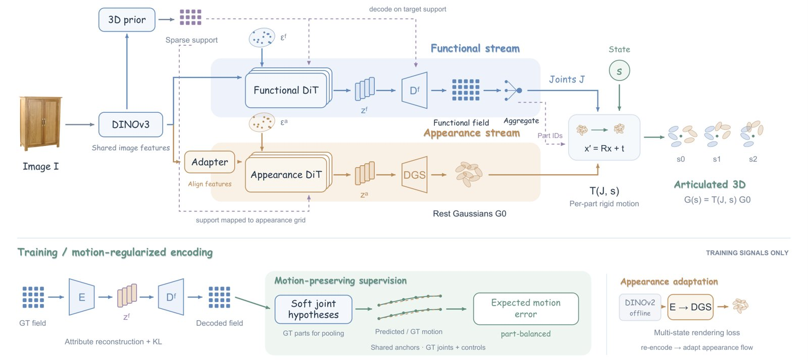
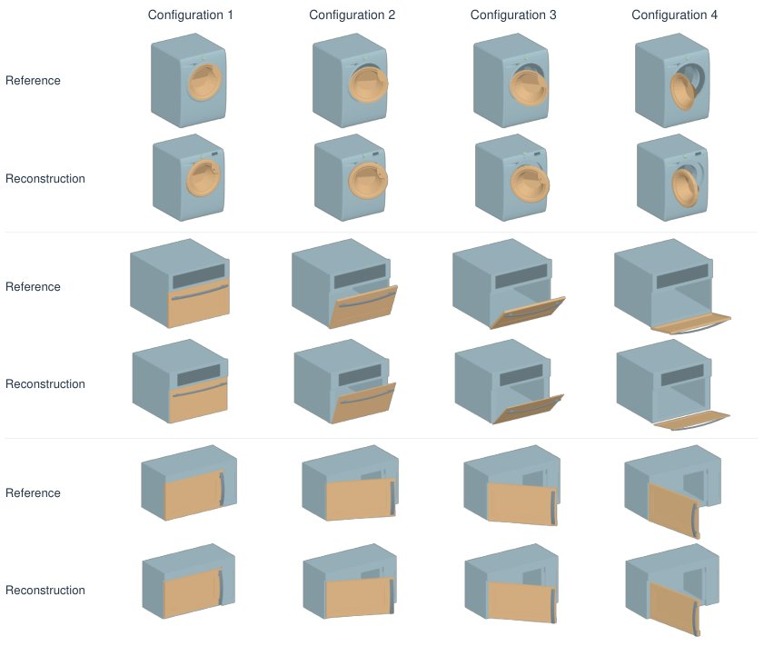
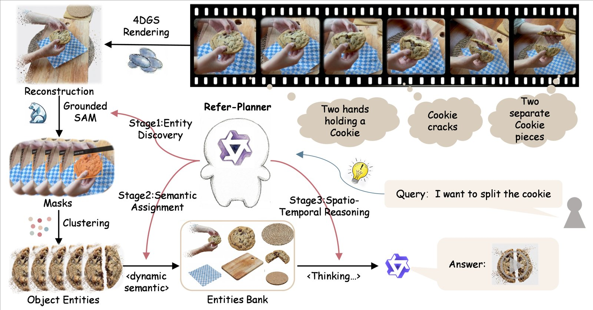

# 2026-10-26 科研日报

## 今日速览

周日没有 arXiv 公告，本期回扫上周五（10-23）cs.CV 公告里此前没收录、又和“可编辑资产”直接相关的两篇：一篇从单张图片生成能正确开合的铰接物体，并让同一套高斯直接跟着关节动起来；另一篇把 4D 高斯动态场景整理成一个个可以用自然语言点名的“实体”。两篇都在回答同一个问题：重建或生成出来的高斯，怎样从“一团可渲染的点”变成“有部件、有状态、能被操作的东西”。

- **必读：[MoRE](#2026-10-26--more)（Nanyang Technological University、University of Cambridge，arXiv 预印本）。** 它的出发点很具体：关节参数单项误差都小，不等于门绕着对的铰链转。作者一方面把关节写成“坐标轴类别 + 两个与轴正交的 Plücker 矩系数”，去掉“轴上任取一点当原点”的冗余；另一方面在编码器训练时，直接拿预测关节和标注关节去搬动同一批锚点，比较搬动后的位置差，把“动得对不对”变成可微的损失。推理时只生成一次静止状态的高斯，按部件刚体变换就能渲染任意开合状态，不必每个状态重新生成。值得精读它的运动正则怎样让梯度流到离散的类型和轴分类上；也要看清边界：只支持与坐标轴对齐的转动和平移关节，静止状态的表面精度并不领先。
- **选读：[R4DGS](#2026-10-26--r4dgs)（ACM MM 2026，中国地质大学（武汉）、北京大学（深圳）等）。** 提出“在 4D 高斯场景里做指代分割”的任务和基准，并给出一个免训练框架：先用二维分割掩码把高斯聚成持久实体，记下每个实体在哪些时间段存在、长什么样，再让多模态大模型在这张实体表上做带时间、排除、数量约束的闭集选择。它最有价值的地方是诚实的消融：直接用二维掩码作答的 vIoU 反而比“提升到高斯再渲染回来”高得多，说明瓶颈仍在二维到三维的提升这一步。
- **本期其他值得一扫：** 用“光照图”做中间表示、让手绘笔触可控地改画面光照的 Dior（v2），以及从观测历史里检索语义而不是另训三维网络的在线语义高斯 RecallGS，见文末简列。
- **圈内：** Blender 主干在 10-24、10-25 连续合入两笔原生高斯泼溅（GSplat）修复，重写了投影计算以去掉对视口尺寸的依赖；另有一位皮肤科医生用公开皮损数据集比较，发现微调了二十分钟的 2015 年老 CNN 在 200 例活检确诊病例上明显胜过两款前沿多模态大模型，HN 上的讨论主要在质疑比较是否公平。

## 可编辑资产：让生成的高斯物体按对的关节动

### MoRE · arXiv · 2026-10-21

**一句话判断：** 单图生成铰接物体这条线（ArtiLatent、PAct、PhysX-Anything 等）大多把关节当作一组属性去回归，本篇把监督目标换成“关节诱导的运动”本身，并给出一个没有冗余自由度的关节线编码。方法改动不大但切中要害，消融也干净地分开了“编码方式”和“运动监督”的各自贡献。对“拆分绑定、可编辑动态资产”来说，它示范了怎样让部件归属、关节和高斯外观在同一个坐标系里对齐，从而一次生成、多状态渲染。它不涉及材质与光照，打开部件后露出的内表面靠多状态训练数据“记住”，不是物理推断。

**Title：** MoRE: Motion-Regularized Encoding for Articulated 3D Generation  
**作者：** Guantian Zheng、Shan Jin  
**单位：** School of Mechanical and Aerospace Engineering, Nanyang Technological University；Manifest Limited；Department of Engineering, University of Cambridge  
**发表时间 / 投稿信息：** arXiv v1 于 2026-10-21 挂出（10-23 公告）。arXiv Comments 仅写“6 pages, 3 figures, 4 tables”，正文为 IEEE 会议双栏格式并带 Index Terms，推测为在投的短篇会议稿，具体会议未标明。  
**链接：** [摘要](https://arxiv.org/abs/2610.30337) · [HTML 全文](https://arxiv.org/html/2610.30337v1) · [PDF](https://arxiv.org/pdf/2610.30337)（作者称代码与预训练权重将在以后放出，暂未找到项目页）

**摘要中译：** 从单张图像生成铰接物体，需要同时恢复其外观和控制各部件运动的机构。对关节属性的紧凑编码本身并不能保证重建结果保留其诱导的运动。我们提出 MoRE，即用于铰接 3D 生成的运动正则化编码。MoRE 用轴分类加两个与轴正交的 Plücker 矩系数表示与坐标轴对齐的关节线，消除了沿轴任意选取原点的问题。在表示学习阶段，解码出的关节假设被用来移动对应的三维锚点，并将其运动与标注关节诱导的运动比较。对关节类型和轴方向取可微期望，把属性重建与其诱导的运动耦合起来。一个图像条件的流模型学习由此得到的功能隐变量，而一个经多状态适配的高斯模型提供外观。推理时，恢复出的部件归属和关节直接驱动同一组静止姿态高斯，无需为每个状态重新生成物体。在 PartNet-Mobility 和 ACD 上的实验显示，与对比基线相比，部件包围盒一致性、铰接状态几何和视觉相似度更好，关节预测的轴、原点和运动范围误差也低于 ArtiLatent。受控消融支持关节线编码，并表明运动监督降低了锚点运动误差。代码和预训练权重将在未来发布。

*原论文 Fig. 2（方法总览），[来源](https://arxiv.org/html/2610.30337v1)。图中柜子照片按作者说明仅作示意，并非测试结果。可以把它看成两条并行的“生成流水线”：上面一条生成“哪些体素属于哪个部件、各部件怎样动”，下面一条生成“长什么样”，最后在体素网格上把两者对齐。*

**方法与原理。**

先说几个名词。**铰接物体** 指由若干刚性部件和关节组成、部件能相对运动的物体，比如柜门、抽屉、笔记本电脑。**转动关节（revolute）** 绕一条轴线转，**平移关节（prismatic）** 沿一个方向滑动。**Plücker 坐标** 是表示三维直线的一种方式：方向 \(\ell\) 加“矩” \(m=o\times\ell\)，其中 \(o\) 是直线上任一点；无论 \(o\) 沿轴滑到哪里，\(m\) 都不变。**稀疏结构化隐变量** 指 TRELLIS 一类 3D 生成模型的做法：只在物体占据的体素上存特征向量，再由扩散或流模型生成这些特征。

1. **问题与瓶颈。** 现有方法分别监督关节类型、轴方向、轴上一点和运动范围。两个问题由此产生：一是“轴上一点”不唯一，网络被迫去拟合一个本无定义的量；二是各项误差分开计算，无法反映它们合起来对运动的影响，例如轴方向差 1 度、原点偏一点，对一扇大门的门边会造成明显位移，但对属性损失来说只是两个小数。
2. **输入、输出与前提。** 输入是单张物体图像；输出是静止姿态下的稀疏体素支撑、每个体素的部件与关节属性、每个部件的关节，以及一组静止姿态的 3D 高斯。训练期需要带部件与关节标注的数据（功能分支用 Infinigen-Articulated 程序化生成的约 50 万个物体、18 类）和同一物体多个开合状态的多视角渲染（外观分支用约 3300 个物体、8 个状态、48 个视角）；推理时这些都不需要。
3. **关节线编码。** 只考虑与坐标轴对齐的关节，先把轴方向分类为 \(e_x,e_y,e_z\) 之一，再在与该轴正交的平面里预测两个系数：

$$
m=c_1u_\ell+c_2v_\ell,\qquad o_\perp=\ell\times m
$$

   其中 \((u_\ell,v_\ell)\) 是与轴正交的两个坐标轴方向，\(o_\perp\) 是直线上离原点最近的点。这样关节线由“一个类别 + 两个实数”唯一确定，没有冗余维度。每个体素都存一份这样的属性，加上语义与包围盒描述、关节类型和运动上下限。
4. **运动正则（核心）。** 功能分支是一个把 \(96^3\) 属性场压到 \(24^3\times16\) 隐变量的稀疏变分自编码器。训练时，在每个标注部件内对解码出的预测取平均，得到该部件“是固定、转动还是平移”“轴是 x、y 还是 z”的概率；对每个可动部件取最多 256 个体素中心作为锚点，在运动进度 \(u\in\{0,0.5,1\}\) 三个时刻，分别用每种“类型 × 轴”假设下的预测关节和标注关节去刚体变换这些锚点，计算位置差的平方，再按假设概率加权求和：

$$
\ell_p=\sum_c \pi_{p,c}\,\frac{1}{|\mathcal U||\mathcal A_p|}\sum_{u}\sum_{x\in\mathcal A_p}\big\|T(\hat J_{p,c},u)\,x-T(J_p^*,u)\,x\big\|_2^2
$$

   这里 \(\pi_{p,c}\) 是部件 \(p\) 取假设 \(c\) 的概率，\(T\) 是由关节和进度给出的解析刚体变换，\(\mathcal A_p\) 是锚点集合。因为是对概率取期望而不是先投票选出类型和轴，梯度可以同时流到类型、轴分类的 logits 和矩、运动范围等连续量上；先平方再加权，也避免了方向相反的错误运动相互抵消。这一项以权重 \(\lambda_M\) 加到常规的属性重建损失和 KL 项上。
5. **从图像生成，再把关节接到高斯上。** 自编码器训练好后冻结，再训练一个以 DINOv3 图像特征为条件的流匹配模型生成功能隐变量（从一个结构生成的预训练权重初始化）。外观分支沿用 TRELLIS 的外观编码器和高斯解码器（每个体素 32 个高斯），用已知关节把高斯变换到各训练状态后与多视角图像比较，从而学会“打开后露出的内部长什么样”。推理时，先按预测语义分组、用 DBSCAN 聚类包围盒描述得到部件，部件内多数投票定关节类型和轴、平均得到连续参数；部件归属从 \(96^3\) 功能网格转到 \(64^3\) 外观网格，每个高斯继承所在体素的部件，给定关节状态就对整组高斯做同一个刚体变换（中心和朝向都转，颜色、尺度、不透明度不变）。

**为什么这样设计（作者解释与实验支持分开）。** 作者的论证是：铰接表示的好坏应该用“动起来对不对”来衡量，而不是逐项属性误差；关节线编码去掉的冗余维度本来就是网络的噪声来源。实验支持来自 Table III 的 2×2 消融：在不加运动损失时，矩编码已在六项指标上全部优于“回归轴上一点”；固定矩编码后加上运动损失，转动和平移部件的锚点运动均方根误差分别从 0.0431、0.0207 降到 0.0362、0.0168（约 16% 和 19%）；两者合用六项最好。编辑判断：这些误差都在编码器重建层面测得，运动正则对最终“从图像生成”结果的贡献，正文没有单独隔离。

**结果与局限（作者报告）。** 单图生成的对比沿用 PAct 论文里的基线数字（Table I）。指标里 RS/AS 指静止/铰接状态，\(d_{\mathrm{gIoU}}\) 是部件包围盒的广义交并比距离，CD 是表面倒角距离，三者越小越好；CLIP 是渲染图与参考图的语义相似度，越大越好。在 PartNet-Mobility 上，铰接状态倒角距离从 PAct 的 0.0176 降到 0.0092，CLIP 从 0.8996 升到 0.9545；但静止状态倒角距离（0.0028）不如 PAct（0.0019），作者也承认静止表面重建是短板。关节预测（Table II，基线数字取自 ArtiLatent 论文）轴角误差 1.03°、原点误差 0.04，均低于 ArtiLatent 的 1.14°、0.10，类型准确率持平。自述局限：只处理固定、转动、平移三类且轴需与坐标轴对齐；各部件运动独立评估，不处理层级运动链；推理时的聚类错误和跨网格归属错误训练无法纠正；未报告多次运行的方差；密度和摩擦只是存储的属性，不是校准过的物理预测。

**值得关注 / 阅读指引。** 对资产编辑方向，最可复用的是两件事：一是“用解析运动比较代替属性比较”的损失写法，它不依赖网络结构，同样可以用来监督从多视角重建里估计关节的方法；二是“部件归属挂在体素上、高斯继承体素归属”的绑定方式，简单但让一次生成、多状态渲染成为可能。坐标轴对齐的假设对真实扫描物体并不总成立，接到真实场景前需要一步规范化朝向。对比基线的数字均直接抄自其它论文，不是同一环境重跑，读表时留意。建议顺序：Fig. 2 → §III-A 式 (1) → §III-B 式 (3)(4) 与其后的说明 → Table III 消融 → §III-C、§III-D 外观与绑定 → Table I、II → §IV-E 局限。

*原论文 Fig. 3，[来源](https://arxiv.org/html/2610.30337v1)。注意这张图用的是已知关节和编码器隐变量，检验的是外观分支“打开后内部是否合理”，不是从单张图像生成的结果。*

## 动态场景理解：把 4D 高斯整理成能被语言点名的实体

### R4DGS · ACM MM 2026 · 2026-10-21

**一句话判断：** 这篇的贡献主要在任务和基准：把“在动态高斯场景里找出语言描述的东西”从类别查询推进到带时间状态（“被掰碎之前的完整饼干”）、排除（“除了手和金属杯以外的所有物体”）、多目标和“根本不存在”的复杂指代。方法本身是一套工程化的组合（二维分割追踪、掩码提升到高斯、实体表、多模态大模型做选择），免训练、可检查，但最终分割质量明显受限于二维到三维的提升。对“场景拆分成可操作部件”这条线，它提供的是“实体表”这种中间结构的参考，而不是更好的分割算法。

**Title：** R4DGS: Referring Segmentation in 4D Gaussian Splatting  
**作者：** Bangpu Chen、Yaxuan Li、Shirui Peng、Xiangtian Si、Liuxin Chu、Xitong Cao、Hongbo Jin、Jiayu Ding  
**单位：** 中国地质大学（武汉）；新疆大学；宁波诺丁汉大学；北京大学（深圳）  
**发表时间 / 投稿信息：** arXiv v1 于 2026-10-21 挂出（10-23 公告）。arXiv Comments 与正文均写明已被 ACM Multimedia 2026（MM ’26，2026 年 11 月 10–14 日，里约热内卢）接收，并给出 DOI。  
**链接：** [摘要](https://arxiv.org/abs/2610.30326) · [HTML 全文](https://arxiv.org/html/2610.30326v1) · [PDF](https://arxiv.org/pdf/2610.30326) · [项目页](https://chenbangpu.github.io/R4DGS/)

**摘要中译：** 基于 4D 高斯泼溅（4DGS）的动态表示在重建和渲染上已展现出很强的能力，但现有方法在动态场景中支持复杂自然语言指代方面仍很有限。现有的 4D 高斯方法主要为面向渲染的动态建模而设计，而当前的语义扩展往往依赖逐场景的语义优化，或只在相对简单的查询设定下评测。本文研究“指代式 4D 高斯泼溅”（R4DGS）：在动态 4D 场景中定位随时间变化的、多目标或需推理的、以及零目标或含干扰项的表达。为支持这一任务，我们提出带结构化查询标注的基准 R4D-Bench-QA。我们进一步提出 ReferGaussian，一个建立在 4DGS 之上的统一框架，它把低层的动态高斯转换为持久的、可用语言寻址的实体，以免训练方式进行指代推理。ReferGaussian 把由掩码支撑的高斯实体组织在 EntityBank 中，用多模态大语言模型（MLLM）把复杂查询分解为可追踪的物体短语和结构化指代约束，并在无需逐场景语义优化的情况下执行约束感知的定位。在 R4D-Bench-QA 和 4D LangSplat 评测协议上的实验表明，该方法在时间目标选择上有所提升，在时空定位上具有竞争力，且无需逐场景语义训练。

*原论文 Figure 5（方法总览），[来源](https://arxiv.org/html/2610.30326v1)。关键的设计是第三阶段的“闭集选择”：大模型只能从实体表里已有的编号和时间段中挑，不能凭空生成目标，所以每个答案都能追溯到具体的高斯集合。*

**方法与原理。**

先说几个名词。**4D 高斯泼溅（4DGS）** 是在 3D 高斯上加时间维度的动态场景表示，常见做法是用一个随时间变化的形变网络预测每个高斯的位置、旋转、尺度偏移。**指代分割** 是给一句描述，输出它所指的那个（或那些、或零个）物体的掩码。**vIoU** 是本文主指标，把“在哪些帧激活”和“每帧掩码重合多少”合在一起算，越大越好；**Acc** 是逐帧判断“此刻目标是否存在”的准确率。

1. **问题与瓶颈。** LangSplat、4D LangSplat 等方法给每个高斯学一个语言特征，查询时比相似度，适合“找杯子”这类类别查询，但不擅长“装着浅色液体时的玻璃杯”这种依赖时间状态的描述，也很难表达“排除”“恰好两个”“不存在”；并且每个场景都要单独训练语义场。
2. **输入、输出与前提。** 输入是一个已经重建好的 4DGS 场景、它的多视角视频帧和一句查询；输出是逐帧的分割掩码序列（可能为空）。不需要逐场景语义训练，但依赖现成的二维开放词汇分割追踪模型（Grounded-SAM）和本地多模态大模型（主实验用 Qwen3-VL-8B）。
3. **第一阶段：把二维掩码提升成持久实体。** 查询规划器先把句子拆成可以追踪的物体短语，二维模型为每个短语给出逐帧掩码轨迹。对每个高斯，计算它在采样帧里的投影足迹有多大比例落在掩码内，按可见性加权平均，得到支持分数。算法每轮随机取最多 6 个有效帧更新分数、选出候选高斯集合，再把候选集合渲染回这些帧与掩码比交并比；平均交并比达到 0.70 或连续三轮没有改进就停，最多 10 轮，保留最好的一版。被选中的高斯集合连同二维轨迹的有效时间段，就构成一个实体。
4. **第二阶段：实体表。** 每个实体存为一条记录：编号、高斯集合、有效时间段、代表性截图与轨迹摘要、外观或状态属性、与其它实体的关系。这张表会被缓存，同一场景的后续查询可以直接复用。
5. **第三阶段：约束感知的闭集选择。** 规划器把查询转成结构化模式：主体短语、身份与状态属性、关系与排除约束、时间谓词、可选的目标数量，以及显式的“目标不存在”标志；格式不合法或引用了不存在的实体编号会被拒绝并要求重写。然后大模型只在实体表提供的编号和时间段里挑选满足全部约束的组合，找不到就返回空集。最后只在选中的时间段内渲染选中实体的高斯，多个实体的掩码逐帧合并。

**为什么这样设计（作者解释与证据）。** 作者认为语言描述的单位是“实体”而不是单个高斯，所以先把高斯组织成实体，再让擅长推理的大模型在实体层面做决定，这样复杂约束容易表达，结果也可检查。证据上，迭代提升把 vIoU 从一次性投票的 12.4 提到 34.4；对掩码做腐蚀、膨胀或丢掉 10%–25% 候选，vIoU 只下降不到 2.3 点，但实体合并或拆分错误会把它拉低到 19.4 和 22.7，说明方法对局部掩码噪声稳健、对实体身份错误敏感。值得特别注意的是同一张表里的对照：直接用二维分割掩码作答的 vIoU 是 57.4，远高于完整方法的 34.4。编辑判断：在这个基准上，把二维证据“提升到高斯再渲染回来”这一步损失了大量精度，三维表示的价值目前主要体现在时间推理与跨视角一致的实体组织上，而不是掩码本身更准。

**结果与局限（作者报告）。** 在自建的 R4D-Bench-QA 上，Acc 76.5%、vIoU 34.4%，高于 4D LangSplat（58.4%、32.1%）和 Segment then Splat（55.6%、28.4%），vIoU 的领先幅度较小。在 4D LangSplat 原有的四场景时间敏感查询协议上，平均 Acc 93.01% 略高于 4D LangSplat 的 90.83%，但平均 vIoU 62.95% 低于后者的 72.26%。实体表复用把同一场景后续查询的耗时从约 600 秒降到约 200 秒、本地大模型调用从 6 次降到 3 次，离交互式使用仍有距离。作者列出的失败情形是拥挤的接触事件、含糊的长查询、物体破碎和严重遮挡，即拓扑快速变化、身份边界不清的情况。

**值得关注 / 阅读指引。** 对场景拆分与可编辑资产，“实体表”这种“高斯集合 + 有效时间段 + 属性 + 关系”的记录结构，可以直接借来做动态场景里的部件管理，并在其上接编辑或物理驱动。它的提升步骤只靠投影足迹与掩码的重合比例，没有利用深度或几何一致性，这是最容易改进的地方，也解释了为什么提升后的掩码不如二维掩码。建议顺序：Figure 2（任务定义）→ §4.3 式 (7) 与算法 1 → §4.4 实体记录与闭集选择 → Table 4 消融（重点看 57.4 与 34.4 的对照）→ Table 2、3 → 失败案例。

## 本期其他值得一扫

- [Dior](https://arxiv.org/abs/2608.29925)（Xuanpu Zhang、Xuesong Niu、Haoxiang Cao、Ruidong Chen、Jianhao Zeng、Changqian Yu、Shiguang Liu；v1 于 2026-08-30 挂出，v2 于 2026-10-22 更新，投稿信息未标明）：用户在图上画几笔指定想要的光照，过去的方法很难把笔触准确映射到光的强度、颜色和空间分布。作者引入一种与材质解耦的光照表示“Lumi Map”作为中间量，用渲染器合成“原图、光照图、重光照结果”三元组训练模型按光照图生成结果，再用真实重光照图像对做重建训练缩小合成与真实的差距。属于二维图像重光照，不估计几何与材质，但“先把用户意图转成显式光照图”的思路可作可重光照资产交互编辑的参照。本期仅据摘要简列。
- [RecallGS](https://arxiv.org/abs/2610.31293)（Thanh-Khoi Nguyen、Thien-Phuc Tran、Minh-Triet Tran；arXiv 2026-10-22）：在线语义 3D 高斯通常要另训一个三维网络补充图像特征缺的几何上下文。作者改为从观测历史里检索：用 CLIP 找出相关的历史帧，用高斯在这些帧里的 alpha 合成权重判断哪些视角真正看到了它，再把这些视角的语义特征按渲染足迹汇总到高斯上。在 ScanNet 和 ScanNet++ 上以 2.48 FPS 取得较强的语义分割结果，免训练。本期仅据摘要简列。

## 圈内新闻与社区反应

**Blender 主干连续合入原生高斯泼溅修复（图形学）。** Blender 主干在 10-24 合入 Mark van de Ruit 的 [GSplat: Minor bugfixes](https://github.com/blender/blender/commit/32f5c9c48bca1835a79abd861fd4ca5837144f32)（对应 [PR 165264](https://projects.blender.org/blender/blender/pulls/165264)），提交说明称重写了高斯投影计算，去掉对视口尺寸的依赖，并修复了尺度为 0 的高斯被当作尺度 1 显示的问题；改动集中在绘制模块的高斯着色器库和 EEVEE 的高斯几何着色器。10-25 又合入一笔同作者的[着色器常量修复](https://github.com/blender/blender/commit/ff0c1b72bc3e332a354e86bb6d288a748c32ddb8)。暂未找到可核实的社区反馈。编辑判断：投影与视口尺寸脱钩，意味着同一份高斯在不同视口、离屏渲染里的屏幕尺寸计算将保持一致，这对用 Blender 批量渲染高斯场景做数据生成是前置条件；功能仍在主干开发中，稳定版本的时间表未见公告。

**皮肤科医生：微调过的老 CNN 胜过前沿多模态大模型（LLM）。** 皮肤科医生 Magnus Lynch 10-25 在[实验室博客](https://lynchlab.net/llm-skin-cancer)发文，从 2025 年 ISIC 发布的公开数据集 MILK10k 里随机取 200 个活检确诊的皮损（每例含临床照与皮肤镜图，良恶各半），让 GPT-6 Astra、Claude Fable 5.1 和一个在约 6.8 万张公开皮肤图像上微调约二十分钟的 Inception v3 卷积网络在六类诊断中作答。卷积网络答对 125 例（62%），两款大模型分别答对 84 和 85 例（42%），文中还展示了大模型把薄型黑色素瘤判为可直接出院的良性病变的案例。Hacker News 的[讨论](https://news.ycombinator.com/item?id=50233779)里，有机器学习工程师认为拿专门微调的小模型和通用模型在 200 例上比没有参考价值（[howunfortunate](https://news.ycombinator.com/item?id=50234167)），有人指出通用模型本就不以此为目标、更合理的用法是让大模型去搭建专用分类器（[fastball](https://news.ycombinator.com/item?id=50234151)、[snitty](https://news.ycombinator.com/item?id=50234199)），也有人质疑文中没写明具体模型版本（[spwa4](https://news.ycombinator.com/item?id=50234200)）。编辑判断：结论本身不意外，但它是一个可复现的小样本对照，提醒在高风险垂直任务里“直接问通用多模态模型”与“小数据微调专用模型”的差距仍然很大。

## 覆盖说明

日报发布日为 **2026-10-26（周一）**，内容覆盖日为 2026-10-25（周日）。周日无 arXiv 公告，本期回扫 10-23（周五）cs.CV 公告中此前未收录、与高斯资产编辑和重光照相关的条目；正文两篇为 MoRE（2610.30337）与 R4DGS（2610.30326），均核对了 arXiv HTML 全文的方法、实验与局限，配图为原论文插图；Dior 与 RecallGS 仅据摘要简列。所有结果均为作者报告，未独立复现。圈内新闻以 Hacker News 近两日首页与 Blender 主干提交为入口，核对了原文与提交说明；中文媒体与 X 本期未单独检索，具身方向本期未找到高信号新闻。对标仓 Real2Sim_GPT6_ASTRA 自 9 月 10 日以来无新提交。

**编写：** Cream
