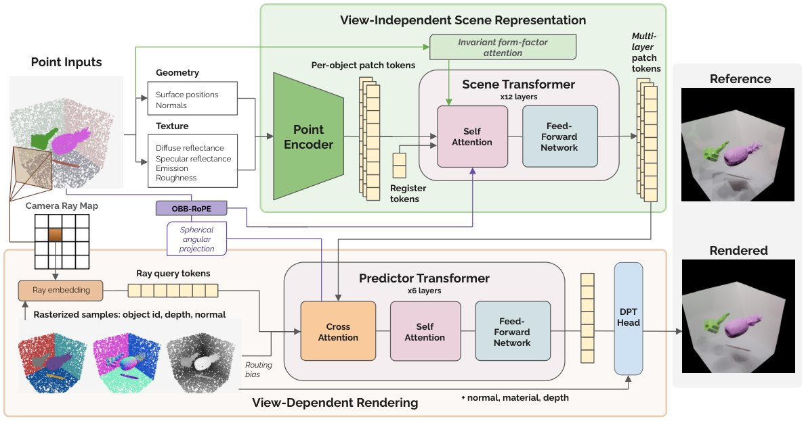
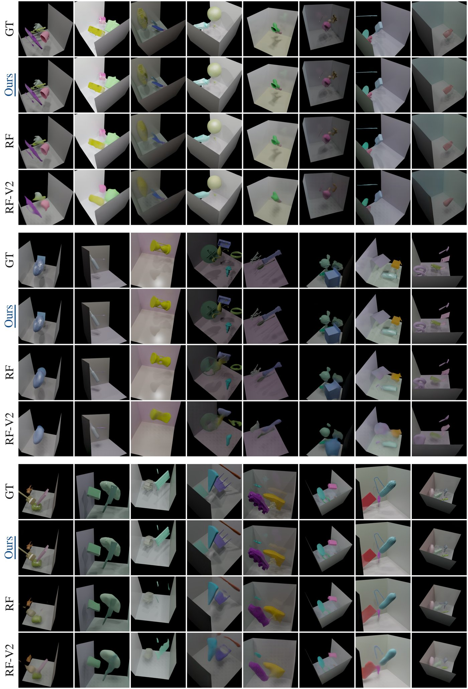
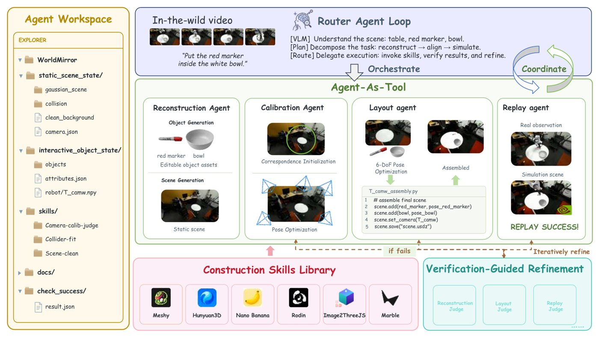
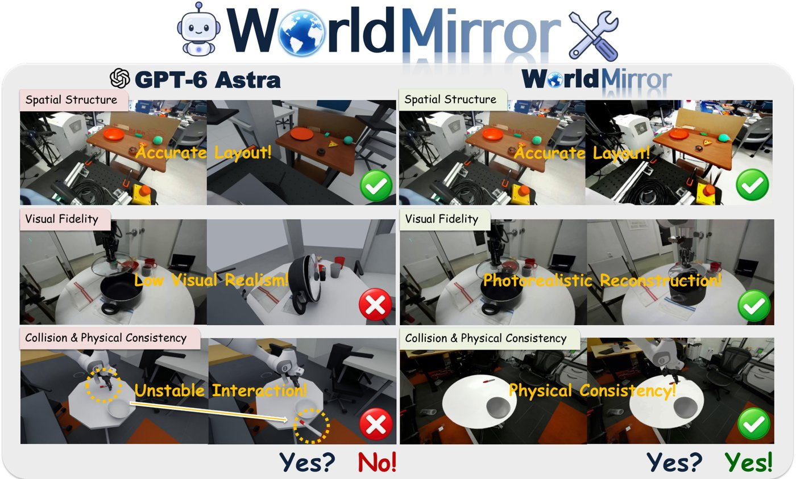

# 2026-10-27 科研日报

## 今日速览

周一（10-26）的 arXiv 公告里，和课题最贴的两篇恰好分处 Real→Sim 链条的两端：一篇在“渲染端”，把前馈式全局光照从“按三角形做注意力”改成“按物体做注意力”，让带间接光的整图渲染不再随网格面数平方增长；另一篇在“构建端”，让一个编程智能体调度各种重建与生成工具，把野外机器人演示视频搭成能直接回放原始关节轨迹的仿真场景，而且正面对照了 GPT-6 Astra。

- **必读：[RADIANT](#2026-10-27--radiant)（MIT CSAIL，arXiv 预印本）。** RenderFormer 一类前馈神经渲染器把每个三角形当成一个 token，场景一精细就爆掉。RADIANT 的判断很干脆：宏观的光能交换取决于表面和物体布局，而不是剖分方式，所以每个物体只给 32 个表面片 token，再把辐射度理论里的“形状因子”所需的距离与朝向项，精确地拆成查询与键的内积塞进注意力，不用显式存两两偏置矩阵。同等参数量、同一个 103 万场景数据集上，它比 RenderFormer 高 3.3 dB，到 25 dB 只用五分之一的训练步数；输入是点而不是网格，这让它天然能接重建或生成出来的点云和高斯。值得精读形状因子注意力的写法和“点泼溅光栅化负责主可见性、注意力只管间接光”的分工；也要看清它目前只在合成室内场景、漫反射为主的材质上验证。
- **选读：[WorldMirror](#2026-10-27--worldmirror)（Xspark AI、清华大学、The University of Hong Kong、University College London、北京大学）。** 把 Real→Sim 场景构建写成“可执行世界程序的迭代修正”：路由智能体沿固定的构建依赖图前进或回退，每一步都要通过视觉、空间或物理校验才提交。它最有说服力的数字是回放：在 Isaac Sim 里不做重规划、直接执行 DROID 原始关节轨迹，成功率 100%，GPT-6 Astra 为 40%；但在物体摆放的 IoU 和位置误差上，GPT-6 Astra 反而更好。评测只有十个左右的 DROID 场景，属于方法展示而非定论。
- **本期其他值得一扫：** 把物体生成和场景布局拆开再用点云配准拼回去的 Easy-3Dfy、用扩散模型采样家具布局再“编译”成无碰撞场景的 SceneBloom，以及把 3DGS 渲染搬上低功耗 FPGA 的 LENS，见文末简列。
- **圈内：** OpenAI 发布中档模型 GPT-6.1 Terra，HN 讨论集中在它和 Sol、Astra 的价位与定位；另有一篇在两美元的 ESP32-S3 上用 SIMD 指令把 FAST 角点检测做到每帧约 6 毫秒的长文，对“低端硬件上跑具身演示”有参考意义。

## 正向渲染效率：按物体而不是按三角形算全局光照

### RADIANT · arXiv · 2026-10-23

**一句话判断：** 前馈全局光照这条线（RenderFormer 及其后续）一直卡在“token 数等于三角形数”。RADIANT 换了一个更符合物理直觉的粒度：光能交换发生在有限面积的表面片之间，跟它被剖成 50 个还是 5 万个三角形无关。于是 token 数只和物体数有关，注意力里再显式放进辐射度形状因子的几何项。对正向批渲染效率来说，这是一条和 ReSTIR、辐射缓存互补的路线：不追踪光线，一次前向推理直接给出含间接光的 HDR 图。它目前是“场景到图像”的渲染器，不做逆渲染，也没有在真实扫描上大规模验证。

**Title：** RADIANT: Object-Centric Feed-Forward Global Illumination  
**作者：** Sarah Zhang、Zhiyang Dou（共同一作）、Minghao Guo、Benjamin Tod Jones、Wojciech Matusik  
**单位：** MIT CSAIL  
**发表时间 / 投稿信息：** arXiv v1 于 2026-10-23 挂出（10-26 公告）。arXiv Comments 为空；正文含 AI 使用声明、伦理声明与可复现性声明，格式像机器学习会议投稿，推测在投，具体会议未标明。  
**链接：** [摘要](https://arxiv.org/abs/2610.32075) · [HTML 全文](https://arxiv.org/html/2610.32075v1) · [PDF](https://arxiv.org/pdf/2610.32075)（作者称发表后公开代码与数据集，暂未找到项目页）

**摘要中译：** 前馈神经渲染器无需逐场景优化或运行时光线追踪，就能为新的三维场景合成全局光照。现有基于 Transformer 的渲染器以单个三角形为 token，自注意力随网格分辨率呈平方增长。然而宏观辐射传输由底层表面几何与物体布局决定，而不是某种特定的网格剖分；更细的剖分会增加 token 数，却不改变底层传输物理，这促使我们采用与剖分无关、以物体为中心的表示。我们提出 RADIANT（基于辐射度的物体间神经 Transformer），一种从点输入做前馈全局光照的以物体为中心的架构。它用每个物体 32 个表面片 token 表示物体，使注意力序列长度与多边形数量脱钩。在单个网络中，物体间场景 Transformer 建模三维辐射交换，视图解码器在目标相机位姿处渲染图像。为了在不显式构造 O(N²) 偏置矩阵的情况下捕捉光传输，不变形状因子注意力把几何距离和表面朝向作为 SE(3) 不变的内积直接嵌入查询–键点积，并由学习到的面积与材质增益加权。对于没有网格连接关系时的主可见性，相机光线在共享的球面坐标系中、在经深度测试的点泼溅引导下对场景 token 做交叉注意力。在 103 万场景的基准上、同等模型容量下，RADIANT 达到 25 dB 色调映射 PSNR 所需训练步数比 RenderFormer 少 5 倍，600k 步时达到 32.2 dB（比 RenderFormer 高 3.3 dB，比 RenderFormer-V2 高 7.6 dB）。我们还展示了其可扩展性：一个 500 物体场景的 512×512 前向推理耗时 0.83 秒，计算量随物体数而非多边形数增长。

*原论文 Figure 1（方法总览），[来源](https://arxiv.org/html/2610.32075v1)。左半边可以理解为“先在物体之间把光来回传几遍”，只依赖场景；右半边是“从某个相机看过去，每个像素该取哪些物体的光”，换视角只需重跑这一半。*

**方法与原理。**

先说几个名词。**全局光照** 指不只算光源直接照到的光，还算光在物体之间反复反射形成的间接光、接触阴影和颜色渗染。**辐射度方法（radiosity）** 是经典的全局光照算法：把表面分成小片，用“形状因子”描述两片之间能交换多少光能。**前馈神经渲染器** 指训练好以后，输入场景描述和相机，一次前向推理就输出图像，不针对单个场景再优化。

1. **问题与瓶颈。** RenderFormer 把每个三角形作为 token 做全注意力，代价随三角形数 \(T\) 呈 \(O(T^2)\)；后续版本用窗口注意力或物体级池化缓解，但编码阶段仍在三角形层面计算，且要求输入是网格。真实重建、深度相机和三维生成模型给出的往往是点云或高斯，没有干净的网格。
2. **输入、输出与前提。** 输入是每个物体的点（位置、法线、材质）、墙面与光源，以及目标相机；输出是该视角的 HDR 辐射度图像。训练数据是用 Objaverse 资产程序化拼成的 103 万个室内场景，用路径追踪生成真值；材质以漫反射反照率、发光和一个标量镜面反射率描述。
3. **物体 token 化。** 每个物体在自身归一化坐标系里用 PointNet++ 的集合抽象取 32 个中心点、各带 128 个近邻，得到 32 个宽 1024 的表面片 token。每个物体还附带 8 个“辐射度统计量”（对数面积、平均反照率、平均发光、平均镜面反射率），既加到查询和键上，也决定后面形状因子项的增益。物体位姿通过一种基于有向包围盒的旋转位置编码注入，网络对物体输入顺序天然不变。
4. **不变形状因子注意力（核心）。** 两片表面之间的形状因子 \(dF_{ij}=\cos\theta_i\cos\theta_j\,dA_j/(\pi r_{ij}^2)\) 取决于距离和两侧朝向。作者为每对表面片构造四个几何不变量：

$$
\mathbf G_{ij}=\big(-\|\Delta_{ij}\|^2,\;\mathbf m_i^\top\Delta_{ij},\;-\mathbf m_j^\top\Delta_{ij},\;\mathbf m_i^\top\mathbf m_j\big),\qquad \Delta_{ij}=\mathbf c_j-\mathbf c_i
$$

   其中 \(\mathbf c\) 是表面片中心、\(\mathbf m\) 是平均法线。关键在于每一项都能精确写成“接收方特征”和“发送方特征”的内积，例如 \(-\|\Delta_{ij}\|^2=\langle[2\mathbf c_i,-\|\mathbf c_i\|^2,-1],[\mathbf c_j,1,\|\mathbf c_j\|^2]\rangle\)。把这些因式直接拼到查询和键的末尾，注意力打分里就自动多出一项 \(\sum_t a_t(i)\,b_t(j)\,G_{ij,t}\)，增益 \(a,b\) 由材质统计量预测，全程不需要显式存一张 \(N\times N\) 的偏置表，可以直接用 FlashAttention。距离项系数为正时，它相当于给注意力权重乘上一个随距离衰减的高斯因子。余弦截断、平方反比衰减和遮挡这些非二次的部分，留给后面的网络层去学。
5. **视角解码。** 先用点泼溅光栅化（深度测试，7×7 膨胀）得到每个像素的主可见物体、深度、法线和材质，相当于一个不依赖网格的 G-buffer；交叉注意力因此不必自己“找光线打到哪”，只需负责阴影、多次反弹和颜色渗染。像素按 4×4 分块成光线 token，物体和光线都映射到同一个以相机为中心的球面坐标系里做旋转位置编码，角度差直接对应“光线是否指向这个物体”。损失是对数辐射度的 L1 加少量 LPIPS。

**为什么这样设计（作者解释与实验支持分开）。** 作者的论证是辐射度理论本来就以有限面积的表面片为单位，token 粒度应与之对应；把形状因子的几何项显式给网络，可以省掉它自己去学“离得近、面对面的表面交换更多光”。实验支持来自 Table 6 的消融（256² 分辨率、100k 步、三个随机种子）：去掉形状因子注意力降 0.52 dB，去掉物体间注意力降 2.46 dB，去掉光栅化通道降 3.12 dB。编辑判断：形状因子项的增益稳定但不大，真正拉开差距的是“主可见性交给光栅化”和“物体间传输”这两件事。

**结果与局限（作者报告）。** 在 4112 张留出图像上，600k 步时每图 PSNR 32.21 dB、LPIPS 0.042，RenderFormer 为 28.95 dB、0.077，RenderFormer-V2 为 24.60 dB、0.117；三者在同一数据、同等约 2 亿参数下训练，基线并非按原作者的训练日程。按场景复杂度分组，14 个以上实体时仍保持约 31.6 dB。效率方面，20 个物体以内 RenderFormer 反而更快（RADIANT 的时间主要花在 16384 个光线 token 上），超过约 25 个物体后 RADIANT 占优，500 物体合成场景快 8.5 倍；但 25 到 50 个实体超出训练分布后，所有方法的画质都会下降。只保留单视角可见点（每物体 28% 到 48%）的残缺点云，零样本只有 26.3 dB，未扫到的表面渲染成空洞；在 4 个视角上微调 400 步后，新视角回到 30.3 dB。自述局限：每物体固定 32 个 token，简单墙面浪费、复杂物体不够；光线 token 的全注意力限制了 1024² 以上分辨率；不处理烟雾等体介质；输入法线噪声会传到平面上。

*原论文 Figure 3，[来源](https://arxiv.org/html/2610.32075v1)。可以重点看物体底部的接触阴影和墙面上的颜色渗染，这正是间接光最容易出错的地方。*

**值得关注 / 阅读指引。** 对正向批渲染效率，最可复用的是“把一个经典物理量的几何部分拆成内积塞进注意力”的写法：它不改注意力内核，可以照搬到其他需要成对几何关系、又不想存 \(N^2\) 矩阵的任务。“输入是点、主可见性靠点泼溅”这一点，让它和 3DGS 资产之间只差一步：高斯的中心、法线和分解出的材质可以直接当输入，这对用重建资产批量生成带全局光照的训练图很有吸引力。需要警惕的是，材质模型只到漫反射加一个镜面标量，和可重光照高斯常用的完整 BRDF 参数还有差距；残缺输入的实验也说明，它不会补全没看到的几何。建议顺序：Table 1（与各类方法的计算量对比）→ Figure 1 → §3.4 式 (1) 与其后的说明 → §3.5 光栅化通道 → Table 6 消融 → Table 3、§4.4 → 附录 J 残缺几何。

## 具身数据回环：让智能体把机器人演示搭成能回放的仿真场景

### WorldMirror · arXiv · 2026-10-22

**一句话判断：** Real→Sim 的难处不在某一步重建，而在于视觉、几何、物理三类约束互相牵连，一处错了要知道回退到哪一步重做。WorldMirror 用一张固定的构建依赖图加一个按校验结果“前进或回退”的路由智能体来解决这件事，并以“原始轨迹不改一个数就能在仿真里复现”作为最严格的检验。对课题来说，它和 Real2Sim_GPT6_ASTRA 这类“让大模型一把重建”的做法形成了直接对照：大模型在布局上更准，专用工具加校验回环在外观、碰撞几何和可回放性上更好。

**Title：** WorldMirror: Agentic Real-to-Sim Generation of Interactive Worlds from In-the-Wild Robot Demonstrations  
**作者：** Tianling Xu、Weijie Wan、Honghao Su、Kailun Su、Junyuan Tang、Huichi Zhou、Haozheng Zhang、Qi Xiong、Ping Luo、Wenbo Ding、Tianxing Chen、Yue Chen  
**单位：** Xspark AI；清华大学；The University of Hong Kong；University College London；北京大学（作者与单位的逐一对应未在 HTML 版标明）  
**发表时间 / 投稿信息：** arXiv v1 于 2026-10-22 挂出（10-26 公告），主分类 cs.RO。arXiv Comments 为空，投稿信息未标明。  
**链接：** [摘要](https://arxiv.org/abs/2610.31834) · [HTML 全文](https://arxiv.org/html/2610.31834v1) · [PDF](https://arxiv.org/pdf/2610.31834) · [项目页](https://worldmirror-page.github.io/)

**摘要中译：** 现有的仿真机器人学习方法往往需要大量人工来构建场景和指定任务，限制了训练规模和数据多样性。与此同时，野外机器人演示天然提供了真实世界交互的多样、逼真的观测。要在仿真中利用这些演示，既需要高保真的视觉重建，也需要物理上一致的交互。通用智能体能灵活适应多样场景、对三维空间关系有较强推理能力，而专用生成模型能高保真地重建场景外观与几何。我们提出 WorldMirror，一个从野外机器人演示构建可交互数字孪生的智能体式 Real→Sim 框架。核心思想是把 Real→Sim 构建表述为一个可执行世界程序的迭代精修：编程智能体分解观测到的场景、规划重建步骤、调度专用的图像与三维生成工具，并依据校验反馈修正程序。一种以相机位姿为锚的场景表示把世界组织为静态视觉背景、支撑几何和可编辑的交互资产，同时保持场景、物体与机器人之间的空间关系。智能体利用这一表示诊断并纠正重建错误，从而实现物理一致的交互与轨迹回放。在 DROID 上的实验表明，WorldMirror 能重建视觉逼真、几何一致的可交互世界，并保持所记录机器人轨迹的物理有效性。

*原论文 Figure 2（方法总览），[来源](https://arxiv.org/html/2610.31834v1)。注意中间那个“世界状态”：每次修改都是对它的一次候选更新，只有通过校验才提交，否则原样保留并带着失败类型回到路由。*

**方法与原理。**

先说几个名词。**数字孪生** 在这里指与真实演示场景外观、几何和物理一致、机器人能在其中执行动作的仿真场景。**DROID** 是一个在大量真实环境里采集的机器人操作数据集，含多相机视频和机械臂关节轨迹。**直接轨迹回放** 指把录下来的关节角序列原封不动地在仿真里执行，不做逆运动学重定向或重规划，因此场景、物体和机器人基座的相对位置必须足够准。

1. **问题与瓶颈。** 前馈式重建一次给出结果，很难同时满足外观、尺度、接触几何三类约束；纯通用智能体又生成不了细致的几何和逼真外观。不同错误需要不同的修法：物体放错位置要调布局，漏了物体要回到场景分解，碰撞形状不合适要改资产的物理表示。
2. **输入、输出与前提。** 输入是一段 RGB 视频和对应的机器人轨迹；输出是在同一坐标系下的静态背景（用高斯表示外观、另配碰撞几何）、带尺度和位姿的可编辑物体资产、标定好的相机和机器人配置，可在 Isaac Sim 中执行。
3. **世界状态与依赖图。** 世界状态由静态场景、交互物体、空间关系和校验反馈四部分组成。构建图规定了合法顺序：场景准备、相机标定、支撑面拟合、物体构建、布局、机器人对齐、轨迹回放。路由智能体不自由编排流程，只在“前进、调用某个技能、回退到前序阶段、停下检查、接受”这几种合法动作里选。
4. **专用智能体与技能库。** 四个专用智能体（重建、标定、布局、回放）各自负责多步子任务。相机先用 DINOv2 特征匹配初始化，再用渲染对图像的光度与结构对齐（含线段匹配）细化；刚体物体用 Meshy 生成，铰接物体用 Articraft；装配阶段按观测掩码和轮廓调整物体的尺度、位置、朝向，最后把记录的相机到基座外参换算进统一坐标系，放好机器人基座。
5. **校验驱动的回环。** 每个候选更新都要过视觉、空间或物理校验；失败时返回失败类型和回退目标，依赖于被修改部件的下游部件标记过期并重建，直到全部校验通过或用完预算。

**为什么这样设计（作者解释与证据）。** 作者认为固定的依赖图保证了“直接回放”所需的几何前提，而自适应的回退让修错有的放矢。证据来自一个导轨操作任务上的消融（Table 5、6）：一次性构建加一次回放、以及不做诊断的反复精修都失败；完整方法经 4 次回放迭代成功，最终位置误差 2.34 厘米。去掉自适应路由会失败，去掉有状态记忆几乎无影响。编辑判断：消融只在一个任务上做，且“去掉记忆无影响”说明当前收益主要来自校验与回退，而不是记忆结构。

**结果与局限（作者报告）。** 视觉保真（10 个 DROID 场景首帧）：LPIPS 0.427、DISTS 0.168，均为最好，PSNR 13.57 与 RoLA 的 13.53 接近；GPT-6 Astra 为 11.90、0.606、0.299。空间结构（17 个物体、8 对物体）：WorldMirror 掩码 IoU 0.469、位置误差 9.66，GPT-6 Astra 为 0.598、8.72，后者更好；成对距离误差 WorldMirror 最低（0.219 对 0.331）。回放（Table 4）：位移误差 1.79 厘米、终点误差 5.83 厘米、接触 F1 0.873、成功率 100%，GPT-6 Astra 为 11.17 厘米、21.98 厘米、0.653、40%。作者自述：评测只覆盖少量 DROID 演示，还没有下游策略学习、真机部署或跨任务泛化实验，质量受所用重建与仿真工具限制。

*原论文 Figure 1，[来源](https://arxiv.org/html/2610.31834v1)。这张对比图的结论与 Table 3、4 一致：布局看 GPT-6 Astra，能不能“动起来不穿模”看校验回环。*

**值得关注 / 阅读指引。** 对 Real→Sim→Real 的数据回环，这篇给了两个可以直接借鉴的东西：一是“以相机为锚的统一坐标系加原轨迹直接回放”这一评测口径，它比只看渲染指标更能暴露尺度和接触错误；二是“依赖图 + 带失败类型的回退”这种编排方式，比让大模型一把出结果更可控，也便于在低成本硬件上把重型生成步骤换成更轻的工具。和 Real2Sim_GPT6_ASTRA 的思路放在一起读很有意思：两者都依赖大模型，但一个让大模型直接产出场景，一个只让它当调度员。需要留意外观部分 PSNR 只有 13 到 14 dB，高斯背景与生成资产之间的光照一致性没有专门处理，这正是可重光照资产能补上的地方。建议顺序：Figure 2 → §3.3 路由与技能库 → §3.5 坐标系 → Table 4 → Table 3（GPT-6 Astra 更好的部分）→ Table 5、6 → 结论里的局限。

## 本期其他值得一扫

- [Easy-3Dfy](https://arxiv.org/abs/2610.32250)（Ziang Zhang、Wenyou Yi、Zehan Wang、Jiachen Xu、Xintong Han、Chunchao Guo、Zhou Zhao；arXiv 2026-10-23，投稿信息未标明）：单图三维场景构建里，端到端方法 SAM-3Dfy 的物体质量和细节几何不够。作者把物体生成和场景布局拆开，分别交给专用三维物体生成器和三维基础模型，再用一个配准模块把物体局部网格对齐到场景点图的可见部分，拼出整个场景；无需场景级监督，在 Scene-Maker 和 3D-FUTURE200 上多项几何指标优于 SAM-3Dfy。对单图生成可编辑场景资产是个干净的组合基线。本期仅据摘要简列。
- [SceneBloom](https://arxiv.org/abs/2610.32978)（Yuhan Liu、Lianhui Qin、Shenji Wan；arXiv 2026-10-23，投稿信息未标明，[代码](https://github.com/Tinaliu0123/scenebloom)）：用扩散模型在功能区内采样家具布局，再从提议中抽取关系约束，引导几何拟合与局部位姿修正，“编译”成可仿真的室内场景。五类房间里是唯一没有网格穿插和越界物体的方法；用这些场景训练的物体导航策略，在留出的真实扫描上成功率高于用同等数量真实扫描训练的策略。本期仅据摘要简列。
- [LENS](https://arxiv.org/abs/2610.25068)（Haohua Que、Mingkai Liu、Tianle Zhu、Handong Yao；v1 于 2026-10-18 挂出，v2 于 2026-10-23 更新，投稿信息未标明）：把场景坐标回归定位和 3DGS 渲染搬到 AMD KR260 低功耗 FPGA 上，渲染器用定点数逐位精确实现，把透射率改写为 log-sum-exp 递推并剔除可证明无贡献的高斯。板上实测在 Cambridge 上渲染 34.11 dB，每瓦性能比 Jetson Orin NX 高 1.9 到 5.7 倍，功耗约四分之一；板上训练仍达不到 GPU 的时间与能耗。和“具身演示要能在低端硬件上跑”的约束相关。本期仅据摘要简列。

## 圈内新闻与社区反应

**OpenAI 发布 GPT-6.1 Terra（大模型）。** OpenAI 10-26 发布中档模型 [GPT-6.1 Terra](https://openai.com/index/introducing-gpt-6-1-terra/)，登上 Hacker News 首页（[讨论](https://news.ycombinator.com/item?id=50248124)）。讨论里有人整理了价位：Terra 输入每百万 token 1 美元、输出 5 美元，约为 GPT-6.1 Sol 的一半，GPT-6 Astra 仍是最贵的一档（[6thbit](https://news.ycombinator.com/item?id=50249523)）；有人指出这次和 Sol 一样走了大幅降价路线，但 Terra 仍夹在变强的小模型和变便宜的大模型之间，定位尴尬（[minimaxir](https://news.ycombinator.com/item?id=50248477)、[Silagi](https://news.ycombinator.com/item?id=50248646)）；也有人认为这一档正适合拿来对每个代码改动做自动审阅（[mehdizare](https://news.ycombinator.com/item?id=50250992)）。编辑判断：对 Real→Sim 这类要反复调用大模型的智能体流水线（例如上面的 WorldMirror 和 Real2Sim_GPT6_ASTRA），中档模型降价意味着可以把“校验—回退”的迭代次数开得更大，值得在调度类步骤上试一试用中档模型替代 Astra。

**在两美元的 ESP32-S3 上做 SIMD 加速的视觉特征检测（嵌入式视觉）。** 一篇[博客长文](https://shraiwi.com/blog/simd-fast-esp32s3/)（[HN 讨论](https://news.ycombinator.com/item?id=50236681)）介绍作者利用 ESP32-S3 鲜为人知的 128 位 SIMD 指令，手写汇编实现 FAST 角点检测，比参考实现快约一倍，处理一帧 320×240 图像约 6 毫秒；为绕开指令集不能非对齐读取等限制，还写了一个简单的寄存器分配工具。编辑判断：这类“在极低成本芯片上把经典视觉算子压到实时”的经验，对只有消费级低端硬件时搭具身演示的感知前端有直接参考价值。

## 覆盖说明

日报发布日为 **2026-10-27（周二）**，内容覆盖日为 2026-10-26（周一）arXiv 公告（cs.GR、cs.CV、cs.RO 新提交与交叉列表）。正文两篇为 RADIANT（2610.32075）与 WorldMirror（2610.31834），均核对了 arXiv HTML 全文的方法、实验与局限，配图为原论文插图；Easy-3Dfy、SceneBloom、LENS 仅据摘要简列。所有结果均为作者报告，未独立复现。圈内新闻以 Hacker News 近一日首页为入口，核对了原文或讨论串；中文媒体与 X 本期未单独检索。对标仓 Real2Sim_GPT6_ASTRA 自 9 月 10 日以来无新提交；Blender 主干原生高斯泼溅自 10-25 的着色器常量修复后暂无新提交。

**编写：** Cream
