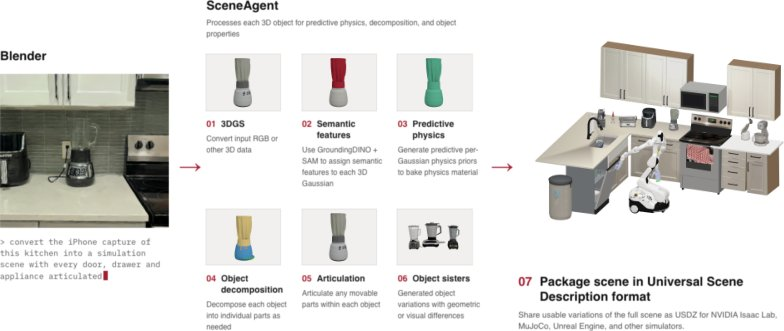
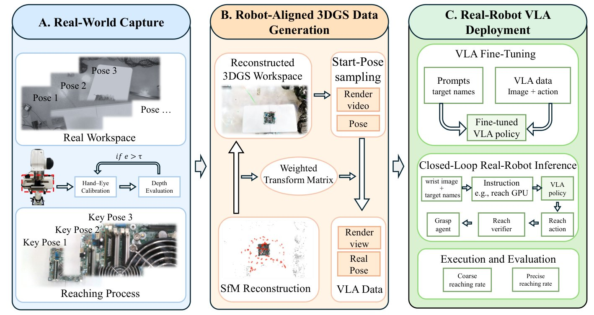
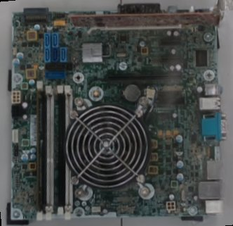

# 2026-10-28 科研日报

## 今日速览

周二（10-27）的 arXiv 公告里，和课题最贴的两篇都在回答同一个问题：手头只有一段真实采集，怎样最省事地变出能训练机器人的数据。一篇走“重”路线，让编程智能体把高斯泼溅、摄影测量、激光扫描乃至动态视频，一路转成带质量、摩擦、关节和软体的仿真场景；另一篇走“轻”路线，干脆不要物理仿真，只用一个和机械臂坐标系对齐的 3DGS 场景渲染腕部相机画面，就批量造出了 VLA 微调数据。两条路线的取舍，正好对应“具身演示要能在低端硬件上完成”的现实约束。

- **必读：[SceneAgent](#2026-10-28--sceneagent)（Harvard University，arXiv 预印本）。** 昨天的 WorldMirror 是“从机器人演示视频搭场景”，SceneAgent 则从更通用的采集出发：3DGS、摄影测量、LiDAR、生成式 3DGS 场景和动态视频都能吃进去，输出 Isaac Lab 可用的 USD 场景，物体带分割、物理参数、部件分解、关节或软体属性。核心是在仿真器里渲染、检查、修错的回环，以及一套可复用的“技能”。同一个杂乱料箱场景上，给六种编程智能体装上这套技能后，1 厘米阈值的 F1 从个位数涨到 40% 到 61%，SimFoundry 只有 6.9%。值得精读高斯到物体的归属规则、逐高斯物理先验的投票方式，以及“真机失败转成仿真变体数据”的自动研究回环；也要看清：评测场景很少，物理参数没有用实测标定，真机实验只有一个抓放任务，而且演示数量越多真机成功率反而先升后降。
- **选读：[PrecisionReach-GS](#2026-10-28--precisionreach-gs)（Texas A&M University，arXiv 预印本）。** 主板拆解这种又密又反光的场景很难做完整数字孪生，作者就只解决“接触前精确到位”这一段：手眼标定后把 3DGS 场景对齐到机器人基座系，在可达、无奇异的位姿上渲染腕部视角，配上平滑轨迹做动作标签。1500 条生成轨迹让 π0.5 在三个目标上平均精确到位 80%，150 条遥操作只有 58.7%，人工采集时间从约 200 分钟降到 10 分钟以内，每个生成进程显存不到 1 GB。和 MiracleAug 这类“示教增强”思路高度同构，可直接借鉴其对齐与位姿过滤做法。
- **本期其他值得一扫：** 用自适应分段 Bézier 曲线表示高斯运动的 GaussianSpline、让智能体按可执行运动学图修正闭链铰接物体的 MARC、把三维编辑改写成轨迹视频编辑的 VidEdit3D、用损失的一阶变分决定高斯增删的 Birth-Death 3DGS，以及首个前馈隐式 4D 新视角合成模型 FL4N，见文末简列。
- **圈内：** Google DeepMind 发布世界模型 Genie 4，强调更写实的画面、原生音频和可用自然语言实时改写的模拟，并点名机器人训练环境是用途之一；HN 讨论则集中在可控性和物理是否可信。

## Real→Sim：让智能体把各种采集转成带物理的仿真场景

### SceneAgent · arXiv · 2026-10-26

**一句话判断：** 把一段采集变成能交互的仿真场景，每一步单独看都有现成工具（SAM 分割、SAM3D 生成网格、PartSAM 拆部件、Articulate Anything 生成关节），难的是步骤之间的衔接：尺度错了、位姿偏了、掩码漏了，单个模型的输出看起来都“合理”，拼起来就不能用。SceneAgent 的答案是让编程智能体在目标仿真器里渲染每一步结果、检查并修复，再把成功的做法沉淀成技能。它的价值更多在工程整合与评测口径，而不是某个新算法；对课题来说，它把“拆分绑定、可编辑动态资产”这一卡点一直推到了带物理参数的 USD 场景。

**Title：** SceneAgent: An Agentic Pipeline from 3D and 4D Captures to Simulation Environments  
**作者：** Luke Hollis、Tianxing Fan（共同一作）、Heng Yang  
**单位：** Harvard University（School of Engineering and Applied Sciences，Computational Robotics Group）  
**发表时间 / 投稿信息：** arXiv v1 于 2026-10-26 挂出（10-27 公告），主分类 cs.RO。arXiv Comments 为空，投稿信息未标明；作者称会公开代码与处理后的数据。  
**链接：** [摘要](https://arxiv.org/abs/2610.34745) · [HTML 全文](https://arxiv.org/html/2610.34745v1) · [PDF](https://arxiv.org/pdf/2610.34745) · [项目页](https://computationalrobotics.seas.harvard.edu/SceneAgent/)

**摘要中译：** 视觉采集能提供细致的场景外观，但要把它转成可交互的仿真环境，需要物体重建、物理建模，以及对中间错误的纠正。我们提出 SceneAgent，一个通过基于仿真器的视觉检查与修复来协调这些步骤的智能体式流水线。它可以处理 3D 高斯泼溅（3DGS）、摄影测量、LiDAR 采集、AI 生成的 3DGS 场景以及动态场景的 4D 视频，并结合物体分割、物理参数估计、部件分解、关节化和可变形体仿真。为支持策略学习，SceneAgent 会生成多样的物体变体（“数字姐妹”）和脚本化演示。在 GraspClutter6D 的一个杂乱料箱场景上，无论是否使用其技能，凡是能给出可评分输出的编程智能体，在 SceneAgent 下 1 厘米 F1 都得到提升，重建也优于 SimFoundry：所有智能体配置的 F1 都超过 SimFoundry，最好为 60.75%，SimFoundry 为 6.9%。在 4DCodeBench 的三个动态场景上，SceneAgent 把 Gemini 4 Argon 的平均动态 IoU 从 0.86% 提升到 99.09%。我们还展示了多样的仿真交互，以及初步的真机策略迁移。

*原论文 Figure 2（流水线总览），[来源](https://arxiv.org/html/2610.34745v1)。左侧那句“把这段 iPhone 拍的厨房转成仿真场景，所有门、抽屉和电器都要能动”就是给智能体的任务描述；中间六步各对应一组技能，每一步结果都会在仿真器里渲染出来供智能体检查。*

**方法与原理。**

先说几个名词。**编程智能体（coding agent）** 指能自己写代码、调用工具、读结果再改的大模型程序，比如 Codex、Claude Code；论文把它运行的软件环境叫 harness。**技能（skill）** 是可复用的说明与工具集合，告诉智能体某类转换该怎么做、怎么验。**USD** 是一种通用的三维场景描述格式，Isaac Lab 等仿真器可直接读取。**数字姐妹（digital sisters）** 是作者对“同一物体的小幅变体”的叫法，比如纹理、磨损不同但形状不变，用来扩充训练分布。

1. **问题与瓶颈。** 已有的 Real→Sim 系统（PolaRiS、SimFoundry 等）各自整合了分割、网格生成、位姿对齐和物理建模，但错误常发生在环节之间：网格形状对了，插进场景后尺度、朝向或位置错了；掩码漏了一块，物体就缺几何。这类错误单靠前馈流水线发现不了。
2. **输入、输出与前提。** 输入可以是 RGB 图像序列（先用 COLMAP 估位姿、Nerfstudio splatfacto 训 3DGS）、现成 3DGS、摄影测量资产、LiDAR，或 World Labs Marble 等模型生成的场景；动态视频走单独的 4D 路线。输出是一个补全后的背景高斯加上 \(K\) 个物体，每个物体带自己的高斯集合、网格、相似变换、物理属性和（可能为空的）关节。
3. **高斯归属与网格对齐。** 每隔若干视角用 SAM 取掩码；一个高斯属于某个掩码，要求它的中心投影落在掩码内，并且深度不超过同一图像小格内最靠前高斯深度加一个容差，也就是“只认前表面”。多视角掩码若共享足够多的高斯就合并为同一物体。SAM3D 生成的网格再用只含单一尺度的截尾相似 ICP 对齐到这些高斯。移走前景后，用检测到的平面补全暴露出来的背景，可选 LaMa 补纹理。
4. **物理属性、部件与关节。** 一个以 DINOv2、OpenCLIP 特征和 16 个几何量为输入的小 MLP，对每个高斯预测材质类别、刚体或软体类型、碰撞形状和九个数值属性，在物体内取平均；再和视觉语言模型、按物体名的关键词先验加权投票，最后由视觉语言模型审核材质。需要注意，这个物理先验的训练标签是视觉语言模型写的，不是实测值。随后 PartSAM 拆部件，缺失部分（如笔帽下的笔尖）由 CubePart 补全，Articulate Anything 给出 URDF 关节，智能体在仿真里检查运动是否合理；刚度分数高于阈值的物体转为软体。
5. **检查与修复回环。** 编排智能体先制定计划，接入智能体准备数据，执行智能体逐步调用工具，并对每一步做“执行者—评审者”式视觉复核。对每个物体，评审智能体会看配准叠加图、六个轴向加两个斜向的单独视图，以及两张放回整个场景后的视图；对齐只有在中位与 90 分位点距离、覆盖率、轮廓一致性四项都过固定阈值时才接受。每次转换的做法会写进文件，供后续转换读取；智能体提出的技能修改要在一组静态 3D、动态 4D 和视频转 4D 的基准上同时过“提升”和“不退化”阈值才保留。
6. **从 3D 到 4D。** 对动态视频，场景扩展为相机内外参、静态几何和若干动态材质，每种材质有初始状态、物理参数和一个按帧推进的仿真器（凝胶、弹塑性体和液体用 MPM 等），渲染后与输入帧比对来拟合参数。
7. **数据生成与策略学习。** 在转换后的场景中用仿真真值状态规划脚本化演示，渲染机器人相机视角，LoRA 微调 π0.5。可选的自动研究回环会回看真机或仿真失败录像、标出失败片段、为每种失败设计复现它的数字姐妹，再让编码模型写出能在这些变体中成功的控制器，只保留通过成功检查的回合。

**为什么这样设计（作者解释与实验支持分开）。** 作者的论证是：单个模型输出“看起来合理”不代表组装后可用，所以检查必须在目标仿真器里、按最终用途来做；技能则把一次次修错的经验固化下来，让不同智能体都能复用。实验支持来自“同一智能体、有无技能”的成对比较：在 MessyKitchens 厨房场景上，Codex 的 F1 从 16.45% 升到 41.13%，Claude Code 从 7.07% 升到 19.29%；在 GraspClutter6D 料箱场景（20 个 YCB 物体互相遮挡、13 张 1920×1080 图像）上，六种智能体的 F1 从 2% 到 10% 升到 40% 到 61%，倒角距离从 6.2 到 9.9 厘米降到 1.4 到 3.4 厘米。编辑判断：这些数字主要说明“技能”对智能体的帮助有多大，而每种配置只跑了一次，方差未知；与 SimFoundry 的比较也只在这一个场景上。

**结果与局限（作者报告）。** 动态部分，4DCodeBench 三个合成场景（溃坝液体绕柱、西瓜落地碎裂等）上，Gemini 4 Argon 加技能后平均动态 IoU 从 0.86% 到 99.09%，基准作者公布的结果里这三个场景最好为 30.57%，但后者的设置与版本不同。真机部分（Table 2、3）：只用仿真演示微调 π0.5 做“茄子玩具放进篮子”，真机成功率在 40 条演示时为 48%，继续加到 4000 条反而降到 12%，作者归因为过拟合；改用“先多任务、再单任务无随机化”的顺序微调后，真机成功率升到 88%（44/50）。自述局限：转换要反复调用视觉语言模型并依赖外部 GPU 工作站，细致场景仍慢且易错；视觉检查无法确认隐藏几何和物理参数是否准确；质量、摩擦、刚度、关节参数都还没有用真机交互标定，断裂示例的材料参数是工程估计；采集到的高斯保留了原始光照，与网格物体合成时阴影和反射可能不一致；重建评测只覆盖一个厨房和一个料箱、每种配置只转换一次，4D 评测只有三个合成场景，真机只测了抓放。

**值得关注 / 阅读指引。** 对“拆分绑定、可编辑动态资产”这一卡点，最值得借鉴的是 §3.3 的式 (1)：用“投影在掩码内且靠近前表面”来决定高斯属于哪个物体，比只靠二维掩码反投影稳得多，可以直接搬到可重光照高斯的物体拆分里。§3.4 的“逐高斯物理先验 + 多源投票 + 视觉语言模型审核”则是给高斯资产自动挂物理属性的一个可行模板，但要记住它的标签来自大模型而非测量。作者自己点出的“高斯带着原始光照，合成后阴影反射不一致”正是逆渲染、材质分解可以补上的缺口。Table 2 里演示越多真机越差的现象很值得警惕，提示仿真数据的多样性与真实分布的对齐比数量更关键。建议顺序：Figure 2 → §3.1 编排与验收阈值 → §3.3 式 (1) → §3.4 → Figure 5 与 §4.1 成对比较 → Table 2、3 → §5 局限。

## 轻量造数据：只用对齐到机械臂的高斯场景训练腕部相机 VLA

### PrecisionReach-GS · arXiv · 2026-10-26

**一句话判断：** 很多 3DGS 造数据工作仍然要提网格、建接触模型、跑 GPU 物理仿真，搭起来很重。这篇反其道而行：只做接触前的“精确到位”，所以完全不需要物体网格和物理，只要 3DGS 渲染足够像、相机位姿和机械臂坐标足够准、轨迹在机械臂上真的能走。它的贡献是把这三个“足够”分别落成可检验的步骤，并在真机上量化了生成数据和遥操作数据的性价比。对“只有消费级低端硬件也要做出具身演示”的约束，这是今天最直接可抄的一篇。

**Title：** Robot-Aligned 3D Gaussian Splatting for Precise Reaching with Wrist-Camera VLA Policies  
**作者：** Zuoxu Wang、Xiao Liang（通讯作者）  
**单位：** Texas A&M University（Zachry Department of Civil and Environmental Engineering）  
**发表时间 / 投稿信息：** arXiv v1 于 2026-10-26 挂出（10-27 公告），主分类 cs.RO。arXiv Comments 为空；正文为 IEEE 双栏格式，推测投向 IEEE 机器人类会议或期刊，具体未标明。  
**链接：** [摘要](https://arxiv.org/abs/2610.35626) · [HTML 全文](https://arxiv.org/html/2610.35626v1) · [PDF](https://arxiv.org/pdf/2610.35626) · [项目页](https://001-wang.github.io/PrecisionReach-GS/)

**摘要中译：** 高效的机器人数据采集仍是视觉-语言-动作（VLA）策略学习的主要瓶颈，对需要精确末端定位和相机-动作对齐的任务尤其如此。在电子废弃物拆解中，这一问题格外严重：机器人要在密集堆叠、外观相似的部件中操作。完整的数字孪生仿真很难构建，因为许多部件薄、反光或机械结构复杂，难以得到准确的物体级网格和接触模型。本文聚焦接触前的到位阶段，提出一个基于 3D 高斯泼溅（3DGS）的数据生成流水线，用于腕部相机 VLA 的适配。方法用 3DGS 重建真实工作空间，从与机器人对齐的位姿渲染多样的腕部相机观测，并与平滑、结构化的到位轨迹配对，为 VLA 微调提供与机器人对齐的视觉-动作监督。我们还为 VLA 策略增加了一个以指令为条件的到位验证器，估计与目标的接近程度，并在物理交互前给出可靠的终止判断。主板拆解实验表明，仅凭腕部相机观测、无需外部侧视相机，就能实现基于 VLA 的精确到位。使用 π0.5 时，1500 条生成轨迹在三个目标上取得 80.0% 的精确到位成功率，使用 150 条遥操作演示时为 58.7%，而所需的人工主动采集时间不到 10 分钟。

*原论文 Fig. 1（方法总览），[来源](https://arxiv.org/html/2610.35626v1)。整条链路里只有 A 段需要人动手，B 段完全离线生成，这就是“人工不到 10 分钟”的来源。*

**方法与原理。**

先说几个名词。**VLA（视觉-语言-动作模型）** 指输入相机图像和语言指令、直接输出机器人动作的大模型，这里用的是 π0.5 和 OpenVLA-OFT。**手眼标定** 是求出相机相对机械臂末端的固定位姿。**可操作度（manipulability）** 衡量机械臂在当前关节构型下沿各方向移动末端的难易，接近零说明靠近奇异位形，小的笛卡尔修正可能需要很大的关节运动。

1. **问题与瓶颈。** 主板上的螺丝、显卡、内存条又小又密、外观相似，还有反光和细线，做物体级网格和接触模型代价高、误差大；遥操作采集 150 条演示要约 200 分钟连续人工操作，而普通图像增强只能改颜色和裁剪，生成不了沿新轨迹、几何一致的新视角。
2. **输入、输出与前提。** 输入是腕部相机拍的工作空间视频、少量朝向目标的到位视频（给出关键位姿）和手眼标定结果；输出是成对的腕部图像、语言指令与动作标签。前提是任务只到“可以抓”的那一刻为止，抓取本身交给一个固定的规则控制器。
3. **对齐到机器人坐标。** 先手眼标定，再用平面参考面上的点到平面残差检查标定，特别关注沿接近方向的误差。3DGS 场景处在 SfM 坐标系里，作者用 SfM 相机中心与机械臂运动学给出的相机中心做加权相似变换拟合（求尺度、旋转、平移），靠近目标部件的关键帧权重更高，从而让交互区域附近最准。
4. **只采可执行的起点。** 在工作空间附近随机采样起始位姿，只有同时满足“在安全区域内、逆运动学残差足够小、关节角不越界、可操作度高于下限”的才保留，避免生成“看起来合理但真机走不到”的样本。
5. **轨迹与动作标签。** 从起点经预接近位姿到目标关键位姿，平移和旋转都用 \(h(u)=3u^2-2u^3\) 的平滑时间曲线插值，端点速度为零；每个中间位姿换算成腕部相机位姿并渲染。对关节空间策略（π0.5）用逆运动学求关节差作动作，对位姿空间策略（OpenVLA-OFT）用相邻末端位姿的相对变换。
6. **到位验证器。** 一个独立训练的小网络根据当前腕部图像、指令和机器人状态回归到目标的距离，指令通过 FiLM 调制和空间注意力影响视觉特征；训练时以 0.5 的概率把状态特征置零，防止它只靠末端高度“作弊”。部署时连续三次预测距离小于 0.65 厘米才判定到位，然后把控制权交给抓取模块。

*原论文 Fig. 2(b)，[来源](https://arxiv.org/html/2610.35626v1)。原文把它和同一采集提取的网格渲染并排对比，网格版在主板区域有明显的几何和外观瑕疵；作者选 3DGS 的理由正是“策略看到的输入要像真的”，而不是几何精度。*

**为什么这样设计（作者解释与证据）。** 作者认为，到位阶段的瓶颈是观测与动作的对齐，而不是物理，所以不必建完整孪生。证据有三组。真机主结果（Table 2，每格 25 次）：π0.5 用 1500 条生成轨迹时，螺丝、显卡、内存条的精确到位分别为 21、19、20 次，150 条遥操作为 12、14、18 次；但只用 300 条生成轨迹时精确到位全部为 0，说明数据量有明显门槛。组件消融（Table 7，900 条）：去掉验证器，粗到位不变、精确到位从 58.7% 降到 45.3%；去掉关键帧加权对齐，两项都降，粗到位从 93.3% 降到 74.7%。对齐精度（Table 10）：整体位置均方根误差约 0.9 到 1.1 厘米，关键帧附近平均误差不到 0.4 厘米，朝向平均误差不到 0.6 度。编辑判断：关键帧加权这一步的收益最大，它本质上是承认“全局对齐做不到毫米级，就把精度集中到要用的地方”。

**结果与局限（作者报告）。** 成本方面（Table 3），1500 条生成轨迹只需 12 段视频、人工不到 10 分钟，单个生成进程约 200 分钟、显存不到 1 GB，可以多进程并行。验证器单独评测时整体距离误差 0.64 厘米、近目标误差 0.10 厘米；但如果把末端高度人为偏 2 厘米，停止精度降到 48%，不做状态置零的版本则直接降到 0。真机测试是在把主板挪动位置之后做的，作者也明确这只代表中等程度的布局变化，更大的工作空间或部件变化需要重新重建；标定误差、分布外视角、持续遮挡或严重重建瑕疵都会让性能下降；方法只覆盖接触前到位，不涉及接触丰富的操作。作者还指出，主对比中遥操作用了腕部加侧视两个相机，受控实验显示侧视相机和平滑轨迹都对性能有贡献。

**值得关注 / 阅读指引。** 这篇和 MiracleAug 这类“示教增强”的思路几乎同构：都是在已有真实观测上生成新视角、新轨迹的配对数据。可以直接拿来用的有三点：一是“关键帧加权的相似变换对齐”，几行最小二乘就能显著提升交互区附近的精度；二是“工作空间、逆解残差、关节限位、可操作度”四重过滤，保证生成样本在真机上可执行；三是显存不到 1 GB 的生成进程，说明这类造数据在低端显卡上完全可行。也要看到它刻意回避了光照变化和接触，换成会被手或物体遮挡、光照会变的任务时，3DGS 的烘焙光照和静态场景假设就会成为短板，这正是可重光照、可编辑高斯能接力的地方。建议顺序：Table 1（与 SplatSim、RoboGSim、Real2Render2Real 的对比）→ Fig. 1 → §III-C 对齐与位姿过滤 → Table 2、3 → Table 7 → §IV-E 验证器 → Table 10 → §V 局限。

## 本期其他值得一扫

- [GaussianSpline](https://arxiv.org/abs/2610.35224)（Tom Yachil、Andrei Sharf；arXiv 2026-10-26，8 页，投稿信息未标明）：动态 4D 高斯里，每个高斯的运动用非均匀分段三次 Bézier 曲线表示，控制点和时间分段一起学，剧烈运动的区域自动分配更多分段，近乎静止的区域保持紧凑；相邻段之间用控制点反射约束保证 \(G^1\) 连续。作者报告在 Neural 3D Video、Google Immersive 和合成场景中，非均匀、剧烈运动的场景上提升明显。对可编辑动态资产来说，显式曲线轨迹比形变网络更容易被拆分和编辑。本期仅据摘要简列。
- [MARC](https://arxiv.org/abs/2610.33060)（Xiong Yang、Junkun Hao、Zijian Xiao、Zipeng Ye、Yuchen Xie、Ran Yi；arXiv 2026-10-19 挂出、10-27 交叉列入 cs.CV，投稿信息未标明，[项目页](https://demianmusk.github.io/MARC-Home/)）：从图像和文本生成铰接物体代码时，让程序构建、运动求解和纠错共享一张可执行运动学图，能表示闭链和关节耦合；数值求解器把运动错误定位到具体连接，智能体据此修改连接或几何再重测。20 个物体上，用 Kimi-K3 时有效运动覆盖 67.8%、整体成功 60.0%，优于六个基线。和 SceneAgent 的“仿真里检查再修”是同一思路在铰接机构上的细化。本期仅据摘要简列。
- [VidEdit3D](https://arxiv.org/abs/2610.35756)（Yanming Yang 等；arXiv 2026-10-26，投稿信息未标明，[项目页](https://2hitee.github.io/VidEdit3D-page/)）：把 3DGS 场景编辑改写成沿相机轨迹的视频编辑，借视频扩散模型的时空先验保证多视角一致，免训练地把锚点视角的编辑传播到整段轨迹，最后只更新目标区域的高斯。对“允许结构性修改又不破坏多视角一致”的编辑需求是一个新思路。本期仅据摘要简列。
- [Birth-Death 3DGS](https://arxiv.org/abs/2610.34344)（Quan Tran Hong、Long Nguyen-Chi、Binh T. Nguyen；arXiv 2026-10-25，投稿信息未标明，[代码](https://github.com/quanth238/birth-death-3dgs)）：给每个高斯附加一个“质量坐标”，对多视角重建损失求导得到一阶变分分数，分数高的位置生新高斯，分数低且不透明度低的删除，取代克隆、分裂、剪枝的经验规则；接入 3DGS-MCMC 后在高斯数量受限时提升最明显。本期仅据摘要简列。
- [FL4N](https://arxiv.org/abs/2610.35854)（Eunbeen Hong 等，通讯 Seungryong Kim；arXiv 2026-10-26，投稿信息未标明，[项目页](https://cvlab-kaist.github.io/FL4N/)）：首个前馈的隐式 4D 新视角合成模型，不用显式 4D 高斯，而是在预训练静态场景隐表示上学习时间残差，以少量动态数据把物体运动和相机视差分开，实时渲染。本期仅据摘要简列。

## 圈内新闻与社区反应

**Google DeepMind 发布世界模型 Genie 4（世界模型）。** DeepMind 10-27 发布 [Genie 4](https://deepmind.google/blog/genie-4-a-new-generation-of-world-simulation/)，登上 Hacker News 首页（[讨论](https://news.ycombinator.com/item?id=50261319)）。官方说法是：画面更写实、运动更流畅，并能同时生成音乐、环境声和对话；底层借助 Gemini Omni 锚定真实外观与行为，再由其他 Gemini 模型做推理来维持模拟的连贯；用户可以用键盘控制移动和镜头，用自然语言实时改天气、加人物或物体；官方点名的用途之一是为机器人和智能体构建训练环境。目前仅向受信测试者做研究预览，之后先开放给 Google AI Ultra 订阅者和 Gemini API 早期合作方。HN 上的质疑集中在两点：有人认为从演示视频看，它对操作输入的响应还不如 Genie 3（[sodacanner](https://news.ycombinator.com/item?id=50261519)）；有人指出大理石半身像砸在西瓜上那一幕，按真实物理半身像应该翻倒（[mlmonkey](https://news.ycombinator.com/item?id=50261683)）；也有人问它能否导出三维资产或游戏引擎工程，还是只能在 Google 的运行时里用（[pdntspa](https://news.ycombinator.com/item?id=50261637)）。编辑判断：这三条质疑恰好就是今天两篇论文所走路线的理由。视频世界模型画面再真，物理不可验证、也拿不出可编辑资产；SceneAgent 和 PrecisionReach-GS 则都把输出落在显式的高斯或网格加物理参数上，可检查、可回放、可在低端硬件上批量渲染。对课题而言，世界模型更适合当“生成新场景的来源”，再经 Real→Sim 流水线转成显式资产，SceneAgent 已经支持从生成式 3DGS 场景输入，正是这条接口。

## 覆盖说明

日报发布日为 **2026-10-28（周三）**，内容覆盖日为 2026-10-27（周二）arXiv 公告（cs.GR、cs.CV、cs.RO 新提交与交叉列表）。正文两篇为 SceneAgent（2610.34745）与 PrecisionReach-GS（2610.35626），均核对了 arXiv HTML 全文的方法、实验与局限，配图为原论文插图；GaussianSpline、MARC、VidEdit3D、Birth-Death 3DGS、FL4N 仅据摘要简列。所有结果均为作者报告，未独立复现。圈内新闻以 Hacker News 近一日首页为入口，核对了 DeepMind 原文与讨论串；中文媒体与 X 本期未单独检索。对标仓 Real2Sim_GPT6_ASTRA 自 9 月 10 日以来无新提交；Blender 主干原生高斯泼溅自 10-25 的着色器常量修复后暂无新提交。

**编写：** Cream
