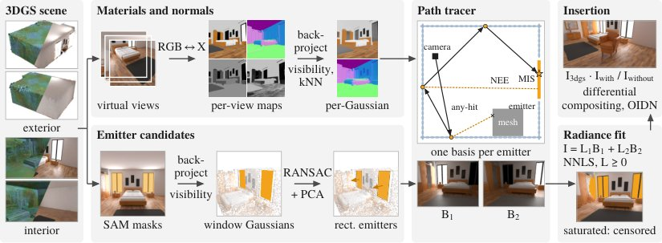
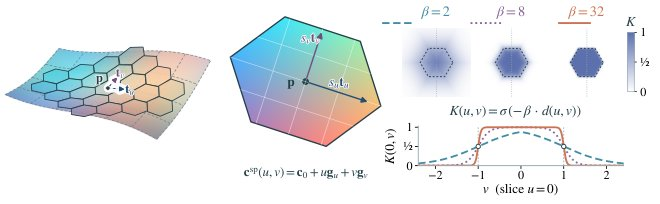

# 2026-10-29 科研日报

## 今日速览

周三（10-28）arXiv 公告里，和主线贴得最近的是一篇室内 3DGS 场景插入物体的工作。它和常见的逆渲染做法反过来：几何和材质直接从现成的二维先验里拿来，然后固定住，只去估计少数几块面光源的亮度。照片里过曝的窗户和灯只能说明“至少有这么亮”，作者就把它们当作不等式约束来处理。这个思路对“真实室内、弱先验、要可重光照”的问题很有参考价值。另外两篇一篇讲效率，一篇讲低成本具身：一篇换掉了高斯的形状和颜色模型，在同等内存下明显胜过 2DGS；另一篇在几百美元的 SO-101 机械臂上跑了 1340 个真机回合，比较四种主流策略的数据效率。

- **必读：[GraftRay](#2026-10-29--graftray)（Technical University of Munich，arXiv 预印本）。** 往重建好的室内高斯场景里放一个网格物体，要让它被窗户和台灯这类近场面光源照亮，还要在地板上投下正确的软阴影。GraftRay 先把扩散模型预测的反照率、粗糙度、金属度和法线多视角投回每个高斯，再用 SAM 圈出的发光区域拟合矩形面光源。由于光传输对光源亮度是线性的，每个光源只需渲一张单位亮度的“基图”，再用过曝像素只给下界的最小二乘解出亮度。最后在 OptiX 里把高斯和网格放在一起做路径追踪，并用差分合成只把插入物带来的明暗变化叠回原始 3DGS 画面。FIPT 合成室内场景上，插入效果的 PSNR 为 34–35 dB，次好的 IRGS 是 28.4 dB；阴影 IoU 为 0.76–0.77，基线最多 0.50。值得精读的是“固定材质只解光源”的取舍，以及截尾观测（只知下界的观测）的写法。局限是光源要人工圈，材质误差会直接传到光照估计里。
- **选读：[Hexels](#2026-10-29--hexels)（Johns Hopkins University，arXiv 预印本）。** 把 2DGS 的高斯圆盘换成边缘软化的六边形面片，每片内部的颜色按一次函数线性变化，于是更少、更大的面片就能盖住平整且颜色渐变的区域。在相同模型内存下，新视角 PSNR 比 2DGS 高 4.5–7.4 dB，训练显存最多省 3.6 倍；DTU 倒角距离为 0.978 mm，同内存的 2DGS 是 1.375 mm。不过不限内存时，2DGS 的 0.794 mm 仍然更好。它直接回应了几何质量与效率卡点，也适合低显存设备。
- **选读：[SO-101 上的四策略数据效率研究](#2026-10-29--so101-scaling)（fysical.ai，arXiv 预印本）。** 一位作者、一台 SO-101、一个抓放任务，从 12 条到 200 条演示，比较 ACT、Diffusion Policy、SmolVLA 和 π₀.₅。数据少时 π₀.₅ 最好；到 100 条以后，从头训练的 ACT 反而领先。π₀.₅ 用 LoRA 微调只成功了 4/110，只训动作专家则是 130/200，可见微调配方的影响比数据量更大。这对在低端硬件上做具身 demo 有直接参考价值。
- **本期其他值得一扫：** 在 Isaac Lab 数字孪生里评测 SO-101 空间操作的 SO-101 Bench、把 Walk-on-Spheres 随机游走组织成可复用“传输骨架”的蒙特卡洛 PDE 求解器、度量生成资产与采集场景对应误差的 ObjectTwin，见文末简列。
- **圈内：** Liquid AI 发布 2B 级开放权重多模态模型族 LFM3，官方博客顺带展示了 VLA 和导航微调，HN 上的使用者反馈有好有坏；Axiom 宣布用智能体集群在 Lean 中完成了有限单群分类的形式化，HN 讨论的焦点在于形式化到底查出了什么、产出的库能不能复用。

## 真实室内的物体插入：固定材质，只解近场面光源

### GraftRay · arXiv · 2026-10-27

**一句话判断：** 室内逆渲染难，很大程度上是因为几何、材质和光照要一起解，而 LDR 照片里过曝的窗户分不清是光源还是亮面反射。GraftRay 换了个问法：如果目标只是“插入物体并让光影可信”，那么材质可以借二维先验，几何沿用重建结果，真正要解的只剩十几个面光源的亮度。这个问题是线性、低维的，还能把过曝像素当不等式约束来用。对主线来说，它是一个“目标驱动、少解未知量”的逆渲染样板，也提供了一套在高斯上做随机透明路径追踪的实现思路。

**Title：** GraftRay: Physically Based Mesh Insertion into Gaussian Splatting Scenes via Path Tracing  
**作者：** Jinxin Ai、Matthias Niessner  
**单位：** Technical University of Munich  
**发表时间 / 投稿信息：** arXiv v1 于 2026-10-27 挂出（10-28 公告），主分类 cs.CV、交叉列入 cs.GR。Comments 为“8 页正文加参考文献、6 图、2 表”，投稿信息未标明。  
**链接：** [摘要](https://arxiv.org/abs/2610.37036) · [HTML 全文](https://arxiv.org/html/2610.37036v1) · [PDF](https://arxiv.org/pdf/2610.37036) · 项目页与代码：论文中未给出

**摘要中译：** 往二维或三维高斯泼溅（2DGS/3DGS）重建的场景里插入虚拟物体，是内容创作、AR 和合成数据生成的关键能力。真实的插入要求物体被场景光照自然照亮，反过来也要在场景上投下物理上可信的阴影。现有方法要么在图像空间做外观协调，牺牲了多视角一致性；要么在插入点用环境贴图近似场景光照，而环境贴图表达不了窗户、台灯这类主导室内照明的近场面光源。为此我们提出 GraftRay，一个把网格物体物理一致地插入二维或三维高斯室内场景的统一方法。我们借助基于扩散模型的先验恢复场景材质与表面法线，显式建模有空间延展的发光体，并以闭式方式求解其辐射亮度。随后，一个混合渲染器对场景高斯和插入网格做联合路径追踪，生成视角一致的着色、相互反射和软阴影。在 FIPT 上，GraftRay 取得新的最好成绩，渲染保真度和阴影精度都超过 ComGS、EAG-PT 等近期基线，同时保持很有竞争力的渲染效率。

*原论文 Figure 2（方法总览），[来源](https://arxiv.org/html/2610.37036v1)。上下两路分别准备“材质”和“光源几何”，中间的路径追踪器把两者变成每个光源一张基图，右侧先解光源亮度，再做插入合成。*

**方法与原理。**

先说几个名词。**LDR（低动态范围）** 指普通相机输出的 8 位照片：太亮的地方会被截到最大值，即“过曝”，此时只知道真实亮度不低于这个值。**路径追踪** 是从相机发出光线、在表面按材质随机反弹、累计到达光源的能量的蒙特卡洛渲染方法；**NEE（下一事件估计）** 是在每个反弹点主动朝光源采样一次，**MIS（多重重要性采样）** 是把“朝光源采样”和“按材质方向采样”两种估计按权重合并，以减小方差。**差分渲染（differential rendering）** 是 Debevec 2008 年提出的经典合成技巧：分别渲染有物体和没物体的场景，只把两者的差异叠回真实照片。

1. **问题与瓶颈。** 环境贴图只记录“从某一点看出去各方向有多亮”，不知道光源在哪、有多大，所以窗户在物体左侧一米处时，阴影的方向和软硬就算不对。联合逆渲染（GS-IR、IRGS 等）理论上能解出光源，但未知量太多；而在 LDR 输入下，过曝的窗户和白墙的高光在像素值上看起来一样，难以分开。图像空间协调（MV-CoLight 等）能做出好看的单帧，却没有场景级光传输，换视角或换光照就不一致。
2. **输入、输出与前提。** 输入是一个训练好的 2DGS 或 3DGS 室内场景（无需原始照片，也可以是生成的场景），用户在一两个视角里用 SAM 粗略圈出的窗户和灯，以及要插入的网格和它的位姿。输出是带材质和法线的高斯、若干矩形面光源（位置、朝向、尺寸和绝对亮度），以及插入物体后的多视角渲染。前提是二维材质估计器（RGB↔X 或 DiffusionRenderer）给出的材质大体可信；光源区域需要人工指定。
3. **第一步：材质与法线投回高斯（§3.1）。** 从场景里渲染若干虚拟视角，用不同随机种子多次运行 RGB↔X，得到每个视角的反照率、粗糙度、金属度和法线图。每个像素的预测只交给“可见”的高斯：沿相机光线累积透射率，第一次跌破 \(1/2\) 的深度作为表面深度，只有与之相差在容差内的高斯才接收这个预测。每个高斯先在各视角内按种子求平均，再对种子取逐通道中位数。这样，单张图里互相矛盾的预测就变成多视角一致的场景级估计；材质存放在高斯上，路径反弹到画面以外的表面时也能查到。此后材质和法线固定，不再与光照联合优化。
4. **第二步：拟合矩形面光源（§3.2）。** SAM 掩码用同样的可见性测试反投影到高斯上，得到每个光源的三维点集。作者用偏向亮高斯的加权 RANSAC 拟合平面，再对内点做 PCA，得到中心、两个面内轴、半宽和法线（墙面上的光源则对齐水平和竖直方向），法线朝向室内。这样光源就成了路径追踪器能直接采样的解析矩形，而不是一团亮高斯。
5. **第三步：在高斯上做路径追踪（§3.3–3.4）。** 每个高斯用包住其 3σ 椭球的轴对齐包围盒注册为 OptiX 自定义图元，求交时取光线上高斯响应的峰值点，并按峰值给出有效不透明度 \(\alpha_i\)。难点在于 alpha 混合要求按深度顺序处理，而硬件遍历的顺序是任意的。作者用**随机透明**解决：每遇到一个高斯，以概率 \(\alpha_i\) 接受它，OptiX 返回最近一个被接受的交点。于是第 \(i\) 个高斯成为“第一个被接受者”的概率是

   \[
   P(i)=\alpha_i\prod_{j<i}(1-\alpha_j),
   \]

   其中 \(j<i\) 表示光线上位于它前面的高斯。这正好等于 alpha 混合里的权重，因此对返回的那个高斯着色，就是混合结果的单样本无偏估计。这样每段路径只需一次硬件遍历，不用为每条光线缓存并排序所有交点，插入的网格也在同一个加速结构里一起追踪。阴影光线则用另一种光线类型，确定性地连乘 \((1-\alpha)\) 累积透射率，透射率低于 \(5\times10^{-3}\) 时提前终止，以得到平滑的软阴影。着色用 Cook–Torrance/GGX 微表面模型，直接光照在矩形上做 NEE 并与材质采样做 MIS，间接光照继续沿材质方向反弹，用俄罗斯轮盘终止，积分器结构仿照 Mitsuba 的 path integrator。
6. **第四步：用基图解光源亮度（§3.5）。** 几何、材质和光源位置固定后，图像对各光源亮度 \(L_k\) 是线性的：

   \[
   I=\sum_k L_k B_k ,
   \]

   \(B_k\) 是只开第 \(k\) 个光源、亮度为 1 时路径追踪得到的图像，包含它带来的直接光和间接光。渲染某个光源自己的基图时，会去掉它所在平面附近那薄薄一层亮高斯，避免“重建出的窗户外观”和“解析光源”重复计光。拟合时把像素分成两类：没过曝的像素要求预测值经相机响应曲线后等于观测值；过曝的像素只施加单边惩罚，预测低于截止阈值才罚，高于则不罚。用编辑的话概括式 (7) 的结构：未截断像素给平方残差，截断像素给 \(\max(0,\tau-f(\cdot))^2\)，其中 \(\tau\) 是截止阈值，\(f\) 是 sRGB 或拟合出的 EMoR 相机响应，所有 \(L_k\ge0\)。作者的理由是：最亮的像素恰恰是直视光源的那些，把它们当等式会把亮度往传感器上限拉低，丢掉又会失去“光源至少这么亮”的信息；真正决定亮度大小的是没过曝的墙、地板和家具。每个通道的未知量通常不到 20 个，残差却可达数千万，作者在 GPU 上算残差和雅可比，用 Levenberg–Marquardt 求解；在线性空间里它就是非负最小二乘（NNLS）。一个附带的好处是：用户误圈的“假光源”如果解释不了房间的照明，会被自动压到接近零的亮度。
7. **第五步：差分合成（§3.6）。** 直接用路径追踪图替换原 3DGS 渲染，会丢掉视角相关外观和重建细节（例如镜子反射）。所以作者在同一相机下渲染有物体和无物体两张线性图，物体像素直接用路径追踪结果，背景像素则用原 3DGS 渲染乘以两图之比：比值小于 1 是投下的阴影，大于 1 是物体反射到周围的光。比值有上限，并用背景中位数补偿曝光差，可选地压低反射光的色偏，最后去噪并套用相机响应。

**为什么这样设计（作者解释与实验支持分开）。** 作者的论证是：插入任务需要的未知量比完整逆渲染少，固定材质和几何以后，光照估计就从高维非凸问题变成了低维的线性或近线性拟合，而且对初值不敏感（作者称“解对初始化不敏感”）。消融（Table 2，bedroom 场景）给了直接支持：把面光源换成点光源或环境贴图，PSNR 掉 8–9 dB，阴影 IoU 少三分之一；只算直接光时 PSNR 为 25.7 dB，四次反弹已在完整结果 1.4 dB 以内；去掉“物体反射回房间”的光，阴影 IoU 跌到 0.58 或 0；用灰色反照率代替材质先验，物体区域 PSNR 减半（15.6 dB）；不做差分合成直接用路径追踪全帧，PSNR 降到 24.8 dB。光源几何的鲁棒性也测了：尺寸缩放 0.8–1.5 倍、平移最多 20 cm，PSNR 至多下降 1.3 dB，阴影 IoU 保持 0.80。

**结果与局限（作者报告）。** 评测场景包括 4 个 FIPT 合成房间和 2 个 NFINITE 合成场景（有路径追踪真值），2 个 FIPT-Real 和 5 个 ScanNet++ 真实采集，以及 5 个在 SpAItial 平台上生成的 3DGS 场景；所有方法用相同的物体、位置和光源，每个场景 3 个视角。有真值时，作者只比较“插入前后的变化”：PSNR 衡量这个变化与真值变化的差距，mask PSNR 只看物体像素，阴影 IoU 和 RMSE 衡量投影区域及其强度（IoU 越高越好，RMSE 越低越好）。理由是全图 PSNR、SSIM、LPIPS 被各方法共享的背景主导，几乎反映不出光照好坏，这一点本身就值得记住。FIPT 上 GraftRay（RGB↔X 先验）的 PSNR 为 34.29、阴影 IoU 0.77，IRGS 为 28.40、0.50，GS-IR 为 26.71、0.47，EAG-PT 为 24.26、0.40，ComGS 只有 13.09。真实和生成场景没有真值，只能用无参考的 VQAScore 比值，作者也承认它几乎区分不开各方法（0.33–0.54 之间）。材质方面，FIPT 上对齐尺度后的反照率 PSNR 为 19.9 dB，GS-IR 和 GI-GS 低 6–8 dB（它们把阴影和窗光烘进了反照率）；EAG-PT 反照率相近（20.2 dB），但只能给出漫反射反照率。GraftRay 的金属度会溢到漫反射表面上。成本（单张 RTX 3090，FIPT bedroom）：重建 22 分钟，DiffusionRenderer 先验每个种子 1.5 小时，投回 6 分钟，光源拟合 13.5 分钟；插入阶段每个 1024×576 视角 1.6 分钟（256 spp 渲两张图加合成），EAG-PT 在 1024 spp 下每帧 14.4 分钟，作者折算成同采样数约慢 12 倍。自述局限：光源要用 SAM 人工圈（掩码可以粗略）；材质和法线全部来自二维估计器，其误差会传到光照拟合和插入结果。另有两点编辑观察：真实场景的优势只靠一个区分度很弱的指标支撑；材质和几何固定后，场景本身并没有变得“可重光照”，换光源时房间原有的烘焙外观仍要靠差分合成兜底。

**值得关注 / 阅读指引。** 对“真实室内、弱先验”的逆渲染主线，最可直接借鉴的有三点。一是 §3.1 的多视角加多种子投票：把二维材质先验变成每个高斯上一致的初值，可以作为任何联合优化的起点，也能当作检查材质是否烘进阴影的对照。二是 §3.5 把 LDR 过曝像素写成截尾观测：这个技巧不依赖插入任务，凡是从普通照片估计光源亮度的逆渲染都可以用，和 IRIS 的相机响应估计是互补关系。三是 §3.3 的随机透明加确定性阴影光线：它和此前跟踪的 Stoch3DGS 同属“免排序”路线，这里用在正向路径追踪而不是重建梯度上，可以对照着看两者的方差和速度。和之前跟过的可微路径追踪辐射缓存（Zhang et al., TOG 2026）相比，GraftRay 完全回避了材质的梯度，只解线性光源；要把它推广到“材质也要更新”的情形，就得回到可微渲染和缓存那条路。建议阅读顺序：Figure 2 → §3.1 → §3.5（式 6、7）→ §3.3 → Table 2 消融 → §4 评测口径 → §4.3 局限。

## 几何与效率：六边形面片加线性颜色

### Hexels · arXiv · 2026-10-27

**一句话判断：** 2DGS 每个圆盘只有一个与位置无关的颜色，渐变区域只能靠很多重叠的小圆盘去拼，内存、显存和过度绘制都由此而来。Hexels 让每个面片自带一个线性颜色场，并换成更省边界的六边形，于是“一片顶多片”。它改的是图元本身而不是压缩或剪枝，因此能和那些方法叠加使用。对“几何质量与效率”卡点，它是同内存下几何和画质同时变好的一个具体证据。不过它只改了外观模型，没有材质或光照分解，离可重光照资产还差一层。

**Title：** Honeycomb-Surfels: Compact Hexagonal Primitives for Efficient Scene Rendering and Reconstruction  
**作者：** Prakhar Kaushik、Soumava Paul、Alan Yuille  
**单位：** Johns Hopkins University（CCVL）  
**发表时间 / 投稿信息：** arXiv v1 于 2026-10-27 挂出（10-28 公告），主分类 cs.CV、交叉列入 cs.GR；投稿信息未标明。  
**链接：** [摘要](https://arxiv.org/abs/2610.37668) · [HTML 全文](https://arxiv.org/html/2610.37668v1) · [PDF](https://arxiv.org/pdf/2610.37668) · [项目页](https://honeycomb-surfels.github.io/) · [代码仓](https://github.com/honeycomb-surfels/hexels)（作者称训练代码与渲染器将一同发布）

**摘要中译：** 借助辐射场和泼溅，新视角合成与三维重建进展迅速，但它们对内存和计算的需求限制了在资源受限场景中的使用。我们提出 Hexels：一种带一阶空间颜色场的平面六边形表面元，可用于高效的三维场景与二维图像表示。Hexels 利用局部平坦、外观平滑变化的区域，用更少、更大的图元来表示。六边形支撑域在面积和边界上都更高效，局部颜色场则刻画图元内部的外观变化。在 34 个场景上，相比内存匹配的 2DGS，Hexels 在各数据集上把 PSNR 提高 4.53–7.38 dB，同时训练显存更低。消融显示，按图元数匹配时，Hexels 比 2DGS 最多高 4.74 dB，训练显存更低，FPS 快 2.31 倍。在不加约束的设置下，Hexels 也提供了互补的质量—内存折中。在高效三维表面重建上，相比内存匹配的 2DGS，Hexels 在 15 个 DTU 扫描上把误差降低 28.9%；在 6 个 Tanks and Temples 表面场景上，Hexels 取得对比方法中最高的平均 F1（34.38%，2DGS 为 31.72%）。我们还表明，作为通用图元，Hexels 在二维图像表示上也优于 Image-GS。Hexels 推进了表面对齐图元在质量—效率折中上的帕累托前沿。

*原论文 Figure 1（图元定义），[来源](https://arxiv.org/html/2610.37668v1)。论文没有单独的流水线图，因为渲染和训练流程与 2DGS 相同，变的只是这一个图元。β 越大边越硬，但 \(K=1/2\) 的等值线始终是标准六边形。*

**方法与原理。**

1. **问题与瓶颈。** 3DGS、2DGS 一类图元的颜色在图元内部是常数（视角相关的球谐只随方向变化，不随位置变化）。墙面、桌面这种大而平、颜色缓慢渐变的区域，只能靠大量重叠的小图元拼出渐变，于是图元数、过度绘制（每个像素要混合的图元数）和训练显存一起变大。高斯核的长尾也让边界处的重叠更严重。已有的 BBSplat、Nexels 给图元加纹理或共享神经场，表达力上去了，但内存和计算转移到了纹理和解码器上。
2. **输入、输出与前提。** 输入与 2DGS 相同：已标定的多视角图像，用 COLMAP 稀疏点（或指明时用更稠密的 MVS 点）初始化。输出是一组定向的六边形面片，每片带位置、旋转、两个尺度、边缘锐度、不透明度和颜色参数；不需要纹理、特征网格或解码网络。
3. **六边形支撑域。** 在面片的局部坐标 \((u,v)\) 里定义 \(d(u,v)=\max\{|v|,|\tfrac{\sqrt3}{2}u+\tfrac12 v|,|\tfrac{\sqrt3}{2}u-\tfrac12 v|\}-1\)，\(d=0\) 正好是标准正六边形，内部为负、外部为正。支撑权重 \(K=\sigma(-\beta d)\) 是一个软化的“在不在六边形里”，\(\beta\) 控制边缘软硬，也作为参数学习。为什么选六边形：正六边形能无缝铺满平面，同面积下周长比正方形和三角形都短（蜂窝定理）。作者在附录里用一阶近似推出，在相同颜色误差上限下，六边形能比对应的正方形多覆盖约 30% 的面积，是三角形的两倍。这是理想化的推导，实验部分才是在真实场景中的检验。
4. **线性颜色场。** 每个面片的颜色写成 \(\mathbf c(u,v)=\mathbf c_0+u\,\mathbf g_u+v\,\mathbf g_v\)：\(\mathbf c_0\) 是中心颜色，\(\mathbf g_u,\mathbf g_v\) 是沿两条局部轴的 RGB 梯度。因为是在局部坐标里定义的，面片放大时同样的渐变会摊到更大的物理范围上。V1 版本不含视角相关项，每片 20 个参数，作者评测的 2DGS 每片 58 个参数；V2 加一个随“相机到面片中心方向”线性变化的残差，共 29 个参数；V3 改用三阶球谐。
5. **渲染与训练。** 和 2DGS 完全一样：对每个像素做透视正确的光线—平面求交，得到局部 \((u,v)\)，以 \(\alpha=\min\{oK,0.99\}\) 按深度从前到后混合，只是把高斯权重换成六边形权重，颜色在交点处按线性场求值。损失为标准的 L1 加 SSIM，用 Adam 优化；主要实验固定图元数量，不做增删，不限设置下才沿用 3DGS 的克隆、分裂和剪枝。推理时预先算好与相机无关的量，用只输出 RGB 的光栅器。

**为什么有效（作者解释与实验支持）。** 作者的解释是：自然场景里大片区域局部平坦、外观平滑，一个能自带渐变的大图元可以替代许多常数色小图元，过度绘制随之下降，显存和速度一起受益。消融（Figure 8）把“高斯形状或六边形”与“常数色或线性色”两两组合，只用 256 个图元拟合平面和渐变着色图像，结果是线性色贡献最大，六边形进一步降低了重叠和误差。二维图像表示实验更直观：在 Image-GS 的 45 张图上，同为 1 万个图元，PSNR 从 33.16 提到 35.82 dB，迭代次数从 10,000 降到 5,100。

**结果与局限（作者报告）。** 内存匹配是作者的主要设置：限制基线的图元数，使未压缩模型大小相同。在这一设置下，Mip-NeRF360、Tanks and Temples、DTU 上，Hexels V1 比 2DGS 高 4.53–7.38 dB（Mip-NeRF360 平均高 6.99 dB），比 Triangle Splatting 高 1.70–2.90 dB，FPS 为 378–831，是 2DGS 的 1.54–1.87 倍，训练显存最多低 3.6 倍。按图元数匹配时，比 2DGS 最多高 4.74 dB，渲染最多快 2.31 倍。不限内存时仍比 2DGS 高 0.90 dB。几何方面，DTU 15 个扫描的平均倒角距离（重建表面与真值点云之间的平均距离，越小越好）为 0.978 mm，内存匹配和图元匹配的 2DGS 分别为 1.375 和 1.449 mm，Triangle Splatting 为 1.124 mm；但**不限内存的 2DGS 为 0.794 mm，仍然更好**，只是显存更高。另外 Hexels 在这张表里固定了图元数，而其他方法允许增删。Tanks and Temples 6 个场景的平均 F1 为 34.38%，不限内存的 2DGS 为 31.72%。每个面片可以在常数时间内直接导出为六边形多边形单元，不用渲深度图、建体素或跑 Marching Cubes，但这些单元彼此独立，拼不成水密网格。自述局限：一阶颜色表达不了单片内的任意纹理，高频或不相关的外观仍要靠更小的面片；稀疏初始化可能留下覆盖空洞；边更硬并不能消除小投影尺寸或掠射角下的采样走样。

**值得关注 / 阅读指引。** 对主线有两个连接点。一是几何鲁棒性：室内的大面积平墙和桌面正是 PGSR 类平面先验关注的区域，而 Hexels 本身就是平面图元，加上更少的重叠，可以作为“弱纹理室内”几何重建的候选底座，值得在 ScanNet++ 这类室内数据上验证（论文只测了 DTU、Tanks and Temples 和 Mip-NeRF360）。二是逆渲染：线性颜色场很自然地可以推广成“线性反照率场”，粗糙度和法线也可以按同样方式在片内变化；但每片的法线是常数，镜面高光在片内的变化未必能表达，这一点需要实验回答。光线追踪方面，六边形面片的求交比椭球更简单，也许更适合接到 GRay、3DGRT 这类光追框架上，但论文没有测。建议顺序：Figure 1 → §3 式 (2)–(4) → Figure 8 消融 → Table 2 内存匹配 → Table 5、6 几何 → 附录 G 的覆盖面积推导 → 局限。

## 低成本具身：一台 SO-101 上四种策略的数据效率

### SO-101 数据效率研究 · arXiv · 2026-10-27

**一句话判断：** 这不是新方法，而是一项严格控制变量的真机实验：同一任务、同一套演示、相同测试摆放，1340 个回合逐一回看录像打分。它回答了刚上手低成本机械臂的人最关心的两个问题：该训哪种策略，要录多少条演示。结论对“在低端机上做具身 demo”很实用：数据少时用预训练 VLA 并只训动作专家，数据多了以后小模型从头训也不差；还有一点，测出来的成功率本身就很嘈杂。

**Title：** From 12 to 200 Demonstrations: How ACT, Diffusion Policy, SmolVLA and π₀.₅ Scale on a Low-Cost Arm  
**作者：** Simon Cowling  
**单位：** fysical.ai（丹麦）  
**发表时间 / 投稿信息：** arXiv v1 于 2026-10-27 挂出（10-28 公告），主分类 cs.RO；Comments 为“31 页、5 图、19 表”，投稿信息未标明。  
**链接：** [摘要](https://arxiv.org/abs/2610.37170) · [HTML 全文](https://arxiv.org/html/2610.37170v1) · [PDF](https://arxiv.org/pdf/2610.37170) · 代码与数据：论文中未见公开链接

**摘要中译：** 我们在一个带干扰物的抓放任务上，用 12、25、50、100、200 条遥操作演示的嵌套子集，以每种策略一套固定的训练配方，训练了四种常用的模仿学习策略：ACT、Diffusion Policy、SmolVLA 和 π₀.₅。每个训练出的模型都在一台实体 SO-101 机械臂上按固定的物体摆放运行，共评分 1340 个回合，分为 126 组。从头训练的 ACT 从 12 条演示时 40 回合成功 1 次，提升到 100 条时 40 回合成功 37 次。只微调动作专家的 π₀.₅ 在数据稀缺时最好（12 条时 16/40，25 条时 28/40），之后停在 70% 左右；从 100 条开始 ACT 领先，但本研究无法完全确定这个差距。SmolVLA 和 Diffusion Policy 的峰值都在 50% 左右，两者都受“无法起步”的问题影响：SmolVLA 有 47% 的回合机械臂根本没有动，Diffusion Policy 在去掉演示开头的静止段之前几乎从不起步。对 π₀.₅ 来说，微调配方比数据量更重要：低秩适配（LoRA）只成功 4/110，动作专家微调则成功 130/200。根据关节和相机录像，我们把每个回合放到一个四级阶梯上（开始移动、够到球、带起球、送达），并说明对 ACT 来说，数据越多，失败从“够不到”转向“抓不住”，直至消失，而 π₀.₅ 剩下的失败集中在抓取。我们还测量了十回合一组作为测量有多弱（同一检查点测两次，平均相差 10 次中的 2 次成功），把种子间差异与这种噪声分开，并对照录像审核了人工打分。每套配方内训练步数固定，因此数据量和每条数据被看到的次数是一起变化的；我们说明了哪些结论在这一混杂下仍然成立，哪些不成立。

**方法与原理（实验设计）。**

先说几个名词。**ACT**（Action Chunking Transformer）是一个从头训练的 Transformer，以条件变分自编码器的方式一次预测一段未来动作（动作块）。**Diffusion Policy** 用迭代去噪生成动作序列。**SmolVLA** 和 **π₀.₅** 都是视觉—语言—动作模型（VLA）：在大规模多机器人数据上预训练的视觉语言骨干，加一个用流匹配生成连续动作的“动作专家”小网络；π₀.₅ 的骨干是 PaliGemma，预训练数据量比 SmolVLA 大得多。**LoRA（低秩适配）** 是只在原权重旁训练很小的低秩增量矩阵的微调方式；“动作专家微调”则是冻结或屏蔽视觉语言骨干的梯度，只训练动作专家。

1. **问题。** 四种策略各自是在不同机器人、任务和数据量上提出的，已有的低成本臂基准要么只测一个数据量，要么每个模型只测 20 次左右，不足以判断差异是否真实。
2. **数据与硬件。** 一位操作者用主从臂遥操作录了 225 条演示（30 fps，平均 17 秒），其中 25 条留作日后研究；其余 200 条在训练前一次性划成 12 ⊂ 25 ⊂ 50 ⊂ 100 ⊂ 200 的嵌套子集，所以同一数据量下所有模型看到的是完全相同的演示。输入为前置相机和腕部相机（640×480）加 6 个关节角，输出为 6 个关节目标。任务是在两个红色干扰球之间捡起绿色球放进篮子，30 秒内完成算成功。推理在一台 RTX 5070 Ti（16 GB）工作站上本地运行，训练在云端 A10G 或 A100 上完成。
3. **训练与测试。** 每种策略用一套接近 LeRobot 默认值的固定配方，在所有数据量下不变，并用多个随机种子训练；每个模型在 10 个固定的伪随机摆放上测试。主要对比组都在比录制时暗约一半的室内光下运行，作者把它当作有意的鲁棒性测试。
4. **从录像分析失败。** 作者用关节和腕部相机录像把每个回合归到四级阶梯：开始移动、够到球、带起球、送达，从而能看出失败发生在哪一步，而不只是一个成功率。他们还对照录像审核了人工打分表。
5. **干预实验。** Diffusion Policy 起初几乎从不起步。作者做了一份去掉每条演示开头静止段的副本（中位数 2.8 秒，占全部帧的 17.4%），只用于 Diffusion Policy，问题随之消失，这说明静止段是起步失败的直接原因。

**结果与局限（作者报告）。** 数据效率：12 条演示时 π₀.₅ 为 16/40，ACT 为 1/40；25 条时 π₀.₅ 为 28/40；ACT 在 100 条时达到 37/40，此后领先 π₀.₅，后者停在 70% 左右。作者的说法是“预训练换来了数据效率，但在这个任务上没看到它换来更高的上限”。微调配方：LoRA 只训练 0.07% 的权重，成功 4/110；动作专家微调训练 16.7% 的权重，成功 130/200，差距达 61 个百分点，比除 ACT 外任何策略从 12 条到 200 条的提升都大。作者提醒：只跑过 LoRA 的人会得出“π₀.₅ 在这台臂上不行”的错误结论。测量噪声：同一检查点测两次，10 回合中平均相差 2 次成功，所以十回合一组只能看出大差异。控制频率：四种策略在 16 GB 消费级显卡上都接近 30 Hz 目标；但推理在控制回路内进行，每出一个新动作块，机械臂就会短暂停顿，ACT 停 0.01 秒，π₀.₅ 停 0.17 秒，约占后者控制步数的十分之一，作者没有检验这对成功率的影响。局限（作者明确列出）：只有一个任务、一台臂、一位操作者；比较的是“按默认配方使用的策略”，不是各架构的最佳表现；训练步数固定，200 条演示时每帧被看到的次数比 12 条时少约 17 倍，所以曲线在 100–200 条处变平时，分不清是到了上限还是训练不足；测试光照比训练暗。

**值得关注 / 阅读指引。** 对“低端机具身 demo 加合成数据”的兴趣，这篇提供了一组可直接对照的真机基线和三条可操作的经验：录演示时剪掉开头的静止段；数据少于约 50 条时用预训练 VLA，并只训动作专家而不是 LoRA；评估至少要多组重复，并把失败按阶段拆开。它也给合成数据留了一个清楚的接口：作者的未来工作就包括“仿真成功率与真机成功率的对照”和“仿真强化学习与遥操作演示的对照”，正好可以用此前跟踪的 PrecisionReach-GS 一类 3DGS 造数据方法来补上。建议顺序：§1.1 结论范围 → Table 1、2（硬件与配方）→ §4.1 扩展曲线 → §4.2 四级阶梯 → §4.3 起步失败 → §4.4 配方敏感性 → §5 训练步数混杂 → §6 实用建议。

## 本期其他值得一扫

- [SO-101 Bench](https://arxiv.org/abs/2610.36420)（Truman Hickok；arXiv 2026-10-27，投稿信息未标明，[项目页](https://so101-bench.github.io/) · [代码](https://github.com/5hadytru/so101_bench)）：在一台真实 SO-101 布置的 Isaac Lab 数字孪生里，做语言条件的空间操作基准：4 个任务、138 个物体（分为见过、未见实例、未见类别）、916 个评测回合和 3629 条仿真演示，所有策略在相同算力预算下微调。五个不用真实数据训练的策略搬到真机上（未见环境、未见物体）时排名完全不变（Spearman ρ = 1.00），但仿真会高估成功率。九个 VLA 和世界动作模型最好约 61%；让大模型写代码、把抓取交给学习策略的智能体达到 83.2%，消融显示优势来自所用框架和语言模型的选择。可与上面的真机研究对照着看。本期仅据摘要简列。
- [From Walks to Skeletons](https://arxiv.org/abs/2610.36931)（Yunfeng Liao、Yucheng Wu、Xiucheng Li；arXiv 2026-10-27，19 页，投稿信息未标明）：Walk-on-Spheres 是一种无网格的椭圆 PDE 蒙特卡洛解法，传统做法每次查询后就丢掉采样到的随机游走。作者把游走组织成一张持久的共享计算图（“传输骨架”），在不同空间查询点和边界条件之间复用，支持渐进细化、结构保持压缩、动态几何的局部更新，以及交互式编辑区域间的传输。思路和批渲染里的光传输复用同源。本期仅据摘要简列。
- [ObjectTwin](https://arxiv.org/abs/2610.35904)（Zhenghe Guo；arXiv 2026-09-30 挂出、10-28 列入 cs.GR，投稿信息未标明）：把生成网格当作采集场景中物体的可编辑替身时，要求它在采集时的度量状态下能复现同一实例的标定观测。作者固定实例、相机、扫描投影支撑、深度、度量锚点和评测分母，只替换物体表示，以此测量“资产对应误差”。在两个室内 RGB-D 域、两个生成后端上，可见且已锚定的生成资产 MaskIoU 损失 0.302–0.497，而且哪个生成器更好会随采集域反转；保守的位姿细化并不能系统性地挽回。对 Real2Sim 资产评测是一个有用的口径。本期仅据摘要简列。

## 圈内新闻与社区反应

**Liquid AI 发布 LFM3：2B 级开放权重多模态模型族（LLM · 端侧 · 具身）。** Liquid AI 于 10-27 发布 [LFM3](https://www.liquid.ai/blog/lfm3)，权重放在 [Hugging Face](https://huggingface.co/collections/LiquidAI/lfm3)。首批 6 个模型都从同一个 LFM3-1.7B-Base 分出来，分别覆盖文本、视觉、音频、全模态和两种“决策”模型。架构上，24 层里有 13 层门控短卷积、5 层 256 窗口滑窗注意力、6 层全局注意力，这个配比是在 14 种设备与后端组合（手机、树莓派 5、笔记本、NPU 等）上做硬件在环搜索得到的。官方称文本模型 4 位量化后约 1 GB，上下文 256K，每个模型都能在单卡上微调。以下数字均为厂商自报：文本模型在多项智能体基准上接近或超过 Qwen3.5-9B，在知识类和智能体编程任务上仍明显落后于大模型。博客还展示了用 LFM3-VL-2B 做 VLA 的研究性扩展：LIBERO 四个子集平均 96.2%，在 Jetson AGX Orin 上 FP16 生成一个动作块不到 50 ms；导航模型在 Orin 上以 2.5 Hz 以上更新路径点。HN 讨论（[原帖](https://news.ycombinator.com/item?id=50262229)，10-27）里有不同方向的使用反馈：有用户把它当“快但要复核”的侦察模型，报告在 7900XT 上预填充约 8500 tok/s、生成约 212 tok/s（[jakswa](https://news.ycombinator.com/item?id=50279040)）；有人在 MLX 系工具里加载失败（[dchuk](https://news.ycombinator.com/item?id=50264925)）；有人发现 1.7B 文本模型答错常识题，VL 版反而答对，参与发布的员工回应“量化总会带来问题”，并追问用的是哪种量化（[lubitelpospat](https://news.ycombinator.com/item?id=50265767)）；也有人怀疑这么小的模型能否真用来写代码（[UncleOxidant](https://news.ycombinator.com/item?id=50266161)）。编辑判断：对“低端机具身”这条兴趣，LFM3 值得关注的不是榜单分数，而是“2B 骨干、单卡微调、Orin 上 50 ms 出动作块”这套组合，它把 VLA 的部署门槛拉到了工业边缘设备（Jetson 级），但离学生手里的消费级小卡和树莓派级控制器还有一段距离，博客里的 VLA 结果也全是仿真基准。

**Axiom 用智能体集群在 Lean 中形式化有限单群分类（Agent · 形式化数学）。** Axiom 于 10-26 发布[项目说明](https://axiommath.ai/research/the-enormous-theorem-formalized)，[发布页](https://cfsg.axiommath.ai/)称这是有限单群分类（CFSG）的首个完整机器检验证明。原证明约 1.5 万页，分散在 500 多篇文献里。官方描述的流程是：先用已有的 Lean 成果和一份内部整理的“证明地图”把工作拆成 108 个里程碑、约 380 个子任务；数十个智能体通过 GitHub issue 认领任务，人类数学家处理数学障碍，工程师负责分布式构建缓存和外置有限计算的证书。用时 24 天，产出约 4310 万行 Lean 代码。过程中发现文献里有 34 处“值得注意的偏离”，最大的一处是：Walter 对“非平衡群定理”的证明中有一个封闭性断言存在反例（从 PSL₂(49) 出发构造），最终改走 Solomon 的极大 2-分量理论路线，并由 AxiomProver 证出了一个新定理。官方强调，人类要审查最终陈述和定义是否表达了原意，Lean 只负责检查推导。HN 讨论（[原帖](https://news.ycombinator.com/item?id=50261647)，10-27）的焦点：有人提醒原证明的大缺口（拟薄情形）此前已由人类补上，并非这次才发现（[QuesnayJr](https://news.ycombinator.com/item?id=50262722)）；有人想知道 500 份来源里有多少需要实质修补而不只是翻译（[Salparvezml](https://news.ycombinator.com/item?id=50262531)）；Axiom 员工回应，难点在于同一个非形式概念会被形式化成彼此不兼容的版本，需要整合（[jonath_laurent](https://news.ycombinator.com/item?id=50262065)）；也有人认为这样暴力形式化得到的未必是可复用的库，并引用了 Xena 项目的文章（[aureianimus](https://news.ycombinator.com/item?id=50263678)）。编辑判断：这件事对图形学和具身研究的意义不在数学本身，而在于“长周期、多智能体、可机器验收”的工程组织方式：任务地图、认领、带假设的中间结果必须追溯回最终目标、构建缓存。这和 SceneAgent、MiracleAug 一类“智能体干长活”的管线面对的是同一类问题。

## 覆盖说明

日报发布日为 **2026-10-29（周四）**，内容覆盖日为 2026-10-28（周三）arXiv 公告（cs.GR 新提交与交叉列表，cs.CV、cs.RO 按关键词筛选）。正文三篇为 GraftRay（2610.37036）、Hexels（2610.37668）与 SO-101 四策略数据效率研究（2610.37170），均核对了 arXiv HTML 全文的方法、实验与局限；配图为前两篇的原论文插图，第三篇 HTML 版没有可用插图，故未配图。SO-101 Bench、From Walks to Skeletons、ObjectTwin 仅据摘要简列。所有结果均为作者报告，未独立复现。圈内新闻以 Hacker News 近两日热帖和英文 AI 日报为入口，核对了 Liquid AI 与 Axiom 的原文和讨论串；DeepMind Genie 4 已在 10-28 期报道，本期不重复；中文媒体与 X 本期未单独检索。对标仓 Real2Sim_GPT6_ASTRA 自 9 月 10 日以来无新提交；Blender 主干 10-26 以来最近 50 笔提交中没有原生高斯泼溅相关改动。

**编写：** Cream

**故障说明：** 本日由 Cream 于 13:54 HKT 应维护者要求手动补发。当日主发布定时任务未触发：Cream（primary，窗口 05:30–06:20）没有在窗口内认领，也没有出稿；Neon（standby，窗口 06:20–06:50）同样没有补发。依据：补发前仓库中没有 `digests/2026-10-29.md`，`last_success` 停在 2026-10-28，也没有当日 claim；本次补发的认领与发布事件已记入 `meta/failover.json`。
