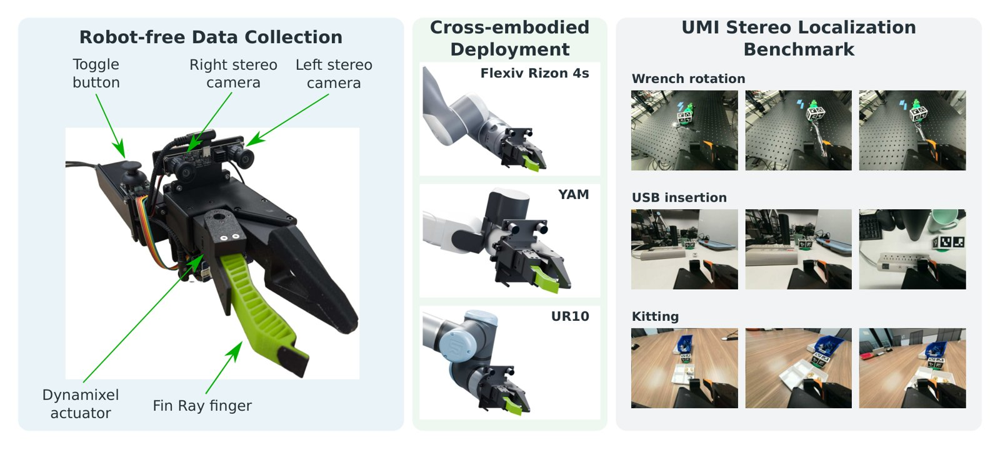
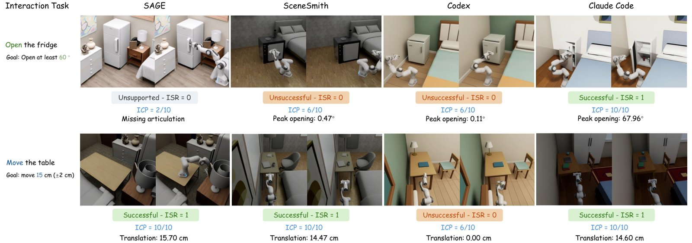

# 2026-10-30 科研日报

## 今日速览

arXiv 最新一期仍是周三（10-28）的公告，所以本期回到这一期里上回没展开的具身与场景生成工作。两篇放在一起读很有意思：一篇做的是“怎么便宜又准地采到真实演示”，另一篇问的是“生成出来的仿真场景到底能不能拿来交互”。它们正好卡在 Real2Sim 管线的两头，也都和用户自己的 MiracleAug 与对标仓 Real2Sim_GPT6_ASTRA 直接相关。

- **必读：[OpenJaws](#2026-10-30--openjaws)（NVIDIA，arXiv 预印本）。** 一套约 400 美元、全开源的手持 UMI 采集夹爪：3D 打印结构、Dynamixel 舵机、Arduino 控制板，加一只全局快门的鱼眼双目相机。双目基线直接给出米制尺度，不再靠单目加 IMU 去猜。作者同时发布了 90 段演示、9 个任务的定位基准 UMI-Loc-Bench-v1：双目 COLMAP 全轨迹误差 5.2 mm / 0.8°，原版 UMI 的单目 SLAM 只能跟住 37% 的帧。值得注意的有两点。一是人为把标签误差从约 10 mm 加到 30 mm 以上，策略成功率就从 90% 掉到 30%，说明“标签精度直接决定策略好坏”。二是作者用 GPT-6 Astra 把演示自动转成 Isaac Lab 数字孪生，10 段齿轮插装里有 7 段能在仿真里成功回放，这和用户在做的 Astra 驱动增强示教是同一条路。
- **选读：[ScIntBench](#2026-10-30--scintbench)（The University of Western Australia、University of British Columbia，arXiv 预印本）。** 把 12 个文本生成室内场景的系统丢进 Isaac Sim，让 Franka 去推椅子、开冰箱、按台面，测场景能不能被“用”。结论很扎心：7 个系统的场景根本无法执行任何交互；静态物理几乎满分的 SAGE 只完成 11.5% 的任务；最好的是通用编码智能体 Claude Code，也只有 36.9%。2436 个“场景加任务”组合里有 1534 个因为缺目标物体或缺铰链等物理属性而无法执行。对 Real2Sim 和合成数据管线，它提供了一套比“看起来像、静止时不穿模”更严格的验收口径。
- **本期其他值得一扫：** 把生成多视图拼成无缝纹理的 Texture Consolidation、在 Jetson Thor 上拆解 18 个 VLA 时延的 VLA-HWBench、用冻结前馈几何模型当“虚拟深度相机”的 LingGS 等，见文末简列。
- **圈内：** Mistral 放出 1T 参数的 Mistral Large 4 权重，HN 上讨论集中在许可证是否算“开源”和降价后的性价比；有人在 Raspberry Pi Pico 2 W 上跑起了只有几万参数的循环 Transformer 世界模型，能“做梦”生成 Breakout 和迷你 Doom，并让一个小策略在梦里学着玩。

## 采集端：400 美元的双目 UMI 与 Astra 自动孪生

### OpenJaws · arXiv · 2026-10-27

**一句话判断：** UMI 这条路线的瓶颈一直在“动作标签有多准”，而单目加 IMU 的 SLAM 既没有绝对尺度，又容易在手持快速运动下丢跟踪。OpenJaws 的做法很朴素：换成标定好的双目相机，用现成的 SLAM/SfM 直接拿到米制轨迹；夹爪本身既是采集器又是部署端，靠 ISO 法兰直接装到协作臂上，省掉了“手持器与部署夹爪运动学对齐”的麻烦。对用户来说，它的价值有三层：便宜、全开源、能用消费级硬件复现；有一个量化定位误差如何影响策略的实验；还有一个 GPT-6 Astra 做 Real2Sim 的独立实证。

**Title：** OpenJaws: An Open Hardware UMI Framework with Stereo Localization for Generalist Manipulation  
**作者：** Adithyavairavan Murali、Yash Oza、Karanbir Chahal、Neel Jawale、Silas De Vries、Hesam Rabeti、Erwin Coumans、Balakumar Sundaralingam、Stan Birchfield  
**单位：** NVIDIA（论文首页标注）  
**发表时间 / 投稿信息：** arXiv v1 于 2026-10-27 挂出（10-28 公告），主分类 cs.RO；投稿信息未标明。  
**链接：** [摘要](https://arxiv.org/abs/2610.36598) · [HTML 全文](https://arxiv.org/html/2610.36598v1) · [PDF](https://arxiv.org/pdf/2610.36598) · [项目页](https://open-jaws.github.io/)（作者称硬件、软件与数据以商用友好的许可证发布）

**摘要中译：** 通用操作接口（UMI）这类手持采集设备可以在没有机器人的情况下在真实环境中采集操作演示，但所得动作标签的质量受限于视觉定位的精度。现有系统要么用单目视觉惯性里程计恢复末端位姿，存在尺度歧义和漂移；要么把跟踪交给闭源模块和外部设施，又重新带来成本和布置负担。我们提出 OpenJaws，一个完全开放软硬件的传感化 UMI 框架，提升定位精度并简化跨机器人平台的部署。OpenJaws 把一个带标准 ISO 接口的模块化 3D 打印夹爪与一台低成本双目相机配对，恢复米制相机轨迹。我们还提出 UMI-Loc-Bench-v1，用于量化手持采集设备在真实环境中的定位精度，并表明双目定位显著优于单目方案。最后，我们展示了用 OpenJaws 采集的数据训练的策略可以在多个任务上部署到真实机器人。

*原论文 Figure 1（系统总览），[来源](https://arxiv.org/html/2610.36598v1)。采集和部署用的是同一个夹爪，这是它和原版 UMI 最大的工程差别。*

**方法与原理。**

先说几个名词。**UMI（Universal Manipulation Interface）** 是 2024 年提出的手持采集范式：人拿着带腕部相机的夹爪做演示，事后用视觉定位还原夹爪轨迹作为动作标签，策略输出“相对当前末端位姿的位移”，因此不依赖具体机械臂。**ATE（绝对轨迹误差）** 是把估计轨迹与真值刚性对齐后逐帧位置误差的均方根；**覆盖率** 指定位算法能给出有效位姿的帧占比。

1. **问题与瓶颈。** 原版 UMI 用 GoPro 单目加 IMU 跑改造过的 ORB-SLAM3，初始化脆弱，需要先录一段建图视频并借助已知尺寸的标记物；单目本身没有绝对尺度。部署时还要另配一个电动夹爪，并保证行程、相机到工具中心点的变换与采集时一致。其他方案改用 VR 追踪器或 iPhone ARKit，又闭源又贵。
2. **硬件。** 全部用现成模块：Dynamixel XC430 舵机、Arduino OpenRB-150 控制板、Arduino IMU 扩展板、一台全局快门鱼眼双目相机，结构件全部 3D 打印，刻意不做定制 PCB，买齐物料就能装。手指沿用 Grasp EveryThing 的 TPU 柔性指形（去掉触觉）。法兰采用 ISO 9409-1-50-4-M6，多数协作臂可直接安装。作者给出的物料成本约 400 美元、重 0.408 kg；对照表里原版 UMI 含 WSG-50 夹爪约 5389 美元，表中其他方案在 454–1316 美元之间。选全局快门是因为手持快速运动时卷帘快门会让图像扭曲，破坏特征匹配。
3. **双目定位。** 标定内参和基线后，先去鱼眼畸变再极线校正，用 SAM 把夹爪手指和标记物遮掉，避免运动的手指干扰匹配，然后交给现成的定位后端（COLMAP 双目刚体重建、ORB-SLAM3、cuVSLAM 等）。双目三角化由已知基线直接给出绝对尺度。
4. **基准 UMI-Loc-Bench-v1。** 9 个任务（叠方块、齿轮插装、扳手旋转、货架取物、料箱取物、配套、USB 插入、放笔、捡糖）各 10 段，共 90 段手持演示；真值来自贴了 ArUco 码的 AprilTag 立方体，评测时把立方体遮掉，防止算法拿它当特征。
5. **策略与 Real2Sim。** 策略沿用原版 UMI 的 Diffusion Policy 和相对末端动作空间，在 UR10 上部署。Real2Sim 部分把一段演示和夹爪、物体的仿真资产交给 GPT-6 Astra 智能体，不给物体真值位姿，让它自己从演示里恢复场景图和接触几何，并在 Isaac Lab 里回放；回放成功才算孪生建成。

**结果与局限（作者报告）。** 定位方面，所有双目方法基本能跟住整段轨迹，ORB-SLAM3 单目加 IMU 平均只覆盖 9%，原版 UMI-SLAM 覆盖 37%。在 UMI-SLAM 能跟住的公共片段上，双目 COLMAP 为 2.9 mm / 0.4°，UMI-SLAM 为 18.4 mm / 4.0°。全轨迹上 COLMAP 为 5.2 mm / 0.8°，ORB-SLAM3 双目 7.4 mm / 1.4°，cuVSLAM 双目 12.4 mm / 1.9°；但 COLMAP 每段要 836 秒，cuVSLAM 只要 34.8 秒，作者在策略实验中用的是 cuVSLAM。学习型单目方法 ViPE 轨迹形状很好（按真值拟合尺度后 3.5 mm），原生尺度却差到 48.2 mm，作者认为腕部近距离视角超出了它的训练分布。给双目加 IMU 后误差更低（2.0 mm / 0.5°），但覆盖率从 100% 跌到 18%，作者的结论是 IMU 在这个场景下得不偿失。基线标定误差 ±5 mm 会把平移误差从 3 mm 拉到 6–8 mm，旋转几乎不受影响。真机上，叠方块 200 段演示、抓放 50 段，各测 10 次都成功 9 次；在训练标签里人为加入漂移，使平移误差从约 10 mm 升到 30 mm 以上，成功率降到 30%。Real2Sim 方面，10 段齿轮插装演示里 7 段建成了可回放的孪生，智能体还自动选用了接触所需的有向距离场碰撞表示。编辑观察：策略实验只有两个任务、各 10 次，Real2Sim 只测了一个任务，样本都很小；双臂需要同时定位两台双目，作者列为未来工作。

**值得关注 / 阅读指引。** 对“低端机做具身 demo”的约束，这是一份能照着买、照着装的清单，并且结果建立在开源定位后端上，不依赖专有设备。和上期 SO-101 数据效率研究对照着看：那篇是关节空间遥操作，这篇是末端空间手持采集，两者都说明“数据质量和配方”比模型更值得先抓。§V-D 的 Real2Sim 是本期和用户课题最近的一段：作者同样把 GPT-6 Astra 当作“从演示恢复仿真场景”的智能体，7/10 的成功率和“不给真值位姿”的设定，可以直接作为 MiracleAug 一类管线的对照基线；它也说明双目给出的米制轨迹能降低孪生对齐的难度。建议顺序：Table I（成本与设计对比）→ §III-B 双目定位 → Fig. 4 定位结果 → §V-C 标签噪声消融（Fig. 7）→ §V-D Real2Sim → 附录 A-D 物料清单。

## 生成端：生成的室内场景能不能被“用”

### ScIntBench · arXiv · 2026-10-27

**一句话判断：** 现在的文本生成场景评测主要看两件事：像不像（多模态大模型打分），静止时稳不稳（穿模、悬空、重力下是否滑落）。ScIntBench 加了第三件：真的去推、去开、去按，看场景能否支撑交互、交互后会不会散架。它的结论对所有想拿生成场景造机器人训练数据的人都是提醒：静态指标好并不代表能交互，缺铰链、缺物理属性才是最主要的失败原因。

**Title：** ScIntBench: Physical Interaction Plausibility in 3D Scene Generation  
**作者：** Wendi Ying、Daochang Liu、Leonid Sigal、Ajmal Saeed Mian  
**单位：** The University of Western Australia；University of British Columbia（Leonid Sigal 兼 Canada CIFAR AI Chair）  
**发表时间 / 投稿信息：** arXiv v1 于 2026-10-27 挂出（10-28 公告），主分类 cs.CV；投稿信息未标明。  
**链接：** [摘要](https://arxiv.org/abs/2610.37326) · [HTML 全文](https://arxiv.org/html/2610.37326v1) · [PDF](https://arxiv.org/pdf/2610.37326) · [项目页](https://scintbench.github.io)

**摘要中译：** 现有的文本条件三维室内场景生成评测大多强调语义保真度和静止状态下的物理有效性，对交互时的物理可靠性评估不足。为此我们提出 ScIntBench，一个以“交互就绪度”为中心的统一基准：它在物理仿真中执行规定的操作动作（如推、开、表面按压），并测量任务成功率、能力与进度、交互后的完整性和动态合理性。多视角语义评估和静态物理评估作为补充，帮助解释交互结果。我们在 10 种房间类型上系统评估了 12 个最先进的场景生成系统。结果表明，语义和静态物理表现好并不一定意味着交互就绪：一个静态合理性接近满分的系统只完成了 11.54% 的交互，12 个系统中有 7 个生成的场景无法支撑任何交互，即使最好的系统也只成功完成了 36.92% 的规定任务。这些发现揭示了生成交互就绪场景的两个根本挑战：提供必要的物理交互能力，以及确保主动操作下的可靠物理行为。

*原论文 Figure 3（交互任务结果的定性对比），[来源](https://arxiv.org/html/2610.37326v1)。外观都说得过去的冰箱，只有一个系统的门真的能打开到规定角度。*

**方法与原理。**

1. **任务构建。** 从 SceneEval 选 30 条文本提示，覆盖 10 种房间，每种 3 条。由大模型根据房间描述提出候选交互，每条规定目标物体、动作、所需能力（如铰链、可移动）、成功条件和物理约束，共 203 个任务。任务与生成结果无关，所有方法共用，合计 2436 个“场景加任务”评测实例。
2. **统一执行协议。** 生成场景在 Blender 里统一渲五个视角（俯视加四个角），几何检查在原始几何上做，物理仿真在 Isaac Sim 里做；**不替方法补任何缺失的铰链或物理属性**，场景是什么样就按什么样测。接触类操作用 Franka Panda 执行，表面测试用一个标准化的力驱动探针；执行器和成功条件先在参考场景上校准。
3. **四个交互指标。** ISR 是规定任务的成功率，按仿真器可观测的状态二值判定，控制器或仿真自身的失败单独记录，不算到场景头上。ICP 是六级量表（目标缺失 0、目标存在 2、可交互 4、交互已开始 6、显著进展 8、成功 10），由多模态大模型依据场景能力和执行证据打分。PIV 是交互并静置后出现违规（非预期位移、新增穿插、越界、失去支撑）的物体占比，越低越好。DP 由多模态大模型看交互视频，对运动自然度、接触、重力、摩擦、铰链一致性打 0–10 分。
4. **补充指标。** 语义沿用 SceneWeaver 的四项打分（真实感、功能性、布局、完整度）；静态物理为碰撞、越界、支撑和重力下的被动稳定性。

**结果与局限（作者报告）。** 12 个系统分四类：数据驱动生成器（ATISS、DiffuScene、InstructScene）、大模型布局流程（LayoutGPT、LayoutVLM、Holodeck、HSM）、专用智能体管线（SceneWeaver、SAGE、SceneSmith）和通用编码智能体（Codex、Claude Code）。只有 Holodeck、SAGE、SceneSmith、Codex、Claude Code 五个能执行交互，ISR 分别为 17.39%、11.54%、27.40%、27.75%、36.92%，其余七个为 0。SAGE 的碰撞率 0.41%、稳定性 98.33%，静态最好，ISR 却只有 11.54%；Holodeck 静态差得多，ISR 反而更高。作者发现交互就绪度与“功能性”语义分更相关：五个可交互系统按 ICP 的排名与按功能性的排名完全一致。成功不等于不出事：Claude Code 的 ISR 最高，PIV 也较高（12.52%）；SAGE 的 PIV 最低（1.10%）；SceneSmith 的 DP 最高。失败分析：1534 个实例因缺目标或缺物理前提无法执行；开冰箱任务要求 60°，SceneSmith 和 Codex 只开到 0.47° 和 0.11°；推椅子时把桌上两本书碰到了地上。成本上，两个编码智能体每个场景约 28 分钟，SAGE 和 SceneSmith 要 174–235 分钟。验证方面，BEHAVIOR-1K 和 iGibson 的参考场景能完成全部 10 个对应任务，生成方法最多 5 个；100 个案例的人工评估中，ICP 和 DP 与人工评分的 Spearman 相关只有 0.51 和 0.42。编辑观察：两项由大模型打分的指标与人的一致性一般，只宜作辅助；任务由大模型生成，任务分布本身也会影响结论；交互类型限于推、开、按，没有抓取和放置。

**值得关注 / 阅读指引。** 和此前跟踪的 SceneAgent（采集转带物理的仿真场景）、WorldMirror 一起看，Real2Sim 和场景生成的验收标准正从“渲染好看”转向“仿真能用”。ScIntBench 的 ISR、PIV 可以直接拿来检验用户自己管线产出的场景：增强示教时生成的场景若缺铰链或质量属性，示教本身就无法回放。另一个值得留意的信号是：通用编码智能体在功能性和交互上已经超过专用管线，但场景不够“满”。这与 OpenJaws 里 Astra 恢复孪生的做法方向一致，智能体加仿真器校验正在成为主流。建议顺序：Table 2 → §4.2 结论 → Figure 3 → §4.4 失败分析 → 附录 C 指标定义 → 附录 D 执行协议 → Table 4 人工一致性。

## 本期其他值得一扫

- [Texture Consolidation of Generated Multi-View Renderings](https://arxiv.org/abs/2610.36098)（Hongyi Liu、Yifan Wang、Vladimir G. Kim、Misha Kazhdan；Johns Hopkins University、Adobe Research、Adobe Firefly Foundry；arXiv 2026-10-26，排版为 Computer Graphics Forum 期刊模板，录用情况未标明，[代码](https://github.com/hliuw/TextureConsolidation)）：扩散模型生成的多视图彼此并不一致，直接反投影到网格上会错位。作者把各视图反投影成带置信度的纹理图，在网格表面上解光流把它们互相对齐，再用带置信度的梯度域拼接融合成一张无缝纹理。作者指出，对生成数据而言视图越多不一致越多，这和真实采集“越多越好”正相反。对 3D 生成的轻度兴趣，这是一个可插在任何多视图生成器之后的几何处理模块。本期仅据摘要和引言简列。
- [VLA-HWBench](https://arxiv.org/abs/2610.34717)（Borui Xu 等；arXiv 2026-10-26 首挂、当前为 v2，投稿信息未标明）：在 Jetson AGX Thor 和 AMD Ryzen AI Max+ PRO 395 上把 18 个开放 VLA 的推理拆成七个阶段计时。动作生成方式比参数量更决定时延（参数量最多解释 15% 的方差），少步流匹配一次出长动作块的模型能跟上控制频率，逐 token 解码的不能；4 位权重加算子融合让 π₀.₅ 和 GR00T N1.7 快 2.6–2.9 倍，但目前只有这两个模型、只在 Jetson 上有。对低端机部署是一份实用的选型参考。本期仅据摘要简列。
- [LingGS](https://arxiv.org/abs/2610.36853)（Da Li、Yihan Zang、Ivan Viola、Zeyu Wang、Dominik Engel；arXiv 2026-10-27，投稿信息未标明）：单目高斯 SLAM 中，用冻结的流式三维基础模型当“虚拟 RGB-D 相机”出深度，相机位姿却交给显式的特征重投影求解，而不是让网络直接预测。作者称跟踪精度显著好于学习式位姿预测，单张 RTX 4090 约 7 FPS，吞吐是对比系统的 2–3 倍。本期仅据摘要简列。
- [StereoSplat](https://arxiv.org/abs/2610.35902)（Vladimir Yugay 等；arXiv 2026-09-29 挂出、10-28 列入 cs.GR，投稿信息未标明）：面向双目视频的前馈 3DGS，以双目基础模型的特征和视差为输入直接出逐像素高斯，并在逆深度空间聚合冗余图元，只用合成双目数据集 XRStereo 训练，零样本迁移到真实双目视频，强调米制尺度。和 OpenJaws 的“双目给尺度”思路可对照。本期仅据摘要简列。
- [BoxWorld](https://arxiv.org/abs/2610.36371)（Zike Wu 等；arXiv 2026-10-26，投稿信息未标明，[项目页](https://boxworld-web.github.io)）：把交互世界模型拆成两半：编码智能体按用户规则写出一个只维护包围盒、属性和状态变量的“盒子引擎”，再由视频生成器把状态流实时渲染成画面。规则显式、外观交给生成，是“仿真器管物理、生成模型管渲染”的又一个例子。本期仅据摘要简列。
- [DomeGS](https://arxiv.org/abs/2610.37172)（Anastasiya Pechko 等；arXiv 2026-10-27，9 页，投稿信息未标明）：把天穹作为 3DGS 场景的一部分一起重建，而不是外挂一个天空盒，用于补全 VR 里无界户外场景缺失的地平线；36 人用户实验中空间临场感和真实感都显著优于天空盒（p = 0.042）。本期仅据摘要简列。

## 圈内新闻与社区反应

**Mistral 放出 Mistral Large 4 权重（LLM · 开放权重）。** Mistral 于 10-29 发布[公告](https://mistral.ai/news/mistral-large-4-oss/)，开放此前公开预览的 Mistral Large 4（昵称 Le Chonk）权重，Hugging Face 上的模型名为 Mistral-Large-4-1T-A52B，即总参数约 1T、每 token 激活约 52B 的混合专家模型，原生多模态。官方称预览后又做了三周强化学习，编程和防御性网络安全提升明显，并声称在 FrontierCode 2.0 上以 19.7% 领先开放权重模型（厂商自报），提供三档推理模式。HN 讨论（[原帖](https://news.ycombinator.com/item?id=50289418)，10-29）里，有人指出它用的是修改版 MIT 许可证，商业托管需另行授权，严格说是“权重可得”而非 OSI 意义上的开源（[rcr-anti](https://news.ycombinator.com/item?id=50289652)）；有人注意到 API 价格比预览期降了近一半，认为降价后才有竞争力（[Topfi](https://news.ycombinator.com/item?id=50289701)）；也有人抱怨想付费使用却找不到入口（[tokai](https://news.ycombinator.com/item?id=50289584)）。编辑判断：1T 级模型离个人显卡很远，对用户的意义主要在于多了一个可自托管、可审计的强编码智能体底座，Real2Sim 一类“智能体写仿真代码”的管线不必只绑定闭源模型。

**Pico 2 W 上的微型世界模型（世界模型 · 端侧）。** 开源项目 [tinyworldformer](https://github.com/SheepSeb/tinyworldformer) 在 Raspberry Pi Pico 2 W 这块廉价微控制器上同时跑两个网络：一个 2.6 万到 13 万参数的 int8 循环 Transformer 世界模型，根据当前帧和动作预测下一帧和奖励；一个 9 千到 1.6 万参数的 MLP 策略，只看世界模型生成的画面来选动作。“循环”指同一个 Transformer 块反复调用多次，用计算换内存。作者说每个游戏是几百行 numpy 写成的真实版本，可以逐帧核对生成结果；README 表格里 Breakout 两轮循环下 99.99% 的帧完全正确。策略可以换成在板子上从零学习的 stream-x 强化学习智能体，在“梦”里自学。HN 讨论（[原帖](https://news.ycombinator.com/item?id=50295450)，10-29）中，有人注意到迷你 Doom 需要循环结构而简单游戏不需要（[dannyw](https://news.ycombinator.com/item?id=50295825)），也有人好奇神经网络为何能做到这么确定（[andai](https://news.ycombinator.com/item?id=50296260)）。编辑判断：这些游戏的状态是一帧小网格、规则完全确定，离真实机器人的世界模型很远；但“世界模型加策略在梦里训练”这一整套能塞进微控制器，对“低端硬件上的具身 demo”是一个很好的教学级参照。

## 覆盖说明

日报发布日为 **2026-10-30（周五）**，内容覆盖日为 2026-10-29（周四）。成稿时 arXiv 最新一期仍为 10-28（周三）公告，因此本期取该期 cs.GR、cs.CV、cs.RO 中上期未收录的条目。正文两篇为 OpenJaws（2610.36598）与 ScIntBench（2610.37326），均核对了 arXiv HTML 全文的方法、实验与局限，配图为原论文插图。简列六篇仅据摘要（Texture Consolidation 另读了引言）。所有结果均为作者报告，未独立复现。圈内新闻以 Hacker News 近一日热帖为入口，核对了 Mistral 公告与 tinyworldformer 的 README 和讨论串；中文媒体与 X 本期未单独检索。对标仓 Real2Sim_GPT6_ASTRA 自 9 月 10 日以来无新提交；Blender 主干 10-28 以来的提交中没有原生高斯泼溅相关改动。

**编写：** Cream
