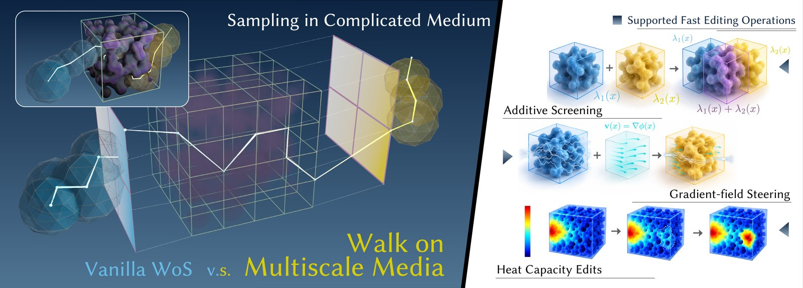
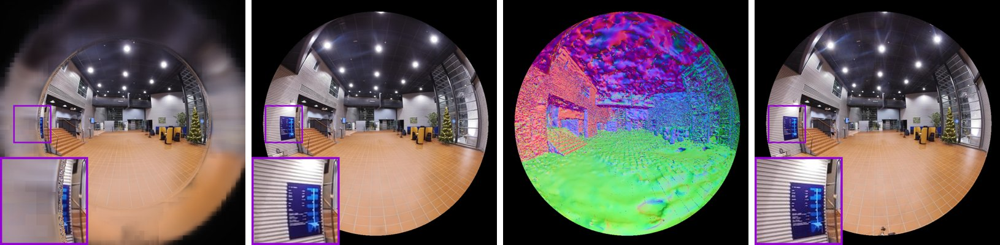

# 2026-10-31 科研日报

## 今日速览

本期取 arXiv 周五（10-30）公告。两篇正文一篇在“算”、一篇在“采”：一篇把 Monte Carlo PDE 里最费时的“在非均匀介质里反复游走”编译成可复用、可编辑的预制件，正好落在用户在中科大做过的 Walk on Spheres 方向上；另一篇让 3DGS 直接吃超过 180° 的鱼眼图，同时出渲染场景和对齐的碰撞网格，是 Real2Sim 数字孪生的又一块拼图。

- **必读：[WoMM](#2026-10-31--womm)（哈尔滨工业大学（深圳），arXiv 预印本）。** 核心观察是：多尺度有限元的基函数可以解释成“首次出射概率”，于是一块复杂介质的细尺度输运能被预编译成“端口算子 + 入口相关的出射分布 + 带泊松标记的路径记录”。查询时随机游走穿过介质只需一次宏跳转；改吸收场、改热容、加引导场时，只对缓存路径重新加权，不重新撒路径。和官方变系数 WoS 在相同样本数下比，在线时间快约 22–28 倍，四组配置里三组误差更低。它把“渲染里的缓存与重用”这套思路系统地搬进了 PDE 求解，也给“可编辑、可组合资产”提供了一个物理求解侧的版本。
- **选读：[GOFish](#2026-10-31--gofish)（Amazon 实习工作，合作单位含 University of Maryland、Carnegie Mellon University 等，arXiv 预印本）。** 第一个直接在鱼眼图上训练、把光栅化视场推过 180°、并从同一个高斯场景里提取对齐网格的 3DGS 表面重建方法。在 200° 的 FIORD 上 PSNR 比最好的基线高 2.28 dB，网格 F-score 也最高，渲染 79 FPS。和上期 OpenJaws 的鱼眼双目放在一起看：低成本鱼眼采集在“定位”和“建孪生”两头都有了开源方案。
- **本期其他值得一扫：** 编码智能体批量造机器人仿真环境的 Gym-Anything for Robotics、带 LiDAR 惯导的开源双臂 UMI-Live、单图生成可动画卡片头发的 HairDeck 等，见文末简列。
- **圈内：** 有人把 NES 的 6502 CPU 和内存“编译”进一个没训练过的 Qwen3.5 权重里，逐 token 跑出了《超级马里奥》；另外，Cursor 扩展市场上一个被篡改的 Claude Code 扩展会往 SSH 授权密钥里加后门，用相关扩展的话值得自查。

## 求解端：把非均匀介质编译成可编辑的随机游走预制件

### WoMM · arXiv · 2026-10-24

**一句话判断：** Walk on Spheres 的卖点是“无网格、逐点查询”，但碰到细尺度非均匀介质（多孔材料、复合材料、空间变化的吸收体），路径要在里面一步步试探，代价随介质复杂度暴涨，而且材质一改就得全部重来。WoMM 的回答是“预编译 + 重加权”：像几何资产一样把一块介质的输运行为编译一次，之后放到哪、怎么组合、怎么改参数，都只动缓存的统计量。对用户来说，这是把此前在 GCL 做的 Monte Carlo PDE 与现在关心的“可编辑资产”“缓存复用”两条线连在一起的一篇。

**Title：** Walk on Multiscale Media: Compiling Editable and Composable Transport Medium Prefabs for Monte Carlo PDE Solvers  
**作者：** Yunfeng Liao、Xiucheng Li  
**单位：** 哈尔滨工业大学（深圳）  
**发表时间 / 投稿信息：** arXiv v1 于 2026-10-24 挂出，主分类 physics.comp-ph，10-30 交叉列入 cs.GR；排版为 ACM 期刊模板，投稿信息未标明。  
**链接：** [摘要](https://arxiv.org/abs/2610.35952) · [HTML 全文](https://arxiv.org/html/2610.35952v1) · [PDF](https://arxiv.org/pdf/2610.35952)

**摘要中译：** Monte Carlo PDE 求解器支持无网格的逐点查询，但在非均匀介质中反复游走代价很高，在材料可复用或动态变化的场景里尤其如此。我们提出 Walk on Multiscale Media（WoMM），把细尺度输运编译成可复用、可编辑、可组合的输运预制件。对多尺度有限元基函数和凝聚算子的概率解释，给出了保留细尺度材料效应的粗尺度转移。每个预制件包含端口级算子、依赖入口的出射分布和带泊松标记的轨迹记录，从而支持重叠吸收场的增量更新、通过路径重加权实现的梯度场引导，以及瞬态扩散。与常规 Walk-on-Spheres 结合成连续—离散混合求解器后，这些预制件加速了重复的逐点 PDE 查询，并支持交互式材料编辑，而无需反复求解细尺度问题。

*原论文 Figure 1，[来源](https://arxiv.org/html/2610.35952v1)。左边那条白色折线就是“进入预制件后一次跳到出口”的宏跳转。*

**方法与原理。**

先说几个名词。**WoS（Walk on Spheres）** 用布朗运动的首次出射分布估计椭圆型 PDE 的解：每一步在当前点画一个不碰边界的最大球，跳到球面上随机一点，直到贴近边界再读边界值。**MsFEM（多尺度有限元）** 把细尺度系数“压”进局部基函数，得到粗网格上的有效算子；**Schur 补 / 凝聚** 指把内部自由度消去，只留下边界端口之间的关系。**屏蔽项（screening）** 即方程里的吸收/反应项，概率上对应路径以一定速率“被吸收”。

1. **关键观察：基函数就是出射概率。** 在离散的扩散算子上，多尺度基函数在某个内部点的值，等于从该点出发的随机游走首先从对应端口离开的概率；凝聚后的粗算子则描述端口之间的输运。于是“编译介质”就变成了用随机游走估计这些概率。作者实测：每个节点 64 条路径时单个基函数误差约 12%，但聚合到端口的转移误差只有 0.33%；1024 条路径时分别是 3.0% 和 0.083%。粗尺度游走真正依赖的是聚合量，噪声被大幅平均掉，这是“只编译端口级输运”的依据。
2. **预制件的三样东西。** 端口级凝聚算子（粗格之间怎么走）；稀疏内部锚点上的“入口相关出射分布”（从某处进入后从哪儿出来，查询时按三线性权重选邻近锚点采样）；以及无屏蔽情形下的路径事件库，每条记录带终止端口和沿途的泊松标记。
3. **编辑只做重加权。** 加一个吸收体时，路径不用重撒：泊松标记点上按新屏蔽场计算生存概率，就得到编辑后的权重。为了只估“编辑带来的差”，作者用预解恒等式把差值写成只依赖被编辑节点出射概率的形式，并用二阶 U 统计量配对不同记录，消掉“同一记录相乘”带来的偏差，证明了无偏性和方差上界（定理 4.1）。扩散系数整体缩放、拉普拉斯域下的热容编辑也都能化成同一套重加权。
4. **方向引导。** 用端口权重的调和延拓构造一个正标量场，做 Doob h 变换得到漂移；因为它在内部调和，路径修正项为零，引导只需在出射端点乘权重，不增加额外方差。
5. **混合求解。** 介质外部仍用普通 WoS；路径进入触发区后切换到粗格骨架上走，离开预制件时按细尺度出射分布还原连续位置，再回到 WoS。作者还给出按查询位置选择多尺度分辨率的策略。

**结果与局限（作者报告）。** 主实验与 Sawhney 等 2022 年的官方变系数 WoS 对比，同为每次查询 4096 条路径、12 次查询、不计预处理、单线程 CPU：在线时间 Hybrid 为 111–138 ms，官方 WoS 为 3044–3138 ms，约快 22–28 倍；RMSE 在四组（基础/编辑后 × 平滑/振荡边界）中三组更低，只有未编辑的平滑边界情形略逊（0.0099 对 0.0082）。40 种平移、旋转、缩放的吸收体姿态上，局部算子增量的平均相对误差低于 1%；编辑区越小误差越大。24 个较强的屏蔽编辑放进完整求解器后，误差明显大于单独测局部算子时，因为还要经过端口压缩、入口插值和在线采样三层近似（振荡边界的最终 RMSE 0.0214，变化量 RMS 0.1074）。作者明确的局限：底层扩散系数只能整体缩放、不能任意改结构；需要前期预编译，最适合反复查询或反复编辑的场景。编辑观察：实验以受控的单一介质和单线程计时为主，还没有在渲染或大规模场景中的端到端演示；8 个端口时解明显变差，端口数是实际使用时最需要调的参数。

**值得关注 / 阅读指引。** 与 Boundary Value Caching、Walk on Probes、WoDS、Monte Carlo Steklov Operators 一起看，“随机游走的可复用中间量”正在成为 MC PDE 的主线。WoMM 的不同之处在于把编辑放在第一位：缓存的不只是解，而是带泊松标记的路径，于是一类参数变化可以无偏地重放。这和 ReSTIR、Radiance Cache 的“重用样本、按新目标重加权”是同一种思想，对正向批渲染效率那条线也有借鉴意义。建议顺序：Figure 1 → §3.2 随机游走解释 → §4.2 预解恒等式与 U 统计量 → Table 1、Table 2 → §4.3 引导与热容 → §6 局限。

## 采集端：超过 180° 的鱼眼 3DGS 与对齐网格

### GOFish · arXiv · 2026-10-27

**一句话判断：** 机器人、自动驾驶和消费级全景相机大量使用鱼眼镜头，但 3DGS 生态里“能渲鱼眼”和“能出网格”一直是两拨方法：前者最多光栅化到 180° 左右、不出网格；后者（GOF 等）只认针孔图像，鱼眼图必须先矫正，边缘的视线就丢了。GOFish 把两者合到一起，产出可实时渲染、可光线追踪全视场、带碰撞网格的数字孪生，并且不需要 LiDAR。对 Real2Sim 管线来说，它解决的是“采集设备是鱼眼时，孪生怎么建”这个很实际的问题。

**Title：** GOFish: Full Field-of-View Gaussian Splatting and Mesh Extraction  
**作者：** Allen Tu、Meher Gitika Karumuri、Shifan Zhu、Hailing Wang、Yen-Liang Lin、David Held、Matthias Zwicker、Tom Goldstein  
**单位：** Amazon；University of Maryland, College Park；University of Massachusetts Amherst；Northeastern University；Carnegie Mellon University（论文首页列出，作者与单位的逐一对应以原文为准；致谢称工作完成于 Amazon 实习期间）  
**发表时间 / 投稿信息：** arXiv v1 于 2026-10-27 挂出（10-30 公告），主分类 cs.CV，交叉 cs.GR、cs.RO；投稿信息未标明。  
**链接：** [摘要](https://arxiv.org/abs/2610.37818) · [HTML 全文](https://arxiv.org/html/2610.37818v1) · [PDF](https://arxiv.org/pdf/2610.37818) · [项目页](https://3dgofish.github.io)

**摘要中译：** 机器人、自动驾驶车辆和消费级 360° 相机使用鱼眼镜头获得宽视场。可用于仿真的数字孪生需要在整个视场内的照片级渲染，以及对齐的碰撞网格。然而，已有的鱼眼高斯泼溅方法只能光栅化到 180°，且不生成网格；而高斯表面重建方法假设训练图像为针孔模型。我们提出 GOFish，第一个直接在鱼眼图像上训练、光栅化超过 180° 视场、并从同一场景提取对齐网格的 3DGS 表面重建方法。标定化的致密化在整个视场内恢复表面，标定化 Mip 滤波和广角外观建模则把像素模糊和镜头边缘衰减挡在场景和网格之外。在 200° 的 FIORD 与 205° 的 FullCircle 基准上，GOFish 的 PSNR 分别比最好的已有方法高 2.28 和 1.97 dB；在各鱼眼渲染基线自身的视场内也优于它们，并在 FIORD 和 ScanNet++ 主集上取得最高的网格 F-score。高斯场景和网格共同构成一个无需 LiDAR、可用于仿真的数字孪生：实时渲染、可光线追踪全视场，并提供碰撞几何。

*原论文 Figure 1（由四张子图拼接），[来源](https://arxiv.org/html/2610.37818v1)。最左的基线在 180° 以外是一圈模糊，GOFish 一直清晰到圆边，还附带一张同视角的网格。*

**方法与原理。**

先说几个名词。**GOF（Gaussian Opacity Fields）** 是从 3DGS 提网格的常用方法：对每个三维点，取各训练视角下高斯合成的不透明度的最小值，形成不透明度场，再抽等值面。**3DGUT** 用无迹变换把高斯投影到任意相机模型，**3DGRT** 则逐像素光线追踪高斯；**PPISP** 是一种建模相机曝光、白平衡等成像流程的外观模块。

1. **标定定义的光栅化域。** 不再用“图像平面 + 针孔投影”定义哪些像素有效，而是用标定后的相机模型把每个有效像素对应的视线都纳入（作者称为完全准入），从而能把光栅化推过 180°。
2. **标定化致密化。** 鱼眼边缘的像素对应的立体角和中心不同，原生的梯度致密化会在边缘长不出高斯。作者按标定校正致密化梯度，让整个视场都能恢复表面。
3. **标定化 Mip 滤波。** 广角下每个像素覆盖的立体角随位置变化很大，不处理的话，像素模糊会被“烤”进高斯，导致网格变糊。滤波按标定后的像素足迹来做。
4. **广角外观建模。** 鱼眼边缘有很强的亮度衰减，若交给场景去拟合，就会变成错误的颜色或几何。作者用一个随相机固定的衰减项吸收它，在 FIORD 上比 PPISP 高 3.17 dB。
5. **网格提取。** 在同一个高斯场景上做全视场的不透明度场并抽网格，另有可选的几何目标项。

**结果与局限（作者报告）。** 全视场 PSNR：FIORD 上 GOFish 24.36，最好的基线 DirectFisheye-GS 为 22.08；FullCircle 上 25.47，3DGRT + PPISP 为 23.50；ScanNet++ 上 30.17。把 GOFish 裁到各基线自身的视场内比，它依然领先。网格在 FIORD 和 ScanNet++ 主集上 F-score 最高。效率（单张 A10G）：FIORD 训练加抽网格共 153 分钟，GOF 为 208 分钟；渲染 79 FPS，接近只渲染的 3DGUT + PPISP（84 FPS），是 3DGRT + PPISP（22 FPS）的三倍多；平均 0.60 M 个高斯，少于 3DGUT + PPISP 的 1.03 M。作者明确的局限：继承了不透明度场的问题，反光表面会错位、细结构会被削掉，观测稀疏处会出洞或过填；对标定和位姿误差敏感；只支持静态场景和中心投影相机，不支持运动物体和卷帘快门；训练比只渲染的 3DGUT 慢。编辑观察：三个数据集中只有 FIORD 有超过 180° 的几何真值，全视场网格精度的证据目前比较单薄；论文演示了用网格做物理仿真，但还没有接到机器人策略训练上。

**值得关注 / 阅读指引。** 上期 OpenJaws 用全局快门鱼眼双目给出了米制轨迹，这篇则给出了鱼眼图直接建“能渲又能撞”的孪生的办法，两者串起来就是一条低成本的鱼眼 Real2Sim 链路。它和 SceneAgent、ScIntBench 一样，把“孪生能不能进仿真”放在评测目标里。作者在结论里也提到，可以在 GOFish 孪生上简化碰撞体、加语义标签，做成任务就绪的仿真环境，这一步正是 GPT-6 Astra 一类智能体擅长的。建议顺序：Figure 1、Figure 2 → §4 方法各组件 → Table 1 → Table 3 组件消融 → Figure 6 物理仿真演示 → 附录 C.3 失败案例。

## 本期其他值得一扫

- [Gym-Anything for Robotics](https://arxiv.org/abs/2610.40565)（Pranjal Aggarwal、Sean Welleck；arXiv 2026-10 挂出，10-30 公告，投稿信息未标明，[项目页](https://gym-anything.github.io/robotics)）：让编码智能体批量写机器人仿真，并用“对抗式创建—审核”循环检查仿真和任务是否合格；按美国 GDP 数据挑选有经济价值的体力劳动，得到 25 个仿真、25 个测试和 175 个训练强化学习环境组成的 RoboWorld。最强的前沿模型在全部测试任务上都失败，平均奖励只有 0.06。作者还用代码策略在多样场景里生成演示去训练 π₀.₅ 等 VLA。和 ScIntBench 的结论放在一起看，“智能体写仿真”已从演示走向规模化，但验收依然是瓶颈。本期仅据摘要简列。
- [UMI-Live](https://arxiv.org/abs/2610.39385)（Govind Velamoor 等；arXiv 2026-10，10-30 公告，投稿信息未标明，[项目页](https://umi-live.github.io/)）：全栈开源的双臂 UMI，把相机、LiDAR 惯导、板载计算和电源集成在手持端，采集现场不需要外部跟踪设备和标定；异步流水线并行跑 SLAM 并直接产出训练就绪的数据集。微调 π₀.₅ 和 MolmoAct2 在双臂抓放上分别 10/10、8/10；公开 40 小时数据。正好补上了 OpenJaws 列为未来工作的双臂部分，但走的是 LiDAR 路线，成本更高。本期仅据摘要简列。
- [HairDeck](https://arxiv.org/abs/2610.40599)（Yuze He 等，含 Yong-Jin Liu；arXiv 2026-10，27 页，投稿信息未标明，[项目页](https://hyzcluster.github.io/HairDeck)）：单图生成风格化角色的“发片”（游戏里艺术家摆放的带状网格）及驱动它们的弹簧骨链。把每张发片当一个 token、用集合扩散 Transformer 一起去噪，而不是像 CHARM 那样自回归生成长串控制点；在 CHARM 测试集上倒角距离降 44%，快 33 倍。一个“生成即可直接进引擎、可动画”的 3D 生成例子。本期仅据摘要简列。
- [NRF-GS](https://arxiv.org/abs/2609.37115)（Pratik Singh Bisht、Andreas Kolb；arXiv 2026-09 首挂，本次更新注明 **NeurIPS 2026 录用**）：用一个全场景共享的轻量 MLP 预测视角相关的残差颜色，取代每个高斯的球谐系数；高光表达力上去了，就不需要堆冗余高斯，作者称在同等或更好画质下高斯数最多减少 50%。对逆渲染里“高光被几何吸收”的老问题是一个表示层面的旁证。本期仅据摘要简列。
- [Tactus](https://arxiv.org/abs/2610.39076)（Li Guan 等，作者百余人；arXiv 2026-10，9 页，投稿信息未标明）：3D 针织的触觉加位姿手套，指尖叠层 1.5 mm，电容触觉传感器按接触研究布点，IMU 融合手部跟踪以对抗手物遮挡，并给出触觉力回归和手部位姿的标准化评测协议。灵巧操作数据采集的一个工程参照。本期仅据摘要简列。

## 圈内新闻与社区反应

**把 NES 编译进 Qwen 权重（模型即计算机）。** 开源项目 [nesformer](https://github.com/dbreunig/nesformer) 把 NES 的 6502 CPU、2 KB 内存和卡带程序 ROM 放进一个标准的 Qwen3.5 结构检查点里运行：权重没有经过训练，而是由编译器逐个算出来的；模型逐 token 预测 CPU 的执行日志，外部的小程序只负责画面、手柄输入和垂直消隐中断。它基于 Qwenputer，关键技巧是把 Gated DeltaNet 的循环状态当作机器内存。作者称自带测试游戏每一帧都与常规 6502 模拟器完全一致，但每帧要 1–6 秒。HN 讨论（[原帖](https://news.ycombinator.com/item?id=50306442)，10-30）里，作者说整套权重和代码是让编码智能体读完 Qwenputer 的文章后两轮提示做出来的（[dbreunig](https://news.ycombinator.com/item?id=50307402)）；有人设想把整个虚拟机编进权重，让工具调用在模型内部执行（[armcat](https://news.ycombinator.com/item?id=50307314)）；也有人提醒它比真机慢 150–290 倍，正好说明确定性程序的效率优势（[pbohun](https://news.ycombinator.com/item?id=50307246)）。编辑判断：和上期在 Pico 上“做梦”的 tinyworldformer 不同，这不是学出来的世界模型，而是把精确的状态机硬编码进注意力的循环状态；它对具身方向的启发在于“哪些部分该由网络学、哪些部分该由确定性模块给出”，与 BoxWorld、Gym-Anything 里“规则显式、外观生成”的分工是同一个问题。

**Cursor 扩展市场上被篡改的 Claude Code 扩展（工具链安全）。** 安全公司 Phorion 披露（[报告](https://phorion.io/blog/offical-claude-code-vsx-compromise/)），Open VSX / Cursor 扩展市场上出现过一个被恶意修改的 Claude Code 扩展；据讨论串转述的 Cursor 通告，它会把攻击者的公钥（标注为 svc-telemetry）追加到 `~/.ssh/authorized_keys`。HN 讨论（[原帖](https://news.ycombinator.com/item?id=50300683)，10-29）中，Anthropic 的工程师说明这不是 Anthropic 系统被入侵，官方渠道发布的版本不受影响（[felixrieseberg](https://news.ycombinator.com/item?id=50304129)）；有人贴出了通告里的自查方法，即在授权密钥文件里查找这个标签（[jonas21](https://news.ycombinator.com/item?id=50306306)）；据 Reuters 转述的 Cursor 说法，问题版本在太平洋时间周四约 02:27 至 13:35 在架（[AdrianCX](https://news.ycombinator.com/item?id=50302777)）。编辑判断：做科研时大量依赖编码智能体和第三方扩展，实验机和 GPU 服务器上的 SSH 授权密钥值得定期核对。

## 覆盖说明

日报发布日为 **2026-10-31（周六）**，内容覆盖日为 2026-10-30（周五），取 arXiv 周五公告的 cs.GR（含交叉列入）与 cs.RO。正文两篇为 WoMM（2610.35952）与 GOFish（2610.37818），均核对了 arXiv HTML 全文的方法、实验与局限，配图为原论文插图（GOFish 为 Figure 1 四张子图拼接）。简列五篇仅据摘要。所有结果均为作者报告，未独立复现。圈内新闻以 Hacker News 近一日热帖为入口，核对了 nesformer 的 README 与讨论串、Phorion 报告的讨论串；中文媒体与 X 本期未单独检索。对标仓 Real2Sim_GPT6_ASTRA 自 9 月 10 日以来无新提交；Blender 主干 10-29 以来的提交中没有原生高斯泼溅相关改动。

**编写：** Cream
