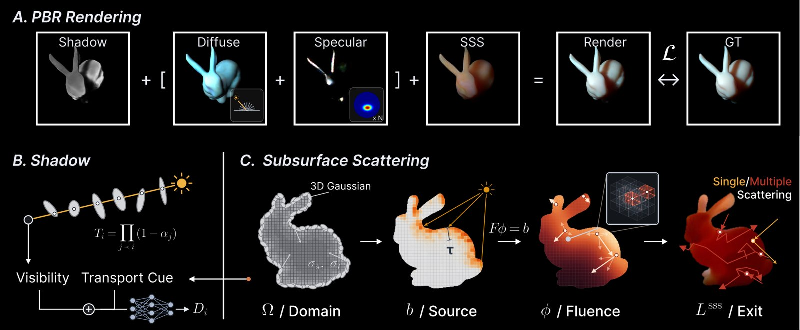
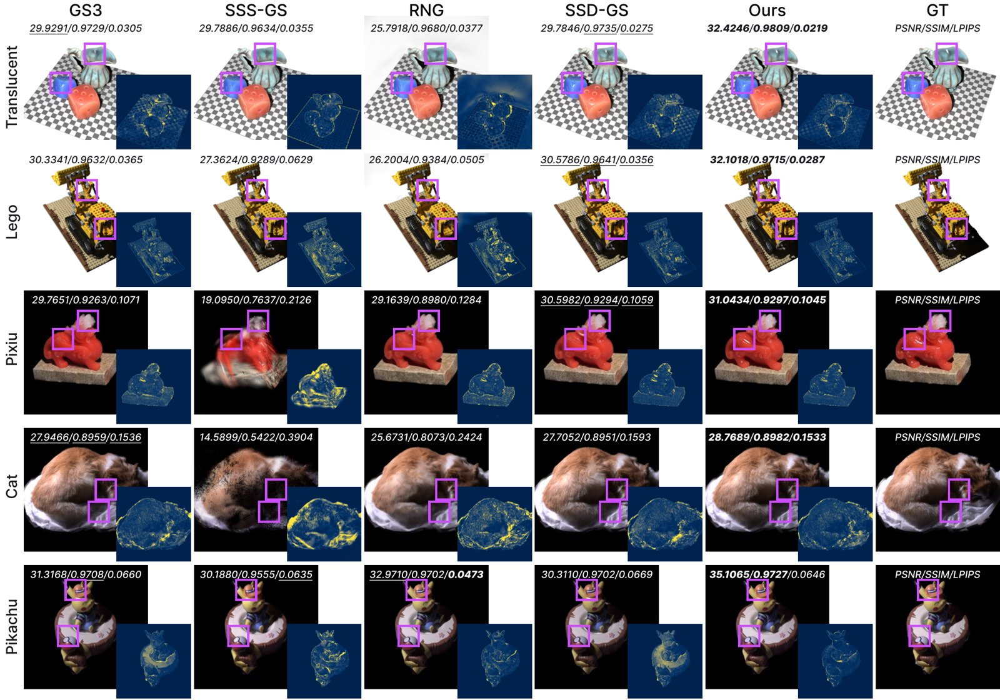
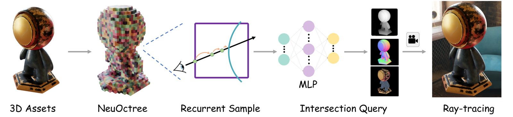

# 2026-11-01 科研日报

## 今日速览

周六无 arXiv 公告，本期做一次主线回扫：从近一个月与“可重光照高斯”相关、此前没收录过的论文里挑出一篇真正动了光传输的，再补一篇北大的光线求交神经表示。两篇都在回答同一个问题：高斯或体素表示怎样才能交给一个讲物理的渲染器去用。

- **必读：[VolS-GS](#2026-11-01--vols-gs)（KAIST AI，arXiv 预印本）。** 现有可重光照 3DGS 给每个高斯各算各的颜色，所以“光从一处进、从另一处出”的次表面散射只能靠局部核或网络去凑。VolS-GS 把高斯云本身体素化成介质区域，在上面解一次可微的扩散方程（有限体积离散 + 共轭梯度，反向只多一次伴随求解），再让每个高斯读回解出的光通量作为次表面出射。阴影分支复用同一个消光场，另加一个正则防止高光项“偷走”被遮挡区域的亮度。三个单灯逐次照明（OLAT）基准上平均最好，Bunny 上去掉次表面项掉 5.48 dB。必读原因：它是“在高斯支撑上解输运方程”的一个干净样板，和 Monte Carlo PDE、辐射度缓存这类思路直接相通；但输入是已知点光源的灯光棚采集，离真实场景随手拍还有距离。
- **选读：[NeuOctree](#2026-11-01--neuoctree)（北京大学，arXiv 预印本）。** 不预测密度或距离场，而是在稀疏八叉树的每个体素里直接预测“这条光线是否打到表面、打在哪、法线和反照率是什么”，所以可以直接接进表面光线追踪器做重着色、反射、折射，不用先提网格或烘焙贴图；同一结构还能用八叉树 CNN 从彩色点云 0.05 秒前馈出资产。
- **本期其他值得一扫：** 只改反照率、保留可重光照性的风格化 RxGS，2.5 分钟训练的 Voronoi 表面重建 CVTSplat，以及面向强化学习切割/铲取的损伤 MPM 仿真器，见文末简列。
- **圈内：** Blender 开始为 glTF 的 `KHR_gaussian_splats` 扩展做高斯导出（草稿 PR）；Talos 披露一款信息窃取木马把偷来的数据交给大模型写“受害者价值评估”，并预置了被拒绝时的多模型降级链；另有一个用 C++ 和 Dear ImGui 写的轻量编码智能体外壳 Prospero 引发讨论。

## 可重光照高斯：让光在物体内部走一段路

### VolS-GS · arXiv · 2026-10-02

**一句话判断：** 把“次表面散射”从每个高斯的局部外观函数，改成在高斯云体素化后的介质上解一次可微扩散方程；方法链条清楚、物理含义明确，是可重光照高斯里少见的真正做了非局部光传输的工作，但数据条件是灯光棚 OLAT 采集。

- **Title：** VolS-GS: Relightable Gaussian Splatting with Volumetric Subsurface Scattering
- **作者：** Junyeong Ahn, Jaegul Choo
- **单位：** KAIST AI
- **投稿信息：** 投稿信息未标明（arXiv Comments 仅注 23 pages）
- **发表时间：** arXiv 首次挂出 2026-10-02（v2 更新于 2026-10-06）
- **链接：** [arXiv abs](https://arxiv.org/abs/2610.04007) · [PDF](https://arxiv.org/pdf/2610.04007) · [项目页](https://justin4ai.github.io/VolS-GS/) · [代码仓](https://github.com/justin4ai/VolS-GS)（项目页给出的仓库链接，内容是否已完整开源未核实）
- **为何此时收录：** 发表于一个月前，此前未收录；本期无新公告，按近期主线（真实感可重光照高斯与光传输效率）回扫补入。

**摘要中译：** 我们提出 VolS-GS，一个可重光照的高斯泼溅框架，从单灯逐次照明（OLAT）采集中重建物体，并在新的光照与视角下渲染。现有可重光照高斯方法通常在每个基元上独立建模外观，难以表达非局部效应；这在次表面散射上尤为明显：光从一个位置进入物体，可能从另一个位置射出。我们不只靠神经网络或每个基元上的局部核来建模这一效应，而是把高斯场景的空间支撑当作一个可微有限体积输运求解器的定义域，让光能在物体内部传播。一个小网络为每个高斯预测散射与吸收系数，求解器在得到的场中重新分配入射光。这些系数是拟合图像得到的而非测量值，因此求解器提供的是一条“形状像输运”的外观聚合路径，而不是材质测量。为防止学到的阴影和高光项吞掉其他成分，阴影项由可见性与求解得到的透射率、散射共同预测，并用一个正则项压制被阴影项判为无光区域里的高光。在三个 OLAT 基准上，VolS-GS 在留出的光源与视角上一致提升了重光照质量。

*图：原论文 Figure 3（来源：[arXiv HTML](https://arxiv.org/html/2610.04007v1)）。下排从左到右就是方法的数据流：高斯云 → 体素化介质区域 → 单次散射源 → 扩散求解 → 每个高斯读回出射亮度；左下的阴影分支和右边的求解共用同一个消光场。*

**方法与原理。**

*问题出在哪。* 可重光照 3DGS 的常见做法是给每个高斯一个外观模型（反照率、法线、高光波瓣，外加一个以光照方向为条件的网络），颜色只由这个高斯自己的属性决定。这对漫反射和高光够用，但次表面散射天然是非局部的：玉石、蜡烛、皮肤这类材质，背光一侧会透出前面打进去的光。已有工作 SSS-GS 用光照方向条件的网络去拟合，SSD-GS 在每个高斯上算一个闭式偶极子扩散核，两者本质上仍是“一个高斯看自己”。论文 Figure 2 给了一个直观反例：C 形物体从开口处打光，偶极子核按欧氏距离衰减，会跨过空隙把光“传”到另一臂上，而真实的光只能沿介质内部绕过去。

*输入与输出。* 输入是已知相机位姿、已知点光源位置的 OLAT 图像（每张图只开一盏灯）以及前景遮罩；输出是一组带漫反射反照率、学习法线、各向异性球面高斯高光、阴影衰减和逐高斯散射/吸收系数的高斯，可在新点光源和新视角下渲染。因为扩散方程对源项是线性的，多盏灯可以叠加，论文附录据此在环境贴图下重光照而不重训。

*怎样做（四步）。*

1. **把高斯变成介质区域。** 在物体包围盒上铺一个 \(64^3\) 网格，把高斯的空间支撑栅格化成分数占据场 \(O(\mathbf{x})\in[0,1]\)。高斯只贴着表面，栅格化后是空壳，所以用广义环绕数（generalized winding number，不需要水密网格就能判断内外）把内部填实。每个高斯的散射系数 \(\sigma_s\)、吸收系数 \(\sigma_a\) 由一个小 MLP 根据位置编码、逐高斯隐变量和光照/视线方向预测，再泼溅到网格上，内部格子沿用最近表面格子的系数。这个网格本身没有可学参数，每次加密高斯或每 300 步按当前高斯重建一次。
2. **算单次散射的源项。** 每个有效格子朝光源步进，累积按占据加权的路径长度 \(\tau\)（空隙不计消光），得到到达该格子的光 \(E=e^{-\sigma_t\tau}/d^2\) 和首次散射密度 \(b=\sigma_s E\,O\)，其中 \(\sigma_t=\sigma_s+\sigma_a\) 是消光系数，\(d\) 是到点光源的距离。
3. **解一次扩散方程。** 多次散射后光失去方向性，可以用光通量 \(\phi\)（各方向平均的光密度）的扩散近似描述：

$$
-\nabla\cdot\big(\kappa\,\nabla\phi\big)+\sigma_a\,\phi=b \ \ \text{（介质内）},\qquad \kappa\,\partial_n\phi+\tfrac{1}{2A(\eta)}\,\phi=0 \ \ \text{（边界）}
$$

   这里 \(\kappa=1/(3\sigma_t)\) 是扩散系数，第一项让光从亮处流向暗处，第二项是吸收，右边 \(b\) 是上一步的源；边界条件说明到达表面的光一部分射出、其余被内部反射（\(A(\eta)\) 为内反射因子，论文取 \(\eta=1\)）。按有限体积法离散后得到对称线性系统 \(F\phi=b\)，用预条件共轭梯度求解。占据场保持分数而非二值，是因为边界项按界面面积缩放，二值遮罩会高估面积。
4. **读回并合成。** 每个高斯在自身位置沿法线往里一格采样 \(\phi\) 作为多次散射出射，再加一项沿视线在介质内积分的单次散射（扩散近似表达不了还带方向性的第一次散射），乘以逐高斯幅度和一个场景级标定系数，作为次表面颜色 \(L^{\mathrm{sss}}\)。最终每个高斯颜色为 \(c_i=L^{\mathrm d}_i+L^{\mathrm s}_i+L^{\mathrm{sss}}_i\)，交给原版 3DGS 光栅器合成，光栅器本身不改。

*为什么这样设计。* 作者的核心论点是：高斯云已经给出了物体的空间支撑，只是没人在上面解过内部输运；把求解域直接取自高斯而不是另提网格，几何和外观就能一起端到端优化。可微性靠伴随法：因为 \(F\) 对称，反向只需再解一次 \(F\lambda=\partial\mathcal L/\partial\phi\)，显存不随共轭梯度迭代次数增长，这是可微渲染里的标准做法，被搬到了高斯的占据场上。阴影与高光的“抢功”是另一个设计重点：阴影衰减 \(D_i\) 由从光源视角泼溅得到的可见性 \(V_i\) 加上同一消光场给出的透射线索共同预测，且这些线索做了梯度截断，防止阴影分支反过来改介质让阴影更好拟合；高光泄漏正则只惩罚被判为无光区域里的高光亮度。编辑推理：这相当于让三个外观分支在同一物理量（消光场）上对齐，减少了可重光照分解里常见的“任何一项都能解释残差”的歧义。

*怎样训练和使用。* 监督只有图像：L1 + D-SSIM 光度损失、与遮罩对齐的不透明度损失、上述高光泄漏正则，以及让相邻高斯消光和反照率平滑、并限制高斯尺度不超过网格分辨率的介质正则（一个高斯只读一个 \(\phi\) 值，太大就跨了多个格子）。先 9k 步只拟合表面项和几何，之后每步跑一次前向求解和一次伴随求解。作者明确说明：学到的系数受光照/视线方向调制，是拟合量而不是材质的光学常数。

**结果与局限。** 在 SSS-GS 基准（5 个合成半透明物体 + 3 个真实灯光棚采集）、NRHints（7 个真实物体，多数不强半透明）和 GS³ 合成集（金属、毛发、混合材质）上，作者在统一分辨率、划分和训练预算下重训 GS³、SSD-GS、RNG、SSS-GS 作对比，报告三个数据集平均指标均最好，次表面主导的 SSS-GS 基准提升最一致。消融里，Bunny 去掉体积次表面项掉 5.48 dB（PSNR，越高越好），而半透明成分弱的 Drums 只掉 0.10 dB，与“介质薄时自动退化为局部着色”的设计一致；去掉阴影项在 7 个场景中 6 个是最大单项损失；高光泄漏正则几乎不动 PSNR，作者也明确承认它只改善分解可解释性（高光覆盖面积从 68% 降到 23%）。成本：单张 A6000，合成场景渲染约 64.5 FPS，训练不到 3.5 小时、显存不到 8 GiB。局限：扩散近似在光仍有方向性时不够；凹处表面之间的互反射不走介质，无法表示（失败案例为折叠的兔耳尖和盘子下方偏暗）；\(64^3\) 网格分辨率有限。

**值得关注。**
- 对真实场景逆渲染而言，这篇最可复用的不是次表面本身，而是“用高斯占据场当 PDE 求解域 + 伴随法求梯度 + 网格随高斯重建”这一套机制；同样的骨架可以换成其他线性输运近似（如低阶辐射度或光探针扩散）。
- 它依赖已知点光源的 OLAT 采集，光源位置与开关都是已知量；在未知环境光的随手拍场景里，源项 \(b\) 本身就要估计，分解歧义会显著增大。读的时候建议把“哪些量在灯光棚里是白给的”逐一列出来。
- 和上期（10-31）的 WoMM 对照：两者都把“在非均匀介质里的输运”变成可缓存、可微的结构，一个走随机游走、一个走有限体积线性系统，可以对照思考偏差、方差与分辨率的取舍。
- 阴影分支的梯度截断与高光泄漏正则，是解决“可重光照分解里各分支互相抢残差”的具体工程手段，值得在其他可重光照高斯方法里对照消融。

*图：原论文 Figure 4（来源：[arXiv HTML](https://arxiv.org/html/2610.04007v1)）。对比重点在背光区域的透光和阴影边界的细节。*

## 光线求交的神经表示：让学出来的资产直接进光线追踪器

### NeuOctree · arXiv · 2026-10-28

**一句话判断：** 不再走“密度场 → 体渲染”或“隐式场 → 提网格”，而是让网络直接回答光线追踪器需要的问题：打没打到、打在哪、法线和颜色；结构化的八叉树输出空间还能前馈生成，适合作为可重光照资产的一种候选承载形式。

- **Title：** Neural Explicit Shape Representation
- **作者：** Jun-Hao Wang, Changan Lu, Baoquan Chen, Peng-Shuai Wang
- **单位：** 北京大学
- **投稿信息：** 投稿信息未标明
- **发表时间：** arXiv 首次挂出 2026-10-28
- **链接：** [arXiv abs](https://arxiv.org/abs/2610.38441) · [PDF](https://arxiv.org/pdf/2610.38441) · [代码](https://github.com/octree-nn/neural-octree)

**摘要中译：** 现有神经三维表示分别解决连续曲面建模、高效图像合成或单物体压缩，但没有同时提供光线追踪所需的显式表面查询和可跨物体预测的结构化输出空间。我们提出 NeuOctree，一种神经显式表示，直接预测光线是否以及在何处与表面相交，并给出法线与反照率。NeuOctree 在稀疏八叉树体素的角点上存储共享特征，并插值成连续的局部场；一个带“由交点引导的循环采样”的轻量解码器在预测表面附近细化每次查询，从而无需提取网格或烘焙纹理即可直接渲染表面，并能处理开放、非水密几何。同一八叉树结构既支持紧凑的逐物体优化，也支持一个共享的八叉树 CNN 从彩色点云构建可渲染资产而无需逐物体拟合。在七个网格、四种存储预算上，NeuOctree 在 28 组比较中 24 组位置误差最低，法线精度有竞争力，在几何—外观联合重建上显著优于 N-BVH 与 VQAD。前馈模型 0.05 秒构建表示，并能不重训地从 Objaverse 迁移到 ShapeNet。我们还展示了光线追踪渲染和图像条件生成。

*图：原论文 Figure 2（来源：[arXiv HTML](https://arxiv.org/html/2610.38441v1)）。左侧为八叉树与角点特征，右侧为沿光线逐体素查询直到第一个命中。*

**方法与原理。** 问题在于：符号距离场、占据场和辐射场都只给出“某点的标量”，光线追踪器还得自己做根查找或体积采样才能知道交点；N-BVH 这类方法能直接预测交点，但每个物体要单独优化，没法让一个网络跨物体预测。NeuOctree 的做法分四步：

1. **结构。** 从点云建稀疏八叉树，只保留被占据的叶体素；每个体素的 8 个角点各存一个特征向量，相邻体素共享角点，所以三线性插值后的特征场在体素边界上连续。
2. **查询。** 渲染时按从前到后的顺序枚举一条光线穿过的占据体素，每段给出局部入点和出点。共享的几何 MLP 读取插值特征、局部位置、光线方向，输出命中概率、交点位置（参数化为入点到出点之间的比例，保证交点落在这段光线上）和法线；材质 MLP 输出反照率。第一个命中概率超过阈值的体素即为交点。
3. **循环细化。** 只在体素边界取特征，离表面可能很远，而且同一表面点从不同方向看入点不同，会让解码器学成强视角相关的映射。于是用上一次预测的交点投影回光线作为下一次查询位置，共做 3 次自适应查询（加上入点出点共 5 次特征读取），让查询逐步靠近真实表面。消融显示这比只用端点或均匀采样的交点与法线更准。
4. **前馈构建。** 同一结构上训练一个八叉树 U-Net：输入彩色点云，直接为每个体素预测 8 个角点特征，共享角点取平均，交给同一解码器。

监督来自 RGB-D 图像反投影得到的光线：对每段在真值表面之前的光线—体素片段，标注是否命中、局部交点、法线与反照率；损失为位置、法线、命中二分类交叉熵和颜色项，彩色重建再加图像级法线/反照率 SSIM 与防空洞、防漂浮物的拓扑正则。部署时只需八叉树、角点特征和两个小 MLP。

**结果与局限。** 逐物体压缩（Thingi10K 与斯坦福扫描库共 7 个网格，81 KiB 到 823 KiB 四档）中，位置误差 28 组里 24 组最低，小预算 21 组全胜，最大预算被 QNDF 拿走 4 组；几何—外观联合压缩上明显优于 N-BVH 与 VQAD。前馈模型在 Objaverse 3.2 万资产上训练约 19.5 小时，单物体构建 50 ms（N-BVH 逐物体拟合约 3 分钟）；在 Objaverse 上法线和 PSNR 仍略逊于逐物体优化的 VQAD，迁移到 ShapeNet 后三项指标都更好。表示目前只输出反照率，不含粗糙度等完整材质参数；训练需要 RGB-D 真值光线，不是从多视角照片反演。

**值得关注。** 对逆渲染来说，“直接返回交点 + 法线 + 材质”的接口意味着阴影光线、反射光线都能直接查询，不必在高斯或体密度上做近似可见性；读的时候可关注两点：一是命中阈值与循环细化在薄结构、开放曲面上的稳定性，二是如果把反照率扩展成完整 BRDF 参数，这个结构能否接住从真实图像做的可微逆渲染（论文本身只做了从已知几何的监督）。

## 本期其他值得一扫（仅据摘要）

- **[RxGS](https://arxiv.org/abs/2610.25681)（arXiv 2026-10-19；Wanrong Hong, Liu Jiang, Mukesh Prasad, Jun Li）：** 参考图风格化时只优化逆渲染得到的漫反射反照率场，粗糙度、金属度、法线和估计的环境光都不动，因此风格化后的场景仍能重光照；风格迁移用最近邻特征匹配损失加高斯中心上的平滑先验。思路简单，但正好说明“分解得干净”对下游编辑的价值。
- **[CVTSplat](https://arxiv.org/abs/2610.35347)（arXiv 2026-10-26；Briac Toussaint, Diego Thomas, Jean-Sébastien Franco, Edmond Boyer, Christian Theobalt）：** 用随 SDF 自适应疏密的质心 Voronoi 剖分做多视角表面重建，规则胞元让最近邻查询和 Voronoi 构建可以专门 GPU 化，构建比通用实现快 5–10 倍；DTU 与 BlendedMVS 上几何精度与最好的高斯表面方法相当，单卡训练约 2.5 分钟。
- **[MG-CD-MPM](https://arxiv.org/abs/2610.39975)（arXiv 2026-10-29；Yusen Feng, Shangbo Luan）：** 面向强化学习的多状态材料操作仿真器：在工具附近的局部区域用多重网格预条件共轭梯度解相场损伤，背景 MPM（物质点法）保持均匀；工具与材料双向耦合，把接触冲量转成作用在工具上的力和力矩直接给策略；覆盖软体、脆性、颗粒与黏塑性介质，演示了切割、舀取、铲取，并在两个切割任务上用 PPO 训练策略。
- **[RacerGS](https://arxiv.org/abs/2610.34263)（arXiv 2026-10-25；Wenqing Wang, Huimin Zeng, Yun Fu）：** 在 Scaffold-GS 的锚点上加哈希投影上下文和 FiLM 调制的自回归 GRU 熵模型，对量化残差做自适应熵编码，作者报告相对原版 3DGS 压缩 150 倍以上、相对 Scaffold-GS 28 倍。
- **[CTBakeGS](https://arxiv.org/abs/2610.37406)（arXiv 2026-10-27；Haruki Fukuda 等）：** 不训练、直接把 CT 体渲染结果“烘焙”进 3DGS：在自适应八叉树上放高斯，颜色和不透明度用渲染器自己的光照在 GPU 上解析计算，并随机保留低于 1/255 不透明度下限的弱高斯；笔记本上一次转换 4–30 秒、800×800 下 68 FPS，[代码](https://github.com/BocchiSlice/CTBakeGS)已开源。对“从已有渲染器无训练生成高斯”这类捷径是个干净的例子。

## 圈内新闻与社区反应

**Blender 开始做 glTF 高斯导出（图形学）。** Blender 的 glTF 插件维护者 Julien Duroure 在 10-29 开了草稿 PR [glTF: Manage KHR_gaussian_splats at export](https://projects.blender.org/blender/blender/pulls/165845)，目标是用 Khronos 的 `KHR_gaussian_splats` 扩展导出原生高斯；PR 说明里属性检查与转换已完成，图元级和文件级扩展声明、测试仍待做。同期还有一个仍开着的 [GSplat: Estimate splat radius for bounds computation](https://projects.blender.org/blender/blender/pulls/165590)（10-26 更新），按高斯半径估计包围盒。暂未找到可核实的社区反馈。编辑判断：Blender 原生高斯此前主要在“能显示、能渲染”，有了标准格式导出，高斯场景才能在 Blender 与其他引擎、Web 查看器之间流转；两者都还是开发中的 PR，未合入主干。

**信息窃取木马把“受害者估值”交给大模型（Agent 安全）。** Cisco Talos 在 10-31 发文分析 VOLTA（[报告](https://blog.talosintelligence.com/appraisal-by-ai-model-driven-victim-prioritization-in-the-volta-infostealer/)）：这款会自删除的 Windows 窃取程序在偷完浏览器密码、会话令牌、加密钱包等之后，还会用偷来的 Gmail 会话搜外卖和购物收据来确认住址，把整理好的证据包经 OpenRouter 发给大模型，让模型按变现价值给受害者资产排序、并评估其安全习惯；它会检测“我不能”之类拒答措辞，依次降级到另外两个模型。Talos 的判断是 AI 在这里替代的是攻击者最耗人力的分析环节，并且“预期会被拒绝并做降级”可能成为恶意软件的标准设计。HN 讨论（[原帖](https://news.ycombinator.com/item?id=50316531)，10-31）里，有人担心编码智能体与自动更新工具每月推送海量代码改动，一次被篡改的更新就可能带进这种东西（[akersten](https://news.ycombinator.com/item?id=50317572)），也有人把现在的智能体生态比作随意开放端口的早期互联网（[jumploops](https://news.ycombinator.com/item?id=50317767)）。编辑判断：结合上期扩展市场后门事件，实验机上的浏览器会话、云凭据和 SSH 密钥越来越是“一次被偷、全盘被分析”，值得收紧。

**Prospero：一个刻意轻量的编码智能体外壳（Agent 工具）。** Chris Wellons（nullprogram）在 10-31 发布 [Prospero](https://nullprogram.com/blog/2026/10/31/)，用他自己的 C++ 风格和 Dear ImGui 停靠界面写成，作者称资源占用比主流同类低约两个数量级；不内置模型，需自己接 llama.cpp、本地部署模型或各家 API，支持子智能体、通过 SSH 把无界面副本部署到其他主机，以及桌面控制。作者的出发点是本地开源模型已能胜任较简单的编程任务，而现有外壳多基于 Web 技术栈、内存开销过大。HN 讨论（[原帖](https://news.ycombinator.com/item?id=50315226)，10-31）反应分化：有人喜欢紧凑的界面，希望它能作为 opencode 或 Codex 服务协议的前端（[thehamkercat](https://news.ycombinator.com/item?id=50316066)），也有人对其“专业版”收费模式和复古观感不以为然（[keepo404](https://news.ycombinator.com/item?id=50316083)）。编辑判断：在显卡有限、想跑本地模型的场景里，“外壳本身不吃资源”是实打实的需求。

**用 Lua 在 LaTeX 里程序化生成花卉边饰（图形学小品）。** 开源项目 [florilegium](https://github.com/kevinraymond/florilegium) 在 LuaLaTeX 编译时用参数化曲线逐片画出代尔夫特蓝风格的花卉页边，不依赖任何图片；布局里“填满剩余空间”的部分借用了 1998 年装饰纹样文献中的想法，作者说明项目在 Claude 辅助下完成并公开了过程记录。HN 上（[原帖](https://news.ycombinator.com/item?id=50305637)，10-30）多数是对效果的称赞，也有人指出 README 明显是 AI 写的（[bonzini](https://news.ycombinator.com/item?id=50307726)）。

## 覆盖说明

日报发布日为 **2026-11-01（周日）**，内容覆盖日为 2026-10-31（周六）。周六无 arXiv 公告，本期回扫本周 cs.GR 公告及近一个月“高斯 + 重光照/逆渲染/材质”检索结果中此前未收录的条目。正文两篇为 VolS-GS（2610.04007）与 NeuOctree（2610.38441），均核对了 arXiv HTML 全文的方法、实验与局限，配图为原论文插图；简列五篇仅据摘要。所有结果均为作者报告，未独立复现。圈内新闻以 Hacker News 近两日热帖、Blender 项目 PR 与 Talos 原文为入口；中文媒体与 X 本期未单独检索，具身方向本期未找到高信号新闻。对标仓 Real2Sim_GPT6_ASTRA 自 9 月 10 日以来无新提交。

**编写：** Cream
