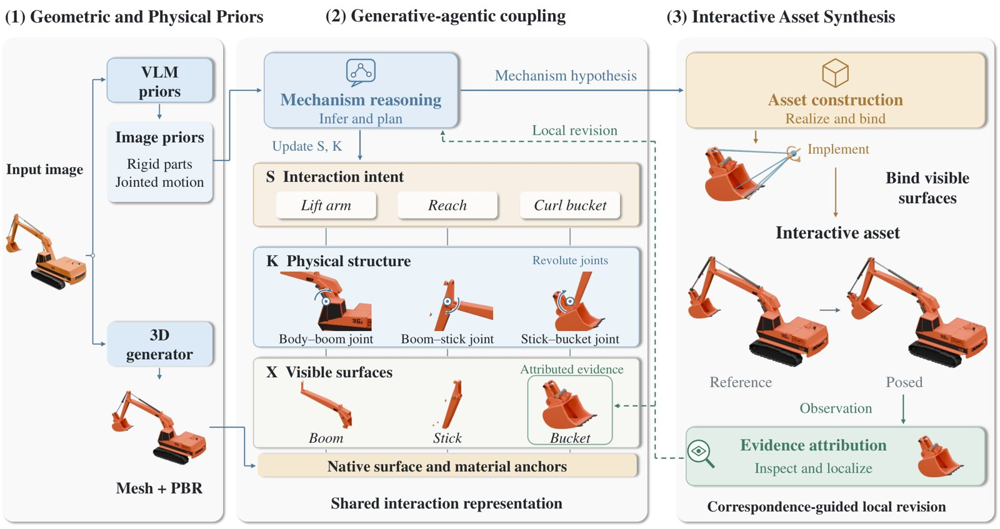
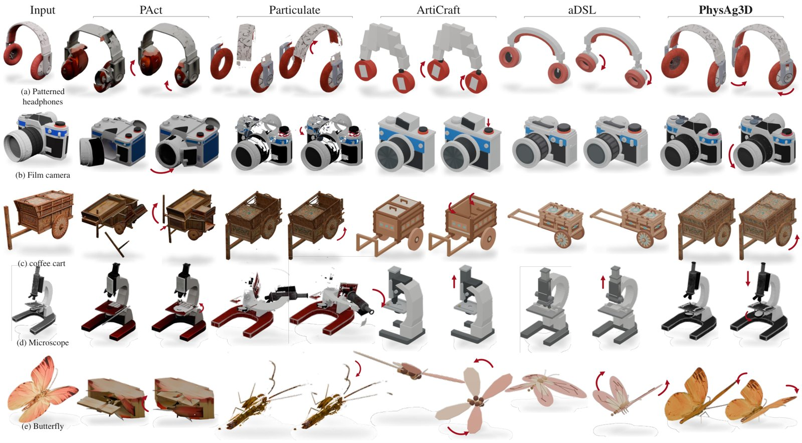
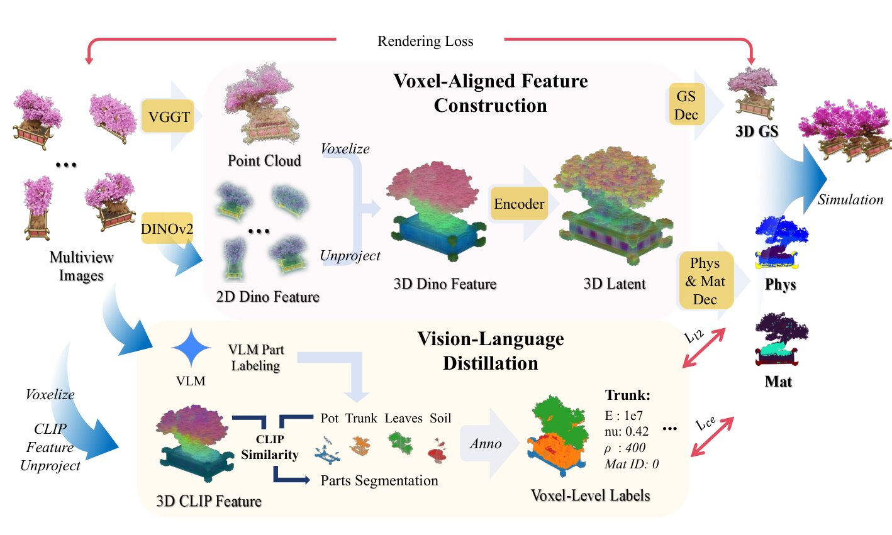
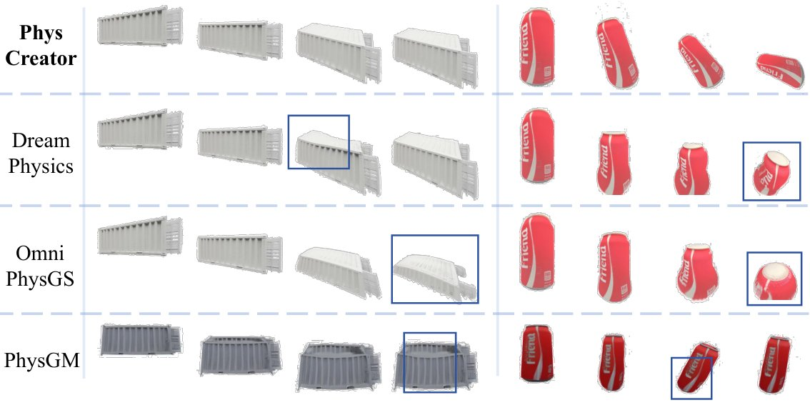

# 2026-11-02 科研日报

## 今日速览

周日无 arXiv 公告，本期把本周 cs.CV / cs.RO 公告里还没收录、又正好落在“可编辑动态资产”这条线上的两篇补上。两篇都在回答“一张图之后，资产怎么才能动起来”，但路线正好相反：一篇让智能体拿着 Blender 和 MuJoCo 一步步搭关节、绑表面、跑仿真再返工；另一篇用一个前馈网络把几何、外观和逐体素物理参数一次性预测出来，交给 MPM 去模拟。

- **必读：[PhysAg3D](#2026-11-02--physag3d)（北京大学、Huawei 等，arXiv 预印本）。** 先用 TRELLIS.2 从单张照片生成带材质的整物体网格，再由一个推理模型（论文配置为 gpt-6-astra，经 Codex 接口调用）把“要发生什么动作”“由哪个关节或柔性区域实现”“落到哪些可见表面上”三层显式写下来，在 Blender 里切部件、设关节、绑皮肤，在 MuJoCo 里执行检查，失败就按对应关系定位到具体部件做局部返工，最多修两次。自建 50 物体、110 个动作的真实照片基准上动作完成率 91.3%，最强基线 66.8%。必读原因：它是我们一直关注的 GPT-6 Astra 式“智能体 Real2Sim”在单物体可交互资产上的一个完整样板，而且论文把“播放关节动画”和“仿真里真的成立”这两种证据分得很清楚，值得照着这套记账方式去设计自己的验证环节。
- **选读：[PhysCreator](#2026-11-02--physcreator)（西安交通大学 等，arXiv 预印本）。** 把多视角（或经流匹配从单视角生成的）DINOv2 特征提升到体素，在同一个体素潜空间里同时解码 3D 高斯和逐体素杨氏模量、泊松比、密度与材质类别，约 10 秒出一个可直接进 MPM 的资产；物理标注靠 VLM 给部件打标签、CLIP 把标签落到体素、再用仿真回看筛掉不靠谱的伪标签。和 PhysAg3D 对照着读，能看清“推理 + 工具”和“蒸馏 + 前馈”各自买到了什么、丢了什么。
- **本期其他值得一扫：** 以 3D 基础模型为主干、同时预测未来几何与动作的世界—动作模型 E0.5，把未来 3D 轨迹当辅助目标的 Trace-WAM，以及不会“数值断裂”的大变形弹性 MPM，见文末简列。
- **圈内：** Randall Balestriero 与 Yann LeCun 把“柏拉图表示假说”证成了一个关于 JEPA 的定理，并给出“下一 token 预测是一种坏视图”的解释；Terence Tao 博客刊出 Frank Calegari 的客座文章，讨论 AI 批量产出数学论文之后学界该怎么调整评价与训练。

## 可编辑动态资产：单张图之后，让它动起来

### PhysAg3D · arXiv · 2026-10-29

**一句话判断：** 不训练新模型，而是把“生成器给外观、推理模型给机制、Blender 与 MuJoCo 给执行和验证”串成一个有预算上限的返工循环；关键贡献是那张把动作意图、物理结构和可见表面一一对上的分层表示，它让失败可以被定位到具体部件，而不是整件重来。

- **Title：** PhysAg3D: Bridging 3D Generative and Agentic Models for High-Fidelity and Physically-Interactive Assets
- **作者：** Bi'an Du, Fanpeng Meng, Jiemin Fang, Chen Yang, Pufan Li, Daizong Liu, Qi Tian, Wei Hu
- **单位：** 北京大学；Guangdong Laboratory of Artificial Intelligence and Digital Economy (SZ)；Huawei；武汉大学
- **投稿信息：** 投稿信息未标明
- **发表时间：** arXiv 首次挂出 2026-10-29
- **链接：** [arXiv abs](https://arxiv.org/abs/2610.39924) · [PDF](https://arxiv.org/pdf/2610.39924) · [项目页](http://supra-3d.github.io/PhysAg3D)（代码是否开源未见说明）
- **为何此时收录：** 本周四公告条目，此前未收录；本期无新公告，按“可编辑动态资产 + 智能体 Real2Sim”主线补入。

**摘要中译：** 从单张图像生成可交互的 3D 资产，需要真实的外观、对所描绘物体的忠实，以及合理的物理行为。然而精细的几何本身并不能决定物体应该怎样运动或形变。我们提出 PhysAg3D，把 3D 生成模型与智能体推理和工具使用结合起来。一个视觉—语言智能体首先从图像推断语义部件、候选交互和物理先验；3D 生成器则从同一张图生成带纹理的整物体网格。一个分层交互表示把这些可修订的先验连接到机制，以及机制所控制的生成表面，用来组织交互的构建与细化。在这一表示和对网格的观察引导下，智能体使用几何与物理工具构建部件、关节、可形变区域和表面绑定，同时保留生成结果中有用的几何与材质。渲染出的交互与执行测量在固定预算内引导有针对性的修订。该框架同时支持刚性关节运动和柔顺形变。在真实照片与外部基准上的定量和定性评估表明，生成的资产细节丰富、与图像对齐且交互合理；消融支持有界细化和源表面保留的作用。

*图：原论文 Figure 2（来源：[arXiv HTML](https://arxiv.org/html/2610.39924v1)）。中间一栏就是整篇的核心：上层写“要做什么”，中层写“哪个关节做”，下层写“动的是哪块表面”，右下角的虚线是失败后回到具体层级的返工路径。*

**方法与原理。**

*要解决什么。* 现有图像到 3D 的生成器已经能给出外观很好的网格，但网格是“一整块”：哪里该转、哪里该软、转轴在哪、限位多大，图像里并不直接给出。另一类方法（PhysX 系列、ArtiCraft、aDSL 等）直接预测部件和关节，常常要牺牲纹理与细节，或者只支持刚性关节。PhysAg3D 的出发点是两者各有所长：生成器负责“看起来像”，推理模型负责“动起来对”，中间需要一个能互相对账的结构。

*输入与输出。* 输入是一张物体照片。输出是一个资产包：可见几何与材质、物理实体与参数、控制量，以及从物理状态到可见表面的绑定；附带交互预览和尚未满足的需求清单。作者明确说，隐藏结构、真实尺度和材质参数无法由一张图唯一确定，所以构建目标是“声明过的交互”，而不是恢复真值。

*怎样做（四步）。*

1. **两路先验。** 推理模型从图像给出可修订的假设：部件、材质、连接方式、候选交互、尺度，并保留歧义；TRELLIS.2 从同一张图生成带纹理网格 \(M_0\)。先验不作为生成器的条件，两者只在后续“解释—构建—反馈”中耦合，不需要联合训练。
2. **写下分层表示。** 每个候选版本记为 \(\mathcal R_v=(S_v,K_v,X_v,\Gamma_v,\rho_v)\)：\(S\) 是需求（目标区域、动作协议、观测量、判定测试与初始条件，例如“盖子相对底座打开”），\(K\) 是机制（刚体或柔顺域、支撑、自由度、关节坐标系与限位、材质假设），\(X\) 是具体实现（真实的网格、材质、场景节点、控制量、仿真实体与导出绑定，也记录构建失败）。\(\Gamma\) 把三层相互连起来，\(\rho\) 记录每块表面相对 \(M_0\) 是保留、修改、新增、删除还是未解决。这样“打算铰接的面板”和“实际导出时仍粘在底座上”可以被区分开。
3. **构建并绑定。** 在 Blender 里切部件、改材质，用物理装配工具建仿真实体。刚体部分设定从属关系、父子连接、关节坐标系与限位、碰撞体与控制；柔顺部分设定离散化、材质假设、支撑与载荷，并把物理节点位移映射到可见顶点，形式为 \(V_t=V_{\text{rest}}+W(P_t-P_{\text{rest}})\)。构建时尽量保留原网格的几何、UV 与材质，所有编辑都记录目的和与源表面的对应。
4. **验证与返工。** 每个候选都要过三类检查：渲染检查（与图像对齐、外观保留、部件分离、可见响应），源表面检查，执行检查（在 MuJoCo 里跑动作、行程、接触、支撑与形变恢复）。每条证据标为未评估、通过、失败或不确定；构建一旦变动，此前的动态证据全部作废。未满足的需求沿 \(\Gamma\) 找到相关机制、实体和绑定，推理模型在剩余预算内提出局部修改。预算是硬上限：初次构建加至多 2 次修复、至多 2 次主机侧物理验证、至多 1 次结构重规划；关节行程可按 2/3 比例最多缩两次，但缩短后的行程不能冒充“完全闭合”的需求。

*为什么这样设计。* 作者反复强调几类证据不能混用：一个代理体在动、一个关节到达目标角度、以及“应该动的那块可见表面真的跟着动了”是三件不同的事；关节动画播放和物理仿真能给出相似画面，但只有后者提供动力学证据。编辑推理：这套记账方式本质上是在给智能体流水线做“可追溯的测试用例”，让每次修复都能回答“改了什么、哪条需求因此通过”，这是把大模型当工程师用时最容易缺的一环。

**结果与局限。** 自建基准取 50 个真实物体、110 个预定义动作，覆盖刚性、柔顺和混合物体：输入视角一致性（前景 IoU 0.835、PSNR 16.47）和全部交互指标领先，动作完成率 91.3%（aDSL 66.8%），全部动作无可见失稳的物体比例 88.0%（aDSL 42.0%）。外部基准 PhysXVerse 与 PhysX-Mobility 上每一列都最好，PSNR 比最强基线高约 2.7 dB；PhysX-Bench 上 CLIP 与 MonoArt 并列、视觉质量第二，尺度、可供性、运动学、材质与描述分数领先。102 份有效人工评测里两项均分领先，可见运动崩坏被标记 7 次（基线 11–47 次）。消融：去掉返工，运动学和材质分各掉约 19.7 和 17.3 分；去掉源表面保留，CLIP 掉 0.16、视觉质量分掉 17.68。作者自己写明的边界：多数外部指标基于关节播放而非经过校准的动力学或接触稳定性；隐藏结构与材质参数仍无法从一张图恢复；柔性耳垫等只用了近似柔顺模型。

*图：原论文 Figure 4（来源：[arXiv HTML](https://arxiv.org/html/2610.39924v1)）。重点看花纹与细小部件在运动后是否还保留；论文注明这里展示的是外观与关节播放，不代表校准过的动力学。*

**值得关注。**
- 和此前收录的 OpenJaws（借 GPT-6 Astra 做 Real2Sim）、WorldMirror（智能体式 Real2Sim）一起看：PhysAg3D 把对象缩小到单个物体，但把“需求—机制—表面”的对应和证据状态写得最细，适合作为自己搭智能体资产流水线时的验证框架参考。
- 它的构建环境是 Blender + MuJoCo，正好与 Blender 原生高斯的进展相邻；如果把 \(M_0\) 换成高斯资产，“表面绑定”这一层需要从顶点权重改成对高斯的绑定，这正是拆分绑定里最难的地方，可以带着这个问题读第 3.3 节和附录 A.2。
- 消融说明返工带来的提升主要在运动学与材质，而外观提升主要来自“别乱改源表面”；在消费级算力下复现时，可以先只做一次构建加一次修复，看能保住多少收益。
- 注意它的“成功”大部分是可见层面的判定；要拿去造机器人数据，还要补接触与质量参数的物理校准。

### PhysCreator · arXiv · 2026-10-25

**一句话判断：** 把几何、外观和空间变化的物理参数放进同一个体素对齐的潜空间里一次前馈预测出来，约 10 秒得到可直接进 MPM 的高斯资产；物理监督来自 VLM 蒸馏加仿真回看筛选，比逐物体优化快两个数量级，但参数仍是“语义上合理”而非实测。

- **Title：** PhysCreator: Creating Physically-Attributed 3D Assets at Will
- **作者：** Shiyan Zheng, Ming Li, Lei Han, Xiangyu Xu
- **单位：** 西安交通大学；香港中文大学（深圳）；Discover Robotics（论文首页列出的三处单位，逐人对应以原文为准）
- **投稿信息：** 投稿信息未标明
- **发表时间：** arXiv 首次挂出 2026-10-25
- **链接：** [arXiv abs](https://arxiv.org/abs/2610.34473) · [PDF](https://arxiv.org/pdf/2610.34473) · 项目页与代码未在 arXiv 页面给出

**摘要中译：** 3D 资产创建的显著进展使得从图像生成高保真 3D 成为可能，但多数现有表示本质上是静态的，无法刻画动态交互下合理的物理行为。我们提出 PhysCreator，一个从图像直接生成带空间变化物理属性、可直接用于仿真的 3D 表示的统一框架。不同于把物理属性当作简单的事后预测、或依赖昂贵逐实例优化的方法，我们把物理属性估计重新表述为统一 3D 表示学习的一部分：把图像观测提升为空间结构化的 3D 表示，构建体素对齐的潜空间，在其中以前馈方式联合建模并推断几何、外观与物理属性。为了在没有密集物理真值标注的情况下可扩展地学习，我们利用视觉—语言蒸馏，把强大视觉—语言模型中与材质相关的语义先验，转化为有空间定位的体素级监督。实验表明该方法在视觉质量、物理合理性和泛化性上优于已有方法。

*图：原论文 Figure 2（来源：[arXiv HTML](https://arxiv.org/html/2610.34473v1)）。右下角“Trunk: E=1e7, nu=0.42, ρ=400”就是一个部件被赋予的伪标签示例。*

**方法与原理。** 作者针对的是此前前馈方法 PhysGM 的短板：它在 2D 特征空间里工作，几何靠逐像素预测、物理参数靠全局图像特征，只能给整个物体一套均匀材质。PhysCreator 改成在 3D 体素上做：

1. **体素化与特征提升。** 多视角图像先过 VGGT 得到点云与相机，按点云占据选出活跃体素；每个体素中心投到各个可见视角，采样 DINOv2 特征后取平均，再用一个作用在体素 token 上的 Transformer 编码成潜变量 \(\mathbf z_i\)。
2. **共享潜空间、两个解码头。** 几何头把每个潜变量解码成若干 3D 高斯（位置、尺度、不透明度、外观）；物理头在每个体素上预测杨氏模量 \(E\)、泊松比 \(\nu\)、密度 \(\rho\) 与材质类别，并可通过交叉注意力接受“软”“硬”这类文字条件。因为两者来自同一个 \(\mathbf z\)，物理参数天然与几何对齐，可以出现“花在摇、盆不动”的空间变化。
3. **单视角入口。** 用多视角流程为训练物体构建潜变量，再训练一个以单张图为条件的流匹配模型，从噪声生成同一空间里的潜变量，复用同样的解码头。
4. **没有物理真值时怎么监督。** 对渲染图，VLM（论文引用 Gemini 2.5 技术报告）给出部件名称及每个部件的物理参数；把 CLIP 稠密特征提升到体素，与部件文本做余弦相似度，给每个体素分配部件，从而得到体素级伪标签；再用这些参数跑一次仿真，让 VLM 判断动态行为是否符合材质语义，不合格的样本丢掉。训练时 \(E\) 和 \(\rho\) 取对数归一化，连续量用均方误差，类别用交叉熵。

仿真用 PhysGaussian 的 MPM 实现，在 Objaverse 上训练与评测。

**结果与局限。** 与逐实例优化的 DreamPhysics、OmniPhysGS 和前馈的 PhysGM 比较，五类物体平均 CLIP 语义一致性 26.98%（PhysGM 24.93%）、用户评分 4.13（PhysGM 2.81），每个物体约 10 秒，而两种优化方法分别超过 1 小时和 5 小时。几何上倒角距离 0.0431、F-score 72.72（PhysGM 0.0475、59.05）。在人工核验过的参考标注上，杨氏模量相对误差 7.78%、泊松比 8.12%（PhysGM 分别为 16.19%、18.66%）。“硬/软”文字条件下预测的杨氏模量比值为 13.18，DreamPhysics 只有 1.70。需要注意：参考标注本身也是 VLM 初值加人工判断“看起来合理”得到的，并非材料测量；评测集是 Objaverse 渲染物体，没有真实照片实验；论文也没有给出代码链接。

*图：原论文 Figure 3（来源：[arXiv HTML](https://arxiv.org/html/2610.34473v1)）。*

**值得关注。** 和 PhysAg3D 正好构成一组对照：PhysAg3D 处理的是关节与机制，外观借现成生成器，靠推理模型和仿真反复验证；PhysCreator 处理的是连续介质参数，几何、外观、物理一起前馈，速度快但没有闭环验证。读的时候可关注两点：一是“VLM 打部件标签 + CLIP 落到体素”这条伪标签链路，在部件边界和小部件上会不会系统性出错；二是它的输出已经是带逐粒子参数的 3D 高斯，正好可以直接接 MPM，这对需要“可编辑、可仿真的高斯资产”的流水线是一个现成的接口参考。

## 本期其他值得一扫（仅据摘要）

- **[E0.5](https://arxiv.org/abs/2610.36011)（arXiv 2026-10-26；X-Era AI Lab Team，通讯作者 Guangrun Wang 等）：** 不再把 VGGT 这类几何特征当视频模型或 VLM 的附加输入，而是直接以 3D 基础模型为主干，同时预测未来 3D 状态与动作；RoboTwin 2.0 上不做具身预训练即达 89.90%（干净）/ 50.09%（随机化）成功率，再用 AgiBotWorld-Beta 的 16 万条轨迹预训练后，两个真机平台平均成功率约提升 15 和 7 个百分点。
- **[Trace-WAM](https://arxiv.org/abs/2610.36840)（arXiv 2026-10-27；Xu Hu, Zhaoxiang Zhang 等）：** 认为预测整段未来视频要重建大量与操作无关的背景，于是加一个预测未来 3D 点轨迹（像素位移 + 深度变化）的辅助分支，三分支 Transformer 共同学习视频、运动与动作；推理时动作分支不读预测轨迹，速度不变。少示教和分布偏移下相对 Fast-WAM 提升明显，[项目页](https://trace-wam.github.io/)。
- **[Total Deformation MPM](https://arxiv.org/abs/2610.36945)（arXiv 2026-10-27；Timna Böttcher, Rick Ridder, Jan Bender）：** 物质点法在纯弹性材料大变形时常出现“数值断裂”；此前的修法在参考构型固定网格上算力，无法兼容常规碰撞处理。本文直接由粒子位置和固定参考网格求变形，仍在当前网格上算弹力，因此能用 MPM 常见的网格碰撞与粒子级碰撞，并抑制零能模态。对用 MPM 仿真高斯资产（如上面的 PhysCreator）时的大变形稳定性有参考价值。
- **[GEMS](https://arxiv.org/abs/2610.33158)（arXiv 2026-10-23；Ling-Chia Chen, Abdelrhman Werby, Kaan Aytekin, Kai O. Arras）：** 一次重建 3DGS 地图，之后只在场景变化区域增量更新并只存改动，配合智能体按需渲染新视角来回答时空问题、定位物体；附带 473 个问答对的 GEMS-Bench，[项目页](https://abwerby.github.io/GEMS/)。
- **[PhysInsert](https://arxiv.org/abs/2610.40453)（arXiv 2026-10-29；Yue Gong, Yebin Liu 等）：** 参考图物体插入，用 Blender 渲染严格对齐的“有/无物体”反事实成对数据（跨视角、跨光照），结合 VGGT 几何流约束位姿与光照适配，并同时监督物体占据与周围环境的变化（阴影等）；[项目页](https://arthuring.github.io/PhysInsert/)。

## 圈内新闻与社区反应

**把“柏拉图表示假说”变成定理（表示学习）。** Randall Balestriero 与 Yann LeCun 的新预印本 [Proving and Improving the Platonic Representation Hypothesis with JEPAs](https://arxiv.org/abs/2610.39302) 证明：在不同模态上分别训练的 JEPA，只要正样本对是“同一场景的两次观测”（作者称为好视图），学到的表示就只差一个旋转；而下一 token 预测相当于用“同一文档的不同片段”做正样本，是一种坏视图，这解释了语言模型为什么要靠规模才和视觉对齐。作者报告好视图达到同等对齐所需样本少 42 倍，一个 1.09 亿参数的文本 JEPA 与 DINOv2、CLIP 图像编码器的对齐优于其评测的所有语言模型（最大 72B）。HN 讨论（[原帖](https://news.ycombinator.com/item?id=50325454)）里，有人追问哪些领域能凑出网页规模的“好视图”训练集，因为下一 token 预测的长处恰恰是能吃下无结构语料（[theptip](https://news.ycombinator.com/item?id=50327939)）；也有人怀疑这个假说只是在说“存在一种最优降维，模型越大越容易逼近”（[Lerc](https://news.ycombinator.com/item?id=50325743)）。编辑判断：对具身与 3D 方向，多视角、多传感器同步采集天然就是“同一场景的两次观测”，这篇给“多视角数据比单纯扩规模更值钱”提供了一个可检验的理论说法。

**数学界如何面对 AI 批量产出的证明（AI 与科研）。** Terence Tao 博客刊出 Frank Calegari 的客座文章 [Mathematics has changed. Let's act like it](https://terrytao.wordpress.com/2026/11/01/mathematics-has-changed-lets-act-like-it/)（11-01）。文章以 OpenAI 10 月 6 日一次性发布 700 多篇数学研究论文为背景，承认其中有很好的想法，但批评这些论文写得糟、不守署名规范、个别还有错；作者主张数学界与其纠结大公司的行为，不如把力气放在自己能控制的招聘、发表和学生培养上，并认为“选对问题、用 AI 得到证明、彻底理解它并据此提出新问题”应当算作实质贡献。HN（[原帖](https://news.ycombinator.com/item?id=50328251)）上有人认同这一贡献标准（[kccqzy](https://news.ycombinator.com/item?id=50328796)），也有人指出机器证明的用法不是让人去读，而是交给另一个智能体去复用其中的想法（[fritzo](https://news.ycombinator.com/item?id=50329877)）。编辑判断：图形学与具身研究同样在面对“智能体能大量产出方法和实验”的局面，“问题选择与理解深度”作为评价重心的讨论值得关注。

## 覆盖说明

日报发布日为 **2026-11-02（周一）**，内容覆盖日为 2026-11-01（周日）。周日无 arXiv 公告，本期回扫本周 cs.GR、cs.CV、cs.RO 公告中与可重光照、物理资产、Real2Sim 相关且此前未收录的条目。正文两篇为 PhysAg3D（2610.39924）与 PhysCreator（2610.34473），均核对了 arXiv HTML 全文的方法、实验与局限，配图为原论文插图；简列五篇仅据摘要。所有结果均为作者报告，未独立复现。圈内新闻以 Hacker News 近两日热帖为入口并核对原文；中文媒体与 X 本期未单独检索，Blender 原生高斯本期未找到新的可核实进展。对标仓 Real2Sim_GPT6_ASTRA 自 9 月 10 日以来无新提交。

**编写：** Cream
