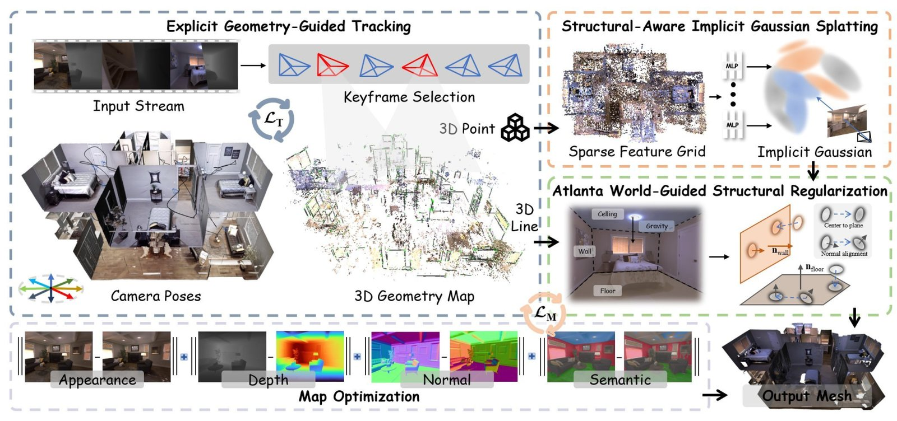
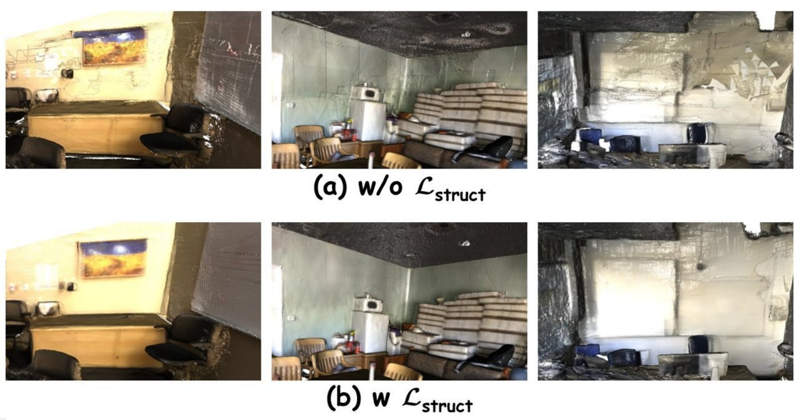
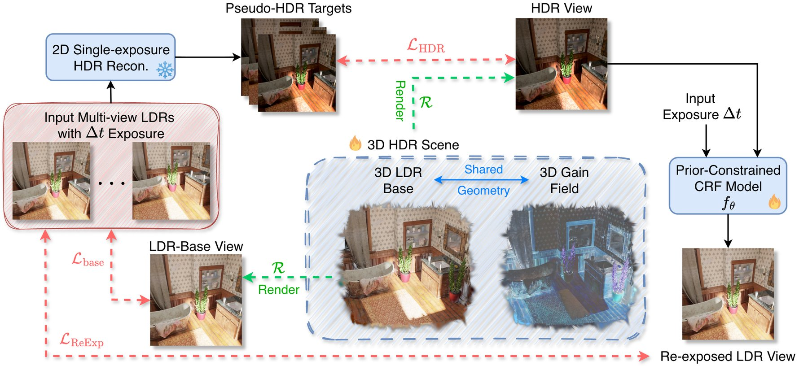

# 2026-11-03 科研日报

## 今日速览

周一公告（11-02）里，和“真实室内采集 → 可重光照高斯资产”这条主线直接相关的有两篇，分别解决输入端的两个老问题：几何不可靠，以及颜色不是线性辐射。一篇用室内建筑的结构规律去约束高斯的位置和法线，另一篇从只有一种曝光的 LDR 照片里恢复 HDR 辐射。逆渲染要用的材质和光照分解，都要先有这两样作为地基。

- **必读：[DrawSplat](#2026-11-03--drawsplat)（Tohoku University、RIKEN AIP、中国科学技术大学等，arXiv 预印本）。** RGB-D SLAM 前端用点和线特征跟踪相机，并从结构线估计重力方向，再由线推出墙、地面、天花板这类结构平面。这些平面变成可微损失，直接作用在高斯的中心和法线上。高斯本身采用“锚点 + 小网络解码”的隐式形式，致密化时把容量优先分给墙角、门框和深度不连续处。在多房间的 Replica Apartment 上，轨迹误差比次优方法低约 60%；在真实噪声的 ScanNet 上，渲染 PSNR 高 2.54 dB，模型只有 18 MB。必读原因：室内大平面、弱纹理、深度噪声正是真实场景逆渲染里法线最容易坏的地方。这篇把“平面先验怎样写成作用在高斯上的损失、怎样避免误伤家具”讲得具体，消融也说明了这类先验在哪些指标上作用有限。
- **选读：[PriorGS](#2026-11-03--priorgs)（University of Waterloo，arXiv 预印本）。** 只给同一曝光的多视角 LDR 照片，用 2D 单图 HDR 重建模型生成伪 HDR 监督。每个高斯的颜色拆成“LDR 基底 + 3D 增益场”，再用一条保证单调的相机响应曲线把 HDR 重新曝光回输入照片，形成闭环。逆渲染需要的是线性 HDR 辐射，而手机和相机给的是被裁剪、被非线性映射过的 LDR，这篇给出了一种不需要多曝光包围拍摄的补法。
- **低端机具身：** [RTPolicy](#2026-11-03--rtpolicy-sacq) 在边缘开发板上跑到 32.9 Hz 的多视角操作策略；[SACQ](#2026-11-03--rtpolicy-sacq) 把 VLA 权重压到约 1.5 bit，LIBERO 成功率几乎不掉。
- **圈内：** Blender 官方开发者博客详细讲了 5.3 原生高斯泼溅在 EEVEE 和 Cycles 里怎么实现，正式版预计 11-10 发布，独立测试者也给出了第一批生产可用性评估；美团发布 1.6T 参数的多模态智能体模型 LongCat-2.5；浙大与 TeleAI 的 GR-BC 用图搜索从带失败和人工干预的轨迹里挑出“真正推进任务”的动作块。

## 室内几何鲁棒性：用结构先验约束高斯

### DrawSplat · arXiv · 2026-10-30

**一句话判断：** 不靠单目深度或法线网络，而是用 RGB-D 序列里本来就有的线特征和重力方向推出结构平面，再把平面写成作用在高斯中心与法线上的软约束。它对“墙面变厚、法线发毛、长轨迹漂移”这三类室内失效讲得很清楚。代价是只适用于建筑结构占主导的室内场景，而且依赖 RGB-D 输入和语义分割。

- **Title：** DrawSplat: Atlanta World-Guided Implicit Gaussian SLAM for Indoor Reconstruction
- **作者：** Fan Zhu, Zhisong Xu, Ziyu Chen, Zhenjun Zhao, Takayuki Okatani
- **单位：** Tohoku University；RIKEN Center for AIP；The University of Tokyo；中国科学院合肥物质科学研究院、中国科学技术大学自动化系；University of Zaragoza
- **投稿信息：** 未标明（IEEE 期刊版式，具体投稿去向不明）
- **发表时间：** arXiv 首次挂出 2026-10-30（11-02 公告列入 cs.CV，交叉列入 cs.RO）
- **链接：** [arXiv abs](https://arxiv.org/abs/2610.41602) · [PDF](https://arxiv.org/pdf/2610.41602) · [HTML](https://arxiv.org/html/2610.41602v1)（论文中未给出项目页或代码链接）

**摘要中译：** RGB-D SLAM 需要准确的在线跟踪、高质量渲染和几何一致的重建。现有高斯 SLAM 方法主要用光度、深度或局部帧到模型的约束来优化高斯基元，这在弱纹理、大平面、深度噪声大、轨迹长的室内场景中往往不够，得到的地图会出现位姿漂移、表面变厚、法线噪声和结构边界模糊。我们提出 DrawSplat，一个由 Atlanta World 先验引导的隐式高斯 SLAM 框架，用于室内重建。它模仿“画画”的过程：先由显式的点—线几何勾出结构布局，再由隐式神经高斯填充高保真外观与连续的几何细节。系统通过点线联合跟踪估计相机位姿、稀疏几何和重力方向，利用 Atlanta World 先验中“共享重力方向”这一部分从跟踪到的线推断结构平面，并把它们转成作用于高斯中心与法线的可微正则项。为提高紧凑性和效率，DrawSplat 还把基于锚点的隐式神经高斯表示与自适应结构采样结合，把高斯容量分配给结构信息丰富的区域。多个数据集上的实验表明，DrawSplat 在高斯 SLAM 系统中实现了稳健的跟踪、高保真渲染和较强的几何重建，同时在质量、效率与模型大小之间保持了实用的平衡。

*图：原论文 Fig. 2（来源：[arXiv HTML](https://arxiv.org/html/2610.41602v1)）。数据流是单向的：前端只用图像特征和深度确定位姿、线和重力，不依赖正在变化的高斯外观；后端拿到这些量后，一边更新平面参数，一边优化高斯。*

**方法与原理。**

*要解决什么。* 室内高斯 SLAM 有两个相互牵连的困难。第一，SplaTAM、MonoGS 这类方法用渲染结果与输入帧对齐来求位姿，白墙、走廊这种弱纹理区域给不出足够的梯度，长轨迹就会漂。第二，即使位姿准确，只用光度和深度监督时，一面墙会被许多朝向不一的高斯“糊”成一层厚壳，法线噪声很大，导出的网格边界发虚。已有的结构化方法如 MG-SLAM 用了曼哈顿世界假设（场景只有三个互相垂直的主方向），但结构约束主要用于跟踪和网格补全，没有真正进入高斯的可微优化；而且多房间场景里墙的朝向往往不止两组。

*输入与输出。* 输入是 RGB-D 视频流，外加一个预训练 2D 语义分割模型（论文用 Mask2Former）给每帧打墙、地、天花板等标签。输出是相机轨迹、隐式高斯地图，以及用渲染深度做 TSDF 融合得到的网格。重力方向、结构平面都由系统自己从线特征估计，不需要 IMU。

*怎样做（四步）。*

1. **点线联合跟踪。** 在 ORB-SLAM 式前端上，每帧同时提取 ORB 点和 EDLines 线段。位姿由四类残差共同求解：点和线端点的 2D 重投影误差，以及借助深度反投影后的 3D 点距、点到线段距离，再配 Huber 鲁棒核。弱纹理区域点特征少，但墙角、门框、踢脚线的线段依然稳定，这是位姿“锁得住”的来源。局部 BA 和回环触发的全局 BA 之后，修正量会传给后端的锚点。
2. **从线估计重力并推出结构平面。** Atlanta World 假设比曼哈顿世界宽松：所有结构共享一个重力方向，水平方向可以有多组。于是，每条结构线要么平行于重力，要么垂直于重力。重力方向 \(\mathbf n_g\) 取使 \(\sum_i \omega_i \min(|\mathbf d_i^\top \mathbf n|,\,1-|\mathbf d_i^\top \mathbf n|)\) 最小的单位向量，其中 \(\mathbf d_i\) 是线方向，权重 \(\omega_i\) 结合线长、观测次数和语义（墙地交界线权重高，家具斜边权重低）。随后把线分配到平面 \((\mathbf n_j,\delta_j)\) 上：线方向要落在平面内，端点要在平面上，平面法向要么平行、要么垂直于重力。新线先找已有平面，解释不了的再用 RANSAC 生成新平面。
3. **把平面写成高斯的损失。** 每个高斯 \(G_k\) 按到平面的距离和语义兼容度得到软关联权重 \(w_{kj}\)：被判为非结构物体（椅子、杂物）的高斯权重为零，不会被拍平。结构损失由三项组成：

\[
\mathcal L_{\text{struct}}=\lambda_{gp}\sum_{k,j} w_{kj}\big(\mathbf n_j^\top \mathbf P_k+\delta_j\big)^2+\lambda_{gn}\sum_{k,j} w_{kj}\big(1-|\mathbf n_k^\top \mathbf n_j|\big)+\lambda_{aw}\,\mathcal L_{aw}
\]

第一项把高斯中心 \(\mathbf P_k\) 拉到平面上，用来消除“墙面变厚”。第二项让高斯法线 \(\mathbf n_k\)（协方差最小特征值对应的方向，也就是扁平高斯最薄的方向）对齐平面法向 \(\mathbf n_j\)。第三项 \(\mathcal L_{aw}\) 只作用在平面参数上：墙的法向要垂直于重力，地面和天花板的法向要平行于重力。优化时交替进行：先固定高斯更新平面，再固定平面更新高斯，每批之间刷新线到平面、平面到高斯的关联。

4. **隐式高斯与按结构致密化。** 场景按 1 cm 体素组织成锚点，每个锚点存 32 维特征、尺度和 \(K=10\) 个偏移。偏移位置处的高斯颜色、不透明度、旋转、尺度和语义由小 MLP 根据视角解码，思路来自 Scaffold-GS。致密化仍以屏幕空间梯度为主，但乘上一个结构权重 \((1+w(\mathbf x))\)，\(w\) 融合了到 3D 线的距离、渲染深度梯度和光度残差三种响应，所以墙角和深度跳变处更容易长出新锚点。剪枝时只删除观测充分、不透明度低、结构权重也低的锚点。总的地图损失是 \(\mathcal L_{\text{rgb}}+\lambda_d\mathcal L_d+\lambda_n\mathcal L_n+\lambda_s\mathcal L_{\text{struct}}+\lambda_{\text{sem}}\mathcal L_{\text{sem}}+\lambda_o\mathcal L_{\text{dist}}\)，其中法线项 \(\mathcal L_n\) 让渲染法线对齐由输入深度算出的法线。

*为什么这样设计。* 作者的论证是：跟踪交给显式几何，因为线和点在弱纹理处比光度对齐稳；平面从线来，而不是从深度点云拟合，因为线比噪声深度更能代表“结构”；约束做成软权重并由语义门控，是为了不把家具也压平。编辑推理：这相当于在 PGSR 一类“扁平高斯 + 平面约束”做法的基础上，把平面来源从单帧深度或局部拟合换成了多帧一致的结构线，换来的是长轨迹下全局一致的平面。代价是对 Atlanta World 假设的依赖更强。

**结果与局限。** 以下都是作者报告，在单块 A100 上运行，每组跑 5 次取平均。
- *跟踪（轨迹均方根误差，越小越好）：* Replica Apartment 平均 1.09 cm，MG-SLAM 为 2.77 cm，LoopSplat 为 5.77 cm；ScanNet 平均 6.52 cm，MG-SLAM 为 6.77 cm。合成 Replica 单房间上与 RTG-SLAM、LoopSplat 基本持平（0.27 cm 对 0.26–0.27 cm）。
- *渲染：* ScanNet 平均 PSNR 27.07 dB，LoopSplat 为 24.53 dB，MG-SLAM 为 23.71 dB；Replica Apartment 为 38.79 dB，LoopSplat 为 34.64 dB。注意，同一前端配显式 3DGS 时 Replica PSNR 反而更高（40.57 对 39.43），只是模型达到 108 MB。
- *几何：* Replica 上 F1 为 93.7（3D 重建，越大越好），仍低于 NeRF 系的 ESLAM（94.7）；ScanNet 上只报告了 2D 深度 L1（4.41 cm，SplaTAM 为 6.46 cm），没有 3D 网格指标，ScanNet++ 只有定性图。
- *效率：* Replica 上跟踪 24.6 FPS、渲染 209 FPS，但含建图、平面估计、回环的整体 SLAM 吞吐只有 2.0 FPS，语义预处理另计约 9.2 FPS；显存 4.5 GB，模型 18.3 MB，是对比方法里最小的。
- *消融：* 只用外观损失时 PSNR 39.85，但 F1 只有 73.4，说明“拟合图像”和“几何正确”是两回事；去掉整个结构损失后，Replica 的 F1 只从 93.7 降到 93.2，PSNR 却降了约 1.9 dB。也就是说，在干净的合成数据上，结构先验对几何指标贡献很小，主要作用体现在 ScanNet 这类深度噪声大的真实数据上（见下图）。语义用预测结果替代真值时，各项几乎不变。
- *局限（作者自述）：* 主要面向建筑结构占主导的 RGB-D 室内场景；动态场景、室外、不满足 Atlanta World 假设的空间可能不稳定；深度严重出错或线不可靠时，位姿、重力和平面都会受影响；不能像生成式方法那样补全未观测的空洞。作者把单目 SLAM（用度量深度预测代替传感器深度）列为后续工作。

*图：原论文 Fig. 6（来源：[arXiv HTML](https://arxiv.org/html/2610.41602v1)）。右侧场景最能说明问题：没有结构约束时，白墙在深度噪声下碎成多块；加上之后，墙面被拉回同一平面。*

**值得关注。**
- 对真实室内逆渲染来说，法线质量直接决定着色分解是否成立。这篇提供了一种不依赖单目法线网络的法线来源：多帧一致的结构线和重力。可以把它的 \(\mathcal L_{gp}\) 和 \(\mathcal L_{gn}\) 与 PGSR 的单视角、多视角平面约束对照着读，看两者在 ScanNet 这类噪声数据上分别靠什么起作用。
- “语义门控的软关联”值得借鉴：平面先验只作用在墙、地、天花板上，家具保留自由度。目标物体本身多半不是平面，这种门控能防止背景先验误伤前景资产。
- 要注意它的证据边界：真实数据上没有 3D 几何指标，Replica 上结构损失对 F1 的增益不到 0.5。如果关心的是“法线到底准了多少”，论文没有直接报告法线误差，需要自己补测。
- 隐式锚点解码让模型变小，但也让每个高斯的属性由网络临时生成。要在它之上做材质分解或导出到 Blender，需要先把高斯“烘焙”成显式属性，这一步论文没有讨论。

### PriorGS · arXiv · 2026-10-29

**一句话判断：** 用 2D 单图 HDR 重建模型给出的伪 HDR 作监督，但不让高斯直接存 HDR 颜色。高斯颜色拆成被 LDR 照片牢牢约束的“基底”，加上一个专门承载 HDR 扩展的“增益场”，再用一条形状受先验约束的单调相机响应曲线闭合回输入照片。思路干净，消融也支持每个部件，但最终质量受限于伪 HDR 的好坏。

- **Title：** Prior-Guided Single-Exposure HDR Novel View Synthesis via Base-Gain Representation
- **作者：** Armin Shafiee Sarvestani, Sheyang Tang, Jialu Xu, Zhou Wang
- **单位：** University of Waterloo（Department of Electrical and Computer Engineering）
- **投稿信息：** 未标明（文末附有会议式的 AI 使用声明，具体投稿去向不明）
- **发表时间：** arXiv 首次挂出 2026-10-29（11-02 公告列入 cs.CV）
- **链接：** [arXiv abs](https://arxiv.org/abs/2610.41011) · [PDF](https://arxiv.org/pdf/2610.41011) · [HTML](https://arxiv.org/html/2610.41011v1)（论文中未给出项目页或代码链接）

**摘要中译：** 单曝光高动态范围（HDR）新视角合成，是从同一曝光拍摄的低动态范围（LDR）多视角图像中恢复 HDR 场景，并估计相机响应函数（CRF），以便把场景重新曝光成其他曝光下的 LDR 图像。没有 HDR 真值时，只用单曝光 LDR 视图做直接监督会让 HDR 重建欠约束，无法保证忠实恢复，因此需要学到的 LDR 到 HDR 重建先验。另外，单曝光视图只在有限范围内约束 CRF，要在该范围之外可靠地重新曝光，就需要一个可学习的 CRF 先验。我们提出 PriorGS，一个基于 3D 高斯泼溅的框架，同时应对这两个问题：（1）用 2D 单曝光 HDR 重建方法生成伪 HDR 监督来引导 HDR 恢复，并通过闭合的重建回路把它锚定到输入 LDR 视图；（2）用一个保证单调、倾向于合理响应形状的可学习先验来正则化 CRF 建模。然而，各视图独立生成的伪 HDR 目标之间存在不一致，若把 HDR 直接编码为高斯的颜色属性，会损害场景重建。为此我们引入 3D 基底—增益 HDR 表示，把 HDR 辐射分解为 LDR 基底和叠加的 3D 增益场，提升了对这类不一致的鲁棒性，并支持 3D 的 HDR 外观编辑。大量实验表明 PriorGS 显著优于基线。

*图：原论文 Figure 3（来源：[arXiv HTML](https://arxiv.org/html/2610.41011v1)）。三条红色虚线就是三项损失：基底对输入、HDR 对伪 HDR、重新曝光结果对输入。可学习的只有 3D 场景和右侧 CRF 的四个参数，2D HDR 模型是冻结的。*

**方法与原理。**

*要解决什么。* LDR 照片是“场景辐射 × 曝光时间 → 非线性相机响应 → 量化 → 高光裁剪”的结果。只有一种曝光时，被裁掉的高光和压进噪声的暗部在 LDR 里没有信息。现有单曝光方法（Mono-HDR-GS、SeHDR）能把输入那一档曝光拟合得很好，恢复出的 HDR 却可能完全不对；相机响应要么用灵活的 MLP，在没见过的曝光下乱外推，要么每个场景手挑一条固定曲线。

*输入与输出。* 输入是同一曝光、已知位姿的多视角 LDR 照片（COLMAP 初始化）。输出是 3D 高斯场景，它能渲染 HDR 视图，也能配合学到的 CRF 渲染任意曝光的 LDR 视图。训练时额外用到一个现成的 2D 单图 HDR 重建模型（论文选 IntrinsicHDR），推理时不再需要它。

*怎样做（三步）。*

1. **伪 HDR 监督。** 训练前，把每张 LDR 输入送进 2D HDR 重建模型，得到伪 HDR 目标 \(\widetilde H^v\)。它提供了“高光里本来有什么”的先验，但各视图独立推断，彼此可能不一致。
2. **基底—增益表示。** 每个高斯带两组球谐系数：一组给出 LDR 基底颜色 \(\mathbf c_i^v\)，另一组给出对数增益 \(\mathbf g_i^v\)。HDR 辐射写成

\[
\mathbf h_i^v=(\mathbf l_i^v+\delta)\odot 2^{\mathbf g_i^v}-\delta,
\]

其中 \(\mathbf l_i^v\) 是基底颜色去伽马后的线性值，\(\delta=1/64\) 让纯黑处也能被增益抬起来。同一套几何分别用 \(\mathbf c\) 和 \(\mathbf h\) 渲染出 LDR 基底图和 HDR 图。这个设计借鉴了 Ultra HDR 一类“SDR 底图 + 增益图”的 2D 格式。作者的理由是：如果直接把 HDR 存成高斯颜色，伪 HDR 的跨视图不一致会顺着梯度改动几何，产生颜色和几何伪影；拆开之后，几何和基底由可靠的 LDR 输入锚定，不可靠的部分只进入增益场。

3. **受先验约束的 CRF 与闭环。** 相机响应写成 \(f_\theta(E)=t_\phi(\eta_\psi(E))\)：外层 \(t_\phi(x)=(1+\sigma)\,x^n/(x^n+\sigma)\) 是对 DoRF 真实相机响应数据库平均曲线的两参数近似，内层 \(\eta_\psi(E)=\mathrm{sigmoid}(a\ln(E+\epsilon)+b)\) 把任意辐照度软归一化到 \([0,1]\)。只要 \(a,\sigma,n>0\)，整条曲线严格单调。四个参数按场景学习，三个颜色通道共享。用它把 HDR 渲染按训练曝光重新曝光，\(\widehat L_R^v=f_\theta(\Delta t\,\widehat H^v)\)，再要求结果等于输入照片。总损失为 \(\mathcal L=\mathcal L_{\text{base}}+0.5\,\mathcal L_{\text{HDR}}+0.5\,\mathcal L_{\text{ReExp}}\)，每项都是 L1 加 D-SSIM。HDR 项在 \(\mu\)-law 压缩后计算，避免高光主导梯度。

*为什么这样设计。* 闭环让 HDR 两头都被 LDR 约束：上游通过基底，下游通过重新曝光。伪 HDR 只负责告诉模型“裁剪掉的部分大概是什么”。CRF 用物理上合理的参数族而不是 MLP，是因为单曝光只能约束响应曲线的一小段，其余部分只能靠先验的形状来外推。

**结果与局限。** 数据为 HDR-NeRF（4 个真实场景，8 个 Blender 合成场景带 HDR 真值）和 HDR-Plenoxels（4 个真实场景）。每次只用一种曝光训练，在其余 4 种曝光和 HDR 上测试，5 种训练曝光轮流取平均，单卡 RTX 3090，迭代 30K 次。
- *合成场景 HDR：* PSNR 31.22 dB，最强基线 GaussHDR 为 26.96 dB。单曝光 HDR 存在整体亮度尺度不确定，评测前每个场景做一次亮度校正，再经 \(\mu\)-law 压缩。
- *真实场景重新曝光：* HDR-NeRF-Real 上 PSNR 24.31 dB，GaussHDR 为 16.28 dB；HDR-Plenoxels-Real 上 23.00 dB，GaussHDR 为 17.73 dB。需要注意，GaussHDR 和 HDR-GS 原本是多曝光方法，这里被改到单曝光设置下运行，SeHDR 闭源，由作者自行复现，因此差距的一部分来自设置不利于基线。
- *消融（真实场景重新曝光）：* 去掉伪 HDR 先验，PSNR 降到 18.39 / 15.00；改成直接存 HDR 颜色，降到 22.71 / 15.05（Plenoxels 上几乎崩溃）；CRF 换成固定伽马 2.2，降到 14.87 / 12.57；把增益场换成 MLP，结果接近，但失去 3D 编辑能力，高频纹理也更差。
- *应用：* 把增益系数统一乘以 \(\rho\) 就能在 3D 中连续调节动态范围，\(\rho=0\) 回到 LDR 基底，并且多视角一致。
- *局限（作者自述）：* 质量受伪 HDR 目标的上限约束，2D 模型没补出来的高光纹理，3D 里也补不出来；严重的跨视图不一致仍可能被编码成虚假的视角相关外观。作者提出的后续方向是在 3D 中直接做生成式 HDR 重建，以及引入不确定性学习。

**值得关注。**
- 对逆渲染的直接意义：材质和光照分解都假定输入是线性辐射。手机随手拍的 LDR 被裁剪、被色调映射之后，高光处的光源强度和镜面反射信息会系统性丢失。PriorGS 的“LDR 基底 + 增益”可以当作逆渲染前的一道预处理，也可以作为可学习的一层接进逆渲染优化。不过论文只评测了新视角合成，没有验证恢复出的辐射拿去做光照估计是否可靠。
- 它的 \(\delta\)、对数增益和 \(\mu\)-law 损失都是处理“高光主导梯度”的小技巧，在自己的可微渲染里做 HDR 环境光或发光体估计时可以直接参考。
- 和下文 Blender 5.3 的已知限制放在一起看：Blender 目前假定导入的高斯是在 sRGB 空间里训练的，而渲染器在线性空间工作，低不透明度、高辐射区域会出错。PriorGS 这类显式恢复线性 HDR 的高斯，恰好能补上这一缺口（编辑推理，未经验证）。

## 新兴趣相关：低端机上的具身策略

两篇都在回答“策略模型怎样在算力受限的机器人上跑起来”，但都以工业边缘板卡为目标平台，不等于学生手里的消费级小卡或树莓派级控制器。以下均仅据摘要。

- **[RTPolicy](https://arxiv.org/abs/2610.41625)（arXiv 2026-10-30；Xianbao Hou, Wei Sui, Cong Yang 等；投稿信息未标明）：** 多视角操作策略的瓶颈在视觉主干和动作生成的计算量。它先按视角融合多路相机特征，再压缩成少量 token，作为流匹配动作生成器的条件，同时输入机器人状态和流时间。RoboTwin 2.0 的 50 个单任务（干净设置）平均成功率 52.26%，排行榜最强基线 π₀ 为 46.4%。在真实双臂平台上，异步流式推理成功率 72.0%；INT16 下，RDK S600 上每步 30.35 ms（32.9 Hz），RDK S100 上 149.72 ms（6.7 Hz）。[项目页](https://d-robotics-ai-lab.github.io/RTPolicy.project/)
- **[SACQ](https://arxiv.org/abs/2610.41408)（arXiv 2026-10-30；Haesung Lee, Insu Han；投稿信息未标明）：** 直接把大语言模型的低比特训练后量化搬到 VLA 上，在极低比特下会明显掉点。SACQ 用向量码本量化权重，按每层压缩后“最终动作误差”的增量分配比特数，再对照解码出的动作校准码本。在 GR00T N1.7 上，语言和动作部分的权重压到 1.5 bit，LIBERO 四个子集平均成功率 93.85%，显存降为原来的 1/4.83；再加上 INT8 激活和低精度注意力，成功率为 93.55%，速度是 BF16 的 1.51 倍。

## 本期其他值得一扫（仅据摘要）

- **[When Depth Lies / MIRA-Bench](https://arxiv.org/abs/2610.41651)（arXiv 2026-10-30；Hao Yin, Xin Yu 等）：** 收集了 525 个真实场景、1011 张含镜面或反光面的 RGB-D 图像，构成 14,140 个问答。结论是：现有 VLM 分不清物体是直接看到的还是反射出来的，而给模型加上深度输入反而更差，因为镜面处的深度是错的。这对“深度先验是否可靠”是一个具体的反例集，[代码与数据](https://github.com/EvaYin-cloud/MIRA-Bench)。
- **[FlowMoDE](https://arxiv.org/abs/2610.41190)（arXiv 2026-10-30；Liangjing Shao, Hongliang Ren 等；作者注明在审）：** 由粗到细的流匹配单目深度估计，只在一个合成室内数据集上训练，在五个真实室内外数据集上相对误差平均降低 14.1%，点云 Chamfer 距离降低 9.9%。它可以作为缺少传感器深度时的几何先验候选，[项目页](https://flowmode-shao.netlify.app/)。
- **[Dynamic Skinning](https://arxiv.org/abs/2610.40976)（TVCG 2026 已接收；Damien Rohmer, Victor Zordan 等）：** 在线性混合蒙皮之上加一组按顶点位置导数和时间计算偏移的“变形器”，不解物理方程就能做出抖动、波动传播这类次级运动，计算极快，美术也容易控制，[项目页](https://dynamicskinning.com)。
- **[DyCraft](https://arxiv.org/abs/2610.40754)（arXiv 2026-10-29；Jeff Tan, Shangzhe Wu, Jiajun Wu 等）：** 编码智能体一次写完整段动画时，常出现穿模、悬空和不自然的运动。DyCraft 借鉴动画师的做法：先做 3D 分镜关键姿态，每一帧都是可以单独搭建、调试的静态场景，再在验证过的起止状态之间补局部运动。在 24 个长时多镜头任务上，物理违规明显少于原生编码智能体基线，[项目页](https://dy-craft.github.io/)。
- **[SimuGuard](https://arxiv.org/abs/2610.41857)（arXiv 2026-10-30；Alex Zhou, Yongchao Chen 等）：** 仿真基准里有一部分“策略失败”其实是仿真器的问题。作者在 RoboTwin 上追查到碰撞检测会丢弃面积低于固定阈值的三角形，厘米级几何因此被误报约 2 cm 的穿透，物体被以每秒数米的速度弹飞。只改这一个常数，伪影从每 100 回合 12 次降到 0，五个容器任务的成功率从 89% 升到 98%，[代码](https://github.com/ALEXander22568/simuguard)。

## 圈内新闻与社区反应

**Blender 5.3 原生高斯泼溅：官方讲清实现，独立测试划出生产边界（图形学）。** Blender 开发者博客 10-30 发布 [Splatting the Gaussians into Blender](https://code.blender.org/2026/10/splatting-the-gaussians-into-blender/)（Mark van de Ruit、Sergey Sharybin），[5.3 版本页](https://www.blender.org/releases/5-3/)显示正式版预计 11-10 发布，[里程碑](https://projects.blender.org/blender/blender/milestone/34)上 11-04 进入发布候选阶段。要点如下。高斯作为点云的一种类型存储，属性包括位置、三维尺度、四元数旋转和球谐辐射，可以在几何节点里读写；支持导入 PLY、SPZ（至 v4）和 USD，暂不支持导出。EEVEE 用相机朝向的公告板加抖动透明度来实现，实现简单但噪声大，需要提高采样数。Cycles 则让每条光线与高斯在“沿光线不透明度最大处”求交，并把不透明度当作接受概率做随机判定，这样不必追踪状态，对 GPU 友好，也天然支持反射和间接光；官方引用了 3D Gaussian Ray Tracing 与 Stochastic ray tracing of transparent 3D Gaussians，还修正了大而极扁的高斯在显式算协方差时的数值伪影。重光照的做法是用最小尺度轴当法线，官方注明思路类似 PGSR 的扁平化，目前只是初步支持；后续计划包括 GPU 剔除、编辑工具，以及“为了更好的重光照，考虑做反照率提取”。[发布说明](https://developer.blender.org/docs/release_notes/5.3/rendering/)还写明：目前假定高斯是在 sRGB 空间训练的，而渲染器在线性空间工作，低不透明度、高辐射区域会出错。社区反应方面，Blender 官方 Bluesky 帖下（[原帖](https://bsky.app/profile/blender.org/post/3mz3vkpezac2q)，10-30）有用户指出，此前 Blender 里的高斯流程都是插件用点云“模拟”的，真正的问题是这次究竟是正式对象类型还是只是视口功能。从官方说明看，它是点云数据块下的正式类型。日本团队 Locahun3D 用 1720 万个高斯的涩谷十字路口扫描做了[实测](https://locahun3d.com/en/works/blender-53-native-3dgs.html)：EEVEE 每帧约 1.7 s，Cycles GPU 约 2.6 s，内存约 3.2 GB；但默认自发光材质下灯光不起作用，深度通道有 7.5–8.4% 的像素缺失，PLY 导出得到 0 个高斯，USD 导出丢失颜色和不透明度，Apply Transform 后会出现缝隙。结论是适合做背景板和预演，不适合需要重新打光的镜头。另一位用户在 [#164171](https://projects.blender.org/blender/blender/issues/164171) 报告 EEVEE 下低不透明度、大辐射范围的高斯会出现黑斑，开发者已通过移除半精度辐射打包的变通处理修复。11-01 期报道的 glTF 高斯导出草稿 PR 仍未合入，导出依旧是空缺。编辑判断：Blender 官方列出的下一步“反照率提取”和“线性空间”两件事，正是可重光照高斯要解决的核心问题。原生类型落地以后，逆渲染研究成果有了一个可以直接接入、也能直接比较的 DCC 出口。

**美团发布 LongCat-2.5：1.6T 参数的原生多模态智能体模型（LLM · Agent）。** 美团 11-02 发布 [LongCat-2.5](https://longcat.ai/blog/longcat-2.5/)（[美团新闻稿](https://www.meituan.com/news/NN261102280001343)）。这是一个 MoE 模型，总参数 1.6T，每个 token 激活约 48B。图像被转成离散 token，与文本一起由同一个模型处理，不另设视觉编码器，官方用它做设计稿还原网页、生成可交互 3D 页面等“视觉编程”任务。智能体编程方面，模型在由 GitHub PR 构造、由测试集验收的任务上做大规模长程强化学习，并把真实智能体的失败转成新的训练任务。中训练阶段使用最长 1M token 的序列，全程在国产算力（单卡显存低于 80 GB）上完成；推理时专家权重和激活都量化到 4 bit。目前通过官网和 API 提供，限时价格为每百万输入 token 0.30 美元、输出 1.20 美元，权重只写了“即将”发布 GitHub 和 Hugging Face。以下为厂商自报：多数基准成绩介于 Claude Opus 4.8 与 Claude Opus 5 之间。HN 讨论（[原帖](https://news.ycombinator.com/item?id=50337716)，11-02）的意见有：发布只和 GPT-5.5、Opus 4.8 等旧版本比较，又不解释原因，显得像在回避（[BugsJustFindMe](https://news.ycombinator.com/item?id=50338662)）；博客柱状图配色有问题，只看得清自家模型，像是没人审过（[slopnt](https://news.ycombinator.com/item?id=50343462)）；价格与 DeepSeek V4.1 Flash 相同，关键看缓存命中率和速度（[esafak](https://news.ycombinator.com/item?id=50338815)）；作为 API 有竞争力，但本地部署不如参数量只有一半的 DeepSeek V4.1（[colingauvin](https://news.ycombinator.com/item?id=50340641)）；还有人指出博客里的 GitHub 和 HF 链接没有说明到底会不会开放权重（[embedding-shape](https://news.ycombinator.com/item?id=50338646)）。编辑判断：值得关注的是“把真实智能体失败转成可复现训练任务”这条数据闭环，以及 W4A4 推理，而不是榜单位置；在权重和独立评测出来之前，能力判断只能停留在厂商自报。

**GR-BC：从带失败和人工干预的轨迹里挑出真正推进任务的动作（具身智能）。** 机器之心 11-02 报道了浙江大学（CAD&CG 国家重点实验室）、中国电信人工智能研究院（TeleAI）与伽马智能等的 [GR-BC](https://gr-bc.github.io/)（[arXiv 2610.20504](https://arxiv.org/abs/2610.20504)，项目页 BibTeX 标为 CoRL 2026）。出发点是：即使是成功的示教，也会有犹豫、过冲和失败后的恢复；失败轨迹里也可能有能接回正确路径的片段。做法是：用冻结的视觉特征把示教、策略执行和人工接管的轨迹拼进同一张“目标可达图”，跨轨迹的连边要求三个视角都互为近邻，且夹爪状态一致；从成功终点反向跑 Dijkstra，估计每个状态的剩余步数，换算成进度；动作块只有在净进展足够、中途回退不过深时才获得有界的正权重，其余权重为零。VLA 的结构和监督损失都不变，只改样本权重；新的真机执行加入数据池后，图和权重随之刷新，进入下一轮离线训练。项目页报告，用 X-VLA 在四孔装配、显卡插装、双螺钉拧紧、内存条插装四个任务上做迭代训练，平均最终成功率约 91%，优于 DAgger、AWR 和带奖励的 BC。暂未找到可核实的社区反馈。编辑判断：它不需要奖励模型或进度标注，而是用“图上的可达性”给混杂数据定权重，对于手里数据少、失败多的小规模真机实验很实用；但成立的前提是视觉特征上的近邻确实代表可以互相到达的状态，项目页给出的跨夹爪状态错连率为 0%，其他场景下需要自行检验。

## 覆盖说明

日报发布日为 **2026-11-03（周二）**，内容覆盖日为 2026-11-02（周一）arXiv 公告，包括 cs.GR 新提交与交叉列表，以及 cs.CV、cs.RO、cs.LG 中按关键词筛出的条目；当日 cs.GR 新条目较少，且与主线关系不大。正文两篇为 DrawSplat（2610.41602）与 PriorGS（2610.41011），均核对了 arXiv HTML 全文的方法、实验与局限，配图为原论文插图。低端机具身两篇和其余简列五篇仅据摘要。所有结果均为作者报告，未独立复现。圈内新闻核对了 Blender 开发者博客、发布说明、问题追踪和独立测试原文，LongCat-2.5 的官方博客与 Hacker News 讨论，以及 GR-BC 的项目页；中文媒体以机器之心 11-02 的稿件为入口。Ke-Sen 会议论文页本期无法访问，X 本期未单独检索。

**编写：** Cream

**故障说明：** 本日由 Cream 于 14:40 HKT 应维护者要求手动补发。当日主发布定时任务没有触发：Cream（primary，窗口 05:30–06:20）没有在窗口内认领，也没有出稿；Neon（standby，窗口 06:20–06:50）同样没有补发。依据：补发前仓库中没有 `digests/2026-11-03.md`，`last_success` 停在 2026-11-02，也没有当日 claim；本次补发的认领与发布事件已记入 `meta/failover.json`。
