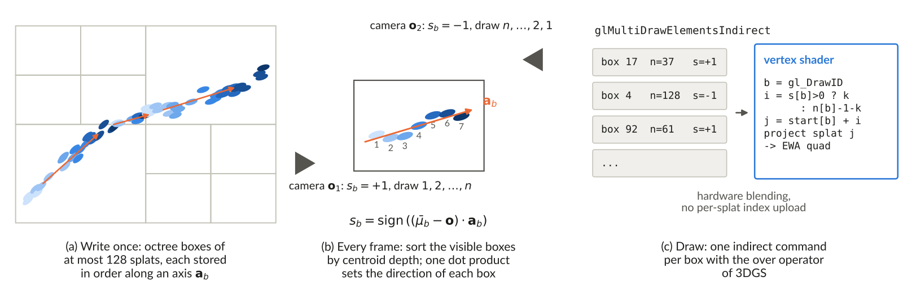
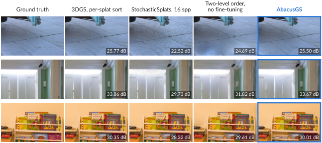
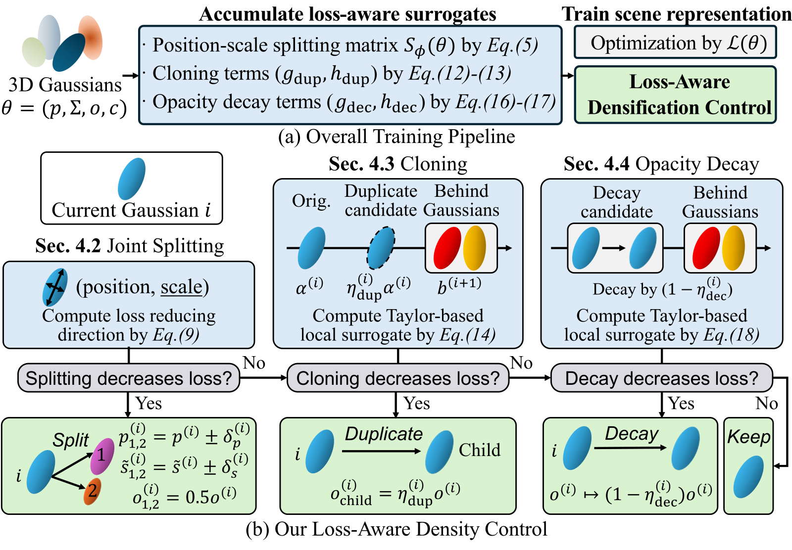
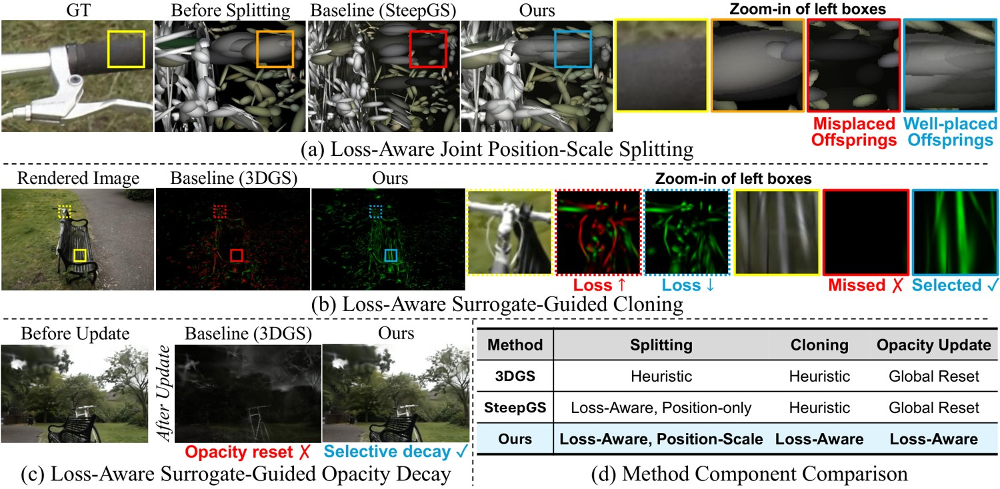

# 2026-11-04 科研日报

## 今日速览

周二公告（11-03）里和主线最贴近的是两篇“把高斯资产本身整理好”的工作，一篇管看，一篇管训。一篇把渲染时每帧都要做的逐高斯深度排序，改成写盘时就排好、运行时只排少量盒子；另一篇把训练中“该在哪里加高斯、该削弱哪些高斯”从经验阈值改成按损失变化来判断。两篇都不涉及材质和光照，但前者决定可重光照资产能不能在网页、手机和 Blender 这类光栅化查看器里流畅打开，后者决定同样的高斯预算能不能落在真正缺细节的地方。

- **必读：[AbacusGS](#2026-11-04--abacusgs)（University of Memphis、National University of Singapore，arXiv 预印本）。** 把场景切成每个最多 128 个高斯的八叉树小盒子，写盘时让每个盒子内部沿一条由训练相机方向算出的轴排好序。每帧只按盒子中心深度排序可见盒子，再用一次点积决定盒内正着读还是倒着读，混合公式保持 3DGS 原样。再做 3000 步按这个顺序的微调，平均 PSNR 只比同样微调过的 3DGS 低 0.13 dB。在 CPU 排序的 OpenGL 查看器里，帧时间从 26.8 ms 降到 6.0 ms。它最值得看的是这个思路：在不换合成算子的前提下，把“顺序”变成资产格式的一部分。
- **选读：[Loss-Aware ADC](#2026-11-04--loss-aware-adc)（Sungkyunkwan University，NeurIPS 2026 已接收）。** 自适应密度控制（ADC）决定训练中复制、分裂、修剪哪些高斯。这篇用二阶泰勒近似分别预测“分裂、复制、降不透明度”三种操作会让损失变化多少，只执行预测能降损失的操作，并用选择性的不透明度衰减取代全局重置。三个标准数据集上 PSNR 最高，高斯数量和 ResGS 相当；代价是训练时间从 32.5 分钟增加到 47.5 分钟。
- **其他：** [神经视角相关颜色场](#2026-11-04--others) 用连续颜色场约束高斯，让几何去承担高频细节；[GaussFlaw](#2026-11-04--others) 给 3DGS 瑕疵做了像素级的八类标注数据集；[GPU 原生纹理网格重建](#2026-11-04--others)（WACV 2027）把多路 RGB-D 的融合、网格化、贴图和接缝曝光校正全部留在 GPU 上；[UA-Depth](#2026-11-04--others) 为透明和反光物体修复深度并输出逐像素不确定度。
- **圈内：** aras-p 发布 Unity Gaussian Splatting 2.0，直接读取 `.ply`/`.spz` 文件，多个场景物体之间也能全局正确排序，还加了一个不需要排序的随机透明渲染选项，正好和 AbacusGS 对照着看；Blender 5.3 今天进入发布候选阶段；微信视觉团队开源 2B/4B 的 WeVisOne-VL；智元在营业中的便利店让 6 台人形机器人连续工作 24 小时。

## 正向渲染效率：把混合顺序写进资产

### AbacusGS · arXiv · 2026-11-01

**一句话判断：** 这篇针对的是硬件光栅化查看器（网页、手机、Blender EEVEE 这类“每个高斯画一个四边形、由 GPU 固定管线混合”的渲染器）里最贵的一步：每帧在 CPU 上对几百万个高斯按深度排序，并上传一份同样长度的索引。它不改 3DGS 的 over 混合公式，只改“按什么顺序混合”，再用一次很短的微调让模型适应新顺序。思路干净，实验对照也做得规矩：每个转换后的模型都配了一个用同样步数继续训练的 3DGS 对照。局限也很明确：加速主要出现在 CPU 排序的场景，在有快速 GPU 基数排序的桌面端收益小得多，而且真实手机还没有测。

- **Title：** AbacusGS: Gaussian Splatting without Per-Splat Sorting
- **作者：** Jiacheng Ding, Yanliang Qi, Cong Guo, Peihua Mai
- **单位：** University of Memphis；National University of Singapore
- **投稿信息：** 未标明（arXiv Comments 仅注明 10 页、5 幅图、6 张表）
- **发表时间：** arXiv 首次挂出 2026-11-01（11-03 公告列入 cs.CV，交叉列入 cs.GR）
- **链接：** [arXiv abs](https://arxiv.org/abs/2611.01534) · [PDF](https://arxiv.org/pdf/2611.01534) · [HTML](https://arxiv.org/html/2611.01534v1)（作者称代码将发布，暂无仓库链接）

**摘要中译：** 3D 高斯泼溅（3DGS）在每一帧都要把所有高斯按深度排序。用硬件光栅化器绘制、在 CPU 上排序的查看器（大多数网页和移动端查看器都是这样）把大部分帧时间花在这次排序上。我们提出 AbacusGS，把 3DGS 场景的混合顺序存进场景的数据布局里。AbacusGS 把高斯分进每个最多 128 个高斯的八叉树盒子，并在写入时把每个盒子沿选定的一条轴排好序。每一帧只对可见盒子排序，每个盒子用一次点积决定正向还是反向读取。一次短暂的、感知顺序的微调就能把现有 3DGS 模型转换过来，3DGS 的 over 算子保持不变。在 13 个标准场景上，AbacusGS 相对同样微调过的 3DGS 模型平均损失 0.13 dB PSNR。在 CPU 排序的 OpenGL 查看器中，AbacusGS 的帧渲染速度是逐高斯排序的 4.5 倍。我们还给出了每个高斯 17 字节的紧凑格式，以及使用同一顺序的 CUDA 分块渲染器。代码将会公开。

*图：原论文 Fig. 2（来源：[arXiv HTML](https://arxiv.org/html/2611.01534v1)）。左边是只做一次的写盘步骤；中间是每帧唯一要做的工作，即对几万个盒子排序、对每个盒子算一个符号；右边说明为什么连索引缓冲都省掉了：每个盒子在内存里是连续一段，着色器拿到盒子编号和方向位就能算出第 k 个实例对应哪个高斯。*

**方法与原理。**

*要解决什么。* 3DGS 的像素颜色是按前后顺序做 alpha 混合：

$$
\mathbf{C}(\mathbf{p})=\sum_{k=1}^{n}\mathbf{c}_{\pi(k)}\,\alpha_{\pi(k)}(\mathbf{p})\prod_{j<k}\bigl(1-\alpha_{\pi(j)}(\mathbf{p})\bigr)
$$

其中 \(\pi\) 是覆盖该像素的高斯的排列，\(\alpha\) 是投影后的二维高斯在像素处的不透明度，乘积项是前面所有高斯留下的透射率。3DGS 用高斯中心沿视线方向的深度 \(z_i=\mathbf{f}\cdot(\boldsymbol{\mu}_i-\mathbf{o})\) 来近似这个顺序，相机一动就要整体重排。CUDA 渲染器用 GPU 基数排序，几百万个键不到 1 毫秒；但网页和手机查看器用的是“每个高斯一个实例四边形 + 硬件混合”，排序放在 CPU 线程里做。论文自己的 OpenGL 查看器中，26.8 ms 的一帧里有 24.1 ms 花在排序上，排完还要上传一份逐高斯的索引缓冲。

已有的绕法有三类，作者逐一说明了代价：复用上一帧的排序结果（仍然是逐高斯更新）；彻底去掉顺序，改用加权和、顺序无关透明或随机透明（换了合成算子，和训练时的算子不一致，随机方法在实时采样数下还有噪声）；按组排序（如 StreamingGS 对体素排序，但体素内部每帧仍要排）。AbacusGS 属于第三类，关键区别是盒内顺序在写盘时就固定下来，运行时只决定方向。

*输入与输出。* 输入是一个已经训练好的 3DGS 模型和它的训练相机位姿。输出是一个按盒子重新排列、盒内带固定顺序的同一套高斯参数（可选再压缩成每个高斯约 17 字节的格式），以及两种渲染器：OpenGL 多重间接绘制渲染器和 CUDA 分块渲染器。

*怎样做（四步）。*

1. **分盒。** 按高斯中心的 48 位 Morton 码（把三维坐标位交错得到的一维编码，空间上相近的点编码也相近）排序，在这些编码上建自适应八叉树；叶子取“最多容纳 \(K=128\) 个高斯的最大节点”，平均每盒约 31 个高斯。每个盒子在内存里占一段连续区间，像稀疏矩阵 CSR 格式里的一行，盒头记录起始偏移、八叉树单元、剔除半径和排序轴。
2. **写盘时定盒内顺序。** 对每个盒子 \(b\)，取所有训练相机指向盒子中心的单位向量 \(\mathbf{v}_{bc}\)，对 \(\sum_c \mathbf{v}_{bc}\mathbf{v}_{bc}^{\top}\) 求主特征向量作为排序轴 \(\mathbf{a}_b\)，再把盒内高斯按 \(\mathbf{a}_b\cdot\boldsymbol{\mu}_i\) 升序存放。用主轴而不是平均方向，是因为 360 度环拍时各方向会互相抵消，平均值没有意义，而主轴仍然稳定。
3. **每帧只做盒子级工作。** 对可见盒子按中心深度 \(\bar z_b\) 排序，再对每个盒子计算 \(s_b=\mathrm{sign}\bigl((\bar{\boldsymbol{\mu}}_b-\mathbf{o})\cdot\mathbf{a}_b\bigr)\)：相机大致沿 \(\mathbf{a}_b\) 看时顺读，反过来看时倒读。于是完整的混合顺序变成两级：盒子之间按深度，盒子内部按预存顺序或其逆序。每帧要排的键从 \(N\) 个高斯降到 \(V\) 个可见盒子，\(V\) 最多约为 \(N/31\)。
4. **按新顺序微调。** 两级顺序在两种情况下与 3DGS 的中心深度顺序不一致：相邻盒子在共享面附近深度区间重叠，以及相机不沿盒子排序轴看时盒内顺序有偏差。作者的处理是不去消除这些误差，而是让模型适应它们：在可微分块光栅化器（gsplat）里把每个高斯的深度键换成 \(\kappa_i=2^{12}\,r(b_i)+\ell_i\)（\(r\) 是盒子名次，\(\ell\) 是盒内位置），前向和反向都用这个顺序，关闭致密化，盒子划分和盒内顺序保持固定（它们是存储格式的一部分），浮点模型训练 3000 步、紧凑模型训练 10000 步。

*为什么这样设计。* 作者解释了两个看起来“更精确”的方案为什么更差。一是八叉树单元本来就有精确的 BSP 遍历顺序，不用排序；但高斯会伸出所在单元，分割面接近平行于视线时，BSP 顺序会先画相邻盒子里更远的高斯，实验中 BSP 顺序微调后的损失（−0.246 dB）明显大于中心深度排序（−0.084 dB）。二是每帧对盒内重新排序（StreamingGS 的做法）质量只好一点（−0.058 dB），但在 CPU 上比逐高斯排序还慢（50.7 ms 对 26.8 ms）。“存一次、只选方向”是在精度和每帧工作量之间取的点；盒子越大，盒内顺序误差越大（\(K\) 从 64 到 256，损失从 −0.112 增加到 −0.186 dB）。

*渲染与压缩。* OpenGL 渲染器对每个可见盒子发一条 `glMultiDrawElementsIndirect` 命令，每条 20 字节，顶点着色器根据 `gl_DrawID` 和方向位把实例号映射成高斯下标，不需要逐高斯索引缓冲。CUDA 渲染器把“分块—高斯”对的全局排序换成“分块—盒子”对的排序。紧凑格式中，位置相对盒子单元用每轴 10 位存储，不透明度、DC 颜色和平均对数尺度各用 8 位，形状（各向异性加旋转）和高阶球谐系数各用一个 16 位索引指向 65536 项的码本，码本用以训练损失为敏感度加权的 k-means 得到。

**结果与局限（作者报告）。** 13 个场景（Mip-NeRF 360、Tanks and Temples、Deep Blending）上，未微调时两级顺序平均损失 1.27 dB，微调后降到 0.13 dB（各数据集为 −0.13、−0.14、−0.08 dB）；紧凑格式损失略大，主要出现在天空、天花板这类平滑区域。随机透明方法 StochasticSplats 要到每像素 1024 次采样才追上，16 和 64 次采样时噪声明显。速度方面（RTX 6000 Ada，13 个场景中位数）：CPU 排序的 OpenGL 查看器帧时间从 26.8 ms 降到 6.0 ms；改用 GPU 排序后两者差距变小（3.8 对 2.6 ms），4K 下有 4 个场景反而略慢；CUDA 渲染器在三种分辨率下都更快（原始分辨率下 1.33 对 0.97 ms，对照组是同样按盒子顺序存储、同样使用紧凑数据的 3DGS 流程）。文件大小从每个高斯 248 字节降到约 19 字节，首帧加载从 293 ms 降到 69 ms。浏览器测试是在无头 Chrome 中把 CPU 限速 4 倍模拟手机，绘制仍在桌面 GPU 上完成，作者明确说没有测真实手机。偏离训练视角 30% 的相机上，两级顺序与逐高斯顺序渲染图的差距中位数和测试视角接近。

**值得关注。** 
- 可重光照高斯资产最终要在光栅化查看器里交付（Blender 5.3 的 EEVEE 实现也是“投影成四边形、从后往前混合”），AbacusGS 说明“顺序”可以作为资产格式的一部分随文件交付。读的时候重点看 3.3 节的两类顺序误差和 4.3 节的消融：如果资产要被重光照、编辑或绑定后再渲染，盒子划分和排序轴是否仍然有效，论文没有讨论，因为它的前提是场景静态、盒子固定。
- 排序轴来自训练相机的分布。对相机分布比较窄的采集（比如只拍了半个球面的物体），4.4 节只测试了 30% 平移，离训练分布更远的视角是否会出现更明显的斑块，值得自己验证。
- 方法与合成算子无关的部分（分盒、两级索引、多重间接绘制）可以直接迁移到带额外属性（法线、材质参数）的高斯上，因为它只改变绘制顺序，不改变每个高斯携带什么数据。

*图：原论文 Fig. 3（来源：[arXiv HTML](https://arxiv.org/html/2611.01534v1)）。第三列是未微调的两级顺序，路面上可以看到斑块；第四列微调后与 3DGS 基本一致；第二列的随机透明在低采样数下带有明显噪声。*

## 训练中的高斯分配：按损失变化做密度控制

### Loss-Aware ADC · NeurIPS 2026 · 2026-11-01

**一句话判断：** 3DGS 训练里“哪些高斯该分裂、复制、削弱”一直靠视空间梯度阈值、尺度阈值和周期性全局不透明度重置这类经验规则。这篇在 SteepGS（只对位置做二阶分析的分裂规则）基础上，把三种操作统一成“先用泰勒展开预测损失变化，再决定做不做、做多大”。推导清楚，消融完整，结果是更少的高斯、更高的 PSNR。代价是训练变慢约 46%，而且 LPIPS 并不占优。

- **Title：** Unified Loss-Aware Density Control for 3D Gaussian Splatting
- **作者：** Tae-Young Kim, Jiwoo Chung, Jae-Pil Heo
- **单位：** Sungkyunkwan University
- **投稿信息：** NeurIPS 2026 已接收（arXiv Comments：Accepted to NeurIPS 2026）
- **发表时间：** arXiv 首次挂出 2026-11-01（11-03 公告，cs.CV）
- **链接：** [arXiv abs](https://arxiv.org/abs/2611.02044) · [PDF](https://arxiv.org/pdf/2611.02044) · [HTML](https://arxiv.org/html/2611.02044v1)（论文中未给出项目页或代码链接）

**摘要中译：** 3D 高斯泼溅的效率和保真度在很大程度上取决于自适应密度控制，它在优化过程中增加和抑制高斯基元。然而，标准流程仍依赖启发式的视空间梯度、尺度阈值和全局不透明度重置，而不是显式评估每次分裂、复制或不透明度更新能降低多少损失。这种错位会把基元分配到已经足够的区域，漏掉重建不足的结构，并因一刀切的不透明度变化让训练不稳定。本文把自适应密度控制重新表述为一组局部的降损失决策。我们推导了高效的、基于泰勒展开的逐高斯代理量，用来预测分裂、复制和不透明度衰减三种基元级操作带来的目标变化。由此得到一个统一的损失感知框架，包含三个部分：第一，把二阶分裂推广到归一化的位置—尺度联合空间，使子高斯不仅调整位置，还能调整各向异性的尺寸；第二，把复制表述为代理最小化问题，只选择复制后预计能改善重建的高斯，并给每个子高斯分配有依据的不透明度；第三，用选择性的软不透明度衰减取代全局不透明度重置，削弱有害的基元，同时保留有用的基元。在标准 3DGS 基准上，本方法的基元分配更有针对性，在相当或更少的高斯预算下取得更好的渲染质量。

*图：原论文 Fig. 2（来源：[arXiv HTML](https://arxiv.org/html/2611.02044v1)）。三种操作按固定优先级串行判断，一个高斯在一次密度控制中至多做一种操作。统计量在正常训练的前向和反向中顺带累积，只在训练时需要。*

**方法与原理。**

*要解决什么。* 标准 3DGS 的密度控制规则是：视空间位置梯度大于阈值的高斯是候选；其中尺度小的复制一份，尺度大的分裂成两个更小的；不透明度低的剪掉，并且每隔一段时间把所有高斯的不透明度压到很低重新学。这些规则都不直接回答“这样做会不会让损失下降”，于是会在已经拟合好的地方继续加高斯，在细结构处反而漏掉，全局重置还会让训练突然变差。SteepGS 已经用二阶信息判断“分裂能否降损失”，但只考虑子高斯的位置偏移，复制和不透明度仍用旧规则。

*输入与输出。* 输入是训练中的一组高斯 \(\theta^{(i)}=(p^{(i)},\Sigma^{(i)},o^{(i)},c^{(i)})\)（中心、协方差、不透明度、颜色）和常规的 L1 加 D-SSIM 光度损失。输出仍是标准 3DGS 模型，推理时不需要任何额外模块。

*怎样做（三个判断，依次进行）。*

1. **位置—尺度联合分裂。** 把分裂变量从位置 \(p\) 扩展为 \(\phi=[p;\log s]\)，对每个高斯累积一个 \(6\times6\) 的“分裂矩阵”：每个像素的损失对该高斯不透明度贡献 \(\alpha^{(i)}(x)\) 的导数，乘以 \(\alpha^{(i)}(x)\) 对 \(\phi\) 的二阶导数，再对训练视角和像素取平均。位置和对数尺度的单位不同，直接求特征向量没有可比性，所以先用 \(J=\mathrm{diag}(L,\tfrac{1}{\sqrt2}I)\)（\(L\) 满足 \(LL^\top=\Sigma\)）把它变换到归一化坐标。取最小特征值 \(\lambda_{\min}\) 及其特征向量：\(\lambda_{\min}\) 为负说明沿这个方向把高斯一分为二能降低损失。只有当高斯的位置和尺度梯度都很小（梯度下降已经推不动它）且 \(\lambda_{\min}\) 低于一个负阈值时才分裂，两个子高斯沿特征向量方向对称偏移位置和对数尺度，不透明度各取一半。这样细把手这类结构上的子高斯既能移到对的位置，也能变细。
2. **按代理量复制。** 把复制看作在原高斯后面紧贴着加一个相同的高斯，其不透明度为原来的 \(\eta\) 倍。这个操作在像素 \(x\) 处带来的变化可以写成 \(\eta\,\Delta_{\mathrm{dup}}(x)\)，其中 \(\Delta_{\mathrm{dup}}\) 由透射率、自身不透明度、自身颜色与身后合成颜色之差决定。于是损失可以展开为

   $$
   \mathcal{L}(\theta\cup\{\mathcal{C}\})\approx\mathcal{L}(\theta)+\eta\,g_{\mathrm{dup}}+\tfrac12\eta^2 h_{\mathrm{dup}}
   $$

   \(g_{\mathrm{dup}}\) 是损失对渲染颜色的梯度与 \(\Delta_{\mathrm{dup}}\) 的内积，\(h_{\mathrm{dup}}\) 是用代理曲率加权的 \(\Delta_{\mathrm{dup}}^2\) 之和。二次函数的最小点是 \(\eta^\ast=-g_{\mathrm{dup}}/h_{\mathrm{dup}}\)。只有 \(g_{\mathrm{dup}}<0\)（复制方向能降损失）且 \(\eta^\ast\) 落在一个小区间内（上限 \(10^{-2}\)，保证泰勒近似仍然可靠）时才复制，子高斯的不透明度就设为 \(\eta^\ast o\)，而不是原样复制一份。
3. **选择性不透明度衰减。** 同样的推导反过来用：把不透明度乘以 \((1-\eta_{\mathrm{dec}})\) 带来的变化是 \(-\eta_{\mathrm{dec}}\Delta(x)\)，展开后求最优衰减强度。只削弱那些“预测减少其贡献会降低损失”的高斯，取代 3DGS 对所有高斯一刀切的重置。

*为什么这样设计。* 作者的论点是：三种操作本质上都是对某个高斯“不透明度贡献”或“位置尺度”的小扰动，因此可以用同一套局部二次模型统一判断，而不必为每种操作调一组经验阈值。二阶分裂之所以只对“几乎不动”的高斯启用，是因为此时一阶梯度已经帮不上忙，负曲率方向是唯一还能降损失的方向（这一点继承自 SteepGS）。论文 Fig. 1(b) 给了一个直接的证据：逐个真实复制候选高斯并测量损失变化，3DGS 的规则同时选中了降损失和升损失的候选，而代理量选中的大多是降损失的。

**结果与局限（作者报告）。** 每个实验重复 5 次。Mip-NeRF 360、Tanks and Temples、Deep Blending 上 PSNR 分别为 27.72、24.20、29.79，都是表中最高；平均高斯数 1.9M、1.0M、1.3M，与 ResGS 相当，约为 3DGS 的 43% 至 56%。但 SSIM 和 LPIPS 并不领先：Mip-NeRF 360 上 LPIPS 为 0.219，明显不如 DC4GS 的 0.189 和 PixelGS 的 0.190。作者把对照设在 ResGS 的“3DGS + 残差分裂”设定下，以隔离方法本身的作用。训练成本（A6000）：时间从 32.5 分钟增加到 47.5 分钟，峰值显存从 9.91 GB 增加到 11.32 GB；高斯更少，渲染帧率从 157 提高到 232。作者列出的局限包括：曲率是对完整目标的近似，偶尔会做出次优决策；代理量逐个高斯独立评估，没有显式建模高斯之间的相互作用；重复的高频纹理仍然难以保留。

**值得关注。** 
- 对逆渲染来说，密度控制决定了几何先验能否在细结构处落地：高斯放错地方，后面的法线和材质分解就无从谈起。可以重点看 4.2 节的归一化变换和附录 A.5 的代理曲率，它们是能直接移植到带法线、材质参数的高斯训练流程里的部分。
- 三种判断都只看光度损失。如果训练目标里加入法线一致性、深度或材质正则，代理量需要把这些项也纳入 \(g\) 和 \(h\)，论文没有覆盖这种情况。
- LPIPS 偏弱和“重复高频纹理难保留”是同一个问题的两面：更省的预算优先保住了 PSNR，感知细节有所损失。如果目标是重光照后的视觉质量，需要自己看局部裁剪而不是只看平均 PSNR。

*图：原论文 Fig. 1（来源：[arXiv HTML](https://arxiv.org/html/2611.02044v1)）。(b) 最能说明问题：经验规则选中的复制候选里混着不少会让损失上升的红色高斯，而代理规则选中的几乎都是绿色的。*

## 本期其他值得一扫（仅据摘要）

- **[3DGS within Self-Learned Neural View-Dependent Color Fields](https://arxiv.org/abs/2611.03114)（arXiv 2026-11-02；Yixiao Yang, Yu-Shen Liu, Zhizhong Han）：** 离散高斯各自带颜色时，常常用颜色本身去“凑”图像细节，导致深度差、漂浮物多。作者让颜色从一个连续的、与视角相关的神经颜色场中查询，并约束其 Lipschitz 连续性（颜色变化大必须对应位置变化大）。神经网络偏好低频，于是高频细节只能交给几何来表达，几何质量随之提高。这和逆渲染里“外观吸收了几何误差”的老问题同源，[代码](https://github.com/yangyixi21/Neural-Color-Fields-3DGS)。
- **[GaussFlaw](https://arxiv.org/abs/2611.02767)（arXiv 2026-11-02；Shaocheng Shen, Xiaoyun Zhang 等）：** 构建了 GaussFlaw-80K：14,289 张 3DGS 渲染图上的 80,049 个瑕疵区域，每个都有像素级掩码和八类标签之一（几何、混合、光度三大类）。在此基础上训练结合 RGB 与深度线索的 GeoCritic 模型来定位和分类瑕疵，并用诊断结果有针对性地做致密化、属性修正和离群点剪枝。它可以作为“看平均 PSNR 之外还坏在哪里”的评测工具。
- **[GPU-Native Real-Time Textured Mesh Reconstruction](https://arxiv.org/abs/2611.03033)（WACV 2027 已接收；Hiroyuki Sato）：** 多路 RGB-D 实时生成带纹理三角网格的体积视频系统。TSDF 融合、Marching Cubes、连通分量去噪、按视角贴图、补洞、接缝处的曝光校正全部留在 GPU 上，中间结果不回传主机。每个面只从一台相机取纹理，跨相机的低频曝光差用逐相机的增益场估计并烘焙进贴图。在 CMU Panoptic 上，最高比 nvblox 和 Open3D 快一个数量级以上。
- **[OctreeSplat](https://arxiv.org/abs/2611.02658)（arXiv 2026-11-02；Yibin Zhao, Jianjun Yi 等）：** 前馈高斯重建，从冻结的视觉基础模型提取多视角特征和几何先验，建分层八叉树并预测致密化分数，按局部复杂度分配高斯密度；用随机实体体渲染改善深度。训练只更新 7600 万参数、35 GPU 小时，并在 Replica、TUM、Tanks and Temples、DTU 上测了视图合成、深度和表面重建。
- **[UA-Depth](https://arxiv.org/abs/2611.01645)（arXiv 2026-11-01；Rui Cao, Yun-Hui Liu 等；作者注明在审）：** 消费级 RGB-D 相机在透明、反光、半透明物体上会出现空洞和有偏深度。UA-Depth 迭代地同时修复深度和逐像素不确定度，用冻结的深度基础模型初始化缺失区域，并在相对深度转度量深度时用稳健的尺度对齐减少离群点影响。在八个数据集的零样本测试中平均排名最好。逐像素不确定度可以直接当作“深度先验可信度”的掩码使用。
- **[SyncHeC](https://arxiv.org/abs/2611.02999)（arXiv 2026-11-02；Zhengdong Hong）：** 用可微渲染加连续时间运动学，从一段 6.5 秒的机械臂运动中同时标定手眼外参和图像与关节读数之间的时间差。平移误差 0.21 cm，延迟误差 2.7 ms；在策略训练和部署中补偿这个时间差后，六类任务的平均成功率提高 8.1 个百分点。
- **[GSExplorer](https://arxiv.org/abs/2611.01543)（arXiv 2026-11-01；Sicheng Yu 等）：** 以一个持续维护的 3DGS 场景作为世界状态：每一步用当前场景的渲染结果作为条件生成视频，再交给 SLAM 后端重建回场景，冲突内容被过滤掉。在 481 帧“离开再回来”的长程探索中，回访一致性较好。

## 圈内新闻与社区反应

**Unity Gaussian Splatting 2.0：直接读文件、全局排序，并加入免排序的随机透明选项（图形学）。** Aras Pranckevičius 于 11-02（UTC，即北京时间 11-02 23:59）发布 [v2.0.0](https://github.com/aras-p/UnityGaussianSplatting/releases/tag/v2.0.0)，项目为 MIT 许可。主要变化有四点：不再需要“先生成 Gaussian 资产”，直接加载 `.ply` 或 `.spz` 文件（支持 zstd 压缩的 SPZ 4），可以从 StreamingAssets、本地路径或 URL 读取；删除了全部编辑工具，作者建议改用 SuperSplat；多个相互交叠的高斯物体现在做全局排序，混合结果正确；新增一个不需要排序的随机透明渲染选项，可以配合简单的时间重投影滤波降噪。作者在说明中写明手上没有 VR/XR 设备，这部分代码可能在重构中出了问题。社区方面，前 OpenCV 开发者 Victor（@verukhimov）在 X 上[转述了这几项变化](https://x.com/verukhimov/status/2117659572798406712)，暂未找到实际使用的反馈。值得关注的原因是：主流引擎插件同时提供“排序混合”和“随机透明”两条路线，正好和 AbacusGS 讨论的问题对应：前者需要每帧排序，后者带噪声，AbacusGS 试图在两者之间找到第三种做法。

**Blender 5.3 进入发布候选阶段（图形学，延续报道）。** 前一期已介绍过原生高斯泼溅的实现。新的进展是：按 [5.3 里程碑](https://projects.blender.org/blender/blender/milestone/34)的计划，11-04 进入发布候选阶段，11-10 正式发布；[渲染部分的发布说明](https://developer.blender.org/docs/release_notes/5.3/rendering/)列出的限制没有变化：只能导入 PLY、SPZ，不能导出；默认按 sRGB 训练的高斯处理，而 Cycles 和 EEVEE 在线性空间计算，低不透明度、高亮区域会有偏差；重光照只是把 Emission 节点换成 BSDF 的初步支持。

**微信视觉团队开源 WeVisOne-VL：一个 2B/4B 模型同时做检测、OCR、分割和抠图（LLM · 视觉）。** 腾讯微信视觉团队在 [GitHub](https://github.com/Tencent/WeVisOne-VL) 和 Hugging Face（[4B](https://huggingface.co/tencent/WeVisOne-VL-4B)、[2B](https://huggingface.co/tencent/WeVisOne-VL-2B)）上发布了这个基于 Qwen3-VL 的视觉语言模型。所有任务都写成结构化文本输出：框和点用坐标 token 表示，目标不存在时直接输出 `None`；需要掩码或 alpha 抠图时，再用一个 9.6M 参数的像素解码器，把对应 token 的隐状态、预测框和 ViT 多层特征融合起来，直接输出全分辨率结果，不需要另接 SAM。官方报告的 4B 拒识率在自建的 WeRef-Bench 上为 96.4%。社区反馈：日本 AI 创作者 @grmchn4ai 在本地[试跑了 2B demo](https://x.com/grmchn4ai/status/2117664792026734854)，从截图里检测指定角色，认为“这个精度能本地跑，有用处”；@gyuforge [提醒](https://x.com/gyuforge/status/2117604962733830184)从本地文件夹加载时要把 `mask_decoder.pt` 和权重放在一起；@dugujun12 [指出](https://x.com/dugujun12/status/2117630111424159804)官方在两套测试上的拒识率分别是 96.4% 和 67.4%，不能只引用前一个数字就说它“不瞎编”。对具身和重建流程来说，一个小模型同时输出框、掩码和“没有目标”的判断，可以直接用作物体级分割的前端。

**智元 6 台人形机器人在营业中的便利店连续工作 24 小时（具身智能）。** 11-02 10:00 至 11-03 10:00，智元让 6 台精灵 G2 在上海徐汇一家正常营业的便利店里分别负责迎宾、取货打包、巡检补货、咖啡、收银出餐和清洁，全程直播（[机器之心发布稿，经新浪转载](https://finance.sina.com.cn/roll/2026-11-03/doc-inixnuin6484585.shtml)、[界面新闻](https://www.jiemian.com/article/15286464.html)）。官方统计累计完成 1730 项任务，最终 4 台通过“转正”考核，负责清洁和补货巡检的两台未通过。调度由智元的具身智能体框架 Genie Master 负责；智元方面介绍，经验层面的总结当天形成、第二天生效，策略层面的更新则依赖数据积累，通常一到两周体现在新版本中。官方也声称“全程无人在环”。目前公开的主要是任务数量；[读特](https://www.dutenews.com/n/article/60125302)的报道指出，门店是否真的能把一个班次交给机器人，还要看热食等待时间、取错后能否自行纠正、一天需要店员接手几次这类运营数据，而这些尚未公布。暂未找到可核实的独立使用者反馈。值得关注的是，这是少见的公开承认部分失败的长时真实场景测试，但成功率和人工接管次数等关键指标还没有披露。

**Flower 发布 Endeavor 1.1（LLM · Agent）。** Flower Labs 11-03 在[官方博客](https://flower.ai/blog/2026-11-03-introducing-endeavor-1.1)发布 Endeavor 1.1，主打可以私有云或本地部署、提供可读的推理过程、模型输出归用户所有并可用于训练自有模型，新增图像输入和欧盟境内推理。官方称推理和编程能力较 1.0 提升（如 GPQA 从 92.0 到 94.4），并称综合指标超过 OpenAI 和 Anthropic 的主流产品，这些都是厂商自报数字。暂未找到可核实的社区反馈。

## 覆盖说明

日报发布日为 **2026-11-04（周三）**，内容覆盖日为 2026-11-03（周二）arXiv 公告，包括 cs.GR 新提交与交叉列表，以及 cs.CV、cs.RO 中按关键词筛出的条目。正文两篇为 AbacusGS（2611.01534）与 Loss-Aware ADC（2611.02044），均核对了 arXiv HTML 全文的方法、实验与局限，配图为原论文插图（矢量图按原图转为位图）。其余七篇仅据摘要。所有实验数字均为作者报告，未独立复现。本期没有直接涉及材质分解或重光照的新论文。圈内新闻核对了 GitHub 发布页、Blender 里程碑与发布说明、腾讯官方仓库与模型页、Flower 官方博客以及机器之心、界面新闻、读特的报道；社区反馈来自 X 上的公开帖子。

**编写：** Cream
