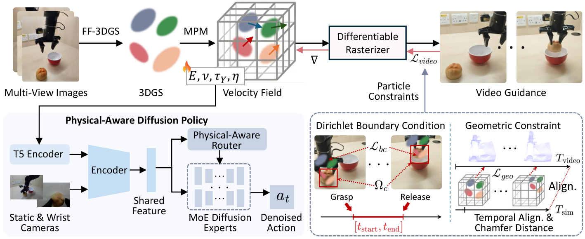
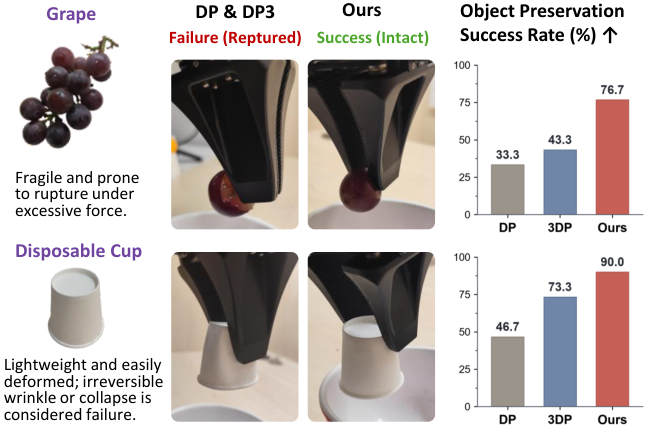
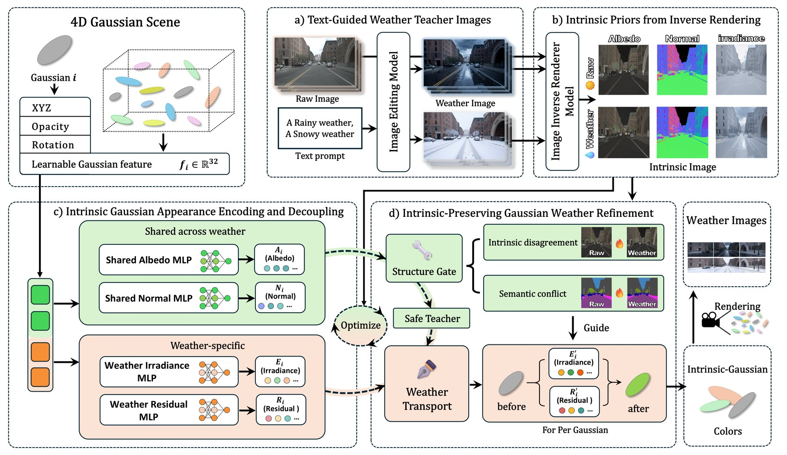
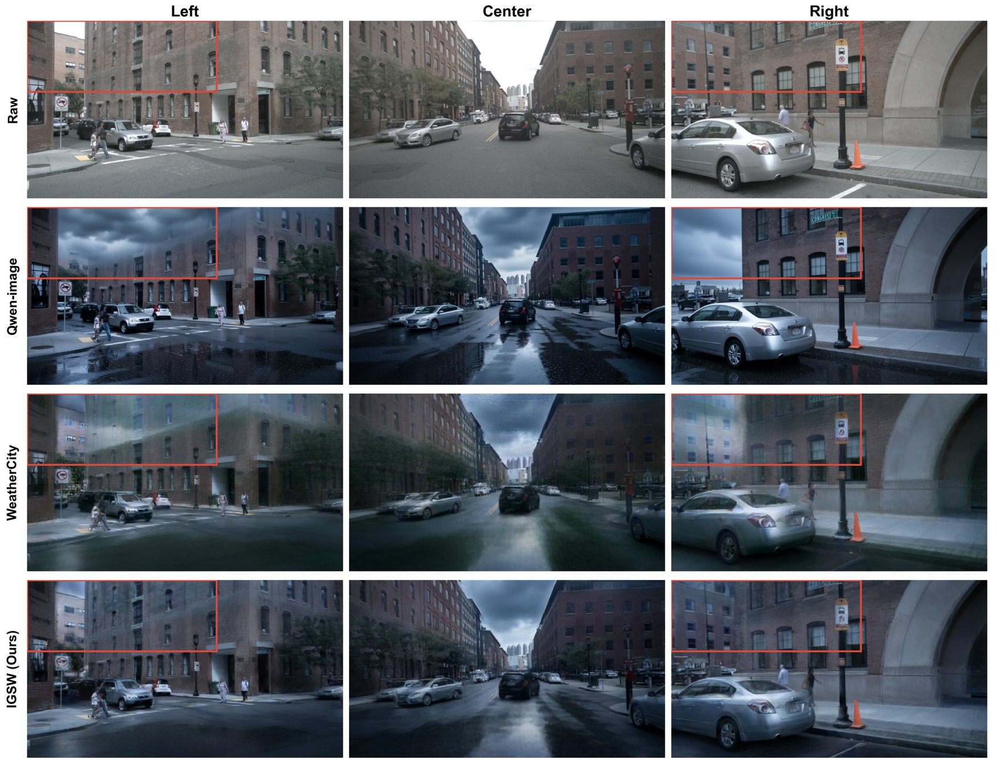

# 2026-11-05 科研日报

## 今日速览

周三公告（11-04）里最值得花时间的是两篇“把物理和材质从图像里拆出来再用”的工作。一篇把前馈 3DGS 和可微 MPM（物质点法）绑在一起，从一段机械臂操作视频里反推物体的杨氏模量、屈服应力和黏度，再把这些参数作为条件喂给扩散策略；另一篇把自动驾驶 4D 高斯场景的外观拆成跨天气共享的反照率、法线和随天气变化的辐照度，用来做雨雪编辑。前者是可编辑动态资产走向“能被机器人用”的一步，后者是逆渲染先验在大场景里的一个务实用法。两篇的共同短板也一样：物理参数和本征图都来自有偏的先验（VLM 初值、扩散逆渲染器），论文只证明了“比不拆好”，还没有证明“拆得对”。

- **必读：[Physical Diffusion Policy](#2026-11-05--physical-diffusion-policy)（香港大学，arXiv 预印本）。** 每个高斯一一绑定一个 MPM 粒子，用视频渲染损失、Chamfer 几何约束和夹爪接触区的狄利克雷边界约束，反传到四个本构参数上；参数再送进一个按“弹性、泡沫、塑性、刚性”四个专家组成的 MoE 扩散策略。真机抓放成功率从 DP3 的平均约 42% 提到约 62%，弹簧、牙膏管、长面包这类可变形物体提升最大。部署时不在线优化，而是用 DINOv2 特征查“物理记忆库”，单次约 0.4 秒。值得读的是 IV-A/IV-B 的“高斯—粒子绑定 + 约束设计”，以及它没回答的问题：记忆库检索本质上是在找见过的同类物体。
- **选读：[IGSW](#2026-11-05--igsw)（重庆大学，arXiv 预印本）。** 用 Qwen-Image 生成雨雪“老师图”，用 IntrinsicWeather 的扩散逆渲染器给原图和老师图各估一套反照率、法线、辐照度，再让 4D 高斯的每个基元解码出“共享反照率/法线 + 按天气分开的辐照度/残差”。第二阶段用语义冲突和本征差异做一个“结构保护门”，挡住老师图里把楼盖成云这类错误。nuScenes 上语义一致性 Sem-CS 从最好基线的 0.71 提到 0.90。可以把它当作“扩散逆渲染先验 + 高斯本征分解”在室外动态场景的参考实现来看。
- **其他：** [FlowRig](#2026-11-05--others) 用流匹配一次前馈为整段 4D 网格序列生成时间对齐的骨架，和拆分绑定直接相关；[3D World Simulator](#2026-11-05--others) 用粒子—体素混合潜变量做 50 Hz 的动作条件 3D 世界模型，能同时预测外观、几何和触觉；[Phase-DGS](#2026-11-05--others)（NeurIPS 2026）用“运动相位”代替时间戳，让不同步多机位也能训动态高斯；[SettleSplat](#2026-11-05--others)（WACV 2027）处理“物体被当着相机挪走又放下”的在线高斯建图。
- **圈内：** Radiance Fields 月报汇总 10 月动态，最值得注意的是 Rivian 收购高斯泼溅驾驶仿真公司 Third Dimension AI、Isaac Sim 6.2.0 默认开启 NuRec 场景的高斯深度和反照率、Niantic 发布带碰撞网格的 100 个高斯场景库；优必选发布以 Real2Sim2Real 为核心、底层用自研 Thinker-GS 重建的仿真平台；招商局狮子山实验室开源 35B 总参、约 3B 激活的具身推理 VLM；索尼 XYN 高斯采集方案对北美个人创作者开放订阅。

## 可编辑动态资产：从操作视频反推材质，再用来调策略

### Physical Diffusion Policy · arXiv · 2026-11-03

**一句话判断：** “3DGS + MPM”此前主要用在图形学里做物理动画（PhysGaussian 一类，材质参数手设），这篇把方向反过来：从真实操作视频里估材质参数，并且把估计结果真正接到机器人策略上，给出了“参数估得越偏，成功率掉得越多”的敏感性曲线。这条链路对“可编辑动态资产要服务具身”很有说服力。但要清醒看待几点：参数估计精度只在仿真物体上有真值；真机部署靠的是对已建库物体的视觉检索，对新材质的泛化没有被测试；消融表少了文中提到的“去掉边界约束”一行。

- **Title：** Physical Diffusion Policy via MPM-Guided 3D Gaussian Simulation
- **作者：** Can Wang, Qiyuan Qiao, Lei Liu, Ge Yuan, Xinhui Liu, Dong Xu（通讯作者）
- **单位：** 香港大学
- **投稿信息：** 未标明（arXiv Comments 仅注明 10 页）
- **发表时间：** arXiv 首次挂出 2026-11-03（11-04 公告，cs.RO）
- **链接：** [arXiv abs](https://arxiv.org/abs/2611.04493) · [PDF](https://arxiv.org/pdf/2611.04493) · [HTML](https://arxiv.org/html/2611.04493v1)（论文中未给出项目页或代码链接）

**摘要中译：** 为各种日常物体学习稳健的操作策略仍然困难，因为不同材质的物体有截然不同的形变和接触动力学。扩散策略为建模多模态操作行为提供了强大的框架，但通常缺乏显式的物理推理，面对异质物体时可能产生“平均化”的动作。我们提出一种物理感知的扩散策略，用对物体物理性质的理解来增强视觉模仿学习。框架把 3D 高斯泼溅与可微物质点法（MPM）仿真耦合，通过视频引导和粒子级约束，从视觉示教中恢复材质属性，实现准确的物理参数估计。估计出的物理条件进一步整合进一个材质感知的混合专家（MoE）扩散策略，使其能在不同物理区间自适应地生成行为。为了实际部署，我们引入物理记忆库，无需在线仿真优化即可高效检索物理参数。在大量仿真和真实物体上的实验表明，该方法相比现有基于扩散的方法提高了操作成功率和泛化性。结果说明，引入物理知识对于在多样环境中实现可扩展的机器人操作至关重要。

*图：原论文 Fig. 1（来源：[arXiv HTML](https://arxiv.org/html/2611.04493v1)）。左半部分是离线的“物理参数估计”，右半部分是带物理条件的扩散策略训练；部署时左半部分被记忆库检索替代。*

**方法与原理。**

*要解决什么。* 同一个“抓起来放过去”的任务，对网球、弹簧、葡萄和纸杯需要完全不同的抓取力度和轨迹。普通扩散策略只看图像，面对外观相近、材质不同的物体，容易把几类示教的动作平均掉。作者的思路是给策略一个显式的“这东西有多软、多黏、多容易永久变形”的条件，而这个条件要从视觉里估出来。

*输入与输出。* 估计阶段的输入是对场景绕半球拍的一段视频（均匀取 64 帧）和一段固定视角的单目操作示教视频；输出是物体的四个本构参数 \(\boldsymbol\theta=\{E,\nu,\tau_Y,\eta\}\)（杨氏模量、泊松比、屈服应力、黏度）。策略阶段的输入是语言指令、桌面相机和腕部相机图像、7 维机器人状态和 \(\boldsymbol\theta\)，输出 8 维末端目标位姿与夹爪指令。

*怎样做。*

1. **高斯—粒子一一绑定。** 用 ZFormer 前馈 3DGS 从多视角图像重建物体高斯，每个高斯对应一个 MPM 粒子。仿真中高斯中心跟随粒子位置 \(\boldsymbol\mu_k^t=\mathbf x_k^t\)，协方差按形变梯度的极分解 \(\mathbf F_k^t=\mathbf R_k^t\mathbf S_k^t\) 只做旋转更新 \(\boldsymbol\Sigma_k^t=\mathbf R_k^t\boldsymbol\Sigma_k^0(\mathbf R_k^t)^\top\)。于是仿真每一步都能可微渲染，图像损失的梯度能一路传回材质参数。
2. **有约束的反演。** 先让 VLM 按物体类别给一个粗略初值，再按材质类别（弹性体、金属、橡皮泥等）设定每个参数的上下界，初始化后和每次梯度更新后都裁剪回区间内。目标函数是

   $$
   \mathcal L=\mathcal L_{video}+\lambda_{bc}\mathcal L_{bc}+\lambda_{geo}\mathcal L_{geo}
   $$

   \(\mathcal L_{video}\) 用一个视频引导模型比较仿真渲染序列与示教视频（两者帧对应未知，所以不是逐像素比较）；\(\mathcal L_{geo}\) 是仿真粒子与 DA3 深度估计得到的观测几何之间逐帧的 Chamfer 距离；\(\mathcal L_{bc}\) 把夹爪接触区内的粒子在抓取期间约束到夹爪轨迹上，释放后取消。仿真步长和视频帧率之间用一个分段数公式做时间对齐。MPM 网格 \(100^3\)，每段取 8 个关键帧，优化 30 轮。
3. **材质感知 MoE 扩散策略。** 四个专家分别对应弹性、泡沫、塑性、刚性，先各自只用对应材质的示教预训练，再加入一个以“物理参数 + 视觉”联合特征为输入的路由器，联合微调。最终噪声预测是四个专家输出按路由权重的加权和。
4. **物理记忆库。** 每个物体存一组（桌面相机 DINOv2 特征、腕部相机 DINOv2 特征、估好的 \(\boldsymbol\theta\)）。测试时用两路余弦相似度按 0.6:0.4 加权检索最近条目，直接取它的参数。

*为什么这样设计。* 作者的三个设计选择都有消融支撑：去掉 VLM 初值误差最大（平均 log-MAE 从 0.565 升到 1.257），说明纯靠渲染损失从零反演四个跨数量级的参数基本不可行；去掉区间约束或几何约束也都变差。策略侧，单一策略加物理条件已经把真机平均成功率从 28.9% 提到 49.4%，再加预训练专家和路由器到 62.5%，说明大头收益来自“有物理条件”，MoE 是在此基础上进一步避免动作平均。

**结果与局限（作者报告）。** 仿真在 Isaac Lab 里做，每任务 120 次；真机每任务 30 次，示教 100 条（PS5 手柄遥操作），物体包括硬糖、面包、毛绒玩具、海绵、乒乓球、纸巾包、牙膏管、香蕉、葡萄、弹簧、羽毛球、纸杯等。真机抓放四类材质平均成功率：DP 约 25–34%，DP3 约 30–49%，本文 56–70%；单物体上弹簧从 6.7%（DP3）到 60.0%，牙膏管从 16.7% 到 63.3%，硬糖从 30.0% 到 70.0%。完好率实验中，本文在葡萄不破、纸杯不变形的比例上最高。物理参数估计只在仿真物体上和真值比较。部署时在线优化单次 798 秒，记忆库检索约 0.41 秒，库从 15 条扩到 200 条，真机成功率从 59.2% 小幅降到 57.4%。检索精度表是“域内”设置，即查询物体在库里有对应条目。论文没有单列局限性小节。

**值得关注。**
- 对“可编辑动态资产”这条线，这篇最可复用的是高斯与粒子一一绑定、协方差只随旋转更新的做法，以及三类约束的组合。协方差不随拉伸变形，意味着大变形时外观会失真；如果要拿它做资产，值得自己检查 Fig. 1 之外的长时形变渲染。
- 记忆库检索在库中物体上几乎等于“认出这个物体”，所以对没见过的材质，策略拿到的是最相似已知物体的参数。真正的新材质泛化仍需要在线反演，而那要 13 分钟。这是从论文到实际部署之间最大的缺口。
- 消费级硬件友好度：策略在单张 A100 上训练，估计阶段 \(100^3\) 网格 MPM 加前馈 3DGS 也不算重，复现门槛主要在真机示教和多视角采集，而不在算力。

*图：原论文 Fig. 3（来源：[arXiv HTML](https://arxiv.org/html/2611.04493v1)）。只有物体完好（葡萄不破、纸杯不发生不可逆变形）才算成功。这张图比平均成功率更能说明“知道材质”带来的差别：动作变得更柔和，而不只是抓得更准。*

## 逆渲染先验落到大场景：本征解耦的多天气 4D 高斯

### IGSW · arXiv · 2026-11-03

**一句话判断：** 这是一篇面向自动驾驶数据增强的天气编辑工作，但它的核心结构是“扩散逆渲染器给出逐帧本征图，高斯在 3D 中把它们统一起来”，这正是逆渲染里用材质/几何先验约束高斯的典型做法。设计朴素、实验对照充分，对“本征图不可靠时怎么用”的处理（只做特征级软监督、只在语义冲突附近信任本征差异）值得借鉴。局限是：光照模型只有“反照率 × 辐照度 + 残差”，没有显式的光源或 BRDF；评价全是 CLIP 和语义一致性这类间接指标，没有本征分解本身的精度评估。

- **Title：** IGSW: Multi-Weather Urban Scene Reconstruction with Intrinsic-Decoupled Gaussian Splatting
- **作者：** Zhongquan Wang, Long Cao, Peijia Xie, Senlei Ma, Jie Li, Guofa Li（通讯作者）
- **单位：** 重庆大学机械与运载工程学院
- **投稿信息：** 投稿信息未标明
- **发表时间：** arXiv 首次挂出 2026-11-03（11-04 公告，cs.CV）
- **链接：** [arXiv abs](https://arxiv.org/abs/2611.04374) · [PDF](https://arxiv.org/pdf/2611.04374) · [HTML](https://arxiv.org/html/2611.04374v1)（论文中未给出项目页或代码链接）

**摘要中译：** 对 4D 场景进行高保真的天气编辑，可以支持自动驾驶的端到端训练和闭环仿真。把生成式图像编辑与动态高斯表示结合起来可以实现多天气场景重建，但经过天气编辑的图像常常带有结构畸变。直接拟合这些图像的外观，可能把老师图中的错误传播到重建的 4D 场景里，破坏原有场景结构和时间连续性。为此我们提出 IGSW，一个两阶段框架，结合本征解耦的 4D 高斯场景建模与保结构的天气细化。第一阶段，背景高斯的外观被分解为跨天气共享的反照率和法线，以及随天气变化的辐照度和残差。由扩散图像编辑模型生成的天气老师图，以及由扩散逆渲染器估计的本征图，为稳定的结构和光照变化提供特征级的软监督。第二阶段，一个结构保护门结合语义冲突和跨天气的本征差异，抑制不可靠的老师区域；逐高斯的天气传输变量和目标天气分支则在本征解耦的场景上强化所需的天气外观。在 nuScenes 和 Waymo 上的实验表明，IGSW 在所比较的方法中取得了最高的内容相似度和语义一致性，以及最低的时间误差。

*图：原论文 Fig. 2（来源：[arXiv HTML](https://arxiv.org/html/2611.04374v1)）。关键在 (c)：反照率和法线的解码头不接收天气条件，同一个高斯在晴天和雨雪下共用同一套材质与几何；只有辐照度和残差按天气分支。*

**方法与原理。**

*要解决什么。* 用图像编辑模型逐帧把晴天改成雨雪，再拿这些图去训 4D 高斯，会把编辑模型的错误（比如云层盖住楼、路面纹理漂移）一起学进去，而且逐帧编辑没有跨帧、跨视角约束，时序会闪。作者希望“天气只改光照和氛围，不改场景里有什么”。

*输入与输出。* 输入是标定好的多视角驾驶序列（每场景 100 个时间戳、三个前向相机），以及对应的雨或雪老师图和两套本征图。输出是一个能渲染原天气和目标天气的动态高斯场景。

*怎样做。*

1. **本征先验。** 用 IntrinsicWeather 中基于 Stable Diffusion 3.5 的逆渲染器，分别分解原图和老师图，得到反照率 \(\tilde A\)、法线 \(\tilde N\)、辐照度 \(\tilde E\)。原图的 \(\tilde A^o,\tilde N^o\) 作为“跨天气不变”的参考，\(\tilde E^o,\tilde E^w\) 这一对描述光照应该怎么变。
2. **本征解耦高斯。** 每个背景高斯带一个 32 维外观特征 \(f_i\)，由共享解码头得到反照率 \(A_i\) 和法线 \(N_i\)，由按天气 \(x\in\{o,w\}\) 分开的解码头得到辐照度 \(E_i^x\) 和残差 \(R_i^x\)，颜色为

   $$
   c_i^x=\mathrm{clip}_{[0,1]}\bigl(A_i\odot E_i^x+\lambda_R R_i^x\bigr)
   $$

   本征图只作“特征级”监督：一个固定的轻量编码器提取平均池化颜色和 Sobel 边缘，比较余弦距离，而不是逐像素回归，以容忍扩散逆渲染器的错位和数值误差。
3. **结构保护门。** 用 UPerNet–ConvNeXt-XL 对原图和老师图做语义分割，墙、建筑、道路、人行道、行人、车辆等受保护类别发生类别变化的像素记为冲突；再在冲突附近计算反照率差和法线夹角组成的本征差异 \(D(p)\)，超过阈值的才算不可靠。门值大的区域，用“原图内容 + 按语义类别迁移老师图颜色统计”的安全目标替代老师图。
4. **逐高斯天气传输。** 第二阶段冻结反照率和法线，给每个背景高斯加两个标量：\(E_i^{w\prime}=E_i^w\exp(2\tanh u_i^w)\) 调辐照度增益，\(R_i^{w\prime}=R_i^w+2\tanh(v_i^w)\mathbf 1_3\) 调残差。它们挂在高斯上，所以看到同一个高斯的所有视角共享同一个天气调整，而不是每张图各自修色。

*为什么这样设计。* 只在语义冲突附近才信任本征差异，是因为扩散逆渲染器的本征图本身就有噪声，全局用它判断会误伤正常的天气变化（比如雨天路面反照率看起来确实变了）。传输变量只用两个无色标量，是刻意限制自由度，防止第二阶段又把老师图的错误颜色学回来。

**结果与局限（作者报告）。** 在 nuScenes 十个场景和 Waymo 上与 Qwen-Image、FRESCO、IntrinsicWeather、WeatherEdit、WeatherCity 比较，第一阶段训练 30,000 步，第二阶段 800 步恢复加 3,000 步天气细化，单张 RTX 4080。nuScenes 雨天：CLIP-S 0.872（WeatherCity 0.858），语义一致性 Sem-CS 0.899（WeatherCity 0.713），时序误差 \(E_{warp}\) 0.0021（WeatherCity 0.0023）；但 CLIP-DS（天气变化方向与文本方向的对齐度）0.160，低于 Qwen-Image 的 0.209，说明“天气味”比直接编辑弱一些。雪天的 Sem-CS 从 0.684 提到 0.879。所有指标都是 CLIP、语义分割和光流的间接度量，没有用户研究，也没有评估本征分解本身。

**值得关注。**
- 对逆渲染方向，最值得借鉴的是 III-E 的“特征级本征约束”：扩散逆渲染器输出的反照率和法线拿来当软先验，而不是当真值，这对材质分解中“先验有偏”的老问题是一个便宜的折中。
- “反照率 × 辐照度 + 残差”没有光源和 BRDF，残差项会吸收高光、湿路面反射这类效果。如果想把它扩展到可重光照，需要关注残差 \(\lambda_R R\) 在雨天占了多大比例，论文没有给出这个分析。
- 前景车辆和行人不参与本征解耦（方法只对背景高斯做分解），雨雪下的车辆外观仍靠老师图拟合。

*图：原论文 Fig. 6（来源：[arXiv HTML](https://arxiv.org/html/2611.04374v1)）。老师图里云层错误地盖住了可见的建筑，直接拟合老师图的方法会把这个错误带进 3D 场景；IGSW 的结构保护门把这些区域换成“原图内容 + 雨天色调”。*

## 本期其他值得一扫（仅据摘要）

- **[FlowRig](https://arxiv.org/abs/2611.03775)（arXiv 2026-11-02；Fengzhi Guo, Nate Morrill, Shiqi Li, Cheng Zhang；[项目页](https://tamu-visual-ai.github.io/FlowRig/)）：** 静态 3D 自动绑骨方法逐帧用在动态网格上会时序不稳，4D 方法又要逐序列优化。这篇用流匹配一次前馈为整段网格序列生成时间对齐的骨架，同时支持单网格绑骨、指定骨骼数量、不确定度估计，以及基于掩码的插值和前后预测。训练上先用大规模 3D 绑骨数据初始化，再迁移到中等规模的 4D 网格—骨架数据。注意摘要正文里方法名写作 MoTWorld，与标题不一致。对“拆分绑定、可编辑动态资产”这条线，它提供了一个前馈的骨架先验，可以和动态高斯的运动分解对照着看。
- **[3D World Simulator（Hybrid Particle-Voxel Dynamics）](https://arxiv.org/abs/2611.04492)（arXiv 2026-11-03；Jimmy Wang, Yifan Chou, Kaifeng Zhang, Yixuan Wang, Binghao Huang 等）：** 动作条件的世界模型，不在 2D 视频空间预测，而是把点云压成粒子—体素混合的 3D 潜变量，再预测它在动作下的演化，可从任意视角渲染，并能对齐触觉信号。作者报告 50 Hz 交互式长程预测，并用它为策略生成多视角和腕部视角的训练与评测数据。它和必读那篇是两条路线：一条显式估材质参数再进物理仿真，一条直接学 3D 潜空间动力学。
- **[Phase-DGS](https://arxiv.org/abs/2611.04666)（NeurIPS 2026 已接收；Hosung Jeon, Jaesik Park 等；[项目页](https://oc-dev74.github.io/Phase-DGS/)）：** 动态高斯默认所有相机严格同步。这篇用“该帧处于运动周期的哪个阶段”这一语义相位代替时间戳，不同相机、不同时刻拍到同一运动状态的帧共享同一相位，从而建立时空对应。在时间偏移、丢帧、相机卡顿下最多提升 8.5 dB PSNR，可接入 RealTime-4DGS 和 FreeTimeGS。前提是运动有周期性，对一次性动作是否适用要看正文。
- **[SettleSplat](https://arxiv.org/abs/2611.04195)（WACV 2027 已接收；Anh Thuan Tran, Jana Kosecka 等）：** 单目在线高斯建图中，物体在相机前被拿起、移动、放下：移动时是干扰物，放下后又是持久变化。作者把逐像素不确定度提升为高斯的“动态度”场来剪除瞬时高斯，再用按渲染深度不确定度加权的几何矛盾来区分真实变化和欠优化区域。对机器人操作过程中的场景维护直接有用。
- **[PrimeSim](https://arxiv.org/abs/2611.04870)（arXiv 2026-11-03；Travis Davies, Wentao Ma 等）：** 从预训练视频生成模型出发，在 22 个平台、30,110 小时机器人示教上中期训练，用统一的跨本体动作表示和带相机身份的视角交错注意力保持多视角一致，再转成自回归模拟器，10.1 FPS，迁移到未见平台只需 100 到 200 步梯度更新。
- **[3DGS-VBench+](https://arxiv.org/abs/2611.04498)（arXiv 2026-11-03；Yuke Xing, Guangtao Zhai, Yiling Xu 等）：** 3,036 个压缩后 3DGS 重建的渲染视频，9,108 条主观评分，分整体、几何、颜色三个维度，并提出可在有少量参考或无参考时打分的多模态评估模型。可与昨天的 GaussFlaw 一起作为“平均 PSNR 之外”的评测工具备查。

## 圈内新闻与社区反应

**Radiance Fields 十月月报：高斯泼溅正在变成仿真和影视的基础设施（图形学 · 具身）。** Radiance Fields 通讯的 [Gaussian Splatting in October 2026](https://radiancefields.substack.com/p/gaussian-splatting-in-october-2026) 汇总了 10 月动态，几条和课题直接相关。其一，Rivian 于 10-22 宣布收购 Third Dimension AI，其产品 SuperSim 用高斯泼溅和世界模型从客户车辆的传感器日志重建驾驶场景、渲染新视角并插入原本不存在的物体，团队约 15 人并入 Rivian 自动驾驶组，交易金额未披露。其二，Isaac Sim 6.2.0 对 NuRec 场景默认开启高斯深度和反照率输出；Niantic Spatial 发布 Places Library，100 个真实环境以“高斯 + 碰撞网格”形式提供给 Isaac Sim 使用。其三，影视侧 Framestore 公开了《超人》氪星全息影像的 4D 高斯流程（192 台相机、24 fps、每帧约 160 万个高斯，约 5 TB 数据），并明确提到当时 Houdini 不原生支持高斯、没有重光照，只能围绕这些缺口搭流程；10 月内 Arnold for Maya 5.6.4 已允许任意着色器驱动高斯，Unreal Engine 5 也有了第三方重光照插件。其四，World Labs 发布实验性 WebGPU 渲染器 Spark Radix，在 GPU 上对所有物体的高斯统一排序、一次绘制完成，官方称比 Spark 快 1.37 倍，并直说尚不支持 LoD 和蒙皮。值得关注的判断是：“高斯 + 碰撞网格”正在成为仿真平台的标准交付格式，而可重光照和蒙皮仍是生产流程里公认的缺口，这正是拆分绑定和逆渲染两条线的落点。月报内容为作者汇总，各条细节以原始公告为准。

**优必选发布 Thinker-Sim 具身仿真平台（具身智能）。** 11-02 发布，主打 Real2Sim2Real：用自研 Thinker-GS 高保真重建算法从真实工厂、展厅采集重建场景，再自动生成 SimReady 资产（低模拓扑优化、视觉材质生成、碰撞体自动配置），叠加光照、纹理、材质等多维随机化做评测（[新浪科技](https://finance.sina.com.cn/tech/shenji/2026-11-02/doc-inixicic0524615.shtml)、[IT之家](https://www.ithome.com/1/020/888.htm)）。官方称渲染效率提升 67.3%，单节点 8 卡日均合成 390 小时仿真数据，可用自然语言通过 Ulab-Agent 编排任务；这些都是厂商自报数字，“提升”的对照基线未说明，Thinker-GS 也没有公开论文或代码。暂未找到可核实的独立使用反馈。和必读论文对照来看，工业平台目前解决的是“外观像 + 有碰撞体”，材质的物理参数仍主要靠随机化，而不是从数据里估。

**招商局狮子山实验室开源具身推理 VLM「驭物 Lion-ER-35B-A3B」（具身智能 · LLM）。** 据[量子位](https://www.qbitai.com/2026/11/507586.html)报道，模型为 MoE 结构，总参数约 35B，每 token 激活约 3B，权重已在 [Hugging Face](https://huggingface.co/cmriat/lion-ER-35B-A3B) 开源。团队把具身推理拆成实体、空间、时序、物理、可供性、任务、社会、证据 8 个一级领域、39 项二级能力，按能力缺口分配训练预算，监督数据 312,380 条。官方报告十项公开基准相对基座全部提升，如 Where2Place 64.28（+9.30）、ERQA 64.38（+6.19），以每题作答 4 次取平均计分。值得关注的是“按能力蓝图配数据、用评测失败驱动下一批数据”的方法论，比分数本身更可借鉴；分数为团队自报，暂未见独立复现。

**索尼 XYN 高斯采集方案对北美个人创作者开放（图形学）。** 据 [Tech Times](https://www.techtimes.com/articles/329998/20261103/sony-xyn-brings-real-time-gaussian-splatting-us-virtual-production-stages.htm) 报道，索尼面向 LED 虚拟制片的云端高斯泼溅流程 XYN Spatial Capture，此前只通过企业账户提供，现在美国和加拿大的个人创作者与小工作室可以按月 20 美元自助订阅。这说明高斯重建正在从研究工具变成按月付费的标准服务。

**乌镇峰会具身智能论坛：从“表演”转向“上班”（具身智能）。** 11-04 世界互联网大会乌镇峰会机器人与具身智能论坛上，墨奇智能 CTO 黄青虬提出“十万小时高精度数据远远优于一千万小时低质量数据”，坚持让酒店、公寓的一线保洁人员佩戴采集设备记录真实作业（[新京报](https://www.bjnews.com.cn/detail/1793793543129237.html)、[光明网](https://politics.gmw.cn/2026-11/04/content_39085671.htm)）；蚂蚁灵波展示了与国大药房合作的药房配药机器人，称已在多家上海门店运行。这和昨天智元便利店测试的结论一致：行业关注点已从演示动作转向真实场景下的长程任务完成率和数据回流。

## 覆盖说明

日报发布日为 **2026-11-05（周四）**，内容覆盖日为 2026-11-04（周三）arXiv 公告，包括 cs.GR 新提交与交叉列表，以及 cs.CV、cs.RO 中按关键词筛出的条目。正文两篇为 Physical Diffusion Policy（2611.04493）与 IGSW（2611.04374），均核对了 arXiv HTML 全文的方法、实验与表格，配图为原论文插图。其余六篇仅据摘要。所有实验数字均为作者报告，未独立复现。本期没有直接涉及正向渲染效率的新论文。Blender 5.3 仍处于发布候选阶段（按里程碑计划 11-10 正式发布），渲染发布说明中的 Gaussian Splats 小节仍在，本期不再重复介绍。圈内新闻核对了 Radiance Fields 月报、新浪科技与 IT 之家的优必选发布报道、量子位报道与 Hugging Face 模型页、Tech Times 报道，以及新京报、光明网的乌镇论坛报道。

**编写：** Cream
