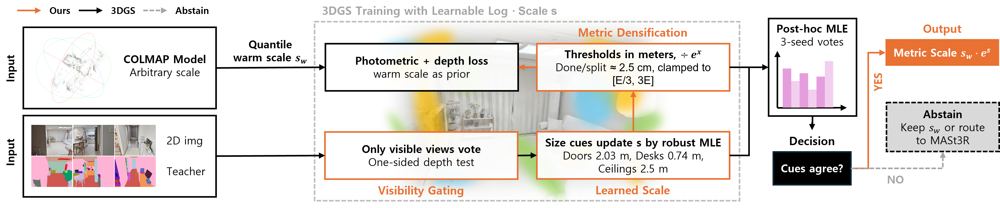
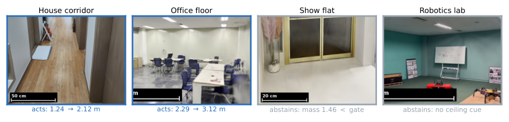
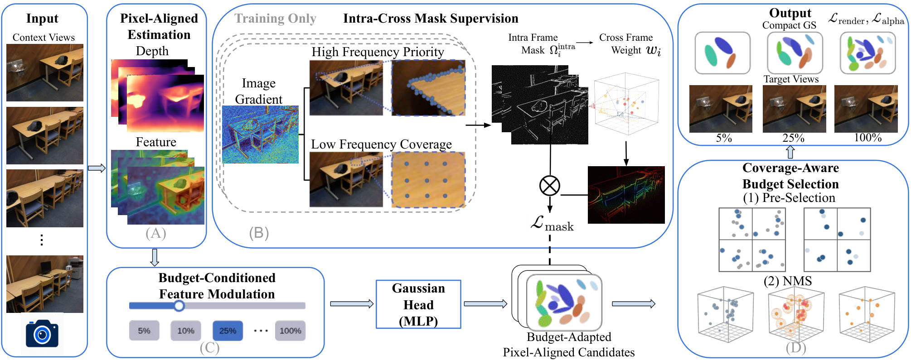
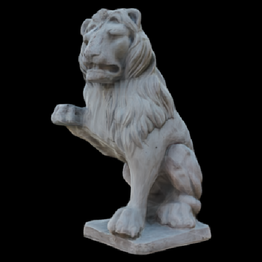
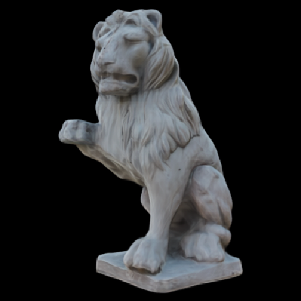
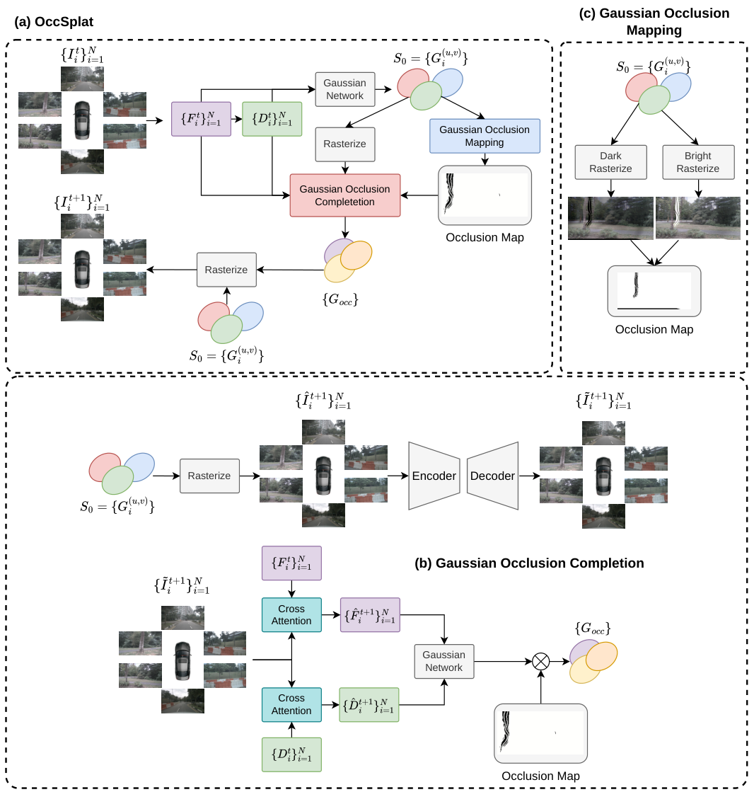

# 2026-11-06 科研日报

## 今日速览

周四公告（11-05）里，和课题最贴的是两条「把高斯场景用得起来」的工作。一条盯着室内 3DGS 最常被忽略、却对机器人与 AR 致命的全局尺度：从门、桌、层高这些语义锚点读出米制尺度，证据不够就明确拒绝，而不是硬猜；另一条盯着前馈高斯重建里「高斯越积越多、渲染越来越贵」的预算问题，让用户指定保留比例，一次训练就能在不同输入视角数和不同预算之间切换。前者是 Real2Sim 链路里「重建完能不能量」的部署问题，后者是消费级算力下「前馈重建能不能压住」的工程问题。两条共同的提醒也一样：报告出来的漂亮数字，可能只在训练分布里成立；室外、手持视频、残缺实例，都会让方法安静地退回基线或拒绝作答。

- **必读：[METRIC-GS](#2026-11-06--metric-gs)（Stony Brook University、SUNY Korea，arXiv 预印本）。** 室内 3DGS 继承 SfM 的任意单位，量不了、放不了 AR、也进不了路径规划。作者用冻结的 2D 分割器做可见性感知投票，把门、家具和层高等实例尺寸在建筑先验下做鲁棒 MLE，并用 inlier-mass 门控决定「改尺度」还是「弃权、转交重型度量模型」。ScanNet++ 47 场景上，单独用它把分位数启发式的平均误差从 21.1% 降到 16.6%（行动的 28 场景上 9.3%），约 11 秒/场景；把弃权场景路由给 MASt3R，精度与「处处跑 MASt3R」相当，调用次数少 60%。值得读的是「弃权当一等公民」的部署契约，以及他们对 MoGe-2「训练分布内 2.3%、未见捕获上 28–35%」的对照——公开论文里的度量数字常常是最好情形，不是部署估计。
- **选读：[BudgetSplat](#2026-11-06--budgetsplat)（Graz University of Technology，arXiv 预印本）。** 像素对齐的前馈 3DGS 会随着分辨率和视角数迅速膨胀。作者把压缩写成「重要性 × 空间覆盖 × 跨视角冗余」的联合问题：Intra-Cross Mask Supervision 教网络估重要性，budget-conditioned 特征调制按保留比例改不透明度和属性，Coverage-Aware Budget Selection 再做块预选、按视角不透明度排序和 3D 冗余抑制。一个模型同时支持不同上下文视角数和多种测试时预算，不必按预算重训或逐场景压缩。对「低端机上还能跑的前馈重建」是直接对照。
- **其他：** [GaussianRenderFormer](#2026-11-06--others)（在投 TMLR）问「没有光栅化器，Transformer 能不能自己渲高斯」，在剪枝到 2 万高斯的 Objaverse 物体上相对同输入光栅化差约 6 dB，诊断指向视角解码器；[CrossPressor](#2026-11-06--others)（WACV 2027）是免训练的锚点跨视角融合加速，长序列上跨视角融合最高约 26×；[OccSplat](#2026-11-06--others)（ACCV 2026 CV4DC）在驾驶环视前馈重建里预测遮挡区的新高斯，补的是几何而不是像素；[GREP](#2026-11-06--others) 用物理有效性 / 视觉一致性 / 人类使用逻辑三层原则评估生成房间；[Feature Puzzles](#2026-11-06--others) 只用单图分割监督学多视角一致分割。
- **圈内：** Gracia 给 Unreal 做了 4D 高斯插件，声称能吃场景光照并投射阴影；Quixel Megascans 全库即将免费且允许用于 AI 训练，有人随即讨论扫描资产转 3DGS 的可能；SIGGRAPH Asia 2026 的 NVIDIA Training Lab 已挂出「用 3DGS 推进世界仿真」场次；百度无人车侧世界模型叙事继续强调「一天仿真抵三年路测」——仍是厂商自报口径。

## 室内高斯要能量：读得懂就改，读不懂就弃权

### METRIC-GS · arXiv · 2026-11-04

**一句话判断：** 这是一篇把「尺度」从 3DGS 流水线里单独抽出来、并认真谈部署契约的工作。方法本身并不花哨——语义尺寸先验 + 可见性投票 + 鲁棒融合——真正稀缺的是：证据不够时明确弃权，并把弃权当作转交重型度量模型的路由信号。对要把室内高斯搬进机器人或 AR 的人，这篇比又一篇「端到端度量重建」更有用：它告诉你现有 COLMAP/3DGS 管道里能补什么、补不了时该交给谁。局限也很清楚：只服务「看得见建筑」的室内静帧；部分重建/部分标注的实例会集体偏短、骗过门控；名义层高先验仍敏感。

- **Title：** METRIC-GS: Selective Metric-Scale Estimation for 3D Gaussian Splatting
- **作者：** Sooyeun Yang, Jongseong Brad Choi（通讯作者）
- **单位：** Stony Brook University；SUNY Korea
- **投稿信息：** 投稿信息未标明
- **发表时间：** arXiv 首次挂出 2026-11-04（11-05 公告，cs.CV）
- **链接：** [arXiv abs](https://arxiv.org/abs/2611.06020) · [PDF](https://arxiv.org/pdf/2611.06020) · [HTML](https://arxiv.org/html/2611.06020v1)（论文中未给出项目页或代码链接）

**摘要中译：** 3D 高斯泼溅重建会继承运动恢复结构给出的任意单位，因此在有人提供尺度之前，既不能测量，也不能用来放置 AR 内容。两条常用做法在真实捕获上都很脆：在五个用卷尺量过层高的室内场景上，分位数「地板到天花板」启发式平均误差 27%，度量深度对齐在三个网络上误差 35–71%。我们提出 METRIC-GS，一种面向真实室内照片的选择性尺度估计器：它从重建自身的语义内容读出尺度，更重要的是，证据稀薄时拒绝作答。冻结的 2D 教师通过可见性感知投票给高斯打标签；门、桌、层高等建筑与家具类别的实例级尺寸先验，由鲁棒最大似然步骤融合；inlier-mass 检验把稀薄证据变成显式弃权，并兼作通往重型度量模型的路由器。在 47 个带激光真值的 ScanNet++ 场景上，配置在任何公开评测前冻结，估计器单独把启发式的平均误差从 21.1% 降到 16.6%（在它行动的 28 个场景上为 9.3%），每场景约 11 秒。MASt3R 仍是更准的独立估计器（9.9%），但只把我们的弃权转交给它，就能在调用次数减少 60% 的情况下匹配「处处运行」的精度；我们主张部署的正是这种选择性混合。可见性感知投票把可行动场景从 16 提到 28，而部署精度不变。原样应用到我们自己的 13 组手机与无人机捕获上——其中 MASt3R 有 12 次未过自身配准门——系统改进了全部 5 个它行动的捕获，且无一变差。我们还报告：一个当前前馈度量模型在训练混合内的基准上得到 2.3%，在从未见过的普通捕获上却是 28–35%：公开的度量尺度数字是最好情形，不是部署估计。

*图：原论文 Fig. 1（来源：[arXiv HTML](https://arxiv.org/html/2611.06020v1)）。左侧是暖启动与训练中的尺度耦合（稠密化阈值按米换算）；右侧是后验估计与弃权/路由。*

**方法与原理。**

*要解决什么。* 手机带惯性时尺度几乎免费；一旦只剩照片（单反、相册、无人机），COLMAP/3DGS 给出的世界单位就是任意的。分位数层高启发式和「SfM 深度对齐度量深度网络」在真实室内上会差到几十个百分点，三个深度网络彼此也可差到 2.5 倍。作者的观察是：室内重建里有很多标准化或分布很紧的语义锚（门高、桌高、层高），在标好的高斯上量出来，可以过约束全局尺度；量不够时，合同是「说不知道」，而不是硬给一个数。

*输入与输出。* 输入是已有的室内多视角照片与 COLMAP/3DGS 管线；输出是全局尺度 \(\hat s\)（米/模型单位），或明确弃权（保留暖启动尺度，并可路由到 MASt3R 一类重型模型）。

*怎样做。*

1. **暖启动。** 用点云高度的多分为数地板/天花板跨度映射到名义层高 2.5 m，得到 \(s_w\)；后续只估计残差对数尺度 \(s\)，交付尺度为 \(s_w e^{s}\)。
2. **可见性感知语义投票。** 冻结 Mask2Former（ADE20K）给训练视角打标签。高斯中心投影到多视角投票时，只有渲染深度确认可见的视角才计票（单侧检验 \(z < D(1+\tau)\)，\(\tau=0.05\)），避免被遮挡点继承前景标签；对称 \(|z-D|\) 会误杀掠射地板点。每 200 次迭代抽 24 视角投票；后验估计用 48 视角 × 三种子。
3. **实例级尺寸线索。** 对门、桌、马桶、层高等类别，体素连通分量切实例，沿语义竖轴取分位数修剪跨度；簇级与实例级线索带相反方向的偏差（标签溢出偏大、残缺重建偏小），鲁棒估计器在中间折中。先验均值/方差按建筑规范与家具尺寸一次性设定，从不按数据集调。
4. **鲁棒融合与弃权。** Geman–McClure 惩罚融合各线索，加上对残差 \(s\) 的二次暖启动先验；后验在对数网格上穷举最小。inlier mass \(M\)（归一化残差 \(|r|<2\) 的加权和）低于 1.5 则弃权，返回 \(s=0\)。
5. **训练环耦合。** 光度损失加尺度无关的深度正则；稠密化/剪枝阈值按「米制场景范围」换算，使交付模型本身是度量的，而不只是「模型 + 一个数」。消融表明：环内尺度几乎不提升后验精度，真正买到的是「模型已按米稠密化」。

*为什么这样设计。* 可见性门控买的是覆盖面而不是精度（可行动场景 16→28，部署平均误差几乎不变）；融合买的是鲁棒性（单线索估计器中位数接近、平均数可爆到约 40%）。弃权门在 ARKitScenes 手持视频上预注册「几乎全弃权、不劣化」，结果 50/50 弃权、零劣化——这是部署契约，不是刷榜技巧。

**结果与局限（作者报告）。** ScanNet++ 47 场景、配置公开评测前冻结：分位数启发式平均 21.1% / 中位 17.5%；本文 16.6% / 10.6%；行动的 28 场景上 9.3%。MASt3R 全体 9.9%；「本文 + 只把 19 个弃权交给 MASt3R」为 9.4%，调用少 60%。9 个行动修正比启发式更差（最差 +15 pp），主因是部分实例集体偏短且彼此一致、骗过门控；换更强分割器（Swin-L）可修好最差场景。自采 13 组手机/无人机捕获：行动 5 组全部改进、弃权 8 组继承暖启动、无一劣化；MASt3R 在其中 12 组未过自身配准门。局限：室外/工业/合成外观/看不见建筑的特写不在工作域；名义层高从 2.1 改到 3.0 m 重训会明显拉动误差；部分实例完整性仍是开放失败模式。

**值得关注。**
- 对 Real2Sim / 室内高斯进仿真，「尺度 + 弃权」比再卷一个端到端度量网络更贴部署：现有管道能补就补，不能补就花得起地调用重型模型。
- 「训练分布内 2.3%、分布外 28–35%」这句对照，适合当作读一切度量重建论文的过滤器。
- 消费级友好度：后验估计约 11 秒（RTX 4080），不替代 6–16 分钟的 3DGS 训练；只需要尺度时，端到端跑 MASt3R 可能更直接。

*图：原论文 Fig. 5（来源：[arXiv HTML](https://arxiv.org/html/2611.06020v1)）。走廊垂直跨度被截断时修正最大；样板间线索刚好低于门控则弃权——拒绝本身就是输出。*

## 前馈高斯的预算旋钮：指定保留比例，而不是事后再压

### BudgetSplat · arXiv · 2026-11-04

**一句话判断：** 把「能泛化的前馈 3DGS」和「表示能不能按预算收缩」绑在同一个模型里，而不是训完再剪。对消费级显存和批渲染成本敏感的读者，这比再刷一个无约束的 feed-forward PSNR 更有信息量。尚未看到代码与项目页；室内 ScanNet / Replica 上的质量—体积权衡是否迁到室外或驾驶，正文需自己核对。

- **Title：** BudgetSplat: Budget-Controllable Generalizable Gaussian Splatting
- **作者：** Yuxi Hu, Jun Zhang, Wei Mao, Yuchen Rao, Friedrich Fraundorfer
- **单位：** Graz University of Technology
- **投稿信息：** 投稿信息未标明
- **发表时间：** arXiv 首次挂出 2026-11-04（11-05 公告，cs.CV）
- **链接：** [arXiv abs](https://arxiv.org/abs/2611.06593) · [PDF](https://arxiv.org/pdf/2611.06593) · [HTML](https://arxiv.org/html/2611.06593v1)（论文中未给出项目页或代码链接）

**摘要中译：** 前馈 3D 高斯泼溅能做高效的可泛化新视角合成，但现有像素对齐方法常常生成高度冗余的高斯基元，使最终表示大小和渲染代价随图像分辨率与输入视角数迅速增长。我们提出 BudgetSplat，一个预算可控的前馈框架，能按用户指定的保留比例调整最终高斯表示。我们不把压缩简单当成重要性排序，而把它表述为重要性估计、空间覆盖与跨视角冗余的联合问题。单个训练好的模型支持变化的上下文视角数和多种测试时预算，无需按预算重训或逐场景压缩。为实现这一表述，Intra-Cross Mask Supervision 为学习高斯重要性提供结构、覆盖与冗余感知的指导，预算条件特征调制则按请求的保留比例调整高斯不透明度与属性。Coverage-Aware Budget Selection 进一步结合块级预选、按视角的不透明度排序和 3D 冗余抑制，构造紧凑且空间分布合理的高斯表示。室内重建与跨数据集泛化实验表明，在不同输入视角数与保留比例下都能得到一致的质量—体积权衡，在保持渲染质量的同时显著降低最终表示存储与渲染代价。

*图：原论文方法示意图（来源：[arXiv HTML](https://arxiv.org/html/2611.06593v1)）。同一套权重在测试时吃不同的 preservation ratio，输出不同稀疏度的高斯集合。*

**方法与原理。**

*要解决什么。* 像素对齐前馈 3DGS 倾向于「每个像素都吐高斯」，分辨率和视角一多，表示和渲染一起炸。事后压缩往往要按场景或按预算重来；作者希望训练一次，测试时拧预算旋钮。

*输入与输出。* 输入是若干上下文视角和用户指定的保留比例；输出是按该比例筛选、调制后的紧凑高斯集合，用于新视角合成。

*怎样做。*

1. **Intra-Cross Mask Supervision：** 同时用结构、覆盖、冗余信号监督「哪些高斯更重要」，避免只按局部 saliency 砍导致空洞。
2. **预算条件特征调制：** 把保留比例注入特征，调节不透明度与高斯属性，使网络在不同预算下行为一致。
3. **Coverage-Aware Budget Selection：** 块级预选 → 按视角不透明度排序 → 3D 冗余抑制，保证留下的点在空间上散开，而不是挤在纹理丰富区域。

*为什么这样设计。* 只做重要性排序容易丢掉覆盖；只做空间均匀采样又留不住细节。三者联合，才可能在「体积下去」的同时「洞不明显」。

**结果与局限（作者报告）。** 实验在 ScanNet 与 Replica 上报告不同视角数与预算下的质量—体积权衡；具体数值以正文表格为准。摘要未给出与特定基线的逐项对比数字。局限：工作域偏室内；与同组同日的 CrossPressor（锚点融合加速）是互补问题——一个压最终表示，一个压长序列融合成本。

**值得关注。**
- 和兴趣笔记里「批渲染 / 低端机」同向：测试时预算旋钮比「先重建再压缩」更适合合成数据管线里反复改视角、改分辨率。
- 读正文时重点看：极端低保留比例下几何是否塌、跨数据集（若有）降多少、调制是否引入视角闪烁。

## 本期其他值得一扫（仅据摘要）

- **[GaussianRenderFormer](https://arxiv.org/abs/2611.05593)（在投 TMLR；Shahaf Valencia Levy, Sagie Benaim；Hebrew University of Jerusalem；[项目页](https://svlwoof.github.io/gaussianrenderformer)）：** 高斯编码成 token，视角无关编码器 + 视角相关解码器直接出图，渲染器里没有光栅化。在 26,820 个剪枝到 2 万高斯的 Objaverse 物体上训练，300 个未见物体相对完整未剪枝泼溅 38.08 dB，同输入光栅化为 44.02 dB。作者诊断差距主要在视角解码器：把每个高斯的投影足迹告诉解码器还能再涨 1.4 dB。这是「正向渲染能不能学」的概念验证，距离实时可微管线还远，但对理解光栅化归纳偏置有用。

*图：原论文 teaser 中同一物体的参考与模型输出（来源：[arXiv HTML](https://arxiv.org/html/2611.05593v1)）。整体结构在，细层与高频仍是主要落差。*

- **[CrossPressor](https://arxiv.org/abs/2611.06258)（WACV 2027 已接收；Yuxi Hu, Wenhao Dong, Jun Zhang, Friedrich Fraundorfer）：** 针对锚点压缩前馈 3DGS（如 ZPressor）在长序列上「锚点固定、支撑视角越堆越多」的表示—融合错配，提出免训练的 coverage-cycled evidence routing：保留全部解码器侧锚点查询，约束支撑序列增长，并在 K/V 投影前路由、联合打包上下文。报告跨视角融合最高约 26.12×、端到端约 1.43×。与 BudgetSplat 同组同日，一个管融合成本，一个管最终高斯预算。
- **[OccSplat](https://arxiv.org/abs/2611.06273)（ACCV 2026 CV4DC 研讨会论文轨；Dung Do Tien 等）：** 驾驶环视前馈 3DGS 在单次观测下，遮挡区到新视角会露馅。OccSplat 用 Gaussian Occlusion Mapping 找缺支撑区域，再预测新高斯基元做几何补全，而不是只在图像空间 inpainting。nuScenes 上报告遮挡区增益更大。可与昨日 SettleSplat（在视野内物体被挪走）对照：一个补看不见的静物几何，一个处理看得见的动态干扰。

*图：原论文 overall（来源：[arXiv HTML](https://arxiv.org/html/2611.06273v1)）。核心是「缺几何就长新高斯」，不是「缺像素就补图」。*

- **[GREP](https://arxiv.org/abs/2611.05802)（Mohan Cao, Yongsen Mao 等；[项目页](https://han-808.github.io/GREP/)）：** 评估 LLM 选资产、摆房间的生成结果时，从「特定视角/预设问题」转向三层原则：物理有效性、视觉一致性、人类使用逻辑；评估智能体按场景上下文自主找问题并给分。报告与人类多数偏好约 87% 一致。对「生成房间能不能进仿真」是评测侧工具，不是生成器本身。
- **[Feature Puzzles](https://arxiv.org/abs/2611.05874)（Jiahao Ma 等）：** 只用单图语义分割监督，通过裁剪与几何变换构造多视角一致伪标签，再挂一个轻量网络吃 3D 基础模型的多视角特征。支持多种提示，可延到开放词表 3D 分割。对可编辑资产的「跨视角同一实例」有用，但监督仍来自 2D 分割器的偏见。
- **[CLEAR](https://arxiv.org/abs/2611.05969)（WACV 2027；Tu Vo 等）：** 单图去反射。指出生成式 latent 修复若把输入高频经 skip 灌回解码器，会把反射边缘一并锐化回来；用颜色—纹理潜空间对齐与物理启发的层分离组织预测。可作「室内玻璃/橱窗捕获」预处理备查，与逆渲染主线弱相关。

## 圈内新闻与社区反应

**Unreal 侧的 4D 高斯开始吃场景光（图形学）。** Gracia 发布 Unreal Engine 插件，宣传把 4D 高斯捕获直接放进关卡，拾取场景光照、投射阴影，并接入 Sequencer 与 Movie Render Queue（[帖文](https://x.com/gracia_hq/status/2118380322803130763)）。这和 Radiance Fields 月报里「影视侧缺重光照 / 蒙皮」的缺口同向：工具链在补「能进灯光」这一层，但插件能力与许可需以官方说明为准，未见独立评测。

**Quixel Megascans 全库免费与 AI 训练条款（图形学 · 资产）。** Epic/Quixel 宣布 Megascans 全库将免费，并更新条款允许用这些资产训练 AI；Fab 列表在 11-12 前陆续更新（[Quixel 公告帖](https://x.com/quixeltools/status/2118346475528994821)）。讨论区随即有人提到「扫描资产转 3DGS」的想象空间。对合成数据管线，这意味着高质量扫描库的授权门槛下降，但「免费」不等于「任意商用/任意再分发」，具体以更新后的条款为准。

**SIGGRAPH Asia 2026：NVIDIA 培训里出现 3DGS 世界仿真（图形学 · 具身）。** 会议培训报名信息中，场次包括从 URDF 到 USD 的 Isaac Sim、用 3D 高斯泼溅推进世界仿真等（[相关讨论](https://x.com/tomaszbednarz/status/2118375458136019318)）。说明厂商已把「高斯场景进仿真」当成可讲授的标准技能，而不只是论文 demo。

**百度无人车世界模型叙事（具身 · 自动驾驶）。** 量子位等报道百度侧世界模型强调实时推演与「一天仿真抵三年」类表述（[量子位 11 月合集](https://www.qbitai.com/date/2026/11)）。口径为厂商宣传，对照基线与开放评测未在公开报道中展开；和昨日 Rivian/Third Dimension、优必选 Thinker-Sim 一样，行业叙事仍是「高斯/神经场景 → 仿真数据」，物理参数是否从数据估出仍少见公开细节。

**手机端高斯与住宅重建的观感对照（图形学）。** 社区继续对比 iPhone 捕获的室内 3DGS 与自建采集架、以及用 World Labs Atlas 从真实走廊 3DGS 生成改装修版本等实践帖；信号是「住宅室内外观重建正在变日常」，与 METRIC-GS 要解决的「外观有了、尺度还没有」形成互补。

## 覆盖说明

日报发布日为 **2026-11-06（周五）**，内容覆盖日为 2026-11-05（周四）arXiv 公告，包括 cs.GR 新提交与交叉列表，以及 cs.CV 中按关键词筛出的条目。正文两篇为 METRIC-GS（2611.06020）与 BudgetSplat（2611.06593），均核对了 arXiv HTML 全文的方法与实验叙述，配图为原论文插图。其余条目主要据摘要，GaussianRenderFormer 与 OccSplat 核对了 HTML 插图。所有实验数字均为作者报告，未独立复现。兴趣笔记与 blog/academic tip（blog `c29075d`、academic `f19a697`）无新公开发布增量，策展权重维持既有真实场景逆渲染 / 效率 / 可度量资产主线。Blender 5.3 仍按里程碑临近正式版，本期不重复展开原生高斯限制。圈内动态核对了 X 关键词检索与量子位 11 月合集页面。

**编写：** Cream
