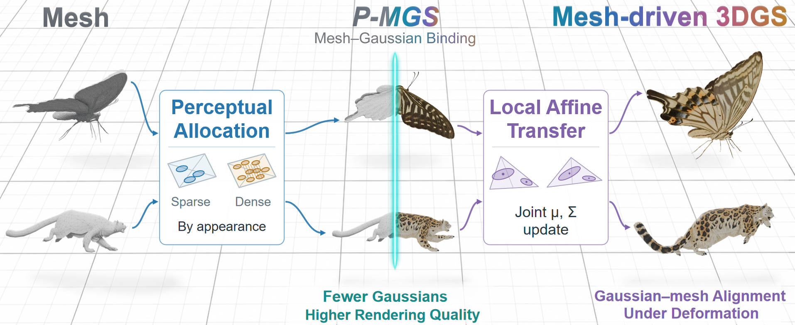
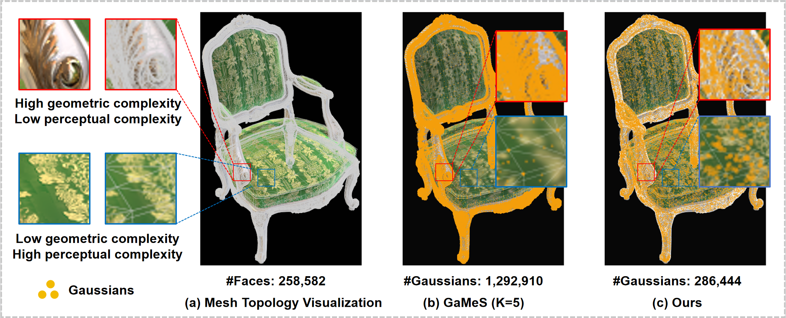
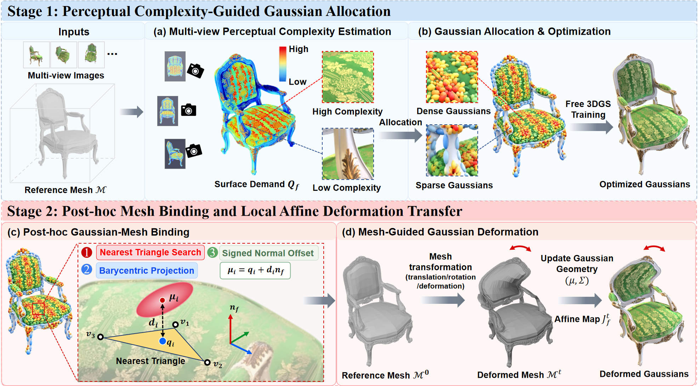
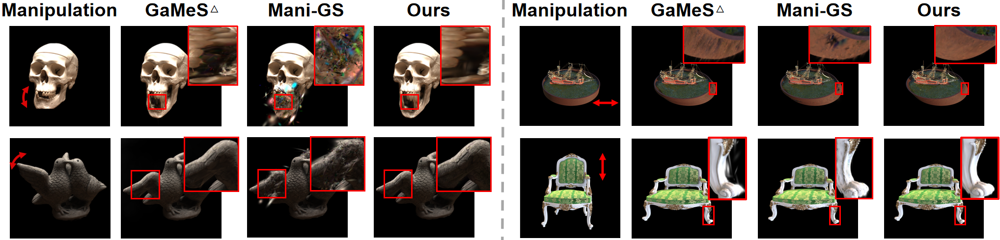
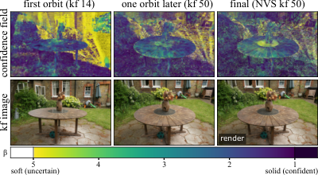
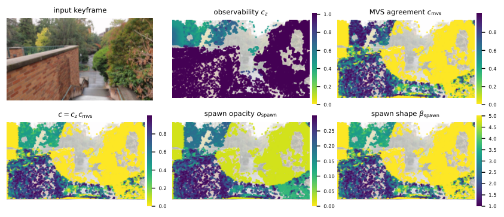
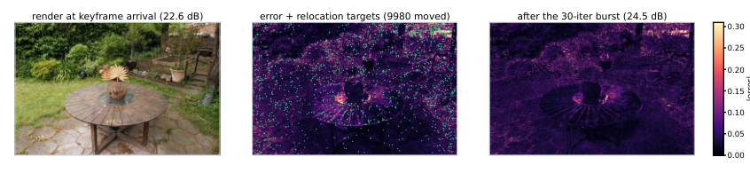

# 2026-11-07 科研日报

## 今日速览

周五公告（11-06）里，和课题最贴的是两条「让高斯表示既能好看、又能动手改 / 边走边建」的工作。一条盯着网格—高斯混合里长期存在的错配：面片细分密度并不等于外观复杂度，固定每面塞 \(K\) 个高斯既浪费又撑不住纹理；作者先按多视角感知复杂度分配预算，再无约束优化，最后事后绑定到原网格，编辑时用局部仿射把中心与协方差一起带走。另一条盯着在线重建：关键帧只能优化几十步，初始化差了就改不回来；作者把 beta 核的形状参数当成几何置信度旋钮——多视角一致的地方吐更「实心」的基元，证据稀薄处保持柔软可纠正，再配合误差驱动搬迁与闭式 LoD 合并。前者直接服务可编辑资产与绑定，后者服务捕获中的效率与鲁棒几何。共同提醒：漂亮的网格拓扑或漂亮的实时数字，都不自动等于外观容量或部署置信度。

- **必读：[P-MGS](#2026-11-07--p-mgs)（合肥工业大学、北京大学深圳研究生院、鹏城实验室、安徽大学，arXiv 预印本）。** 现有 mesh-based 3DGS 常按面片固定配额，容量跟的是细分而不是外观需求。P-MGS 用多视角感知复杂度做分配，高斯先自由优化再事后绑定，编辑靠局部仿射形变传递。NeRF-Synthetic 上报告平均 PSNR 34.00 dB、约 545K 高斯，相对 Mani-GS 高 0.75 dB 且高斯数少约 79.7%；编辑定性上浮点与错位少于 GaMeS△ / Mani-GS。值得读的是「外观容量 ≠ 几何细分」这句诊断，以及 post-hoc binding 如何保住 3DGS 的自适应细化又不丢掉网格拓扑。
- **选读：[HIBS](#2026-11-07--hibs)（University of Würzburg，arXiv 预印本）。** 在线 3DGS 每个关键帧只短促优化，差初始化几乎无法事后补救；高斯核本身偏软，实心表面要靠大量重叠。HIBS 引入 beta 核作置信度旋钮，按几何可观测性与多视角深度一致性初始化不透明度与形状，错误驱动搬迁回收陈旧基元，闭式矩匹配合并给 LoD。Mip-NeRF 360 在线协议上报告相对基线最高约 +0.8 dB PSNR、优化时间最多约少 40%。对「边扫边建、低端机上还要能收敛」是直接对照。
- **其他：** [SplatAnything](#2026-11-07--others)（浙江大学、腾讯混元、Causa Robotics）指出前馈 3DGS 常用径向距离归一化，却放任邻域高斯间距随场景尺度漂移，提出 GSNorm 用间距中位数做场景级归一；[MOMASPLAT](#2026-11-07--others)（University of Texas at Austin）把场景与被操作物体分开建 3DGS，给移动操作合成含接触后动态的新视角示教，作者报告相对最强基线平均成功率翻倍以上；[Gaussolve](#2026-11-07--others) 把混合网格—高斯冲突改成「先溶解不一致网格再回填」；[T²-Splat](#2026-11-07--others) 解耦拓扑演化与残差纹理。
- **圈内：** Blender 5.3 已进入 RC、计划 11-10 正式版，原生 3DGS 导入与三引擎渲染文档写明性能与色彩空间限制；社区在 5.2.3 LTS 上继续对比 KIRI 专用渲染与 EEVEE/Cycles；工具作者回应「3DGS 好看但不是真网格，暂难 UV/绑定进游戏管线」——与今日 P-MGS 的问题同向；OpenCV 5.1.0 发布；奇点智能技术大会（11-20/21，北京）日程强调 Physical AI 与系统栈。

## 外观要预算，网格只负责拓扑：事后绑定的可编辑高斯

### P-MGS · arXiv · 2026-11-05

**一句话判断：** 这是一篇把「外观表示容量」从「网格细分密度」里拆出来的工作。方法并不堆复杂网络——感知复杂度分配 + 无约束优化 + 事后绑定 + 局部仿射传递——真正稀缺的是承认：固定每面 \(K\) 个高斯既解释不了平滑墙面的浪费，也解释不了窗户/纹理区的欠拟合。对要做可编辑、可变形真实场景资产的人，这篇比再一篇「端到端网格化高斯」更贴近部署：几何编辑走网格，外观质量走自适应高斯，二者用绑定契约接起来。局限也很清楚：依赖可用的输入网格；感知复杂度估计与工作负载校正仍是启发；极端非刚体与大拓扑变更未充分验证。

- **Title：** Perception Over Geometry: Rethinking Gaussian Allocation in Mesh-based Splatting
- **作者：** Yuting Wang, Yang Zhao（通讯作者）, Shanding Diao, Penglin Wang, Yuan Chen, Wei Jia, Ronggang Wang
- **单位：** 合肥工业大学；北京大学深圳研究生院；鹏城实验室；安徽大学
- **投稿信息：** 投稿信息未标明
- **发表时间：** arXiv 首次挂出 2026-11-05（11-06 公告，cs.GR）
- **链接：** [arXiv abs](https://arxiv.org/abs/2611.07979) · [PDF](https://arxiv.org/pdf/2611.07979) · [HTML](https://arxiv.org/html/2611.07979v1) · [代码](https://github.com/yuting01234/P-MGS)

**摘要中译：** 3D 高斯泼溅能做照片级新视角合成，但缺少显式拓扑，几何编辑困难。现有网格方法通过把高斯绑到三角面实现几何操控，通常给每个面分配固定数量的高斯。然而，外观重建所需的表示容量取决于局部外观复杂度，而不仅仅取决于网格细分密度。为此我们提出 P-MGS：把外观建模与几何控制分开，同时追求高质量渲染、紧凑表示与灵活网格编辑。P-MGS 引入感知复杂度引导的分配策略，按多视角观测估计的表面外观需求分配高斯。为保留重建灵活性，高斯先在无网格约束下优化，再通过事后绑定关联到原始网格，既保留自适应细化又保住网格拓扑。网格编辑时，局部仿射形变传递更新高斯中心与协方差，减轻错位与漂浮伪影。实验表明，在更少高斯下获得更高的平均新视角合成质量，并保持连贯的网格编辑。

*图：原论文 Fig. 1（来源：[arXiv HTML](https://arxiv.org/html/2611.07979v1)）。同一套表示同时服务渲染质量与网格形变编辑。*

*图：原论文 Fig. 2（来源：[arXiv HTML](https://arxiv.org/html/2611.07979v1)）。左为非均匀几何复杂度的拓扑；中为 GaMeS 式固定每面配额；右为按外观需求分配。*

**方法与原理。**

*要解决什么。* GaMeS 一类方法把高斯绑到三角面，配额是 \(N_G = N_f \times K\)：面越多或 \(K\) 越大，表示越大，但光滑墙面与复杂纹理区吃到的容量一样。作者观察到：局部外观复杂度（多视角下的残差/工作负载需求）与细分密度经常错位；把优化也绑死在网格参数化上，又会限制 3DGS 本来的自适应 densify。目标是：外观阶段尽量自由，编辑阶段再借网格的拓扑。

*输入与输出。* 输入是多视角图像与一张（或重建得到的）三角网格；输出是绑定到该网格的紧凑高斯集合，可随网格编辑做刚体/局部非刚体形变，并保持新视角渲染。

*怎样做。*

1. **多视角感知复杂度估计。** 在网格面上累计多视角观测信号，估计「这块表面还需要多少外观容量」；再扣除光栅化工作负载代价，避免只往投影面积大的面盲目堆高斯。
2. **感知引导分配与初始化。** 按估计需求给各面分配高斯个数（有上下界）；在对应面上采样中心，用局部几何初始化协方差朝向与尺度。
3. **无约束优化。** 分配完成后，高斯属性按标准可微泼溅优化，**不**把中心锁死在面参数里，保留 densify/refine 空间。
4. **事后绑定。** 优化结束后，把每个高斯投影到最近/最合适的参考面，存重心坐标与沿法向的有符号偏移，而不是硬吸附到顶点——中心可以略离面，绑定只建立对应关系。
5. **局部仿射形变传递。** 网格从 \(M\) 变到 \(M_t\)（拓扑不变）时，用面局部仿射把拉伸、剪切、旋转同时作用到高斯中心与协方差，避免「只转顶点相对偏移」留下的尖刺与漂浮。

*为什么这样设计。* 先自由优化再绑定，是为了不牺牲重建质量；绑定用重心+法向偏移而不是单顶点锚，是为了编辑时形状跟着面走；仿射传递承认局部不只是旋转。消融上，感知分配在相同预算下优于均匀 \(K=3\)，并在比均匀 \(K=5\) 少约 40% 高斯时仍更高 PSNR。

**结果与局限（作者报告）。** NeRF-Synthetic：平均 PSNR 34.00 dB、SSIM 0.971、LPIPS 0.0279，约 545K 高斯；相对 Mani-GS 高 0.75 dB、高斯数少约 79.7%。与 GaMeS△、Mani-GS 的编辑对比中，椅/船以及 DTU 物体在非刚体形变后漂浮与错位更少。感知分配消融：相同预算下相对均匀 \(K=3\) 约 +1.26 dB；相对均匀 \(K=5\) 约 +1.11 dB 且少约 40% 高斯。局限：需要网格；大拓扑变更/重网格化不在设定内；感知统计与工作负载校正偏工程启发；真实室内残缺捕获与反光材质未作为主评测。

**值得关注。**
- 对「可编辑真实场景资产 / 绑定」：把外观容量从细分密度解耦，是比「再卷一个统一可微网格」更可落地的契约。
- 和兴趣主线交叉：编辑侧仍是网格，重光照/材质解耦并未解决——读时可对照「绑定之后 SH/外观是否仍烘焙了光照」。
- 代码已挂 GitHub；复现时重点看分配上下界与绑定后是否允许再微调。

*图：原论文 Fig. 3（来源：[arXiv HTML](https://arxiv.org/html/2611.07979v1)）。两阶段：外观按感知复杂度建高斯；几何编辑走网格拓扑与局部仿射。*

*图：原论文 Fig. 4（来源：[arXiv HTML](https://arxiv.org/html/2611.07979v1)）。Chair / Ship 与 DTU 物体上，事后绑定 + 仿射传递减少错位尖刺。*

## 在线重建的置信度旋钮：beta 核从软到实心

### HIBS · arXiv · 2026-11-05

**一句话判断：** 把「核形状」从固定的高斯剖面，升级成随观测置信度转动的实心程度旋钮，并配上可观测性感知的生成、误差驱动搬迁与闭式 LoD。对边捕获边重建、又希望实心表面别靠堆半透明高斯硬撑的读者，信息密度高于再刷一篇离线 PSNR。项目页与实现细节公开；姿态误差、无序输入与颜色基选择仍要自己核对正文附录。

- **Title：** Hierarchical Incremental Beta Splatting for Online Reconstruction
- **作者：** Linus Franke
- **单位：** University of Würzburg
- **投稿信息：** 投稿信息未标明
- **发表时间：** arXiv 首次挂出 2026-11-05（11-06 公告，cs.CV）
- **链接：** [arXiv abs](https://arxiv.org/abs/2611.08288) · [PDF](https://arxiv.org/pdf/2611.08288) · [HTML](https://arxiv.org/html/2611.08288v1) · [项目页](https://linus-franke.com/hibs/)

**摘要中译：** 在线 3D 高斯泼溅在捕获过程中重建场景：每个关键帧只生成一次基元，并只优化几十步，几乎没有机会修正糟糕初始化或补上缺失细节。高斯核本身偏软，实心表面需要大量重叠。我们提出 Hierarchical Incremental Beta Splatting（HIBS），把 beta 核带进增量重建。其形状参数可在柔软、近高斯剖面与平顶、近不透明 surfel 之间插值，充当几何置信度旋钮。置信度感知的生成利用几何可观测性与多视角深度一致性，同时初始化不透明度与形状：几何可核验处生成更实心的基元，不可核验处生成柔软、可纠正的基元。作为在线致密化，误差驱动搬迁把陈旧基元回收到光度误差热点。有界的 beta 支撑使精确图块裁剪与更快光栅化成为可能；闭式、保形状的合并公式提供 LoD 层次，便于快速优化与实时渲染。在 Mip-NeRF 360 的在线协议上，HIBS 将 PSNR 最高提升约 0.8 dB，同时把优化时间最多降低约 40%。

*图：原论文插图（来源：[arXiv HTML](https://arxiv.org/html/2611.08288v1)）。形状参数把基元从柔软高斯拉向平顶 surfel，用来编码「这里有多敢说自己是实心几何」。*

**方法与原理。**

*要解决什么。* 离线 3DGS 可以靠漫长 densify 弥补坏初始化；在线设定里每个关键帧预算只有几十次迭代，生成时的不透明度/尺度几乎定终身。标准高斯剖面在低不透明度时更「糊」，实心墙要靠许多半透明椭球叠出来，既慢又不稳定。

*输入与输出。* 输入是（可无序的）图像流与位姿估计；输出是带层次 LoD 的 beta 基元辐射场，边重建边可渲染。

*怎样做。*

1. **Beta 核作置信度旋钮。** 用形状参数在「近高斯柔软」与「平顶近不透明」之间插值；有界支撑利于精确 tile culling。
2. **可观测性感知生成。** 结合几何可观测性与多视角深度一致性，给新基元同时赋不透明度与形状：一致则更实心，分歧则更软、留给后续纠正。
3. **实心程度控制与短促优化。** 每个关键帧只做一小段优化 burst；实心控制器按误差统计调节软硬，避免过早锁死错误几何。
4. **误差驱动搬迁。** 把贡献差、占坑的基元挪到当前光度误差热点，相当于在线 densify 的「回收再利用」。
5. **闭式矩匹配合并 → LoD。** 用闭式合并保形状地建层次，大场景训练与实时渲染共用同一表示；融合光栅化吃有界核的裁剪红利。

*为什么这样设计。* 把「置信度」写进核形状，而不是只写进一个标量权重，是为了让渲染器在证据足时少靠重叠、证据不足时仍可梯度纠正。搬迁解决「生成一次就定终身」；合并解决「基元越积越多」。

**结果与局限（作者报告）。** 摘要：Mip-NeRF 360 在线协议上最高约 +0.8 dB PSNR、优化时间最多约 −40%。与 i3DGS 等在线方法对比，定性 LPIPS 与细节更干净（项目页 teaser 示例）。附录讨论颜色基（spherical-beta vs SH）、无序输入、TUM 位姿精度与内存随时间变化。局限：仍依赖位姿前端；置信度启发式对传感器噪声敏感；「实心」不等于度量几何或可仿真碰撞网格。

**值得关注。**
- 和昨日 BudgetSplat / CrossPressor 同属「表示与计算预算」族，但场景换成在线捕获：旋钮是核形状与搬迁，不是保留比例。
- 对弱几何先验的室内扫描：多视角深度一致性门控是可读的失败模式入口——一致才实心，否则保持软。
- 消费级友好度：作者强调更快优化与有界核光栅化；具体机型帧时以项目页与附录为准。

*图：原论文插图（来源：[arXiv HTML](https://arxiv.org/html/2611.08288v1)）。生成时同时写入不透明度与形状，把「敢不敢实心」前移到初始化。*

*图：原论文插图（来源：[arXiv HTML](https://arxiv.org/html/2611.08288v1)）。在线 densify 的关键不是只加新点，而是让旧点搬家。*

## 本期其他值得一扫（仅据摘要 / 首页）

- **[SplatAnything](https://arxiv.org/abs/2611.08264)（Hao Yu, Zhenwei Wang, Yongzhen Hu, Yuning Gong, Junta Wu, Xiaowei Zhou, Hujun Bao, Tengfei Wang, Chunchao Guo, Sida Peng；浙江大学、腾讯混元、Causa Robotics）：** 前馈 3DGS 常在径向距离归一化空间里回归高斯属性，却放任邻域中心间距随场景尺度与相机配置漂移，导致尺度监督模糊。GSNorm 用全部有效观测上的高斯间距稳健统计（中位数）做场景级归一，再回归尺度等属性。作者建立覆盖多数据集、稀疏输入与外推视角的基准，称在场景尺度与视角变化大时增益更明显。可与昨日 METRIC-GS「尺度要可部署」对照：一个补重建后的米制尺度，一个校正前馈网络内部的间距参照。

- **[MOMASPLAT](https://arxiv.org/abs/2611.08372)（Sateesh Kumar, Arnav Balaji, Arpit Bahety, Skand Peri, Georgios Pavlakos, Roberto Martín-Martín；University of Texas at Austin；[项目页](https://robin-lab.cs.utexas.edu/momasplat/)）：** 移动操作里基座位姿几乎从不复现示教时的位姿；已有新视角增强常假设场景静止，接触后的物体运动渲不出来。作者利用 MoMa 采集天然多视角，把静态场景与被操作物体分开做 3DGS / 前馈几何，再运动学重定向动作，合成含动态交互的完整轨迹。五任务三场景实物实验，作者报告相对最强基线平均成功率翻倍以上，大位移处基线归零时仍有非平凡成功。对「示教数据增强 × 高斯场景」是具身侧高信号，但物理参数与可重光照不在范围。

- **[Gaussolve](https://arxiv.org/abs/2611.07049)（Yiyan Wang, Haohan Liu, Tetsuo Shibuya；The University of Tokyo、福州大学；[项目页](https://ooosn.github.io/gaussians-can-subtract/)）：** 混合网格—高斯常见「加性残差」：网格错了就靠高斯去补。作者指出许多冲突是多视角不一致（投影伪影、遮挡、视图相关外观），提出先用轻量 Neural Dissolve Field（标量球谐高斯）溶解不一致网格内容，再让残差高斯回填；连续透过率融合避免硬可见性断裂。报告在更少高斯、更快渲染下更高保真。与 P-MGS「网格负责拓扑」可对读：一个管编辑绑定，一个管混合渲染里的不一致。

- **[T²-Splat](https://arxiv.org/abs/2611.06974)（Zhihao Tang, Youjia Zhang, Mingbo Zhao, Wei Yang；华中科技大学、东华大学；[项目页](https://t2-splat.github.io/)）：** 三角泼溅常靠过细细分保外观。作者用 Safe RDT 初始化连接，Dynamic Topology Evolution 做边塌缩/顶点分裂，再在固定网格上用残差 Mip 纹理细化外观；Mip-NeRF 360 上相对 MeshSplatting 报告 +0.71 dB，并支持把面数压到原 10%。与 P-MGS 同属「拓扑预算 vs 外观预算」讨论，一条走自适应网格+纹理残差，一条走感知分配高斯+事后绑定。

## 圈内新闻与社区反应

**Blender 5.3：原生 3DGS 进入 RC，正式版指向 11-10（图形学 · 工具链）。** 开发者文档写明：PLY/SPZ 导入、点云类型、Geometry Nodes，以及 Workbench / EEVEE / Cycles 均可渲染；默认发射着色，重光照仍属早期；官方 Limitations 包括性能不理想、训练侧 sRGB 假设与线性空间偏差、Apply Transform 尚未正确处理 scale/rotation/SH（[Rendering 发布说明](https://developer.blender.org/docs/release_notes/5.3/rendering/)；[日程](https://projects.blender.org/blender/blender/milestone/34)）。社区继续在 5.2.3 LTS 上对比 KIRI 专用渲染与 EEVEE/Cycles 的原始性能（[相关讨论](https://x.com/jbb_t4art/status/2118639672352276666)）。对日报主线：原生管线降低「高斯进 DCC」门槛，但官方已提示不能默认等同论文 CUDA rasterizer，也还不能当可绑定游戏网格。

**「好看 ≠ 可进游戏管线」的工具作者口径（图形学 · 资产）。** 有网格重建插件作者明确回复：3DGS 观感好，但不是真网格，目前难做 UV、绑定与游戏内使用，高斯输出只可能作为远期选项（[帖文](https://x.com/MiladKambari/status/2118271504013987973)）。这与今日 P-MGS / T²-Splat / Gaussolve 要解决的「拓扑与外观如何分工」是同一缺口的产品侧表述。

**OpenCV 5.1.0（视觉基础设施）。** 项目方宣布 5.x 线首个功能更新：新数值格式、统一现代 DNN 引擎，以及更多 3D / 特征工具（[相关转述](https://x.com/2logics/status/2118742787416035807)）。对重建与标定脚本是基础设施信号，不直接改神经渲染方法本身。

**奇点智能技术大会日程：Physical AI 与系统栈（具身 · 产业）。** 量子位报道 11 月 20–21 日北京场次，覆盖 RSI、Agent、Physical AI 到系统栈（[量子位 11 月合集](https://www.qbitai.com/date/2026/11)）。口径为会议预告；与近期厂商「世界模型 / 仿真抵路测」叙事同周，但开放评测与可复现基线仍少见。

**单图物体高斯草稿资产继续产品化（图形学 · 生成）。** Speridlabs Idol 等「一图 → 标准 PLY」路径仍在传播：峰值显存与速度友好，但未拍到的侧面由生成补全、不能当测量扫描。适合当合成数据草稿，不适合当米制数字孪生输入——可与昨日 METRIC-GS 的部署契约对照阅读。

## 覆盖说明

日报发布日为 **2026-11-07（周六）**，内容覆盖日为 2026-11-06（周五）arXiv 公告，包括 cs.GR 新提交与交叉列表，以及 cs.CV / cs.RO 中按关键词筛出的条目。正文两篇为 P-MGS（2611.07979）与 HIBS（2611.08288），均核对了 arXiv HTML / PDF 的方法与实验叙述，配图为原论文插图。其余条目主要据摘要与项目页首页；Gaussolve、T²-Splat、MOMASPLAT、SplatAnything 核对了 abs/项目入口。所有实验数字均为作者报告，未独立复现。兴趣笔记与 blog/academic tip（blog `c29075d`、academic `f19a697`）无新公开发布增量，策展权重维持既有真实场景逆渲染 / 效率 / 可编辑资产主线。Blender 5.3 按 RC 与官方 Limitations 轻扫，不重复展开全部原生高斯细节。圈内动态核对了 X 关键词检索与量子位 11 月合集页面。

**编写：** Cream
