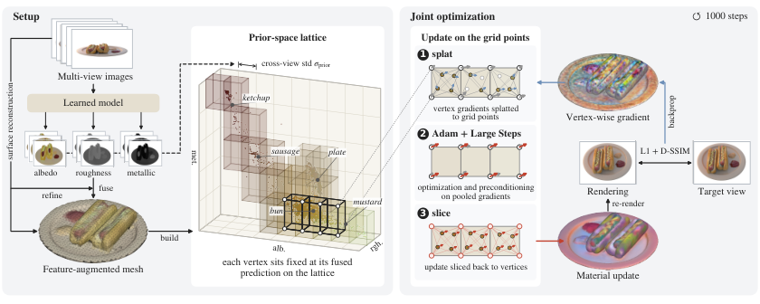
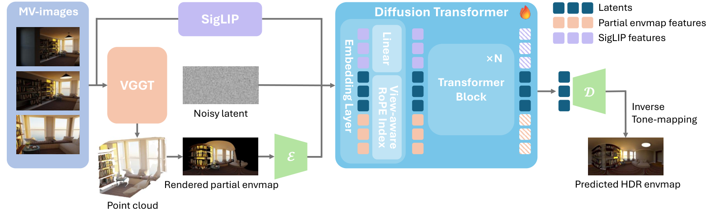

# 2026-11-08 科研日报

## 今日速览

周末没有新的 arXiv 公告，今天回扫本周与主线最贴的「逆渲染里先验怎么用」。两篇工作从两头切入同一个问题：材质与光照本来就互相可以解释，单靠光度拟合会把阴影、高光吸进反照率。一篇处理材质一侧：它不把学习得到的材质预测当成额外的损失项去拉，而是用预测结果决定哪些表面点共享同一组材质变量。优化目标仍然只有光度项，只是可以自由调的维度少了。另一篇处理光照一侧：它把空间变化的 HDR 光照估计改成以几何为条件的生成任务，先用粗重建在任意位置渲染一张残缺的环境图，再让扩散模型补全。两篇对照着读，能看出先验进入逆渲染的两种方式：一种是约束优化空间，一种是直接生成缺失的量。前者更接近真实场景资产重建，后者更接近插入与重光照时的光照输入。

- **必读：[PRep-IR](#2026-11-08--prep-ir)（Seoul National University，arXiv 预印本）。** 已有方法把材质预测当正则项（锚定到预测值、蒸馏扩散模型、或鼓励相似预测得到相似材质），都改变了优化目标，还要调权重。PRep-IR 把多视角预测融合到网格顶点，在「预测材质特征空间」里建一个 permutohedral 格子，顶点材质改由格点变量插值得到，光度梯度先在格点上汇聚再回写。作者报告在 Synthetic4Relight 与 TensoIR-Synthetic 上重光照 PSNR 比最强网格基线高 1.5–2.5 dB；受控对比里，同一先验用作重参数化也胜过用作损失；梯度分析显示一致分量占比从 8% 升到 54%（反照率），因此 100 步、约 35 秒的联合优化仍能超过所有基线。值得细读的是「先验约束变量而不改目标」这一点，以及它为什么能降低蒙特卡洛渲染梯度的噪声。
- **选读：[LUMEN](#2026-11-08--lumen)（香港科技大学、LIGHTSPEED、岭南大学，arXiv 预印本）。** 回归式光照估计容易过度平滑，基于探针的表示又难以给出集中的强光源。LUMEN 用 VGGT 从单图或多视角恢复点云，在查询位置渲染一张残缺的 LDR 全景作为可见性条件，再和 SigLIP 图像特征一起送进扩散 Transformer 生成完整的 HDR 环境图；训练用 700 个 Infinigen 室内场景的密集空间光照监督，外加真实 HDRI。作者报告在真实的 Laval 空间变化数据集上各项指标都领先。对「重光照资产在场景里插入时用什么光照」有直接参考价值；作者也明说了，视野没覆盖的区域只是合理采样，不保证和真值一致。
- **其他：** [MIKU](#2026-11-08--others)（SIGGRAPH Asia 2026 / TOG）先统一不同数据集的 PBR 参数化，再分两阶段生成反照率与金属度·粗糙度；[TwinBridge](#2026-11-08--others) 用 3DGS + 物理仿真的数字孪生给真实世界强化学习提供初始化与稠密视觉奖励；[FlashRelight](#2026-11-08--others)（NeurIPS 2026）先去光照再合成动态目标光照，做人像视频重光照；[RATR](#2026-11-08--others) 用无训练的角色分配做材质迁移。
- **圈内：** Apple 的 HALO 用千间程序生成房屋里的合成数据训练宇树 G1，在六个未建图的真实环境中报告单项任务 91% 成功率，并开源了数据、训练与部署代码；MaxxBench 对 89 个 DeepSWE 任务做小改动，原本分数挤在 74% 左右的模型拉开了 23 个百分点，引发「基准刷分」讨论；Frontier3DBench 用 Blender 与 UE5 的 145 个任务评测编码智能体的 3D 创作能力；Kimi K3.1 Pro 开放权重。

## 逆渲染与材质：先验约束变量，而不是改目标

### PRep-IR · arXiv · 2026-11-05

**一句话判断：** 这篇把「学习到的材质先验怎么接进物理逆渲染」从调损失权重的问题，改成了选变量的问题。思路借自计算摄影里的双边空间求解（bilateral solver）：先验只决定哪些点应该共享材质，具体取值仍完全由光度拟合决定。它在网格 + Mitsuba 3 的设定下验证，不是 3DGS，但「先验定义的低维子空间 + 梯度汇聚」这件事和表示无关，对高斯逆渲染里用 RGB↔X、MVInverse、DiffusionRenderer 这类预测做先验的路线（相关工作里点名了 PTIR-GS 的锚定式正则）是很直接的对照。局限也清楚：先验把不同材质预测成相同时，格子会把它们强行绑在一起；论文用印刷标签的例子展示了这种失败。

- **Title：** Integrating Learned Priors through Prior-Space Reparameterization for Physically Based Inverse Rendering
- **作者：** Hun Hwangbo, Minjun Park, Yongsung Kim, Wooseok Song, Jungmin Ko, Junghyun Hwang, Sungroh Yoon
- **单位：** Seoul National University（IPAI、ECE 等院系）
- **投稿信息：** 投稿信息未标明
- **发表时间：** arXiv 首次挂出 2026-11-05（cs.CV）
- **链接：** [arXiv abs](https://arxiv.org/abs/2611.07573) · [PDF](https://arxiv.org/pdf/2611.07573) · [HTML](https://arxiv.org/html/2611.07573v1) · [代码](https://github.com/hunhwb/PRep-IR)

**摘要中译：** 物理逆渲染把外观分解为材质与光照，这是一个有歧义的问题，学习得到的材质预测可以提供有用的先验。现有方法大多通过辅助正则损失引入这些线索，这会改变优化目标，并需要权衡它们与光度拟合的影响。我们提出一种由先验引导的材质重参数化：利用预测得到的特征关系来限制优化空间，同时保持目标不变。我们把多视角材质预测融合到网格上，并在所得的先验特征空间中构造 permutohedral 格子。预测相似的表面点共享材质变量，这些变量与几何、光照一起，仅用光度目标联合优化。在三个合成基准和 Stanford-ORB 上、用两种学习预测器做的实验表明，材质分解与重光照都得到改善。在 Synthetic4Relight 和 TensoIR-Synthetic 上，重光照 PSNR 比评测中最强的网格基线高 1.5–2.5 dB；在受控比较中，也优于用同一先验构造的正则损失。我们还表明，这种重参数化会汇聚带噪声的光度梯度，使不同采样视角下的更新更一致。借助这种一致性，缩短后的联合优化不到一分钟，在 TensoIR-Synthetic 上的重光照质量仍高于所有评测基线。

*图：原论文 Fig. 2（来源：[arXiv HTML](https://arxiv.org/html/2611.07573v1)）。多视角图像先重建网格并得到材质预测；用输入 RGB 细化预测的反照率后融合到网格顶点；在「反照率 RGB + 粗糙度 + 金属度」这五维先验特征上建固定格子。每步把顶点上的光度梯度 splat 到格点，求出格点更新后再 slice 回顶点。图中为方便显示画成三维规则网格。*

**方法与原理。**

*要解决什么。* 逐点独立优化材质时，自由度太多，同一张照片可以用「暗一点的反照率 + 亮一点的光」解释，也可以反过来，于是阴影和高光常被吸进反照率。学习得到的材质预测器（本文用 MVInverse 与 DiffusionRenderer 两种：前者是多视角前馈逆渲染网络，后者是视频扩散式的 G-buffer 预测器）给出的绝对值经常模糊、不一致，但「哪些地方是同一种材质」通常判断得不错。已有做法把这种信息写成损失：锚定到预测值、做分数蒸馏、或者 DiffReg-PBIR 那样的联合双边正则。问题在于损失改变了最优解，权重难调，正则项和光度项还会互相拉扯。

*输入、输出与前提。* 输入是固定光照下拍摄的多视角图像及相机位姿；输出是三角网格、逐顶点的反照率与粗糙度，以及一张 \(64\times128\) 的环境贴图，可用于重光照。实验中金属度固定为 0，但它的预测值仍作为先验特征参与分组。需要额外运行一个材质预测网络，以及一个 SDF 网格初始化阶段（沿用 DiffReg-PBIR 的神经表面重建，用预测法线引导）。

*怎样做。*

1. **网格与先验准备。** 从训练视图优化稠密网格 SDF，用 marching cubes 提取网格再重新网格化。对每个训练视图运行材质预测器；预测的反照率先用输入 RGB、预测反照率与空间距离三者做联合三边滤波细化，把印刷图案、纹理边界这类细节对齐回原图，然后按视角权重融合到网格顶点，得到每个顶点的五维先验特征 \(\mathbf{p}_i\in[0,1]^5\)。
2. **建先验空间格子。** 把可见顶点按 \(\mathbf{p}_i\) 嵌入 permutohedral 格子（一种把 \(d\) 维空间划成单纯形的数据结构，每个点只落在 \(d+1\) 个格点上，比超立方网格的 \(2^d\) 个角少得多）。格距 \(\sigma_{\mathrm{prior}}\) 取「至少两视角可见的顶点上，先验特征跨视角标准差的中位数」。注意特征里**没有位置**：两块颜色相近的表面即使相隔很远也会共享格点。这个格子以及顶点到格点的对应关系在整个优化中固定，几何变了也不重建。
3. **换变量。** 不再直接优化逐顶点材质 logit，而是优化格点上的偏移 \(\mathbf{C}\)：

$$
\mathbf{Q}_s=\mathbf{Q}_0+\mathbf{S}^{\top}\mathbf{C}
$$

其中 \(\mathbf{Q}_s\) 是可见顶点的材质 logit（经 sigmoid 变成反照率 RGB 与粗糙度），\(\mathbf{Q}_0\) 是所有顶点相同的初值，\(\mathbf{S}\) 是稀疏的 splat 矩阵（每列最多 6 个非零的重心权重），\(\mathbf{S}^{\top}\) 就是把格点值插值回顶点的 slice 操作。\(\mathbf{C}\) 初始化为零；从未被看到的顶点单独保留自由偏移。

4. **梯度在格点上汇聚。** 可微渲染给出逐顶点梯度 \(\mathbf{G}\)，链式法则得到 \(\partial\mathcal{L}/\partial\mathbf{C}=\mathbf{S}\mathbf{G}\)，即所有共享该格点的顶点梯度加权求和。之后用 Adam 更新，并在格子图上加 Large Steps 预条件 \((\mathbf{I}+\lambda\hat{\mathbf{L}})^{-1}\)（\(\hat{\mathbf{L}}\) 是按平均度归一化的格子图拉普拉斯），让相邻格点的更新也平滑一些，最后 slice 回顶点。
5. **联合优化。** 几何（顶点位置）与环境光照同时优化，目标仅为物体区域的 \(0.8\,\mathrm{L1}+0.2\,(1-\mathrm{SSIM})\) 加背景像素的 sRGB L1，**不加任何先验损失**；渲染用 Mitsuba 3 的自动微分。

*为什么有效。* 线性重参数化 \(\mathbf{x}=\mathbf{x}_0+\mathbf{P}\mathbf{w}\) 下，一步梯度下降使 \(\mathbf{x}\) 移动 \(-\eta\,\mathbf{P}\mathbf{P}^{\top}\nabla_{\mathbf{x}}\mathcal{L}\)。所以映射 \(\mathbf{P}\) 同时决定了两件事：可以表示哪些解（低秩时被限制在子空间里），以及更新如何耦合。作者的解释是：先验只用来划定子空间和耦合方式，最优解仍由光度项单独决定，因此不会出现「正则把解拉偏」的问题。作者还做了一个测量：固定优化状态，随机抽 16 对训练视角，分别算出更新量，把更新能量分解成跨样本一致的部分和噪声。无先验时噪声超过 90%；重参数化后一致分量占比在反照率上从 8% 升到 54%，在粗糙度上从 2% 升到 25%。把先验当损失也能提高一致性，但其中大部分来自先验项本身，光度贡献反而比无先验时更小。编辑推理：这相当于在材质维度上做了「同类样本平均」，蒙特卡洛渲染噪声和视角采样噪声被大量共享变量摊薄，这也解释了为什么可以用更大的步长、更少的步数。

**结果与局限（作者报告）。** 合成数据四场景平均：Synthetic4Relight 上重光照 PSNR 约 32.2 dB，高于 Neural-PBIR 的 30.76、DiffReg-PBIR 的 29.94；TensoIR-Synthetic 上约 28.2–28.4 dB，而最强基线约 25.9。联合优化 5.9–6.4 分钟，对应 DiffReg-PBIR 约 23 分钟、MaterialFusion 约两小时（不含先验推理与网格初始化；含全部阶段时，用 MVInverse 总计约 27–29 分钟，用 DiffusionRenderer 约 111 分钟）。真实数据 Stanford-ORB 的 7 个光照场景上，重光照 HDR PSNR 27.82–27.93，略高于 DiffReg-PBIR 的 27.80，但色调映射后的 PSNR-L 仍是 DiffReg-PBIR 更高，真实数据上的优势远没有合成数据大。100 步的压缩日程把联合优化降到 34–39 秒，重光照比 1000 步版本低约 0.7 dB，但在 TensoIR-Synthetic 上仍高于所有基线。受控三组对比（无先验 / 先验作损失 / 先验作重参数化，其他设置相同）中，重参数化在所有指标上胜出。作者也承认：与「格子能表示的最优反照率」相比仍差 1.94–4.35 dB，说明瓶颈不在子空间限制而在优化本身；先验特征如果把不同材质判成一样（如包装上的细小文字），格子会把它们绑死。

**值得关注。**

- 对高斯逆渲染：把逐高斯材质改由「先验特征格子」插值，几乎可以原样搬过去。splat/slice 是稀疏矩阵乘，额外开销小；值得关注的是高斯在优化中会增删，而本文的格子对应关系是固定的，这一点需要另行处理。
- 对「先验当损失还是当约束」的取舍：受控对比和梯度能量分解是这篇最有说服力的部分，比单看最终 PSNR 更值得读（§6.1、Fig. 4）。
- 对效率：100 步、约 35 秒的结果说明，逆渲染的慢有一部分来自梯度噪声逼着用小步长；降低方差本身就是一种加速。读 §6.2 时注意计时只含联合优化循环。
- 局限：只在固定单一光照、物体级场景上验证；金属度在主实验中固定为 0（附录里学习金属度在 DTC-Synthetic 上有提升，在 Stanford-ORB 上略降）。

## 光照估计：用几何补全任意位置的 HDR 环境图

### LUMEN · arXiv · 2026-11-01

**一句话判断：** 这是一篇把空间变化光照估计改写成「几何条件生成」的工作，关键设计是用粗重建在查询位置渲染一张残缺全景作为条件：可见的部分直接告诉模型「这里能看到什么」，扩散模型只负责补全看不到的部分和 HDR 强度。对逆渲染与重光照资产的用户，它更像一个「插入物体时给出局部光照」的前端，而不是物理一致的光传输求解；作者自己也说这更接近「几何引导的生成」。

- **Title：** LUMEN: Geometry-Guided Diffusion Model for Spatially-Varying HDR Illumination Estimation
- **作者：** Hongze Chen, Fangyu Lin, Runze Zhang, Lingting Zhu, Weikai Chen, Zeyu Hu, Yingda Yin, Keyang Luo, Xin Wang, Zehong Lin, Jun Zhang
- **单位：** 香港科技大学；LIGHTSPEED；岭南大学
- **投稿信息：** 投稿信息未标明
- **发表时间：** arXiv 首次挂出 2026-11-01（cs.CV）
- **链接：** [arXiv abs](https://arxiv.org/abs/2611.01823) · [PDF](https://arxiv.org/pdf/2611.01823) · [HTML](https://arxiv.org/html/2611.01823v1) · 项目页与代码：论文中未找到

**摘要中译：** 从图像估计场景光照很有挑战，因为光照本质上随空间变化，取决于几何、遮挡与光源。现有方法通过推导局部环境图或基于探针的表示来引入几何线索，但大多依赖回归或参数化模型，导致光照过度平滑、真实感有限。我们从生成的角度重新审视空间变化光照估计，提出 LUMEN：一个以几何为条件的扩散框架，可从单视角或多视角图像在任意空间位置合成高动态范围（HDR）环境图。具体地，我们从输入图像重建粗略的三维场景，在任意位置渲染残缺的环境图以编码可见性与空间结构；这些信号与多视角图像特征融合，送入扩散 Transformer 生成完整的 HDR 环境图。为训练模型，我们构建了包含 700 个室内场景、带密集空间监督的合成数据集，包括多视角 RGB、深度以及多个采样位置的 HDR 光照。实验表明，LUMEN 在视觉保真度与空间一致性上显著优于以往方法。

*图：原论文 Fig. 2（来源：[arXiv HTML](https://arxiv.org/html/2611.01823v1)）。先用前馈重建网络估计相机与点云；在查询位置放一台等距柱状投影相机渲染残缺全景；输入视图与残缺全景分别编码后拼成一个 token 序列，由扩散 Transformer 生成完整全景，再逆色调映射回 HDR。*

**方法与原理。**

*要解决什么。* 室内光照随位置变化很大：桌下、窗边、灯旁的入射光完全不同。回归式方法倾向输出平均答案，强光源被抹平；把空间坐标直接当条件，模型很难学到遮挡关系。

*怎样做。*

1. **粗几何。** 用 VGGT（一个前馈多视角几何网络，直接输出每张图的深度、内参和外参）重建场景并反投影成点云；单图输入也可以。
2. **残缺全景作条件。** 在查询点 \(\boldsymbol{x}\) 放一台等距柱状投影相机，从点云渲染 LDR 全景 \(H_p\)。被观测到的方向有颜色，未观测的方向是空洞。这张图同时编码了可见性和局部结构。
3. **多源条件编码。** 输入视图用 SigLIP 提语义特征，再线性投影到 VAE 潜空间；残缺全景用预训练 VAE 编码器。两类条件与带噪潜变量拼成一个序列，并用「视角感知的 RoPE 索引」 \(\phi(i,j,t)=(i,j,0)+\sum_{k\le t}(1,0,o_k)\) 给每个输入分配不重叠的位置编码区段，避免透视图和全景图的二维坐标互相混淆。
4. **生成与 HDR 还原。** 扩散 Transformer 用 flow matching 训练（预测速度场 \(\epsilon-z_0\)），输出 Reinhard 色调映射 \(H_L=H/(1+H)\) 后的全景，再取逆得到 HDR。
5. **数据。** 用 Infinigen Indoors 生成 700 个室内场景（另加 200 种 BSDF 材质和户型规则），每个场景在多个位置渲染 HDR 光照作为监督；另用 1,527 张真实 HDRI 的裁剪对训练全局光照，减轻合成域差异。消融中只用真实数据的版本在空间变化任务上基本失效，只用合成数据的版本保真度下降。

**结果与局限（作者报告）。** 评测按惯例用预测环境图渲染漫反射、哑光金属、镜面三种球，与真值渲染比较 si-RMSE、RMSE、角度误差和 SSIM（前三项越小越好）。在真实的 Laval Indoor 空间变化数据集上各项指标领先；在两个合成集上除角度误差外领先，角度误差输给只在 Infinigen 上训练的 4DLighting；多视角输入比单视角有稳定提升。作者承认：视野没覆盖的区域只是从分布中采样，不保证和真值一致；只用 Reinhard 色调映射时，直射阳光、强射灯这类极端动态范围会出现强度和色偏问题；不处理随时间变化的光照。训练用 8 张 H20。

**值得关注。** 把「残缺环境图」当条件，是把几何可见性显式交给生成模型的一种简洁做法，适合拿来给可重光照高斯资产做场景插入的光照输入。但它输出的是逐位置的独立环境图，不是可以用来做阴影、互反射一致性约束的光传输表示；拿来作为逆渲染中的光照先验时，要注意这个先验在观测之外是生成出来的。

## 其他值得一看

- **MIKU · SIGGRAPH Asia 2026 / TOG · 2026-11-05。** *MIKU: Material Invariance and Knowledge Unification for PBR Generation*（Yajie Bao, Jiaye Fu, Youtian Lin, Shuang Wu, Jiachen Qian, Feihu Zhang, Xun Cao, Yao Yao）。问题出在数据侧：不同 PBR 数据集的材质定义、渲染约定和参数化各不相同，混合训练容易得到物理上不合理的结果。作者先把异构参数化归一到统一表示，再分两阶段生成：几何引导的多视角反照率生成，然后以反照率为条件预测金属度与粗糙度。对材质先验的来源质量是一个提醒。仅据摘要；Comments 写明 SIGGRAPH Asia 2026（TOG）。[arXiv](https://arxiv.org/abs/2611.07354)
- **TwinBridge · arXiv · 2026-11-04。** 用 3DGS 外观加物理仿真构建实验室操作任务的数字孪生：仿真状态给出任务事件和几何进度作为奖励，用于仿真示教预训练和强化学习；再把这些监督蒸馏成视觉奖励模型，在真实交互中结合执行历史给出稠密奖励，做人在回路的策略微调。作者报告五个真实实验室任务的最终平均自主成功率 98%，每任务真实交互至多 25 分钟。仅据摘要。[arXiv](https://arxiv.org/abs/2611.06442)
- **FlashRelight · NeurIPS 2026 · 2026-11-04。** 人像视频在动态光照下的重光照：先去除原光照得到光照中性的视频，再合成随时间变化的目标光照；支持环境图序列、文字和参考视频三种控制方式，训练混合了静态逐灯（OLAT）数据和生成的动态光照视频。仅据摘要；Comments 写明 NeurIPS 2026 录用并已开源。[arXiv](https://arxiv.org/abs/2611.06355)
- **RATR · arXiv · 2026-10-31。** 无需训练的材质迁移：作者认为目标图同时携带几何和原有外观，参考图同时携带材质和物体结构，两者角色纠缠。方法在扩散图像编辑器里抑制目标图的表面外观，只保留几何线索，同时从参考图中隔离材质证据，并在去噪过程中协调两者。仅据摘要。[arXiv](https://arxiv.org/abs/2611.00551)

## 圈内新闻与社区反应

**Apple HALO：只用合成数据训练的人形机器人（具身）。** Apple 研究团队 11 月 4 日在 arXiv 发布 [Perceptive Humanoid Motion from Simulation](https://arxiv.org/abs/2611.06908)，并公开了[项目页](https://apple-aiml-research.github.io/ml-halo/)和数据生成、训练、部署[代码](https://github.com/apple-aiml-research/ml-halo)。系统分三层：现成的视觉语言模型约每 2 秒把语言指令拆成子任务；动作生成器以约 3 Hz 从第一人称 RGB 生成 5 秒全身运动计划；动作跟踪器以 50 Hz 用深度和本体感觉驱动宇树 G1 的 29 个关节。训练数据约 300 小时，来自 1,000 个 Infinigen 程序生成的房间、Isaac Sim 光线追踪渲染。作者报告在六个未建图的真实环境里，360 次单项任务平均成功率 91%，三种组合长任务平均 70%。[IT之家的报道](https://www.ithome.com/1/023/767.htm)（11-07）补充：机载算力是背包里的 Mac mini，编排与生成默认用千问模型。[Humanoids Daily 的梳理](https://www.humanoidsdaily.com/news/apple-halo-humanoid-synthetic-data-unitree-g1)指出：并非完全不用人类数据（跟踪器预训练用了 LAFAN1 动捕，钻桌下的关键帧来自手机视频），论文也没有和其他已发表系统做对比。这些是媒体梳理，不算独立复现。为什么值得关注：这是「合成渲染数据可以直接替代遥操作」的一个高曝光样本，而且代码公开，可以检验渲染与随机化到底起了多大作用。

**MaxxBench：小改动就让编码智能体的分数拉开（Agent · 评测）。** Justin Lo 11 月 7 日[发布 MaxxBench](https://x.com/loresjpg/status/2118880329490637049)：对 89 个 DeepSWE 任务做小改动（改指令措辞、文件名大小写、时间戳格式等），工程问题本身不变。在原基准上分数挤在 74% 左右的模型，在改动版上相差 23 个百分点。帖子在 X 上传播很广。Theo（t3.gg）[转发评论](https://x.com/theo/status/2119157991048126769)「基准是一门艺术」；有用户[指出](https://x.com/Cydr4l/status/2119173314501370091)两个版本相近的模型在 DeepSWE 上只差 0.6，在 MaxxBench 上差约 13；也有人[反过来质疑](https://x.com/robertomasymas/status/2119176812781846825) MaxxBench 本身是否挑选了让模型出错的改法。为什么值得关注：小扰动下分数的稳定性正在成为挑选智能体的新标准，但这套改动集本身还没有经过第三方审视。

**Frontier3DBench：编码智能体的 3D 创作评测（图形学 · Agent）。** 据 X 上的[发布与讨论](https://x.com/88C888/status/2118728310284746946)（11-06），这个基准包含 Blender 与 UE5 中的 145 个任务、九个类别，覆盖物体建模、场景搭建和开放世界交互，评测了 11 组模型配置，没有模型在所有类别上都领先，涉及运动和有状态工作流的任务明显更难。能找到的转发多为模板式推广帖，暂未找到可核实的独立使用反馈。为什么值得关注：Blender 原生 3DGS 刚进入 5.3，「智能体操作 DCC 工具」的评测接下来很可能会扩展到高斯资产。

**Kimi K3.1 Pro 开放权重（LLM）。** 据 [Toolhalla 的本周本地模型汇总](https://toolhalla.ai/blog/this-week-in-local-ai-2026-11-06)，月之暗面在 Hugging Face 发布了 Kimi K3.1 Pro：MoE 架构，总参数 2.8T、激活 104B，上下文 100 万 token，许可证为自有协议，年营收超过 2,000 万美元的模型服务商需要另签协议；仓库约 1.4 TiB，没有官方 GGUF。X 上的[话题汇总](https://x.com/i/trending/2118015143208423849)提到 Ollama、Databricks 当天跟进支持，同时本地运行门槛很高。能力数字均为厂商自报。为什么值得关注：开放权重的规模已经到了个人设备完全跑不动的程度，「开放」更多意味着可以私有化部署，而不是本地可用。

## 覆盖说明

日报发布日为 **2026-11-08（周日）**。周六、周日没有 arXiv 新公告，本期为逆渲染主线回扫：在 cs.GR、cs.CV、cs.RO 最近一周的列表中按关键词筛选，并与已收录清单去重。正文两篇 PRep-IR（2611.07573）与 LUMEN（2611.01823）核对了 arXiv HTML 中的方法与实验部分，配图为原论文插图；「其他值得一看」四篇仅据摘要与 arXiv Comments。所有实验数字均为作者报告，未独立复现。兴趣笔记与 blog/academic（blog `c29075d`、academic `f19a697`）没有新的公开增量，策展权重维持真实场景逆渲染 / 效率 / 可编辑资产主线。Blender 5.3 正式版计划 11-10 发布，本期没有新进展，不重复展开。圈内新闻核对了 arXiv、项目页、GitHub 与 X 原帖；Frontier3DBench 与 Kimi K3.1 Pro 未能直接访问官方公告页，依据为 X 帖文与第三方汇总，已在正文注明。

**编写：** Cream
