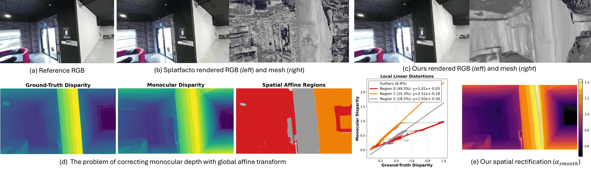
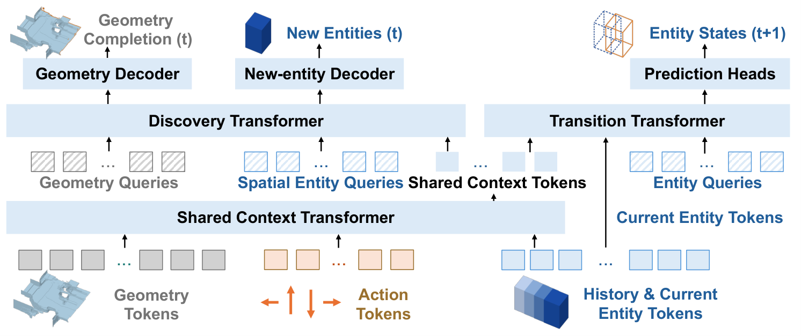

# 2026-11-09 科研日报

## 今日速览

周末没有新的 arXiv 公告，本期收的是上一轮没覆盖到的 11-05 提交，加上周末的社区动态。两条主线的共同点是：**先验再好，也要先弄清它在哪里不可靠，再决定怎么用。** 一篇处理 3DGS 几何：单目深度先验被当作「全局缩放+平移就能对齐到度量深度」来用，作者发现这个假设本身站不住，于是改成逐区域的仿射场。另一篇处理世界模型：把「世界怎么演化」和「画面怎么画」拆开，状态用显式 3D 占据网格维护，生成的图像不再回灌进状态预测，结果是整套仿真加渲染在一台 MacBook 上也能交互。

- **必读：[AffineGS](#2026-11-09--affinegs)（dConstruct Robotics、新加坡国立大学，NeurIPS 2026 录用）。** 作者先做了统计：在 MuSHRoom 与 ScanNet++ 上，Depth-Anything-V2 的视差用单一全局仿射对齐，约 41% 的像素仍对不上；把场景分成 3–5 个局部线性区域后，内点率升到 85% 以上，RMSE 约减半。据此，他们不再要求「一个缩放+一个平移」，而是用渲染深度与单目视差的空间梯度比值估计逐像素的缩放场与平移场，再用以视差为引导图的 guided filter 做边缘感知平滑；另加一个由渲染法线导出的梯度域正则，把高斯朝向也约束住。作者报告：在无传感器深度的前提下，ScanNet++ 上的深度 Abs Rel 约 0.055，而同样吃单目先验的 DN-Splatter（Monodepth）基线退化到 0.35。读它的理由是：这是对「单目先验怎么用」的一次诊断，和表示无关，对任何用 RGB↔X、MVInverse 这类预测当先验的逆渲染路线都有参考价值。
- **必读：[PlayGen2](#2026-11-09--playgen2)（香港中文大学、Tencent 等，arXiv 预印本）。** 把游戏世界拆成静态几何（体素占据网格）和带身份索引的动态实体状态，由一个世界状态模型联合学「动作条件下的实体演化、几何补全、新实体发现」，渲染交给另一个扩散渲染器，依据投影的深度与语义图出图。作者报告：Doom 原型在 M4 Pro 的 MacBook 上后端约 160 ms 延迟；未见地图零样本可用；多人和规则干预不用重新训练。读它的理由：显式 3D 状态让「编辑实体、插入规则」直接可行，而且硬件门槛低，这是低端设备上做具身 demo 时最需要的特性。局限同样明显：只在 Doom 这类简单场景验证，离真实机器人操作还很远。
- **选读：** [XM4D](#2026-11-09--others)（可证全局最优的 4D 重建，用 QCQP/SDP 松弛估计相机与非刚体形变，再初始化动态高斯）。
- **其他：** [InstantHand](#2026-11-09--others)（NeurIPS 2026）单图前馈生成可驱动的高斯手；[EDGAR](#2026-11-09--others)（TOG 录用）用一步扩散修复高斯头像的失败帧再回灌优化；[4DPS](#2026-11-09--others) 把毫米波雷达的微多普勒渲染做成可微的 4D 点 splatting。
- **圈内：** Blender 5.3 的原生高斯支持有了较完整的官方说明（EEVEE 用抖动透明、重光照仍是「发射体换 BSDF」的初级方案）；UE5 两个插件 StarLightGS 与 WallGS 让 3DGS 进入引擎光照；魔芯科技的 MoWorld 2.0 把物理要素与可编辑 4D 高斯资产绑进同一个世界模型。

## 3DGS 几何：先验有多可信，决定怎么用

### AffineGS · NeurIPS 2026 · 2026-11-05

**一句话判断：** 这篇的价值不在又多了一个深度正则，而在于它指出「单目深度用全局缩放+平移对齐」这一被广泛沿用的做法本来就不成立，并且给出了不需要传感器的修正。它的修正是局部仿射场，约束是梯度域的，对高斯的朝向也起作用，所以 mesh 提取质量上提升更明显。局限：仍然依赖基础模型本身的可靠性，镜面与透明物体上先验失效时它无能为力；也没有绝对物理尺度。

- **Title：** AffineGS: Unlocking Accurate Geometry in 3DGS via Spatially Varying Affine Rectification
- **作者：** Tze Ho Elden Tse, Jizong Peng, Richard Chen, Angela Yao
- **单位：** dConstruct Robotics；新加坡国立大学（National University of Singapore）
- **投稿信息：** NeurIPS 2026 录用（据 arXiv Comments）
- **发表时间：** arXiv 首次挂出 2026-11-05（cs.CV）
- **链接：** [arXiv abs](https://arxiv.org/abs/2611.07709) · [HTML](https://arxiv.org/html/2611.07709v1) · [项目页](https://eldentse.github.io/AffineGS/)

**摘要中译：** 3D 高斯泼溅（3DGS）已成为照片级新视角合成的主流方法，但其几何精度落后于视觉质量。现有深度引导方法试图用单目深度先验来正则优化，通常采用单一的全局缩放与平移对齐。我们发现这一假设存在根本缺陷：现代单目深度网络系统性地表现出依赖区域的分段线性畸变，这使得标准的全局对齐会因强加单一变换而扭曲场景几何。为此，我们提出空间变化的仿射矫正模型，用区域平滑、边缘感知的场把单目视差校正为一致的度量深度。我们还推导了一个法线感知的正则项，借助空间梯度把矫正后的视差与 3DGS 深度和法线耦合起来。在多种实验设置下，我们这种无需传感器的方法在保持 3DGS 良好光度质量的同时，显著提升几何精度，并超过当前几何方向的最优方法。

*图：原论文 Fig. 1（来源：[arXiv HTML](https://arxiv.org/html/2611.07709v1)）。(a–c) 标准 3DGS 的底层几何噪声较大，而该方法在保持照片级外观的同时提取出干净的网格；(d) 单目视差呈分段线性畸变，单一全局对齐不够；(e) 用边缘感知的尺度场矫正单目深度先验。*

**方法概要。**

1. **问题。** 单目网络输出的是相对视差，没有物理尺度。已有做法（如 DN-Splatter 用单目深度、以及其他深度正则方法）假设「度量深度 = 全局缩放 × 视差 + 全局平移」。作者统计发现：全局对齐在两个数据集上都留下约四成不对齐；分成 3–5 个局部区域后内点率超过 84%，说明畸变是分段线性的。
2. **局部仿射场。** 把渲染深度与单目视差的关系建模为 \(D = \alpha(x)\,\hat d + \beta(x)\)（\(\alpha\)、\(\beta\) 随像素变化）。两边对屏幕坐标求导，并假设仿射场在连贯区域内变化比深度慢，得到「视差的空间梯度与渲染深度的空间梯度成比例」，由梯度幅值之比估计局部缩放，再回代求平移。估计前对极端值按分位数截断。
3. **边缘感知平滑。** 以单目视差为引导图，用 guided filter（窗口半径在 MuSHRoom 上约 550–650 像素）平滑缩放场与平移场，使其沿物体边界分段连续；滤波后再截断，避免出现非正的缩放。
4. **梯度域法线正则。** 深度是零阶量，容易受平移歧义影响；由渲染法线和相机内参可以解析地推出深度梯度，作者据此把矫正后的视差梯度与「应有梯度」对齐（幅值 MSE 加方向余弦相似度），从而约束高斯的朝向，而不仅是位置。附录给出了完整推导。
5. **度量重对齐。** 每一轮迭代都重新估计仿射场，并用全局锚点让矫正后的深度与当前渲染对齐。

**结果与局限（作者报告）。** 在 ScanNet++ 的设置下，深度 Abs Rel 约 0.055 / 0.049（两种划分），而 DN-Splatter（Monodepth）基线约 0.354 / 0.367；新视角合成接近使用传感器深度的 DN-Splatter，并优于 2DGS、SuGaR 等无传感器显式方法。作者承认：先验在镜面、透明物体与严重域差异下失效时无法恢复几何；没有绝对物理尺度，只能对齐到 SfM 的任意坐标系；因为每步都重新对齐到当前渲染，已经存在于光度重建中的全局尺度误差无法被纠正（在一个 ScanNet++ 场景里，渲染深度比传感器深度短约 5%）。

**值得关注。**

- 第 1 节与附录 A 的统计分析：它不依赖具体方法，可以直接拿去检验自己用的单目先验是否同样「分段线性」。
- 对高斯逆渲染：材质与几何先验也常被当作「全局可对齐」来用，这个思路（先验=局部仿射，而非全局常数）值得套用到反照率、粗糙度先验上。
- 注意计算开销：每步都要估计梯度、做 guided filter，大窗口在高分辨率上不便宜；读 §C.3 的算力说明。

## 世界模型：显式 3D 状态，渲染另算

### PlayGen2 · arXiv · 2026-11-05

**一句话判断：** 这是「学出来的游戏引擎」的一种更接近真正引擎的做法：状态是显式的、可编辑的 3D 数据，画面只是状态的投影渲染，并且不反馈给状态预测，所以不会像纯视频世界模型那样累积画面误差。它在 Doom 里验证，规模很小，但把「低延迟、可编辑实体、可组合多人」这三件事同时做到了，还给出了代码和权重。对我们关心的具身仿真，它更像是一个设计范式的样本，而非可直接用于机器人的模型。

- **Title：** PlayGen2: Learning Real-Time Playable Worlds with Explicit 3D State
- **作者：** Jihai Zhang, Yuhan Zhou, Junyou Li, Deheng Ye, Qi Dou, Yu Cheng
- **单位：** 香港中文大学；Tencent；Nanyang Technological University；Wellington College
- **投稿信息：** 投稿信息未标明
- **发表时间：** arXiv 首次挂出 2026-11-05
- **链接：** [arXiv abs](https://arxiv.org/abs/2611.07867) · [HTML](https://arxiv.org/html/2611.07867v1) · [代码与权重](https://github.com/MajorDavidZhang/PlayGen-2)

**摘要中译：** 构建可玩的世界不仅需要生成逼真的视频，还需要响应迅速的控制、持久的空间结构以及与动态实体的连贯交互。把生成帧作为唯一的循环世界表示，会使这些要求与依赖视角的外观合成绑在一起，难以在生成和交互中长期保持空间与时间一致。我们提出 PlayGen2，一个实时交互的世界模型，它把学习得到的 3D 状态演化与神经渲染分开。PlayGen2 维护一份持久的世界记忆，包括用体素占据网格表示的静态几何，以及按身份索引的玩家与其他实体的 3D 状态。在固定大小的局部区域内，世界状态模型联合学习动作条件下的实体动态、几何补全与实体发现，并把更新提交到持久世界记忆。另一个独立的神经渲染器根据世界状态的深度与语义投影合成第一人称观测，而不把生成图像回灌到状态预测。以 Doom 为测试平台，我们展示模型成功学到了包括几何感知的玩家运动和玩家—NPC 交互在内的世界动力学。该框架计算高效，完整的仿真与渲染流程在配备 M4 Pro 芯片的 MacBook Pro 上后端延迟约 160 ms。除单人交互外，我们还展示了在未见 Doom 地图上的零样本部署、通过组合单人模型实现的多人交互，以及基于规则的状态干预带来的可编程玩法。这些能力体现了所学游戏世界模型的可迁移性与可扩展性。代码与预训练权重已公开。

*图：原论文 Fig. 2（来源：[arXiv HTML](https://arxiv.org/html/2611.07867v1)）。共享上下文 Transformer 编码几何、实体历史与动作；发现 Transformer 用几何查询与空间实体查询补全几何并生成新实体；转移 Transformer 预测 t+1 时刻的玩家与实体状态。*

**方法概要。**

1. **状态表示。** 静态几何用体素占据网格；动态实体（玩家、怪物、弹丸、道具）各自有带身份索引的 3D 包围体、语义类别与运动属性。物品被捡走这类「没动但状态变了」的情况也能表达。两者合起来构成持久的世界记忆，局部区域外的信息保存在记忆里。
2. **世界状态模型。** 在固定大小的自我中心局部区域内，一个共享上下文 Transformer 先编码几何、实体历史与动作；发现 Transformer 负责补全未知几何并生成新遇到的实体；转移 Transformer 预测玩家与现有实体在下一步的状态。两个过程互相提供上下文：新补全的几何为后续状态转移提供约束，玩家移动又决定下一步要补哪块未知区域。
3. **渲染分离。** 另一个扩散渲染器以世界状态投影得到的深度与语义图、动作与近期 RGB 历史为条件合成第一人称画面。生成帧只更新 RGB 历史，不进入状态预测。
4. **训练外扩展。** 不重新训练即可做未见地图部署、通过组合多个单人模型做多人、以及用规则直接改状态的可编程玩法。

**结果与局限（作者报告）。** 完整仿真加渲染约 160 ms 后端延迟（M4 Pro MacBook Pro）；论文用累计碰撞误差等指标衡量交互一致性，并展示怪物接近玩家的学习轨迹。局限：只在 Doom 一类简单几何的游戏里验证；渲染质量与保真度并非重点；离真实机器人所需的接触物理还很远。

**值得关注。**

- 「状态与渲染解耦」：对基于 3DGS 的具身仿真，同样可以把物理状态与渲染分开维护，这样渲染部分可以换成更轻的模型。
- 低端硬件：笔记本上可以交互的延迟，是它对我们最直接的参考价值；读 §实验里的延迟拆分，看瓶颈在状态模型还是渲染器。
- 实体与几何的可编辑性：规则干预直接作用于状态，比对视频做提示词控制更可靠，这对「可编辑动态资产」的方向有启发。

## 其他值得一看

- **XM4D · arXiv · 2026-11-05。** *XM4D: 4D Reconstruction through Certifiable Geometric Optimization*（Haoyu Han, Jack Benarroch Jedlicki, Jiahui Lei, Heng Yang）。把相机运动估计与非刚体形变估计拆成两步，各自写成二次约束二次规划（QCQP），用半定规划（SDP）松弛得到可验证的全局最优证书，求解器是 GPU 加速的 Burer–Monteiro 方法；非刚体部分用嵌入式形变图表示；恢复的几何再用来初始化动态高斯做光度精修。作者报告在七个基准上相机估计准确、可扩展到数千帧并取得最优新视角渲染质量。仅据摘要；投稿信息未标明，单位未核实。[arXiv](https://arxiv.org/abs/2611.07902)
- **InstantHand · NeurIPS 2026 · 2026-11-05。** *InstantHand: Feed-Forward 3D Gaussian Splatting for Animatable Hand Avatar Reconstruction from a Single Image*（Chanho Kim 等）。用现成 MANO、相机与掩码估计，前馈生成可驱动的高斯手，无需测试时优化；Soft Alpha Band 正则把监督集中在轮廓边界以减轻手指变粗，可靠性门控的外观迁移按每个高斯的渲染贡献搬运源图颜色、未观测区域用先验补全。作者报告建一个化身 2.84 秒、渲染 161 FPS，在 InterHand2.6M 上与逐对象优化的基线相当。仅据摘要。[arXiv](https://arxiv.org/abs/2611.08330)
- **EDGAR · TOG 录用 · 2026-11-05。** *EDGAR: Efficient Diffusion-Driven Gaussian Avatar Refinement via Synthetic Failure*（Kwan Yun, Minhyeok Bang, Colette Suhjung Koo, Junyong Noh）。构造「退化渲染–真值–参考」三元组数据集模拟高斯头像的失败模式，以一步扩散主干加 Sapiens 身份特征融合、混合专家结构修复伪影，再把修复后的多视角渲染当作伪目标去优化同一个高斯头像，使最终渲染不必逐帧再跑修复。仅据摘要。[arXiv](https://arxiv.org/abs/2611.07909)
- **4DPS · 审稿中 · 2026-11-05。** *4D Point Splatting for mmWave Radar Micro-Doppler Differentiable Rendering*（Adnan Armouti, Guanyue Qian, Rajalakshmi Nandakumar）。把场景表示成带材质、法线与速度的有向点，splat 到距离与多普勒 bin 里，输出雷达真实记录的原始复数回波；作者报告在 HuPR 与 RT-Pose 上重建达到最优，下游位姿模型用渲染数据训练后在真实数据上的误差为 21.9 cm，对照真实数据训练为 16.7 cm。属于高斯类渲染向非光学传感器的外延。仅据摘要；Comments 为「Under Review」。[arXiv](https://arxiv.org/abs/2611.08342)

## 圈内新闻与社区反应

**Blender 5.3 原生高斯：官方说明与局限（图形学）。** 5.3 版本说明与[开发者博客](https://code.blender.org/2026/10/splatting-the-gaussians-into-blender/)把方案讲得比较清楚：高斯被实现为点云的一种类型，属性是位置、三维缩放、四元数旋转和「radiance」（球谐系数，不是颜色）；支持 PLY、SPZ，以及通过 USD、glTF 导入，暂不支持导出；Workbench、EEVEE、Cycles 都能渲染。EEVEE 采用抖动透明而不是排序/分块，实现简单但噪声大，需要提高采样数；重光照目前只是把默认发射体换成漫反射等 BSDF，而辐射度本身是视角相关的，官方也承认以后可能要做反照率提取。已知局限包括：假设高斯在 sRGB 空间训练，而 Cycles/EEVEE 在线性空间，低不透明度高辐射度处不准；「应用变换」尚未处理缩放、旋转和球谐属性。为什么值得关注：这是开放 DCC 工具第一次内置高斯，但「可编辑」目前只停留在点云层面，真正的资产级编辑与重光照仍要靠外部研究补齐；在低功耗设备上高重叠度渲染也是官方点名的短板。[Creative Bloq](https://www.creativebloq.com/3d/blender-5-3-finally-gets-game-changing-native-gaussian-splat-support)对此做了更普及的介绍。

**UE5 的高斯插件：StarLightGS 与 WallGS（图形学 · 实时）。** 据 [3D&4D NEWS 11-08 期](https://izutsuya.io/3d4d-news/en/2026/11/08/)：CoSTAR National Lab 开源了 StarLightGS（MIT 协议，UE5.7 及以上，beta），把 3DGS 渲染进 GBuffer，用引擎自带灯光与阴影重光照；WallGS 在 Fab 上架，支持 UE5.3–5.8、PLY 与 SOG、4DGS、Quest，并能生成碰撞，高级版含重光照。为什么值得关注：把高斯当作「场景的一部分」而不是烘焙背景，是进入实际生产管线的前提；但两者的重光照能力和真实性目前只有厂商描述，缺少对比评测。

**魔芯科技 MoWorld 2.0：物理要素与可编辑高斯资产（具身 · 世界模型）。** 据[量子位 11-08 的报道](https://hub.baai.ac.cn/view/59468)，魔芯科技 11 月 4 日在乌镇的世界互联网大会上发布 MoWorld 2.0：把重力、弹力、浮力、光照、柔体、流体、刚体等十余种物理要素放进同一个世界模型，通过「物理高斯渲染器」与多专家预测（物理、像素、高斯三类信息）实现，输出可继续编辑与渲染的 3D/4D 高斯资产；在华为昇腾 NPU 上实时视频推理约 70 FPS，高斯资产渲染最高约 500 FPS，手机端约 100 FPS。以上指标都是团队自述，来自媒体采访，没有论文或独立评测。为什么值得关注：它和 PlayGen2 恰好走了两条路：一条是把物理和资产表示作为模型的显式输出，一条是把状态显式化而渲染另算；二者共同的结论是，世界模型的「输出格式」正在从视频转向可编辑的 3D 状态。

**speridlabs「Idol」：单图生成最多约 105 万个高斯（3DGS）。** 据 [3D&4D NEWS](https://izutsuya.io/3d4d-news/en/2026/11/08/03.html)，该模型在 Hugging Face 发布，输出标准 3DGS .ply，峰值显存标注 7.2GB，需要 NVIDIA GPU，使用前需同意两个受限模型（DINOv3 与 FLUX.2-dev）的条款；单张耗时从 B300 上的 3.4 秒到 RTX 3080 上的 46 秒不等。基准和速度均为发布者自测，也没有找到论文或技术报告，训练数据和方法未公开。为什么值得关注：从单图出 .ply 的门槛已经降到消费级显卡，但质量尚无第三方验证。

## 覆盖说明

日报发布日为 **2026-11-09（周一）**。周末没有新的 arXiv 公告，本期收录此前未覆盖的 11-05 提交（cs.GR、cs.CV 与关键词检索：3DGS、逆渲染、神经渲染、重光照、可编辑动态资产、具身仿真），并与已收录清单去重。AffineGS（2611.07709）与 PlayGen2（2611.07867）核对了 arXiv HTML 中的方法与实验部分，配图为原论文插图；「其他值得一看」仅据摘要与 arXiv Comments。圈内动态来自 Blender 官方文档与博客、3D&4D NEWS、量子位（经智源社区转载）；本期没有检索到值得摘录的新 Ke-Sen / SIGGRAPH 条目。所有实验数字均为作者或厂商报告，未独立复现。

**编写：** Cream
