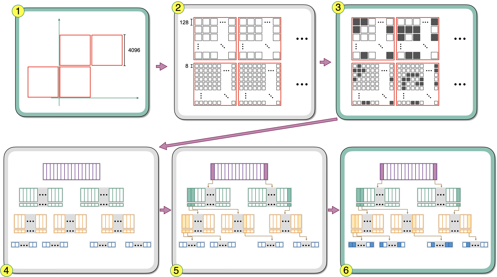
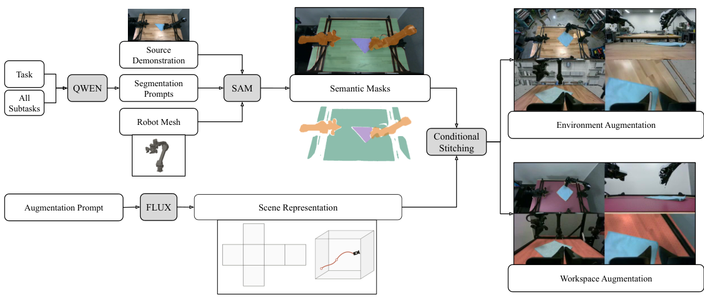

# 2026-11-10 科研日报

## 今日速览

周一的 arXiv 公告收的是上周四、周五（11-05、11-06）的提交，图形学方向整体偏少，没有新的 3DGS 逆渲染主线论文。本期的重心因此落在两件「基础设施」上：一个是 GPU 上稀疏体素网格终于能动态改拓扑，另一个是机器人示教的视觉增强从「逐帧生成」改成「生成一次场景资产再按相机几何渲染」。两者共同的思路是：**把昂贵的东西做一次、做成显式结构，然后靠几何和数据布局把它复用到每一帧。**

- **必读：[NanoVDB 动态拓扑与按体素顺序处理](#2026-11-10--nanovdb)（NVIDIA、University of Wisconsin-Madison，ACM TOG 45(6)）。** NanoVDB 是 Blender Cycles、Houdini、RenderMan 等都在用的 GPU 稀疏体素格式，过去只能读不能改拓扑，所以动态模拟只能回到 CPU 的 OpenVDB 或者每步整棵树重建。这篇用「位掩码草稿区 + 前缀和一次性分配」把膨胀、剪枝、合并、粗化/细化做成 GPU 上的批量操作，作者报告 5.67 亿活跃体素的膨胀只要 2.0 ms；另用一个「体素块管理器」把活跃体素当成扁平序列来遍历，绕开树遍历带来的线程发散。读它的理由：稀疏体素是高斯与辐射缓存、TSDF 重建、碰撞距离场的共同底座，它给出了「动态稀疏结构在 GPU 上怎么组织才能接近带宽上限」的完整工程答案，并附有 TSDF→ESDF 的机器人感知用例。
- **选读：[Augmentron](#2026-11-10--augmentron)（University of Pennsylvania、UC Berkeley、Scale AI，NeurIPS 2026 机器人学习 workshop）。** 不对每帧每个相机分别跑生成模型，而是用时间中值估出干净背景、让 FLUX 生成一张俯视工作台图和一套六面环境贴图，再按标定的相机位姿（含腕部相机）渲染并把机器人与任务物体原像素贴回去。作者报告：用一半增强数据替换一半真实数据，三项真机任务在干扰物分布外条件下的合并成功率从 18.0% 升到 45.3%，处理耗时约为视频时长的 0.93 倍。读它的理由：这是低成本具身数据增强里「几何一致」做得最朴素也最省的一种，消费级机器上就能复现思路；局限是背景只用平面和立方体贴图近似，没有真实三维结构和光照一致性。
- **其他：** [Meituan-Robotics-0](#2026-11-10--others)（美团桌面操作 VLA，开放代码与权重）；[几何纹理分割](#2026-11-10--others)（Pacific Graphics 2026）；[蒙皮角色自穿插实时修复](#2026-11-10--others)。
- **圈内：** Chaos Corona 16 正式支持让高斯泼溅接受场景光照（重光照），商业渲染器已经把「高斯进入传统光照」做成了一个开关；开源一键本地训练工具 OOOSplat 受到关注；LLM 侧，llama-modchip 声称在 64 GB 内存、无显卡的机器上跑 2840 亿参数的 DeepSeek-V4-Flash，Hacker News 上对 1.71 bit 量化的质量争论很集中。

## 稀疏体素基础设施：让 GPU 上的拓扑也能动

### NanoVDB 动态拓扑 · ACM TOG 45(6) · 2026-11-05

**一句话判断：** 这不是一篇「新表示」论文，而是把一个已经被工业界广泛采用的数据结构补上了最关键的缺口：GPU 上的动态拓扑。它对我们的意义在于方法论：稀疏结构的拓扑变化和数据载荷分开处理，拓扑用位运算批量重建，数据用扁平序列流式访问。凡是需要在 GPU 上维护稀疏体素（辐射缓存、光探针网格、TSDF、高斯的空间索引）的系统都可以借鉴。局限：算子是按「时代」（epoch）批量更新的，不适合逐体素细粒度插删；论文评测以模拟和重建为主，没有渲染缓存类的直接用例。

- **Title：** Dynamic GPU Voxel Grids and Voxel-sequential Processing in NanoVDB
- **作者：** Eftychios Sifakis, Francis Williams, Christopher Horvath, Rohan Sawhney, Mark Harris, Jonathan Swartz, Ken Museth
- **单位：** NVIDIA；University of Wisconsin-Madison
- **投稿信息：** ACM Transactions on Graphics 45(6)（据 arXiv HTML 页的期刊元数据，DOI 10.1145/3842564）；TOG 第 6 期通常对应 SIGGRAPH Asia 2026 论文，但论文页未写会议名，此处不作推断
- **发表时间：** arXiv 首次挂出 2026-11-05（cs.GR）
- **链接：** [arXiv abs](https://arxiv.org/abs/2611.08665) · [HTML](https://arxiv.org/html/2611.08665v1) · [PDF](https://arxiv.org/pdf/2611.08665)；项目页与代码在论文中未单列（NanoVDB 本身属于开源的 OpenVDB 项目）

**摘要中译：** 我们为 NanoVDB 数据结构引入两项基础性改进：GPU 原生的动态拓扑更新，以及一种显著加速稀疏网格上逐点算子与模板（stencil）算子的「按体素顺序访问」范式。NanoVDB 的线性化内存布局已经带来了很强的 GPU 性能，fVDB 框架提出的 Index-Grid 概念又实现了拓扑与数据的分离和稀疏机器学习负载中最紧凑的存储。然而，此前所有版本的 NanoVDB 都假设拓扑是静态的，这使它无法用于模拟和动态几何处理。我们通过一组动态拓扑算子消除了这一限制：形态学膨胀、网格合并、剪枝，以及跨分辨率的粗化与细化。这些算子使用位并行算法，能在几毫秒内重建含数亿体素的网格。我们还为处理稀疏数据的 GPU kernel 引入了按体素顺序访问的范式与数据结构：把活跃体素作为一条扁平的线性序列来流式处理，尽量减少乃至消除树遍历。这使计算密度与规整性足以让复杂的模板算子也接近显存带宽峰值，而存储开销很小。二者合起来解除了 NanoVDB 的只读限制，使它成为动态 GPU 模拟与几何处理的高性能主表示。我们在三维重建、流体模拟和大规模网格体素化等应用的基准上评估了这些新算子。

*图：原论文 Fig. 4（来源：[arXiv HTML](https://arxiv.org/html/2611.08665v1)）。拓扑算子的统一流程：先给出保守覆盖结果的候选根块（每块 \(4096^3\) 体素）；为每个根块分配稠密位图草稿区，标记哪些下层节点（\(128^3\)）和叶节点（\(8^3\)）需要存在；随后按位图统计节点数、一次性分配新网格并并行重建父子连接；最后才按具体算子写入活跃体素标记并更新元数据。绿框是随算子变化的步骤，灰框是所有算子共用的步骤。*

**先补两个背景。** VDB 是一种固定深度、分支因子很大的稀疏体素树：根节点用哈希表管理覆盖 \(4096^3\) 体素的根块，往下是 \(128^3\) 的「下层节点」和 \(8^3\) 的叶节点。OpenVDB 是它的 CPU 版本，节点在堆上分配、靠指针连接，改拓扑很方便但不适合 GPU；NanoVDB 把整棵树压成一块连续缓冲区、用相对偏移寻址，GPU 读取很快，代价是建好之后只能读。fVDB 提出的 Index-Grid 进一步把「哪些体素是活跃的」（拓扑）和「每个体素存什么值」（数据载荷，放在一个独立的线性「边车」数组里）分开。

**方法概要。**

1. **问题。** 动态模拟（比如流体的窄带水平集，每一步界面移动后活跃区域都要变）需要频繁改拓扑。在 NanoVDB 里过去唯一的办法是把活跃坐标导出来、再整体重建一棵树，代价随体素数线性增长，还要搬运大量数据。另一方面，GPU kernel 惯用「一个线程块处理一个叶节点的 512 个体素槽」，叶节点越稀疏，空转的线程越多，负载也不均衡。
2. **拓扑变化按批次进行。** 作者采用「批同步」模型：先集体决定这一轮哪里要变（例如水平集预计会移动多远），再一次性生成一个新的、合法的拓扑，然后在新拓扑上继续计算。五个算子是：膨胀（把活跃集合向邻域扩一圈）、剪枝（按掩码删除体素）、合并（两个网格取并集）、粗化（每轴 2:1 下采样）和细化（粗化的伴随）。一次窄带更新就可以写成「先保守膨胀、在固定拓扑上更新数值、再剪掉跑出带宽的体素」。
3. **用位图草稿区重建树。** 如图所示，算子先给出候选根块，每个根块配一块稠密位图，用一个比特表示某个下层节点或叶节点「需要存在」。不同算子只在「标记哪些节点要存在」和「最后填哪些活跃体素」两步上不同，其余步骤（统计、前缀和、一次性分配、连接重建、元数据更新）全部共用。这样设计的理由是：在 GPU 上逐个分配节点会产生大量原子操作和碎片，而先在稠密位图里标记、再用前缀和算出每个节点的最终位置，可以一次分配完整个新网格，内存布局也天然保持线性化。
4. **位并行膨胀。** 叶节点是 \(8^3\) 体素，正好可以用 512 位掩码表示。膨胀时，作者为每个叶节点算出它对 26 个邻居叶节点的「影响掩码」，再把「按叶节点排列」的数据转置成「按模板偏移排列」（原论文 Fig. 6），让一个 warp 里的线程协作做位运算。作者指出，只要模板半径不超过 8 个体素（叶节点边长），都可以这样处理。
5. **按体素顺序访问（体素块管理器）。** Index-Grid 里每个活跃体素都有一个连续编号。作者把编号序列切成固定宽度（如 32）的块，为每块记录它跨越了哪几个叶节点（用一个跳转位图记录叶节点边界）。kernel 启动时，一个块内的线程在共享内存里并行解码出「每个体素属于哪个叶节点、在叶内的偏移」，然后每个线程正好处理一个活跃体素，不再有空转槽位。对模板运算还有一个优化：五阶 WENO 模板（流体模拟中常用的高阶差分格式）有 19 个采样点，但最多只会碰到 4 个叶节点，所以先批量取出这几个邻居叶节点，再用无分支的 warp 同步运算算出 19 个点的编号。

**为什么有效（作者解释与编辑推理分开）。** 作者的核心论点是一个带宽下界：5.67 亿体素的膨胀如果用「拓扑和数据绑在一起」的方式实现，光是读写 32 位数据就要搬运约 4.7 GB，在该 GPU 1792 GB/s 的峰值带宽下至少需要 2.63 ms，而纯拓扑的实现只用了 2.0 ms，说明任何携带数据的实现都追不上。编辑推理：这其实就是 Index-Grid「拓扑与数据分离」的回报，拓扑只有每体素 1 比特，数据可能是几十字节，改拓扑时不碰数据，是这套设计最值得借鉴的地方。

**结果与局限（作者报告）。** 在 12 个分辨率的火焰前沿水平集上（最大 5.67 亿活跃体素），膨胀比此前最好的 NanoVDB 重建路线快 183 倍、比 OpenVDB 的 CPU 多线程实现快 76 倍，显存少 139 倍（356 MiB 对 48.2 GiB）；剪枝快 12.1 倍和 10.6 倍。WENO5 重新初始化中，体素块管理器保持约每秒 200 亿次体素更新，叶节点越稀疏相对传统访问器的优势越大，最高 1.98 倍。三维重建上，在单张 48 GB 的 RTX 6000 Ada 上，KITTI 序列的占据栅格可做到 5 mm 体素、23.5 亿活跃体素，Replica 室内 TSDF 做到 3 mm，而对照的 nvblox 与 Open3D 在更粗的体素尺寸上就到了上限（这是「能跑到多细」的比较，不是同尺寸下的速度比较）。作者承认：形态学腐蚀尚未实现；不规则形状的模板难以享受位并行加速；每个可能涉及的根块要预留约 16 MB 位图草稿区。

**值得关注。**

- **对正向渲染效率：** 辐射缓存和光探针网格都需要「随场景和视角变化增删格子」，本文的「拓扑按批次重建 + 数据放边车 + 按体素顺序遍历」是一个现成的组织方式。读 §3.1–3.2 的流程和 §4 的块解码。
- **对重建与具身：** §5.1 和附录 B 用同一组算子拼出了 TSDF 融合到欧氏距离场（ESDF，用于碰撞检查与路径规划）的完整流程，并测了动态场景中移动车辆不再累积进持久网格的「衰减」策略，可直接对照 nvblox。
- **计时范围：** 各项加速只计 kernel 墙钟时间，且在高端工作站 GPU 上测得；消费级显卡上的绝对数字需要自己再测。

## 具身数据增强：生成一次，按几何渲染到每一帧

### Augmentron · NeurIPS 2026 Workshop (WRL) · 2026-11-06

**一句话判断：** 方法很朴素，正因为朴素才有参考价值：它说明在「换背景、换桌面」这类增强上，几何一致性比生成质量更重要，而几何一致性只需要机器人的运动学、相机标定和一个能复用的场景资产。它的上限也正由这个朴素决定：背景只是平面加立方体贴图，没有视差、没有光照交互，反光桌面、阴影、遮挡关系都不会随之改变。

- **Title：** Augmentron: Scalable Multi-View Visual Augmentation for Robot Learning
- **作者：** Tanay Tandon, Aseem Doriwala, Jade Choghari, Catherine Weaver, Pragna Mannam
- **单位：** University of Pennsylvania；University of California, Berkeley；Scale AI（部分作者为 Scale AI 实习期间完成）
- **投稿信息：** 已接收于 NeurIPS 2026 第 8 届机器人学习 workshop（WRL）（据 arXiv Comments），非主会论文
- **发表时间：** arXiv 首次挂出 2026-11-06（cs.RO）
- **链接：** [arXiv abs](https://arxiv.org/abs/2611.09145) · [HTML](https://arxiv.org/html/2611.09145v1) · [PDF](https://arxiv.org/pdf/2611.09145)；论文中未找到项目页或代码链接

**摘要中译：** 在视觉上过于单一的示教数据上训练的机器人策略，会对与任务无关的环境特征变得敏感。现有的生成式增强方法可以引入视觉多样性，但逐帧、逐相机视角地独立处理，计算代价高，且可能在不同相机与时刻之间产生不一致的观测。我们提出 Augmentron，一个几何感知的流程：它生成可复用的场景表示，并按记录下来的相机位姿进行渲染。这样得到的环境与工作台变化在时间和多视角上都是一致的，同时保留机器人、任务物体、动作与标注不变。在三项真实操作任务上，把一半真实训练数据替换为 Augmentron 数据，能同时提升在分布外干扰物与分布外工作台变化下的成功率。在与其他增强方法的单独对比中，Augmentron 在全部三种条件下取得最高的合并成功率。结果表明，在训练配方中加入增强数据有助于策略泛化到动态的真实环境。

*图：原论文 Fig. 2（来源：[arXiv HTML](https://arxiv.org/html/2611.09145v1)）。任务标注与机器人几何先确定哪些区域必须保持不变（受保护区域）；随后生成一份场景表示，按每个相机的位姿渲染，再与原示教中的受保护像素合成，得到环境增强或工作台增强。*

**方法概要。**

1. **问题。** 视觉增强的目的是让策略不依赖与任务无关的外观（墙、桌面纹理、杂物）。已有生成式做法（如 RoboEngine）对每一帧、每一个相机单独分割并生成，成本随轨迹长度和相机数线性增长，而且同一时刻两个相机看到的「新背景」可能对不上，腕部相机视角不断变化时更明显。视频生成模型能保证时间连贯，但多相机之间的一致仍然困难，代价也更高。
2. **输入与输出。** 输入是已录制的多相机示教（本文为两个固定相机和两个腕部相机）、每一时刻的机器人关节状态、相机标定，以及任务的语言标注。输出是同一条轨迹的新视频，动作、语言标注、时间戳全部原样保留，所以可以直接混入训练集。
3. **第一步，确定什么不能动。** 用正运动学把机器人网格放到记录的姿态，再用标定的相机参数投影，得到每一帧的机器人掩码，必要时用分割修正。任务物体与桌面由一个指令调优的语言模型把任务描述转成分割提示词，再交给 SAM 3（Meta 的可提示分割模型）分割。固定相机的桌面掩码在时间上可以复用，腕部相机则每帧单独估计。
4. **第二步，生成一次可复用的场景资产。** 在多帧里排除受保护像素后取逐像素的时间中值，因为机器人和物体一直在动，某帧被挡住的地方在别的帧里往往能看到，中值就近似得到一张「没有前景的干净背景」。把它和一句增强描述交给 FLUX 图像生成模型，生成两样东西：一张俯视的工作台图像和一套六面立方体贴图（cubemap，用六张朝向坐标轴的图表示周围环境）。
5. **第三步，按几何渲染并合成。** 固定相机的背景只需渲染一次。腕部相机则用机器人状态和标定外参算出每一帧的相机位姿：换桌面时，把生成的桌面贴图投影到标定好的桌面平面上再渲染；换环境时，把立方体贴图映射到周围场景再渲染。最后把原示教中受保护的机器人和物体像素贴回去。所有相机共用同一份场景资产，这就是时间与多视角一致性的来源，而生成模型只需要每条轨迹调用一次左右。

**怎样使用。** 增强数据只用于训练：策略是从 π₀.₅（Physical Intelligence 的通用机器人动作策略）用 LeRobot 库微调而来，部署时只吃真实相机图像，不需要场景资产或掩码。

**结果与局限（作者报告）。** 三项任务为把杯子放到碟上、叠毛巾、把花插进花瓶，共 1793 条真实示教（约 9.16 小时）；每个任务、每种配方、每种条件做 50 次真机试验。在数据量与训练步数都匹配的对比中（30k 步），用一半增强数据替换一半真实数据后，合并成功率在原分布从 66.7% 到 76.7%，加干扰物时从 18.0% 到 45.3%，把木桌换成反光钢面时从 50.7% 到 67.3%。45k 步时，Augmentron（3 倍有效数据量）在三种条件下都高于 RoboEngine 与随机遮罩噪声基线（各 2 倍数据量），但数据量并不匹配。处理四路视频的耗时约为原视频时长的 0.93 倍，同硬件上 RoboEngine 为 16.28 倍。作者也指出：增强比例加大不一定更好（3 倍数据量在原分布和换桌面条件下反而下降），每个配方只有一个训练种子，结论只能算初步。编辑判断：花瓶任务在各配方下都偏低、波动大，说明这类纯外观增强对精细接触任务帮助有限。

**值得关注。**

- **对低成本具身 demo：** 整个流程只需要运动学、标定、一个分割模型和一次图像生成，没有三维重建，消费级机器就能跑，是「数据增强回路」最容易起步的基线。
- **与高斯类场景增强的对照：** 把立方体贴图换成 3DGS 场景、把「贴回原像素」换成带遮挡与光照的合成，就是更进一步的方向；本文的反光钢面实验恰好暴露了「只换外观、不改光照」的上限。
- 读 §3.3 腕部相机的渲染与 Table 1 的逐任务结果，注意哪些提升来自数据量而非方法。

## 其他值得一看

- **Meituan-Robotics-0 · arXiv · 2026-11-05。** *Meituan-Robotics-0: A Vision-Language-Action Foundation Model for Desktop Manipulation*（Meituan Robotics Team：Caicheng Wang, Chen Zhao 等 37 人；美团）。面向固定底座桌面操作的视觉-语言-动作（VLA，即从图像和语言指令直接输出机器人动作的模型）基础模型：1.47 亿视觉语言样本加 15,060 小时、覆盖 12 种机器人本体的轨迹；三阶段训练依次是离散动作 token 预训练、流匹配（flow matching）连续控制的中期训练、真机后训练。提出 Rollback：把被人工接管替换掉的那段策略动作留作负样本、人工修正作正样本，用于带分类器自由引导的 DAgger（一种「策略执行、人来纠正、再训练」的模仿学习循环），无需学价值函数。作者报告 RoboTwin 2.0 成功率 93.6%，网线插入任务 70%。项目页给出代码与权重。投稿信息未标明。仅据摘要与第三方转述核实。[arXiv](https://arxiv.org/abs/2611.08577)
- **几何纹理分割 · Pacific Graphics 2026 · 2026-11-06。** *Segmenting Geometric Textures of 3D Meshes*（Weidan Xiong, Kaijie Qu, Shihao Feng, Shunqi Fan, Rongyu Xiong, Hui Huang）。针对网格表面的「中层」几何纹理（浮雕、编织等重复起伏，而非语义部件），建立基准并微调 SAM 3 做多视角二维分割，再按 DINO 特征相似度聚类、提升到三维；附带按分割结果编辑模型与按纹理检索的交互工具。单位未核实。仅据摘要。[arXiv](https://arxiv.org/abs/2611.08897)
- **蒙皮角色自穿插实时修复 · arXiv · 2026-11-06。** *Real-Time Self-Penetration Repair for Skinned Characters with Soft Contact Budgets*（Yifei Zhu）。一个不需训练的后处理模块：先在单 CPU 核上解局部二次规划修正姿态，再对最终蒙皮网格做有上限的「软组织压缩」，按身体部位分配姿态与皮肤各承担多少修正。作者报告在 320 段未见动作、3 种体型上，手与躯干穿插深度超过 20 mm 的帧比例从 15.53% 降到 0，两层合计每帧约 2.29 ms。与可绑定动态资产相关，单位与投稿信息未标明。仅据摘要。[arXiv](https://arxiv.org/abs/2611.09693)

## 圈内新闻与社区反应

**Chaos Corona 16：高斯泼溅可以接受场景光照了（图形学）。** Chaos 的建筑可视化渲染器 Corona 16 于 11 月 4 日正式发布（[官方发布说明](https://documentation.chaos.com/space/CRMAX/1436221661/16.0.0)，[CG Channel 11-09 报道](https://www.cgchannel.com/2026/11/chaos-releases-corona-16-for-3ds-max-and-cinema-4d/)）：新增「让高斯泼溅接受场景照明」的选项，另有裁切蒙版、SPZ 压缩格式支持、3ds Max 原生高斯对象渲染和曝光控制；产品经理的介绍视频提到了高斯的自阴影。官方没有说明重光照的原理（例如是否从辐射度里估计反照率），按 Blender 5.3 的公开说明，同类实现多是把发射体换成 BSDF 的近似做法，这里只能存疑。社区反馈：暂未找到可核实的独立使用反馈。为什么值得关注：继 Blender 5.3 之后，商业离线渲染器也把「高斯参与场景光照」做成了开关，工业界对「可重光照高斯」的需求已经很明确，而真正的材质分解仍是研究要补的空白。

**OOOSplat：一键本地训练高斯泼溅的开源桌面应用（图形学 · 工具）。** 国内开发者 OOOLab 的 [OOOSplat](https://github.com/ooolabdev/ooosplat)（Apache 2.0）把抽帧（FFmpeg）、相机位姿估计（COLMAP）和高斯训练（Brush）打包成一个安装包，支持 Windows、Apple Silicon macOS 与 Ubuntu，素材和训练全在本机，输出 PLY、SOG、SPZ 或单文件 HTML 播放器；最新版 0.7.1 加入了补拍、图片 GPS 辅助尺度等功能。11 月 9 日 [Hamidun News](https://news.hamidun.com/en/news/15634/ooosplat-turns-smartphone-video-into-a-3d-scene-locally-in-o) 的介绍提醒：项目较新，复杂场景下的稳定性与质量反馈还很少，CPU 回退只适合试用。开发者本人九月在 [r/GaussianSplatting](https://www.reddit.com/r/GaussianSplatting/comments/1wfa53y/okay_lets_build_an_opensource_oneclick_gaussian/) 的发帖属作者宣传，不算独立反馈。为什么值得关注：在没有好显卡的条件下，它是把手机视频变成高斯场景最省事的本地流程之一，适合快速做演示素材。

**llama-modchip：64 GB 内存、无显卡跑 2840 亿参数模型（LLM）。** 开源项目 llama-modchip 声称把 DeepSeek-V4-Flash（2843 亿总参数、每 token 激活约 132 亿的混合专家模型）压到平均每权重 1.71 bit、56.56 GiB，在 16 核 Zen 5 CPU 上生成约每秒 9–15 个 token。据 [LLMs Blog 对讨论的汇总](https://www.llms.blog/posts/llama-modchip-deepseek-64gb-reactions)，11 月 8 日的 Hacker News 帖子到 9 日获 418 分、188 条评论：多数人质疑如此低比特的量化质量（「4/5 bit 以下都很差」），也有用户报告在 64 GB DDR4 的笔记本处理器上稳定每秒 12–14 token；X 上有人核对后认为内存账算得对，但指出 README 中「无损」只是同一个文件在改与未改运行时之间比较，且冷启动处理两万多 token 的提示要约 8 分钟。至今没有人公开与完整模型的质量对比。为什么值得关注：大模型「能装下」已经不是瓶颈，质量与预填充速度才是，本地部署的取舍需要看这类独立核对。

## 覆盖说明

日报发布日为 **2026-11-10（周二）**，内容覆盖 **2026-11-09（周一）** 的 arXiv 公告，即 11-05、11-06 的提交（cs.GR 全部新条目，以及 cs.CV、cs.RO 中与 3DGS、逆渲染、神经渲染、重光照、可编辑动态资产、具身数据增强相关的关键词条目），并与已收录清单去重。本日公告中没有新的 3DGS 逆渲染主线论文。NanoVDB 动态拓扑（2611.08665）与 Augmentron（2611.09145）核对了 arXiv HTML 中的方法与实验部分，配图为原论文插图；「其他值得一看」仅据摘要、arXiv Comments 与公开转述。圈内动态来自 Chaos 官方发布说明与 CG Channel、OOOSplat 仓库与相关报道、LLMs Blog 对 Hacker News 与 X 讨论的汇总；Blender 原生高斯支持本期无新的官方进展；未检索到值得摘录的新 Ke-Sen / SIGGRAPH 条目。所有实验数字均为作者或厂商报告，未独立复现。

**编写：** Cream
