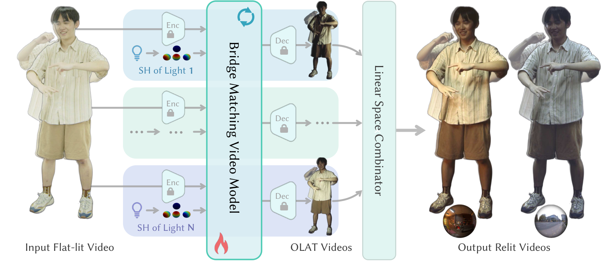
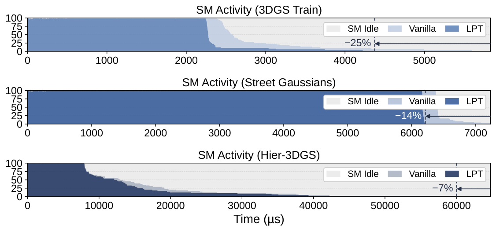

# 2026-11-11 科研日报

## 今日速览

周二的 arXiv 公告收的是上周五到周日（11-06 至 11-09）的提交。和逆渲染主线最近的一篇来自浙江大学，而且已经是 SIGGRAPH Asia 2026 的期刊论文；另一篇是很「工程」的 3DGS GPU 调度论文，不改模型、不重训，就能把光栅化里被少数重 tile 拖住的长尾砍掉。两篇放在一起看，共同的思路是：**把难的部分变成显式、可组合的基元**。前者把重光照拆成「每个方向一段 OLAT 视频」再线性叠加，后者利用 alpha 混合可以按深度分段合成，把一个过重的 tile 拆给多个线程块做。

- **必读：[DynOLAT](#2026-11-11--dynolat)（浙江大学、Cornell University、4DV.ai、蚂蚁集团、之江实验室，SIGGRAPH Asia 2026 期刊论文 / ACM TOG 45(6)）。** 不让扩散模型直接「生成一张重光照后的视频」，而是从平光照视频预测一组单灯（OLAT，One-Light-At-a-Time，即每次只亮一盏灯）基视频，再按环境贴图在线性空间里加权求和。这样光照方向由「第几个基」决定，相对强弱由环境贴图权重决定，都不再靠模型去猜。另外还采了第一个动态全身 OLAT 数据集（2400 万帧、224 组人物-服装）。读它的理由：这是「把光传输的线性性留在模型外面」的一个干净示范，和高斯逆渲染里「材质与光照解耦」是同一个问题的两种回答；局限也很直接：每个基都要单独跑一遍视频扩散，101 个基在 8 张 A100 上要 14–27 分钟。
- **必读：[3DGS 的 SM 级负载不均衡](#2026-11-11--smbalance)（Korea Advanced Institute of Science and Technology）。** 作者用 Nsight 量出：屏幕 tile 之间的高斯数可以差 55–6100 倍，少数重 tile 让大部分 SM（流多处理器）在帧尾空等。解法是持久化 kernel 按「最重的先做」派发 tile，再把离群的重 tile 按深度切成几段、交给多个线程块并行混合，最后合成。作者报告驾驶场景平均提速 1.23 倍、Hier-3DGS 城市场景平均 2.93 倍，画质差异在 0.0015 dB 以内。读它的理由：这是纯调度层面的优化，2DGS、3DGUT、Hier-3DGS 都能直接用，和剪枝、SwiftGS 等也能叠加；对我们关心的「正向批渲染效率」，它提醒了一个容易被忽略的瓶颈：问题不总是总量，而是分布。
- **其他：** [ClearForm](#2026-11-11--others)（透明界面 + 背后场景的共享平面高斯重建）；[FastGRT](#2026-11-11--others)（高斯光线追踪训练提速 1.9–5 倍，Vulkan 实现，开源）；[RigidGS](#2026-11-11--others)（WACV 2027，物体解耦后在 Quest 2 上做刚体交互）；[ZARA](#2026-11-11--others)（单图前馈可驱动、可重光照的人体高斯）；[TransArt3D](#2026-11-11--others)（两张端点图 + 视频过渡先验重建铰接资产）；[无路径的体积光传输推断](#2026-11-11--others)；[AF-NTC](#2026-11-11--others)（神经纹理压缩的各向异性过滤）；[可微物理模拟综述](#2026-11-11--others)。
- **圈内：** Blender 5.3 于 11 月 10 日正式发布，原生高斯泼溅进入稳定版，但重光照只是「把发射换成漫反射 BSDF」的粗略近似，早期用户实测「灯光基本不起作用」；Niantic Spatial 给高斯场景加了「物体可移动」测试功能，面向机器人仿真的布局变化；具身侧，NVIDIA 在 CoRL 发布 GR00T 2 并计划开源，蚂蚁灵波开源触觉基础模型 LingBot-Touch。

## 重光照：把光传输的线性性留在模型外面

### DynOLAT · SIGGRAPH Asia 2026（ACM TOG 45(6)）· 2026-11-08

**一句话判断：** 这篇最有价值的不是网络结构，而是问题的拆法。直接以环境贴图为条件生成重光照视频的方法（DiffusionRenderer、UniRelight 等），常常把重光照做成了「外观协调」：阴影方向会漂、亮度不跟着光源强弱走。DynOLAT 把模型的任务缩小为「给定一个方向，预测这盏灯下的样子」，剩下的交给物理上精确的线性叠加，可控性因此由构造保证。代价是计算量随基的数量线性增长，而且输入必须近似平光照，野外视频要先过一个作者自己也说「还很初步」的去光照模块。

- **Title：** DynOLAT: OLAT Video Prediction for Controllable Dynamic Full-Body Relighting
- **作者：** Taoming Liu, Yinji ShenTu, Guangzhao He, Yudong Jin, Yukang Ye, Siyu Zhang, Fan Jia, Wei Hua, Hujun Bao, Xiaowei Zhou
- **单位：** 浙江大学 CAD&CG 国家重点实验室；Cornell University；4DV.ai；蚂蚁集团；之江实验室
- **投稿信息：** 已接收于 SIGGRAPH Asia 2026 期刊论文（据 arXiv Comments「Journal Track」），ACM TOG 45(6)（据 arXiv HTML 页元数据，DOI 10.1145/3842500）
- **发表时间：** arXiv 首次挂出 2026-11-08（cs.CV）
- **链接：** [arXiv abs](https://arxiv.org/abs/2611.11210) · [HTML](https://arxiv.org/html/2611.11210v1) · [PDF](https://arxiv.org/pdf/2611.11210) · [项目页](https://zju3dv.github.io/DynOLAT)；代码与数据集是否公开未在论文中核实到

**摘要中译：** 准确的光照响应是逼真的动态人体重光照的关键，因为阴影、高光与颜色变化应在方向和相对强度上都跟随目标光照。现有基于学习的重光照方法能生成观感合理的视频，但光照响应常常不准确：阴影和高光可能偏离目标方向，输出亮度也未必忠实地跟随目标环境中的相对强度，使结果更接近外观协调而非可控重光照。为此，我们提出 DynOLAT，一个面向动态全身人体、可泛化的 OLAT 视频预测框架。我们的方法不直接合成单一的重光照外观，而是从平光照输入预测时间一致的 OLAT 基视频，再根据目标环境贴图对这些基做线性组合。这种基于 OLAT 的表述让方向响应在预测的基中显式化，而相对光照强度则由环境贴图导出的线性权重决定。我们还提出了一套动态采集流程，以及首个大规模动态全身 OLAT 数据集，包含来自 224 组人物-服装组合的超过 2400 万帧（同一人的不同服装记为不同组合）。实验表明，与所测试的基线相比，DynOLAT 对目标光照方向与相对强度的变化响应更为忠实，实现了可控的视频重光照。

*图：原论文 Fig. 2（来源：[arXiv HTML](https://arxiv.org/html/2611.11210v1)）。平光照视频经冻结的视频 VAE 编码后，送入可训练的桥匹配视频模型；每个目标光照方向以球谐编码作为条件，分别生成一段 OLAT 视频；最后由线性空间组合器按环境贴图权重叠加，得到任意环境下的重光照视频。*

**方法概要。**

1. **问题拆分。** 光传输对光源是线性的：任何环境光照下的外观，都等于各方向单灯外观按该方向入射辐射加权求和。光场舞台（LightStage）的「基于图像的重光照」就是这样做的，但它需要真的在每盏灯下拍一遍。DynOLAT 用一个视频模型代替拍摄：输入平光照视频和一个光照方向，输出这个方向下的 OLAT 视频；对 101（或 201）个方向各跑一次，就得到一组基。
2. **用桥匹配而不是加噪去噪。** 以往的扩散重光照把输入帧和高斯噪声拼在一起去噪，随机性会让纹理细节漂移，也会扰动本应由方向决定的阴影和高光。作者借用 LBM（潜空间桥匹配）的做法：直接从平光照视频的潜变量出发，学习一条把它「运送」到 OLAT 潜变量的确定性轨迹，噪声强度只设 0.001。输入和输出逐 token 对齐，模型只需学「与光照相关的残差」。骨干是 Wan 视频扩散模型。
3. **光照方向怎么输入。** 把世界坐标下的光照方向转到输入视频的相机坐标系，再拼接三阶球谐编码，经零初始化的线性层加到时间步嵌入上，通过 AdaLN 调制每个 transformer 块。作者认为这比输入阴影图或光源图更省、也没有几何歧义。
4. **保住高频细节。** 桥匹配保留了输入的大部分结构，但会过度平滑高频（发丝、褶皱、锐利的阴影边界），而这些恰恰会在之后的线性叠加中被放大。作者从四方面补救：图像与视频联合训练（静态子集画质更高）、动态分辨率、像素空间监督、调整采样步数。
5. **长视频。** 训练时上下文长度固定。推理时用滑动窗口，并把上一窗口已经生成的 OLAT 潜变量作为「历史上下文」，在当前窗口重叠区域里直接覆盖为对应的桥状态，作者称之为「循环桥上下文」，用来消除窗口边界的闪烁。
6. **线性组合。** 把环境贴图按「最近的基方向」划分区域，积分每个区域的线性 HDR 辐射得到权重，逐帧在线性色彩空间里加权求和；每张环境贴图再乘一个全局缩放（通常取 3）来匹配采集时的动态范围。

**数据是怎么来的。** 一个人不可能同时处在两种光照下，所以作者在 LightStage（800 多颗 LED 分成 101 个可单独寻址的灯组，灯光时钟 35 ms）上用时分复用：平光照帧与 OLAT 帧快速交替，再用相邻平光照帧之间的光流把 OLAT 帧对齐过去，得到像素对齐的训练对。他们还发现若一个采集过程中只用一个固定方向，模型会把光照和动作纠缠在一起，所以每段交替使用空间上相距最远的两个方向，并保证每个人的完整采集里 101 个灯各用一次。动态子集用 68 台 4K 60 fps 相机，静态子集用 70 台 Blackmagic 相机拍完整 OLAT 序列，用于定量评测。

**结果与局限（作者报告）。** 静态子集上的图像重光照（各通道按真值均值重新缩放以消除光照强度与表面颜色之间的尺度歧义），DynOLAT 的 PSNR / LPIPS 为 26.23 / 0.0567，对照的 DiffusionRenderer 为 23.11 / 0.0900、UniRelight 为 22.91 / 0.0928、LBM 为 23.08 / 0.1002。定性对比中，作者展示了旋转点光源下阴影方向更准、低强度区域不会出现其他方法的偏色。计算量：1280×720、57 帧的视频，单个基约 61 秒；8 张 A100 并行生成 101 个基约 14.5 分钟，1920×1088 下约 27 分钟。训练用 8 张 A100 约一周。作者承认：输出质量受视频 VAE 重建上限约束，快速大幅运动时面部与布料细节会糊；平光照输入的假设限制了直接用于普通视频，去光照模块去不干净的投影和彩色光会被当成材质或几何响应；基的数量越多，生成时间与存储越大。编辑判断：「101 个方向 + 最近邻划分」本质上是对环境光的分段常数近似，高频光照（如硬阴影的锐利边界）的精度受基数量限制，这和光场舞台本身的限制一致。

**值得关注。**

- **对逆渲染主线：** 它代表了和「高斯 + 材质 + 渲染方程」完全不同的一条路线：不显式恢复材质与几何，而是学习光照的线性基。二者的分界在于：这条路线天生只对「被拍摄的那个人在拍摄视角下」成立，不能换视角、不能放进新场景做二次反射。读 §3.6 与 Tab. 2 时可以想想：如果把 OLAT 基当作监督信号去蒸馏一个可重光照的高斯表示，是否能兼得两边的好处。
- **对数据：** §4 的时分复用 + 光流对齐 + 双方向交替采集，是「怎样拍出像素对齐的成对光照数据」的实用方案；动态全身 OLAT 数据此前非常稀缺。
- **对比方法的选择：** 它和 DiffusionRenderer、UniRelight 的对比，恰好揭示了「以环境贴图为条件直接生成」路线的系统性问题（方向漂移、强度不守恒），值得作为评估重光照可控性的检查项。

## 正向渲染效率：问题不在总量，在分布

### 3DGS 的 SM 级负载不均衡 · arXiv · 2026-11-09

**一句话判断：** 这是一篇系统论文，思路简单但切中要害：按 tile 光栅化的 3DGS 默认「一个 tile 一个线程块」，由硬件调度器决定先后，而硬件不知道哪个 tile 重。作者用持久化 kernel 接管调度，再利用 alpha 混合按深度分段可组合的性质把重 tile 拆开。它不改场景表示、不重训、几乎不改画面，所以可以作为任何 tile 式高斯渲染器的「免费」加速层。局限是收益完全取决于每帧的不均衡程度：均衡的场景只有 1.03–1.10 倍，而且只优化 alpha 混合这一阶段，不涉及排序、投影或训练。

- **Title：** Mitigating SM-Level Load Imbalance in 3D Gaussian Splatting on GPUs
- **作者：** Junha Ryu, Hoi-Jun Yoo
- **单位：** Korea Advanced Institute of Science and Technology（School of Electrical Engineering）
- **投稿信息：** 投稿信息未标明（HTML 版式为 ICML 模板，但模板不等于投稿，此处不作推断）
- **发表时间：** arXiv 首次挂出 2026-11-09（主类 cs.DC，交叉列入 cs.GR、cs.CV）
- **链接：** [arXiv abs](https://arxiv.org/abs/2611.12319) · [HTML](https://arxiv.org/html/2611.12319v1) · [PDF](https://arxiv.org/pdf/2611.12319)；论文中未找到代码链接

**摘要中译：** 3D 高斯泼溅（3DGS）可以在普通 GPU 上实现照片级的实时渲染，并越来越多地用于生成式世界模型和自动驾驶仿真器。然而，现有优化要么依赖需要重新训练的算法改动，要么依赖难以适应不断演化的 3DGS 变体的专用加速器。本文指出 GPU 上 3DGS 渲染的一个根本性低效：屏幕 tile 之间工作量不均导致严重的 SM 级负载不均衡。这种不均衡造成很长的执行尾巴：少数 SM 处理计算密集的 tile 时，大多数 SM 处于空闲，大规模城市场景尤甚。为此，我们提出一种软件定义的 GPU 调度方法来缩短执行尾巴。该方法用持久化 kernel 优先调度重 tile，并有选择地把离群 tile 切块分给多个 CTA（线程块）。一个轻量的逐帧策略利用渲染管线中已有的 tile 统计量决定何时切、切多少。该方法既不需要重训，也不需要专用硬件，并可与现有优化正交叠加，适用于多种 3DGS 变体。按场景平均，它在大规模城市场景上把 alpha 混合提速最高 2.93 倍，在最不均衡的帧上最高 5.6 倍，同时保持原有的 alpha 混合公式不变。

*图：原论文 Fig. 7(b)（来源：[arXiv HTML](https://arxiv.org/html/2611.12319v1)）。三个代表帧（3DGS 的 Train、Street Gaussians、Hier-3DGS）的 SM 活动时间线：浅色为原始调度，深色为「最重的先做」（LPT）调度。原始调度下，帧尾只有少数 SM 在忙，LPT 把尾巴分别缩短约 25%、14% 和 7%。Hier-3DGS 一帧的缩短最少，说明单靠调度顺序救不了极端重的 tile，这正是后面要切块的原因。*

**方法概要。**

1. **先量化问题。** 作者在 19 个场景上统计每个 tile 覆盖的高斯数：标准基准里最大与最小相差 55–605 倍，大规模城市与驾驶场景超过 6100 倍。但偏斜不等于 GPU 闲置，所以他们又用 Nsight Compute 采样 SM 活动时间线（原论文 Fig. 5），确认确实有长尾：一帧的大部分时间里只有少数 SM 在跑。
2. **持久化 kernel + 最重优先（LPT）。** 不再「一个 tile 启动一个线程块」，而是只启动 GPU 能同时驻留的那么多个线程块，每个线程块循环地从一个按高斯数降序排列的队列里取下一个 tile。这样重 tile 一开始就被处理，不会恰好排在最后。高斯数是渲染管线里本来就有的统计量，排序代价很小。
3. **按深度切块 + 饱和信号。** 调度只改变 tile 什么时候开始，不改变它要跑多久，极端重的 tile 仍然在关键路径上。作者利用 alpha 混合的可组合性：一个 tile 里按深度排好序的高斯可以切成几段连续区间，各段分别混合出颜色和剩余透射率，再按前后顺序合成，结果与原公式相同（只差浮点累加顺序）。切开后会失去「透射率足够低就提前终止」的优化，所以作者加了「饱和信号」：前面的段一旦饱和就通知后面的段停止。
4. **只切最重的，并与其余 tile 并发。** 全部切块在均衡场景下反而有额外开销，因此只切最重的若干个 tile，它们的分块在一个单独的 CUDA 流里与 LPT 调度的其余 tile 并发执行，由硬件调度器动态分配 SM。
5. **逐帧在线策略。** 一个轻量成本模型根据每个 tile 的高斯数，在每帧决定切几个 tile、每个切几段，也可以选择不切。作者把它与事后挑选的「最优固定配置」和「逐帧最优配置」对比，在线策略接近后者。

**结果与局限（作者报告）。** 在 NVIDIA GB10（48 个 SM）和 RTX A6000（84 个 SM）上，对 13 个标准场景（Mip-NeRF 360、Tanks & Temples、Deep Blending）、15 段驾驶序列（nuScenes、Argoverse 2、PandaSet、Waymo，经 OmniRe 重建，gsplat 渲染）、NVIDIA NuRec 的 3DGUT 场景以及 Lyra 2.0 生成的场景测试：alpha 混合阶段在驾驶场景平均提速 1.23 倍、标准基准 1.12 倍，单帧最高 3.20 倍；nuScenes 005 上达 1.77 倍，而仅用 LPT 只有 1.06 倍；Hier-3DGS 城市场景平均 2.93 倍、单帧最高 5.64 倍；NuRec 的 3DGUT 视角 1.22–1.31 倍，可与 SwiftGS、HiGS 叠加。画质上，即使对每个 tile 都切块，24 个场景的 PSNR 差异最大 0.0015 dB，驾驶与 NuRec 的每一帧相对原渲染器都在 76 dB 以上。作者承认：只优化推理时的 alpha 混合阶段；收益随每帧不均衡程度变化，Waymo 等均衡序列仅 1.03–1.10 倍；成本模型的常数在所有 GPU 上共用一套，未逐卡标定。编辑提醒：报告的是 alpha 混合阶段的加速比，不是整帧加速比；预处理与排序占比高的场景，整帧收益会被稀释。

**值得关注。**

- **对正向批渲染效率：** 我们关心的批量渲染（多视角、多光照）同样是 tile 式混合，尤其是大场景和近景里出现大量重叠半透明高斯时，长尾问题只会更明显。§4.2 的「按深度分段 + 饱和信号」与渲染器实现方式几乎无关，可以直接移植到自己的 CUDA 光栅化器中。
- **对低端显卡：** SM 数越少，一个重 tile 拖住整帧的比例越高，但也越难切开并发。论文只测了 48 和 84 个 SM 的两张卡，消费级入门显卡上的收益需要自己测。
- 读 §3 的测量方法（Nsight SM 活动时间线），这本身就是诊断自己渲染器瓶颈的好工具。

## 其他值得一看

- **ClearForm · arXiv · 2026-11-07。** *ClearForm: Shared-Surface Gaussian Splatting for Transparent and Opaque Scenes*（Hajeong Lee, Jong-Il Park）。玻璃等透明界面的颜色大多来自背后的场景，若用同一个依赖透明度的 alpha 同时控制颜色合成和几何合成，「看清背景」就会削弱透明面对几何的贡献，作者称之为「几何-外观合成两难」。做法是共享的平面高斯配两套不透明度：几何合成里保留界面的存在，RGB 合成里建模透射与稀疏反射；再用「双证据生命周期」决定高斯的保留（多视角几何或 RGB 重建任一方支持即保留）。作者报告 3D-FRONT-T 上倒角距离 27.05 mm，对照的 PGSR 复现为 59.18 mm。与逆渲染中「透明/反射表面几何」的难点直接相关。单位与投稿信息未标明。仅据摘要。[arXiv](https://arxiv.org/abs/2611.10370)
- **FastGRT · arXiv · 2026-11-08。** *FastGRT: Accelerating Training of 3D Gaussian Ray Tracing*（Meet Banthia, Xiaoteng Liu, Hexu Zhao, Aurojit Panda, Jinyang Li）。高斯光线追踪（3DGRT 一类，可做反射、折射、非针孔相机）训练远比光栅化慢，作者分析后认为很大一部分代价来自计算的组织方式：把光线遍历和混合解耦，前向的遍历结果在反向中复用，再加快速梯度累加和混合式 BVH 更新。用 Vulkan 实现，作者称是首个同时支持训练与渲染的 Vulkan 版高斯光线追踪；训练比 3DGRT 快 1.9–4.97 倍，渲染公式不变。代码开源。和「正向效率」与「用光追做逆渲染」都有关。单位与投稿信息未核实。仅据摘要。[arXiv](https://arxiv.org/abs/2611.11586)
- **RigidGS · WACV 2027 · 2026-11-06。** *RigidGS: Geometry-Aware Object Decoupling for Rigid-Body Interaction in 3D Gaussian Splatting*（Paul Sansah Gyreyiri, Diksha Shukla）。指出物体感知的 3DGS 把几何与物体标签放在一起优化时，标签梯度会把边界高斯标错；做法是先用深度与时间信息修正 SAM2 掩码，再在训练前用 COLMAP 投影投票确定每个高斯属于哪个物体并冻结，掩码只用于监督几何。LLFF/NVOS 上分割与边界 IoU 提升 7.7 和 14.5 个百分点，并在 Meta Quest 2 上不经网格提取实现实时刚体操作。已接收于 WACV 2027 应用方向（据 arXiv Comments）。与「拆分绑定的可编辑资产」相关。仅据摘要。[arXiv](https://arxiv.org/abs/2611.10199) · [项目页](https://gyreyirisansah.github.io/rigidgs)
- **ZARA · arXiv · 2026-11-07。** *ZARA: Zero-shot Animatable and Relightable 3D Avatar reconstruction from a single image*（Yixiao Chen, Dongdong Weng, Chengfeng Zhao, Tao Gong, Zhihe Zhao, Zhe Zhu, Yue Liu, Yuan Liu）。在预训练的大型人体重建模型上接一个「材质 Transformer」，单张图前馈地输出可驱动的高斯人体及其本征属性，数十秒完成、无需逐人优化；没有真值材质图，就用伪材质标签做条件与监督，并用面部正则约束反照率。和今天的 DynOLAT 正好构成对照：一个走显式材质，一个走光照基。单位与投稿信息未核实。仅据摘要。[arXiv](https://arxiv.org/abs/2611.10562)
- **TransArt3D · arXiv · 2026-11-08。** *TransArt3D: From Two States to Articulated 3D Reconstruction with Video Transition Priors*（Chenhao Guan, Liying Yang, Xinxing Yu, Hao Mo, Tianshun Han, Renjun Gao, Yanyan Liang）。只给两张端点状态图（如柜门关与开），用视频扩散生成中间过渡帧，再把这种「物体怎么动」的二维先验转成显式部件与关节运动学：跨帧联合施加静态 3D 先验、用整流流（rectified flow）细化三维运动场，最后按恢复的关节把两张图融合到同一个规范表面上贴图。作者报告在 PartNet-Mobility 上优于同样只用两个端点的方法，并在多项指标上超过使用六个状态的方法。与具身仿真的铰接资产相关。单位与投稿信息未核实。仅据摘要。[arXiv](https://arxiv.org/abs/2611.11304)
- **无路径的实时体积光传输推断 · arXiv · 2026-11-09。** *Real-Time Volumetric Light Transport Inference without a Path*（Ludwic Leonard, Ruediger Westermann）。不对路径追踪的噪声结果去噪，而是只用主光线特征和环境光采样这些廉价量，由带注意力的图像到图像网络直接推断最终像素辐射；在图像空间运算，开销几乎不随体积密度和相机远近变化，在体积云场景实时运行。和「用廉价特征替代昂贵光传输」的辐射缓存思路相近。单位与投稿信息未核实。仅据摘要。[arXiv](https://arxiv.org/abs/2611.12103)
- **AF-NTC · arXiv · 2026-11-09。** *Explicit LOD-Conditioned Anisotropic Filtering for Neural Texture Compression*（Shin Fujieda, Takahiro Harada）。神经纹理压缩无法使用 GPU 纹理单元的过滤，作者让解码器以硬件采样器用的三个量（短轴尺度即 LOD、长宽比、长轴方向）为条件，沿长轴取一串采样点、在短轴方向做层级混合，并用各向异性过滤的真值训练。在全 BC7 mip 链 25% 的体积下，十组材质-场景都优于不做各向异性过滤的三线性 BC7（+1.3 至 +7.6 dB）。单位与投稿信息未核实。仅据摘要。[arXiv](https://arxiv.org/abs/2611.12650)
- **可微物理模拟综述 · arXiv · 2026-11-09。** *Same Physics, Different Gradients: A State-of-the-Art Report on Differentiable Physics Simulation*（Lei Shu, Zizhou Huang 等 18 人，含 Miles Macklin、Leonidas Guibas、Gordon Wetzstein、Jeannette Bohg、Chenfanfu Jiang）。按两条轴给可微模拟器分类：返回的导数「属于哪个对象」（实际执行的有限计算、它逼近的收敛方程、还是连续动力学）与反向传播「怎样实现」（自动微分、方程级伴随、手写伴随）；另单列接触这类不光滑映射的分类，并在同一测试平台上测量梯度失效的四种机制。35 页，适合作为「从视频反推物理参数」类工作的入门地图。投稿信息未标明（据格式推测为 STAR 类综述）。仅据摘要。[arXiv](https://arxiv.org/abs/2611.12162)

## 圈内新闻与社区反应

**Blender 5.3 正式发布，原生高斯泼溅进入稳定版（图形学）。** 11 月 10 日，Blender 5.3 正式发布（[官方发布页](https://www.blender.org/releases/5-3/)，[渲染部分发布说明](https://developer.blender.org/docs/release_notes/5.3/rendering/)）：可导入 PLY 与 SPZ 格式的高斯，存为点云，用几何节点处理，Workbench、EEVEE、Cycles 都能渲染；同一版本还加入了 DLSS 4.5 光线重建降噪，Vulkan 成为 Windows 与 Linux 的默认后端（[Phoronix](https://www.phoronix.com/news/Blender-5.3-Released)）。按开发者博客（[Splatting the Gaussians into Blender](https://code.blender.org/2026/10/splatting-the-gaussians-into-blender/)）的说明，EEVEE 用抖动透明度做随机混合、Cycles 把不透明度当作接受概率，因此需要提高采样数；重光照只是把发射节点换成漫反射 BSDF，法线取高斯最短轴方向（思路与 PGSR 的「压扁高斯」相同），而颜色仍是带视角依赖的辐射度，开发者自己也写了「之后可能要做反照率提取」。官方列出的限制：性能不理想、假设训练在 sRGB 空间、低不透明度高辐射区域不正确、不能导出、Apply Transform 会破坏高斯属性。社区反馈：日本的 LOCAHUN 3D 用 1720 万个高斯的涩谷十字路口扫描实测（[测试报告](https://locahun3d.com/en/works/blender-53-native-3dgs.html)），在 RTX 5090 上 1080p、64 采样时 EEVEE 约每帧 1.7 秒、Cycles 约 2.6 秒，内存 3.2 GB、显存增加约 5 GB，结论是「适合做背景板和预演」，但灯光几乎不起作用、深度通道约 7.5–8.4% 的像素缺失、导出丢色；r/GaussianSplatting 上也有用户在测试版阶段反映重光照会出方块状伪影、细节不如第三方插件 Splatlight。为什么值得关注：至此 Blender、Corona 等主流工具都已经能「把高斯放进场景」，但几乎所有人都卡在同一处：高斯里烘焙的是光照，不是材质。这正是逆渲染研究要补的空白，也说明一个可以直接导入 Blender 的「带材质高斯」格式会很有用。

**Niantic Spatial：让高斯场景里的物体可以移动（具身 · 仿真）。** 据 [Radiance Fields 11-10 报道](https://radiancefields.com/niantic-spatial-makes-splat-objects-movable-in-simulation)，Niantic Spatial 推出「物体交互」测试功能：识别场景中可分离的候选物体，提取、清理后单独表示，附带碰撞信息和估计的简化物理属性，从而在同一个采集场景里生成不同布局，用于测试机器人导航、避障和抓取。它与九月推出的重光照功能（只针对对齐的网格重算每个高斯的球谐系数，碰撞与导航网格因此可以沿用）配合，可同时改变布局和光照；目前只对其具身 AI 套餐的部分客户开放，每家最多 10 个场景。社区反馈：暂未找到独立的使用反馈。为什么值得关注：这是商业侧对「可拆分、可重光照的高斯仿真场景」需求的直接表态，做法（分离 + 简化物理 + 只改球谐的重光照）也给出了一个工程上的下限，研究工作可以以它为对照。

**具身：GR00T 2 与 LingBot-Touch（具身智能）。** 据[量子位 11-10 报道](https://www.qbitai.com/2026/11/509032.html)，NVIDIA GEAR 团队在 CoRL 上发布新一代「世界动作模型」GR00T 2，同时预测未来画面与机器人动作；预训练混合了约 40 万小时人类第一视角视频、约 1 万小时手持 UMI 夹爪示范和 2.35 万小时机器人遥操作，并展示了从人类动捕、UMI 夹爪、手部外骨骼示范直接迁移到未训练过该任务的机器人（报道中的成功率为 60%–65%），模型、数据、仿真环境和采集硬件将陆续开源，10 万小时人类数据已先开放。同日，[蚂蚁灵波开源触觉基础模型 LingBot-Touch](https://www.qbitai.com/2026/11/508996.html)（[GitHub](https://github.com/Robbyant/lingbot-touch)）：近 5000 小时真实触觉数据，覆盖磁、视、压阻三类传感器，按传感原理分设编码入口后映射到统一的指尖坐标空间；在两款灵巧手 26 项真机任务上，四种动作模型接入后平均成功率提高约 14–26 个百分点，轻量版约 530 万参数。[机器之心的报道](https://www.morerss.com/%E6%9C%BA%E5%99%A8%E4%B9%8B%E5%BF%83)同时提到它的局限：真机验证只有两款灵巧手，预训练未覆盖电容式传感器。社区反馈：两者都还是官方与媒体口径，暂无独立复现。为什么值得关注：两者都在把「不依赖特定机器人本体的数据」做成可复用资产，人类视频与跨传感器触觉正在取代纯遥操作，成为具身数据的主体；对缺少真机的条件来说，这类公开数据与小模型比大型真机平台更有用。

## 覆盖说明

日报发布日为 **2026-11-11（周三）**，内容覆盖 **2026-11-10（周二）** 的 arXiv 公告，即 11-06 至 11-09 的提交（cs.GR 全部新条目，以及 cs.CV、cs.RO 中与 3DGS、逆渲染、神经渲染、重光照、可编辑动态资产、铰接重建、具身仿真相关的关键词条目），并与已收录清单去重。DynOLAT（2611.11210）与 SM 级负载不均衡（2611.12319）核对了 arXiv HTML 中的方法、实验与局限部分，配图为原论文插图；「其他值得一看」仅据摘要与 arXiv Comments。圈内动态来自 Blender 官方发布页、发布说明与开发者博客、Phoronix、LOCAHUN 3D 测试报告与 r/GaussianSplatting 讨论、Radiance Fields 报道、量子位与机器之心报道；Blender 原生高斯支持本期随 5.3 正式发布；未检索到值得摘录的新 Ke-Sen / SIGGRAPH 条目。所有实验数字均为作者或厂商报告，未独立复现。

**编写：** Cream
