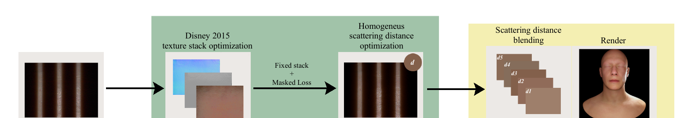
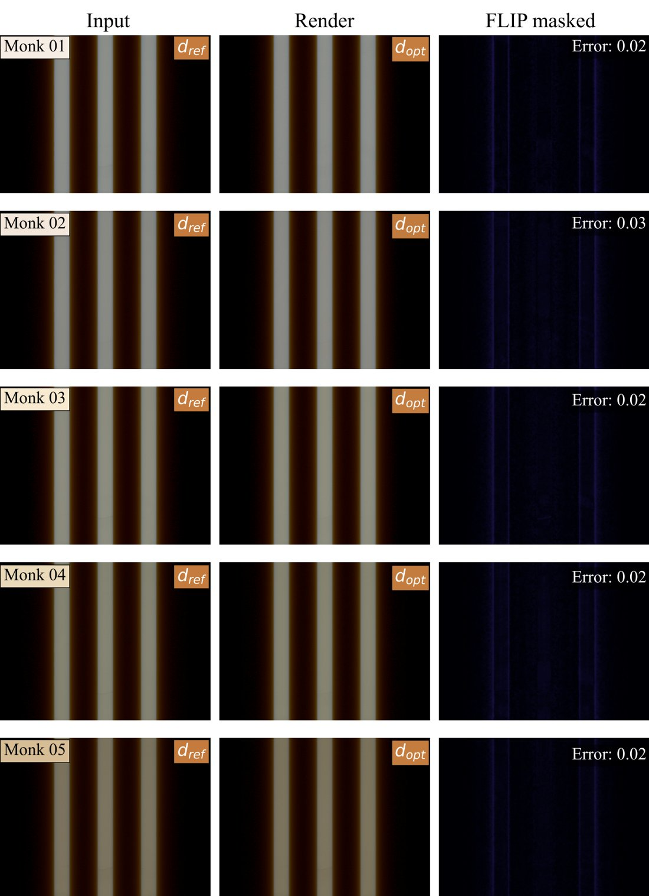
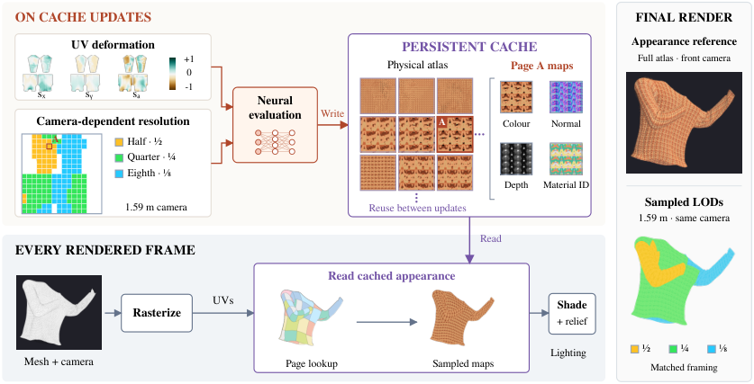
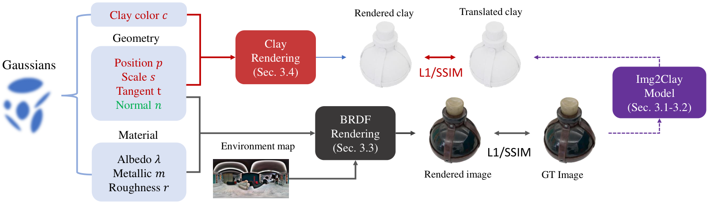

# 2026-11-12 科研日报

## 今日速览

周三的 arXiv 公告收的是 11-09 至 11-10 的提交，cs.GR 只有 6 篇新稿，但其中两篇来自同一个西班牙团队（Universidad Rey Juan Carlos，第二篇与 Adobe 合作），都在回答一个我们很关心的问题：**逆渲染或神经表示学出来的东西，怎样才能直接交给实时渲染管线用。** 一篇把皮肤逆渲染的优化目标从「物理散射系数」改成「游戏引擎 shader 里真正存在的参数」；另一篇把布料随形变变化的微几何压成一张神经纹理，但只存几何属性、不存辐射，光照和材质留给常规 shader。两篇的共同点是：**学习对象停在「着色之前」，光照仍由传统管线负责**，这样重光照与编辑都不用重训。

- **必读：[面向实时管线的可微皮肤次表面散射](#2026-11-12--skinssss)（Universidad Rey Juan Carlos、Politecnico di Milano 等，已接收于 Computers & Graphics）。** 把屏幕空间次表面散射（SSSS，游戏引擎里常用的皮肤近似）写成可微版本，用单相机、单条纹光源的低成本采集，分三阶段依次拟合高光/粗糙度、反照率与法线、散射距离，最后按面部区域混合成一张能直接放进 Unreal 一类引擎的散射距离贴图。读它的理由：这是「逆渲染结果对齐前向近似模型」的一个干净范例，和我们在高斯逆渲染里纠结的「恢复物理量还是恢复渲染器能用的量」是同一个问题；三阶段冻结策略对材质-光照解耦的病态性也有参考价值。局限是只拟合皮肤小块、不处理整张人脸几何，光源假设较强。
- **必读：[Deformable Texture Maps](#2026-11-12--dtm)（Universidad Rey Juan Carlos、Adobe，按 Eurographics/CGF 模板排版，录用未标明）。** 用一个坐标网络把「纹理坐标 + 局部拉伸/剪切」映射成不透明度、法线、深度和材质 ID 四张本征贴图，并在纹理空间缓存，只有布料真的形变时才重算。读它的理由：它示范了一种把「随状态变化的细节」从每帧渲染里拆出来的做法：网络输出与视角、光照无关，所以可以跨帧复用；这对「正向批渲染效率」和「可编辑动态资产」两条线都有启发。局限是每种织法单独训练、只覆盖面内形变。
- **选读：[Pygmalion Effect](#2026-11-12--pygmalion)（NAVER AI Lab、KAIST 等，NeurIPS 2026）。** 2025 年 11 月首挂、本周更新为 NeurIPS 2026 录用版。先用图像翻译模型把反光物体照片「变成黏土」，再让黏土分支和 BRDF 分支共享同一套高斯几何，用无反射的黏土图稳住法线。对反光物体的几何先验是现成可借的思路。
- **其他：** [RF3DGS](#2026-11-12--others)（多视角最小值先验做 3D 去反射）；[FastWild-GS](#2026-11-12--others)（野外照片集 3DGS 训练压到 9 分钟左右）；[RetinexGS](#2026-11-12--others)（低光 RAW 域高斯）；[流体资产提取](#2026-11-12--others)（TVCG 录用，单目视频反推可微 APIC 流体参数）；[Spaghetti Splatting](#2026-11-12--others)（把 3DGS 的点推广到曲线）；[SO-101 光照实验](#2026-11-12--others)（低成本机械臂上「勒克斯」不能代表策略看到的图像）。

## 逆渲染与材质：恢复渲染器能用的参数

### 可微 SSSS 皮肤数字化 · Computers & Graphics · 2026-11-10

**一句话判断：** 很多皮肤逆渲染方法用离线路径追踪估计吸收、散射系数，但这些物理量放不进游戏引擎里的近似 shader；这篇直接把引擎用的近似模型做成可微的，拟合出来的参数「拿来就能用」。代价是它恢复的只是 shader 的有效参数，不是皮肤真实的光学性质，作者对此说得很清楚。

- **Title：** A Lightweight Differentiable Method for Real-Time Skin Rendering and Digitization
- **作者：** Mario Marquez-Balduque, Carlos Rodriguez-Pardo, Jorge Lopez-Moreno
- **单位：** Universidad Rey Juan Carlos；Politecnico di Milano；Euro-Mediterranean Center on Climate Change (CMCC)；RFF-CMCC European Institute on Economics and the Environment (EIEE)（据 arXiv HTML 作者信息，个人对应关系未逐一核实）
- **投稿信息：** 已接收于 Computers and Graphics（据 arXiv Comments）
- **发表时间：** arXiv 首次挂出 2026-11-10（cs.CV）
- **链接：** [arXiv abs](https://arxiv.org/abs/2611.14451) · [HTML](https://arxiv.org/html/2611.14451v1) · [PDF](https://arxiv.org/pdf/2611.14451)；项目页与代码未在论文中找到

**摘要中译：** 皮肤的逆渲染通常依赖离线路径追踪来估计物理属性，而这些属性无法直接对应到游戏引擎等交互应用所用的近似 shader。我们通过直接估计面向实时渲染管线的次表面散射参数来弥合这一差距。我们提出一个可微的屏幕空间次表面散射（SSSS）框架，可联合优化空间变化的基础纹理与散射距离。为了考虑皮肤厚度的局部变化，我们在不同面部区域分别估计这些参数，生成可直接用于生产级实时引擎的混合散射剖面贴图。我们的流程使用低成本的单光源、单视角采集装置，便于实际获取外观。优化由一个掩码损失驱动，聚焦于次表面散射效应占主导的区域。我们在覆盖 Monk 肤色量表的 45 名真实受试者数据集上验证了方法，确保在人群间的泛化。此外，我们还用合成数据、验证单光源假设的多光源装置、以及验证角度一致性的倾斜视角配置做了补充评估。结果表明，该方法能从轻量输入中有效恢复散射参数，得到可直接用于标准实时 shader 的逼真皮肤外观。

*图：原论文 Fig. 4（来源：[arXiv PDF](https://arxiv.org/pdf/2611.14451) 第 4 页，按原图裁切）。左：条纹光照下的输入图；中间绿色框是可微光栅化器内的优化：先拟合 Disney 2015（Burley）材质贴图组，再在固定贴图组和掩码损失下拟合均匀的散射距离 d；右侧黄色框是渲染引擎：把多个皮肤小块各自拟合出的 d 按区域混合成一张散射距离贴图，最终渲染整个人头。*

**方法概要。**

1. **瓶颈在哪。** 实时引擎里的皮肤一般用 Burley 归一化扩散剖面做次表面散射：每个像素的出射光，是周围一圈像素入射光按「距离 r 处还剩多少」加权求和。美术需要手调一个「散射距离」参数，它和反照率强耦合，又没有直观参照。离线逆渲染给出的吸收、散射系数与这个参数之间没有直接换算，所以「测得准」和「引擎能用」之间断开了。
2. **可微的 SSSS。** 作者采用 Burley 剖面的双指数近似：\( R(r,d) = A\,\frac{e^{-r/d}+e^{-r/3d}}{8\pi d r} \)，其中 \(A\) 是漫反射体反照率，\(r\) 是表面上两点的三维欧氏距离（用深度缓冲重建，不用屏幕像素距离，所以与相机远近无关），\(d\) 是要拟合的散射距离。卷积在屏幕空间的圆盘里用重要性采样完成：按剖面的累积分布反解采样半径，角度用 Fibonacci 图案加随机旋转，把结构化走样变成高频噪声。整个过程写成张量运算，梯度能传到 \(A\) 与 \(d\)。作者特别说明，这个单层均匀介质模型不区分表皮和真皮，所以 \(d\) 是「这个 shader 的有效参数」，不是物理散射系数。
3. **采集。** 单相机、单投影仪：投影仪依次打出环境基线、高频条纹、宽条纹等图案。条纹边缘外侧的「光晕」就是次表面散射把光带进阴影区的证据，掩码只保留这些区域。几何来自单目深度估计，颜色经 RAW 处理与色卡校准。
4. **三阶段优化（每阶段冻结一部分参数）。** 阶段一只拟合高光与粗糙度，反照率保持聚类初始化，避免早期把光照误差烧进底色；阶段二解冻反照率与法线，吸收漫反射细节，高光残差图继续开着，防止残余高光被当成反照率；阶段三冻结所有表面贴图，只拟合 \(d\)，且损失只算阴影掩码内的像素，逼优化器只去解释多重散射光晕。作者的理由（有合成实验支撑）是：在公式里 \(A\) 的线性缩放与 \(d\) 的非线性衰减会互相补偿，一起优化就分不开。三个阶段共 1800 步，所有人、所有肤色用同一套超参。
5. **从小块到整张脸。** 每个皮肤小块拟合出一个均匀的 \(d\)；再用厚度贴图（模型越薄、越接近耳朵和鼻翼的地方权重越大）和可选的区域贴图把这些值混合成连续的散射距离贴图，按 Unreal Engine 5 的约定把 [0,1] 映射到 0–1 cm。

*图：原论文 HTML 中的合成数据渲染结果（Monk 肤色 1–5 级，来源：[arXiv HTML](https://arxiv.org/html/2611.14451v1)），展示拟合参数在浅色到中等肤色上的渲染外观。*

**结果与局限（作者报告）。** 在 45 名覆盖 Monk 十级肤色的受试者上做了拟合；合成数据上检查了 \(d\) 能否被准确找回，多光源装置用来检验「单光源也够」的假设，倾斜视角实验检查角度一致性。作者也提到深肤色的信噪比更低，所以阶段三降低了学习率。局限方面：模型是单层均匀介质；几何依赖单目深度；拟合发生在皮肤小块上，整张脸的散射贴图是混合出来的，而不是逐像素直接测得。

**值得关注。**

- **对逆渲染主线：** 我们在可重光照高斯里也面临同样的取舍：恢复物理上「真」的 BRDF 参数，还是恢复「目标渲染器复现得最好」的参数？这篇明确选了后者，并且在文中把这个选择的代价写清楚了，适合拿来对照讨论。
- **对优化策略：** §4 的三阶段冻结与「只在散射光晕区域算损失」，是在病态的材质-光照分解里人为切断耦合的具体做法，比加一堆正则项更好解释，读 Table 1 和对应的合成消融即可。
- **对采集成本：** 单相机加投影仪的条纹光方案，和我们「消费级设备完成」的约束一致。

### Deformable Texture Maps · arXiv · 2026-11-10

**一句话判断：** 它真正的贡献是一个边界清楚的分工：网络只负责「形变之后微几何长什么样」（遮挡、法线、深度、哪根纱线），不负责「看起来什么颜色」。因此输出与视角、光照无关，能在纹理空间缓存、跨帧复用，换光换色都不用重训。

- **Title：** Deformable Texture Maps: Compiling Dynamic Microgeometry into Neural Textures
- **作者：** Antonio Arian Silaghi, Zhen Chen, Danny Kaufman, Élie Michel, Jean-Marc Thiery, Jorge Lopez-Moreno, Elena Garces
- **单位：** Universidad Rey Juan Carlos；Adobe
- **投稿信息：** 投稿信息未标明。arXiv HTML 使用 EUROGRAPHICS / CGF 模板，页眉为 Volume 46 Issue 2、标注「Preprint」，推测在投 Eurographics 2027（依据仅为模板，不代表已录用）
- **发表时间：** arXiv 首次挂出 2026-11-10（cs.GR）
- **链接：** [arXiv abs](https://arxiv.org/abs/2611.13677) · [HTML](https://arxiv.org/html/2611.13677v1) · [PDF](https://arxiv.org/pdf/2611.13677)；项目页与代码未在论文中找到

**摘要中译：** 布料这类可形变材质表面的外观来自细尺度几何，而这些几何会随形变而重组。即使粗糙的模拟模型能高效恢复这些微结构，显式地实例化并渲染它们依然代价高昂。我们提出可形变纹理贴图（DTM），把形变驱动的微几何编译成连续而紧凑的神经纹理。模型把纹理坐标和局部形变映射为描述不透明度、表面法线、深度和材质 ID 的本征贴图，从而捕捉形变引起的遮挡与可见性变化。运行时，这些贴图给出形变驱动细结构的统一纹理空间表示，可直接在粗糙的形变表面上求值。由于表示编码的是几何属性而非辐射，光照与材质响应与学到的模型解耦，因此可以重光照、改着色与改材质而无需重训。我们还提出持久化的纹理空间渲染策略，缓存这些本征贴图并在形变变化时选择性更新，使神经求值与每帧渲染解耦，并能跨帧复用、与常规渲染效果结合。我们在基于纱线的纺织物上演示该方法：非线性的拉伸与剪切会改变纱线的几何、间距与遮挡。构建模型时，我们先让可平铺的纱线小块扫过形变空间，再把细节几何渲染到规范的纹理空间，最后把得到的贴图压缩成单个神经表示。得到的模型可直接在任意粗糙服装网格上求值，并接入常规着色管线，使外观在渲染时保持可编辑。

*图：原论文 Fig. 3（来源：[arXiv HTML](https://arxiv.org/html/2611.13677v1)）。上半部分只在缓存需要更新时运行：网格每个顶点的形变量（横向拉伸 sx、纵向拉伸 sy、剪切 sa）光栅化成 UV 空间的形变贴图，按相机距离给每页纹理分配分辨率，送进神经网络，结果写入持久化缓存（颜色、法线、深度、材质 ID）；下半部分每帧都运行：光栅化粗网格得到 UV，查页表、采样缓存好的贴图，再交给常规着色与视差浮雕。右侧对比全分辨率参考和实际使用的 LOD 分布。*

**方法概要。**

1. **瓶颈在哪。** 针织或梭织布被拉伸、剪切时，纱线间距、遮挡和透光都会变；如果只把静止状态的纹理贴上去，形变后就只是纹理被拉宽，透光和纱线排列都不对（论文 Fig. 6 背光对比最直观）。显式实例化每根纱线又太贵。
2. **离线「编译」微几何。** 取一块可平铺的纱线小块，在三维形变空间（两个方向的拉伸与一个剪切，剪切参数取剪切角的正弦，保证只改方向不额外拉伸）里取 8×8×8 共 512 个状态，每个状态用纱线级模拟器 MADYPG 放松到平衡，再把几何「拉回」静止小块的规范坐标里，渲染出不透明度、法线、深度、材质 ID 四张图。这样所有形变状态都对齐在同一个纹理空间。
3. **压成一个网络。** 输入是纹理坐标与形变状态拼成的五维向量 \(\mathbf{p}=(\mathbf{u},\mathbf{d})\)，先做多频段傅里叶编码，再交给正弦激活的 SIREN，同时输出 8 个通道（不透明度、法线、深度、材质 ID 编码）。材质 ID 用码本编码、推理时取最近的码字。每种织法单独训练一个宽度 128 的网络，3 万步。
4. **运行时缓存。** 因为网络输出与光照、视角无关，作者不在每个片元上跑网络，而是在纹理空间里分页缓存：页面分辨率按投影面积选 LOD；每个顶点记录上次更新时的形变，当前形变与它的最大分量差超过阈值 \(\tau\) 才把相关区域标为待更新；更新按固定频率轮转若干行组，与帧率解耦。
5. **着色。** 缓存里的法线、深度、不透明度交给常规 shader，做视差浮雕、绒毛壳层、飞纤维等效果，材质 ID 让「只改某一组纱线的颜色」变成一次贴图查找。

**结果与局限（作者报告）。** 在罗纹、方平、平针、蜂窝、缎纹五种结构上评估重建质量（不透明度、法线、深度用 PSNR，材质 ID 用准确率）。1920×1080 下与「每帧对可见片元跑网络」的延迟着色对比：布料静止时纹理空间方案帧率明显更高，因为只复用缓存；拉伸时需要更新缓存，帧率下降；拉近镜头时切换高分辨率 LOD 也会短暂下降。作者没有在正文给出单一的加速倍数，原文以 Fig. 9 曲线呈现。局限：继承了训练用微几何模型的简化（纱线是等半径圆柱，没有截面压扁、多股重排）；每种织法单独训练，只能在采样过的形变范围内插值，不能外推或跨结构迁移；形变描述只含面内拉伸与剪切，不含弯曲和局部挤压。

**值得关注。**

- **对正向渲染效率：** 「网络输出与光照、视角无关，所以可以缓存」这个判断，正是我们关心的批渲染里光传输复用的另一种形式：把昂贵的神经求值挪到状态变化时，而不是每帧。读 §3.1–3.2 的形变触发失效策略。
- **对可编辑资产：** 几何属性与外观分开存，意味着重光照、换材质不必重训，这与我们希望高斯资产「拆得开、绑得住」的目标一致。作者在局限里也提到同样的表述可用于皮肤等「微几何由局部形变决定」的材质。
- **对比阅读：** 可与本周二的 NanoVDB 动态拓扑、以及今天的皮肤 SSSS 一起看，三篇都是「把学习或模拟的产物整理成实时管线现成能消费的格式」。

## 反光物体几何先验

### Pygmalion Effect · NeurIPS 2026 · 2025-11-26

**一句话判断：** 反光物体重建难，是因为外观与几何纠缠：镜面高光会把法线带偏。这篇的办法很直接：用一个图像翻译模型先把照片里的反光「去掉」，生成像黏土一样的漫反射图，再拿它当一个不受反射干扰的几何监督。思路简单，代价是完全依赖翻译模型的质量。

- **Title：** Pygmalion Effect in Vision: Image-to-Clay Translation for Reflective Geometry Reconstruction
- **作者：** Gayoung Lee, Junho Kim, Jin-Hwa Kim, Junmo Kim
- **单位：** NAVER AI Lab；KAIST；SNU AIIS（据 arXiv HTML 作者信息）
- **投稿信息：** 已接收于 NeurIPS 2026（据 arXiv Comments，v2 更新）
- **发表时间：** arXiv 首次挂出 2025-11-26，2026-11-10 更新 v2
- **链接：** [arXiv abs](https://arxiv.org/abs/2511.21098) · [HTML](https://arxiv.org/html/2511.21098v1) · [PDF](https://arxiv.org/pdf/2511.21098)

**摘要中译：** 由于视角相关的反射使外观与几何相互纠缠，理解反射一直是三维重建中的长期难题。本文提出「视觉中的皮格马利翁效应」框架，借图像到黏土的翻译，把反光物体隐喻地「雕塑」成黏土般的形态。我们进一步引入双分支设计：基于 BRDF 的反射分支与黏土引导分支共享同一套高斯几何，但走独立的渲染路径。黏土分支由合成的黏土图监督，提供无反射的几何引导，补充 BRDF 分支的光度监督。在合成与真实数据集上的实验显示，几何与光度指标都有一致提升。除技术收益外，我们的框架表明，「去掉光泽来观看」，即把辐射转换为中性外观，可以成为学习反光物体几何的有力归纳偏置。

*图：原论文 Fig. 2（来源：[arXiv HTML](https://arxiv.org/html/2511.21098v1)）。同一套高斯几何（位置、切向、缩放、不透明度）同时被两条渲染路径使用：BRDF 反射分支拟合原始照片，黏土分支用每个高斯额外的视角无关颜色拟合翻译出的黏土图。*

**方法概要。** 第一步训练图像到黏土的翻译模型：基于 FLUX 架构的 OminiControl，配对数据一部分来自 Objaverse 资产（同一物体分别用原材质和黏土材质渲染），一部分由 FLUX 与 Nano-Banana 生成，后者用于缩小真实照片的域差异。第二步，对每张训练图生成黏土图；重建时在 BRDF 分支之外加一条黏土分支，每个高斯多一个视角无关的「黏土色」参数，两分支共享全部几何参数一起训练。作者的解释是：黏土图里没有镜面反射，梯度只会推动几何去解释明暗变化，因而能在训练早期稳住几何、改善法线。GlossySynthetic 上 Chamfer 距离平均优于对比的 SDF 与高斯方法，DTU 上也有报告；局限是翻译出错（比如把纹理误当几何）时会把错误几何带进重建（论文 Fig. 11）。

**值得关注。** 对我们的逆渲染主线，它提供了一个可直接插拔的几何先验：不改 BRDF 模型，只多一条辅助渲染路径。可与 IRGS、R3DG 一类方法对照看「几何先稳住，再拆材质」是否更稳。注意它依赖大型生成模型做预处理，消费级设备上成本主要在翻译这一步。

## 其他值得一看

- **RF3DGS · arXiv · 2026-11-10。** *RF3DGS: Reflection-Free 3D Gaussian Splatting with Self-Priors*（Qiang Wen, Guotao Meng, Junhong Ruan, Hongyu Liu, Chenyang Lei, Qifeng Chen；香港科技大学、Huawei Research）。针对隔着玻璃拍摄（如博物馆展柜）的去反射：利用「同一三维点在多视角里的最小像素值与无反射内容强相关」这一光度先验，先用普通 3DGS 加几何先验得到粗略的无反射深度，再把辅助视角按深度扭到参考视角取最小值，构造干净的透射伪标签；配合「自适应双渲染」损失保留原图高频细节。作者还用 Unity 建了首个 3D 去反射基准。仅据摘要。
- **FastWild-GS · arXiv · 2026-11-10。** *FastWild-GS: Minutes-Scale In-the-Wild Gaussian Splatting via Compact Per-Image Appearance Adaptation*（Donghun Ryu, Seokhyun Kim, Minhyeok Lee；Chung-Ang University）。每张网络照片用一个 128 维外观 token 加 6 个参数的逐通道缩放偏移描述曝光与光照差异，小 MLP 由 token 和每个高斯的特征预测颜色，替代球谐；关键细节是加密与剪枝时的打分渲染也套用同样的外观变换，避免把照片间的外观差异当成重建误差。作者报告 PhotoTourism 每场景 8.8 分钟、LPIPS 最低，比 LPIPS 次优的 AsymGS 快 23 倍。仅据摘要。
- **RetinexGS · EMBC 2026 · 2026-11-09。** *RetinexGS: Retinex-Inspired Gaussian Splatting for Low-Light RAW Reconstruction*（Yulang Fei, Huaiyuan Weng, Chul Min Yeum）。在 RAW 域做低光 3DGS：每个高斯颜色拆成视角无关的基色与共享的位置-视角调制场，用 DNG 元数据里的噪声模型加权损失，并用深度引导初始化补暗部几何。作者报告五个场景平均 sRGB PSNR 比 LE3D 高 2.18 dB。与「本征分解」思路相近但目标是去噪而非重光照。仅据摘要。
- **流体资产提取 · IEEE TVCG · 2025-03-02。** *Physics-Driven Extraction of Dynamic Fluid Asset from Monocular Video with Generative 3DGS*（Zhiwei Zhao, Yin Zhao, Minchen Li, Yixin Hu）。本周 v3 更新标注已接收于 IEEE TVCG，首次收录。不逐帧拟合形变场，而是用生成式 3DGS 得到含不可见面的初始流体几何，从表面运动估计速度场并修正成无散网格速度，再用可微 APIC 模拟反推粘度、边界与流入流出速度；输出由前向模拟驱动，因而可编辑、可交互、可延长。和上周 Physical Diffusion Policy 的「从视频反推物理参数」是同一类思路。仅据摘要。
- **Spaghetti Splatting · arXiv · 2026-11-09。** *Spaghetti Splatting: Differentiating Curvilinear Dirac Masses via Convolution*（George Shramko, Shrisudhan Govindarajan, Rudy Lam, Yizheng Xie, Daniel Rebain, David B. Lindell, Andrea Tagliasacchi；单位未核实）。上一批公告中漏收，今日补入。把「用低频核卷积狄拉克质量」这一 3DGS 配方推广到曲线：曲线用折线近似，逐段体渲染且保证相连段在关节处不重复累加，每段线性化相机投影以支持 Gaussian 之外的 Beta 核。点是长度为零的曲线，所以它严格包含 3DGS；作者称一般场景上与当前最好方法相当、在线状结构上更好，得到的长发丝可直接用于物理模拟。对头发、线缆这类具身场景里难重建的细长物体值得留意。仅据摘要。
- **SO-101 光照实验 · arXiv · 2026-11-10。** *Camera equalisation of an 11.5x drop in environmental illuminance: four imitation-learning policies on an SO-101 arm*（Simon Cowling）。在 SO-101 低成本臂上用同样 50 条示教训练 ACT、SmolVLA、Diffusion Policy、π₀.₅ 四种策略，分别在约 520 lux 和 45 lux 下各跑 10 次：成功 20/40 对 19/40，差异不显著。原因是相机自动曝光与白平衡把照度差异吸收了：前置相机平均亮度只低 3%，腕部相机低 19%。结论是报告真机实验时，相机设置与图像统计比房间照度更该记录和控制。对在消费级臂上做光照相关的数据增强或重光照评测，是一条实用的提醒。数据与代码公开（据摘要）。
- **DecompRL · arXiv · 2026-11-05。** *Topology-Aware Reinforcement Learning for CAD Decomposition toward All-Hexahedral Meshing*（Jiaming Peng 等 8 人，含 Na Lei、Xinhai Chen）。用强化学习对 CAD 模型做内部切分，使之可被全六面体网格化；动作空间加入拓扑感知的内部切分，奖励包含几何项和可网格化反馈。作者报告在四个基准中三个上成功率最高。与主线距离较远，供几何处理方向参考。仅据摘要。

## 圈内新闻与社区反应

**通用大模型直接做机器人操作的评测战升温（具身智能 · LLM）。** 据机器之心 11-11 报道（[RSS 预览](https://www.morerss.com/%E6%9C%BA%E5%99%A8%E4%B9%8B%E5%BF%83)），Anthropic 11 月 10 日发布的 Fable 5.2 在 RoboDojo Sim 双臂仿真评测中正确率 64.9%，较上一代大幅提升；而截至 11-11，该榜单 Agent 赛道第一是 10 月 30 日登榜的 Q0-Preview（任务成功率 68.87%、综合 74.2），它既不走 VLA（视觉-语言-动作模型，直接输出动作）也不走世界动作模型，而是让多模态大模型以 Agent 方式做规划、空间感知、记忆和工具调用。同日量子位以「英伟达机器人开源撞上 Fable 5.2 发布」为题报道，引用 Jim Fan 的说法「不是寒冬是夏天」（[量子位 11 月文章列表](https://www.qbitai.com/date/2026/11)）。**观点：** 「通用模型 + 工具调用」与「专用具身基础模型」的路线之争正在被同一批仿真榜单量化；不过榜单是仿真成绩，与真机的差距仍要看各自复现。

**「仿真即策略」：执行前先在重建场景里预演（具身 · 仿真）。** 同一篇机器之心报道介绍了 1011.AI（北京大学数学科学学院杨超教授领衔团队）的 MXI-SimWorld v0 Preview，在 RoboColiseum 周榜以 0.9656 综合分列第一。做法是：从头部与腕部相机识别桌面物体，检索相似的仿真资产并调整尺寸、外形与位置，搭出可交互场景；在多个并行仿真里试不同抓取姿态与路径，淘汰失败方案，再把成功轨迹带回真实场景执行。**与课题对照：** 这正是 Real→Sim→Real 回环里「检索资产 + 摆位」的轻量路线：不追求逐像素重建，而是用相似资产换取可模拟性。它回避了我们关注的外观真实感问题，但说明对决策而言几何与物理可能比外观更先需要「够用」。榜单分数为团队与媒体发布，未见独立复现。

**Blender 原生 3DGS 的已知边界（图形学）。** 昨天报道过 Blender 5.3 正式支持高斯泼溅；heise 的测评（[heise online](https://www.heise.de/en/news/Blender-5-3-imports-and-edits-Gaussian-Splats-11520011.html)）补充了几条限制：支持 PLY 与 Niantic SPZ 导入，但暂不支持导出；渲染出的颜色可能与原数据有差异；事后改光照的能力有限。**观点：** 对我们而言，这意味着 Blender 目前适合做高斯场景与网格资产的合成和预览，而「导入后重光照」仍需要外部的材质分解，正是可重光照高斯的用武之地。

## 覆盖说明

日报发布日为 **2026-11-12（周四）**，内容覆盖 **2026-11-11（周三）** 的 arXiv 公告，即以 11-09 至 11-10 为主的提交（cs.GR 全部新条目及更新条目，以及 cs.CV、cs.RO 中与 3DGS、逆渲染、神经渲染、重光照、可编辑动态资产、具身仿真相关的关键词条目），另补入上一批漏收的 Spaghetti Splatting，并与已收录清单去重。皮肤 SSSS（2611.14451）与 Deformable Texture Maps（2611.13677）核对了 arXiv HTML/PDF 中的方法、实验与局限部分；Pygmalion（2511.21098）核对了方法与实验表格；配图均为原论文插图。「其他值得一看」仅据摘要与 arXiv Comments。圈内动态来自机器之心、量子位与 heise 的公开报道，事实与观点分开标注。

**编写：** Cream
