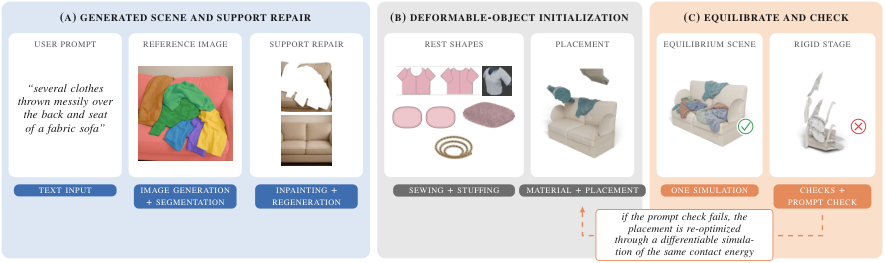
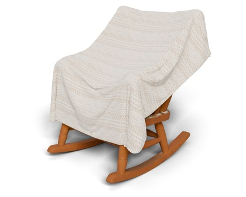
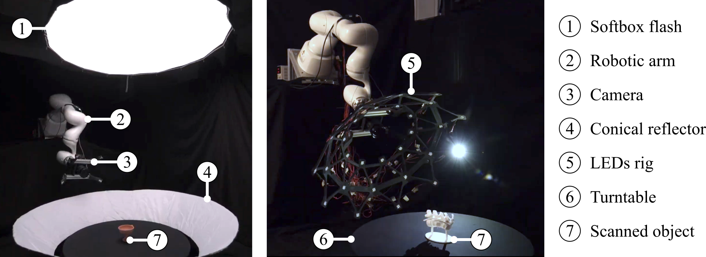
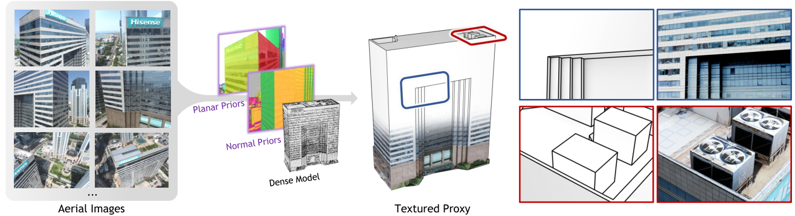

# 2026-11-13 科研日报

## 今日速览

周四没有出现新一批 arXiv 公告，今天改为回扫本周（11-04 至 11-10 提交）在 cs.GR、cs.CV、cs.RO 里漏收的稿件。回扫出来的三篇主稿方向不同，但都在追问同一件事：**一个三维资产要「能用」，除了看起来对，还要满足哪些下游约束。** SoftPAT3D 要求生成的布料能直接进仿真器；Martine 要求重建出的表面在不同采集条件下都经得起亚毫米级检验；深圳大学的建筑代理模型要求几何与纹理从一开始就对齐，而不是事后修补。

- **必读：[SoftPAT3D](#2026-11-13--softpat3d)（Stanford University，作者含 Leonidas Guibas、Gordon Wetzstein、Jeannette Bohg）。** 文本生成三维场景时，把被子、衣服、毛绒玩具、绳子这类可形变物体做成「仿真可用」的物体：从缝纫版片重建静止形状、从材料库给初始弹性参数、在统一的 IPC 接触模型下落到静态平衡，失败时再用可微仿真的伴随梯度修正摆放和材料参数。读它的理由：这正是「可编辑动态资产」与具身仿真之间缺的那一环，生成模型给出的网格往往自交、没有静止形状、没有材料，无法直接进仿真；这篇把每一样缺失的输入都补上了，65 条提示词里没有一条出现穿插。对我们来说，「生成结果先过一遍物理平衡再交给策略学习」这个思路可以直接借到低成本示教数据增强里。
- **必读：[Martine](#2026-11-13--martine)（University of Zurich、Balgrist University Hospital、IRIT/Université de Toulouse，NeurIPS 2026 数据集与评测赛道）。** 28 个物体、84 视角、约 6100 万像素，单光源与多光源两种采集方式，带精确扫描真值和按材质、可见性、曲率、细结构划分的误差掩码。读它的理由：一个反直觉的结论是，在这套数据上多光源光度立体方法并没有超过单光源对应方法，说明「多光照信息」怎么真正转化为几何精度仍是开放问题；这对逆渲染里「多光照能否稳住材质-几何解耦」是一个冷静的参照。Gaussian 系的 PGSR 也在评测之列。
- **选读：[建筑纹理代理生成](#2026-11-13--atp)（深圳大学、Daniel Cohen-Or，SIGGRAPH Asia 2026）。** 把「先抽几何、后投纹理」改成「几何生成时就受航拍图像结构约束」，减少边缘重影与纹理漂移。对「轻量化可渲染资产」有参考价值。
- **其他：** [PLS-GS](#2026-11-13--others)（激光雷达概率支架约束高斯贴面，WACV 2027）；[Structure from Collision 假设空间推理](#2026-11-13--others)（从碰撞形变反推内部空腔，WACV 2027）；[通用神经纹理超分](#2026-11-13--others)（采样时实时上采样，无需逐资产训练）；[从新闻视频到数字孪生](#2026-11-13--others)（世界模型 + 3DGS + OpenUSD 的实地探索）；[IV-OCT 可微逆渲染](#2026-11-13--others)（医学成像里的逐像素衰减系数反演）。

## 可编辑动态资产：生成结果要能进仿真器

### SoftPAT3D · arXiv · 2026-11-08

**一句话判断：** 现有「物理增强」的文本生成三维场景流程只模拟刚体，生成的布料要么悬空要么穿进沙发；这篇的价值不在某个新网络，而在系统地补齐了可形变仿真所需的输入（静止形状、材料、合法初始状态、封闭碰撞体），并用同一套接触能量做正向平衡与反向优化。

- **Title：** SoftPAT3D: Physics-Augmented Text-to-3D Scene Generation with Deformables
- **作者与单位：** Lei Shu, Alberta Longhini, Leonidas Guibas, Gordon Wetzstein, Jeannette Bohg（Stanford University）
- **发表时间：** arXiv 首次挂出 2026-11-08
- **投稿信息：** 投稿信息未标明（Comments 仅注 33 页、13 图）

**摘要中译：** 我们提出 SoftPAT3D，一个物理增强的文本生成三维场景框架。其中布料、毛绒玩具、绳子等可形变物体被生成为物理有效、可直接仿真的物体，并与支撑它的家具、彼此以及自身保持无穿插的接触。现有物理增强流程只模拟刚体，无法容纳生成的可形变物体：文本生成三维返回的网格在几何上无效，有时自交，没有静止形状、材料模型和可接受的初始状态，而这些恰恰是可形变仿真需要的输入。我们利用流程中已有的信息逐一构造它们：静止形状来自物体的制造方式（而非生成出的、物理上不一致的形变构型）；材料库为每个可形变物体分配可再优化的初始弹性参数；被遮挡的支撑部分被重新生成并转为封闭碰撞网格；每个物体从提示词指定的支撑部位上方一个可优化的位置释放，整个场景在统一接触模型下被驱动到静态平衡，并由几何检查和视觉语言模型验证是否完成。当场景不符合提示时，用网格搜索修正摆放；网格搜索达不到的目标，则用同一接触能量的可微仿真伴随梯度去达成，同时联合摆放多个物体、恢复并优化材料参数。在全部 65 条提示词上，SoftPAT3D 没有出现任何不期望的穿插，而其他系统都有；生成场景可直接支持场景编辑和机器人操作。

**方法概要：**
1. 沿用 PAT3D 的前端：提示词扩展为参考图，分割后逐物体升维为带纹理网格，由语言模型排布。
2. 对可形变物体，不用生成网格本身当静止形状，而按「怎么做出来」重建：布料用缝纫版片，体积类物体另行处理；材料库给初始弹性参数。
3. 支撑物被遮挡部分重新补全并转封闭碰撞网格（与纹理资产平均偏差约 3 mm），语言模型从提示里读出「放在座面/靠背/扶手」等部位，按规则给出释放位置。
4. 所有物体在一个 IPC（增量势接触，log-barrier 保证无穿插）时间步进中落到静态平衡；完成判据是两项几何检查加 VLM 提示核对。
5. 不达标时先网格搜索摆放；越过障碍的目标、多物体联合摆放和材料反演由可微仿真的伴随方法完成。

**值得关注 / 阅读指引：**
- 第 3 节「静止形状从制造方式来」是关键设计：生成网格是某个形变后的状态，直接当静止形状会让仿真一启动就回弹或爆炸。这对我们从重建/生成资产搭仿真场景时同样适用。
- 网格搜索与伴随梯度在相同算力下的对比（文中明确做了等算力比较）值得细看，可以判断可微仿真在摆放问题上到底何时划算。
- 局限写得直白：「一排枕头」「叠好的毛巾」这类需要排列或折叠的提示会失败；60 个场景里生成物体的类别保留 48 个、颜色保留 34 个，尺寸与褶皱跟随类别先验而非生成结果。
- 与 CoDimRecon（从多视角重建可仿真场景）是互补关系：一个从观测拟合，一个在没有观测时构造输入。

**链接：** [arXiv](https://arxiv.org/abs/2611.11087) · [HTML](https://arxiv.org/html/2611.11087v1)

## 几何与逆渲染评测：采集条件也是变量

### Martine · NeurIPS 2026 · 2026-11-08

**一句话判断：** 多视角表面重建的结论高度依赖视角覆盖、分辨率和光照，现有基准往往固定其中一项，或真值与图像对齐误差未量化；Martine 把这些都做成可控变量，并把参考数据本身的精度也报告出来，是一份可以拿来做「分条件」诊断的基准。

- **Title：** Martine: Benchmarking Multi-View 3D Surface Reconstruction Across Viewpoint Coverage, Resolution, and Lighting
- **作者与单位：** Robin Bruneau, Baptiste Brument, Frederic Giraud, Bastian Sigrist, Sascha Jecklin, Philipp Fürnstahl, Bjoern Menze, Lilian Calvet（University of Zurich；Balgrist University Hospital；IRIT, Université de Toulouse, CNRS 等）
- **发表时间：** arXiv 首次挂出 2026-11-08
- **投稿信息：** 已接收于 NeurIPS 2026 Evaluations and Datasets Track（据 arXiv Comments）

**摘要中译：** 受控采集装置被广泛用于高精度多视角三维表面重建，因为它允许指定传感器配置、图像分辨率、视角分布和光照。但评测依然困难：重建精度同时取决于重建范式、物体属性和采集方式。现有基准常常限制视角覆盖、分辨率或光照，可能让比较偏向适合该设定的方法；另一些缺少精确三维真值或未量化图像到几何的对齐，难以用于度量级表面评估。我们提出 Martine，一个受控三维物体表面重建基准，包含 28 个物体（含透明材质和精细结构），在球冠上 84 个视角以 9568×6376 分辨率拍摄，分单光源与多光源两种模式。它提供与物体无关的相机标定、精确三维扫描真值、在测试图像上量化的标定与图像-几何对齐精度，以及按材质、可见性、曲率与精细结构划分的三维属性掩码。对摄影测量、经典 MVS、神经隐式表面、高斯泼溅重建和多视角光度立体的实验表明，Martine 支持对采集条件敏感的评测，并能显式控制参考数据精度。该基准能分辨亚毫米级差异，评测可见表面上观察到的最佳倒角距离为 0.058 mm。

**方法概要：**
1. 单光源模式用绕转台轴旋转不变的环境照明；多光源模式在相机周围刚性安装 30 个 LED，每个视角依次点亮，供光度立体方法使用。
2. 相机标定与物体解耦，并在测试图像上量化标定误差与图像-真值对齐误差；掩码在 SAM 基础上加 Canny 边缘细化，把轮廓偏差从 4–5 像素降到 1–2 像素。
3. 评测覆盖 COLMAP、PGSR（高斯系）、NeuS2、Neuralangelo、SuperNormal、RNb-NeuS2、UniMS-PS 等，按分辨率级别与视角子集分别报告。

**值得关注 / 阅读指引：**
- 最值得记住的结果：在本基准与所用实现下，多光源方法没有超过单光源对应方法（RNb-NeuS2 召回率高于 COLMAP 但精度更低，仍低于其所基于的 NeuS2；SuperNormal 总体排名最后），作者结论是光度立体信息「还没被真正用好」。
- 对逆渲染工作而言，属性掩码（材质、曲率、细结构）可用于把误差拆到具体难点上，而不是只看一个平均倒角距离。
- 透明物体与精细结构的子集是现成的难例集合。
- 局限：仍是转台上的单物体，没有场景级遮挡与复杂间接光照。

**链接：** [arXiv](https://arxiv.org/abs/2611.11602) · [项目页](https://martine-benchmark.github.io/)

## 轻量可渲染资产：几何与纹理同时对齐

### 建筑纹理代理生成 · SIGGRAPH Asia 2026 · 2026-11-09

**一句话判断：** 建筑代理模型以往先从稠密重建抽象几何、再投影纹理，几何错位要到贴图阶段才暴露且已无法修复；这篇把航拍图像中的结构线索直接放进代理优化，属于「把下游约束前移」的稳妥改进。

- **Title：** Architectural Textured Proxy Generation
- **作者与单位：** Weidan Xiong, Shihao Feng, Kaijie Qu, Hao Li, Mingqi Zhang, Daniel Cohen-Or, Hui Huang（深圳大学；通讯作者 Hui Huang）
- **发表时间：** arXiv 首次挂出 2026-11-09
- **投稿信息：** SIGGRAPH Asia 2026 Conference Papers（DOI 10.1145/3829340.3842246）

**摘要中译：** 纹理代理模型是建筑场景的基础表示，能在保持视觉保真度的同时高效渲染。现有方法按顺序构建代理：先从稠密重建中抽象几何，再从输入图像投影纹理。这种只看几何的做法忽略了图像证据，导致立面、边缘及其交线在各视角间错位；不一致被推迟到下游纹理阶段处理，而此时底层几何结构已无法可靠恢复。我们提出一种图像引导的代理形式，代理生成同时受稠密重建和航拍图像约束。通过把图像中的结构线索直接纳入构建过程，代理从一开始就被优化到与各视角的观测特征对齐，而不依赖可能不可行的事后修正。由此得到的代理与输入影像天然一致，几何更准、纹理映射更连贯。框架从图像与稠密几何中提取结构先验，并在代理优化中强制二者一致；实验表明，所得代理紧凑且几何-纹理对齐，视觉保真度明显优于现有方法。

**方法概要：** 从航拍图像与稠密模型分别提取结构先验（立面、边缘及交线），在代理优化中联合约束，使代理平面与边在各视角下与图像结构一致，再做纹理映射。

**值得关注 / 阅读指引：** 图 2 归纳的三类典型问题（边缘重影、纹理漂移、跨视角不一致）很适合当作检查清单；作者列出的局限是会保留植被等未识别物体，层次化平面结构以生成 LOD 留作未来工作。

**链接：** [arXiv](https://arxiv.org/abs/2611.12077)

## 其他值得一看

- **PLS-GS** · WACV 2027 · 2026-11-07（Krishnan Harikumar, Alejandro Fontan, Thierry Peynot, Emili Hernández, Niko Sünderhauf）：在激光雷达与相机同时可用的设定下，先对位置和颜色联合拟合层次高斯混合作为「支架」，再把每个渲染高斯约束在对应分量的局部表面坐标系里，用马氏距离损失限制偏离。图元更少、更贴面、渲染更快。[arXiv](https://arxiv.org/abs/2611.10699) · [代码](https://github.com/k-harikumar/PLS-GS)
- **Structure from Collision 假设空间推理** · WACV 2027 · 2026-11-05（Takuhiro Kaneko）：从多视角观察的碰撞形变反推物体内部空腔；把空腔写成显式结构假设，先用前向 MPM 做无梯度全局搜索，再用可微 MPM 局部细化。对「从交互视频反推物理属性」一线有参考价值。[arXiv](https://arxiv.org/abs/2611.07900) · [项目页](https://www.kecl.ntt.co.jp/people/kaneko.takuhiro/projects/sfc-hypothesis/)
- **通用神经纹理超分** · arXiv · 2026-11-05（Shin Fujieda, Takahiro Harada）：一个在大量纹理块上训练的通用小 MLP，嵌入纹理采样阶段实时上采样低分辨率纹理，无需逐资产训练，所有纹理共享权重以避免 GPU 分支发散。投稿信息未标明。[arXiv](https://arxiv.org/abs/2611.07289)
- **从新闻视频到数字孪生** · arXiv · 2026-11-04（Somesh Mohapatra）：只用一段公开的仓库巡游新闻视频，比较商用世界模型与本地 CPU 训练 3DGS 的效果，并记录把结果转成带原生 splat schema 的度量级 OpenUSD 资产所需的修正。结论是已观察部分可以低成本恢复，少视角保真度与未观察区域外推仍是短板。投稿信息未标明。[arXiv](https://arxiv.org/abs/2611.10013) · [代码](https://github.com/pikulsomesh/foodbank-spatial-twin)
- **IV-OCT 可微逆渲染** · arXiv · 2026-11-09（Ajay Manicka, Karim Kadry 等）：在血管内 OCT 上，通过可微物理前向模型逐像素梯度下降恢复光学衰减系数，无需训练数据，并在 128 名患者的 29,269 张临床图像上直接应用。逆渲染在图形学之外的一个干净案例。在投（Comments 注 Under Review）。[arXiv](https://arxiv.org/abs/2611.12686)

## 圈内动态

- **XGRIDS 发布 LCC Scan 新版（iOS / Android）。** 事实：以 3DGS 为核心，捕捉约 1 分钟、端侧生成约 2–3 分钟，采集、生成与存储都在手机本地完成，宣称免费且不限次数（[Tech Times](https://www.techtimes.com/articles/330569/20261112/xgrids-lcc-scan-brings-photorealistic-3d-scanning-iphone-android.htm)）。观点：端侧 3DGS 重建已进入消费级免费工具，对我们「消费级低端机能完成的具身 demo」是一个现实的数据入口；但这类工具输出的是外观模型，材质与可仿真几何仍需另行处理，正好对应 SoftPAT3D 补的那一环。
- **Dark-2DGS（国防科技大学、湘江实验室，Frontiers of Computer Science）。** 事实：用暗环境下的闪光照片，结合光度立体先验与 2DGS，由粗到细优化几何与材质，最后做逆渲染分解并支持重光照（[Scienmag 报道](https://scienmag.com/researchers-reconstruct-relightable-3d-scenes-from-dark-flash-images/)）。观点：闪光灯与相机共位的光照是逆渲染里最便宜的「已知光源」，与 Martine「多光照未必提升几何」的结论放在一起看，关键在于光度线索如何进入几何优化，而不是光源数量本身。
- **Spaghetti Splatting 代码定档 11 月 23 日。** 事实：Radiance Fields 的报道补充了单位（Simon Fraser University、Wayve、UBC、University of Toronto），并提到在头发丝重建上不依赖发型先验即超过 Gaussian Haircut，项目页标注代码 11-23 发布（[Radiance Fields](https://radiancefields.com/spaghetti-splatting-swaps-gaussian-points-for-curves)）。观点：曲线基元可直接进物理仿真，与可编辑动态资产方向契合，代码放出后值得试跑。
- **Spirula Studio v2026.11.12。** 事实：训练中校正卷帘快门等相机标定残差，并加入实验性的 GLOMAP 风格 SfM（同见 Radiance Fields）。观点：标定误差正在被当作 3DGS 训练的一部分来优化，这与 Martine 强调「参考数据精度本身要量化」是同一种意识。
- **Blender 原生 3DGS。** CG Channel 在 5.3 正式版五大功能盘点中把 3DGS 支持列在首位（[CG Channel](https://www.cgchannel.com/tag/3d-gaussian-splatting/)）；本周未见新的功能更新。

## 覆盖说明

日报发布日为 **2026-11-13（周五）**。周四（11-12）未出现新一批 arXiv 公告，本期改为回扫 11-04 至 11-10 提交、此前未收录的条目（cs.GR 全部及 cs.CV、cs.RO 中与 3DGS、逆渲染、可编辑动态资产、具身仿真相关的关键词条目），并与已收录清单去重。SoftPAT3D（2611.11087）、Martine（2611.11602）与建筑纹理代理（2611.12077）核对了 arXiv HTML 中的作者单位、方法与局限部分；配图均为原论文插图。「其他值得一看」仅据摘要与 arXiv Comments。圈内动态来自 Tech Times、Scienmag、Radiance Fields 与 CG Channel 的公开报道，事实与观点分开标注。

**编写：** Cream
