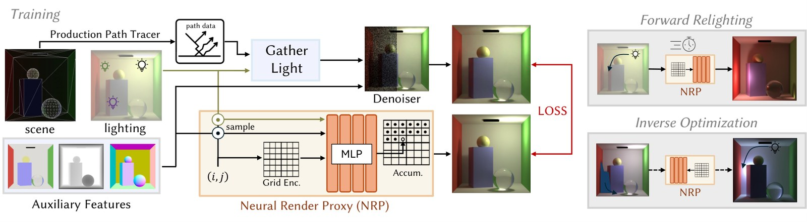
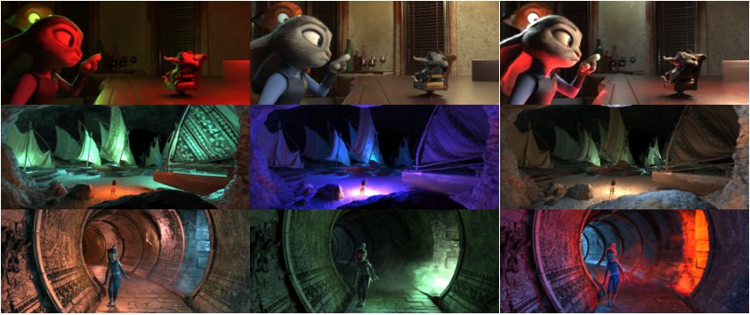
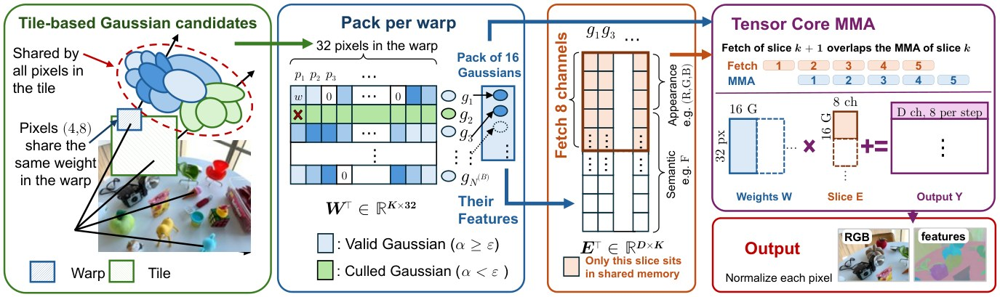
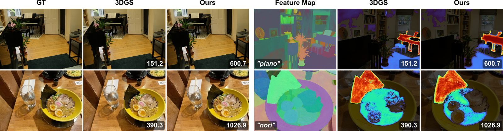
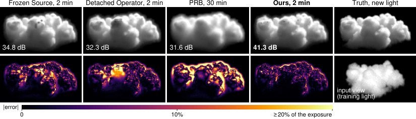
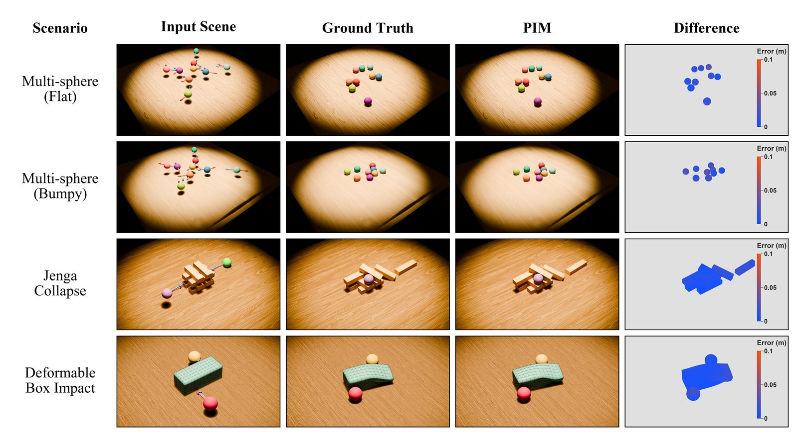

# 2026-11-14 科研日报

## 今日速览

周五的 arXiv 公告回来了。今天最值得盯的不是又一篇「把高斯训得更好看」，而是两条把已有表示接进可迭代工作流的稿件：一篇把生产渲染器里已经追踪过的光运输压成可微代理，让灯光参数可以交互式重打、也可以从图像编辑反推；另一篇把 3DGS——尤其是带高维语义特征的那一类——从串行 alpha 混合改成对准 Tensor Core 的矩阵累加。体积逆渲染则补上了多次散射对密度的那一半导数：正向能渲染不等于反向也能用。

- **必读：[Neural Render Proxies](#2026-11-14--nrp)（ETH Zurich、DisneyResearch|Studios 等，EGSR 2026 / CGF）。** 固定相机与材质的静态场景上，先做一次与灯光无关的路径采样，再训练一个场景专用的轻量网络，学习「场景中任意位置的光如何到达每个像素」。读它的理由：它明确兼容不可微的生产渲染器，推理开销只随分辨率和光源数量变、不随场景复杂度变，并能把涂改、艺术指导或生成式目标通过梯度送回灯光参数。对可重光照高斯来说，这是一条「先把正向光运输做成可反推的代理，而不是一上来可微整场路径追踪」的参照。
- **必读：[MatrixSplat](#2026-11-14--matrixsplat)（The University of Texas at Arlington、Snap Inc. 等，NeurIPS 2026）。** 指出深度排序的 alpha 混合带来逐像素串行依赖，既吃不满 Tensor Core，也让高维特征渲染迅速变贵；于是改用与顺序无关的加权累加，并把特征混合映射到 warp 级矩阵乘加。读它的理由：这是正向高斯渲染效率这条线上，把「混合」本身改写成矩阵运算的一次硬碰硬；作者也写明了近似代价（多层半透明交叠时质量会掉）。可与本周较早的 SM 级负载调度对照：一个改调度，一个改混合公式。
- **选读：[神经多次散射算子](#2026-11-14--msop)（Florida State University）。** 用神经网络算子预测多次散射场并在逆渲染中对其求导，透射与单次散射仍解析计算；还强调「在留出介质上预测得准」不等于「优化轨迹上的导数能用」，需要在反演过程中到访的状态上再微调。
- **选读：[PIM](#2026-11-14--pim)（浙江大学）。** 不逐步滚动物理，而是一次前向直接预测相互作用达到平衡后的网格。对「只要最终结果、等不起仿真步进」的示教或预演场景有参考价值，但目前是分场景训练、拓扑固定。
- **其他：** [Topo-4DGS](#2026-11-14--others)（自我中心视频里的拓扑变化：切开、装配、开合）；[ReCan-GS](#2026-11-14--others)（把一致运动与遮挡/烟雾等干扰分开的 4DGS，WACV 2027）；[Sprint3D](#2026-11-14--others)（公开图像到三维资产管线的端到端加速，代码已开源）；[Instant NuRec](#2026-11-14--others)（NVIDIA，前馈重建可仿真驾驶高斯世界，本期首次收录其 11-11 更新版）。

## 可微光照：把生产渲染器里的光运输做成代理

### Neural Render Proxies · EGSR 2026 / CGF · 2026-11-12

**一句话判断：** 核心不是又一个图像空间重光照网络，而是把路径追踪拆成「与灯无关的路径采样」和「只依赖灯光参数的发光计算」，再用一个场景专用、可微的代理把庞大的路径缓存压进去——因此能接上不可微的生产渲染器，也能把图像空间目标反推成可编辑的灯光参数。

- **Title：** Neural Render Proxies for Interactive and Differentiable Lighting
- **作者与单位：** Sergio Sancho（ETH Zurich、DisneyResearch|Studios），Alexander Rath、Marco Manzi、Marios Papas（DisneyResearch|Studios），Pascal Chang（ETH Zurich、DisneyResearch|Studios），Amit H. Bermano（ETH Zurich、DisneyResearch|Studios、Tel Aviv University），Derek Nowrouzezahrai（McGill University、Mila – Quebec AI Institute、CIFAR AI Chair），Markus Gross（ETH Zurich、DisneyResearch|Studios）
- **发表时间：** EGSR 2026（2026-07-01–03，Bordeaux）；arXiv 首次挂出 2026-11-12
- **投稿信息：** 已接收 Computer Graphics Forum（Proc. EGSR 2026）

**摘要中译：** 在动画制作的灯光流程里，哪怕只改一点参数，也往往要在离线渲染器上重渲大规模场景：全局光照要重新采样，复杂着色器要重新求值，单帧迭代可能要几分钟到几小时。本文提出一种神经渲染代理（NRP），在相机与材质固定的静态场景上，以交互速率做可微重光照。主要想法是把传统渲染解耦为路径采样与发光计算。从一次与灯光无关的渲染过程中收集路径样本，就可以在之后快速采样不同灯光条件，并训练一个场景专用的轻量网络，学习光如何从场景中任意位置传到任意像素。该方法兼容不可微的生产渲染器，推理时内存开销很小，复杂度只随分辨率以及光源数量与参数增长，而不随场景和外观复杂度增长。评测显示重光照可达约 30–60 Hz，并接近路径追踪真值的视觉保真度。此外，可微的 NRP 支持基于梯度的快速逆向流程，让艺术家能从直观的图像空间编辑或生成式目标反解灯光参数。

**方法概要：**
1. 在虚拟光源设定下，路径的几何构造与灯光摆放无关：光线碰到虚拟灯只累加发光、不改变后续散射。于是可以把计算拆成两趟：`SamplePaths` 只看场景，记录路径顶点和到达相机的吞吐权重，把读场景、求交和着色这些最贵的部分做一次即可复用；`GatherLight` 再根据当前灯光参数把这些路径合成图像。
2. 路径缓存本身太大、也不方便求导。NRP 用一个场景专用的轻量网络把路径样本压成连续、可微的表示，直接预测每个光源对每个像素的贡献。
3. 训练数据来自同一份与灯无关的路径，在随机灯光条件下生成去噪图像作监督；推理时网络紧凑，不同视角的 NRP 可以同时放进内存，适合多机位一起改灯。
4. 因为对灯光参数可微，图像空间的损失可以反传到灯光：支持涂改、艺术指导，以及把生成模型给出的目标图反解成一组物理上可编辑的灯光配置。文中也展示了光谱消光不随波长变化的体积，以及虚拟球灯与矩形灯。

**值得关注 / 阅读指引：**
- 最值得借的是「生产渲染器可以保持不可微，可微性放在代理上」这条分工。这对把 3DGS 或网格资产接到已有离线管线、又想做灯光反推的人很有用，不必先把整个生产渲染器改成可微。
- 必须记住它的前提：静态场景、固定相机、固定材质；它反推的是灯，不是材质或几何。非物理的灯光衰减、灯光对某些物体的排他性，一旦代理训练完就不能再改（分层训练多份 NRP 只能部分模拟排他，代价是多训几次）。
- 局限写得很具体：复杂纹理灯、任意形状面光源留作未来工作；与灯无关的材质重要性采样会在以后可能放灯的遮挡区域（例如灯罩内部）采样不足；训练要把路径样本预装进 GPU 显存，样本数量与质量受显存限制。
- 和图像空间的生成式重光照对比时，作者强调的是参数精度与多机位一致性，而不是「看起来像一张新图」。读的时候应盯灯光参数能不能收回来，而不只盯单张图的漂亮程度。

**链接：** [arXiv](https://arxiv.org/abs/2611.17185) · [HTML](https://arxiv.org/html/2611.17185v1) · [项目页（Disney Research Studios）](https://studios.disneyresearch.com/2026/07/01/neural-render-proxies-for-interactive-and-differentiable-lighting/) · [ETH CGL](https://cgl.ethz.ch/publications/papers/paperSan26a.php)

## 正向高斯渲染：让特征混合吃到 Tensor Core

### MatrixSplat · NeurIPS 2026 · 2026-11-11

**一句话判断：** 这篇把 3DGS 渲染变慢的原因说得很硬：深度排序的 alpha 混合是一条带循环依赖的串行指令链，现代 GPU 的矩阵单元几乎用不上；高维语义特征只是把这个问题放大了。解决办法是改用与顺序无关的加权累加，并把混合写成 warp 级矩阵乘加——收益真实，近似也写明了。

- **Title：** MatrixSplat: Matrix-Parallel and Feature-Scalable 3D Gaussian Splatting Rendering on GPUs
- **作者与单位：** Yangming Zhang、Siyi Wu、Ming Li、Miao Yin（The University of Texas at Arlington），Jian Wang（Snap Inc.），Bingzhe Li（The University of Texas at Dallas），Wei Niu（University of Georgia），Sheng Di（Argonne National Laboratory）
- **发表时间：** arXiv 首次挂出 2026-11-11
- **投稿信息：** 已接收 NeurIPS 2026（Comments 写明 Accepted to NeurIPS 2026）

**摘要中译：** 三维高斯泼溅已成为实时新视角合成与三维重建的主流表示，但现有渲染管线与现代 GPU 架构并不合拍：按深度排序的 alpha 合成引入很强的逐像素串行依赖，限制并行度，执行以标量融合乘加（FMA）为主，用不上 Tensor Core 这类高吞吐矩阵单元。当 3DGS 带上多模态或语义特征、需要从数百万高斯累加高维特征时，计算与内存开销会迅速上升。本文提出 MatrixSplat，一个面向现代 GPU、可随特征维度扩展的矩阵并行渲染框架。作者首先把 alpha 合成的串行依赖视为高维特征渲染的关键障碍，改用与顺序无关的加权累加，把特征渲染变成面向矩阵的计算。框架有三项设计：其一，基于 tile 的泼溅管线，把特征累加映射到 Tensor Core 上的 warp 级矩阵乘加；其二，以 warp 为粒度的高斯打包，缓解可见性不规则并提高特征复用；其三，惰性的分通道特征取数，降低共享内存压力、保持 warp 占用，并让高维特征的访存与矩阵计算重叠。在 Mip-NeRF 360、LERF 和 3D-OVS 上，该方法在保持渲染质量与语义精度的同时，相对 3DGS 端到端最高约 3.8 倍、相对 TC-GS 约 2 倍，高维特征的渲染核时间最高可降约 36.7 倍；嵌入已有的快速渲染器还能再获得约 1.69–2.84 倍加速。

**方法概要：**
1. 用类似加权混合顺序无关透明（weighted blended OIT）的可交换加权和，代替前后相关的 over 操作，从而去掉排序带来的循环依赖，把每个像素的特征累加写成矩阵运算。
2. 每个 warp 处理 32 个像素，并把 16 个有效高斯打成权重矩阵；特征按 8 通道一片惰性取入共享内存，避免高维特征一次占满片上存储。
3. warp 级打包用来处理「这个 tile 里高斯数量和深度分布都不均匀」的情况，提高特征复用。
4. 作者声明将发布 CUDA 实现与评测脚本。加速对象主要是前向渲染；反向仍然依赖分散的梯度更新和原子操作，训练加速小于推理。

**值得关注 / 阅读指引：**
- 读的时候不要把「最高 3.8 倍」理解成所有场景、所有阶段的整帧加速。作者自己把 tile 分箱、基数排序、逐高斯预处理和打包扫描列为仍非矩阵化的阶段，一旦混合被加快，这些前置步骤就会变成新的上限。
- 近似是诚实的：与顺序无关的累加在多层半透明严重交叠时会掉质量（文中举例 teatime 上约 −0.23 dB），在中等遮挡下有时反而更好；为 alpha 混合调好的阈值可能需要重调。这不是「无损加速」。
- 评测针对 NVIDIA Tensor Core 上的 warp 级 MMA，其他矩阵单元（例如 NPU）未测。若要把语义高斯用于语言查询或开集分割，高维特征那一项 36.7 倍核加速比 RGB 三通道更有意义。
- 与 11-11 日报的 SM 级负载调度是互补关系：那篇解决的是「有的 SM 在等最重的 tile」，这篇解决的是「混合公式本身吃不到矩阵单元」。

**链接：** [arXiv](https://arxiv.org/abs/2611.15153) · [HTML](https://arxiv.org/html/2611.15153v1)

## 体积逆渲染：把多次散射的导数补回来

### 神经多次散射算子 · arXiv · 2026-11-12

**一句话判断：** 稠密介质逆渲染里，冻结光源的层析等于把多次散射对消光的导数丢掉；可微路径追踪能估这条导数，但又贵又吵。这篇用神经算子预测多次散射场并对其求导，同时把「算子在留出样本上准」和「优化走到的状态上导数还能用」明确分开处理。

- **Title：** Learning the Missing Derivative: Neural Multiple-Scattering Operators for Inverse Volume Rendering
- **作者与单位：** Sipeng Chen、Shibo Li（Department of Computer Science, Florida State University）
- **发表时间：** arXiv 首次挂出 2026-11-12
- **投稿信息：** 投稿信息未标明（Comments 仅注 21 页、11 图、18 表）

**摘要中译：** 要从照片重建光学厚度很大的介质，必须建模多次散射，以及它随消光变化的响应。冻结光源的层析丢掉了这一导数；可微路径追踪能估计它，但采样昂贵且噪声大。本文改为用神经算子预测多次散射场，并在逆渲染中对其求导，透射和单次散射则直接计算。优化过程中还有另一重困难：一个在留出介质上能准确预测场的算子，在优化器实际走到的密度状态上仍可能给出很差的导数。作者因此在由该算子驱动的反演过程中生成状态，并用蒙特卡洛散射场作监督，对这些状态做微调。在留出的光学厚云上，该方法在相同时间内优于冻结光源层析的重光照结果，并且在时间明显更充裕时也优于可微路径追踪。在反演轨迹上训练还能改善到访状态上的导数对齐，减少优化漂移。

**方法概要：**
1. 任务是在已知方向光下，从照片重建非均匀参与介质，并在新视角、新光向下重光照。
2. 正向渲染里，透射与单次散射按解析/直接方式计算；多次散射源项由神经算子 \(G_\phi\) 预测。反向时对这个算子求导，补上冻结光源方法丢掉的那一项。
3. 先在一批介质上把算子训到场预测准确，再在实际反演轨迹到访的密度状态上，用蒙特卡洛散射场监督做微调，使导数在优化器真正经过的点上仍然可用。

**值得关注 / 阅读指引：**
- 「留出集上的前向精度」和「优化轨迹上的导数质量」被写成两个问题，这比再报一个重光照 PSNR 更有启发：逆渲染里，代理不但要能渲染，还要在优化走偏的状态下仍然给出可用梯度。
- 设定是已知方向光下的云状光学厚介质，不是室内表面材质的逆渲染；不要直接外推到 SVBRDF 或 3DGS 材质分解。它提供的是处理「高阶散射导数」的思路。
- 选读即可：如果近期在做参与介质或半透明体，值得把方法概览和第 4 节关于微调的部分看完；若主线仍是表面逆渲染，记住结论即可。

**链接：** [arXiv](https://arxiv.org/abs/2611.16650) · [HTML](https://arxiv.org/html/2611.16650v1)

## 物理直觉：一次前向预测相互作用的平衡态

### PIM · arXiv · 2026-11-12

**一句话判断：** 如果下游只关心物体相互作用的最终结果、不需要中间轨迹，逐步滚动仿真或自回归学习模型都会把误差和延迟叠起来；PIM 选择直接从初始网格、运动学和物理属性预测平衡态网格，用局部几何注意力加跨物体锚点注意力完成这一跳。

- **Title：** PIM: A Physical Intuition Model for Low-Latency Prediction of Object Interaction Outcomes
- **作者与单位：** Tangwen Luo、Chuankun Zheng、Yuchi Huo（浙江大学 计算机辅助设计与图形学国家重点实验室）
- **发表时间：** arXiv 首次挂出 2026-11-12
- **投稿信息：** 投稿信息未标明（Comments 仅注 22 页、7 图）

**摘要中译：** 从初始条件预测物体相互作用的结局，是数据驱动物理推理中的核心问题。现有方法常用刚体级状态，或用自回归滚动来预测演化。粗表示无法刻画局部形变，而滚动误差会在长时域上累积。本文提出物理直觉模型 PIM，直接从初始网格几何、运动学和物理属性预测系统的平衡态。PIM 用局部 k 近邻注意力编码物体内几何，用基于锚点的跨物体注意力建模相互作用，再用双分支解码器分别预测物体级平移和逐顶点残差位移。在同时包含刚体与可变形相互作用的 MuJoCo 场景上，PIM 的顶点和质心误差低于所比较的基线。由于一次前向即可预测完整平衡态，在只需要最终结果的设定下，它相对自回归学习模型和 MuJoCo 滚动都明显降低了延迟。

**方法概要：**
1. 输入是各物体的初始网格、运动学与物理属性，输出是平衡后的网格，而不是一条时间序列。
2. 每个顶点先编码相对物体中心的坐标与半径，再经局部 KNN 注意力聚合物体内几何；每个源物体用最远点采样得到一组锚点，目标顶点对其他物体的锚点做注意力，以建模接触与相互作用。
3. 解码分成两支：一支预测物体整体平移，一支预测逐顶点残差；可变形场景再用边长损失约束局部度量，避免网格被撕开。

**值得关注 / 阅读指引：**
- 它回答的问题很窄、但很实用：示教增强或预演有时只要「推完/放完之后东西在哪」，并不需要可微的全过程。这种「只预测结局」的模型，延迟优势只有在你真的不需要中间帧时才成立。
- 局限同样直白：目前是分场景训练，物体对应关系和拓扑固定；换物体数量、换拓扑、更大形变，以及显式环境、多场景联合训练，都还是开放问题。不能把它当成通用物理引擎的替代品。
- 与昨天回扫的 SoftPAT3D 对照：SoftPAT3D 要的是可仿真的合法输入，PIM 要的是跳过步进、直接看结局。两者可以一起用在「先保证能仿、再决定哪些步骤值得真的滚仿真」。

**链接：** [arXiv](https://arxiv.org/abs/2611.16673) · [HTML](https://arxiv.org/html/2611.16673v1)

## 其他值得一看

- **Topo-4DGS · arXiv · 2026-11-11。** *Topology-Aware 4D Gaussian Splatting for Egocentric Videos*（Leonardo Vanni, Stefano Gasperini, Federico Tombari, Chiara Plizzari；Technical University of Munich、Google、Bocconi University）。针对自我中心视频里切开、装配、开合这类会改变拓扑的日常交互：现有 4DGS 往往在固定表示上做形变，一旦表面分裂、合并或新露出，就会出现严重伪影。本文同时发布面向这类事件的基准 TopoEgo，并提出 Topo-4DGS：给相互作用的部件各自独立刚体变换，并随表面出现、消失或分离动态激活或关闭高斯。作者称在事件发生后的帧上明显优于现有 4DGS，代码与数据将公开。仅据摘要。[arXiv](https://arxiv.org/abs/2611.16012) · [项目页](https://topoego.github.io)
- **ReCan-GS · WACV 2027 · 2026-11-12。** *Reconstruct What You Can: Distractor-free 4D Gaussian Splatting*（Joel Julin, Liuyue Xie, Ananya Bal, Laszlo A. Jeni，Carnegie Mellon University；Mose Sakashita, Koichiro Niinuma，Fujitsu Research of America）。从形变场导出基于雅可比的形变敏感分数，据此把高斯分成刻画一致运动的 Core 与按视角解释遮挡、阴影、烟雾等干扰的 Distractor，无需掩码或特定介质监督。已接收 WACV 2027。仅据摘要。[arXiv](https://arxiv.org/abs/2611.16259) · [项目页](https://recan-gs.github.io)
- **Sprint3D · arXiv · 2026-11-12。** *Sprint3D: Accelerating End-to-End 3D Asset Generation through Pipeline Optimization*（Sho Kuno, Ruihan Yu, Yonghao Yu, Guixu Lin, Lian Fu, Muyao Niu, Yu-Ju Tsai, Zheng-Hui Huang, Yi-Chuan Huang, Siqi Yang, Fengbo Lan, Erwin Wu, Kaipeng Zhang, Zhixiang Wang；Alaya Lab、The University of Tokyo、University of California, Merced、Institute of Science Tokyo、国立阳明交通大学）。不另训生成器，而是给公开的 Pixal3D 管线做端到端加速：剖析显示网格后处理占墙钟时间约 85%（主要是 CPU 上的 UV 展开），网络只占约 14%。作者把后处理搬到 GPU 并移出关键路径，再把整流流的网络求值从 76 次蒸到 8 次；在一块 H200 上，单资产中位时间从 133 秒降到 4.05 秒（约 33 倍）。Toys4K 留出集上输入视角法向指标有提升，轮廓 IoU、点云对齐和细纹理有所下降。同一套后处理也让 TRELLIS.2 加速约 6.7 倍且评测指标无明显变化。项目页与代码已公开。仅据摘要与 PDF 首页单位。[arXiv](https://arxiv.org/abs/2611.16701) · [项目页](https://alaya-lab.github.io/sprint3d/) · [代码](https://github.com/AlayaLab/sprint3d)
- **Instant NuRec · arXiv · 2026-07-15（v2 2026-11-11）。** *Instant NuRec: Feed-Forward 3D Gaussian Reconstruction for Driving Scene Simulation*（NVIDIA：Jiahui Huang, Jiawei Ren, Michal Tyszkiewicz, Bjoern Haefner 等）。此前未收录；本期因其 11-11 的 v2 进入 cs.GR 替换列表而首次写入。模型把一小段多相机驾驶日志一次前向变成可仿真的分层 3DGS 世界：静态层、带分段线性轨迹的动态层、天空立方图，以及每路相机的 ISP 仿射校正，并用 3DGUT 支持非针孔相机。作者称 10–20 秒多相机片段约 1.5 秒重建，在 Waymo Open Dataset 上比所比较的最强基线高 2.01 dB PSNR，并接入 NuRec 与 AlpaSim 闭环仿真。项目页与代码已公开。仅据摘要。[arXiv](https://arxiv.org/abs/2607.14203) · [项目页](https://research.nvidia.com/labs/sil/projects/instant-nurec) · [代码](https://github.com/NVIDIA/instant-nurec)

## 圈内新闻与社区反应

**World Labs 向公众开放 Atlas，输出可以是 3DGS 而不只是视频（图形学 · 世界模型）。** 据 [AI Weekly 11-13 的报道](https://aiweekly.co/alerts/world-labs-opens-atlas-world-model-to-public-with-viewfinder-chisel-and)，World Labs 于 11-12 向公众开放 Atlas 世界模型及开发者 API：可在 Viewfinder 中上传一张或多张照片，或在 Chisel 中摆出粗略三维布局，生成新视角、视频和可走入的场景，结果可存为三维高斯泼溅，或导出网格供 Blender 与游戏引擎使用；API 覆盖场景生成、视频与三维重建。官方介绍见 [Atlas 页面](https://worldlabs.ai/atlas) 与 [2026-09-01 的博文](https://worldlabs.ai/blog/atlas)（博文在发布时已写明可通过 web 应用和 API 使用，11-12 是面向公众的开放节点）。**观点：** 社区讨论里最有用的一句是：输出若是一份可再渲染的高斯场景，换一条相机路径不必再向模型要一次视频。但可重光照、可碰撞的仿真资产，仍然取决于导出结果有没有材质参数和几何代理，不能默认把「能看的 3DGS」当成「能进逆渲染或真机回环的资产」。

**Ke-Sen 与 Blender。** [SIGGRAPH Asia 2026 论文链接收录页](https://kesen.realtimerendering.com/siga2026-Changelog.htm) 自 2026-09-17 之后没有新的 11 月条目。Blender 5.3 原生 3DGS 已在本周日报写过，本窗口未见新的功能更新。

## 覆盖说明

日报发布日为 **2026-11-14（周六）**，内容覆盖 **2026-11-13（周五）** 的 arXiv 公告，即以 11-11 至 11-12 为主的提交（cs.GR 全部新条目及交叉、替换条目，以及 cs.CV 中与 3DGS、逆渲染、神经渲染、重光照、可编辑动态资产、具身仿真相关的关键词条目），并与已收录清单去重。Neural Render Proxies（2611.17185）与 MatrixSplat（2611.15153）核对了 arXiv HTML 中的作者单位、方法、实验与局限部分；神经多次散射算子（2611.16650）与 PIM（2611.16673）同样核对了方法与局限；Sprint3D 的单位取自 PDF 首页。配图均为原论文插图。「其他值得一看」除 Sprint3D 单位外，仅据摘要、项目页与 arXiv Comments。圈内动态来自 AI Weekly 与 World Labs 官方页面的公开报道，事实与观点分开标注。Instant NuRec 为首次收录，依据是其 11-11 更新版出现在周五替换列表。GraftRay 的 v2 与昨日已收录的神经纹理超分未构成足以重提的实质新进展，故不重复。

**编写：** Cream
