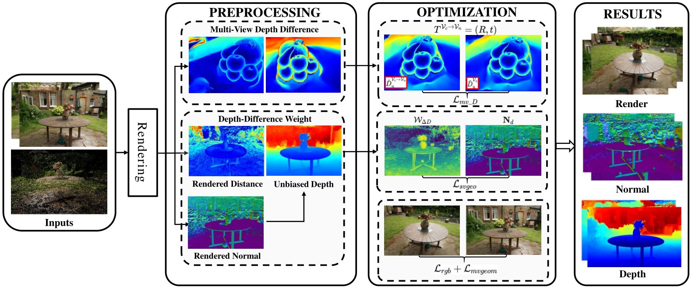
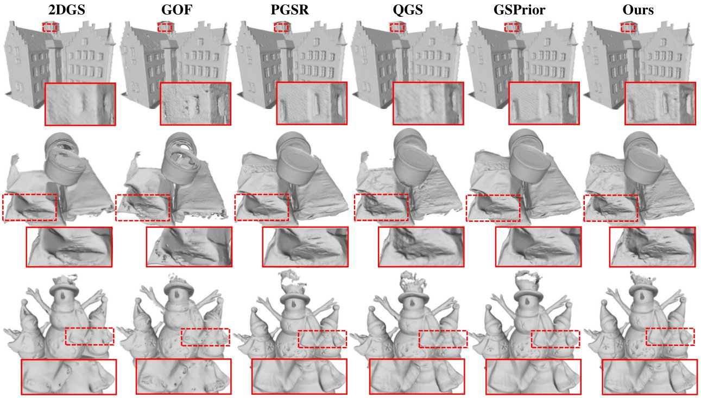
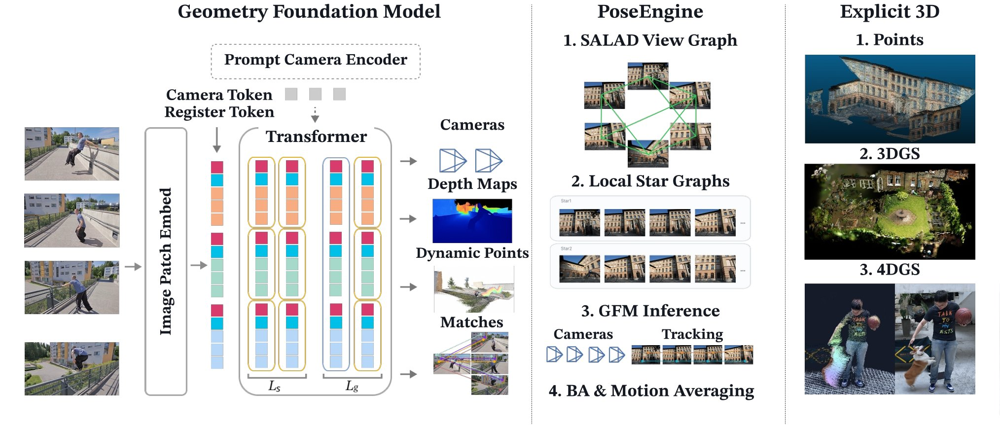

# 2026-11-15 科研日报

## 今日速览

周六没有独立的 arXiv 公告。回扫本周漏收时，最值得补的不是又一篇「把高斯训得更好看」，而是两篇直接碰到「几何到底有多可信」的稿：一篇把无偏深度和渲染距离之差写成可靠性权重，用来调节法向约束，并给出误差上界；另一篇把几何基础模型的预测送进位姿引擎，再接到三维/四维高斯重建。它们都不做材质–光照分解，但对真实场景逆渲染来说，几何这一头是否站得住，往往先于可微光运输。

- **必读：[DepthGS](#2026-11-15--depthgs)（南方科技大学、煤炭科学研究总院、西安交通大学、香港城市大学，IEEE TPAMI 已接收）。** 它建立在 PGSR 的无偏深度与渲染距离之上，不引入外部单目深度网络，而是用二者之差衡量局部几何可不可信：差异大的地方减弱法向约束，差异小的地方加紧，再补上跨视图深度一致性。读它的理由：这是把「哪里不该信深度」写成可计算权重，而不是再堆一个全局法向损失；可与本周较早的 AffineGS（校正单目深度的局部仿射偏差）对照——一条管渲染出来的两种深度，一条管外部先验的分区对齐。
- **选读：[Kosmo-GFM](#2026-11-15--kosmo-gfm)（Kosmo Research）。** 几何基础模型一次给出相机、深度、跨视图匹配和动态三维点，再用位姿引擎把这些先验收成场景级相机，供后续 3DGS / 4DGS 使用。读它的理由：它把「先预测、再优化」写成一条完整重建系统，并强调先验越准、后面的集束调整就可以越省。标题里的「Production-Ready」是作者自称，不是已核实的产线结论；无纹理楼梯间、竖拍视频和零散网络照片仍是明确短板。
- **其他：** [SHIN](#2026-11-15--others)（可按预算叠加的高斯层级，不必为每个运行点另训一份表示）；[GSCV++](#2026-11-15--others)（用标准视频编码器压 3DGS 序列）；[URL-Sim](#2026-11-15--others)（把车辆、行人、骑行者从动态驾驶场景里分开建模的激光雷达仿真）。

## 几何可靠性：用深度差调节法向约束

### DepthGS · IEEE TPAMI · 2026-11-10

**一句话判断：** 核心不是再加一种深度先验，而是把 PGSR 已经算出来的「无偏深度」和「渲染距离」之差，解释成局部几何可不可信的信号：差异大就少用法向约束，差异小就加紧，并给这种做法配上单视图与多视图的误差上界。

- **Title：** DepthGS: Depth-Guided Gaussian Splatting with Adaptive Regularization for High-Quality Surface Reconstruction
- **作者与单位：** Xiao Ren、Yu Liu、He Kong（南方科技大学自动化与智能制造学院）；Ning An、Jian Cheng（煤炭科学研究总院煤矿人工智能研究院、智能开采与岩层控制全国重点实验室）；Xin Qiao（西安交通大学人工智能与机器人研究所）；You-Fu Li（香港城市大学机械工程系）。通讯作者：He Kong。
- **发表时间：** arXiv 首次挂出 2026-11-10；IEEE TPAMI 正式刊出日期未标明
- **投稿信息：** 已接收 IEEE Transactions on Pattern Analysis and Machine Intelligence（依据 arXiv Comments「To appear in IEEE Trans. on Pattern Analysis and Machine Intelligence」）

**摘要中译：** 三维高斯溅射（3DGS）凭借可微光栅和较高的视觉保真度，已成为新视角合成的常用表示，并越来越多地被用于表面重建。但深度信息与重建误差之间的关系仍缺少足够分析，这限制了几何优化策略的设计。本文提出 DepthGS：在单视图和多视图设定下推导深度差与重建误差的关系，并给出相应的误差上界，据此设计自适应正则。单视图中，用法向约束的强度由局部深度差算出的几何可靠性权重来调节；多视图中，则要求邻域视图的深度图，与把当前视图深度变换过去得到的预测保持一致。在 DTU、Mip-NeRF360 和 Tanks and Temples 上的实验表明，该方法在表面重建和新视角合成上均具有竞争力。

**方法概要：**

三维高斯溅射把场景写成一组各向异性高斯，按深度排序做 $\alpha$ 混合。沿用 [PGSR](https://arxiv.org/abs/2406.06521)（Planar-based Gaussian Splatting，一种用平面约束做表面重建的高斯方法），渲染时除了颜色，还会得到两种深度：渲染距离 $D_{\mathcal{D}}$ 是各高斯到相机的平面距离按透射率加权的结果；无偏深度 $D_u$ 则把这个距离除以渲染法向与视线方向的点积，用来补偿斜视带来的偏差。二者反投影到三维后，如果高斯排布不规则，它们往往会分开，这个差记作 $\Delta D$。

1. **单视图：深度差是上界里的一项，也被当成可靠性。** 作者证明，无偏深度对应点的重建误差，不超过渲染距离对应点的误差加上 $|\Delta D|$（文中 Lemma 1）。他们并不直接把 $|\Delta D|$ 当作损失去压，而是把它归一化成权重
   $$
   \mathcal{W}_{\Delta D}(p)=1-\frac{|\Delta D(p)|-\Delta D_{\min}}{\Delta D_{\max}-\Delta D_{\min}+\sigma},
   $$
   差异越大权重越小，法向约束越弱，以免把不可靠的局部几何传下去；差异小则加紧。完整权重还乘上 PGSR 原有的边缘感知项 $(\overline{\nabla I}(p))^2$。参考法向由无偏深度生成，与渲染法向做 $\ell_1$ 对齐，得到单视图损失 $\mathcal{L}_{svgeo}$。
2. **多视图：把当前视图的两种深度变到邻域视图再对齐。** 对应点经过刚体变换后，深度差残差会进入多视图误差上界（Lemma 2）。实际损失 $\mathcal{L}_{mv\_D}$ 并不直接优化那条上界，而是检查：把当前视图的 $D_u$ 和 $D_{\mathcal{D}}$ 变换到邻域视图后，是否与邻域视图自己的深度图一致；两项加权系数 $\alpha=0.8$。无效重投影（出画、深度过小）会被掩掉。
3. **总损失与实现。** 上述两项与图像重建损失、扁平高斯损失、以及 PGSR 的多视图光度一致性一起优化；前几项权重沿用 PGSR，新增项 $\lambda_5=0.008$。每个场景 30,000 步，单卡 RTX 4090。优化结束后，把渲染深度融合进截断符号距离函数（TSDF）体再抽网格，用于表面评测。

**结果、成本与局限。** 数字均为作者报告，未独立复现。DTU 上平均 Chamfer 距离（越小越好，单位毫米）为 0.51，低于同设定下的 PGSR（0.53），略高于 GSPrior（0.50）；训练约 17.6 分钟，与 PGSR 的 17 分钟接近，明显短于 GSPrior 的 42 分钟。Tanks and Temples 上平均 F1 为 0.503，介于 PGSR（0.495）与 GSPrior（0.507）之间。Mip-NeRF360 上整体 PSNR 27.72 dB（所比较方法中第二）、LPIPS 0.175（最低，越小越好）。消融里，深度差权重主要抬高图像指标，跨视图项降低多视图深度差一致性误差；两者合用把 DTU 的 Chamfer 从 PGSR 的 0.53 降到 0.51。优化曲线相对 PGSR 在多数场景上更快上升，但在更难的 bicycle 上，训练 PSNR 微升 0.04 dB、测试 PSNR 反而降了 0.05 dB。作者将这类下降部分归因于复杂光照、大视角变化和破碎几何，使法向与深度估计不可靠，并在结论里把强光照变化、噪声几何和结构杂乱的室外场景列为后续工作。需要注意：上界是分析工具，用来说明为什么要减小深度差不一致，并不构成优化收敛的保证。

**值得关注 / 阅读指引：** 读第 IV-A 节的权重定义和第 IV-B 节如何把上界里的残差改写成可实现的重投影损失，再对照第 V-D 节 bicycle 的反例。对真实场景 3DGS 逆渲染，这篇补的是「几何约束该在哪里收紧」：它用的不是外部单目深度网络，而是渲染器内部两种深度的一致性，和 11-09 的 AffineGS（给单目深度做分区仿射矫正）构成对照。不要把它写成已经解决了室内不完整采集或材质–光照解耦——评测仍是 DTU / Mip-NeRF360 / Tanks and Temples 的新视角与网格精度，没有可重光照证据。也还没有找到项目页或代码仓库。

- **相关链接：** [arXiv abs](https://arxiv.org/abs/2611.13628) · [PDF](https://arxiv.org/pdf/2611.13628) · [HTML](https://arxiv.org/html/2611.13628) · 未找到项目页或代码仓库

## 几何先验：先预测，再交给位姿引擎

### Kosmo-GFM · arXiv · 2026-11-12

**一句话判断：** 这篇的重点不是又一个前馈高斯生成器，而是把几何基础模型的多任务预测（相机、深度、匹配、动态点）和场景级位姿优化接成一条重建系统，让后面的 3DGS / 4DGS 有更稳的相机和几何起点；「Production-Ready」是标题里的自我定位，正文同时也写了无纹理、竖拍和零散照片等失败例子。

- **Title：** Kosmo-GFM: A Production-Ready Geometry Foundation Model
- **作者与单位：** Sheng Tang、Shengzhe Wei、Tiancheng Chen、Wenhua Jin、Xinyang Lu、Tinghao Jiang、Shuoxuan Feng、Yupeng Liu、Yu Zhang、Xingshuo Chang、Keren Zhou、Yuhan Xiong、Jiahao Li、Haoming Liu、Jituo Tian、Hui Liang、Chaoqun Tang、Feng Tian、Wentao Ouyang、Kaojin Zhu、Xiaolin Chai、Peihuang Fu、Miao Zheng、Yunbo Hu、Feixue Cai、Zizhen Zou、Weigang Wang、Yexuan Yang、Haoyu Feng、Weiqi Zhang、Juntong Fang、Zesong Li（共 32 人）。论文署名单位为 Kosmo Research；正文未再逐一列出各作者是否另有学术机构，故单位不作猜测。
- **发表时间：** arXiv 首次挂出 2026-11-12
- **投稿信息：** 投稿信息未标明

**摘要中译：** 本文介绍 Kosmo-GFM，一套把几何基础模型（GFM）、位姿优化引擎（PoseEngine）以及来自 KosmoWorld 的重建监督结合在一起的场景重建系统。GFM 从图像和视频预测相机参数、深度、跨视图对应和动态三维点。PoseEngine 把这些预测与几何优化结合，恢复场景级相机位姿和几何，供后续的三维高斯溅射（3DGS）和四维高斯溅射（4DGS）使用。KosmoWorld 则从重建出的真实场景生成图像和几何监督，用来改进 GFM 的几何预测。在 SpatialBench 的 Sparse 与 Medium 子集上，GFM 在所比较方法中取得最低的绝对相对深度误差，以及 5 度阈值下最高的相对位姿 AUC；在五项动态点与场景流评测中，平均端点误差也最低。文中还单独做了规模扩展实验。

**方法概要：**

传统重建靠特征匹配和几何优化，在弱纹理、重复结构、大基线和动态物体上容易失去约束；几何基础模型可以直接预测相机和深度，但模型输出本身并不保证整段序列、大场景里的跨视图一致性。Kosmo-GFM 的立场是：先验用来减小后续优化的负担，而不是取消优化。

1. **GFM：共享的多视图特征，分任务解码。** 编码器在多帧之间交换信息；相机、深度、匹配和动态点各用一个解码器。相机解码器把相机 token 迭代细化成平移、四元数旋转和视场角；深度解码器做稠密几何；匹配解码器一次给出中心视图与邻域视图的对应；动态点解码器采用源帧查询、目标帧特征的方式预测运动。模型还可以把已知相机参数当作条件，并在训练中加入鱼眼和全景，以覆盖非针孔相机（文中称为 AnyCamera）。
2. **PoseEngine：以 STAR 为单位做场景级收束。** 每个 STAR 由一张中心图和邻域图组成，一共 26 张。无序照片集用全局检索再核验邻域；有序视频则以时间相邻帧为主、检索帧为辅。在一个 STAR 内，GFM 一次前向同时给出几何先验和匹配，再做优化。作者的设计假设是：GFM 越准，后面需要的集束调整轮次就越少。面向大场景还有 PoseEngine Flash：混合精度推理加更简单的集束调整，用时间换一部分位姿精度；后续 3DGS / 4DGS 拟合时还可以联合微调相机，部分补偿这份误差。
3. **KosmoWorld：用重建好的真实场景再生成训练监督。** 数据管线在重建网格、三维高斯和采集位姿对齐后的真实场景里规划轨迹、筛选观察质量，再渲染 RGB 与深度。作者写明该规划模块建立在腾讯混元 HY-World 2.0 的 WorldNav 之上。加入这份数据后，SpatialBench 两个子集上的深度和相对位姿都有提升（文中 Table 1 / 图 10）。

**结果、成本与局限。** 上述 SpatialBench 与动态点指标均为作者报告，未独立复现。作者还称，在所有比较方法都跑完的场景上，PoseEngine 的平均位姿精度高于 GLUEMAP，累计时间明显更短。局限写得比较清楚：大面积空白墙面缺少可匹配特征，楼梯间一类例子里相机轨迹会漂；训练以横拍走查为主，竖拍室内视频更弱；训练数据强调连续走查，对 MegaDepth 这类视角变化大、重叠不稳定的网络照片更不鲁棒。动态训练占比偏高，可能影响静态场景的深度和跨视图尺度；被遮挡点的三维轨迹还会抖。这些是论文自己展示的失败模式，不是外部复现结论。

**值得关注 / 阅读指引：** 读第 3.2 节 PoseEngine 如何把 GFM 先验收成场景级相机，以及第 7 节的失败例子，比只看摘要里的「生产级」三个字有用。对逆渲染主线，它的位置是上游的相机与几何，而不是材质或光照分解；和前馈高斯重建、VGGT 一类几何模型对照时，关键问题是：这些先验进了 3DGS 之后，深度和法向还能不能给可重光照当稳定约束。项目页与 GitHub 仓库已公开；写稿时未能逐一核对仓库是否包含完整的 PoseEngine 与高斯拟合流程，请以仓库说明为准。

- **相关链接：** [arXiv abs](https://arxiv.org/abs/2611.16840) · [PDF](https://arxiv.org/pdf/2611.16840) · [HTML](https://arxiv.org/html/2611.16840) · [项目页](https://kosmoresearch.github.io/Kosmo-GFM/) · [代码](https://github.com/KosmoResearch/Kosmo-GFM)

## 其他值得一看

- **SHIN · arXiv · 2026-11-07。** *SHIN: Scalable Hierarchy for INcremental 3D Gaussian Splatting*（Reagan Koo, Yeong-Gyu Kim, Eun-Seok Ryu）。针对「换一个运行预算就要另存一份高斯」的问题：先做一个可复用的 Base，再叠加增强层，更高质量的工作点是在已解码表示上往上加，而不是替换。层级里「这一级该新增哪些高斯、该保留多少阶球谐外观」由多尺度位置–尺度敏感度和按字节校准的梯度分数一次性排好。这是预算可控高斯这条线上的补收，可与此前的 BudgetSplat 对照。仅据摘要。[arXiv](https://arxiv.org/abs/2611.10652)
- **GSCV++ · arXiv · 2026-11-03（v2 2026-11-04）。** *GSCV++: Lightweight 3D Gaussian Splatting Sequence Compression via Standard Video Codecs*（Qi Yang, Yingzhan Xu, Kai Zhang, Li Zhang）。把 3DGS 序列压成能走标准视频编码器的二维特征图：先做能量自适应的帧间球谐非直流分量（SH AC）降维，再用带先验的 Inter-MiniPLAS 映射，最后按内容配置编码器。作者在 MPEG 数据上报告相对 GSCV 的率失真提升。这是分发与存储向的效率工作，不是渲染核或逆渲染本身的加速。仅据摘要。[arXiv](https://arxiv.org/abs/2611.05359)
- **URL-Sim · arXiv · 2026-11-06。** *URL-Sim: Unified and Regulated LiDAR Simulation for High-Fidelity Reconstruction of Dynamic Driving Scenes*（Kefei Qian, Xipeng Feng, Jie Li, Long Cao, Yuhan Chen, Xiangfei Huang, Guofa Li）。用动态高斯场景图分别建模车辆、行人和骑行者，并约束过度密化，以避免现有 3DGS 驾驶仿真只擅长刚体车辆、又堆出过多图元的问题。目标是从真实驾驶日志重建可用于验证的激光雷达仿真场景。仅据摘要。[arXiv](https://arxiv.org/abs/2611.12932)

## 圈内新闻与社区反应

**Tracking Toolkit 3.0.0：改用 Blender 原生 XR（图形学 · 工具）。** Blender 扩展目录在 [Tracking Toolkit 页面](https://extensions.blender.org/add-ons/tracking-toolkit/)写明，Varrett Productions 的这款插件于 2026-11-10 发布 3.0.0：用来在 Blender 里查看和录制 OpenXR 设备，并接入非线性动画（NLA）与 SMPTE 时间码。这个版本迁到 Blender 自带的 XR 支持，作者称安装体积减少 99% 以上，并新增 Linux；插件本身支持 Blender 5.2 LTS 及以上，Vive Tracker 需要至少 5.3。手柄的摇杆和按键可作为自定义属性记录，也能绑到播放、关键帧等动作。这些是扩展页与更新说明中的作者陈述，暂未找到可核实的独立使用反馈。为什么值得关注：它和本周已经写过的 Blender 5.3 原生 3DGS 不是同一件事——前者是动捕与虚拟相机记录，后者是高斯资产进渲染器——但都说明 5.3 的「原生」能力正在把原先要靠外部运行时的插件往本体上收。

**Ke-Sen 与 Blender 原生 3DGS。** [SIGGRAPH Asia 2026 论文链接收录页](https://kesen.realtimerendering.com/siga2026-Changelog.htm) 自 2026-09-17 之后仍没有新的 11 月条目。Blender 5.3 原生三维高斯支持已在本周日报写过，本窗口未见新的功能更新。

## 覆盖说明

日报发布日为 **2026-11-15（周日）**。周六没有独立的 arXiv 新公告，本期为几何与重建主线回扫：在 cs.GR、cs.CV 最近一周的列表中按关键词筛选，并与已收录清单去重。正文两篇 DepthGS（2611.13628，11-10 挂出，11-12 日报未收）与 Kosmo-GFM（2611.16840，11-12 挂出，11-14 日报未收）核对了 arXiv HTML 中的作者单位、方法、实验与局限部分；配图均为原论文插图。「其他值得一看」三篇为近日漏收的补录，仅据摘要与 arXiv Comments。所有实验数字均为作者报告，未独立复现。兴趣笔记与 blog / academic（blog `c29075d`、academic `f19a697`）没有新的公开增量，策展权重维持真实场景逆渲染 / 几何与可重光照资产质量 / 效率主线。圈内动态来自 Blender 扩展目录的插件页面与 Ke-Sen 更新日志；Tracking Toolkit 的体积与平台声明为作者自述，已与事实分开标注。

**编写：** Cream
