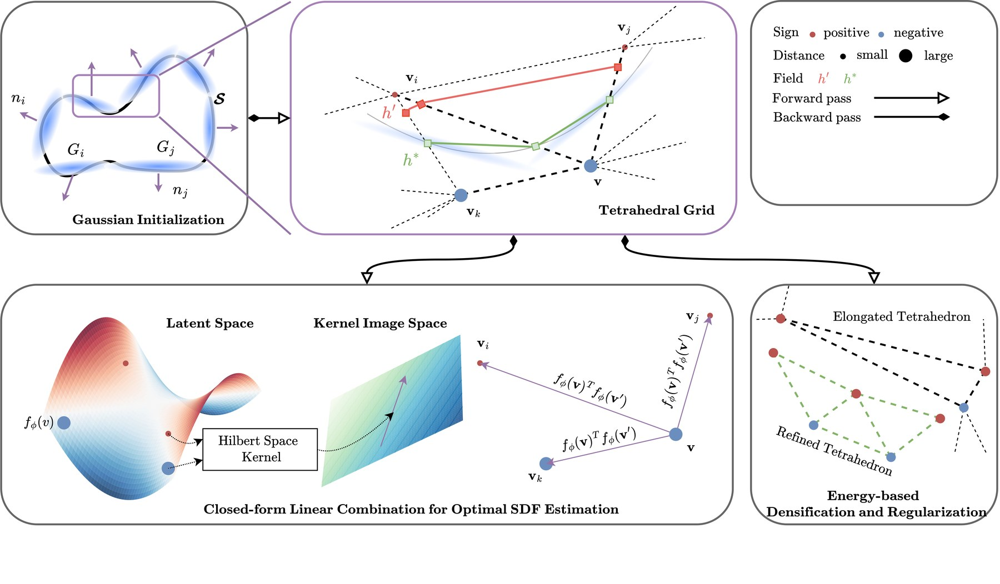
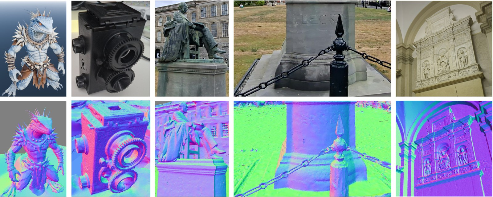
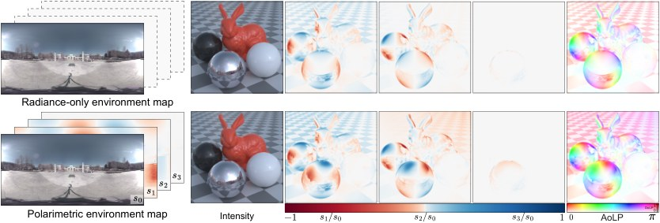
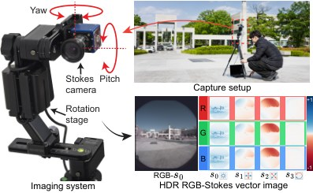
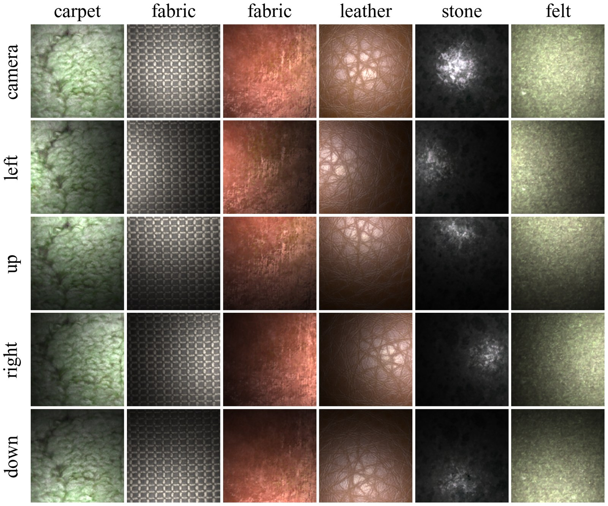
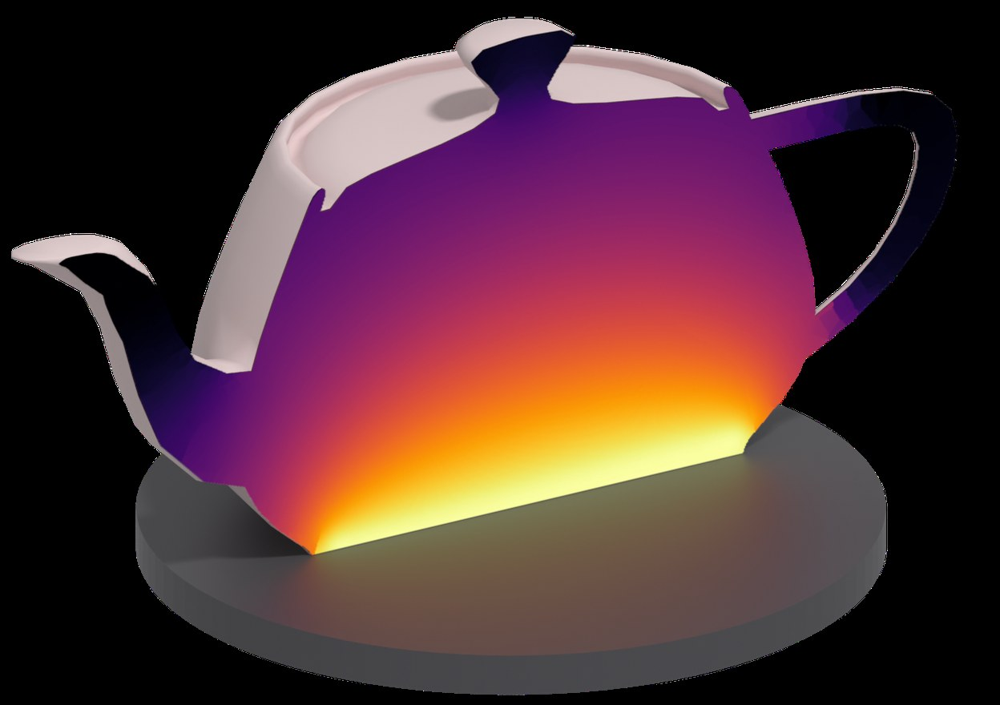
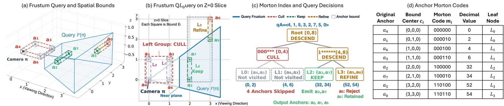

# 2026-11-18 科研日报

## 今日速览

周二的 arXiv 公告里，和主线最贴的两件事分别发生在几何出口和光照入口。一边是：3DGS 已经能画出好看的新视角，但要抽出能继续编辑、求交、进渲染器的三角网格，四面体上「每个顶点只存一个符号距离」会在尖角和薄结构处把互相冲突的梯度挤到同一个点上。另一边是：环境贴图一直只记 RGB 辐射，默认光是非偏振的；真实户外光照里的偏振一旦被丢掉，极化成像和极化逆渲染就少了可对照的入射条件。

- **必读：[TopSDF](#2026-11-18--topsdf)（Khoi Do、Yu-Kun Lai、Binh-Son Hua）。** 它把四面体顶点上的符号距离写成多元高斯随机场，用再生核希尔伯特空间给出闭式的拓扑协方差，让网格顶点可以沿着极性相反的棱更灵活地落点；同时把最优 Delaunay 能量一类的网格质量项写进联合优化，并用能量驱动高斯加密。读它的理由：这是从 3DGS 走向可编辑表面时，对「离散 SDF 自由度不够」这个问题给得最直接的一次改写，而且网格渲染的质量提升是在 Mip-NeRF 360 和 Tanks & Temples 上对着 MILo、GW 等同类抽壳方法报的。
- **必读：[偏振环境贴图数据集](#2026-11-18--polenv)（Yonghee Oh、Ryota Maeda、Yunseong Moon、Seung-Hwan Baek）。** SIGGRAPH Asia 2026 Conference Papers。作者用单次曝光 Stokes 相机加两轴转台采集全球 HDR RGB–Stokes 环境光，并用最小旋转透视参考架和 S2L2 表示做无奇点拼接，发布 100 组真实场景。读它的理由：可重光照和极化逆渲染缺的不是又一个解析天光模型，而是带真实偏振状态的入射光照；这篇把采集、标定、拼接和 Mitsuba 3 渲染一起补上，也标明了户外红通道会漏进近红外这一局限。
- **其他：** [One Code per Material](#2026-11-18--btf) 把实测 BTF 压成单个 256 维编码并能在编码空间里采样新材料；[CiGS](#2026-11-18--cigs) 用可见光高斯提供边界几何、热像提供边界温度，在点上离散边界积分、不建网格地求解稳态导热；[GDM-GS](#2026-11-18--gdm) 把结构化 3DGS 的轨迹渲染写成空间查询和跨帧共享解码。短列还有 WACV 2027 的查询式高斯分割、NeurIPS 2026 的体监督高斯分割，以及面向倾斜摄影建筑简模的 SemLite-GS。

## 从高斯到可继续用的网格

### TopSDF · arXiv · 2026-11-17

**一句话判断：** 这篇的核心不是再加一种从高斯抽壳的后处理，而是指出 Marching Tetrahedra 里「每个网格顶点只有一个确定的符号距离」会在复杂边界把冲突梯度锁死，然后用可学习的拓扑协方差把局部自由度打开，并把网格单元质量直接放进训练。

- **Title：** TopSDF: Topological Signed Distance Field for High-Quality Triangle Mesh Extraction from 3D Gaussian Splatting
- **作者：** Khoi Do、Yu-Kun Lai、Binh-Son Hua
- **作者单位：** Trinity College Dublin（Khoi Do、Binh-Son Hua）；Cardiff University（Yu-Kun Lai）
- **发表时间：** arXiv 首次挂出 2026-11-17（abs 标注提交于 2026-11-06）
- **投稿信息：** 未标明。文内 CCS/DOI 仍为模板占位，不能据此写成已投或已接收 ACM TOG。

**摘要中译：** 三维高斯溅射在新视角合成上已经很有效，但从中抽出干净、水密、可显式使用的三角网格仍然困难。已有方法多用离散 Marching Tetrahedra，给四面体网格的每个顶点指定一个标量符号距离；在复杂边界和薄结构处，这种参数化会迫使共享顶点做严重折中，带来梯度碰撞和几何挫折，而现有优化目标又很少约束单元形状，容易产生退化三角形。本文提出 TopSDF：把符号距离状态建成多元高斯随机场，通过学习四面体顶点之间的潜在拓扑协方差，扩展局部自由度，使候选网格顶点可以沿着极性相反的棱，按这种拓扑相关性灵活落点。与此同时，把变分网格能量直接写入联合优化，并配合由能量驱动的高斯加密以提升三角网格质量。作者在 Mip-NeRF 360、Tanks & Temples 和 ScanNet++ 上报告，网格新视角渲染和三角网格质量均达到当时最好：Mip-NeRF 360 上网格渲染 PSNR 提高 0.86 dB，三角形纵横比从 0.37 提升到 0.49。

**方法概要：**

从高斯抽出表面，现在常用的做法是：从高斯中心或附近采样枢轴点，做 Delaunay 四面体剖分，再在顶点上估计符号距离，用 Marching Tetrahedra 抽出零等值面。这一步可以放在训练之后，也可以嵌进训练，用深度–法向对齐去同时推高斯和网格。TopSDF 针对的是后一种、把抽壳写进训练环的设定。

问题出在离散自由度。Marching Tetrahedra 里，一个顶点的单一符号距离会同时决定它一环邻域里所有「两端异号」棱的零点位置。尖角、薄壁这类地方，不同棱传来的渲染梯度会在同一个顶点上对撞，场被锁在一个折中状态。作者把每个四面体四个顶点上的符号距离看成随机向量，用多元高斯随机场描述整张网格的状态，并引入可学习的拓扑协方差；他们没有用神经网络去拟合这种拓扑特征，而是在再生核希尔伯特空间里推导闭式解，强调这样更省调参、也更能直接插进现有四面体管线。文中把这种表示称为 20 自由度的拓扑 SDF，对照原来每个四面体只有 4 个标量距离。直观效果是：候选网格顶点不必再被共享顶点的单一数值绑死，可以沿极性相反的棱移动到更符合局部表面的位置。

只把零点放对还不够。他们接着用四面体网格上的局部和全局网格能量——文中写明包括最优 Delaunay 剖分（ODT）能量——直接正则抽出的三角形形状，并让加密策略跟着这些能量走：质量差、需要补点的区域才增加高斯和枢轴。训练时，高斯与网格在同一套循环里更新，网格渲染用可微光栅（Nvdiffrast）去对测试图像。

**值得关注：**

在 Mip-NeRF 360 的标准测试视点上，完整模型的网格渲染为 25.96 dB PSNR、0.7655 SSIM、0.2890 LPIPS，比文中此前最好的 GW 高 0.86 dB；Tanks & Temples 上为 21.72 dB，比 GW 高 0.74 dB、比 MILo 高 0.52 dB。这些数字都是作者报告的网格着色结果，不是高斯光栅本身的新视角分数。更值得看的是他们给的对照：GOF、GGGS 等即便把顶点数加到三千万以上，Mip-NeRF 360 上仍停在约 24.5–25.1 dB，作者把这解释成单标量 SDF 的表示瓶颈，而不是单纯的分辨率不够。表面重建方面，Tanks & Temples 相对激光点云的平均 F1 为 0.55（CoMe 0.52、GW 0.48），ScanNet++ 平均 F1 为 0.67（GW 与 CoMe 为 0.66）。完整模型在 Mip-NeRF 360 上训练约 50 分钟、约 1182 万顶点；文中还有一个小模型变体，正文未把小模型的全部指标在本节展开。局限也很明确：拓扑协方差和核能量会增加显存、限制同时处理的四面体批大小；再灵活也跳不出底层四面体网格的分辨率，极细结构和高于网格尺度的细节仍可能画不够。对真实场景逆渲染来说，它改善的是可抽出几何的质量和可渲染性，并不直接分解材质或光照；抽出的网格能否作为可重光照资产的几何底座，还取决于后续的材质与可见性模型。未找到项目页或代码链接。

**相关链接：** [arXiv abs](https://arxiv.org/abs/2611.18708) · [PDF](https://arxiv.org/pdf/2611.18708) · [HTML](https://arxiv.org/html/2611.18708v1)

## 给环境光补上偏振

### 偏振环境贴图 · SIGGRAPH Asia 2026 · 2026-11-17

**一句话判断：** 这不是又一篇从多视图估计环境光的算法，而是补上一类长期缺位的测量：全球、逐像素、含 Stokes 向量的真实 HDR 环境贴图，并解决宽视场下参考架不连续、拼接奇点会破坏偏振方向的问题。

- **Title：** Real-world Polarimetric Environment Map Dataset
- **作者：** Yonghee Oh、Ryota Maeda、Yunseong Moon、Seung-Hwan Baek（Yonghee Oh 与 Ryota Maeda 为共同一作）
- **作者单位：** POSTECH
- **发表时间：** SIGGRAPH Asia 2026 Conference Papers（2026-12-01–04，Kuala Lumpur）；arXiv 2026-11-17
- **投稿信息：** 已发表于 SIGGRAPH Asia 2026 Conference Papers（依据 arXiv Comments、Journal-ref 与 DOI `10.1145/3829340.3842262`）

**摘要中译：** 环境贴图是现代渲染里表示光照的标准方式，但现有环境贴图通常只编码 RGB 辐射，省略了偏振——它对人眼几乎不可见，却携带关于表面形状和材质的信息。缺少偏振，就难以在真实、野外光照下做物理上准确的偏振光传输模拟，也限制了偏振重建与场景理解方法的评测。本文发布一组真实偏振环境贴图，每张都是覆盖全球面的全景，并为每个像素提供高动态范围的 RGB Stokes 向量。为此，作者设计并标定了专用成像系统，还提出偏振感知的全景拼接：为透视相机引入一种标架场表示，并做考虑奇点的融合，以避免拼接处的奇点伪影。数据集包含 100 组偏振环境贴图。

**方法概要：**

偏振环境贴图把每个方向 \(\boldsymbol{\omega}\) 映射到一个 Stokes 向量 \(\mathbf{s}_{\mathrm{env}}(\boldsymbol{\omega})\)，并写在该方向的局部正交标架里。Stokes 向量里，\(s_0\) 是辐射强度，\((s_1,s_2)\) 是线偏振（依赖参考轴方向），\(s_3\) 是圆偏振。采集硬件是一台单次曝光 Stokes 相机，装在可电机驱动偏航和俯仰的两轴转台上：传感器基于 Sony IMX250MYR 偏振 CMOS，并加了定制微波片，因而每个像素能同时记下线偏振和圆偏振；镜头视场约 \(100^\circ\)。每个场景均匀采 18 个方向（6 个偏航 × 3 个俯仰），先做包围曝光合成 HDR，再校正暗角、解马赛克、估计 Stokes、白平衡和颜色校正。转台事先对准光学中心，以减小拼接视差。标定分成一次性的内参、偏振响应和平场，以及每场的白平衡与纯旋转位姿。

拼接不能直接套普通全景管线。强度 \(s_0\) 和圆偏振 \(s_3\) 对参考架不敏感，但线偏振 \((s_1,s_2)\) 会随横向参考轴旋转而变；如果不管标架就融合，重叠区的偏振角（AoLP）会出现明显缝。作者不用 Mitsuba 3 那种固定「相机向上」辅助轴来建透视标架——那种做法在像角附近仍会引入与方位有关的滚转——而是把传感器法向到每条光线方向的最小旋转拿来定义透视标架。融合时也不直接在 Stokes 分量上做多频段混合，而是变到连续、无标架的 S2L2 表示再混合，以避开参考架奇点。文中在重叠区报告的 AoLP 角误差（均值/中位数）从直接拼接的 \(33.7^\circ/31.8^\circ\)，降到最小旋转标架的 \(12.4^\circ/3.3^\circ\)，再加上 S2L2 混合后缝和极点伪影进一步减轻。

数据集以 \(2048\times 1024\) 的等距圆柱全景存储每个 RGB 通道的逐像素 Stokes 向量，覆盖 100 个室内外场景，另外还有同一户外地点、一天内拍摄的 10 张时间序列。渲染端在 Mitsuba 3 里扩展了环境光源插件，用这些贴图做偏振图像式光照。

**值得关注：**

评测里，作者在同一时间地点拍金属球的真实 Stokes 像，再用当场的偏振环境贴图在 Mitsuba 3 里渲染；对照是把 \(s_1,s_2,s_3\) 全部置零、只留辐射的版本。非偏振环境光无法复现真实拍摄里的偏振结构，包括天空和向阳地面较强、建筑物反射较弱的空间变化，以及真实拍摄中出现的圆偏振分量 \(s_3\)。他们还用 Shape from Polarization 做了一个受控对照：同一场景在「只有辐射」和「带偏振」两种光照下，预训练 SfPUEL 的法向预测会发生变化，导体上差异更大。这还不能写成对该网络鲁棒性的一般结论，但说明数据集可以把偏振从辐射里单独拆出来做实验。讨论里他们观察到，大多数自然场景的 \(s_3\) 几乎可以忽略，线偏振相机在不少野外条件下可能已经够用。主要局限是传感器对近红外仍有残余响应，户外日光可能漏进红通道，影响颜色和红色 Stokes。对逆渲染主线，这份数据更像是光照先验和评测基准，而不是一种从普通照片分解环境光的新算法；若要用它训练或检验极化可见性、材质估计，还需要自己把几何与 pBRDF 接进同一套偏振光传输。项目页为 [yongheeoh.github.io/PolarimetricEnvironmentMap](https://yongheeoh.github.io/PolarimetricEnvironmentMap/)，页面声明提供数据集与代码入口。

**相关链接：** [arXiv abs](https://arxiv.org/abs/2611.21334) · [PDF](https://arxiv.org/pdf/2611.21334) · [HTML](https://arxiv.org/html/2611.21334v1) · [项目页](https://yongheeoh.github.io/PolarimetricEnvironmentMap/)

## 其他值得一看

### One Code per Material · arXiv · 2026-11-17

**一句话判断：** 它把「一个实测材料对应一张庞大的按纹素潜变量图」改成「一个材料对应编码空间里的一个点」，因而实测 BTF 不但能被更紧凑地重建，还可以被采样；代价是生成结果仍然靠近已测量的那几十种材料。

- **Title：** One Code per Material: Neural Representation and Generation of Measured BTFs
- **作者：** Fazilet Gokbudak、Canberk Baykal、Chenliang Zhou、Rafal Mantiuk、Cengiz Oztireli
- **作者单位：** University of Cambridge
- **发表时间：** arXiv 首次挂出 2026-11-17
- **投稿信息：** 未标明

**摘要中译：** 实测双向纹理函数（BTF）能记录真实材料在变化光照和视角下的视差、自阴影和互反射，这些是解析 SVBRDF 很难写全的；但一次测量是数十亿个数，每种新材料都要重新采集。已有神经 BTF 多把每个材料编码成很大的按纹素潜变量图，而不是编码空间中的一个点，因此不便采样新材料。本文给出两个工作点：按材料拟合的坐标网络在同等体量下超过 Xia 等人近期的神经 BTF（PSNR 高 3.2 dB），并在所有指标上优于先前基线；紧凑模型则用一个 256 维编码条件化共享解码器，用每材料 256 个数代替数百万维纹素特征，PSNR 和颜色精度超过 Rainer 等人的按纹素潜变量图（PSNR 高 1.2 dB）。因为每个材料是编码空间中的一个点，作者在 84 种材料及其配色、色调旋转扩充上训练类条件流，生成的材料可以按完整 BTF 来渲染和重光照。

**方法概要：** 先为每种材料单独拟合一个傅里叶特征 MLP：输入是纹理坐标的随机傅里叶特征以及光照/观察方向的变换，输出经指数映射以覆盖实测反射率的动态范围，损失是余弦加权、对数域的 \(L_1\)。紧凑模型把这个网络换成全体材料共享的解码器，并把一个 256 维编码与查询拼在一起；编码由置换不变的集合编码器从若干实测样本推断。生成时，类条件流在这些编码上学习，训练数据用配色和色调旋转扩充，使同一结构能覆盖更多外观变化。

**值得关注：** 对可重光照资产，解析金属–粗糙度模型往往画不出织物、皮革、地毯这类亚表面结构带来的阴影和视差；把实测 BTF 变成可采样的编码，是外观侧一条很干净的路。但作者自己写明：每类大约只有 12 个实测材料，生成结果贴近已见结构和配色，结构上的新奇主要来自两种训练材料的少量混合；渲染时还需要先把材料解码成光–视表。未找到公开代码或项目页。数字均为作者报告。

**相关链接：** [arXiv abs](https://arxiv.org/abs/2611.20948) · [PDF](https://arxiv.org/pdf/2611.20948) · [HTML](https://arxiv.org/html/2611.20948v1)

### CiGS · arXiv · 2026-11-17

**一句话判断：** 它把稳态导热写成拉普拉斯边值问题，几何来自可见光高斯、温度来自热像，整条链可微且不建表面或体网格；真正要看的是「热像只覆盖部分表面时，还能不能反推隐藏的管线、保温缺陷和裂缝」。

- **Title：** CiGS: Conduction in Gaussian Splats for Interior Temperature Field from Thermal Images
- **作者：** Liu Zhenyuan、Bharath Seshadri、Bailey Miller、George Kopanas、Ioannis Gkioulekas、Bernd Bickel
- **作者单位：** ETH Zürich（Liu Zhenyuan、Bharath Seshadri、Bernd Bickel）；Carnegie Mellon University（Bailey Miller、Ioannis Gkioulekas）；Google DeepMind（George Kopanas）
- **发表时间：** arXiv 首次挂出 2026-11-17
- **投稿信息：** 未标明

**摘要中译：** 本文从配准好的多视图可见光与热像推断固体内部的温度场，即使热像只覆盖部分表面。作者把稳态热传导建成拉普拉斯边值问题，并用直接边界积分方程在点云上离散：可见光图像的高斯重建提供边界几何，热像提供边界数据。方法在任何阶段都不建表面或体网格；配点从渲染深度中采样，并去掉深度不连续处的像素，再用密度减除使内部求值在贴近表面处仍然准确。整条链可微，可用来从热像恢复加热管的位姿与埋深、保温缺陷以及裂缝形状。作者在只有 Dirichlet 以及 Dirichlet–Robin 混合边界的边值问题上，用合成数据和真实拍摄做了验证，报告与解析解一致，并优于有限元求解器。

**方法概要：** 可见光图像用 RaDe-GS 重建（也可换成 2DGS 或 PGSR 这类能渲染一致深度和法向的方法），几何完全不看热像；热像只需与这套几何配准。从渲染深度和法向抽出表面配点，在这些点上离散边界积分方程。热相机看到的正面点给出温度，作为 Dirichlet 或（在真实拍摄中）Robin 边界的数据；热像没看到的表面则要由使用者提供绝缘或对流一类的 Robin 假设，否则问题不适定。内部温度用密度减除来避免靠近边界时的奇异。因为求解可微，作者把隐藏几何或物性参数放进优化，用表面温度去反推地暖管、墙后保温层厚度和裂缝。

**值得关注：** 真实实验是一把浇进三支探针的石膏茶壶，在转台加热板上从半球约 360 个位置同步拍可见光和热像（FLIR T560）。文中图 1 报告预测与探针读数平均相差 1.4°C；他们还在 100 W 与 150 W 两种加热功率之间迁移标定的 Robin 系数做交叉预测。这和主线里的可重光照不是同一件事，但思路很近：先有可靠的表面表示，再在上面解一个物理边值问题，而且不必先抽出网格。作者写道代码与数据拟在论文接收后发布。假设包括均匀各向同性、无内热源的稳态导热；真实物体若分层、潮湿或尚未稳态，结论不能直接搬。

**相关链接：** [arXiv abs](https://arxiv.org/abs/2611.20283) · [PDF](https://arxiv.org/pdf/2611.20283) · [HTML](https://arxiv.org/html/2611.20283v1)

### GDM-GS · arXiv · 2026-11-17

**一句话判断：** 这是一篇把结构化 3DGS 的「沿轨迹连着渲染」写成数据管理问题的系统论文：视锥加遮挡作范围查询、相邻视角共享解码、CPU 与 GPU 分担选择；加速来自少做重复工作，而不是改着色模型。

- **Title：** A Gaussian Primitive Data Management Framework for Efficient 3DGS Trajectory Rendering
- **作者：** Haolun Ma、Ziyi Liu、Zizhuo Xu、Chuhan Hu、Lei Li
- **作者单位：** 香港科技大学（广州）DSA Thrust（Haolun Ma、Chuhan Hu、Lei Li）；苏州大学（Ziyi Liu）；香港科技大学（Zizhuo Xu）
- **发表时间：** arXiv 首次挂出 2026-11-17
- **投稿信息：** 未标明

Scaffold-GS、Octree-GS 这类结构化三维高斯用稀疏锚点按需解码出高斯，单视角可以实时，但沿相机轨迹逐帧渲染时，每帧仍会投影全部锚点、把相邻帧已经解码过的锚点再解一遍，并且选择、解码、着色都挤在 GPU 上。GDM-GS 把锚点看成空间对象、视角看成范围查询、解码结果看成可共享的派生数据。单帧里，锚点索引和遮挡索引把查询写成带洞的视锥范围查询，视锥外和被证明挡住的锚点根本不解码；跨帧把连续若干视角的请求合并，每个锚点在一组里只解码一次，各视角仍按自己的位姿做最终投影混合；再把选择任务按实测吞吐分给 CPU 和 GPU，在显存上限内做分组解码。作者在八个大规模公开场景上报告，相对最快基线 Octree-GS，平均每视角延迟从 17.22 ms 降到 7.81 ms，约 2.20 倍；他们把选择时间再压到零时的上界写成 2.73 倍，认为当前结果已接近。与 Scaffold-GS 相比，八场景平均 PSNR / SSIM 相对提高 1.21% / 1.11%，LPIPS 降低 6.20%，但 Pompidou 三指标都变差，质量不是处处更好。这对数字孪生巡检、沿路径预览很直接，并不改变高斯的外观表示，也不解决逆渲染。未找到项目页或代码。

**相关链接：** [arXiv abs](https://arxiv.org/abs/2611.20546) · [PDF](https://arxiv.org/pdf/2611.20546) · [HTML](https://arxiv.org/html/2611.20546v1)

- **查询式三维高斯分割 · WACV 2027 · 2026-11-17。** *Prepare Lighter and Faster for Open-Vocabulary Queries: A Query-Wise 3D Segmenter for Gaussian Splatting*（Nhat-Quynh Le-Pham、Khoi Nguyen、Binh-Son Hua；Qualcomm AI Research，Le-Pham 注明工作完成于 Qualcomm；Binh-Son Hua 的通讯邮箱为 Trinity College Dublin）。已接收 WACV 2027。它不把开放词汇分割做成一次预计算全部语义的重表示，而是按查询在稠密 CLIP 特征上做二维实例定位，再用考虑遮挡的可见性投票形成三维实例掩膜，并配合实时高斯语义光栅。更适合「先有高斯场景、再按文本查询编辑或选中」这类交互，而不是重建几何本身。[arXiv](https://arxiv.org/abs/2611.19429)

- **体监督的三维高斯分割 · NeurIPS 2026 · 2026-11-17。** *The Mask Is Not the Object: Volumetric Supervision for 3D Gaussian Segmentation*（Jeonghwan Cho、Minsu Kim、Junyoung Hong、Seon Joo Kim；单位未在 arXiv 摘要页统一给出）。已接收 NeurIPS 2026。标题说的就是方法动机：二维实例掩膜并不等于三维物体，只在图像上监督会把贡献加权和深度关系弄乱。文中用特征渲染里的贡献加权监督、感知深度的光栅，以及直接打到高斯上的监督。这是分割监督怎么接到高斯上的问题，和开放词汇查询式分割互补。arXiv Comments 提到项目页，写作时未解析到稳定 URL。[arXiv](https://arxiv.org/abs/2611.21383)

- **SemLite-GS · arXiv · 2026-11-17。** *SemLite-GS: Semantic-Selective Parallel Gaussian Splatting for Lightweight Building Reconstruction from UAV Oblique Imagery*（Tengfei Wang、Xin Wang 为共同一作，Zihan Li、Quanjian Ji、Yifei Yu、Dong Lin、Zongqian Zhan；武汉大学测绘学院、航天工程大学）。倾斜摄影往往只需要若干目标建筑的低面数简模。该方法先做正射语义参考图并传播到斜片，再按建筑实例做语义选择的并行 PGSR，最后用平面引导的 SDF 抽出保留棱线的轻量网格，并按几何复杂度分配多边形。代码：[GitHub](https://github.com/IRIS-LAB-whu/SemLite-GS)。[arXiv](https://arxiv.org/abs/2611.19773)

## 圈内新闻与社区反应

**Duo v1：把「世界模拟」和「世界里的角色」写成一套实时双向模型（Agent / 世界模型）。** 11 月 17 日，[机器之心](https://finance.sina.com.cn/tech/roll/2026-11-17/doc-iniyznqi2197278.shtml)报道蚂蚁团队与西湖心辰提出 Reciprocal World Model，并发布实现版本 [Duo v1](https://duo-v1.github.io/)。和「根据过去画面与控制信号预测下一帧」的世界模型不同，它把意图模块（决定是否开口、如何接话）和实现模块（按意图联合生成音视频）放在同一时间线上，以约 0.7 秒为一个片段做全双工交互，并强调因果掩码，避免生成时看见尚未发生的用户行为。训练分意图监督微调、实现模块的因果/双向混合生成，以及用自身 rollout 缩小训练–推理差距的蒸馏。项目同时给出 [arXiv:2611.15131](https://arxiv.org/abs/2611.15131)、[代码](https://github.com/inclusionAI/Duo) 和模型发布。这些能力与流程是论文和官方页面的自述；截至写稿，尚未看到可核验的独立复现或大规模真实使用反馈。它演示的是音视频交互中的世界模型，并不输出可编辑的三维或高斯资产，不宜直接对照 3DGS 场景重建。

Ke-Sen 的 [SIGGRAPH Asia 2026 论文链接页](https://kesen.realtimerendering.com/siga2026-Changelog.htm) 仍停留在 9 月 17 日，无新变更。Blender 原生 3DGS 仍以 5.3 稳定版为准，5.4 尚在开发周期，本期未见新的官方限制说明或接口变更。四领域均做了新闻扫描；与主线重复或缺少可核验一手来源的条目未展开。

## 覆盖说明

日报发布日为 **2026-11-18（周三）**。内容覆盖日为 **2026-11-17（周二）** 的 arXiv 新公告（cs.GR 新稿及 cs.CV 中与高斯、逆渲染、外观和几何相关的条目），并与 `seen-papers.json` 去重。TopSDF（2611.18708）与偏振环境贴图（2611.21334）核对了 HTML 的方法、主表或评测与局限，配图为原论文图 2 / 图 1 与图 1 / 图 2；One Code per Material（2611.20948）、CiGS（2611.20283）与 GDM-GS（2611.20546）核对了方法、主要结果和局限，配图取自原论文；查询式分割、体监督分割与 SemLite-GS 据摘要、Comments 与方法标题简写。所有实验数字均为作者报告，未独立复现。

notes 至 `4b15b8c`、blog 至 `c29075d`、academic 至 `f19a697`；公开兴趣笔记无新的研究向增量，策展权重继续放在真实场景几何、可重光照外观与渲染效率。圈内事实来自 Duo v1 项目页、arXiv 与机器之心 11-17 报道，以及 Ke-Sen 更新日志；厂商或作者自述已与独立反馈分开标注。

**编写：** Cream
