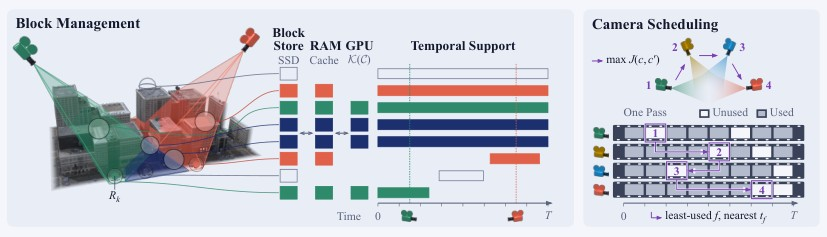
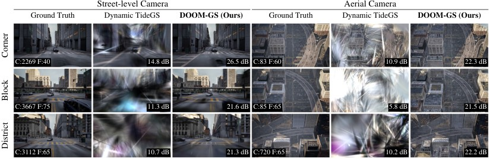
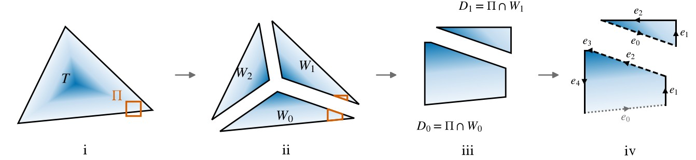
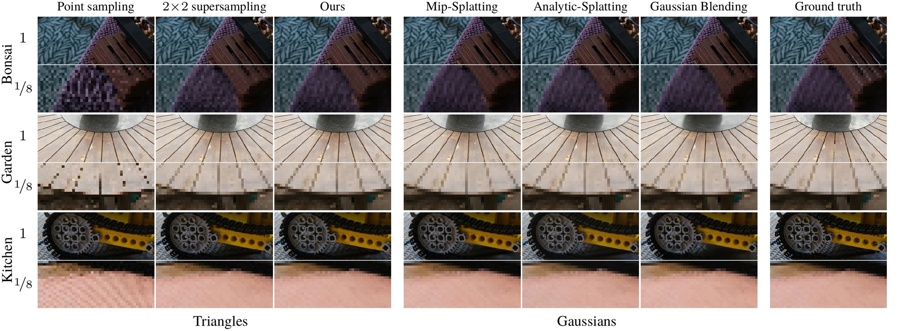
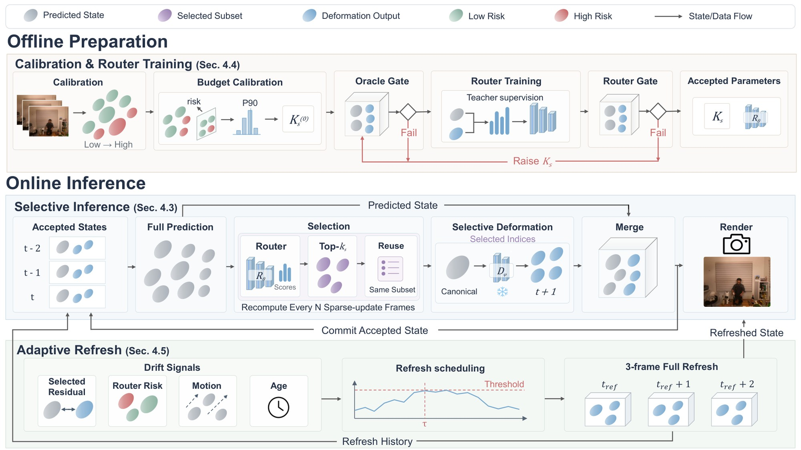
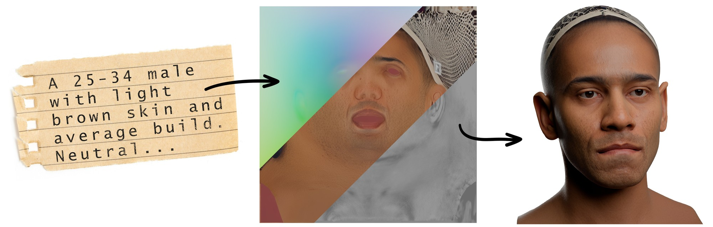
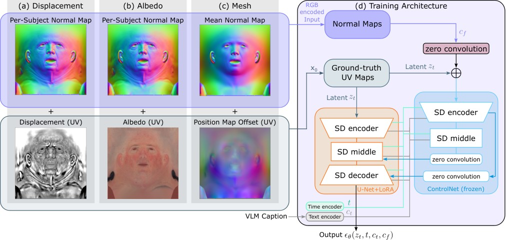

# 2026-11-19 科研日报

## 今日速览

周三的 arXiv 公告里，和主线最贴的两件事分别发生在「大场景动态高斯怎么训得下」和「显式图元怎么在像素上积得准」。一边是：静态场景的核外训练已经能把高斯在固态硬盘、内存和显存之间搬来搬去，但动态高斯会在空间里移动、只在一段时间内有效，原来按空间邻域打包的块会随时间散掉，而且单个视角看见的高斯就可能超过显存。另一边是：三角溅射用半透明三角形做场景表示，却只在像素中心抽样，并在内切圆半径小于一个像素时整块剔除——拉远或降低分辨率时，锯齿和误删会一起出现。

- **必读：[DOOM-GS](#2026-11-19--doomgs)（Doğa Yılmaz、Jialin Zhu、Binglun Wang、He Wang）。** 据作者所知，这是第一个专为大规模动态高斯设计的核外优化方法：用时空块代替纯空间块，用考虑重叠的相机调度减少搬运，并把原先只用于推理的高斯点溅射改成可学习的渲染，从而不再要求「一个视角的全部可见高斯同时住在显存里」。读它的理由：它把城市尺度的动态重建放到约 24 GB 级显存和普通固态硬盘上做成了可对照的实验，并贡献了基于 MatrixCity 的 DynamicMatrixCity 数据集；这和主线里大场景资产、批训练能不能在有限硬件上跑起来是同一类约束。
- **必读：[ATS](#2026-11-19--ats)（Brent Zoomers、Joni Vanherck、Leander Winters、Jeroen Put、Lode Jorissen、Nick Michiels）。** 它给出三角溅射窗口函数在一个像素上的闭式积分，以及相应的梯度：角平分线把三角形分成三块，格林公式再把面积分变成每条边上的闭式项。同一套积分还支持保守剔除，只丢掉对任何像素都达不到透明度阈值的三角形。读它的理由：这是把像素足迹严格积进去，而不是靠 \(2\times 2\) 超采样去碰；已有模型不必重训就能抗锯齿，拉远后的时间闪烁也明显小于超采样。对溅射类表示来说，它把「点抽样误差」从误差预算里先划出去。
- **其他：** [CueSplat](#2026-11-19--cuesplat) 在冻结已有四维高斯骨干的前提下，用历史预测和学习到的路由，只给预算内的高斯做精确变形，面向 Jetson 一类边缘设备；[FaceRiff](#2026-11-19--faceriff) 是 SIGGRAPH Asia 2026 Conference Papers，用少量扫描和 LoRA 从文本生成可物理基渲染重光照的人脸网格、反照率和置换。短列还有跨厂商的 Vulkan 训练器 Cross3DGS、算法–硬件协同的 ElsaGS、无需参考图的三维高斯审美调色 ReTouchGS，以及全景多机高斯定位与建图、屏幕空间伪影剔除。

## 显存装不下的动态高斯，按时空把块运进来

### DOOM-GS · arXiv · 2026-11-18

**一句话判断：** 这篇的关键不是再提出一种动态高斯表示，而是指出已有核外方法依赖的两条假设——空间上靠近的高斯会一直待在一起、单个视角的可见高斯能全部放进显存——在动态大场景里都不成立，然后用时空块、重叠感知的相机调度，以及可学习的点溅射，把「同时驻留」改成「分块流过」。

- **Title：** DOOM-GS: Dynamic Out-of-core Optimization for Massive Gaussian Splatting
- **作者：** Doğa Yılmaz、Jialin Zhu、Binglun Wang、He Wang
- **作者单位：** University College London（Doğa Yılmaz、Binglun Wang、He Wang）；百度研究院（Jialin Zhu）
- **发表时间：** arXiv 首次挂出 2026-11-18（abs 标注提交于 2026-11-17）
- **投稿信息：** 未标明

**摘要中译：** 传统高斯溅射采用核内训练，即假定显存大到能放下全部图元。图元数量超过显存时，例如在大场景上，这一假定不再成立。近期的核外训练研究开始处理这个问题，但只适用于静态场景。与静态高斯不同，动态高斯会在时空中移动，打破已有核外方法的常见假设，给内存管理和训练带来新的困难。本文提出面向大规模高斯溅射的动态核外优化（DOOM-GS），据作者所知，这是第一个专为大规模动态高斯设计的核外优化方法。它配有针对时空图元的缓存管理，以及面向大量图元的快速学习渲染。由于缺少合适的大规模动态高斯评测数据，作者同时贡献了一个新数据集。由于没有可直接比较的方法，他们改写了若干相近方法作为对照。实验表明，DOOM-GS 使得在中等硬件上高质量重建城市尺度动态场景成为可能，可作为后续研究和应用的基础工具。

**方法概要：**

静态场景的核外高斯训练，例如 TideGS、CLM-GS，靠的是空间局部性：把空间上靠近的高斯打成一块，在固态硬盘、内存和显存之间按块调度，并假定「一个视角要用的高斯，可以整块同时放进显存、在相邻视角间复用」。动态场景会从两处拆掉这两条假定。第一，高斯不但移动，而且只在有限时间窗口内有效，原先的空间分组会随时间失去局部性。第二，单个视角看见的图元就可能超过显存，块级复用的前提不成立。

DOOM-GS 把高斯存在固定大小的块里，每块 4096 条记录，和 TideGS 类似；不同的是，块要在空间和时间上同时紧凑。作者用一组专门操作来维持这种紧凑：容量用满时，把新克隆写进已失效的槽位；再按三维位置与时间中心做四维 Morton 编码，定期重新打包。调度相机时，不再按位姿把相近视角排在一起——在动态数据里，同一位姿会在不同时刻反复出现，按位姿排序反而会降低视角多样性，也更少复用已在显存中的块。他们改用考虑块重叠的全局贪心调度，优先选择能复用当前驻留块、同时又保持时间与视角多样性的相机。

即便块可以流式装载，标准的三维高斯光栅仍要求「这一视角的全部可见高斯同时在显存里」才能做按深度的透明度混合。作者把高斯点溅射（Gaussian Point Splatting）从一种推理期的随机渲染，改成可学习的前向过程：从高斯中抽样像素大小的不透明点再溅射，前向按块分批写入帧缓冲，反向用相应的梯度估计。这样，显存预算限制的是同一时刻驻留的块数，而不是这一视角一共能渲染多少图元。文中写明，实验在约 24 GB 显存、普通内存和固态硬盘的设置下进行。

评测数据是作者基于 MatrixCity 构造的 DynamicMatrixCity，含 Corner（\(80\,\mathrm{m}\times 80\,\mathrm{m}\)）、Block（\(260\,\mathrm{m}\times 150\,\mathrm{m}\)）和 District（\(1{,}870\,\mathrm{m}\times 1{,}500\,\mathrm{m}\)）三个尺度，每段 120 帧；Block 与 District 各有 64 个相机。直接对照是 Dynamic TideGS：保留 TideGS 的核外框架，把静态图元换成与本文相同的 GraphiXS 动态表示。两边都使用 1{,}800 块的显存预算，相当于约 740 万个高斯，峰值显存低于 20 GB；Corner 与 Block 训练 4 万次迭代，District 训练 20 万次，批次为 4 张图。

**值得关注：**

在作者报告的 DynamicMatrixCity 对照上，相对 Dynamic TideGS，DOOM-GS 在 Corner / Block / District 上的峰值信噪比分别为 24.93 / 23.19 / 19.35 dB，提高 9.3 / 13.9 / 9.2 dB；结构相似性从 0.515 / 0.344 / 0.286 升到 0.824 / 0.721 / 0.658，感知损失相应下降。训练时间分别减少约 46%、31% 和 28%（Corner 15.9 小时对 29.5 小时，Block 37.2 小时对 54.2 小时，District 228.5 小时对 317.4 小时）；Block 上显存命中率从 78% 提到 89%，District 的峰值显存从 20.5 GB 降到 12.6 GB。作者把 Dynamic TideGS 的拖影和雾状伪影解释为：模型变大后，一个视角可见块数会超过 1{,}800 的驻留上限，覆盖率下降，而 DOOM-GS 用点溅射把可见块全部流过。他们还把 CLM-GS、TideGS 和 A LoD of Gaussians 改成逐帧静态训练作为对照，报告一份动态模型在 120 帧序列上的总代价远低于保存 120 个独立模型。这些数字都是作者报告，场景来自基于 MatrixCity 的合成动态数据，不是真实城市采集；文中也写明没有可直接比较的动态核外方法，基线是改写得到的。未找到项目页或代码。

**相关链接：** [arXiv abs](https://arxiv.org/abs/2611.22805) · [PDF](https://arxiv.org/pdf/2611.22805) · [HTML](https://arxiv.org/html/2611.22805v1)

## 给三角溅射一个精确的像素积分

### ATS · arXiv · 2026-11-18

**一句话判断：** 三角溅射的锯齿和「一拉远场景就被剔光」，根源都是只在像素中心取值、并用内切圆半径做剔除；这篇把窗口函数在像素上的积分写成闭式，连同梯度一起接到渲染和剔除里，已有模型不必重训。

- **Title：** ATS: Anti-Aliased Triangle Splatting with Exact Per-Primitive Integrals
- **作者：** Brent Zoomers、Joni Vanherck、Leander Winters、Jeroen Put、Lode Jorissen、Nick Michiels
- **作者单位：** Digital Future Lab, Flanders Make, Hasselt University
- **发表时间：** arXiv 首次挂出 2026-11-18（abs 标注提交于 2026-11-17）
- **投稿信息：** 未标明

**摘要中译：** 三角溅射用半透明三角形表示场景，但每个三角形只在像素中心求值，并剔除内切圆半径小于一个像素的三角形。前者造成严重锯齿，后者在较低分辨率下会删掉场景的大部分。本文证明，三角溅射窗口在一个像素上的积分有精确的闭式解。角平分线把三角形分成三个子三角形，在每个子三角形里，窗口是到一条边的距离的幂，因此每块都有闭式原函数；格林公式再把积分及其梯度化成「子三角形与像素求交后，每条边一项」。整个三角形上的积分同样有闭式，从而支持保守剔除：只去掉在任何像素上都不可能达到渲染器透明度阈值的三角形。这一精确形式不必重新训练即可为已有模型抗锯齿，时间锯齿小于 \(2\times 2\) 超采样，并在多尺度训练下改进收敛。

**方法概要：**

三角溅射用投影后的二维三角形和符号距离来定义窗口。对每条边的外向单位法向 \(\mathbf{n}_k\) 和偏移 \(O_k\)，有

\[
\phi(\mathbf{p})=\max_k(\mathbf{n}_k\cdot\mathbf{p}+O_k),\qquad
I(\mathbf{p})=\mathrm{ReLU}\bigl(-\phi(\mathbf{p})/r\bigr)^{\sigma}.
\]

其中 \(r\) 是内切圆半径，\(\sigma\) 是可学习的平滑指数。窗口在内心处为 1，在边界和外部为 0。取最大值这件事，正好把三角形分成三个只依赖最近边的子三角形。原方法还规定：投影内切圆半径小于一个像素的三角形直接丢掉。分辨率一降，大量三角形都小于一个像素，场景会被剔空；文中举例，某场景在 \(1/8\) 分辨率下峰值信噪比从 27.2 dB 掉到 18.0 dB。

ATS 的目标是把窗口在像素区域上对盒式滤波器的积分精确算出来，而不是只看像素中心。角平分线给出三个子三角形，每个子三角形上窗口是到一条边距离的幂，存在闭式原函数；再把子三角形与像素求交，用格林公式把面积分变成边界上的闭式项，梯度按同样路径反传。整三角形上的积分同样有闭式，于是剔除可以改成保守规则：若该积分表明这个三角形在任何像素上都达不到透明度截止（文中取与三维高斯和三角溅射光栅相同的 \(\lambda_{\mathrm{cull}}=1/255\)），才把它丢掉。已有模型可以换成这个渲染器而不重训；若要在多尺度下进一步收敛，也可以用同一积分做训练。

**值得关注：**

单尺度训练后把测试视点渲染到训练分辨率的 \(1\) 至 \(1/8\)，与盒式下采样的真值比较：在 Mip-NeRF 360 的 \(1/8\) 上，ATS 为 29.26 dB，无剔除的三角溅射为 24.83 dB，与 \(2\times 2\) 超采样的 29.90 dB 接近，但结构相似性和感知损失更好（0.920 / 0.062 对超采样的 0.908 / 0.072）。时间稳定性上，相机每帧平移 \(1/16\) 像素、在 Mip-NeRF 360 的 \(1/8\) 分辨率下，帧差误差（\(\times 10^{-3}\)，越小越好）从超采样的 9.2 降到 3.3。多尺度训练（与 Mip-Splatting 类似，30% 迭代强制全分辨率）时，ATS 在多数设置上高于超采样，作者写到在 NeRF Synthetic 的 \(1/8\) 上最多高出约 1.9 dB。局限也很明确：精确积分比点抽样、甚至比 \(2\times 2\) 超采样更慢，需要核函数继续优化；每个像素只合成一个透明度，仍会在三角形共享的边缘引入误差，剩余误差要交给 A-buffer 或透明度分布一类方法。项目页写明代码即将发布。数字均为作者报告，训练在 NVIDIA RTX 5090 上完成。

**相关链接：** [arXiv abs](https://arxiv.org/abs/2611.22512) · [PDF](https://arxiv.org/pdf/2611.22512) · [HTML](https://arxiv.org/html/2611.22512v1) · [项目页](https://brent-zoomers.github.io/ats/)

## 其他值得一看

### CueSplat · arXiv · 2026-11-18

**一句话判断：** 这是训练之后的加速层，不是再训一套四维高斯：骨干和已有高斯集合保持冻结，用最近历史预测轨迹，再用轻量路由在场景预算里挑选必须做精确变形的高斯，从而把边缘设备上「每帧对所有高斯跑变形网络」的开销削掉。

- **Title：** CueSplat: Learning to Schedule Sparse Deformation for Dynamic Gaussian Splatting on Edge Devices
- **作者：** Qingyuan Tang、He Zhu、Shixuan Sun、Anbang Wu、Jingwen Leng、Minyi Guo、Yu Feng
- **作者单位：** 上海交通大学
- **发表时间：** arXiv 首次挂出 2026-11-18（abs 标注提交于 2026-11-17）
- **投稿信息：** 未标明

**摘要中译：** 基于变形的四维高斯溅射能够渲染动态场景，但每帧对所有高斯求一次变形网络，在边缘设备上计算很重。作者观察到，高斯轨迹往往在局部可预测，而这种预测的可靠程度随高斯和时间变化。CueSplat 是一个训练后框架：它利用局部时间规律，同时冻结预训练骨干并保留其高斯集合。具体而言，它根据近期历史预测高斯属性，并用轻量的学习路由器，在离线标定的场景预算内选择需要精确变形更新的高斯；选择同时考虑预测可靠性和对渲染的贡献。被选中的索引在邻近帧之间复用，以降低路由开销，入选的高斯仍在目标帧上接受精确更新。周期性的全量刷新用于抑制漂移。

**方法概要：** 部署分成标定与推理两段。标定阶段为每个场景确定预算 \(K_s\)，并用质量门控训练路由器，使在该预算下的渲染质量通过预先设定的门槛。推理时，先用最近若干帧的历史预测当前属性；路由器只在预算内挑出需要走完整变形网络的高斯，其余用预测结果；选中的集合会在邻近帧沿用，每隔一段时间再做一次连续数帧的全量变形，把历史缓存刷新掉。作者在多种冻结骨干（包括 E-D3DGS、4DGaussians 等）上接入这套调度，并在 Jetson AGX Orin 上测帧率，同时与固定分区的 DASH 风格对照做了比较。

**值得关注：** 在 Technicolor 的 50 帧序列上，四个骨干平均，完整变形基线为 32.58 dB、15.50 FPS，接入 CueSplat 后为 32.50 dB、60.47 FPS（均在 Jetson AGX Orin 上测得）。消融表明：只用运动启发式、或把预算固定为 20%，质量会掉得更多；关掉周期性刷新，吞吐更高但质量下降。它针对的是已训好的动态高斯在端侧怎么跑，并不改变表示，也不解决逆渲染。未找到项目页或代码。数字均为作者报告。

**相关链接：** [arXiv abs](https://arxiv.org/abs/2611.22095) · [PDF](https://arxiv.org/pdf/2611.22095) · [HTML](https://arxiv.org/html/2611.22095v1)

### FaceRiff · SIGGRAPH Asia 2026 · 2026-11-18

**一句话判断：** 它要的不是又一张好看的人脸图，而是一套可接到物理基渲染里的资产——网格、与光照无关的反照率、孔隙尺度的置换——并且用预训练扩散模型和每任务不到 3% 的参数，在大约两千张扫描上就把这条链路打通。

- **Title：** FaceRiff: Data-Efficient Unified Text-to-3D Face Asset Synthesis via Geometric Conditioning
- **作者：** Elly Akhoundi、Mathieu Lamarre、Thibault Goyallon、Patrick Anderson、Étienne Danvoye
- **作者单位：** Electronic Arts（Elly Akhoundi，Vancouver；Mathieu Lamarre、Patrick Anderson、Étienne Danvoye，Montréal；Thibault Goyallon，Toronto）
- **发表时间：** arXiv 首次挂出 2026-11-18（abs 标注提交于 2026-11-16）
- **投稿信息：** 已接收 SIGGRAPH Asia 2026 Conference Papers（Comments 与论文题头均写明；DOI [10.1145/3829340.3842358](https://doi.org/10.1145/3829340.3842358)）

**摘要中译：** 带一致 UV 映射几何、反照率和物理基置换的高分辨率人脸数据很少，而这类资产对写实数字人渲染是必需的。已有三维人脸生成往往慢、只覆盖单一模态，或依赖大规模专用数据；大的图像扩散模型虽有很强的人脸先验，却不能直接给出与光照无关的纹理、孔隙尺度置换，或与 UV 对齐的几何。FaceRiff 是一个统一、省数据和省参数的框架，直接从文本在共享 UV 空间生成完整的三维人脸资产（网格、反照率和置换）。它为预训练的 SDXL 骨干配备任务专用的 LoRA 适配器，并用 UV 法向图作为几何条件：实例法向引导反照率与置换的生成，数据集平均法向为网格生成提供规范的空间锚点。作者只用约 350 个身份的 2{,}049 张扫描、在单块 GPU 上训练，每个任务更新骨干不到 3% 的参数，并且不必按实例优化即可得到可渲染资产。相对 FaceG2E 和 DreamFace，FaceRiff 在保持提示对齐和固定拓扑 UV 一致性的同时提高了按提示的多样性，并额外生成适合物理基重光照的、与光照无关的反照率，以及先前文本驱动基线所没有的孔隙尺度置换。一项有 45 名行业专业人员参加的盲测显示，其感知真实感明显高于 DreamFace，并接近真实采集。

**方法概要：** 三个生成任务共享同一套 UV 和同一骨干，但各用自己的 LoRA，并不把网格、反照率和置换绑成一次联合扩散。网格生成用数据集平均法向作为规范空间条件，把输出限制在固定拓扑上；反照率和置换则用该实例自己的 UV 法向，通过 ControlNet 一类条件把几何结构写入纹理。因为反照率的目标是与光照无关的固有色，置换的目标是标量高度场，两者都不能当成普通照片去超分或生成，所以条件与适配器是分模态设计的。同一团队还有一篇 SIGGRAPH Asia 2026 Technical Communications 的短文，讨论如何把 1K 的面部资产图域适应地升到 4K，可作这条资产链的分辨率补充，但不是同一篇论文。

**值得关注：** 对可重光照数字人来说，缺的往往不是「看起来像一张脸」，而是能在不同灯光下成立的反照率和微几何。这篇把预训练图像先验接到 UV 资产上，数据量和可训练参数都很小，但条件是固定拓扑、工作室扫描风格的人脸，不能直接外推到任意物体或野外场景的逆渲染。盲测和与 DreamFace、FaceG2E 的对照都是作者报告。未找到单独的项目页或代码。

**相关链接：** [arXiv abs](https://arxiv.org/abs/2611.21867) · [PDF](https://arxiv.org/pdf/2611.21867) · [HTML](https://arxiv.org/html/2611.21867v1) · [DOI](https://doi.org/10.1145/3829340.3842358)

- **Cross3DGS · WACV 2027 Workshop · 2026-11-18。** *Cross3DGS: Unified Vulkan-Based 3D Gaussian Splatting Training from Workstations to Mobile Devices*（Hiroyuki Sato，MinD in a Device Co., Ltd., Tokyo；Yusuke Takimoto，Independent Researcher, Kanagawa）。已接收 WACV 2027 Workshop on Eyes of the Future（EOF）。它要解决的不是再改一种高斯表示，而是：把采集设备上的训练从「必须送到 CUDA 工作站」变成「在同一套优化器下，按设备限制和已知驱动故障选出能跑对的执行日程」。作者报告，同一套 3 万次更新、一百万高斯的标准质量训练，在 NVIDIA、Intel、Arm、Qualcomm、AMD 和 Apple 的配置上都能完成，其中包括 Android 设备和 iPhone；已有的可移植训练器 VkSplat 与 Brush 在部分移动 GPU 上无法运行。工作站上相对 VkSplat 质量更高、训练时间无显著差别，Brush 在相当质量下训练时间约为其三倍；各设备上的最终质量几乎相同。代码：[GitHub](https://github.com/unclearness/cross3dgs)。[arXiv](https://arxiv.org/abs/2611.22240)

- **ElsaGS · arXiv · 2026-11-18。** *Accelerating 3D Gaussian Splatting Training through Selective Freezing and Computation Caching*（He Zhu、Ziheng Dai、Zihan Liu、Han Zhao、Xiaofeng Hou、Chen Chen、Jingwen Leng、Yu Feng、Minyi Guo 等，上海交通大学；Ruyang Li、Hui Wei、Yaqian Zhao，IEIT SYSTEMS Co., Ltd., Beijing）。观察是多数高斯会较早收敛，后期迭代只在 refinement 一小部分。方法把已收敛的高斯逐步冻结，并缓存它们对像素的累积贡献，前后向光栅都少算；同时提出带像素并行阵列和组相联冻结缓存（FGcache）的 ElsaGS core。作者报告最多可冻结约 90% 的高斯，相对 GPU 端到端最高约 20.6 倍加速、能耗降约 99.4%。需要记住：这是算法与专用架构的协同设计，收益不能直接理解成现有 CUDA 训练器上的同等加速。[arXiv](https://arxiv.org/abs/2611.22059)

- **ReTouchGS · arXiv · 2026-11-18。** *ReTouchGS: Ultralight Render-free Aesthetic Color Enhancement and Transfer for 3D Gaussian Splatting*（Chuanzhi Xu、Boyu Wei、Xuanhua Yin、Yiyang Li、Haodong Chen、Qiang Qu、Weidong Cai，The University of Sydney；Chengkun Yue，Indiana University）。据作者所知，这是第一个面向已训练三维高斯、无需参考图的审美调色框架：从模型预测场景级查找表，也可在有编辑参考时做跨视角一致的颜色迁移。它改的是外观，不改几何，也不做材质–光照分解。代码：[GitHub](https://github.com/LouckXu/ReTouchGS)。[arXiv](https://arxiv.org/abs/2611.23054)

- **CoSphere-SLAM · arXiv · 2026-11-18。** *CoSphere-SLAM: Multi-Agent Panoramic Gaussian Splatting SLAM with Spherical Loop Closure*（Qi Shao、Hong Liang、Liang Li，哈尔滨工程大学，邵同时就职于 University of Liverpool；Zhihao Cao，ETH Zurich，同时就职于 National University of Singapore；Shuhao Zhai，澳门大学；Taoyu Wu，University of Liverpool，同时就职于西交利物浦大学；Zhuoxiao Li，香港科技大学（广州）；Anh Nguyen、Baoru Huang，University of Liverpool，同时就职于 Imperial College London；Long Hu、Xianzhi Li，华中科技大学）。据作者所知，这是第一个面向全景相机的多机高斯溅射定位与建图框架：球面特征在 \(\mathrm{SO}(3)\) 上用快速傅里叶变换相关对齐，并用全局 \(\mathrm{Sim}(3)\) 共识拒绝对称房间造成的错误闭环。项目页：[cosphere-slam.github.io](https://cosphere-slam.github.io/)。[arXiv](https://arxiv.org/abs/2611.22235)

- **SSA-3DGS · WACV 2027 · 首次收录。** *SSA-3DGS: Unsupervised Removal of Screen-Space Artifacts for 3D Gaussian Splatting*（Kristof Overdulve、Lode Jorissen、Nick Michiels；Digital Future Lab, Flanders Make, Hasselt University）。arXiv 于 2026-07-06 首次挂出，2026-11-17 修订为第 3 版并出现在 11-18 的替换列表中，已接收 WACV 2027。它针对的是固定在图像平面上、并不属于三维世界的遮挡（手指挡镜头、镜头上的泥水、行车记录仪里的仪表盘、水印和界面元素），把它们从高斯场景里拆成可学习的二维叠加，避免被烘进几何。此前日报未收录，本次因其会议接收与版本更新补入。[arXiv](https://arxiv.org/abs/2607.05598)

- **4K 面部资产超分 · SIGGRAPH Asia 2026 Technical Communications · 2026-11-18。** *Domain-Tuned Diffusion Super-Resolution for 4K Facial Asset Maps*（与 FaceRiff 同一作者团队，Electronic Arts）。已接收 SIGGRAPH Asia 2026 Technical Communications。把面部 UV 反照率和置换从 1K 升到 4K，强调置换是高度场、不能直接套用照片超分。可与 FaceRiff 的资产链对照阅读。[arXiv](https://arxiv.org/abs/2611.21890)

## 圈内新闻与社区反应

**BWM-Forge：先把机器人、物体、动作和相机写成可执行的场景程序，再交给视频模型补材质与光影（具身 / 世界模型）。** 11 月 18 日，[上观新闻 / 文汇报](https://finance.sina.com.cn/jjxw/2026-11-18/doc-inizensv4696273.shtml)报道同济大学空间智能团队与考拉悠然发布 BWM-Forge。官方说明见[项目页](https://bwm-forge.github.io/)和 [arXiv:2611.16221](https://arxiv.org/abs/2611.16221)，代码在 [GitHub](https://github.com/Lcixs/BWM-Forge)。它把本体、场景物体、运动和相机写成可改参数的三维场景程序，由多类 Agent 搭建、审查并先渲染检查结构和运动的代理视频，再调用视频生成模型，结合代理视频、参考图像和提示词补材质、光影与环境。换本体、换场景、换机位被写成改程序，而不是每次从零拍摄。项目自述的评测包括 VBench-Long 主体一致性 0.9721、背景一致性 0.9722，以及 RoboJudge-9B 指令对齐均分 3.33，均为作者报告；截至写稿，未见可核验的独立复现，也尚未看到生成数据对下游机器人策略的公开增益实验。它产出的是可控的具身视频，并不导出可编辑的三维高斯或网格资产，和主线里的可重光照 3DGS 资产不是同一条出口；和 Blender 场景程序的交叉在于「世界先写成可改的场景」，而不是原生高斯管线。

Ke-Sen 的 [SIGGRAPH Asia 2026 论文链接页](https://kesen.realtimerendering.com/siga2026-Changelog.htm) 仍停留在 9 月 17 日，无新变更。Blender 原生 3DGS 仍以 5.3 稳定版为准，5.4 尚在开发周期，本期未见新的官方限制说明或接口变更。四领域均做了新闻扫描；与主线重复或缺少可核验一手来源的条目未展开。

## 覆盖说明

日报发布日为 **2026-11-19（周四）**。内容覆盖日为 **2026-11-18（周三）** 的 arXiv 新公告（cs.GR 新稿及 cs.CV、cs.AR 中与高斯、溅射、逆渲染、外观和几何相关的条目），并与 `seen-papers.json` 去重。DOOM-GS（2611.22805）与 ATS（2611.22512）核对了 HTML 的方法、主表与局限，配图为原论文图 1 / 图 3 与图 3 / 图 4；CueSplat（2611.22095）与 FaceRiff（2611.21867）核对了方法、主要结果和局限，配图取自原论文；Cross3DGS、ElsaGS、ReTouchGS、CoSphere-SLAM、SSA-3DGS 与 4K 面部资产超分据摘要、题头或方法与结果简写。SSA-3DGS 为首次收录的已有预印本（2026-07-06 挂出，11-17 修订为第 3 版）。所有实验数字均为作者报告，未独立复现。

notes 至 `4b15b8c`、blog 至 `c29075d`、academic 至 `f19a697`；公开兴趣笔记无新的研究向增量，策展权重继续放在真实场景几何、可重光照外观与渲染效率。圈内事实来自 BWM-Forge 项目页、arXiv 与 11-18 媒体报道，以及 Ke-Sen 更新日志；厂商或作者自述已与独立反馈分开标注。

**编写：** Cream
