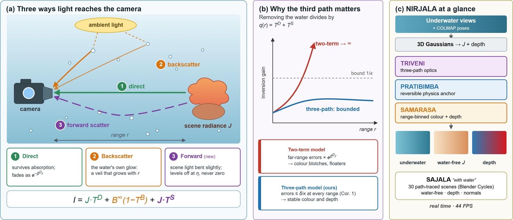
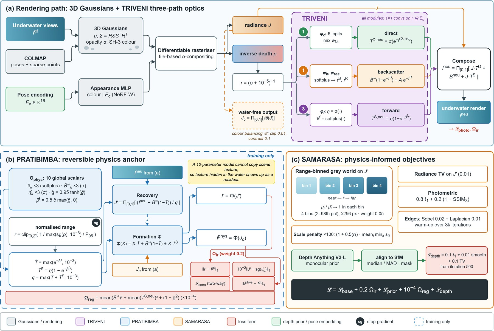
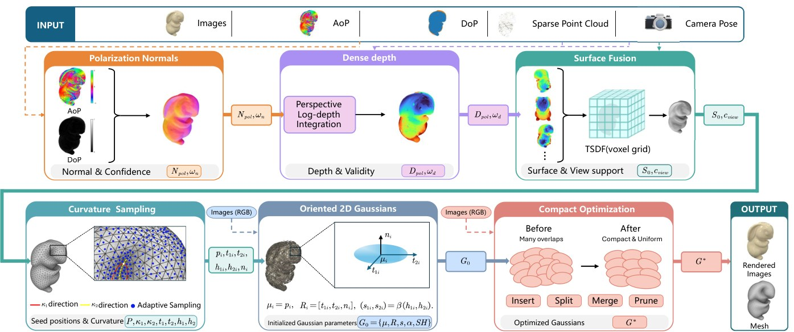
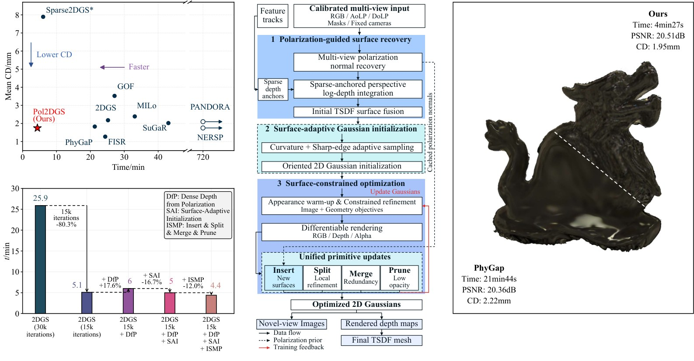
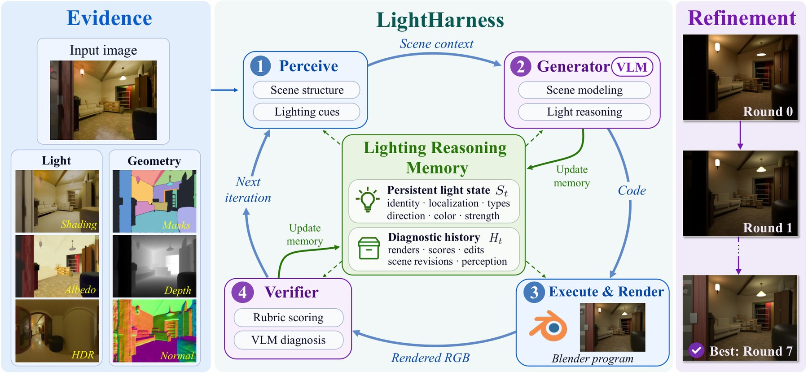
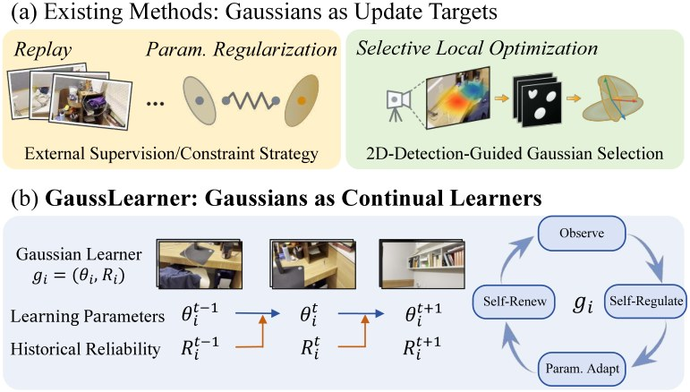

# 2026-11-20 科研日报

## 今日速览

周四的 arXiv 公告里，和主线最贴的两件事分别发生在「散射介质里怎么把场景和介质拆开」和「反射、弱纹理处怎么先拿到可靠的表面，再去优化高斯」。一边是：已有的水下高斯方法多半只写直接透射和后向散射，去水时要把观测除以随距离指数衰减的透过率，反演增益会随距离无限变大，远处的一点点后向散射误差就会变成色块和漂浮物。另一边是：二维高斯从稀疏点云出发，要靠反复调整位置、朝向和尺度并不断加密，才能铺满表面；在反射和弱纹理处，多视图颜色变化给不出可靠的几何信号，优化既慢，表面也容易花。

- **必读：[NIRJALA](#2026-11-20--nirjala)（Latchan Chhetri、Aman Kumar）。** 它把前向散射写成一条会随距离饱和、而不是继续指数衰减的第三条路径，并证明这样去水时的反演增益在任意距离上都有上界；再用一个只有十个全局参数的物理分支，在恢复和重新成像两个方向上把灵活的神经水模型锚住，避免场景纹理偷偷藏进水里。读它的理由：这是把「场景外观和介质」当成同一类解耦问题来做，而且把病态反演写成了可验证的条件，还贡献了用 Blender Cycles 路径追踪、带无水真值的 SAJALA 评测集。主线里的可重光照资产，同样要面对「许多组几何、材质和光照能解释同一张图」；这篇把误差放大的机制先讲清楚了。
- **必读：[RAPID](#2026-11-20--rapid)（Daisong Ouyang、Linlin Xia 等）。** 方法名是 Pol2DGS：先从多视图线偏振角和线偏振度恢复法向，用稀疏几何锚点把法向积分成每张视图的稠密深度，再经截断符号距离场融合成表面，按曲率和棱边做自适应采样，初始化带朝向的二维高斯。读它的理由：它把偏振提供的局部朝向，用在优化开始之前，而不是只在着色阶段做约束；作者报告在 PISR 数据上相对 PhyGaP 大约 5 倍加速（约 4.3 分钟对 21.3 分钟），并在多数场景上保持可比较的网格和新视角质量。昨天刚读过带偏振的环境贴图，这篇把它用到了表面重建和二维高斯的初始化上。
- **其他：** [LightHarness](#2026-11-20--lightharness) 用视觉语言模型做图像到场景程序的迭代重建，把光源假设置进可修订的记忆，不额外训练、也不做可微渲染，就能改光照、插物体；[GaussLearner](#2026-11-20--gausslearner) 把每颗高斯看成持续学习者，用渲染本身的透明度合成权重把像素误差归到图元上，而不是先做二维变化检测再硬切要更新的高斯。短列还有对象中心的动态高斯流式重建、单图本征分解的表示自编码器、按层选择稀疏注意力加速 VGGT，以及同一组作者把高斯场写到星系多波段辐射传输上的 GalaxyGS。

## 散射介质里，去水的增益必须先有上界

### NIRJALA · arXiv · 2026-11-19

**一句话判断：** 这篇的关键不是再做一个「去水色更好看」的水下高斯，而是指出两路径成像在反演时增益会随距离爆炸，于是把前向散射写成一条饱和项，让去水增益有上界，再用一个很小的可逆物理分支，阻止场景内容躲进水的参数里。

- **Title：** NIRJALA: Draining the Sea out of Gaussian Splatting with Three-Path Optics and Reversible Physics
- **作者：** Latchan Chhetri、Aman Kumar（同等贡献）
- **作者单位：** Halo Mind Research Group, India；Sikkim Manipal Institute of Technology, India
- **发表时间：** arXiv 首次挂出 2026-11-19（abs 标注提交于 2026-11-17）
- **投稿信息：** 未标明

**摘要中译：** 水不只是给水下照片加一层颜色，它会改写整张图。每个像素都混合了衰减后的场景辐射、后向散射形成的雾纱，以及在通往相机的路上被小角度散射、却仍到达传感器的场景光；许多组场景和水的组合都能解释同一组像素。现有的水下高斯溅射方法大多只建模前两项，去水时把观测除以随距离指数衰减的透过率，反演增益会随距离无限增大。本文提出 NIRJALA（梵语，意为「无水」），一个同时恢复无水外观和几何的三维高斯溅射框架。它包含三个部分。TRIVENI 是三路径成像模型，在直接透射和后向散射之外加入随距离饱和的前向散射项；作者证明这使反演增益在任意距离上都有上界，并给出后向散射与衰减估计误差传播到恢复颜色上的界限。PRATIBIMBA 是可逆物理锚点，把灵活的神经水模型在恢复和重新成像两个方向上与一个十参数的全局物理模型绑在一起，使场景内容不能悄悄藏进水里。SAMARASA 汇集了物理约束目标，包括按距离分箱、分别平衡各颜色通道的先验。为了对照无水真值评价去水效果，作者还构建了 SAJALA（意为「有水」）：用 Blender Cycles 路径追踪的 30 个场景套件，提供无水图像、深度和法向，并控制水色与浊度。在 SAJALA 上，相对最强基线，NIRJALA 把渲染峰值信噪比从 24.34 提到 24.76 dB，把深度相对绝对误差从 0.109 降到 0.091；在真实的 SeaThru-NeRF 场景上，感知损失从 0.194 降到 0.175，并以 44 FPS 渲染。文末讨论了水下外观指标和几何何时会不一致，以及评测本身的限度。

**方法概要：**

现有修订后的水下成像，通常把观测写成直接透射加后向散射：场景辐射 \(J\) 乘以随距离 \(r\) 指数衰减的透过率，再加上随距离增加、趋向背景光 \(B^{\infty}\) 的雾纱。去水时要先减去雾纱，再除以透过率。距离一大，这个除数接近零，增益 \(e^{\beta^{D} r}\) 没有上界——后向散射或衰减估计里很小的误差，都会在远处被放大成色块和漂浮物。

作者指出，还有一部分场景光只偏转了很小的角度，仍然到达相机。他们把这一项单独写出来，得到三条路径：

\[
I_{\lambda}=J_{\lambda}T^{D}_{\lambda}(r)+B^{\infty}_{\lambda}\big(1-T^{B}_{\lambda}(r)\big)+J_{\lambda}T^{S}_{\lambda}(r),
\]

其中直接透射和后向散射的透过率仍用比尔–朗伯定律，前向散射权重则取会随距离饱和的形式 \(T^{S}_{\lambda}(r)=\eta_{\lambda}(1-e^{-\beta^{f}_{\lambda}r})\)，\(\eta_{\lambda}\in(0,1]\)。文中写明，这个形式借鉴了处理前向峰散射的 delta-Eddington 思路，但是建模选择，并不是从辐射传输方程推出来的；它按像素缩放自己的辐射，并不在像素之间搬光，因此能保住前向散射送回像素的能量，却不能描述它造成的模糊。换来的是更好处理的逆问题：去水时除以 \(q=T^{D}+T^{S}\)，而 \(q\) 在远处趋向 \(\eta\) 而不是零。命题 1 给出反演增益的上界 \(1/\kappa\)，其中 \(\kappa=\eta\min(1,\beta^{f}/\beta^{D})\)；推论再把这个上界转成后向散射误差和衰减误差的传播界限。两路径模型里，相应的误差会随距离指数放大。

实现上，三维高斯仍由 COLMAP 初始化，光栅得到无水平衡前的辐射 \(J\) 和逆深度，距离取逆深度的倒数。TRIVENI 用范围图和 16 维的每视图外观嵌入，经 \(1\times 1\) 卷积分别预测直接透射、后向散射和前向散射，合成为水下渲染；辐射再做分通道的百分位颜色平衡，得到无水输出 \(J_{c}\)。这些神经模块是灵活的，本身并不强制遵守比尔–朗伯定律。

灵活性带来的风险是：网络可以把场景纹理写进雾纱或透过率里，图像照样能对上。PRATIBIMBA 只在训练时启用，用十个全局物理参数构成一条太小、没法复制纹理的分支：在归一化距离上按物理模型做一次恢复，再分别从恢复出的辐射和颜色平衡后的 \(J_{c}\) 重新成像，要求两条路径都能对上观测。场景纹理如果躲进了水的参数，重新成像时就会露出残差。

SAMARASA 负责目标函数。水下色偏随距离变化，对整张恢复图做一次灰世界约束，会让近处和远处的误差互相抵消，所以先验改成在四个距离箱内分别平衡通道均值。重建项是多尺度的光度与结构相似性，再加上梯度和拉普拉斯，用来保住细纹理；对可见高斯的最小尺度加与距离相关的惩罚，用来压针状漂浮物。几何上，用 Depth Anything V2-Large 的单目深度先验，按每张图的尺度和偏移对齐到 COLMAP 的稀疏逆深度，并掩掉不可靠的先验。

评测分两条线。真实数据用 SeaThru-NeRF 的四组场景，只能衡量水下新视角是否像，无法知道去水和几何对不对。为此作者做了 SAJALA：30 个场景，分成珊瑚礁、洞穴、遗迹和沉船四类，每场景 120 个视角，用水下图像、无水真值、深度和法向一起评；水的散射和吸收由 Cycles 的光传输模拟，而不是在图像空间叠一层，因此被测方法各自的成像模型都没有被写进数据里。遗迹中的一个场景还在两种水色、四种浓度以及非均匀浊度下重复渲染，用来看介质变化和方法对均匀介质假设的依赖。

**值得关注：**

在作者报告的对照里，NIRJALA 在 SAJALA 的水下新视图表上全面优于列出的基线，相对最强的 3D-UIR 提高 0.42 dB 峰值信噪比，深度相对绝对误差从 0.109 降到 0.091；真实 SeaThru-NeRF 上感知损失从 0.194 降到 0.175，并在 RTX 3080 Ti 上以 44 FPS 渲染。这些数字需要按文中自己的说明来读：作者对每个场景训练了多次 NIRJALA，报告的是按评测指标选出的最好一次，基线则是官方设置下的单次训练，因此数字偏乐观，小幅领先尤其要谨慎看待。更值得看的是问题提法本身：它把「去水」写成一个增益必须有界的反演，并用可逆的小物理模型去约束灵活的神经介质，而不是只把水下颜色拟合得更好。局限也同样写在明处。前向散射项是逐像素的，不模拟模糊；命题只说明反演是否良态，并不证明真实水体服从这个闭式；所有被比较的方法，包括本文，都共享均匀介质假设，非均匀浊度是故意设置的压力测试。外观指标和几何也并不总是一起变好。未找到项目页或代码。

**相关链接：** [arXiv abs](https://arxiv.org/abs/2611.23450) / [PDF](https://arxiv.org/pdf/2611.23450) / [HTML](https://arxiv.org/html/2611.23450)

## 偏振先给出密表面，再拿去初始化二维高斯

### RAPID · arXiv · 2026-11-19

**一句话判断：** 这篇把偏振当成优化开始之前的稠密表面先验，而不是优化过程中的着色约束：法向先积分成深度、融合成网格，再按曲率把带朝向的二维高斯放在该放的地方，所以训练可以从「已经大概在表面上」起步。

- **Title：** RAPID: Reconstruction Accelerated by Polarization-Informed Depth for 2D Gaussian Splatting
- **作者：** Daisong Ouyang、Linlin Xia、Liangkun Yan、Song Gu、Shedong Zhao、Xin Dai、Yi Zheng
- **作者单位：** 东北电力大学
- **发表时间：** arXiv 首次挂出 2026-11-19（abs 标注提交于 2026-11-18）
- **投稿信息：** 未标明

**摘要中译：** 从多视图图像做高效、准确的三维表面重建，在高斯溅射里仍然困难。许多方法依赖稀疏几何初始化，再靠迭代加密补全表面，优化开销大，也难以在反射和弱纹理区域同时保住渲染质量和几何精度。本文提出 Pol2DGS，一个几何优先的框架，用多视图偏振线索恢复稠密表面先验。它把表面法向与稀疏几何锚点一起积分到深度图中，再跨视图融合；随后用曲率自适应采样和带朝向的高斯初始化，支持高效优化。在 PISR 数据集上的实验表明，相对基于高斯的当前较强重建方法 PhyGaP，大约有 5 倍加速：平均优化时间从约 21 分钟降到 4 分钟，同时保持可比较的新视角合成质量和网格重建精度。这些结果说明，从偏振多视图输入加速高斯优化是可行的。

**方法概要：**

二维高斯溅射用带朝向的圆盘表示局部表面，但构建模型的时间和渲染已经建好的模型，是两件不同的事。从稀疏点云出发，仍然要反复改圆盘的位置、朝向和尺度，并靠加密来补覆盖。反射和弱纹理处，跨视图的颜色变化几乎给不出可靠的几何信号。偏振观测能提供表面朝向，但朝向本身不能决定位置，而且有两类方向歧义：线偏振角 \(\phi\) 和 \(\phi+\pi\) 无法区分；漫反射和镜面反射的偏振方向相互垂直，反射机制未知时还有 \(\pi/2\) 的歧义。

Pol2DGS 的输入是多视图 RGB、线偏振角、线偏振度、前景与偏振有效性掩膜、已标定的相机，以及特征轨迹。对每个有效观测，它用表面法向和视线构成入射面，预测偏振方位角，再与观测到的线偏振角做考虑周期歧义的一致性惩罚；线偏振度用来降低不可靠观测的权重，并加上朝向约束和平滑项。多视图共享同一组法向变量，用来压这些歧义。

法向还要变成深度。在透视投影下，单位法向可以转成对数深度沿图像坐标的梯度；只匹配这些梯度，各连通区域的绝对深度仍是自由的。作者用训练视图的特征轨迹重新三角化，经过重投影和前景检查，得到稀疏深度锚点；没有锚点的独立区域，再从视觉外壳补一个参考深度，固定剩下的自由度。每张视图上，这是一个带锚点的对数深度最小二乘问题，用 LSQR 求解后再取指数。为避免梯度跨过表面断裂，视觉外壳深度突变处的邻接边会被去掉。最后，各视图深度以相同权重融进截断符号距离场（TSDF）：把每张深度图写入体素网格，在表面附近保留带符号的距离，抽取得到统一表面，并做多视图支撑和连通域处理。

有了融合表面，初始化不再均匀撒点。在局部切平面上用二次多项式拟合高度，黑塞矩阵的特征值和特征向量近似主曲率和主方向；采样间隔随曲率变密，平坦处允许更大的圆盘。尖锐棱边按二面角检出，两侧用各自的法向分开采样。每个样本给出位置、法向、切向和两个切向间距，直接写成二维高斯的中心、旋转和尺度，零阶球谐颜色来自融合表面的颜色，不透明度设为 0.1。优化共 15,000 次迭代，前 1,500 次先冻结几何、只热身外观，随后在表面约束下做统一的插入、分裂、合并和剪枝。

评测选了 PANDORA 中的花瓶、猫头鹰、侏儒，以及 PISR 中带结构光扫描真值网格的黑龙、红龙和两只兔子。

**值得关注：**

作者报告，Pol2DGS 平均 4.3 分钟，是表中最短的，相对 PhyGaP 的 21.3 分钟大约 5 倍；在四组有真值网格的场景里，有三组的倒角距离和 F-score 同时优于 PhyGaP，其中黑龙倒角距离 1.95 mm、F-score 40.46%，红龙 1.95 mm、48.06%。和新视角比，它在多数场景上取得最好或次好的峰值信噪比与结构相似性，但并不全面超过 PhyGaP：例如黑龙上 PhyGaP 为 21.04 dB / 0.702，本文为 20.50 dB / 0.635。文中自己也把这一点写清楚了——PhyGaP 还做偏振延迟渲染和考虑自遮挡的环境贴图，面向可重光照，计算更重；Pol2DGS 把预算花在优化前的表面覆盖上，换的是建模时间，不是把延迟渲染那一套也做掉。消融里，只把偏振表面先验加到二维高斯上，黑龙的倒角距离就从 2.46 mm 降到 2.09 mm。必须记住的前提是：输入需要偏振多视图，不是普通 RGB 采集；法向积分依赖稀疏锚点和视觉外壳，锚点很少或断裂处理失败时，深度尺度仍可能漂。未找到项目页或代码。

**相关链接：** [arXiv abs](https://arxiv.org/abs/2611.24404) / [PDF](https://arxiv.org/pdf/2611.24404) / [HTML](https://arxiv.org/html/2611.24404)

## 把光源假设置进可修订的记忆，再去写场景程序

### LightHarness · arXiv · 2026-11-19

**一句话判断：** 它不把「渲出来像不像」当成唯一反馈，而是把几何、本征和光照证据写进迭代，并让光源假设在轮次之间被保存、被反证、被改写；得到的是可执行的场景程序，因而可以直接改光照和插入物体。

- **Title：** Beyond Appearance: Evidence-Guided Programmatic 3D Scene Reconstruction with Agentic Lighting Reasoning
- **作者：** Zeting Luo、Yifan Li、Shuai Yang
- **作者单位：** 北京大学王选计算机研究所
- **发表时间：** arXiv 首次挂出 2026-11-19（abs 标注提交于 2026-11-18）
- **投稿信息：** 未标明

**摘要中译：** 从图像生成代码的三维场景重建，能得到可执行、可编辑的数字内容，并支持视觉仿真。现有方法主要依赖外观相似性，对区分几何、材质和光照中的误差帮助有限。光通过与几何、材质的相互作用塑造场景外观，影响着色、投影阴影和反射。本文提出 LightHarness，一个基于视觉语言模型的智能体框架，把显式的光照推理写入迭代的场景重建。具体来说，它利用互补的几何、本征和光照线索，联合修正场景结构和外观，并提出光照推理记忆，用来在迭代中保持光源假设、支持证据和修订历史。二者一起支持对部分可见和不可见光源的推理，并由证据引导的校验决定下一步修改。该框架在没有额外训练、也没有可微渲染的前提下，通过对几何、材质和光照的连贯推理，重建出显式场景。大量实验表明，在具有挑战性的阴影和复杂光照下，图像到代码的重建精度更优，并进一步支持后续的场景编辑、物体插入和多种重光照。

**方法概要：**

图像到代码把场景写成 Blender 或类似的程序：几何、布局、材质、相机和光源都是可以改的符号，渲出来既是验证，也可以直接拿去编辑。常见做法是：智能体提出或修改程序，看渲染图和参考图像不像，再改一版。只看外观相似，很难判断错的是形状、是材质，还是灯放错了地方；被挡住或完全在画面外的灯，尤其容易在下一轮被忘掉。

LightHarness 把一次迭代分成感知、生成、执行渲染和校验。感知不只看 RGB，还收集着色、反照率、深度、法向和高动态范围一类的几何与光照线索，作为场景上下文。生成器是视觉语言模型，同时写场景模型和光照推理，输出可执行的 Blender 程序。执行后得到渲染图，校验器用量规打分，并用语言模型做诊断，决定下一轮改哪里。中间有一块跨轮次保持的光照推理记忆：一边是持续的光源状态，记录身份、位置、类型、方向、颜色和强度；一边是诊断历史，保存渲染、分数、编辑和感知结果。记忆会在生成时被读出，也会在感知和校验之后被更新，所以对部分可见或不可见光源的假设可以被后来的阴影和反光推翻，而不必每轮从零猜测。整个过程不额外训练模型，也不把渲染管线变成可微的。

**值得关注：**

和主线里可微的三维高斯逆渲染不同，这里的出口是可执行的场景程序：作者展示了在重建结果上替换贴图、做带反射的重光照，以及插入物体时保持投影、遮挡和光照关系；直接让图像生成模型改原图，则容易在几何和阴影上出错。它的价值在于把「几何、材质、光照要一起解释外观」写成了可检查、可修订的假说，而不是又一条必须训练的反演网络。局限也明确：复杂、几乎看不见的光源，在阴影线索不足时仍然会推错；它也不输出可重光照的高斯或网格资产。项目页和代码已公开。

**相关链接：** [项目页](https://logic-al-al.github.io/LightHarness/) / [代码](https://github.com/lyf1212/LightHarness_Code) / [arXiv abs](https://arxiv.org/abs/2611.24565) / [PDF](https://arxiv.org/pdf/2611.24565) / [HTML](https://arxiv.org/html/2611.24565)

## 让每颗高斯自己判断该守还是该改

### GaussLearner · arXiv · 2026-11-19

**一句话判断：** 持续重建里最容易出的错，是先在二维上做一次硬的变化检测，再决定哪些高斯该更新；GaussLearner 改把像素上的不一致，按渲染时真正的透明度合成权重归到每颗高斯上，让图元带着自己的历史可靠性去学。

- **Title：** GaussLearner: 3D Gaussian Primitives as Self-Regulating Continual Learners
- **作者：** Gaoxiang Linghu、Haonan Zhou、Xuanhe Liu、Weili Xu、Kaiyue Zhou、Jun Xiao、Gaoang Wang
- **作者单位：** 浙江大学（Gaoxiang Linghu、Haonan Zhou、Xuanhe Liu、Weili Xu、Jun Xiao、Gaoang Wang）；Chengdu Minto Tech（Kaiyue Zhou）
- **发表时间：** arXiv 首次挂出 2026-11-19（abs 标注提交于 2026-11-18）
- **投稿信息：** 未标明

**摘要中译：** 三维高斯场的持续学习，目标是在世界发生变化时仍保持忠实的重建。直接用新的观测微调已有高斯场，会灾难性地忘掉仍然有效的内容；先做二维变化检测再局部优化，又会把检测错误直接写进三维表示。本文把每颗高斯看成自我调节的持续学习者：它同时维护学习参数和历史可靠性，并在支持与压力之间做自我调节。给定新状态的 RGB-D 观测，先把逐像素的渲染不一致按透明度合成权重归到相关高斯上，再跨视图汇集支持和压力。然后用方向感知的汇聚，区分「观测充分且一致」和「观测不足」，避免把看不见的内容当成要改的内容。这样，高斯可以在不依赖外部回放或参数正则的前提下，自己决定是保持、更新，还是自我更新。作者还引入 CL-3D 数据集，覆盖场景扩展、物体增删与重排以及光照变化。实验表明，该方法在适应新内容和保留历史内容上都优于已有的持续重建方法。

**方法概要：**

已有路线大致是两类。一类在参数上加正则，或回放旧观测，把「别忘」写成外部约束；另一类先在图像上做出变化掩膜，再只优化被选中的高斯。后者把连续的观测差收成一次硬决定，二维检测的错误会直接进到三维场里。

GaussLearner 给每颗高斯一组学习参数 \(\theta_{i}\) 和历史可靠性 \(R_{i}\)。对新状态的每一视图，先用当前高斯场渲染颜色和深度，得到有界的渲染不一致 \(\eta_{p}\)。关键一步是归因：标准高斯溅射在像素 \(p\) 上对高斯 \(i\) 的贡献，就是透明度合成权重 \(\omega_{ip}=\alpha_{ip}\prod_{j<i}(1-\alpha_{jp})\)。把 \(\omega_{ip}(1-\eta_{p})\) 累加为该视图上的支持，把 \(\omega_{ip}\eta_{p}\) 累加为压力。也就是说，一只像素上的对与错，是按这颗高斯当时到底有没有被看到、贡献了多少来分配的，而不是按二维掩膜切。跨视图汇聚时再考虑方向，以免把当前没拍到、但过去一直稳定的部分，当成需要改写的压力。支持和压力会转换成学习率和可靠性的更新，图元据此选择保持、适应或自我更新。初始重建优化 30,000 次；之后每个新状态按数据集做若干轮短优化，每轮开始时重算支持、压力和学习权重，轮内保持固定。

评测用了 CL-Splats、World Across Time，以及作者新采集的 CL-3D（六个真实场景，混合几何和外观变化，并把测试视图分成变化与未变化子集）。对照包括直接微调的三维高斯、CLNeRF 的回放、EWC / MAS 参数正则，以及 CL-Splats、O-SCD 这类选择性局部优化。

**值得关注：**

在作者报告的 CL-3D 新视图表上，GaussLearner 在六个场景上都高于列出的对照，例如 ClubRoom 峰值信噪比 26.02 dB、结构相似性 0.907，对照里较强的 CLNeRF 为 22.33 / 0.833，CL-Splats 为 20.40 / 0.827；ApartmentRoom 为 25.30 / 0.860，对照多在 16–21 dB。这些是作者报告，未独立复现。它和主线的关系在于：真实场景不会一次采集完，光照和物体都会变；如果更新手段是「先在二维上判定哪里变了」，几何和外观解耦本来就不稳的地方会更脆。新观测需要 RGB-D；项目页已公开，未在摘要中写明代码仓库。

**相关链接：** [项目页](https://gaoxiang-linghu.github.io/GaussLearner/) / [arXiv abs](https://arxiv.org/abs/2611.23736) / [PDF](https://arxiv.org/pdf/2611.23736) / [HTML](https://arxiv.org/html/2611.23736)

## 短列

- **OCLDA-GS · arXiv · 2026-11-19。** *OCLDA-GS: Object-Centric Local Deformation-Aware Gaussian Streaming*（Ashim Dahal、Rabab Abdelfattah、Nick Rahimi，University of Southern Mississippi；Nikesh Subedi，University of Utah）。面向多视图视频的在线动态高斯流：现有省时省存储的方法往往先选一组锚点高斯，再在邻域里插值，容易忽略物体自己的运动，也在物体边界上发糊。它按对象重新分配运动感知的锚点，把邻域限制在对象组内，并估计对象级刚体变换，再在锚点上学习局部变形（例如衣服皱褶）。在匹配的细化预算下，作者报告相对 Instant Gaussian Stream，N3DV / Meeting Room / Google Immersive 的峰值信噪比分别提高 0.169 / 0.202 / 0.199 dB，细化间隔之间的平均下降也有所减小。幅度不大，值得看的是「先按对象切邻域，再把大运动和局部非刚体分开」这一设计，而不是分数本身。投稿信息未标明。[arXiv](https://arxiv.org/abs/2611.23416)

- **RAID · arXiv · 2026-11-19。** *RAID: Representation Autoencoder for Intrinsic Decomposition*（Claudia Cuttano、Tamy Boubekeur、Elena Garces、Giuseppe Vecchio；Adobe Research, France；Cuttano 同时就职于 Politecnico di Torino，文中标注为实习期间完成）。单图本征分解要从一张 RGB 里拆出反照率、辐照、法向、粗糙度和金属度，近来多用扩散先验，模型大、还要迭代。RAID 先在 DINOv3 特征上训练一个 \(X\rightarrow X\) 的教师：用共享解码器把各本征图从自身特征重建回去，不需要成对的 RGB–本征监督；再训一个学生，用模态专用的投影从 RGB 特征预测教师表示，一次前向就输出全部本征图，也因此能在只有部分标注的数据集上拼起来训练。作者报告模型约 1.65 亿参数，比扩散方法快约 100 倍，分解质量可比较或更好，并对输入分辨率更稳。这是二维本征分解，不是三维高斯逆渲染，但和主线里「先解开外观因素、再谈重光照」是同一类问题。投稿信息未标明。未见 HTML 版本。[arXiv](https://arxiv.org/abs/2611.24521)

- **LMSA · arXiv · 2026-11-19。** *Layer-Matched Sparse Attention for Low-Redundancy 3D Reconstruction*（Sammam Mahdi、Fariha Binta Salim、K. M. Jubair Sami、Rakin Bin Rabbani，BRAC University）。VGGT 这类前馈多视图变换器一次预测相机和几何，但全局注意力随视图数平方增长。许多免训练加速器假定跨视图信息是冗余的，在重叠视频上好用，在视角少、共享几何少的场景上会掉位姿。LMSA 用一层一个统计量，把层分成两类：散布层用共享的、重要性采样的枢纽键，并让 softmax 的分子分母保持无偏；匹配层保持精确注意力，因为作者测试过的所有激进稀释都会掉精度。在 13 个未见的低冗余场景、32 个视图上，作者报告它与稠密注意力的 AUC@5 差距为 1.4，而 AVGGT 为 10.3、SAF3R 为 4.5；与同期的 GPA-VGGT 差异不显著，且只有相对 AVGGT 的提升通过了两种场景级检验。100 个视图时，聚合器约快 2.0 倍，差距为 1.9。投稿信息未标明。[arXiv](https://arxiv.org/abs/2611.23554)

- **GalaxyGS · arXiv · 2026-11-19。** *Multi-Band Galaxy Novel-View Synthesis with Radiative Gaussian Fields*（Yuzhe Wu、Doğa Yılmaz、Daisuke Kawata、He Wang，University College London；Jialin Zhu，百度）。作者团队与昨日必读的 DOOM-GS 有重叠。这里把高斯溅射写成星系多波段新视角合成：恒星发射、尘埃衰减和尘埃再发射被分成不同的高斯场，用来处理跨波段耦合和异质介质中的光传播。作者认为缺少可直接比较的基线，因而改写了若干替代方法作对照，并报告在精度和物理保真度上更好。它和主线的交叉在于「把介质里的辐射过程写进高斯场」，对象则是天文多波段数据，不是室内可重光照资产。投稿信息未标明。[arXiv](https://arxiv.org/abs/2611.24723)

- **FreeForward4D · arXiv · 2026-11-19。** *FreeForward4D: Annotation-Free Feed-Forward 4D Reconstruction of Driving Scenes*（Luosong Guo、Xiang Yang、Chaoyang Li、Ao Gao、Jiangming Shi、Zhizhong Zhang、Jingyu Gong、Yuan Xie，华东师范大学、Shanghai Innovation Institute；Yanyun Qu，厦门大学；Luosong Guo 与 Xiang Yang 同等贡献）。前馈四维驾驶重建通常要数据集提供的相机、激光雷达深度或三维框。这篇的观点是：预训练视觉模型给出的窗口位姿、度量深度和二维轨迹，只要先校准到同一米制坐标系，就可以在训练和推理时都只用 RGB。在 Waymo 上，作者报告峰值信噪比 27.66 dB、结构相似性 0.836，并称在全图峰值信噪比上超过若干仍使用数据集标注的方法。代码称将公开。投稿信息未标明。[arXiv](https://arxiv.org/abs/2611.24007)

## 圈内新闻与社区反应

当日对国内科技媒体、论文向账号、Ke-Sen 以及 Blender 原生三维高斯的公开说明做了扫描，未见与主线直接相关、且相对近几期日报有实质增量的高信号条目。Ke-Sen 的 [SIGGRAPH Asia 2026 论文链接页](https://kesen.realtimerendering.com/siga2026-Changelog.htm) 仍停留在 9 月 17 日，无新变更。Blender 原生 3DGS 仍以 5.3 稳定版为公开基准，5.4 尚在开发周期，本期未见新的官方接口或限制说明。四领域均做了新闻扫描；与主线重复或缺少可核验一手来源的条目未展开。

## 覆盖说明

日报发布日为 **2026-11-20（周五）**。内容覆盖日为 **2026-11-19（周四）** 的 arXiv 新公告（cs.GR 交叉与替换列表，以及 cs.CV 中与高斯、溅射、逆渲染、本征分解、几何和光照相关的条目），并与 `seen-papers.json` 去重。NIRJALA（2611.23450）与 RAPID / Pol2DGS（2611.24404）核对了 HTML 或 PDF 的方法、主表与局限，配图为原论文图 1 / 图 2 与图 2 / 图 1；LightHarness（2611.24565）与 GaussLearner（2611.23736）核对了方法、主要结果和局限，配图取自原论文；OCLDA-GS、RAID、LMSA、GalaxyGS 与 FreeForward4D 据全文或摘要、题头简写。所有实验数字均为作者报告，未独立复现。cs.GR 当日无新的主列表投稿，仅有交叉与替换；已收录的 TetraCoder、CiGS 与 Spectral World Renderer 出现在替换列表中，未见需要重提的实质版本或录用变化，故不重复展开。

notes 至 `4b15b8c`、blog 至 `c29075d`、academic 至 `f19a697`；公开兴趣笔记无新的研究向增量，策展权重继续放在真实场景几何、可重光照外观与渲染效率。圈内事实来自 Ke-Sen 更新日志与 Blender 已公开的 5.3 / 5.4 说明；未见可核验的同日高信号媒体条目。

**编写：** Cream
