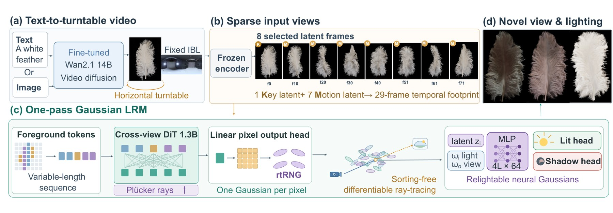
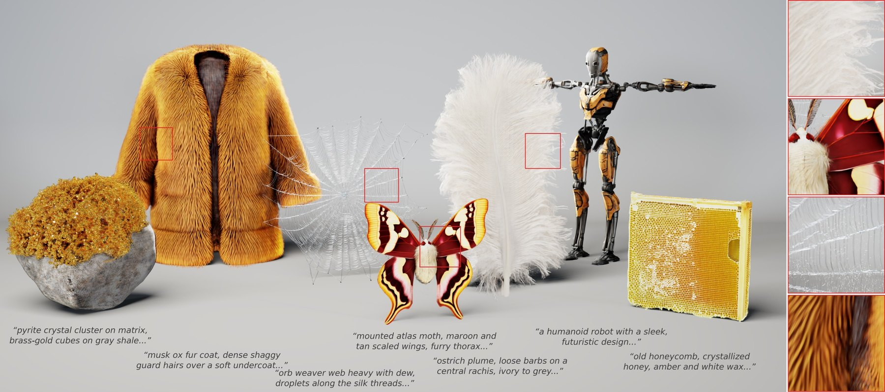
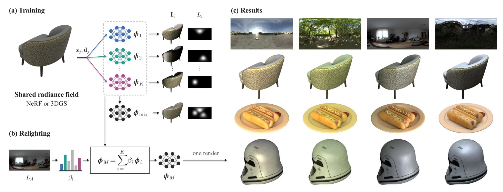
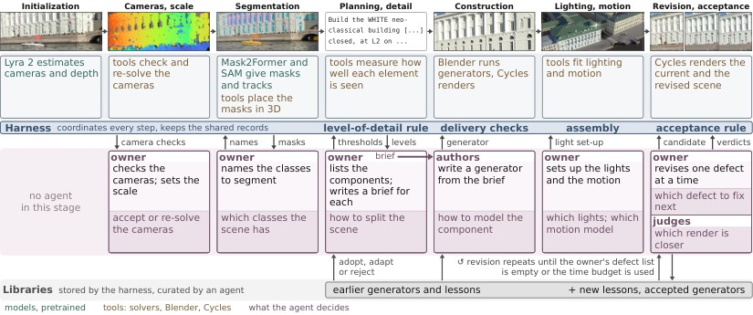
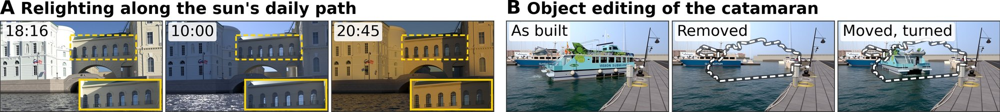
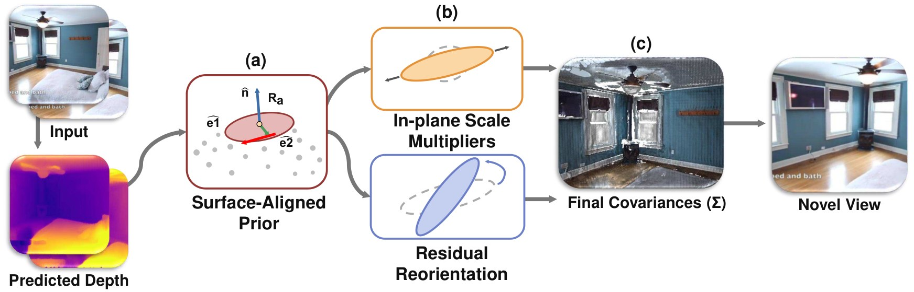
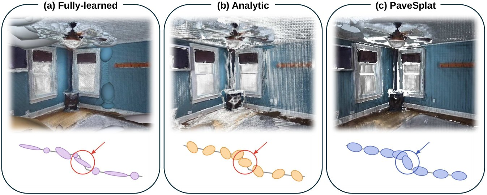

# 从生成转台一次前馈出可追光的高斯；把各基光的外观网络直接合成新照明

## 今日速览

周五 arXiv 把「可重光照」这件事，拆成了两条几乎相反的路。一条从文本或单张照片出发，先生成一段光照和相机都给定的转台视频，再一次前馈得到带神经外观的高斯，用光追去换视角、换照明；另一条不生成资产，而是假定你已经在已知的一组基光下拍好多视图，然后问：能不能把各基光训练好的外观网络，按参数加起来，一次渲出新的环境光。二者都没有先把材质拆成反照率和粗糙度，因此都谈不上替代真实场景里的几何—材质—光照解耦；但它们把「重光照要在什么前提、用什么表示」写得很清楚，正好对照主线里最容易混淆的那一步——好看的新视角，不等于换得了光。

- **必读：[VideoRNG](#2026-11-21--videorng)（Bowen Xue、Saeed Hadadan、Fabrice Rousselle、Ravi Ramamoorthi、Zahra Montazeri、Miloš Hašan）。** 现有高斯生成器多半把工作室光照烤进颜色，网格加紧凑的物理材质又很难表达毛发、蛛网、多层纤维这类细几何。VideoRNG 先把预训练的视频扩散模型微调成一段 RGBA 转台，再把其中的视频潜帧一次映射成数百万带 32 维外观特征的各向异性高斯；共享的方向解码器和随机高斯光追，按入射光方向和可见性把这些特征解成辐射。读它的理由：这是把「生成」和「可重光照表示」接在同一条前馈管线上，并且明确用光追而不是球谐颜色来换照明。作者在合成验证集上报告，新环境光下的峰值信噪比高于 LSRM、Pixal3D、ReLi3D 等可重光照对照；同时也写了转台帧不一致会造成重影、锐利高光仍然困难。未找到项目页或代码。
- **必读：[MergeableRF](#2026-11-21--mergeablerf)（Yinan Wang、Rohan Kadkol、Hyunjin Yoo、Jean-François Lalonde、James J. Clark）。** 线性辐射下，混合光照的图像就是各基光图像的加权和，但把独立训练的辐射场参数直接加起来，一般得不到相应的图像。MergeableRF 用一份与照明无关的共享几何，给每盏基光一个外观多层感知机，并让它们从同一组权重出发，再在训练里用基光混合样本监督「合并后的网络」。换环境光时，先用非负最小二乘把目标贴图投到基光上，再把网络参数按系数合成，一次渲染即可。读它的理由：它把光传输的线性，从图像空间搬到了模型参数上，而且同时支持神经辐射场和三维高斯，并不估计材质。必须记住的前提是：输入是已知基光下的多视图，不是日常单光照采集；光滑的基光瓣还会限制锐利高光。
- **其他：** [SceneAnything](#2026-11-21--sceneanything) 与 VideoRNG 几乎是同一组作者的另一条线：用协议化的调度框架调度智能体，把单段视频写成可编辑的 Blender 网格场景，而不是可重光照高斯。[PaveSplat](#2026-11-21--pavesplat) 给前馈表面高斯的解析切向协方差加了一个旋转残差，原生分辨率提升很小，好处出现在同一预测被拉到更高显示分辨率重渲、却不再跑网络的时候。短列还有推理期收缩高斯足迹做超分的 AGSR（MMSP 2026 最佳论文）、把字形和 SVG 一次前馈转成带法向的高斯资产的 FFGaussType，以及中国科学技术大学刘利刚老师组把游戏世界代理渲成可交互视频的 ContextRenderer。

## 先生成给定光照的转台，再一次前馈出可追光的资产

### VideoRNG · arXiv · 2026-11-20

**一句话判断：** 它不把可重光照写成「先生成网格再贴物理材质」，也不把光照烤进高斯的颜色，而是先生成一段相机和照明都已知的转台观察，再一次前馈得到带神经外观特征的高斯，用光追在新的视线和入射光下解码辐射。

- **Title：** VideoRNG: Relightable Neural Gaussians from Generative Video Models
- **作者：** Bowen Xue、Saeed Hadadan、Fabrice Rousselle、Ravi Ramamoorthi、Zahra Montazeri、Miloš Hašan
- **作者单位：** NVIDIA（Bowen Xue、Saeed Hadadan、Fabrice Rousselle、Miloš Hašan）；University of Manchester（Bowen Xue、Zahra Montazeri）；University of California, San Diego（Ravi Ramamoorthi）
- **发表时间：** arXiv 首次挂出 2026-11-20（abs 标注提交于 2026-11-19）
- **投稿信息：** 未标明

**摘要中译：** 生成真实的三维资产，仍然受经典表示限制：表面网格加紧凑的物理材质，很难表达由细几何或复杂光传输形成的外观；现有的高斯溅射生成器，又通常把固定照明烤进外观。本文提出 VideoRNG，一个两阶段方法，从文本提示或单张图像生成完整、可重光照的三维资产，并不预先指定网格或解析材质模型。第一阶段把预训练的视频扩散骨干微调成视频生成器，在已知的物体姿态、相机和照明协议下，生成结构化的 RGBA 转台序列。第二阶段是一个由预训练视频扩散骨干初始化的前馈大规模重建模型，把选定转台帧的视频变分自编码器潜帧，直接映射成数百万带学习外观特征的各向异性高斯。共享的方向解码器和随机高斯光线追踪器，把这一表示——作者称为光追可重光照神经高斯（rtRNG）——变成新视角和新照明下的辐射。为了在学习几何时保住高频外观，文中引入深度锚定的外观训练，并用前景 token 选择和按成本分配的分布式采样，使百万级高斯重建变得可行。VideoRNG 能生成毛皮、羽毛和蛛网这类复杂资产，并可交互渲染、重光照和嵌入场景。

**方法概要：**

问题可以分成两截。一截是生成：文本或单图生成器如果直接输出烤了光照的高斯，换环境光时高光和阴影不会跟着走；如果输出网格加解析材质，毛发、蛛网、多层纤维这类以细几何和多次散射见长的对象又很难写进紧凑的双向反射分布函数。另一截是重建：已有的可重光照神经高斯，多半要在数百张光照一致的观察上做逐对象拟合，不能一次前馈给出新资产。

VideoRNG 的输入是文本，或一张能看清正面的照片。第一阶段把预训练的潜空间视频扩散模型，在大约 2.2 万段带说明的转台渲染上，用流匹配目标微调。生成器输出 81 帧、分辨率为 $1024\times 1024$ 的转台：物体绕竖直轴转一周，相机固定在零仰角，工作室环境光在世界坐标里保持不动。相对物体而言，转动同时改变了视线和照明方向，因而同一段视频里既有视角变化，也有光照变化。标准变体直接微调扩散变换器；带透明度的变体先接入 Wan-Alpha 变分自编码器，再把 DoRA 适配器合并进骨干后做全量微调，用生成的 alpha 把前景从背景里分开。

第二阶段并不把全部 81 帧送进重建模型。它均匀抽出 29 帧，用因果视频变分自编码器（时间压缩 4、空间压缩 8）编成 8 个 $16\times 128\times 128$ 的潜帧。每个潜帧对应一个关键帧，用来确定发射高斯的相机射线。重建骨干是预训练的 13 亿参数视频扩散变换器（30 个块、宽度 1536），只处理含前景像素的 token；作者报告前景大约占图像面积的五分之一，因此这一步会去掉大部分 token，后续也就少生成大部分高斯。每个保留 token 还通过补丁嵌入的额外通道，接收对应关键帧像素射线的 Plücker 坐标和方位角的正弦、余弦，除此之外不再注入别的位姿。跨视图融合完全靠这 8 个潜帧上全部保留 token 的自注意力。

预测头仿照 GS-LRM，用一层线性映射把每个 token 写成 $16\times 16$ 的逐像素属性，直接对齐到 $1024^{2}$ 分辨率。每个前景像素沿自己的相机射线发射一颗高斯：位置由深度 logit 经 sigmoid 映射到物体包围球在该射线上的深度区间；其余通道给出对数尺度、单位四元数、不透明度和 32 维外观潜变量。不透明度低于 0.01 的高斯会被剪掉。八组观察上的高斯直接拼接，不再做几何合并，一份资产通常有一百万到六百万颗。把每颗高斯钉在对应关键帧的射线上，等于把自由空间定位收成了逐像素深度，外观则是与该观察对齐的潜变量。

如果训练时让渲染损失同时改深度和外观，中心会为了减小图像误差而移动，外观容易发糊；即便再加一项直接的深度损失，作者也观察到同样的问题。深度锚定把这两件事分开：训练时高斯中心先放到真值深度上，专门监督深度预测器；外观则在这块固定的空间参照上，通过在与输入转台不同的相机和点光下渲染来学习。这样，外观解码器看到的是稳定的几何支撑，而不是一边学颜色一边漂移的点。

渲染时，每颗高斯并不存储球谐颜色。共享的方向解码器根据外观潜变量、入射光方向和出射方向，分别给出受光和被遮挡两种响应；阴影射线给出该高斯对光源的透过率 $T_{i\ell}$，再按透过率把两种响应混合，并对入射光样本加权求和。得到的辐射用无需排序的随机估计器沿相机射线做透明度合成；训练阶段则用可微的随机公式，把图像损失传回高斯参数和神经外观。作者写明，按高斯存储神经潜变量这一点继承了 Relightable Neural Gaussians，但光追形式更容易接到后续渲染器里，而且表示是在大规模重建模型里端到端学出来的，新资产一次前向即可，不必再对每个物体拟合。多件资产可以放进路径追踪器，互相投射阴影并计算全局光照。为加快最终渲染，还可以把共享解码器蒸馏成该资产专用的、隐层宽度 64 的小网络，作者报告大约 2 分钟一件，不更新高斯属性。题图中 1280×720、每像素 1 个样本、约 50 毫秒一帧的数字，用的就是蒸馏后的解码器，硬件是 NVIDIA RTX A6000。

两个模型分开训练：视频生成器微调三个 epoch；重建模型从同一 13 亿参数视频骨干初始化，按从 $256^{2}$ 到 $1024^{2}$ 的由粗到细日程，用深度锚定目标端到端微调。评测分两块：一块看文本或生成观察驱动的资产质量，一块在合成验证物体上把重建与可重光照对照分开。

**值得关注：**

在 105 个文本生成对象、每对象四视图上，作者报告 VideoRNG 在 CLIP-T、R@1 / R@5、PickScore 和 ImageReward 上都高于 TRELLIS、LGM、DiffSplat 等对照；505 人的偏好实验里，它获得 57.75% 的选择，次高的 LGM（MVDream）为 18.85%。更贴近主线的是重建和重光照。在 50 个复杂验证物体上，若给的是渲染真值视图，作者报告输入光照下峰值信噪比 26.25 dB、感知损失 0.138，新光照下 25.99 dB / 0.154，高于 TRELLIS、LGM、LSRM、Pixal3D 和 ReLi3D；三张新环境贴图上的重光照表为 25.47 dB / 0.870 / 0.097，对照里较强的 LSRM 为 22.53 / 0.834 / 0.125。这些数字都是作者报告，未独立复现；对照的输入视图数也不完全相同，文中已说明无法简单对齐。

对主线的启发不在「终于有了从单图得到物理正确材质的方法」。它用的是神经外观加光追可见性，不是把几何、材质和照明解开；训练依赖合成资产的真值深度和给定的工作室灯光协议，真实照片只作为生成器的条件，并不提供多光观测。换光能跟着走，说明解码器和可见性估计学到了与方向有关的响应，但不能据此推断双向反射分布函数是否物理正确。锐利高光仍然困难，转台视频若跨帧内容不一致，重建会出现重影。未找到项目页或代码。

**相关链接：** [arXiv abs](https://arxiv.org/abs/2611.25338) / [PDF](https://arxiv.org/pdf/2611.25338) / [HTML](https://arxiv.org/html/2611.25338)

## 光传输是线性的，但辐射场的参数默认并不是

### MergeableRF · arXiv · 2026-11-20

**一句话判断：** 它不估计材质，也不为目标环境光再做一次优化，而是先在已知基光下把共享几何和各盏光的外观网络一起训练，让「把网络参数按系数加起来」近似等于「把各基光的图像加起来」，从而一次渲染完成换光。

- **Title：** Multi-View Relighting with Mergeable Radiance Fields
- **作者：** Yinan Wang、Rohan Kadkol、Hyunjin Yoo、Jean-François Lalonde、James J. Clark
- **作者单位：** McGill University（Yinan Wang、James J. Clark）；Université Laval（Rohan Kadkol、Jean-François Lalonde）；FORVIA, Montreal（Hyunjin Yoo）
- **发表时间：** arXiv 首次挂出 2026-11-20（abs 标注提交于 2026-11-19）
- **投稿信息：** 未标明

**摘要中译：** 本文提出 MergeableRF，一种通过合并模型参数来做辐射场重光照的方法。给定已知基光下的场景多视图图像，目标是直接组合在这些光照下训练的辐射场参数，从而完成重光照。动机来自光传输的线性：混合光照下的图像，等于各基光图像按相同权重的组合。然而，把独立训练的辐射场参数组合起来，并不会得到相应的图像组合。为此，该方法用一份共享几何，并为每盏基光设置单独的外观网络。这些网络从同一初始化出发，再通过合并感知训练，让它们的参数组合能够复现相应的图像组合。给定目标高动态范围环境贴图，先计算它在基光上的系数，再用这些系数把外观网络合并成一个已重光照的模型。该方法同时支持神经辐射场和三维高斯溅射，不估计材质，不另训重光照网络，也不针对目标光照再做优化。与图像空间混合不同，它对每个视角只需一次渲染。在合成的 Neural Gaffer 物体和真实的 OLATverse 采集上，重光照质量与在同一组多光观测上训练的方法具有可比性。

**方法概要：**

在线性辐射（色调映射、伽马编码和裁剪之前，像素值与到达相机的光成正比）下，若目标照明可以写成一组基光的非负组合 $L_A\approx\sum_i\alpha_i L_i$，则对应图像也是 $I_A\approx\sum_i\alpha_i I_i$。这是图像空间混合的依据，但每换一次光，都要把全部 $K$ 个外观网络各渲一遍再混合。作者想做的是参数合并：把各基光网络的参数按同样的系数加起来，只渲一次。困难在于外观网络对参数是非线性的，$f_{\phi_M}$ 一般不等于 $\sum_i\beta_i f_{\phi_i}$。他们把这里的误差叫做合并误差，把基光本身对目标照明的逼近误差叫做基光逼近误差，并分别处理。

场景表示拆成两块。一块与照明无关：神经辐射场里是 InstantNGP 式的多分辨率哈希加小网络，输出密度和特征向量；三维高斯里则保留位置、协方差和不透明度，用特征向量替换原来的球谐颜色。另一块是每盏基光自己的外观多层感知机，两层隐藏层，ReLU 激活，软加输出以保证辐射非负且无上界，输入为特征与经过位置编码的视线方向。两种表示的像素颜色最后都写成合成权重乘外观网络输出的加权和，因此同一套合并策略可以同时用在神经辐射场和三维高斯上。合成权重和特征都不随照明改变，所以各基光渲染的凸组合，等于在每个点上先把各网络的输出按系数相加，再做一次合成。MergeableRF 用合并后的单一网络代替这层内和。

只把独立训练的网络加起来是不够的。消融里，若各外观网络独立初始化且只看单盏基光，合并后的峰值信噪比会掉到大约 9.8 dB；即使共享初始化，也只有约 16 dB。作者因此做了两件事。第一，所有基光网络从同一组随机权重复制出发，让隐藏单元对齐。第二，每一步训练同时抽两类样本：基光样本随机选一盏光，与该光的训练图像比；混合样本在单纯形上随机抽 $k\in\{2,4,8,16\}$ 盏光的系数，用合并后的网络去拟合各基光图像的同一组线性组合——由线性性，这正是混合光照下的精确图像，不必再拍新照片。梯度同时回到被抽中的外观网络和共享几何。

换一张目标环境贴图时，先按红、绿、蓝三个通道，在球面上对基光做非负最小二乘，再把每个通道的系数拆成总强度和一组在单纯形上的权重，于是每个通道得到一个合并网络，几何仍只走一遍。三维高斯在合成数据上还用了另一种变体：每瓣基光再乘三种色调，一次拟合、一个合并网络就输出三通道。可选的自蒸馏把图像空间混合的结果再教给合并网络，每个目标光照大约 3,000 步，渲染成本不变，但不再是纯参数相加。

基光本身是球面上均匀放置的无色 von Mises–Fisher 瓣，对应二十面体细分后的 $K=12,\,42,\,162$ 个方向。神经辐射场主结果用 $K=42$；三维高斯在合成物体上用加宽的 162 瓣再乘三色调，在真实 OLATverse 上用 $K=42$。合成实验来自 Neural Gaffer 的 6 个物体、4 张未见环境贴图、30 个留出视角；真实实验来自 OLATverse 验证集的 6 个物体，用 331 盏灯光舞台 LED 的线性组合构造训练基光和五张目标贴图，24 个训练相机、6 个留出相机。对照包括估计材质再按目标贴图着色的 ReCap、TensoIR、SVG-IR，用球谐投影换光的 PRTGaussian，以及按点光渲染再在图像空间混合的 RNG 和 OLAT Gaussians。所有方法都在同一组相机和曝光下训练。

**值得关注：**

作者自己把对比写清楚了。在合成物体上，估计材质并用目标贴图着色的 ReCap 仍然最准，峰值信噪比 26.62 dB；MergeableRF 的神经辐射场是 23.38 dB，三维高斯是 22.21 dB，与 TensoIR 相当，高于 SVG-IR、PRTGaussian，也高于在图像空间混合各基光渲染的 RNG 和 OLAT Gaussians——后两者的结构相似性和感知损失更好，但每次换光要按激活的基光渲染多次。合并本身有代价：相对把 42 个基光渲染相加（24.54 dB），直接合并掉 1.2 dB；加上自蒸馏后回到 24.36 dB，几乎补回这条缝。在真实 OLATverse 上，三维高斯为 24.35 dB / 0.836 / 0.048，与 RNG 的 24.32 dB 接近，但结构相似性和感知损失更好，并比 ReCap 的 22.53 dB 高约 1.8 dB。这里合并只再掉 0.4–1.1 dB，而各基光渲染之和已经比把采集到的基光图像直接相加减了 8.0–9.5 dB，也就是说误差主要来自表示本身，而不是合并这一步。

对主线最有用的，是它把前提划得很死。这不是从日常单光照 RGB 里做逆渲染：它需要已知基光下的多视图，真实实验更是灯光舞台上的一次性多光采集。它也不输出可编辑的材质参数，换光靠的是「在这组基光张成的照明子空间里做线性组合」。光滑的基光瓣会限制锐利光源和镜面反射，加密基光又会让合并更不准，作者把这一点留作后续。未找到项目页或代码。

**相关链接：** [arXiv abs](https://arxiv.org/abs/2611.25523) / [PDF](https://arxiv.org/pdf/2611.25523) / [HTML](https://arxiv.org/html/2611.25523)

## 把单段视频写成可编辑的网格场景，而不是可重光照高斯

### SceneAnything · arXiv · 2026-11-20

**一句话判断：** 它不把视频拟合成辐射场或高斯场，而是用一套明确的重建协议，让场景主人、作者和评审三类智能体在共享的相机、深度和分割上写参数化的 Blender 生成程序，最终得到可分开编辑的网格、灯光和受支持的运动。

- **Title：** SceneAnything: Agentic Reconstruction of Large-Scale Mesh Scenes from a Single Video
- **作者：** Bowen Xue、Saeed Hadadan、Fabrice Rousselle、Zahra Montazeri、Ravi Ramamoorthi、Milos Hasan
- **作者单位：** NVIDIA（Bowen Xue、Saeed Hadadan、Fabrice Rousselle、Ravi Ramamoorthi、Milos Hasan）；University of Manchester（Zahra Montazeri）；University of California, San Diego（Ravi Ramamoorthi）
- **发表时间：** arXiv 首次挂出 2026-11-20（abs 标注提交于 2026-11-19）
- **投稿信息：** 未标明

**摘要中译：** 从视频重建可编辑的三维场景，既要贴住可见结构，又要合理补全未看见的表面。智能体可以编写场景构建程序，但直接动手重建，往往在布局、尺度和光照上出错。本文提出 SceneAnything，一套从真实或生成视频自动重建网格场景的系统；若与视频生成配合，也可支持文本到场景。调度框架通过明确的重建协议，协调智能体、预训练视觉模型和图形工具。共享的相机、深度和分割估计为部件构建提供依据：场景主人规划环境并给作者下达任务，作者编写参数化的 Blender 程序。一套基于可见性与拟合程度的细节层次规则决定构建级别，未见区域会被补全并标记为推断。组装后的场景使用拟合的光照和受支持的运动，修订要经过程序化检查和独立的视觉比较。被接受的程序和经验会在场景之间复用。作者在 100 个场景上做了评测；子集比较显示，相对直接让智能体重建，原视角保真度有所提高。

**方法概要：**

一次运行从一段连续镜头开始。调度框架先用 Lyra 2 估计相机和深度，场景主人校验相机、对齐重力并估计尺度；再用 Mask2Former 与 SAM，在主人给出的提示下做分割和跟踪，并把掩膜放到三维里。此后主人规划部件，由细节层次规则建议每个元素做到哪一级——例如用程序化规则铺一类物体、为每个实例拟合参数，或按观察到的零件逐块建造。作者智能体根据任务书编写或修改生成器，直到交付检查通过；调度框架把生成器组装成候选场景，拟合适配的光照、材质和受支持的运动。第一版只要通过程序化的场景检查即可接受；之后的修订若检查回退或运动检查失败会被直接拒绝，否则把候选与当前已接受场景按匹配的设置渲染出来，交给独立的评审智能体做双顺序盲比较。主人根据渲染与原视频列出缺陷，再声明下一轮修订。默认的主人模型是 Claude Opus 5.5，作者模型也可替换。未见几何会被补上，但要标记为推断，以免把猜想写成观测。

评测共 100 个场景，包括维基共享的静态与运动视频、生成视频，以及 Mip-NeRF 360、LLFF 和作者自己的采集。与直接把视频和 Blender 交给 GPT-6 Astra 或 Claude Opus 5.5、但不提供这套调度框架、测量和接受程序相比，作者在 30 个场景、101 张原相机帧上报告：SceneAnything 的感知损失为 0.51、DINOv3 相似度为 0.76，两个直接智能体基线分别为 0.66 / 0.55 和 0.69 / 0.52。在 10 个能够与原相机对齐的视频到三维子集上，它的原视角感知损失为 0.50，优于 Pi3-X 的 0.56、PGSR 的 0.61 和 COLMAP 密重建加网格化的 0.67，并在新视角上对输入视频的内容相似度更高（0.53 对至多 0.38）。细节层次规则在三块花园花坛上，把植物区域的感知损失从「每种植物一个生成器实例」的 0.64–0.70 降到 0.55–0.58。移动物体用跟踪掩膜拟合运动参数，作者报告若干例子的掩膜交并比中位数在 0.89–0.98。在 40 个维基共享场景上，主人、作者和评审的输出 token 中位数约为 240 万，按文中 20 美元/百万输出 token 的计价约为每场景 47 美元，其中不包括视觉模型、拟合和渲染的计算。

**值得关注：**

它和 VideoRNG 同一天、几乎同一组作者，走的却是资产管线的另一端：输出是可分开编辑的网格、灯光和动画，而不是带神经外观的高斯。因此它更接近「上游可编辑场景入口」，而不是主线里的可重光照逆渲染。文中用拟合日光再沿当天轨迹移动、以及删掉或挪走船只后仍保留后面的场景，来说明这种可编辑性；被移开后露出的表面是推断出来的，质量通常低于被直接看到的部分。最好结果依赖商业模型，开源作者智能体质量较低；每次运行只处理一段连续镜头，不处理剪辑切换，也不重建人和除水面外的非刚体运动。相机、分割、深度和材质估计都可能错，协议能约束智能体，但不能把这些前端误差消除。作者称将公开调度框架、指令、可复用库和场景，目前未见项目页或代码链接。

**相关链接：** [arXiv abs](https://arxiv.org/abs/2611.25340) / [PDF](https://arxiv.org/pdf/2611.25340) / [HTML](https://arxiv.org/html/2611.25340)

## 解析切向协方差加上一个旋转残差，高分辨率重渲才不容易露洞

### PaveSplat · ACCV 2026 · 2026-11-20

**一句话判断：** 前馈表面高斯若只按预测深度解析出切向圆盘，深度不连续和掠射处的朝向会歪，训练分辨率下最小像素足迹还能把缝盖住，同一预测拉到更高分辨率重渲就会露洞；PaveSplat 把解析标架留作工作点，只额外学习一个单位四元数残差去改朝向。

- **Title：** PaveSplat: Resolution-Robust Feed-Forward Gaussian Splatting with Residually Corrected Surface-Aligned Covariances
- **作者：** Janghun Kim、Hyun-Cheol Kim、Eunbin An、Myeonghun Oh、Hyon-Gon Choo
- **作者单位：** ETRI, South Korea
- **发表时间：** arXiv 首次挂出 2026-11-20（abs 标注提交于 2026-11-19）；会议为 ACCV 2026
- **投稿信息：** 已接收于 ACCV 2026

**摘要中译：** 本文提出 PaveSplat，一种前馈高斯溅射方法：在解析的表面对齐协方差上再加一个学习残差，使表面元在不同渲染分辨率下仍然铺满可见表面。像素对齐的前馈高斯溅射从少量图像一次预测每像素一个图元，渲染质量取决于这些图元对表面的覆盖。近期基于表面元的方法根据预测深度解析地计算表面对齐协方差，但在深度导出的标架病态处，这种协方差没有办法纠正朝向。于是表面元对表面的覆盖变松；在训练分辨率下，每个图元的一像素最小足迹还能盖住缝隙，同一预测在更高分辨率下重渲时，这些缝就会变成空洞。为此，该方法把解析协方差当作初始化，轴向与表面切向对齐，并加上一个以单位四元数表示、从恒等初始化的残差，只在能改善渲染的地方重新朝向，把被解析标架指偏的表面元拨回表面上。在 RealEstate10K 上，PaveSplat 在 $1\times$ 到 $8\times$ 的所有尺度上，于「每像素单个高斯」的方法中取得最好的峰值信噪比、结构相似性和感知损失。原生分辨率的提升很小；好处出现在同一预测被渲染到更高显示分辨率、且不再重新跑网络的时候。在零样本 DL3DV 上，它在该组方法中于各尺度领先峰值信噪比，并在结构相似性或感知损失上位于第一或第二。覆盖空洞分析表明，高分辨率重渲时未覆盖像素少于两个基线。

**方法概要：**

方法建立在 DepthSplat 的深度骨干和 SurfSplat 的表面元管线上：每像素一个薄圆盘，第三轴尺度钉死，中心由预测深度沿世界射线放置，不透明度上限为 0.6，损失仍是均方误差加 0.05 倍感知损失。唯一改动是协方差怎么从深度来。SurfSplat 用点图上的有限差分估计切向，再解析地得到法向和对齐旋转；在固定深度下，能够学习的协方差量只剩两个有界的面内尺度乘数。深度不连续处，差分用到的像素并不共面；掠射处透视压缩会让切向估计不稳；只按法向定旋转时，面内轴也不一定沿着测量各向异性半径的那两个切向。训练分辨率下，光栅器的最小足迹还能把缝盖住，所以这些朝向错误不一定表现在 $256^{2}$ 的指标上。

PaveSplat 在相机坐标系里构造点图，得到右手正交标架 $\mathbf{R}_\mathrm{a}=[\hat{\mathbf{e}}_1\,\hat{\mathbf{e}}_2\,\hat{\mathbf{n}}]$，面内半径取沿这些轴测量的切向长度，再用两个有界乘数微调。解析旋转对应四元数 $q_a$，额外的残差是从恒等初始化的单位四元数 $\Delta q$，最终朝向为 $q=q_a\otimes\Delta q$。残差只在能降低渲染误差的地方转动圆盘，并不推翻解析标架给出的表面先验。作者报告这个残差只增加约 9,512 个预测头参数，相对解析基线大约增加 2% 的编码器时间。骨干、深度预测、不透明度上限和光栅器都保持不变，因此比较问的是：同一组表面采样，在切向对齐且允许局部改朝向之后，覆盖是否更好——而不是深度估计本身有没有变准。

训练和主表评测在 RealEstate10K 的 $256\times 256$、两张输入视图上进行，并按 SurfSplat 的协议，把同一预测在 $512^{2}/1024^{2}/2048^{2}$ 网格上重渲，与双三次上采样的真值比较。对照里与它直接可比的，是同一配方复现的 SurfSplat，而不是把多高斯方法混在一起比高低。

**值得关注：**

在原生 $256^{2}$ 上，作者报告 PaveSplat 相对同配方 SurfSplat 的峰值信噪比从 27.519 提到 27.686 dB，结构相似性从 0.892 到 0.893，感知损失从 0.112 到 0.109，全测试集中分别有 70%、70% 和 81% 的场景领先。文中自己也说，这点原生提升很小，指标在这个工作点上已经接近饱和。真正拉开的是高分辨率重渲：$2048^{2}$（$8\times$）上为 24.266 dB / 0.867 / 0.336，对照的 23.342 / 0.852 / 0.359；并且在「每像素单个高斯」这一组里，四个尺度的三项指标都最好。项目页、代码和权重已经公开。它和主线的交叉在于高斯形状与覆盖，而不是材质或逆渲染；前提仍是有标定相机的前馈新视角合成，不能直接搬到无可靠深度先验的室内逆渲染上。

**相关链接：** [项目页](https://janghunn.github.io/pavesplat/) / [代码](https://github.com/janghunn/pavesplat) / [权重](https://huggingface.co/janghunn/pavesplat) / [arXiv abs](https://arxiv.org/abs/2611.26045) / [PDF](https://arxiv.org/pdf/2611.26045) / [HTML](https://arxiv.org/html/2611.26045)

## 短列

- **AGSR · MMSP 2026 · 2026-11-20。** *AGSR: Aperture-Guided Super-Resolution for Gaussian Splatting*（Ayman Alkhateeb、Hadi Amirpour、Christian Timmerer，Alpen-Adria-Universität Klagenfurt）。已接收于 2026 IEEE International Workshop on Multimedia Signal Processing，并获得最佳论文奖。三维高斯光栅会把每个图元的投影协方差当成局部低通滤波器，细结构被衰减；推理时把投影位移按 $m\in\{1,2,4\}$ 收缩，等价于缩小足迹、提高局部带宽，再把多孔径渲染按不确定度和透过率、深度等几何线索融合。它是已训练三维高斯模型的即插即用增强，作者报告参数量最多约 13.9 万，在 Mip-NeRF 360 上优于轻量图像空间超分，且底层高斯表示越差、收益越大。这是正向渲染的超分，不改几何或材质反演。[arXiv](https://arxiv.org/abs/2611.25934)

- **FFGaussType · arXiv · 2026-11-20。** *FFGaussType: Feed-Forward Conversion of Glyph and SVG Geometry into Compact Gaussian Assets*（Haoan Feng、Tianfu Wang，University of Maryland, College Park，文中标注于 Dolby 实习期间完成；Peimeng Guan、Dae Yeol Lee、Guan-ming Su，Dolby Laboratories Inc.）。在高斯场景里放入字幕、标注或图标，若每个字形都单独迭代优化，很难规模化。它把已知表面上的锚点编到一张特征平面，再用共享解码器一次前馈出带表面法向的神经高斯，从而把几何转换和材质、光照选择分开。作者报告准备好锚点后每件约 9.1 毫秒，在未见字体和测试图标上法向误差 $1.62^{\circ}$、轮廓交并比 0.985，并称与需要数千步逐资产拟合的保真度相当。数据集有 27,221 件成对资产。项目页已公开，代码和数据称将在发表后发布。投稿信息未标明。[项目页](https://fengyee.github.io/FFGaussType) / [arXiv](https://arxiv.org/abs/2611.26431)

- **ContextRenderer · arXiv · 2026-11-20。** *ContextRenderer: Dynamic-Context Video Generation for Interactive Game Worlds*（Runze Wang、Fei Zha、Ke Xu、Wenzheng Wu、Zhongyuan Liu、Youcheng Cai、Ligang Liu，中国科学技术大学；Bing He，上海交通大学；Zhongyuan Wu，University of British Columbia；Yuxuan Xie，哈尔滨工业大学；Runze Wang、Fei Zha、Bing He 同等贡献）。交互式游戏世界模型往往把可执行的世界演化与视觉生成分开，用视频模型把引擎给出的场景代理渲成观察。这篇用块级交互监督的动态上下文学习，以及有界 token 预算下的循环历史压缩，让自回归视频扩散在条件不断更新时仍保持画面连续，并用跨表示流对齐，把不同代理上的重建和外观、交互变化连到同一次高保真重建。作者还介绍了从智能体搭建的世界、3A 游戏和开源视频构造的 WorldPrism 数据。这是生成式渲染，不是三维高斯重建或逆渲染，和主线的交叉主要在「代理几何如何变成可控制的外观」。项目页已公开。投稿信息未标明。[项目页](https://rainzor.github.io/contextrenderer/) / [arXiv](https://arxiv.org/abs/2611.25838)

## 圈内新闻与社区反应

当日对国内科技媒体、论文向账号、Ke-Sen 以及 Blender 原生三维高斯的公开说明做了扫描，未见与主线直接相关、且相对近几期日报有实质增量的高信号条目。Ke-Sen 的 [SIGGRAPH Asia 2026 论文链接页](https://kesen.realtimerendering.com/siga2026-Changelog.htm) 仍停留在 9 月 17 日，无新变更。Blender 原生 3DGS 仍以 5.3 稳定版为公开基准，本期未见新的官方接口、导出或重光照说明。四领域均做了新闻扫描；与主线重复或缺少可核验一手来源的条目未展开。

## 覆盖说明

日报发布日为 **2026-11-21（周六）**。内容覆盖日为 **2026-11-20（周五）** 的 arXiv 新公告（cs.GR 交叉列表，以及 cs.CV 中与高斯、溅射、重光照、网格场景重建和几何覆盖相关的条目），并与 `seen-papers.json` 去重。VideoRNG（2611.25338）与 MergeableRF（2611.25523）核对了 HTML 的方法、主表与局限，配图为原论文图 2 / 图 1 与图 1；SceneAnything（2611.25340）与 PaveSplat（2611.26045）核对了方法、主要结果和局限，配图取自原论文图 2 / 图 5 与图 2 / 图 1；AGSR、FFGaussType 与 ContextRenderer 据全文或摘要、题头简写。所有实验数字均为作者报告，未独立复现。

notes 至 `4b15b8c`、blog 至 `c29075d`、academic 至 `f19a697`；公开兴趣笔记无新的研究向增量，策展权重继续放在真实场景几何、可重光照外观与渲染效率。圈内事实来自 Ke-Sen 更新日志与 Blender 已公开的 5.3 说明；未见可核验的同日高信号媒体条目。

**编写：** Cream
