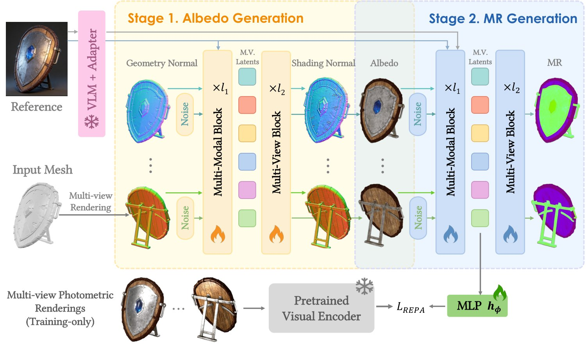
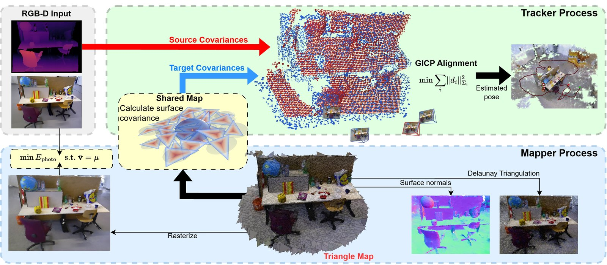
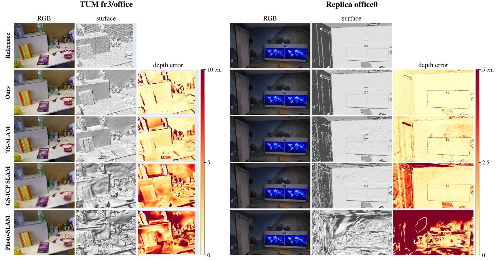

# 2026-11-22 科研日报

## 今日速览

周六没有新的 arXiv 公告。本期回扫本周视觉列表里漏收、又更靠近主线的两篇：一篇已经被 ACM TOG（SIGGRAPH Asia 2026）接收，专门处理「单张参考图 + 网格」时金属度、粗糙度很难从外观里拆干净的问题；另一篇把三角形溅射第一次做成能在桌面和 Jetson 上实时跑的 RGB-D SLAM，和本周的 ATS（闭式三角形积分）正好是同一表示的两端。

- **必读：[UltraTex](#2026-11-22--ultratex)（香港中文大学（深圳）、Meshy AI）。** 现有生成方法往往先做出好看的反照率，金属度和粗糙度却仍然含糊，换光照时就会露馅。它先联合预测多视角反照率和世界空间着色法向，再用冻结视觉语言模型抽出的部件级材质令牌，加上受控光照下的光度特征对齐，去约束金属度–粗糙度。读它的理由：这是目前最直接面向「可重光照资产质量」的漏收工作，而且已经是 Asia 2026 的 TOG 论文；它解决的是参考图到 PBR 贴图的生成，不是真实多视角照片的逆渲染，对照时要把这条界限看清楚。
- **选读：[Facet-SLAM](#2026-11-22--facetslam)（南洋理工大学）。** 先前的三角形溅射 SLAM 靠光度跟踪，定位跑不到传感器帧率。它把跟踪和建图拆开：跟踪器只用融合深度得到的三角形重心做 GICP，建图器则被限制在「不平移重心」的子空间里更新，避免优化把面片从表面上拽走。读它的理由：三角图元本身就能三角化成连通网格，不必再从高斯里抽一层；作者报告桌面约 113 FPS、Jetson AGX Orin 上约 36 FPS。它提升的是几何地图和速度，光度建图质量仍低于成熟的三维高斯 SLAM，也不能当成逆渲染来读。
- **其他：** [Neural Sensor](#2026-11-22--others)（IROS 2026）把一步扩散重光照做成控制回路里的异步「神经传感器」，用来补低光检测；这是图像空间的生成式补光，不是三维材质反演。

## 可重光照资产：先把金属度和粗糙度问清楚

### UltraTex · SIGGRAPH Asia 2026 / TOG · 2026-11-18

**一句话判断：** 这篇的核心不是再提高反照率的观感，而是承认单张参考图里材质、反射和光照缠在一起，于是把「部件级材质语义」和「受控光照下的光度响应」写进金属度–粗糙度的生成；换光照是否站得住，主要看这两步有没有把外观里的照明烤进材质。

- **Title：** UltraTex: Aligning Physical Knowledge for High-Fidelity PBR Texture Generation
- **作者与单位：** Jingzhi Bao（香港中文大学（深圳）理工学院）；Xiaohe Ma、Hong Li、Yuanming Hu（Meshy AI，上海）；Xiaoguang Han（通讯，香港中文大学（深圳）理工学院、深圳河套学院（SLAI））。
- **投稿信息：** 已接收于 *ACM Transactions on Graphics*（SIGGRAPH Asia 2026）；文内标注为 ACM Trans. Graph. 45(6), Article 265（2026 年 12 月）。
- **发表时间：** arXiv 首次挂出 2026-11-18；期刊号为 2026 年 12 月。
- **arXiv：** [abs](https://arxiv.org/abs/2611.24941) / [PDF](https://arxiv.org/pdf/2611.24941) / [HTML](https://arxiv.org/html/2611.24941) / [DOI](https://doi.org/10.1145/3842583)

**摘要中译：**

为三维网格从单张参考图生成基于物理的渲染（PBR）纹理，本身是高度歧义的：观察到的外观把材质身份、表面反射和光照缠在一起。现有生成方法往往能做出逼真的反照率，却仍然难以推断出可用于重光照的准确金属度与粗糙度。本文提出 UltraTex，一个级联的多视角框架，不再只做外观匹配，而是把物理知识写入基于多视角扩散的 PBR 生成。它先联合预测反照率和世界空间着色法向，以得到更细致的反照率；再在已生成的反照率、参考图和材质语义先验条件下预测金属度–粗糙度（MR）贴图。为注入材质语义，一个轻量适配器把视觉语言模型（VLM）的隐层特征变成内在材质表示令牌，为 MR 估计提供部件级的知识锚点。为刻画材质与光的相互作用，光度表示对齐把扩散中间特征拉向受控光照下的真实材质渲染。这样，金属度与粗糙度的变化会通过高光强度、镜面锐度和局部反射对比变得可观察，从而在没有显式光照监督的情况下，为细粒度材质预测提供更强约束。大量实验表明，UltraTex 能生成高质量纹理，并在视觉保真、材质精度和物理合理性上优于现有开源与商业方法。

**方法与原理：**

输入是一张参考图和一张网格。输出是跨视角一致的反照率、金属度和粗糙度贴图，并可以附带世界空间着色法向。整条流水线分成两个独立训练的多视角扩散阶段，骨干都从预训练的文生图扩散模型初始化；金属度和粗糙度被写成同一张 RGB 图的两个通道。

第一阶段要同时给出六个正交视角的反照率，以及世界空间里的着色法向。每个视角先用多模态 DiT，把参考图的 VAE 潜变量和 DINOv2 特征，与该视角渲染出的几何法向编码到一起；再丢掉这些条件令牌，只用各视角的潜变量做多视角 DiT，让自注意力在视角之间对齐。只预测切线空间法向或 bump 的麻烦在于：网格展开成 UV 后面片朝向不一致，法向会在接缝处打架。世界空间着色法向不依赖 UV，所以他们把几何法向当作起点，让网络只学微观几何残差，并和反照率流匹配损失加在一起训练。作者用去掉这一支的对照说明：没有联合法向时，反照率会变平，雕刻和材质边界上的高频结构会变弱。

第二阶段才进入金属度–粗糙度。这一步最容易变成「语义上像金属，贴图上却取了均值」。他们把冻结的 Qwen3.5-4B 视觉语言模型当作材质先验：从第 8、16、24 层取出视觉特征，经两层 MLP 适配器压成一维内在材质令牌，再注入冻结的图像扩散去噪块。注意力可视化显示，这些令牌本身没有显式坐标，却会落在饰扣、金属配件等部件上。只靠语义还不够，因为粗糙度的高频变化往往写在高光软硬里，而不写在「这是木头 / 这是金属」的标签里。于是他们加入光度表示对齐：在受控光照下渲染材质，把扩散中间特征拉向这些渲染的特征，让高光强度、镜面锐度和局部对比成为 MR 的可观察信号。消融里，去掉视觉条件、去掉 VLM 或去掉光度对齐，金属度 / 粗糙度的均方误差（以 $10^{-3}$ 计）都会上升；完整模型为 46.77 / 16.57。把适配器分别接在图像 VAE、DINOv2 和 Qwen3.5 上、只训练适配器时，也是 VLM 这一路最低。

推理时先生成六视图反照率，再条件出对应的 MR；各视角贴图超分到 (1536^{2})，再烘焙到 4K UV。正交投影看不到的区域，用他们此前的 LumiTex 新视角合成来补全。训练数据来自 Objaverse-XL 与 TexVerse 的约 13 万个物体，每个物体在随机相机和环境光下渲染 32 张参考图，并以六个正交视角的真值 PBR 与光度图像做监督。

**值得关注：**

在 152 个留出的 Objaverse-XL 物体、(1024^{2}) 渲染上，作者报告 UltraTex 的 FID / CLIP-FID / CMMD / CLIP-I / LPIPS 以及金属度、粗糙度均方误差均优于 Paint-it、DreamMat、Hunyuan3D-2.1、LumiTex 和 TRELLIS.2；完整模型为 144.3 / 12.92 / 1.081 / 0.9510 / 0.1106，金属度、粗糙度均方误差为 46.77 / 16.57（$\times 10^{-3}$）。环境光重光照表上，相对 LumiTex 与 TRELLIS.2 同样领先（FID 111.2，对照分别为 144.4 与 158.4）。31 名职业三维模型师的盲评（1–5 分）里，它在总体渲染、反照率、金属度和粗糙度上均为最高，平均 4.31，对照包括 Seed3D 2.0（3.20）、Meshy 6 HD（3.13）、TripoAI v3.1 4K（2.95）等；需注意三位作者的单位是 Meshy AI，对照里含 Meshy 的商业版本，阅读用户研究时要把这层关系算进去。

和本刊主线的交叉在于可重光照资产的材质质量，而不是真实室内场景的多视角逆渲染。它假定已经有网格，也假定目标可以被不透明金属度–粗糙度模型写下来。失败和局限写得很清楚：风格化资产生往把金属度当成高光控制而不是物理身份，分解会没有唯一解；宝石、透明挡风玻璃、散射和焦散等也超出当前通道。它不能直接搬到「只有真实照片、还要分解环境光」的设定里。项目页和权重已经公开。

**相关链接：** [项目页](https://ultratex.vercel.app/) / [权重](https://huggingface.co/Jingzhi03/UltraTex) / [arXiv abs](https://arxiv.org/abs/2611.24941) / [PDF](https://arxiv.org/pdf/2611.24941) / [HTML](https://arxiv.org/html/2611.24941) / [DOI](https://doi.org/10.1145/3842583)

## 三角形溅射：把跟踪从光度里拆出来

### Facet-SLAM · arXiv · 2026-11-18

**一句话判断：** 它要解决的不是三角形怎么积分成像素，而是这种图元怎样才能成为可靠的实时配准目标——重心钉在融合深度上，建图只在不平移的子空间里改形状，于是 GICP 跟踪终于跑到传感器帧率，网格也可以直接从顶点连出来。

- **Title：** Facet-SLAM: Real-Time Triangle Splatting SLAM
- **作者与单位：** Edward Beng Wai Tan、Siew-Kei Lam（通讯），南洋理工大学计算机与数据科学学院。
- **投稿信息：** 投稿信息未标明。
- **发表时间：** arXiv 首次挂出 2026-11-18。
- **arXiv：** [abs](https://arxiv.org/abs/2611.23935) / [PDF](https://arxiv.org/pdf/2611.23935) / [HTML](https://arxiv.org/html/2611.23935)

**摘要中译：**

基于三维高斯溅射的稠密 SLAM 能建出可写实渲染的地图，但表面几何往往较差，要得到网格还得再做提取或融合。三角形溅射用的是表面图元，顶点可以直接三角化成连通网格；不过现有基于该表示的 SLAM 仍依赖光度跟踪，定位到不了传感器帧率。本文提出 Facet-SLAM，据作者所知是首个面向 RGB-D 相机的实时三角形溅射 SLAM。快速几何配准是自然的替代，但还不够：建图优化会把三角形从观察到的表面上推开，使它们不再是可靠的配准目标。因此系统把两种角色分开：跟踪器由融合深度设定每个三角形的重心，并用 GICP 把当前帧配准到这些重心上；建图器则通过变量代换，只做不平移的更新。该系统在桌面 GPU 上以约 100 FPS 达到有竞争力的跟踪精度，并在 Jetson AGX Orin 上以传感器帧率运行。相对光度方法，它快二十倍以上，渲染质量相当，表面精度更好：在 Replica 上，Delaunay 网格的倒角距离从 1.55 cm 降到 0.86 cm。实现将发布于 https://github.com/edward62740/Facet-SLAM。

**方法与原理：**

系统分成跟踪和建图两条进程。跟踪不做光度对齐，而是把活帧的深度点，配准到地图里三角形的重心。这些重心不是优化出来的自由变量，而是由融合深度钉住的测量位置 $\boldsymbol{\mu}$。对每个待配准的局部面片，跟踪器在邻接三角形上估计协方差，再用 GICP（广义迭代最近点）求位姿。作者在消融里把这一点写得很硬：若改用点到点或点到面（用三角形自己的法向）的代价，不少序列的绝对轨迹误差会呈双峰分布，配准并不稳。

如果建图器仍自由移动三个顶点，优化会把三角形从深度表面上拽走，下一帧的 GICP 就会对着一组已经错位的重心。他们用变量代换把每个三角形写成 $\mathbf{x}=\mu\mathbf{1}+\mathbf{Q}\mathbf{e}$，其中 $\mathbf{e}\in\mathbb{R}^{2}$ 只编码不平移的形状。建图损失仍是可微渲染的光度项，包括颜色、深度、法向和正则，但梯度不再允许重心离开 $\boldsymbol{\mu}$。一种「先自由优化再把重心搬回去」的折中更差，因为 Adam 的动量里还留着被丢弃的平移梯度。这样，跟踪器始终对着钉在深度上的重心，建图器仍可改三角形的朝向和形状。

地图本身是三角形汤。连通网格可以由已有顶点做受限 Delaunay 三角化直接得到，不必再从高斯里抽一层表面。为了速度，着色使用 0 阶球谐，致密化也更保守。

**值得关注：**

在 TUM RGB-D 的 fr1/desk、fr2/xyz、fr3/office 上，作者报告 Facet-SLAM 的平均绝对轨迹误差为 1.76 cm、约 113 FPS；同一套方法在 Jetson AGX Orin 上为 1.79 cm、约 36 FPS，接近常见 RGB-D 的传感器帧率。对照的 TS-SLAM 是 1.57 cm、1.5 FPS，Photo-SLAM 是 1.21 cm、40 FPS。也就是说，跟踪精度并不是这张表上最好的，换来的是数量级的加速，并且在 Orin 上轨迹误差基本保持。Replica 上平均绝对轨迹误差为 0.17 cm；Delaunay 网格倒角距离从 TS-SLAM 的 1.55 cm 降到 0.86 cm，F1 从 54.1 升到 73.6。作者同时写明：相对 TS-SLAM，表面更好一些，RGB 渲染更差一些；相对成熟的三维高斯 SLAM，建图质量仍然偏低，部分是 0 阶球谐和保守致密化换速度的结果。仓库和项目页已经公开。

它和本周 [ATS](https://rubatotree.github.io/research-daily/digests/2026-11-19.html#2026-11-19--ats) 分享同一类图元，但问的是前端跟踪而不是光栅积分。对需要「地图当时就能拿出网格」的具身设定，这是比先训高斯再抽网格更直的一条路；它不估计材质和光照，Jetson 数字也来自 AGX Orin，不能直接读成消费级低端机结论。

**相关链接：** [项目页](https://edward62740.github.io/facetslam/) / [代码](https://github.com/edward62740/Facet-SLAM) / [arXiv abs](https://arxiv.org/abs/2611.23935) / [PDF](https://arxiv.org/pdf/2611.23935) / [HTML](https://arxiv.org/html/2611.23935)

## 短列

- **Neural Sensor · IROS 2026 · 2026-11-12。** *Real-Time Diffusion Relighting as a Neural Sensor: Closing the Low-Light Domain Gap for Robotic Perception*（Shengjie Xu、Alexander Gao、Ming C. Lin，University of Maryland, College Park；Anshul Rai、Dae Yeol Lee、Guan-Ming Su，Dolby Laboratories）。已接收于 IROS 2026。arXiv 于 2026-11-12 首次挂出，本周一公告时未收入日报。它不把低光看成要逐像素修好的信号，而把扩散模型当成控制回路里的异步「神经传感器」：后台用一步 Delight LoRA 做重光照，只在检测置信度下降时触发，以免堵住 20 Hz 的控制环。作者报告 ExDark 上 mAP 为 87.1%，并在 CARLA 闭环导航中完成全部圈数。这是图像空间的生成式补光，用来抬检测，不是三维高斯或材质反演；幻觉与安全风险文中也有讨论。[项目页](https://shengjie-xu.com/conferences/2026_IROS_neural-sensor/) / [代码](https://github.com/jayhsu0627/neural_relight_sensor) / [arXiv](https://arxiv.org/abs/2611.17438)

## 圈内新闻与社区反应

当日对国内科技媒体、论文向账号、Ke-Sen 以及 Blender 原生三维高斯的公开说明做了扫描，未见与主线直接相关、且相对近几期日报有实质增量的高信号条目。Ke-Sen 的 [SIGGRAPH Asia 2026 论文链接页](https://kesen.realtimerendering.com/siga2026-Changelog.htm) 仍停留在 9 月 17 日，无新变更。Blender 原生 3DGS 仍以 5.3 稳定版为公开基准，本期未见新的官方接口、导出或重光照说明。四领域均做了新闻扫描；与主线重复或缺少可核验一手来源的条目未展开。

## 覆盖说明

日报发布日为 **2026-11-22（周日）**。内容覆盖日为 **2026-11-21（周六）**：当日无独立 arXiv 公告。本期回扫本周 cs.CV / cs.RO 列表中与 PBR 材质、三角形溅射和具身感知相关、且尚未写入 `seen-papers.json` 的条目。UltraTex（2611.24941）与 Facet-SLAM（2611.23935）均于 2026-11-18 首次挂出、随 11-19 公告放出，核对其 HTML 中的方法、主表与局限，配图为原论文图 2 / 图 1 / 重光照图与图 2 / 几何可视化；Neural Sensor（2611.17438）于 2026-11-12 首次挂出、随 11-16 公告放出，据全文题头与方法、主要结果简写。所有实验数字均为作者报告，未独立复现。

notes 至 `4b15b8c`、blog 至 `c29075d`、academic 至 `f19a697`；公开兴趣笔记无新的研究向增量，策展权重继续放在真实场景几何、可重光照外观与渲染效率。圈内事实来自 Ke-Sen 更新日志与 Blender 已公开的 5.3 说明；未见可核验的同日高信号媒体条目。

**编写：** Cream
