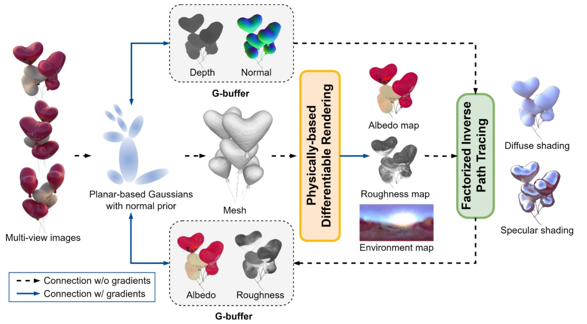
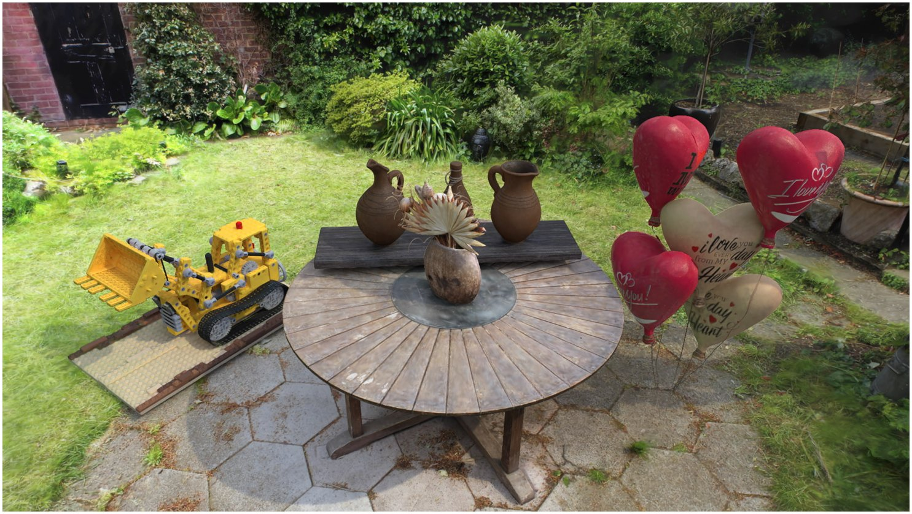
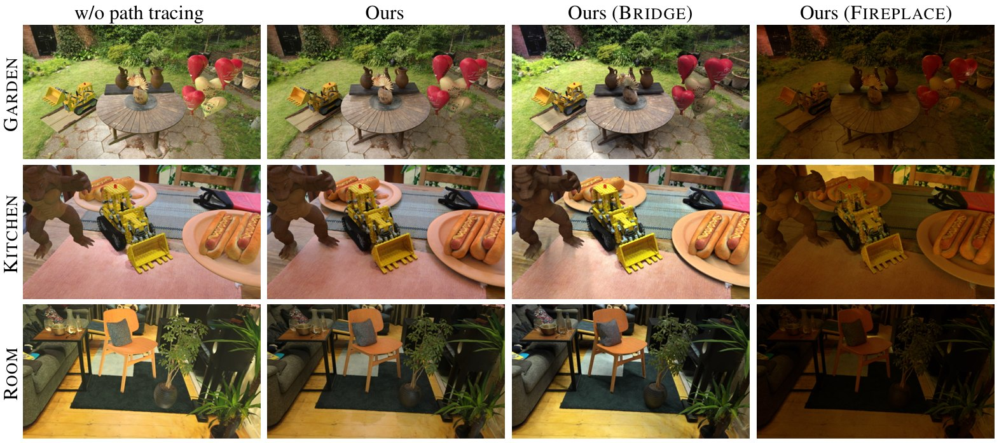
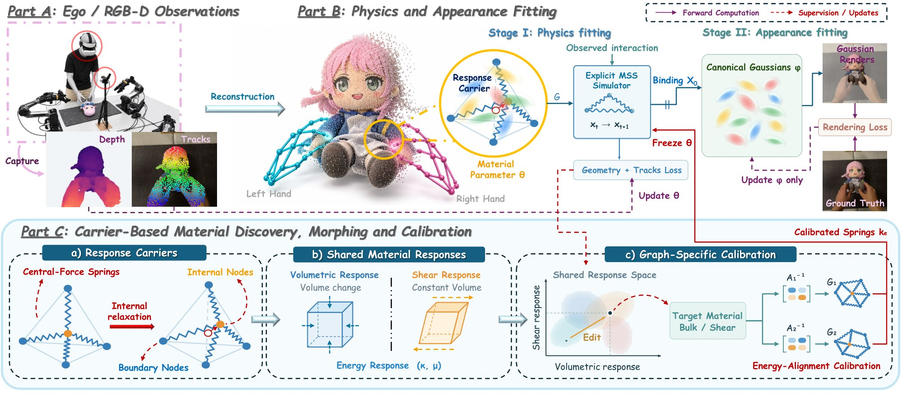
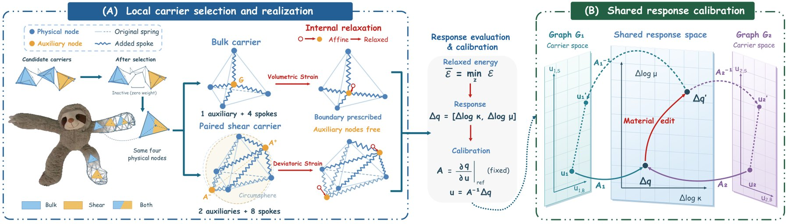
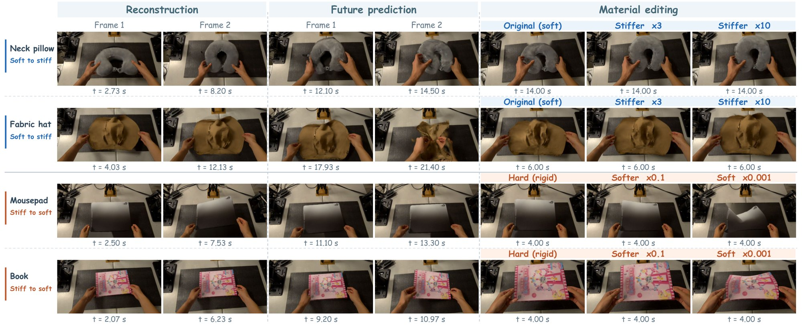

# 2026-11-23 科研日报

## 今日速览

周日没有新的 arXiv 公告，周一早上的公告也要再晚一些才会放出。本期回扫两篇更靠近主线、此前未写入名册的工作：一篇是已经发表在 CVPR 2026 的可重光照高斯，不在高斯上直接追光，而是先抽出网格，再用混合路径追踪补可见性与间接光，并给出实时换光渲染器；另一篇是周五视觉列表里漏收的物理孪生，专门处理弹簧网络里体积响应和剪切响应绑在一起的问题。

- **必读：[GHPT](#2026-11-23--ghpt)（西北大学）。** 现有可重光照高斯要么用分项求和、环境光遮蔽一类近似，真实感不够；要么在高斯上做光线追踪，很难跑到实时。它先用平面高斯抽出多视角一致的深度和网格，在网格上反演出材质与环境光，再把因子化逆路径追踪接到高斯的几何缓冲上，可见性和间接光照改由网格上的硬件光追来算。读它的理由：这是把「可重光照」和「实时合成」放在同一条管线上的漏收工作，而且直接对照本刊一直在看的路径追踪高斯逆渲染——它换来的是实时换光，代价是光传输不再完全发生在高斯场里。
- **选读：[MorphTwin](#2026-11-23--morphtwin)（中国科学技术大学、香港城市大学等）。** 它要解决的不是把视频动作拟合得更像，而是拟合像了之后，新的力还能否让物体按正确的方式变胖、变瘦、变弯。传统三维中心力弹簧在仿射小变形下会把体积模量和剪切模量锁在一起，泊松比只能落在 $1/4$ 附近。它在重建出的不规则弹簧图上加入可松弛的响应载体，离线标定后再用显式积分做交互。读它的理由：这是周五列表里漏收、又和可交互可编辑资产直接相关的一篇；它优化的是弹簧物理，高斯只用来固定物理之后贴外观，不能当成逆渲染来读。

## 可重光照高斯：把光追放到抽出的网格上

### GHPT · CVPR 2026 · 2026-06

**一句话判断：** 这篇的核心不是发明一种新的高斯光追，而是承认路径追踪很难直接作用在高斯上，于是把几何交给平面高斯抽出的网格，把可见性和间接光放在网格的硬件光追里，再把因子化后的着色结果写回每个高斯的材质——换光因此可以在 1080p 实时完成，但前向渲染已经不再是「只在高斯场里追光」。

- **Title：** GHPT: Real-Time Relightable Gaussian Splatting using Hybrid Path Tracing
- **作者与单位：** Jinyang Bo、Fan Dou（共同一作），Wenrui Quan、Shangxun Liu、Yang Xu（通讯）、Yuhe Zhang、Kang Li、Guohua Geng，西北大学计算机科学学院。
- **投稿信息：** 已接收于 CVPR 2026。
- **发表时间：** CVPR 2026（2026 年 6 月）。
- **入口：** [项目页](https://nwu-vislab.github.io/GHPT/) / [PDF（CVF）](https://openaccess.thecvf.com/content/CVPR2026/papers/Bo_GHPT_Real-Time_Relightable_Gaussian_Splatting_using_Hybrid_Path_Tracing_CVPR_2026_paper.pdf) / [补充材料](https://nwu-vislab.github.io/GHPT/static/pdfs/GHPT_supplementary.pdf)

**摘要中译：**

三维高斯溅射已经成为高保真三维场景表示的一条重要路线。然而，要给高斯溅射换光照、做场景合成仍然困难，因为路径追踪不能直接作用在这种表示上。现有方法要么采用近似的着色公式，要么依赖高斯光线追踪，前者重光照质量不足，后者渲染效率偏低。本文提出高斯混合路径追踪（GHPT），用三个阶段得到可重光照的高斯溅射模型。第一阶段利用基于平面的高斯溅射重建表示（PGSR），渲染多视角一致的深度并重建场景表面网格。第二阶段在得到的网格上做基于物理的可微渲染，重建材质贴图和环境贴图。第三阶段把因子化逆路径追踪（FIPT）作用在 PGSR 渲染出的几何缓冲上，可见性与间接光照则在第二阶段得到的网格、材质和环境光上，用硬件加速光线追踪来计算。实验表明，GHPT 的重光照优于对照方法，并且可以对高斯溅射做实时换光与合成。

**方法与原理：**

输入是已知相机位姿的多视角图像，输出是一组可换光照的高斯，以及一张带材质的网格和一张环境贴图；推理时还可以把多个这样的资产合成到同一场景里。作者把整条流水线写成三个先后依赖的阶段，核心想法是：主视图的几何缓冲仍由高斯栅格得到，但阴影和间接光不再用高斯光追，而是在抽出的网格上做混合路径追踪——也就是从几何缓冲里的表面点向外射线，而不是再从相机重追一条主光线。

第一阶段要的是多视角一致的深度和一张能拿去光追的网格。他们采用 PGSR（平面高斯表面重建）：把三维高斯压成二维平面，先做 alpha 混合，得到平面法向和到相机的距离，再与平面求交得到深度，避免把高斯中心深度直接当成表面。为了压住高光对几何的干扰，他们用预训练的单目法向模型 StableNormal 做法向一致性损失，并加上物体遮罩与累积不透明度的二元交叉熵，约束几何结构。网格由重建表面抽出，合成场景上体素边长取 0.002，Mip-NeRF 360 上取 0.01，再用二次误差度量简化到约 50 万三角形，并在 Blender 里展开 UV，供下一阶段优化贴图。

第二阶段不再优化高斯，而是在网格上解渲染方程。出射辐射被拆成直接项和间接项：直接项对环境贴图做采样，间接项沿光线递归追踪；环境光用别名表做下一事件估计，并与双向反射分布函数（BRDF）重要性采样按平衡启发做多重重要性采样。实现基于 SlangPy，以便走 D3D12 / Vulkan 的硬件光追和自动微分。反照率、粗糙度和环境贴图的分辨率分别设为 $4090\times 4096$、$2048\times 2048$ 和 $512\times 256$，每像素 256 个样本。训练分成两段：先用较大学习率主要优化环境光（5000 步），再把环境光固定、把粗糙度重置回初值，继续训练材质 1000 步。作者明确写到，若不分段，光照容易被烤进反照率；他们还把优化后的环境贴图做 1.35 次幂以抬高对比度，帮助把材质和照明拆开。

第三阶段才把材质写回每个高斯。这里用的是因子化逆路径追踪（FIPT，Wu 等人，ICCV 2023）：把渲染方程里与漫反射、两路菲涅尔高光对应的着色积分预先算好，使漫反射率、高光系数和粗糙度能够从积分中分离出来。因为这些着色只需在训练开始前用 256 个样本烘焙一次，后面迭代不必每步重追光。混合光追时，抽出的网格和几何缓冲仍会有细小错位，容易自交；他们的处理是忽略命中距离小于阈值（实验中为 0.1）以及背面的相交。最后用预测材质做因子化着色，与目标图像比 L1，并加上边缘感知的反照率、粗糙度平滑项。

实时渲染器基于 Vulkan 的 ray query。几何缓冲仍用基于分块的软件栅格器来做 PGSR 所需的法向和距离混合；混合路径追踪在 1920×1080 上只用 2 个样本（BRDF 与环境光各一），再加窗口为 9 的空间滤波和长度为 20 的时间累积去噪。作者报告，在 NVIDIA GeForce RTX 4080 上，City 环境光下的合成结果为 113 FPS；花园、厨房、房间三场的总帧时分别为 7.95、7.32 和 9.75 毫秒，房间更慢是因为墙壁挡住了部分环境光、路径更长。

**值得关注：**

在 Synthetic4Relight 上，作者报告重光照 PSNR / SSIM / LPIPS 为 35.87 / 0.971 / 0.045，高于 IRGS 的 34.76 / 0.963 / 0.055 和 R3DG 的 32.89 / 0.968 / 0.051；新视角合成 PSNR 也最高，为 37.11。在 TensoIR Synthetic 上，重光照 PSNR 为 32.46，高于 SVG-IR 的 31.10 和 IRGS 的 30.63；反照率 PSNR 为 33.67，亦为表中最高。但新视角合成并非全面领先：同一张表上 GI-GS 和 SVG-IR 的 PSNR 分别为 36.75 和 36.71，GHPT 为 35.57。也就是说，它更突出的是换光照和合成时的阴影、色渗与光泽互反射，而不是在原光照下把新视角再抬几个分。为了处理反照率与环境光的尺度歧义，评测时仍按惯例如按真值给反照率各通道乘一个全局系数。合成场景上三个阶段大约分别花费 40、15 和 5 分钟；Mip-NeRF 360 上则约为 2 小时、40–100 分钟和 10–30 分钟。

和本刊主线的交叉很直接，路线却不同。路径追踪式的高斯逆渲染想把前向与反向放在同一套多弹光传输里；GHPT 选择先抽出网格，让实时换光走游戏引擎里常见的延迟着色加混合路径追踪。收益是 1080p 实时和可插入的场景合成，代价也清楚：可见性取决于 PGSR 网格的质量，网格与几何缓冲不一致时只能靠忽略近距离命中来补；环境光仍可能烤进反照率，所以必须分段训练并人为抬高环境光对比度；实时配置只有 2 个样本，依赖空间和时间滤波。项目页给出了代码仓库链接，但该仓库目前尚未公开。它不能直接回答「只在高斯场里做与前向一致的路径追踪逆渲染」这个问题，但为「抽出网格之后，实时换光能走多远」提供了一个完整样本。

**相关链接：** [项目页](https://nwu-vislab.github.io/GHPT/) / [PDF（CVF）](https://openaccess.thecvf.com/content/CVPR2026/papers/Bo_GHPT_Real-Time_Relightable_Gaussian_Splatting_using_Hybrid_Path_Tracing_CVPR_2026_paper.pdf) / [补充材料](https://nwu-vislab.github.io/GHPT/static/pdfs/GHPT_supplementary.pdf)

## 物理孪生：让体积和形状能够分开响应

### MorphTwin · arXiv · 2026-11-19

**一句话判断：** 它承认「把视频里的运动拟合出来」并不等于「物体在新的力下会正确地变厚或变薄」——三维中心力弹簧在仿射小变形下会把体积和剪切锁在一起，于是他们在不规则弹簧图上加入可松弛的响应载体，离线标定后再用原来的显式积分去做交互和材质迁移。

- **Title：** MorphTwin: Enriching Deformable Material Responses from Videos for Morphable and Interactive Physical Twins
- **作者与单位：** Haoqin Hong（中国科学技术大学、香港城市大学，共同一作）；Ding Fan、Fubin Dou（中国科学技术大学，共同一作）；Tianyu Huang（香港城市大学，项目负责人）；Yuzhuo Chen（中国科学技术大学）；Zhemeng Zhang（香港大学 Multimedia Laboratory）；Hanxiao Jiang（Columbia University）；Congcong Zhu（中国科学技术大学，通讯）；Gerhard Petrus Hancke、Rynson W.H. Lau（香港城市大学）；Jingrun Chen（中国科学技术大学，通讯）。
- **投稿信息：** 投稿信息未标明。
- **发表时间：** arXiv 首次挂出 2026-11-19。
- **arXiv：** [abs](https://arxiv.org/abs/2611.25963) / [PDF](https://arxiv.org/pdf/2611.25963) / [HTML](https://arxiv.org/html/2611.25963)

**摘要中译：**

要从视频重建出可交互的物理孪生，既需要准确刻画物体如何变形，又需要仿真足够快。作者观察到：仅仅再现视频中的运动，并不能保证物体在新的力下响应正确，尤其是当物理表示限制了它所能发生的变形时。在基于弹簧的孪生里，体积响应与形状响应之间的耦合就会造成这种限制。本文提出 MorphTwin：它丰富局部变形模式，以便分别捕捉并独立控制这两种响应，同时仍保留标准弹簧力和显式仿真。为了让材质编辑和迁移可解释，他们用离线标定，把共享的相对响应变化映射成每张重建图上的刚度更新。在相同的逆向设定下，合成场景上 MorphTwin 相对 PhysTwin 把泊松比的平均绝对误差降低 75.8%，把杨氏模量的平均相对误差降低 22.1%。作者还给出一个包含不同刚度物体交互的第一人称立体与 RGB-D 基准。真实世界实验显示，重建更准，未来跟踪误差最多比 PhysTwin 低 14.4%，并保持交互速度。

**方法与原理：**

输入是稀疏多视角或第一人称视频（立体或 RGB-D），输出是一张可实时交互的弹簧质点图，外观再用高斯在物理固定之后优化。系统先从视频得到几何和三维轨迹，用这些观测去拟合物理参数，然后再把高斯外观绑到已经固定的物理轨迹上。真正的改动发生在弹簧图本身，而不是渲染器。

问题出在三维中心力网络的结构上。若所有节点都服从同一种仿射小变形，拉梅第一参数与剪切模量会被锁成相等，各向同性无应力网络的泊松比会落在 $1/4$ 附近。于是，模型可能学会物体被拉了多长，却学不会它同时瘦了多少。规则格子上的混合模型可以另加体积能量，但视频重建得到的是不规则图，很难直接套格子。

MorphTwin 的做法是在已有图的局部四节点单元上加入「响应载体」。体积载体在单元质心放一个辅助点，成对的剪切载体则在外接球上放两个对称辅助点；候选会经过几何筛选，并按体积、剪切目标联合选择，同时尽量少增加辅助质量。原来的弹簧都保留，辅助点也走同一套中心力显式积分，不需要规则体网格。每条边带一个固定标签，区分骨架边、体积载体边和剪切载体边；两个控制量分别以对数刚度偏移去缩放后两类弹簧。离线分析时，允许辅助点相对周围节点做非仿射位移并求能量最小，体积变形和剪切变形因此可以被降低不同的幅度，有效的体积响应 $\kappa$ 与剪切响应 $\mu$ 不必再满足仿射关系。在线仿真并不做这一步最小化，所有节点仍然显式前进。

因为图的几何和连通会改变同样一组控制量的效果，他们为每张图在参考状态下做一次能量响应标定：用标准化的体积应变和五种保体积偏应变去测 $\kappa$ 和 $\mu$，在对数响应空间里求控制量到响应变化的灵敏度矩阵，再取逆。这样，共享的相对响应编辑可以变成该图自己的弹簧更新。识别材质时，在质量固定的前提下拟合响应坐标变化、骨架刚度和阻尼等，接触距离沿用初始化；新的抓取则通过力受限的控制弹簧驱动孪生。材质迁移时，目标图用自己的标定去实现源图的响应，同时保住自己的参考几何和外观。弹簧在过大应变下不可逆断裂后，外观只绑在还活着的局部连接上。

**值得关注：**

在 PhysTwin 的 20 个三相机 RGB-D 场景上，作者报告相对 PhysTwin，重建和新视角未来预测的 PSNR 分别提高 3.53 dB 和 1.99 dB，LPIPS 分别下降 22.5% 和 24.8%；未来预测的倒角距离从 12.00 mm 降到 11.30 mm，跟踪误差从 23.0 mm 降到 22.1 mm。在他们新采集的 15 段第一人称交互基准上，使用全部视角时，重建和未来预测的 LPIPS 相对 PhysTwin 分别下降 14.6% 和 10.6%；从单路 RGB-D 增加到全部视角时，MorphTwin 的重建 PSNR 提高 4.99 dB，PhysTwin 为 2.36 dB。更关键的是 14 个已知参数的 Spring-Gaus 合成场景：泊松比平均绝对误差从 0.0957 降到 0.0232（降低 75.8%），杨氏模量平均相对误差从 18.22% 降到 14.20%（降低 22.1%）。PhysTwin 的泊松比估计集中在 0.2378–0.2511，而真值跨度为 0.01–0.40，和「仿射小变形下泊松比被锁在 $1/4$」的分析一致。文中还展示了把枕头、布帽变硬，或把鼠标垫、书变软，以及把软源的响应迁到硬目标上；识别实验也表明，惯性激励和接触观测会明显影响参数是否可辨识。

和本刊主线的交叉在于可交互、可编辑的变形资产，而不是真实场景的多视角材质–光照分解。高斯在这里只是物理固定之后的外观附着，弹簧图也仍然是对连续介质的近似。它没有公开的项目页或代码；投稿信息未标明。适合把它当作「视频里的运动拟合对不对，还要看新的力会不会把体积和形状带偏」的对照，而不是一条新的逆渲染流水线。

**相关链接：** [arXiv abs](https://arxiv.org/abs/2611.25963) / [PDF](https://arxiv.org/pdf/2611.25963) / [HTML](https://arxiv.org/html/2611.25963)。未找到公开的项目页或代码。

## 圈内新闻与社区反应

当日对国内科技媒体、论文向账号、Ke-Sen 以及 Blender 原生三维高斯的公开说明做了扫描，未见与主线直接相关、且相对近几期日报有实质增量的高信号条目。Ke-Sen 的 [SIGGRAPH Asia 2026 论文链接页](https://kesen.realtimerendering.com/siga2026-Changelog.htm) 仍停留在 9 月 17 日，无新变更。Blender 原生 3DGS 仍以 5.3 稳定版为公开基准；5.4 的渲染说明目前只涉及输出与编码质量，未见新的高斯接口、导出或重光照变更。四领域均做了新闻扫描；与主线重复或缺少可核验一手来源的条目未展开。

## 覆盖说明

日报发布日为 **2026-11-23（周一）**。内容覆盖日为 **2026-11-22（周日）**：当日无独立 arXiv 公告，周一上午的新列表也尚未放出。本期回扫此前未写入 `seen-papers.json`、又更靠近可重光照与可交互资产的条目。GHPT 为 CVPR 2026 论文，核对其会议 PDF 中的方法、Table 1–3 与实现细节，配图为原论文图 2 / 图 1 / 图 5；MorphTwin（2611.25963）于 2026-11-19 首次挂出、随 11-20 公告放出，核对其 HTML / PDF 中的方法、主表与识别实验，配图为原论文图 2 / 图 3 / 图 5。所有实验数字均为作者报告，未独立复现。

notes 至 `4b15b8c`、blog 至 `c29075d`、academic 至 `f19a697`；公开兴趣笔记无新的研究向增量，策展权重继续放在真实场景几何、可重光照外观与渲染效率。圈内事实来自 Ke-Sen 更新日志与 Blender 已公开的 5.3 / 5.4 说明；未见可核验的同日高信号媒体条目。

**编写：** Cream
