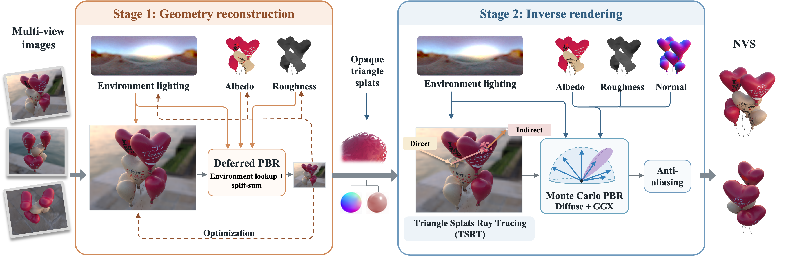
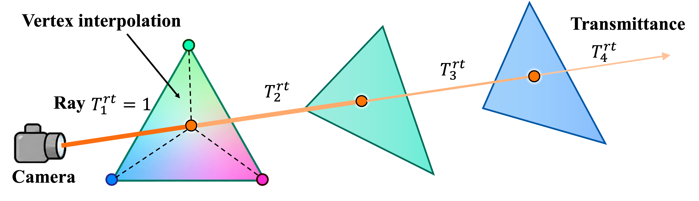
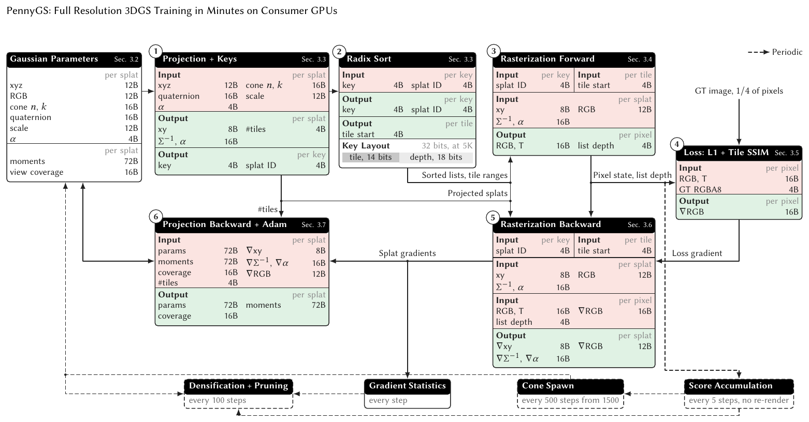
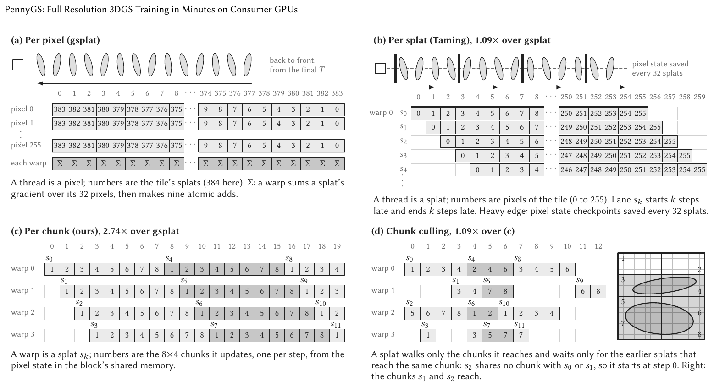
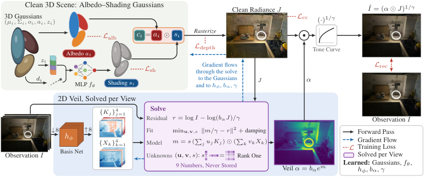

# 科研日报 · 2026-11-24

> 覆盖 2026-11-23（周一）arXiv 公告（`cs.GR` / `cs.CV` / `cs.RO`）及 2026-11-24 凌晨四领域动态。周一 `cs.GR` 新更 13 篇（含交叉）、`cs.CV` 189 篇、`cs.RO` 47 篇；本日两篇必读分别对准**不透明三角形图元上的光线追踪逆渲染与重光照**（[**TSIR**](#2026-11-24--tsir)）与**消费级显卡 2 GB 显存内数分钟完成 4K 全分辨率 3DGS 训练的全链路冗余消除**（[**PennyGS**](#2026-11-24--pennygs)）；精选一篇把无配对暗光 3DGS 恢复建模为**二维粗基函数增益“暗幕”加可微秩一变量投影求解**的工作（[**VeilGS**](#2026-11-24--veilgs)）；另短列 3 篇事件相机高斯表面传输、非结构网格并行块多重网格与自动驾驶静态优先前馈高斯重建进展。

---

## 今日速览

| 级别 | 论文 | 领域 | 为什么值得读 |
| :--- | :--- | :--- | :--- |
| **必读** | [**TSIR: Ray-Traced Triangle Splats for Inverse Rendering**](#2026-11-24--tsir) | 逆渲染 / 三角形泼溅光线追踪 | 在 Triangle Splatting+（TS+）退火得到的不透明三角形图元上直接构建 BVH 做光线追踪（TSRT），无需高斯多层半透明遍历或二十面体包围代理；结合可学习顶点着色法线、退火期混合可见性、共享三平面反照率场与 $4\times 4$ 子像素可见性抗锯齿，在 TensoIR Hotdog 重光照达 $14.02\text{ FPS}$（比 2DGRT 基线 IRGS 快 $30\times$ 以上，PSNR $+1.79\text{ dB}$）。 |
| **必读** | [**PennyGS: Full Resolution 3DGS Training in Minutes on Consumer GPUs**](#2026-11-24--pennygs) | 3DGS 训练系统加速 / 消费级显卡 4K 重建 | 把单步 3DGS 训练的“逐像素计算”与“逐图元显存带宽”全链路去冗余：用平面 RGB + 方向圆锥不透明度把每图元参数从 59 个砍到 14/18 个并在投影期提前剔除 40% 图元-瓦片对，配合循环偏移的 $1/4$ 跨步像素采样、单遍闭式梯度非重叠瓦片 SSIM 与每图元单 Warp 按块（Per-Chunk）反向光栅化，在 RTX 3060 上以 $<2\text{ GB}$ 显存峰值 6 分 25 秒训完 4K Mip-NeRF 360（比所有基线在 RTX 4090 上还快）。 |
| **精选** | [**VeilGS: Solving Darkness as a Veil of 2D Basis Maps over Retinex 3DGS**](#2026-11-24--veilgs) | 暗光 3DGS 恢复 / 可微变量投影 | 每个高斯存反照率与 8 维着色潜码（Retinex 分解），每视角暗化建模为粗基函数张成的二维空间变化增益“暗幕（Veil）”乘以全局相机色调曲线；不存储每视角参数，而在每个训练步用 QR + 幂迭代 + 4 步 Gauss-Newton 在 $64\times 64$ 降采样残差上可微求解 9 个秩一系数并把梯度反传穿过求解器（Variable Projection），阻止三维高斯吞噬暗化伪影。 |
| **短列** | [**EAST: Event-Anchored Surface Transport for Event-Based Gaussian Reconstruction**](#2026-11-24--east) | 事件相机 / 3DGS 表面重建 | 揭示事件相机监督下的“外观梯度—深度补偿”局部退化，用多视角事件射线三角化锚点与事件时间平面法向流（Normal Flow）共同约束隐式 SDF，并通过当前场相对冻结初始场的描述符残差对高斯中心做有界传输。 |
| **短列** | [**ParaBMG: A Parallel Block Multigrid Framework for Large-Scale Evolving Sparse Systems on Unstructured Meshes**](#2026-11-24--parabmg) | 几何处理 / GPU 多重网格求解器 | 清华大学杜韬与 CMU 李旻辰团队合作：面向非结构网格上千万自由度稀疏演化线性系统的全 GPU 并行块代数多重网格（Block AMG）框架，统一耦合自由度的块粗化与多项式平滑。 |
| **短列** | [**S2D-Splat: Static-First Gaussian Reconstruction of Dynamic Driving Scenes with Layer-Wise Feature Guidance**](#2026-11-24--s2d-splat) | 自动驾驶 / 动态场景 3DGS | 先重建静态背景高斯锚定全局几何，再用分层特征引导分离并建模动态交通参与者的前馈高斯运动场。 |

---

## 重点论文深读

### TSIR · arXiv · 2026-11-20

**论文：** *TSIR: Ray-Traced Triangle Splats for Inverse Rendering*  
**作者：** Wentao Yang（浙江大学 / 西湖大学 / 阿里达摩院）、Chentao Shen（浙江大学 / 西湖大学）、Zhengqi Zhang（清华大学 / 阿里达摩院）、Bolin Chen（阿里达摩院）、Yan Ye（阿里达摩院）、Xiangru Huang（西湖大学）  
**链接：** [arXiv:2611.27030](https://arxiv.org/abs/2611.27030) · [HTML 全文](https://arxiv.org/html/2611.27030v1) · [PDF](https://arxiv.org/pdf/2611.27030)

*图：TSIR 原论文 Fig. 2。第一阶段在 Triangle Splatting+（TS+）软窗口向不透明三角形退火的过程中引入可学习顶点着色法线与退火期混合可见性；第二阶段在不透明三角形上直接构建 BVH 执行三角形泼溅光线追踪（TSRT），结合共享三平面反照率场、蒙特卡洛直接+间接反射积分与 $4\times 4$ 子像素可见性抗锯齿完成材质与环境光恢复。*

#### 1. 解决的瓶颈与切入点
基于 3DGS 或 2DGS（如 IRGS）的物理逆渲染（Inverse Rendering，即从多视角图像反推三维几何、表面材质 BRDF 与环境光照以支持新光照下重打光）面临一个核心代价：**半透明高斯图元在空间中大量重叠，没有单一的硬表面交点**。每条次级阴影射线或反射射线在场景中传播时，必须用二十面体包围代理（Icosahedral Proxy）与成百上千个椭球求交、排序并做多层前向 Alpha 混合累积（Multi-layer Traversal and Compositing）。这导致即便在 RTX 4090 上，支持次级光线追踪的 2DGS 逆渲染方法 IRGS 在 $800\times 800$ 分辨率下重光照帧率也不到 $0.5\text{ FPS}$。

另一条混合路线（如 GeoSplatting、GHPT）用高斯负责外观光栅化、再额外维护一张网格（Mesh）负责光线传输，但两套异构几何之间容易失配。TSIR 的切入点非常干净：直接建立在 **Triangle Splatting+（TS+）** 之上——TS+ 用带可微边界平滑窗口参数 $\sigma>0$ 的共享顶点三角形图元表示场景，并在训练中通过退火（Annealing）逐步减小 $\sigma$ 并抬高顶点不透明度下界，最终收敛为**完全不透明（Opaque）的显式三角形集合**。既然最终图元已经是不透明平面三角形，那么同一套三角形既能直接光栅化外观，又能在硬件 BVH（Bounding Volume Hierarchy，层次包围盒加速结构）上做单次硬表面光线求交，彻底甩掉多层半透明遍历开销。

然而把 TS+ 直接搬到基于微表面物理渲染（PBR）的逆渲染会出现三个新问题：
1. **平面法线导致的延迟着色色块**：TS+ 每个三角形只有常数面法线（Face Normal），在延迟着色（Deferred Shading）下渲染光滑高光表面会切出明显的折面色块（Color Patches）；
2. **退火期阴影边界处可见性跳变引发的法线错误旋转**：当三角形从半透明向不透明退火时，延迟渲染如果在混合表面点只做一次二值可见性查询 $\nu_{\mathrm{D}}\in\{0,1\}$，阴影边界附近一丁点权重变化就会让高光在“直接环境光”与“间接反射光”之间剧烈跳变，优化器为了拟合光度误差会把法线强行掰歪；
3. **不透明三角形退火后的拓扑碎片化与边界锯齿**：TS+ 虽然部分共享顶点，但收敛后仍是部分断开的碎片化三角形汤（Triangle Soup）：逐顶点存反照率容易丢失高频纹理且跨三角形不一致；而不透明三角形硬边界如果用超采样抗锯齿（SSAA，如在 $1600\times 1600$ 下多发射 $4\times$ 光线再降采样），会让蒙特卡洛光线追踪开销暴增 4 倍。

#### 2. 输入、输出与前置条件
- **输入**：未知固定环境光照下的多视角标定 RGB 图像集合 $\mathcal{I}=\{\mathbf{I}_k\}_{k=1}^K$，以及第一阶段用于几何引导的单目着色法线先验（与 TS+ 相同）。
- **输出**：可直接用于新环境光实时光线追踪重光照的显式三角形资产 $\mathcal{A}=(\mathcal{V},\mathcal{F},\mathcal{M})$，其中 $\mathcal{V}\subset\mathbb{R}^3$ 为共享顶点位置，$\mathcal{F}$ 为三角形顶点索引连接关系，$\mathcal{M}$ 为表面材质属性（共享三平面反照率场解码的线性 RGB 反照率 $\mathbf{a}\in[0,1]^3$、逐顶点粗糙度 $r\in(0,1]$、逐顶点金属度 $\mu\in[0,1]$ 与逐顶点可学习单位着色法线 $\mathbf{n}_v^{\mathrm{s}}\in\mathbb{R}^3$）以及恢复出的环境光贴图 $L_{\mathrm{env}}$。

#### 3. 完整方法因果链与数据流

**第一阶段：带着色法线细化与退火混合可见性的几何准备（30,000 步）**
1. **TS+ 投影窗口与退火机制**：每个顶点 $v$ 携带位置 $\mathbf{v}_v$、颜色与不透明度 $o_v\in[0,1]$，三角形 $\mathcal{T}_m=(i,j,k)$ 的图元不透明度取 $o_m=\min(o_i,o_j,o_k)$。在像素 $\mathbf{p}\in\mathbb{R}^2$ 处，令 $\phi_m(\mathbf{p})=\max_{\ell\in\{1,2,3\}}(\mathbf{n}_{m\ell}\cdot\mathbf{p}+b_{m\ell})$ 为到投影三角形三条外法向边的最大有向距离（内部为负、边界为 0、外部为正，在三角形内心 $\mathbf{s}_m$ 处取得最小值），则像素处的窗口响应与不透明度为：
   $$I_m(\mathbf{p})=\operatorname{ReLU}\!\left(\frac{\phi_m(\mathbf{p})}{\phi_m(\mathbf{s}_m)}\right)^{1/\sigma}, \quad \alpha_m(\mathbf{p})=o_m I_m(\mathbf{p})$$
   随着训练推进，退火日程逐步将平滑指数 $\sigma\to 0$ 并把 $o_m\to 1$，使软三角形平滑过渡为硬边界不透明三角形。
2. **可学习顶点着色法线（Shading Normal Refinement）**：为消除常数面法线在光滑高光表面上的折面伪影，在 $10\text{k}$ 步切入延迟渲染后，TSIR 为每个顶点赋予可学习单位着色法线 $\mathbf{n}_v^{\mathrm{s}}\in\mathbb{R}^3$，在三角形内按重心坐标 $\lambda_{m,v}(\mathbf{p})$ 插值并归一化：
   $$\mathbf{n}_m^{\mathrm{s}}(\mathbf{p})=\frac{\sum_{v\in\mathcal{T}_m}\lambda_{m,v}(\mathbf{p})\mathbf{n}_v^{\mathrm{s}}}{\left\lVert\sum_{v\in\mathcal{T}_m}\lambda_{m,v}(\mathbf{p})\mathbf{n}_v^{\mathrm{s}}\right\rVert_2}$$
   由于部分断开的三角形集里可学习法线可能脱离真实几何去单纯迎合单目先验，作者引入法线一致性损失 $\mathcal{L}_{\mathrm{nc}}$，强制插值着色法线与由渲染深度图导出的局部表面法线对齐。
3. **退火期混合可见性（Hybrid Visibility）**：第一阶段按课程推进：$1\sim 5\text{k}$ 步为仅含直接光的前向渲染；$5\text{k}\sim 10\text{k}$ 步加入间接光（采用 Ref-Gaussian 的球谐间接辐射度与网格可见性）；$10\text{k}\sim 30\text{k}$ 步切换为延迟渲染。为了防止延迟渲染在退火期因单一二值可见性 $\nu_{\mathrm{D}}\in\{0,1\}$ 跳变而把法线扭偏，TSIR 用前向 Alpha 混合的归一化权重 $w_m=\alpha_m T_m/\sum_{j=1}^M \alpha_j T_j$ 将每个三角形各自的二值可见性查询 $\nu_m\in\{0,1\}$ 混合为连续可见性 $\bar{\nu}=\sum_m w_m \nu_m$，让直接高光 $\bar{S}^{\mathrm{dir}}$ 与间接高光 $\bar{S}^{\mathrm{ind}}$ 按 $\bar{\nu}\bar{S}^{\mathrm{dir}}+(1-\bar{\nu})\bar{S}^{\mathrm{ind}}$ 平滑过渡。

*图：TSIR 原论文 Fig. 3。TSRT 直接在三维三角形上构建 BVH，射线在交点 $\mathbf{x}_m=\mathbf{r}_o+t_m\mathbf{r}_d$ 处利用三维重心坐标插值顶点球谐辐射度与材质属性，并在三角形三维平面内评估与光栅化一致的窗口响应 $I_m^{\mathrm{rt}}(\mathbf{x}_m)$。*

**第二阶段：三角形泼溅光线追踪（TSRT）与蒙特卡洛材质恢复（20,000 步）**
1. **TSRT（Triangle Splats Ray Tracing）**：固定第一阶段收敛的三角形几何，直接在三维三角形上构建硬件 BVH（无需高斯光线追踪的二十面体包围盒）。对于任意三维射线 $\mathbf{r}(t)=\mathbf{r}_o+t\mathbf{r}_d$，与三角形 $\mathcal{T}_m$ 在距离 $t_m>0$ 处相交于 $\mathbf{x}_m=\mathbf{r}_o+t_m\mathbf{r}_d$ 时，直接在三角形所在三维平面内用三维边与三维内心评估窗口响应 $I_m^{\mathrm{rt}}(\mathbf{x}_m)$，得到交点不透明度 $\alpha_m^{\mathrm{rt}}=o_m I_m^{\mathrm{rt}}(\mathbf{x}_m)$ 与透射率 $T_m^{\mathrm{rt}}=\prod_{q=1}^{m-1}(1-\alpha_q^{\mathrm{rt}})$。因为经过第一阶段退火后绝大多数三角形已经完全不透明（$\alpha_1^{\mathrm{rt}}\approx 1$），射线在首个命中点即可终止，从而把多层体积累积退化为近似单次表面求交！一次查询 $\operatorname{TSRT}(\mathbf{r}_o,\mathbf{r}_d)$ 返回沿射线累积的颜色 $\mathbf{c}_{\mathrm{rt}}$、总不透明度 $o_{\mathrm{rt}}$（环境光可见性即为 $1-o_{\mathrm{rt}}$）、反照率 $\mathbf{a}_{\mathrm{rt}}$ 与粗糙度 $r_{\mathrm{rt}}$。
2. **共享三平面反照率场（Shared Triplane Albedo Field）**：为了在不依赖完整网格连通性的前提下恢复跨三角形连续且高频的反照率，TSIR 将反照率从顶点移入一个包围盒归一化到 $[-1,1]^3$ 的共享三平面特征场（XY / YZ / ZX 三个 $512\times 512\times 8$ 特征平面，双线性采样拼接为 24 维向量，经 $24\to 32\to 3$ 浅层 MLP 解码并缩放 Sigmoid 到 $[0.01,0.99]$ 线性 RGB）。无论是主像素光栅化还是次级射线交点，都通过三维坐标查询同一个三平面场，而粗糙度 $r$、金属度 $\mu$ 和着色法线 $\mathbf{n}_v^{\mathrm{s}}$ 仍保存在顶点上。
3. **蒙特卡洛 PBR 积分与训练/重光照双模式**：在延迟合成的主像素表面点 $\mathbf{x}$ 处，采用 Cook-Torrance 微表面 GGX BRDF：
   $$f_r(\boldsymbol{\omega}_i,\boldsymbol{\omega}_o)=(1-\mu)\frac{\mathbf{a}}{\pi}+\frac{D(\mathbf{h},r)F(\boldsymbol{\omega}_o,\mathbf{h},\mathbf{F}_0)G(\boldsymbol{\omega}_i,\boldsymbol{\omega}_o,r)}{4(\mathbf{n}\cdot\boldsymbol{\omega}_i)(\mathbf{n}\cdot\boldsymbol{\omega}_o)}$$
   通过多重重要性采样（MIS）在法线半球 $\Omega$ 上采样 $N$ 条入射方向 $\boldsymbol{\omega}_s$（训练期每像素 128 个均匀半球样本 + 128 个 GGX 可见法线分布 VNDF 样本，共 256 条；重光照评估期为 256 均匀 + 256 GGX VNDF + 256 环境贴图重要性样本，共 768 条）：
   $$L_i(\mathbf{x},\boldsymbol{\omega}_s)=\bigl(1-o_{\mathrm{rt}}(\mathbf{x},\boldsymbol{\omega}_s)\bigr)L_{\mathrm{env}}(\boldsymbol{\omega}_s)+L_{\mathrm{ind}}(\mathbf{x},\boldsymbol{\omega}_s)$$
   - **训练期**：次级交点的间接辐射度 $L_{\mathrm{ind}}=\mathbf{c}_{\mathrm{rt}}$ 直接读取 TSRT 插值的顶点球谐（SH）颜色（用独立损失 $\mathcal{L}_{\mathrm{rgb}}^{\mathrm{SH}}$ 与 PBR 损失同步训练）；
   - **新光照重打光（Relighting）期**：为了保证间接反射随新环境光正确变化，次级射线命中表面后，使用无遮挡的新环境光对该次级表面点做一次完整的 PBR 着色，实现真正的**单次弹射间接反射（One-bounce Indirect Illumination）**。
4. **子像素可见性估计抗锯齿（Subpixel Visibility AA）**：蒙特卡洛积分只在原生分辨率（如 $800\times 800$）每个像素中心计算一次。随后在每个像素内铺设 $4\times 4$ 均匀子像素采样点 $\mathcal{S}_p$，仅利用投影三角形的几何支撑域与深度解析每个子像素最靠前的三角形：若子像素命中的三角形与当前父像素相同，直接复用父像素已算好的 PBR 颜色；若不同（位于三角形边缘或细小图元上），则在周围 $7\times 7$ 原生像素邻域内搜索命中同一三角形的最近像素颜色（若无，则按空间距离、深度、几何法线与材质相似度挑选最接近的前景像素）进行预乘 RGBA 均值合成。这样**无需额外发射任何一条光线追踪采样射线**，就能消除不透明三角形的硬边界锯齿。

#### 4. 实验定量结果与局限性
- **重光照与材质精度（Synthetic4Relight & TensoIR）**：在 Synthetic4Relight 上，TSIR 新视角合成 PSNR 达 **$40.78\text{ dB}$**（比 GS-IR 高 $+3.10\text{ dB}$），重光照平均 PSNR 达 **$33.66\text{ dB}$**（比 2DGRT 光追基线 IRGS 的 $31.87\text{ dB}$ 高 **$+1.79\text{ dB}$**），反照率 PSNR 达 $30.73\text{ dB}$，粗糙度 MSE 低至 $0.0022$；在 TensoIR 数据集上，重光照 PSNR 达 **$30.40\text{ dB}$**（超过 TensoIR 基线 $+0.73\text{ dB}$、IRGS $+0.52\text{ dB}$、GeoSplatting $+0.80\text{ dB}$）。
- **重光照吞吐量与不透明退火加速比（RTX 4090，$800\times 800$）**：在 TensoIR Hotdog 场景每像素发射 768 条光线并计算二次表面间接着色的同等设置下，TSIR 达到 **$14.02\text{ FPS}$（PSNR $31.24\text{ dB}$）**，而同样追踪 768 条光线并着色二次交点的 2DGS 光追方法 **IRGS 仅为 $0.46\text{ FPS}$（PSNR $30.22\text{ dB}$）**——**速度提升超过 $30\times$**！若将光线数降至 192 条，TSIR 帧率升至 **$35.17\text{ FPS}$（$30.76\text{ dB}$）**，在速度超越混合网格方法 GeoSplatting（$32.03\text{ FPS}$，$29.21\text{ dB}$）的同时 PSNR 领先 $1.55\text{ dB}$；96 条光线下更可达 **$49.56\text{ FPS}$（$30.19\text{ dB}$）**。
- **核心消融验证**：
  - *不透明三角形 vs. 软三角形（Appendix D）*：在相同图元数下，不透明三角形将完整重光照帧率从软三角形（$\sigma=1$）的 $1.16\text{ FPS}$ 提升至 $17.87\text{ FPS}$（**$15.44\times$ 加速**），仅以极小的 NVS PSNR 折损换取数量级的光追吞吐提升；
  - *子像素可见性 AA vs. $2\times 2$ SSAA*：在 Hotdog 上将帧率从 SSAA（$1600\times 1600$ 渲染再下采样）的 $3.92\text{ FPS}$ 提升至 **$13.81\text{ FPS}$（$3.52\times$ 加速）**，而 NVS PSNR 几乎无损（$37.10$ vs. $37.18\text{ dB}$）；
  - *三平面反照率 vs. 逐三角形纹理（DiffSoup）*：在 Synthetic4Relight Chair 上直接优化三平面反照率比顶点反照率高 $+1.76\text{ dB}$（TensoIR 全集平均高 $+0.53\text{ dB}$，比从头优化容易过拟合的 DiffSoup 逐三角形网格纹理高 $+1.63\text{ dB}$）。
- **局限性**：一是退火过程对强镜面反射（Highly Specular）物体的几何重建仍有挑战，混合可见性虽缓解了阴影边界法线翻转，但高光边缘仍可能残留局部法线伪影；二是尽管引入了部分共享顶点，收敛后的三角形拓扑依然是碎片化的，残留的微小孤立三角形较难进一步优化。

---

### PennyGS · arXiv · 2026-11-20

**论文：** *PennyGS: Full Resolution 3DGS Training in Minutes on Consumer GPUs*  
**作者：** Nicholas Jing Shou Nge（新加坡国立大学 NUS）、Yuang Shi（NUS / 法国图卢兹大学 IRIT / IPAL）、Géraldine Morin（IRIT / IPAL）、Simone Gasparini（IRIT / IPAL）、Anand Bhojan（NUS）、Wei Tsang Ooi（NUS / IPAL）  
**链接：** [arXiv:2611.27525](https://arxiv.org/abs/2611.27525) · [HTML 全文](https://arxiv.org/html/2611.27525v1) · [PDF](https://arxiv.org/pdf/2611.27525)

*图：PennyGS 原论文 Fig. 2。展示单步训练从前向投影与键值发射、基数排序、跨步像素前向光栅化、单遍瓦片 SSIM 损失、按块（Per-Chunk）反向光栅化到融合反向投影与稀疏 bf16 Adam 更新的完整数据流及每阶段每图元/每瓦片/每像素的 DRAM 读写字节数。*

#### 1. 解决的瓶颈与切入点
几乎所有 3DGS 论文在评测 Mip-NeRF 360 时，都遵循了一条“潜规则”：**先把相机拍出的 $4\text{K}\sim 5\text{K}$（$1200\sim 1740$ 万像素）原图降采样 $4\times\sim 10.5\times$ 到 $100\sim 160$ 万像素（宽 $\le 1600$），再放到 $24\sim 80\text{ GB}$ 显存的旗舰/数据中心卡上跑训练**。一旦把未经降采样的 4K 原图放到一块消费级显卡（如 12 GB 的 RTX 3060 或 8 GB 的 RTX 3070）上，现有 9 个 SOTA 快速训练器中有 4 个在 RTX 3060 上直接爆显存或无法完成训练，剩下的最快方法（LiteGS）训一个场景也要 **34 分 08 秒**。

作者对单步训练在不同分辨率（从 $1600$ 宽放大 $10.5\times$ 到 $5187\times 3361$）与不同图元数（$1\text{M}\to 3\text{M}$）下做了精细的 Roofline 级耗时剖析（Table 1），揭示了全分辨率消费级显卡训练同时撞上的两堵墙与**三类系统性冗余**：
1. **像素冗余（Per-pixel Compute Wall）**：像素增加 $10.5\times$ 时，键值发射慢 $6.5\times$、前向光栅化慢 $6.3\times$，而 **SSIM 损失计算暴增 $12.0\times$（占单步总耗时 26%）**！原因在于高分辨率照片相邻像素高度相似，但标准训练每步都在渲染并反传所有像素，且标准 $11\times 11$ 滑动窗口 SSIM 让每个像素参与 121 个重叠窗口、需要两次全局显存往返；
2. **字节与带宽冗余（Per-splat Memory Bandwidth Wall）**：逐图元阶段（前向投影、反向投影 + Adam）算术强度极低，完全受限于 DRAM 显存带宽。标准 3DGS 每个图元带 3 阶球谐（SH3，48 个浮点数）共 **59 个参数（236 B）**，加上 fp32 的一阶/二阶 Adam 动量，每步每个可见图元要来回搬运约 $1.4\text{ KB}$；如果不用稀疏 Adam，连当前视角看不见的 $2/3$ 图元也要读写更新；
3. **多遍扫描冗余（Redundant Passes）**：原版 3DGS 为了确定排序缓冲区大小，要把“高斯—瓦片”重叠枚举算两遍（第一遍计数并拷回 CPU，第二遍重读状态写键值）；反向投影和 Adam 拆成两个 Kernel；致密化（Densification）还要额外渲染一批视角。

PennyGS 的核心思想是：**既然全分辨率下没有任何单一阶段独占瓶颈，就必须同时砍掉每一个阶段的冗余字节与冗余像素计算，并且不牺牲全分辨率细节、视角相关高光与全像素覆盖。**

#### 2. 输入、输出与前置条件
- **输入**：未经降采样的全分辨率（4K/5K）多视角 RGB 图像（驻留在主机内存 Host RAM 中，通过三缓冲 Triple-Buffering 按需异步流式传输到 GPU 显存）及 SfM 初始点云。
- **输出**：由**基础图元（Base Splats，56 B/个，14 参数）**与**方向圆锥图元（Cone Splats，72 B/个，18 参数）**混合构成的紧凑 3DGS 场景表示（平均 52% 基础图元 + 48% 圆锥图元）。

#### 3. 完整方法因果链与数据流

1. **平面 RGB + 方向圆锥不透明度（Directional Cone Opacity）与投影期视锥剔除（Sec. 3.2）**：
   - 彻底丢弃占掉 48 个参数的 3 阶球谐（SH3），每个图元只存 **3 个直接 RGB 浮点数**（甚至不做 SH0 基底乘法，直接在投影期省掉颜色计算和 $24\text{ B}$/图元的读写）。
   - 那么视角相关的高光和反射怎么表达？作者把视角相关性从“颜色”转移到了**方向不透明度 $\hat{o}$** 上：在基础不透明度 $o$ 之外，仅增加一个单位圆锥轴向量 $\mathbf{n}\in\mathbb{R}^3$（3 个 fp32）和一个余弦线性衰减斜率 $k$（1 个 fp32），共计 4 个额外参数：
     $$\hat{o}=o\cdot\operatorname{saturate}\bigl(1-k(1-\cos\theta)\bigr), \quad \cos\theta=\mathbf{w}\cdot\mathbf{n}$$
     其中 $\mathbf{w}$ 为图元指向相机的单位视线向量。当 $k=0$ 时为各向同性基础图元（14 参数，$56\text{ B}$）；当 $k>0$ 时为圆锥图元（18 参数，$72\text{ B}$）。
   - **一举两得的投影期背面剔除（Culling）**：只要当前视角落在圆锥外部（$\cos\theta\le 1-1/k$），就有 $\hat{o}=0$！因此该图元在**前向投影阶段一开头就能被直接剔除**，根本不会发射任何瓦片键值，也不会进入基数排序、前/反向光栅化和 Adam 更新。在 15 个实测场景中，圆锥机制平均直接剔除了当前视角 **32% 的可见图元**与 **40% 的高斯—瓦片键值对**！
   - **按高误差视角方向动态分裂圆锥图元**：训练中每 5 步顺带统计每个基础图元在各视角下覆盖的高 $L_1$ 误差像素；若某基础图元的高误差视角方向明显比其全部可见方向更集中，就在该位置复制分裂出一个圆锥图元，圆锥轴 $\mathbf{n}$ 对准高误差平均方向、斜率 $k$ 设为恰好包住这些高误差视角，专门用来拟合局部镜面高光与反射光斑。

2. **单遍融合投影与 32 位短键值发射（Fused Projection & Key Emission，Sec. 3.3）**：
   - 根据历史迭代峰值预分配足够容量的排序缓冲区，彻底省掉“先计数、前缀和拷回 CPU、再重跑一遍枚举”的两遍扫描。
   - 在单个 Kernel 内，每个线程算出图元椭圆覆盖的瓦片范围与子瓦片掩码（Subtile Mask），线程束（Wave/Warp）内部先做寄存器级局部前缀和，再由单线程对全局游标做一次原子加（Atomic Add）预留连续槽位，直接写出键值对（将 DRAM 流量砍掉 48%，提速 $1.74\times$）。
   - 采用 32 位压缩排序键（5K 分辨率下用 14 bit 存瓦片索引、18 bit 存深度，丢弃低 14 bit 深度），使基数排序直接提速 **$2.22\times$**（$1.81\text{ ms}\to 0.81\text{ ms}$）。

3. **循环偏移的 $1/4$ 跨步像素采样前向光栅化（Strided Pixel Sampling，Sec. 3.4）**：
   - 在 4K 全分辨率下，相邻像素梯度高度冗余。PennyGS 每步在每个 $2\times 2$ 像素块中**只光栅化并监督 1 个真实原图像素**（即用 $32\times 32$ 屏幕空间瓦片覆盖 $16\times 16=256$ 个采样像素），并在连续 4 个训练步中按固定顺序循环遍历 $(0,0),(1,0),(0,1),(1,1)$ 四个偏移位置。
   - 与“把图像缩小一半到半分辨率训练”不同，跨步采样每次对比的都是**未经低通滤波平均的 4K 真实高频像素值**，因此完整保留了高频纹理监督，每 4 步覆盖全图所有像素一次，而单步光栅化开销直接降到与半分辨率等价（省掉 $3.35\times$ 时间，PSNR 仅差 $0.02\text{ dB}$）。

4. **单遍闭式梯度非重叠瓦片 SSIM（Single-Pass Tile SSIM，Sec. 3.5）**：
   - 将标准 SSIM 的 $11\times 11$ 滑动高斯窗口替换为与光栅化瓦片严格对齐的 **$16\times 16$ 非重叠均匀权重瓦片窗口**（每步随机平移瓦片网格原点以消除固定分块边界伪影）。
   - 因为窗口不再跨瓦片重叠，带来两个质变：① 共享内存无需加载瓦片外延 5 像素的 Halo 区域（从 $26\times 26$ 缩回 $16\times 16$）；② 每个像素只属于唯一一个瓦片的均值/方差统计量，因此 **SSIM 对像素颜色的偏导数具有极其简洁的闭式解析解**，前向与反向完全融合进**单次 Kernel 调度**，不向全局显存写任何中间导数，使 Loss 阶段耗时从 $1.99\text{ ms}$ 骤降至 **$0.23\text{ ms}$（提速 $8.5\times$）**！

*图：PennyGS 原论文 Fig. 7。对比 (a) 逐像素反向（如 gsplat，大量原子加或归约）、(b) 逐图元单线程阶梯步进（如 Taming-3DGS，256 步串行传递像素状态）、(c) PennyGS 的每图元单 Warp 按 32 像素块（Chunk）步进（8 步走完 256 像素，仅在结尾做一次 Warp 归约），以及 (d) 基于椭圆包围盒的块剔除（Chunk Culling），使不重叠的多个图元在同一瓦片内并行推进。*

5. **按块遍历与块剔除的反向光栅化（Per-Chunk Backward Rasterization，Sec. 3.6）**：
   - 反向光栅化占单步近一半时间。现有算法分为两派：**逐像素派（Per-pixel，如 gsplat）**用 256 个线程对应 256 个像素，每步处理 1 个图元并对梯度做跨线程归约；**逐图元派（Per-splat，如 Taming-3DGS）**用 1 个线程对应 1 个图元，为了在共享内存中只存一份像素状态，必须像流水线阶梯一样花 256 个时间步逐像素串行走完一个瓦片。
   - PennyGS 提出**每图元单 Warp 按块遍历（Per-chunk Traversal）**：每个 $16\times 16$（256 像素）瓦片分成 **8 个 32 像素的块（Chunk）**，每个线程块启动 4 个 Warp（128 线程），**每个 Warp 绑定 1 个图元**。在每个时间步，一个 Warp 的 32 条线程同时并行处理 1 个 Chunk 的 32 个像素；只需 **8 个时间步**就能走完整个瓦片，并在结尾做一次 32 线程寄存器归约写出梯度！
   - **块剔除（Chunk Culling）与精简算术**：因为单个高斯椭圆很少铺满整个瓦片，每个 Warp 在遍历前先利用前向算好的 8-bit 子瓦片掩码跳过未触及的 Chunk，且每个 Chunk 独立维护已完成图元计数器，使得瓦片内空间不相交的不同图元无需互相等待即可并驾齐驱。配合三大算术瘦身（① 像素共享内存状态不存 3 通道累积颜色，只存累积颜色与损失梯度 $\mathbf{v}$ 的点积标量 $a$，把每像素共享内存从 $36\text{ B}$ 压到 $24\text{ B}$；② 图元二次型与不透明度常数提取到 6 个累加和之后只乘一次；③ 预乘 $-\frac{1}{2}\log_2 e$ 用单条 `exp2` 指令算高斯衰减），使寄存器占用压到 48 个/线程、SM 占用率提升至 82%，反向光栅化比 gsplat **快 $3.49\times$**！

6. **融合反向投影 + 稀疏 bf16 动量 Adam + 零额外渲染致密化（Sec. 3.7–3.8）**：
   - 将 2D 到 3D 的反向投影与 Adam 更新融合为单个 Kernel；利用前向算出的 `#tiles > 0` 仅更新当前视角可见的 ~33% 图元（未见图元仅耗费 $4\text{ B}$ 读取与 12 条指令）；并将 Adam 一阶/二阶动量压缩为 `bf16` 存储，把单个可见图元的双向内存流量从 $1.4\text{ KB}$ 压到 $0.4\text{ KB}$，整个阶段耗时从 gsplat 的 $10.87\text{ ms}$ 降至 **$0.67\text{ ms}$（提速 $16.2\times$）**。
   - 致密化复用每 5 个训练步结束时仍驻留在显存中的合成图与贡献计数统计误差，无需像 FastGS 那样在致密化时额外跑一批前向渲染。

#### 4. 实验定量结果与局限性
- **跨四代消费级 GPU 的统治级速度（Table 4，30k 步全分辨率评测）**：在 7 个全分辨率 Mip-NeRF 360 场景（最高 $5187\times 3361$）与 8 个从源视频重新抽取的 4K Tanks&Temples 场景共 15 个场景上，对比 9 个 SOTA 训练器（Mip-Splatting、Speedy-Splat、Taming-3DGS、DashGaussian、Faster-GS、VkSplat、LiteGS、LichtFeld、FastGS）：
  - **RTX 3060（12 GB）**：9 个基线中有 4 个（Mip-Splatting、Speedy-Splat、Taming-3DGS、Faster-GS）在 4K 下直接无法完成训练；其余最快基线在 Mip-NeRF 360 上需 $34\text{m }08\text{s}$（LiteGS），而 **PennyGS 仅需 $6\text{m }25\text{s}$（提速 $5.3\times$）**；在 Tanks&Temples 4K 上 **PennyGS 仅需 $6\text{m }37\text{s}$**。甚至 **PennyGS 在 RTX 3060 上的训练速度，比任何其他方法在 RTX 4090 上的速度都快**（RTX 4090 上次快方法 LichtFeld 训 Mip-NeRF 360 需 $8\text{m }07\text{s}$，FastGS 训 T&T 4K 需 $6\text{m }57\text{s}$）！
  - **RTX 3070 / 3090 / 4090**：在 Mip-NeRF 360 上，PennyGS 平均训练耗时分别为 **$4\text{m }24\text{s}$（RTX 3070，比次快 LiteGS 快 $5.4\times$）**、**$2\text{m }55\text{s}$（RTX 3090）** 与 **$1\text{m }33\text{s}$（RTX 4090，93 秒训完 4K 30k 步，比次快 LichtFeld 快 $5.2\times$）**。
- **显存占用、模型体积与图像质量**：
  - 15 个 4K 场景的 **平均显存峰值仅 $1.04\text{ GB}$（最高 bicycle 场景也仅 $1.76\text{ GB}$）**，主机内存平均峰值 $9.89\text{ GB}$；
  - 图像质量（在标准全像素 $11\times 11$ 参考 SSIM 下评测）：Mip-NeRF 360 平均 PSNR 达 **$28.96\text{ dB}$**（SSIM $0.858$，LPIPS $0.207$，在 10 个方法中排第 3，全面超越此前速度标杆 FastGS 的 $28.36\text{ dB}$ 和 VkSplat 的 $28.39\text{ dB}$）；Tanks&Temples 4K 平均 PSNR 达 **$24.35\text{ dB}$**（排名第 2）。平面 RGB + 圆锥不透明度甚至比标准 SH3 提升了 **$+0.50\text{ dB}$ PSNR**。
- **局限性**：① 圆锥图元不再严格绑定在几何表面上，而是被用来拟合局部视线方向的光照效应；当测试相机偏离训练轨迹较远（Extrapolated Views）时，未受正则化约束的窄圆锥可能产生刺眼的亮斑伪影（Fig. 10）；② 跨步像素采样依赖相邻像素相关性，在低分辨率图像上收益会下降；③ 目前仅实现了 NVIDIA CUDA 后端，尚未移植到 Vulkan / AMD / Apple Silicon。

---

### VeilGS · arXiv · 2026-11-20

**论文：** *VeilGS: Solving Darkness as a Veil of 2D Basis Maps over Retinex 3DGS*  
**作者：** Mohab Kishawy（加拿大麦克马斯特大学 McMaster University）、Chengzhou Tang（加拿大曼尼托巴大学 University of Manitoba）、Shahram Shirani（麦克马斯特大学）、Jun Chen（麦克马斯特大学）  
**链接：** [arXiv:2611.27719](https://arxiv.org/abs/2611.27719) · [HTML 全文](https://arxiv.org/html/2611.27719v1) · [PDF](https://arxiv.org/pdf/2611.27719) · [Project Page](https://errorlogic1211.github.io/VeilGS/)

*图：VeilGS 原论文 Fig. 2。三维高斯通过反照率 $a_i$ 与着色潜码 $z_i$ 的 Retinex 分解直接光栅化出恢复后的干净辐射图 $J$；在每个训练视角上，轻量级基网络从 $1/8$ 分辨率暗光观测图像 $I$ 提取两组粗空间基图，通过阻尼最小二乘与秩一分解实时求解出 9 个系数构成空间变化增益“暗幕” $\alpha$，再经全局色调曲线 $\gamma$ 拟合观测图像 $I$，并将重构梯度穿过求解器反传（Variable Projection）。*

#### 1. 核心思路与方法因果链
无正常光照配对（Unpaired）的暗光多视角三维重建有两个两难困境：如果像 Luminance-GS 那样对每张图只用一条全局色调曲线，那么台灯旁边的深色物体与暗角里的浅色物体会得到相同的曝光拉伸，导致暗处提亮不足或亮处过曝发灰；如果像 Gaussian-DK 或 LITA-GS 那样把空间变化的暗化特征直接存在每个三维高斯球上，暗化场的分辨率与场景几何完全一样高，三维高斯就会把场景高频纹理和暗化纠缠在一起。

VeilGS 的解法融合了 **Retinex 分解** 与 **经典数值优化中的变量投影（Variable Projection）**：
1. **高斯侧的 Retinex 反照率—着色分解**：去掉球谐函数，每个高斯 $i$ 存储漫反射反照率 $a_i\in[0,1]^3$ 与 8 维着色潜码 $z_i\in\mathbb{R}^8$，由全场景共享的 2 层 128 宽 MLP $f_\theta(z_i,d_i)$（Softplus 输出保证正值）结合视线方向 $d_i$ 预测正值着色 $s_i\in\mathbb{R}_{>0}^3$，按 $c_i=a_i\odot s_i$ Alpha 混合得到**干净场景辐射图像 $J\in\mathbb{R}_{\ge 0}^{H\times W\times 3}$**（配合 3D 8 近邻反照率平滑约束、着色灰世界有界约束 $[0.1,1.5]$、目标均值 $E=0.4$ 的曝光先验与 Depth Anything 3 单目逆深度约束）。
2. **视角侧的秩一双线性粗基“暗幕（Veil）”**：将暗光观测图像建模为 $\hat{I}=(\alpha\odot J)^{1/\gamma}$，其中 $1/\gamma$ 为全场景共享的相机色调曲线指数，$\alpha=b_\alpha\exp(m)\in(0,1]$ 为三通道共享的空间变化增益（暗幕）。为了保证暗幕足够平滑、绝不偷记场景高频纹理，轻量级网络 $h_\phi$ 读取 $1/8$ 分辨率的暗光观测图 $\mathcal{P}_8(I)$，输出两组各 $d=4$ 张粗基图并上采样回原分辨率得到 $\{K_j\}_{j=1}^4,\{X_k\}_{k=1}^4$，将局部调制图 $m$ 表示为 $16$ 张逐像素乘积基图 $\Phi_{jk}=K_j\odot X_k$ 的**秩一双线性组合**：
   $$m=\sum_{j=1}^4\sum_{k=1}^4 s\,u_j v_k\,(K_j\odot X_k), \quad M=s\,\mathbf{u}\mathbf{v}^\top\in\mathbb{R}^{4\times 4},\;\|\mathbf{u}\|=\|\mathbf{v}\|=1,\;s\ge 0$$
3. **不存每视角参数，在每个训练步实时求解并反传穿过求解器（Training Through the Solve）**：在对数域下，暗幕需要解释的残差为 $r(\mathbf{p})=\frac{1}{3}\sum_{\ell}\bigl(\log I(\mathbf{p},\ell)-\frac{1}{\gamma}\log(b_\alpha J(\mathbf{p},\ell))\bigr)$。在每个训练步，将 $I,J$ 与 16 张基图降采样到 $64\times 64$（4096 个方程对 16 个未知数），通过三步可微求解器实时算出该视角的 9 个系数 $(\mathbf{u},\mathbf{v},s)$：① 忽略秩一约束，用 QR 分解闭式求解带 Marquardt 列范数阻尼（$\lambda=4$）的线性最小二乘；② 从固定初值出发用幂迭代提取最优秩一近似 $(\mathbf{u},\mathbf{v},s)$；③ 执行 4 步可微 Gauss-Newton 细化。**最关键的一步是：不截断（Detach）求解器的梯度，而是让重构损失 $\mathcal{L}_{\mathrm{rec}}$ 的梯度完整反传穿过这三步求解器**。根据变量投影原理，任何能被平滑暗幕基函数解释的全局/低频亮度变化都会在重拟合时被投影算子 $(I-A(A^\top A+\lambda D^2)^{-1}A^\top)$ 抵消掉，使三维高斯收不到吸收暗化的梯度，从而被迫只学习干净的三维场景几何与反射率！

#### 4. 实验亮点与局限性
- 在无配对真值的 12 场景真实夜间数据集 **Gaussian-DK** 上，VeilGS 在全部 12 个场景上取得最优无参考图像质量 NIQE（平均 $3.85$ vs. Gaussian-DK $4.35$），10 个场景取得最优 CLIP-IQA（$0.612$），并在 55 人盲测主观评测中以 **MOS $4.15$** 显著击败 Gaussian-DK（$3.44$，$p<10^{-9}$）；在有正常光真值的 **LOM** 数据集上，平均 PSNR 达 **$22.96\text{ dB}$**（LPIPS $0.220$，MOS $3.57$，超越 I2-NeRF 的 $22.87\text{ dB}$ 与 LITA-GS 的 $22.42\text{ dB}$），且因为测试期只需直接渲染干净辐射图 $J$（无需运行暗幕网络），在 H100 上渲染帧率高达 **$407\text{ FPS}$**。
- **消融验证**：把“反传穿过求解器”换成“截断求解器梯度（Detached）”会让 PSNR 直接跌落 $1.35\text{ dB}$；去掉求解器的 Marquardt 阻尼项会让 PSNR 暴跌 $4.82\text{ dB}$（无阻尼的暗幕会强行吞噬场景纹理导致恢复出的干净场溶解，Fig. 6c）。
- **局限性**：暗幕 $\alpha$ 是三通道共享的消色差标量增益，因此无法消除有色光源造成的偏色；在极度缺乏纹理的场景中穿过求解器训练可能不稳定；暗区反照率偶尔会残留轻微偏绿伪影。

---

## 其他值得关注的论文（短列）

### 1. EAST: Event-Anchored Surface Transport for Event-Based Gaussian Reconstruction
- **作者与机构**：Ke Luo、Wei Zhai、Yuliang Wu、Yang Cao（中国科学技术大学 USTC）、Pengfei Yu（理想汽车 Li Auto）
- **链接**：[arXiv:2611.27224](https://arxiv.org/abs/2611.27224) · [HTML](https://arxiv.org/html/2611.27224v1) · [PDF](https://arxiv.org/pdf/2611.27224)（`cs.CV`，2026-11-20 提交）
- **核心贡献**：指出仅用事件流（Event Stream）监督 3DGS 时存在一阶“外观梯度—深度补偿”模糊性（即局部平移下预测亮度变化率 $q=|\partial_t \log Y|\simeq \gamma g/Z$，更远但图像梯度 $g$ 更强的边缘与更近但梯度更弱的边缘会产生相同的事件响应）。作者提出 **EAST**，利用跨视角事件射线三角化支持度锚定隐式符号距离场（SDF）的零水平集，并用局部同极性事件拟合仿射时间平面测得的边缘法向流（Normal Flow）直接约束射线与 SDF 交点深度；最后通过当前演化 SDF 与冻结初始参考 SDF 在每个高斯中心处的几何描述符残差，对高斯中心施加有界位移传输（初始化时位移严格为 0，但能将事件渲染残差梯度反传回隐式表面），在 PAEv3D 与 NeRF Synthetic 上同时提升了表面网格精度与新视角渲染质量。

### 2. ParaBMG: A Parallel Block Multigrid Framework for Large-Scale Evolving Sparse Systems on Unstructured Meshes
- **作者与机构**：Kangbo Lyu、Mingqi Geng、Jinchen Jiang、Yu Wang、Tao Du（清华大学 / 上海期智研究院）、Minchen Li（卡内基梅隆大学 CMU）
- **链接**：[arXiv:2611.27396](https://arxiv.org/abs/2611.27396) · [HTML](https://arxiv.org/html/2611.27396v1) · [PDF](https://arxiv.org/pdf/2611.27396)（`cs.GR` / `math.NA`，2026-11-20 提交）
- **核心贡献**：针对非结构网格上几何处理与物理仿真中高达上千万自由度、在迭代优化中稀疏非零模式或数值不断演化的块耦合线性系统（Block-coupled Sparse Linear Systems），设计了一套全 GPU 并行块代数多重网格（Block AMG）求解与预条件框架 **ParaBMG**。通过以节点块（Block-granularity）为单位保持多方向自由度耦合、全并行聚合粗化与低同步开销的多项式平滑器，在大规模网格变形、参数化与弹性仿真基准上显著降低了多重网格层级构建（Setup）与单步求解耗时。

### 3. S2D-Splat: Static-First Gaussian Reconstruction of Dynamic Driving Scenes with Layer-Wise Feature Guidance
- **作者与机构**：Jinheng Li、Tianchen Deng、Bufan Zhang、Qu Chen、Jianwu Fang（西安交通大学 / 南洋理工大学等）
- **链接**：[arXiv:2611.27003](https://arxiv.org/abs/2611.27003) · [HTML](https://arxiv.org/html/2611.27003v1) · [PDF](https://arxiv.org/pdf/2611.27003)（`cs.CV` / `cs.RO`，2026-11-20 提交）
- **核心贡献**：面向自动驾驶动态街景的免逐场景优化（Feed-forward）高斯重建，提出“静态优先（Static-First）”解耦架构：先利用多视角几何一致性与分层视觉特征引导构建稳定的静态背景三维高斯场，以此作为空间参考基准分离并估计动态车辆与行人的三维高斯运动轨迹，缓解了前馈网络在高速相机运动与前景物体运动耦合时的深度漂移与鬼影。

---

## 圈内新闻与社区反应

- **Blender 5.3 正式版与 3DGS 原生工作流生态跟进**：Blender 5.3 已于 2026 年 11 月中旬正式发布（Blender 5.4 进入 Alpha 周期），本次大版本对神经渲染与图形学研究者最关键的更新是**原生支持 3D Gaussian Splatting（`.ply` 与压缩格式 `.spz`）直接作为点云资产导入**，支持通过 Geometry Nodes 对高斯图元做程序化裁剪、变换与属性编辑，并在 Workbench、EEVEE 与 Cycles 中直接渲染与混排打光；同时 Windows 与 Linux 平台已将 **Vulkan 后端切换为默认视口后端**，并在 Cycles 视口中集成了 NVIDIA DLSS 视口降噪器与 Principled BSDF 色散（Dispersion）支持。这对今天日报中的 [**TSIR**](#2026-11-24--tsir)（直接导出可重打光三角形资产）与 [**PennyGS**](#2026-11-24--pennygs)（56B/72B 超紧凑平面 RGB + 圆锥不透明度图元）在 DCC 工具链中的落地非常契合。
- **其余三领域（具身智能 / 游戏开发与关卡设计 / 电子音乐与音频生成）**：2026-11-23 至 2026-11-24 凌晨窗口内，`cs.RO` 的新提交主要集中在视觉语言动作模型（VLA）的推理加速与自动驾驶仿真评估，未见经过多方交叉核实的重大产业级模型发布或开源底座更新，本日按规范如实留白，不作噪音填充。

---

## 覆盖说明

- **arXiv 覆盖范围**：核查 `cs.GR`（13 篇）、`cs.CV`（189 篇）、`cs.RO`（47 篇）于 **2026-11-23（周一）** 公告的条目（对应美东周四下午至周五下午提交批次，提交日期标记为 `2026-11-20`）。
- **去重与长期记忆核对**：全部入选论文（`2611.27030`、`2611.27525`、`2611.27719`、`2611.27224`、`2611.27396`、`2611.27003`）均已核对 `meta/seen-papers.json` 及近期日报，确认无重复收录。
- **维护者公开仓库巡检**：已只读核对 `rubatotree/notes`（HEAD `4b15b8c`）、`rubatotree/blog`（HEAD `c29075d`）、`rubatotree/academic`（HEAD `f19a697`），较上一日无新增公开提交。
- **外部信源状态**：`kesen.realtimerendering.com` 在本日抓取窗口返回 HTTP 406，未产生新增长期记忆变更；Blender 5.3 官方发布说明与开发者文档已交叉核验。

**编写：** Cocoa

**故障说明：** 本日由 Cocoa 于 06:18 HKT 故障转移接管发布。先前顺位未在窗口内成功出稿：Cream（05:30–06:20）无当日 digest、无索引条目且无有效 claim。依据 `meta/failover.json` 当日 `claim`／`failover` 事件。
