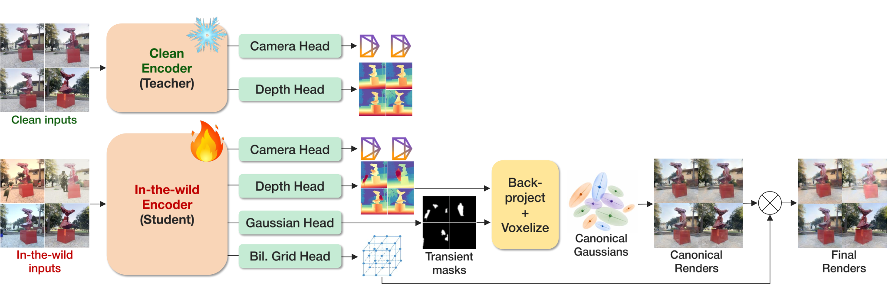
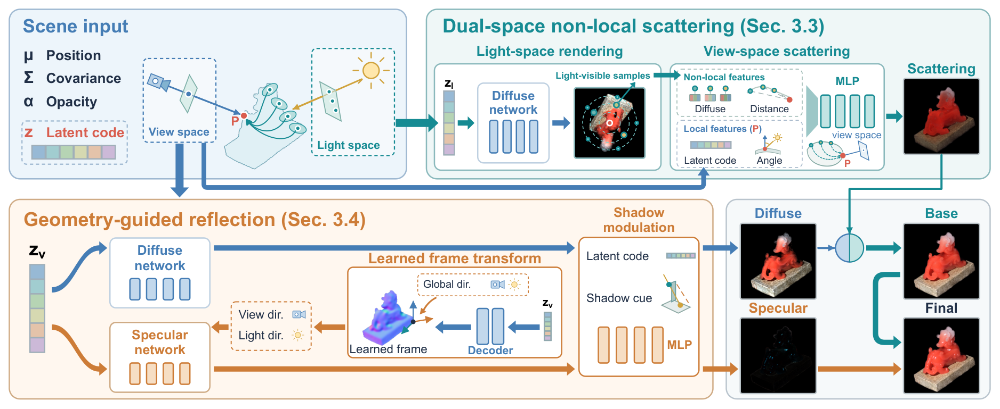
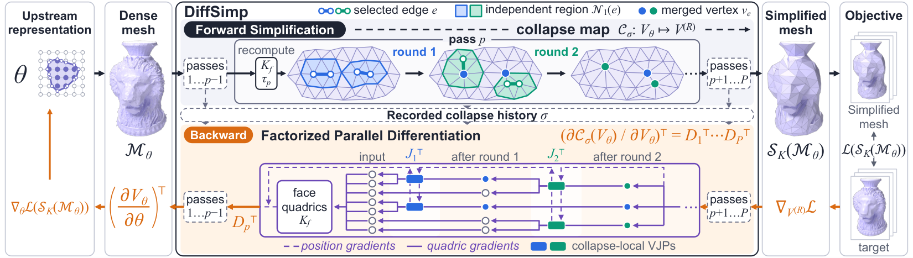
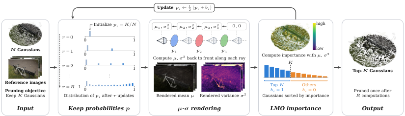

# 2026-11-25 科研日报

## 今日速览

周二 arXiv 公告里，最贴近主线的两篇必读分别对准**野外多视图不一致下的前馈三维高斯重建**，以及**半透明物体可重光照里不能只看局部特征的次表面散射**。另选读一篇把网格简化放进上游几何优化梯度的工作，以及一篇用「一次去掉很多高斯」来重估剪枝重要性的方法。

- **必读：[WildAnySplat](#2026-11-25--wildanysplat)（Huawei Noah's Ark Lab，SIGGRAPH Asia 2026 Conference Papers）。** 现有前馈 3DGS（如对照系中的 AnySplat）在受控多视图上一次前向就能出高斯，但野外照片里的路人、车辆、曝光与 ISP 差异会把这些不一致写进几何和颜色，新视角上出现残影和串色。WildAnySplat 用师生网络：冻结的教师只看干净图，负责提供稳定的相机与深度；学生看野外图，额外预测瞬态掩膜和每视图双边网格，把光度监督和体素融合都按「这是不是稳定场景」加权，并把规范外观与视图相关的颜色变换拆开。读它的理由：这是 AnySplat 路线在野外条件上的直接延伸，也是目前少数把瞬态抑制和外观校正同时做进一次前馈、并已获 SIGGRAPH Asia 2026 会议论文接收的工作；在 RealX3D 的 9 视图设置上 PSNR 为 $19.83\,\mathrm{dB}$，比次优的 WildSplatter 约高 $2\,\mathrm{dB}$。
- **必读：[NNS-GS](#2026-11-25--nns-gs)（北京航空航天大学、南京大学）。** 半透明物体换光时，光线从一处入射、在体内散射、从另一处出射，局部高斯特征很难解释这种依赖。已有 SSS-GS、SSD-GS 等仍主要在每个高斯上评估散射。NNS-GS 先在光源视角把高斯泼溅成深度、三维位置和潜码图，用固定环形采样收集 32 个可见表面处的漫反射响应与距离，再在观察视角用网络预测散射分量；局部反射则用学到的局部坐标系和光空间深度差来稳住高光与阴影边界，并用锚定式分阶段训练避免高光支路把漫反射和散射「吃掉」。读它的理由：这正打在可重光照主线上「换光之后半透明外观还对不对」的缺口，点光源标定数据上合成/真实半透明场景的平均 PSNR 分别比现有方法高 $2.47\,\mathrm{dB}$ 与 $0.81\,\mathrm{dB}$，渲染约 $60\,\mathrm{FPS}$，并且还能用一个衰减尺度调节散射外观。
- **选读：[DiffSimp](#2026-11-25--diffsimp)（Holiday Robotics）。** 可微网格提取之后，紧凑网格往往靠事后二次误差度量（QEM）简化，简化误差回不到上游。DiffSimp 把并行边折叠的离散拓扑选择固定下来，只对由此决定的顶点映射反向传播，并按对数插值逐步把顶点预算收到目标值。读它的理由：这是把「最后真正拿去用的那张低面数网格」纳入逆渲染和几何优化的可插拔层；在更紧的顶点预算下，梯度修正带来的倒角距离收益从 $K=2000$ 时的 $0.05$ 增到 $K=250$ 时的 $1.34$（倒角距离已按 $10^{5}$ 缩放）。
- **其他：** [LMnOP](#2026-11-25--lmnop) 指出留一法重要性是在「几乎没被剪」的原模型上量的，改用反复的留多法并按保留概率做 $\mu$-$\sigma$ 渲染；[GC-GS](#2026-11-25--gc-gs) 把多损失梯度冲突当成几何信号来调和位置更新并做自适应致密化；[Reveal](#2026-11-25--reveal) 在渲染之后有选择地用多视图深度候选替换高斯深度；[HoloSplat](#2026-11-25--holosplat)、[ArgsWorld](#2026-11-25--argsworld)、[STAC++](#2026-11-25--stacpp) 分别对应人体前馈流式重建、自回归扩散直接出 3DGS 世界，以及流式重建的空间 KV 缓存压缩。圈内动态在覆盖日内未见需要新写一条的高信号。

---

## 重点论文深读

### WildAnySplat · SIGGRAPH Asia 2026 · 2026-11-23

一次前馈出高斯的方法要在野外站得住，关键不是再堆一层更重的优化，而是把「路人和曝光差」从规范几何与规范外观里挡出去。

**论文：** *WildAnySplat: Feed-Forward 3D Gaussian Splatting in the Wild*  
**作者：** Richard Shaw、Arthur Moreau、Athanasios Papaioannou、Thomas Tanay、Zhensong Zhang、Eduardo Pérez-Pellitero  
**单位：** Huawei Noah's Ark Lab, London, UK  
**投稿信息：** 已接收为 SIGGRAPH Asia 2026 Conference Papers（Kuala Lumpur，2026-12-01–04；DOI: 10.1145/3829340.3842323）  
**发表时间：** arXiv 首次挂出 2026-11-23（会议正式发表 2026-12）  
**链接：** [arXiv:2611.31023](https://arxiv.org/abs/2611.31023) · [HTML 全文](https://arxiv.org/html/2611.31023v1) · [PDF](https://arxiv.org/pdf/2611.31023) · [项目主页](https://wildanysplat.github.io/) · [代码](https://github.com/wildanysplat/WildAnySplat)

*图：WildAnySplat 原论文 Fig. 2。教师网络只在干净图像上预测相机位姿与深度；学生网络接收野外输入，除位姿与深度外还预测逐像素高斯、瞬态掩膜和每视图双边网格，并在体素融合与光度损失中抑制不可靠观测。*

#### 1. 解决的瓶颈与切入点

前馈三维高斯溅射（Feed-forward 3D Gaussian Splatting，用一次网络前向从多视图直接预测高斯图元，不必对每个场景迭代优化）在受控采集上已经能工作，对照系里的 AnySplat 是这条线上的代表。野外照片却会同时出现三类多视图不一致：行人车辆等**瞬态遮挡**（Transient Occluders）、光照变化，以及相机 ISP 造成的外观差。这些不一致若被写进高斯的位置和颜色，新视角上就会留下残影，或把某一张图的曝光「烤」进资产。

作者的切入点是师生蒸馏，而不是再做一遍耗时的逐场景优化。教师只看干净图像，给出相对稳定的几何监督；学生必须从野外图像里重建出一份规范的三维表示，并把视图相关的颜色偏差交给另一次可逆的外观变换。

#### 2. 输入、输出与前置条件

- **输入：** 一组未经位姿标注的野外多视图图像 $\{I_i^w\}$（也可来自视频）。训练时还需要对应的干净图像 $\{I_i^c\}$，来源包括少量真实配对、合成增广，以及用优化式方法（如 WildGaussians）得到的伪干净重建。
- **输出：** 一份可直接做新视角合成的三维高斯场景。推理时不必再提供干净图，也不需要 COLMAP 相机；官方 demo 接受一个图像文件夹或一段视频，预测相机与高斯并渲染新视角。
- **前提：** 教师在训练中保持冻结，其骨干是 VGGT（Visual Geometry Grounded Transformer，一种从多视图估计几何的变换器），权重来自预训练，不再更新。成对干净数据仍然稀缺，所以混合数据策略是方法能训起来的条件，也会把教师自身的偏差传给学生。

#### 3. 完整方法因果链与数据流

1. **师生分工。** 教师 $f_{\theta^t}$ 与学生 $f_{\theta^s}$ 共用 VGGT 骨干，并都用 DPT 头（Dense Prediction Transformer，把变换器特征解码成稠密图的预测头）输出相机 $\mathcal{C}$ 与深度 $\mathcal{D}$。学生额外增加若干 DPT 头，预测逐像素高斯 $\mathcal{G}$、瞬态掩膜 $\mathcal{T}$ 和每视图双边网格 $\mathcal{B}$：
   $$
   \mathcal{C}^{t},\mathcal{D}^{t}=f_{\theta^{t}}(\{I_i^{c}\}),\qquad
   \mathcal{C}^{s},\mathcal{D}^{s},\mathcal{G}^{s},\mathcal{T}^{s},\mathcal{B}^{s}=f_{\theta^{s}}(\{I_i^{w}\}).
   $$
   教师的位姿与深度通过蒸馏损失 $\mathcal{L}_{\mathrm{distill}}=\mathcal{L}_{\mathcal{C}}+\mathcal{L}_{\mathcal{D}}$ 约束学生，使学生在野外输入上仍靠近干净几何。

2. **前馈高斯与瞬态掩膜。** 学生按 AnySplat 一类做法，用专门的 DPT 头预测与像素对齐的三维高斯（均值、协方差、不透明度、颜色），再经体素化融合成统一场景并做标准 $\alpha$ 混合。与此同时，高斯头多出一个通道，预测每个被举起的三维点属于稳定场景的概率 $M_i(p)\in[0,1]$。有真实或伪瞬态标签时，用正类加权的二元交叉熵监督该掩膜。

3. **掩膜同时改写损失和融合。** 野外图像上的光度损失按掩膜重加权，只在被认为稳定的像素上惩罚重建误差：
   $$
   \mathcal{L}_{\mathrm{photo}^{w}}=\sum_i\sum_p M_i(p)\,\bigl\|\hat{I}_i^{s}(p)-I_i^{w}(p)\bigr\|_1.
   $$
   干净图像则用完整光度损失。体素融合时，每个点的权重还要乘上 $M_i(p)$ 和置信度，$w_{i,p}\propto \exp(\mathrm{conf}_{i,p}/\tau)\,M_i(p)\,R_i(p)$，再对体素内的位置与特征做加权平均。这样，路人不仅不会主导光度梯度，也不容易在融合阶段留下「半透明残影」。

4. **用双边网格把规范外观和视图颜色拆开。** 学生不为每张图直接预测一套互不相干的高斯颜色，而是先渲染规范高斯得到 $\hat{I}_i^{\mathrm{canon}}$，再由一个 DPT 头预测三维双边网格 $B_i$，做空间变化的仿射颜色变换 $\tilde{\mathbf{c}}=\mathbf{A}_i(x,y,l)\mathbf{c}+\mathbf{b}_i(x,y,l)$。为避免规范颜色被网格「吸收」成不自然的基底，变换写成相对单位阵的残差 $\mathbf{A}_i=\mathbf{I}+\Delta\mathbf{A}_i$，并用全变分与残差稀疏项约束网格。光照、曝光和 ISP 的低频差异主要由 $B_i$ 解释，规范高斯则尽量保持跨视图一致。

5. **总损失与数据。** 学生优化 $\mathcal{L}=\lambda_{\mathrm{photo}}\mathcal{L}_{\mathrm{photo}}+\lambda_{\mathrm{distill}}\mathcal{L}_{\mathrm{distill}}+\lambda_{\mathrm{mask}}\mathcal{L}_{\mathrm{mask}}+\lambda_{\mathrm{bg}}\mathcal{L}_{\mathrm{bg}}$。训练混合了 DL3DV、Hypersim、ARKitScenes、RealEstate10K、BlendedMVS、ScanNet++ 等 13 个公开数据集，并在 RealX3D、Phototourism 等上留出测试。

#### 4. 结果、局限与阅读指引

在 RealX3D 的 9 视图设置上，WildAnySplat 的 PSNR 为 $19.83\,\mathrm{dB}$，约比次优 WildSplatter 高 $2\,\mathrm{dB}$，LPIPS 为 $0.270$。相对 AnySplat 骨干，多数设置有提升，例如 NeRF On-the-Go 的 12 视图 PSNR 从 $14.14\,\mathrm{dB}$ 升到 $15.24\,\mathrm{dB}$。Phototourism 这种极端外观变化上它仍有竞争力（3 视图 PSNR $12.57\,\mathrm{dB}$），但 SSIM / LPIPS 在更多视图时不一定全面超过 WildSplatter。作者也提醒：瞬态残影往往只占画面一小块，全图平均指标未必跟观感一致，稀疏无位姿输入还容易夹杂位姿误差，因此定量结果要和定性对比一起看，不能写成「所有基准、所有指标全面第一」。

局限同样清楚：大面积、持续的动态区域仍会拖垮位姿和重建；双边网格主要建模低频颜色变换，强高光或高度非线性的相机处理可能残留不一致；伪干净教师本身有预处理代价，也可能把伪影传给学生。对课题而言，值得看的是它怎样把 AnySplat 式前馈管道改成「规范几何 + 规范外观 + 每视图校正」，以及瞬态概率如何同时进入损失和体素融合——这比再记一组基准数字更有用。代码和推理 demo 已公开，官方说明推理不需要训练代码或 COLMAP。

---

### NNS-GS · arXiv · 2026-11-23

半透明换光要成立，散射项必须能回答「光是从表面哪几处进来的」，而不是只根据当前着色点的局部潜码猜一层软光晕。

**论文：** *NNS-GS: Non-Local Neural Scattering for Relightable Gaussian Splatting*  
**作者：** Shiyu Liang、Yang Gao、Lili Wang、Aimin Hao、Beibei Wang  
**单位：** 北京航空航天大学（Liang、Gao、Lili Wang、Hao）；南京大学（Beibei Wang）  
**投稿信息：** 投稿信息未标明  
**发表时间：** arXiv 首次挂出 2026-11-23  
**链接：** [arXiv:2611.30351](https://arxiv.org/abs/2611.30351) · [HTML 全文](https://arxiv.org/html/2611.30351v1) · [PDF](https://arxiv.org/pdf/2611.30351)

*图：NNS-GS 原论文 Fig. 1（概述）。散射模块在光源空间汇集可见表面处的漫反射响应与距离，再在观察空间预测散射分量；反射模块提供这些漫反射响应，并用局部标架与光空间深度差稳住高光和阴影边界。*

#### 1. 解决的瓶颈与切入点

可重光照三维高斯已经能把不透明表面的漫反射、高光和环境光大致分开，但对蜡、玉、皮肤、牛奶这类半透明体，外观取决于**次表面散射**（Subsurface Scattering, SSS）：光子在 $\mathbf{x}_i$ 进入物体，在介质里走一段，再从另一个表面点出射。双向表面散射反射分布函数（BSSRDF）描述的就是这种空间依赖。SSS-GS、SSD-GS 等把散射残差或偶极扩散写进高斯表示，但评估时仍然主要使用每个高斯自己的局部特征，换光之后「别处入射、此处出射」的贡献对不上。

NNS-GS 的判断是：在标定点光源下，不必学一个完整的高维光传输算子，只要在**光源空间**把可见表面上的照明线索收集起来，再在**观察空间**学习这些线索如何变成当前着色点的散射颜色。与此同时，高光和硬阴影边界变化很陡，普通 MLP 更容易学平滑变化，所以局部反射还要额外的几何提示。

#### 2. 输入、输出与前置条件

- **输入：** 在标定点光源下拍摄的多视图图像（合成与真实半透明场景），以及用于几何的高斯表示。实现上先用前向溅射恢复几何，再用延迟溅射训练外观。
- **输出：** 可在新点光源（以及补充实验中的环境光）下重打光的高斯资产；散射外观可用一个非负尺度 $s$ 调节。论文报告约 $60\,\mathrm{FPS}$ 的渲染性能。
- **前提：** 非局部聚合明确建立在点光源与光源空间采样上。这不是对任意未知环境光的通用分解；把结论外推到复杂自然光时，要看补充材料里的环境光实验，而不能默认已经解决。

#### 3. 完整方法因果链与数据流

1. **光源空间的非局部描述子。** 先把高斯从光源方向溅射成深度、三维位置和潜码图。对着色点 $\mathbf{P}$ 在这些图上的投影，用固定的环形图案采样 $K=32$ 个位置：内环更密、外环更疏，以兼顾近处贡献和较远覆盖。每个有效样本给出漫反射响应 $\mathbf{q}_j$（由漫反射网络解码，对应 BSSRDF 中的入射光与余弦项）以及它到 $\mathbf{P}$ 的欧氏距离 $d_j$，拼成描述子 $\mathcal{N}_L(\mathbf{P})=[\mathbf{q}_1,d_1,\ldots,\mathbf{q}_K,d_K]$。

2. **观察空间的散射网络。** 散射网络 $f_{\mathrm{sss}}$ 接收 $\mathcal{N}_L(\mathbf{P})$、局部高斯潜码 $z$（编码局部材质与几何）以及入射角 $\theta$，输出散射颜色，再用与距离有关的调制 $\mathbf{A}$ 衰减：
   $$
   L_{\mathrm{sss}}=\mathbf{A}\,f_{\mathrm{sss}}\bigl(\mathcal{N}_L(\mathbf{P}),z,\theta\bigr),\qquad
   A=\frac{1}{|\mathcal{V}|}\sum_{j\in\mathcal{V}}\exp(-s d_j).
   $$
   $s$ 被解释为相对有效消光尺度，默认还缩放从 $z$ 学出的每通道光学厚度代理 $\boldsymbol{\tau}$，得到散射权重 $\mathbf{w}=\exp(-s\boldsymbol{\tau})$。增大 $s$ 会压低散射、抬高互补的漫反射权重，外观向不透明漫反射靠拢。学习到的传输响应保持固定，编辑时只动 $s$。

3. **几何引导的局部反射。** 漫反射与高光两个分支共享潜码 $z$。一个小网络从 $z$ 解出局部标架：代理法向用于 Lambert 漫反射，光方向、视方向及其半角向量被变到该标架后再进高光 MLP，减轻网络自己学习随表面旋转的负担。阴影调制则取着色点的光空间深度与其投影处渲染深度之差，经低频编码后预测一个共享因子，同时作用于两个反射分支。作者写明：这是学到的调节，可以衰减或放大反射，**不是**物理可见性项。

4. **锚定式分阶段训练，避免分量互抢。** 标准训练里，灵活的高光支路容易把漫反射和散射已经解释的外观再学一遍，重建指标仍高，但调节 $s$ 时分量不再各司其职。因此延迟外观阶段共 $70\mathrm{k}$ 步：前 $10\mathrm{k}$ 只学漫反射；随后 $20\mathrm{k}$ 引入散射，形成漫反射–散射基 $L_{\mathrm{base}}$；第 $30\mathrm{k}$ 步把各训练视图的基渲染存成固定锚点 $\mathbf{H}_i$；最后 $40\mathrm{k}$ 步加入高光，基必须靠近 $\mathbf{H}_i$，高光则监督观测前景相对锚点的正残差 $\mathbf{R}_i=[\mathbf{Y}_i-\mathbf{H}_i]_+$。损失在重建项之外再加锚点项与高光项，并对稀疏高光做额外强调。

#### 4. 结果、局限与阅读指引

在标定点光源的半透明数据上，NNS-GS 相对 RNG、GS$^{3}$、SSD-GS 等现有方法，合成与真实场景的平均 PSNR 分别提高 $2.47\,\mathrm{dB}$ 与 $0.81\,\mathrm{dB}$；调节散射衰减时也更接近参考。消融表明：去掉散射模块、只用观察空间评估、取消标架变换或阴影调制，都会在相应的软穿透、高光或阴影边界上露出缺口。对主线的阅读价值在于两条分开的因果：非局部散射解决「换光后半透明对不对」，锚定训练解决「能拆开才能调」。需要同时记住边界：光源空间环形采样是为点光源设计的紧凑近似，不是完整 BSSRDF 积分；阴影调制也不是物理可见性。公开页暂未见到项目主页或代码，投稿信息未标明。

---

## 选读

### DiffSimp · arXiv · 2026-11-23

把简化留在优化回路之外，等于默认「先优化一张过密的网格，再容忍简化把它改坏」。DiffSimp 让损失直接定义在最终那张低面数网格上。

**论文：** *DiffSimp: Differentiable Mesh Simplification for Gradient-Based Low-Poly Modeling*  
**作者：** Seonghun Oh  
**单位：** Holiday Robotics  
**投稿信息：** 投稿信息未标明  
**发表时间：** arXiv 首次挂出 2026-11-23  
**链接：** [arXiv:2611.31018](https://arxiv.org/abs/2611.31018) · [HTML 全文](https://arxiv.org/html/2611.31018v1) · [PDF](https://arxiv.org/pdf/2611.31018)

*图：DiffSimp 原论文 Fig. 1。上游网格 $\mathcal{M}_\theta$ 经基于二次误差度量的并行边折叠得到目标顶点数为 $K$ 的简化网格；离散折叠选择在反向中保持固定，梯度只沿由此决定的顶点映射传回 $\theta$。*

#### 方法概要

前向仍是二次误差度量（Quadric Error Metrics, QEM）下的并行边折叠：多轮按代价阈值折叠，达不到预算 $K$ 就提高阈值，并在每一趟开始按无记忆策略重算法线二次型。边的选择和连接关系更新是离散的，整体过程并不全局可微。DiffSimp 的关键是把一次前向得到的折叠历史 $\sigma$（折叠边集合、趟边界、存活/删除端点、以及每个折叠采用的顶点放置分支）固定下来，此时输出连接关系已定，输出顶点只是输入顶点的一个局部可微映射 $\mathcal{C}_\sigma$。损失对上游参数 $\theta$ 的梯度于是写成
$$
\nabla_\theta\mathcal{L}(\mathcal{S}_K(\mathcal{M}_\theta))
=\Bigl(\frac{\partial V_\theta}{\partial\theta}\Bigr)^{\!\top}
\Bigl(\frac{\partial\mathcal{C}_\sigma(V_\theta)}{\partial V_\theta}\Bigr)^{\!\top}
\nabla_{V^{(R)}}\mathcal{L}.
$$
为了高效求这个向量–雅可比积，作者把顶点二次型当作可微中间量，让同一轮里互不重叠的折叠可以并行反传；跨轮次的二次型合并则沿一棵归约森林回传，避免在每次折叠时重复微分相关三角形。集成到优化时，先预热，再按对数插值把顶点预算从当前顶点数收到目标 $K$，避免一上来就做过猛的拓扑改变。折叠历史可以在迭代之间变化，论文以实验表明：每次对「这一步实际发生的历史」求导，仍然能有效优化。

在 Myles 等的 79 个形状上，DiffSimp 被插入 FlexiCubes 重建，并与事后 QEM、PaMO、顶点聚类、ACVD 以及 CWF、TriFlow 等比较。$K=1000$ 时它在倒角距离、F1 和法向一致性上优于全部基线。只做前向简化、不回传梯度的变体已经优于普通 QEM；加上微分后，在更紧的预算下收益更大，倒角距离（已 $\times 10^{5}$）的改进从 $K=2000$ 的 $0.05$ 增到 $K=250$ 的 $1.34$。同样的层还能接到 DiffMC、DMTet 和 Large Steps。逆渲染实验以 nvdiffrec + FlexiCubes 为前端，在 8 个 NeRF-Synthetic 场景上走完几何–材质–光照优化、UV 烘焙和顶点与纹理精修；与把简化留在事后相比，把误差传回上游提高了最终低面数网格的保真度。评测在一块 RTX 5090 上进行，接入后相对未简化基线的端到端时间约为 $1.00$–$1.25\times$。公开资料中暂未见到代码仓库。对逆渲染阅读，重点看「离散折叠不动、只微分顶点映射」这一选择，以及预算日程如何避免过早把几何折坏。

---

### LMnOP · arXiv · 2026-11-23

留一法重要性回答的是「现在拿掉这一颗会怎样」，并不回答「将来还要再拿掉一大批之后，它还重不重要」。

**论文：** *LMnOP: Pruning 3D Gaussian Splatting via Leave-Many-Out Importance*  
**作者：** Sunjae Jeong、Jaeseung Kim、Hyoseok Hwang  
**单位：** MOBILTECH CO., LTD.（Jeong、Kim）；Kyung Hee University（Jeong、Hwang）  
**投稿信息：** 投稿信息未标明  
**发表时间：** arXiv 首次挂出 2026-11-23  
**链接：** [arXiv:2611.30102](https://arxiv.org/abs/2611.30102) · [HTML 全文](https://arxiv.org/html/2611.30102v1) · [PDF](https://arxiv.org/pdf/2611.30102)

*图：LMnOP 原论文 Fig. 2。每个高斯先带保留概率 $K/N$，经过 $r$ 次更新后按留多法重要性调整；$\mu$-$\sigma$ 渲染用保留概率对均值和方差做加权，再以评分损失更新这些概率，最后一次剪到目标个数。*

#### 方法概要

常见剪枝用留一法（Leave-One-Out）重要性：在完整模型里估计去掉单颗高斯对渲染的影响。可一旦真的去掉很多高斯，剩下那些图元的贡献会变，原来「看起来可删」的高斯可能变得关键。LMnOP 改为留多法（Leave-Many-Out）：让每颗高斯带一个保留概率，反复在「已经有一批被随机拿掉」的条件下估计重要性，再用评分损失更新概率。所谓 $\mu$-$\sigma$ 渲染，是把保留概率写进颜色均值与方差的加权，使重要性评估和最终要保留的子集一致。实现上重要性累计 $R=8$ 次且其间不真正删除，最后一步再剪到目标个数，剪完不做微调。评测覆盖 Mip-NeRF 360、Deep Blending 与 Tanks and Temples 共 13 个场景，在去掉 $90\%$ 与 $99\%$ 高斯、且所有方法都对同一原模型剪到同一数量、剪后均不微调时，LMnOP 在 18 个指标列中的 16 列最好；SSIM 与 LPIPS 在全部 13 个场景、两种比例上优于 GaussianPOP，在 $99\%$ 删除时这两项更是每个场景都最好。作者还指出 EAGLES 与 GaussianPOP 往往在高频细节和光滑区域上顾此失彼，而 LMnOP 两边都能保住。值得关注的是它把「重要性会随已删除集合改变」说成可验证的前提，并用留一法分数相同、去留不同的配对来检查这一点。暂未见项目主页。

---

## 其他简讯

### GC-GS · arXiv · 2026-11-18

**论文：** *GC-GS: Optimizing 3D Gaussian Splatting with Gradient Conflict as a Geometry Signal*  
**作者：** Chenhao Zhang、Fengze Zhang、Fengqing Zhu  
**单位：** Purdue University  
**投稿信息：** arXiv Comments 仅写「WACV2027」，未写明 Accepted，按在投或拟投 WACV 2027 理解，不以已接收论处  
**发表时间：** arXiv 首次挂出 2026-11-18（于 2026-11-24 的 cs.CV 新目中公布）  
**链接：** [arXiv:2611.28111](https://arxiv.org/abs/2611.28111) · [HTML](https://arxiv.org/html/2611.28111v1) · [PDF](https://arxiv.org/pdf/2611.28111)

3DGS 常同时优化光度、感知等多项损失，冲突的梯度会把同一颗高斯的位置拉向相反方向。GC-GS 从多目标优化出发，只调和高度冲突图元的位置梯度，并把持续的位置梯度冲突当作致密化信号：前期在欠重建区域分裂或克隆，后期再处理仍然冲突的高斯。适合作为「多损失一起开的时候几何为什么不稳」的对照阅读。

### Reveal · arXiv · 2026-11-22

**论文：** *Complementary Geometry in Gaussian Splatting*  
**作者：** Mingle Jiang、Jikui Zhou、Chenghan Lyu、Rui Xu、Yunke Wang、Chang Xu  
**单位：** The University of Sydney；华中师范大学（Rui Xu）  
**投稿信息：** 投稿信息未标明  
**发表时间：** arXiv 首次挂出 2026-11-22（于 2026-11-24 公告）  
**链接：** [arXiv:2611.29236](https://arxiv.org/abs/2611.29236) · [HTML](https://arxiv.org/html/2611.29236v1) · [PDF](https://arxiv.org/pdf/2611.29236)

Reveal 是一种后处理：当预期能降低误差时，用多视图深度候选替换高斯溅射渲染出的深度。候选可来自骨干自身的源视图深度或 Depth Anything 3，准入由一个约 $81\mathrm{K}$ 参数的小网络决定。论文报告在 DTU、LBM、RIG 上 AbsRel 有下降，外观大体保持；并强调更好的新视角图像并不等于更准的深度——LBM 上 4C4D 的 PSNR/SSIM 最高，深度误差却最大。对需要把高斯几何接到操作或度量的阅读有用，但它补的是已经渲染出来的深度，并不改训练目标本身。

### HoloSplat · arXiv · 2026-11-23

**论文：** *HoloSplat: Real-Time Token Streaming for Feed-Forward Human Reconstruction*  
**作者：** Chaofan Li、Qihan Ding、Shihan Wang、Zhehao Shen、Boyu Shen、Quanyu Chen、Haoyu Wu、Lan Xu、Xin Lou  
**单位：** 上海科技大学  
**投稿信息：** 投稿信息未标明  
**发表时间：** arXiv 首次挂出 2026-11-23  
**链接：** [arXiv:2611.31140](https://arxiv.org/abs/2611.31140) · [HTML](https://arxiv.org/html/2611.31140v1) · [PDF](https://arxiv.org/pdf/2611.31140) · [项目主页](https://heaticy.github.io/HoloSplat/)

面向人体自由视点视频的前馈重建。逐帧优化或普通前馈都会产生过大的高斯载荷，难以在带宽预算内实时传到轻量客户端。HoloSplat 把表示改成可流式传输的 token，并在编码端做实时重建。适合作为「前馈高斯怎样为直播而不是为离线资产服务」的对照，不是室内逆渲染主线上的几何或材质方法。

### ArgsWorld · arXiv · 2026-11-21

**论文：** *ArgsWorld: Unifying 3DGS Scene Reconstruction, Generation and Extrapolation with Autoregressive Diffusion Transformer*  
**作者：** Weiming Chen、Shuaiyan Liu、Xinyu Shao、Zhewen Chen、Tian Guan、Yonghong He、Xitong Ling  
**单位：** 清华大学深圳国际研究生院；哈尔滨工业大学（Shuaiyan Liu）  
**投稿信息：** 投稿信息未标明  
**发表时间：** arXiv 首次挂出 2026-11-21（于 2026-11-24 的 cs.CV 新目中公布）  
**链接：** [arXiv:2611.28792](https://arxiv.org/abs/2611.28792) · [HTML](https://arxiv.org/html/2611.28792v1) · [PDF](https://arxiv.org/pdf/2611.28792)

自回归扩散世界模型通常只出 RGB 视频。ArgsWorld 让同一套模型同时给出显式 3DGS 场景，以便进入下游的渲染、仿真或机器人使用。对「世界模型能否直接变成可渲染资产」有阅读价值，需在全文中核对其几何与跨视一致性，不宜只根据摘要把它写成已经可替换优化式重建。

### STAC++ · arXiv · 2026-11-21

**论文：** *STAC++: Plug-and-Play Adaptive Spatio-Temporal Aware Cache Compression for Streaming 3D Reconstruction*  
**作者：** Boyi Zhu、Youcheng Cai、Dong Wang  
**单位：** 中国科学技术大学、安徽建筑大学  
**投稿信息：** 投稿信息未标明  
**发表时间：** arXiv 首次挂出 2026-11-21（于 2026-11-24 的 cs.GR 新目中公布）  
**链接：** [arXiv:2611.28793](https://arxiv.org/abs/2611.28793) · [HTML](https://arxiv.org/html/2611.28793v1) · [PDF](https://arxiv.org/pdf/2611.28793)

面向无界场景的流式三维重建，STAC 的固定分辨率空间 KV 缓存会随场景增大。STAC++ 是免训练的即插即用压缩：用八叉树做自适应空间 KV、按注意力输出变化指导合并，并复用缓存的中间特征、只重算骨干末段来用后续观测修正历史预测。可接入四种已有流式骨干。关注点是长序列显存，而不是外观分解。

同日还可以留意：[Not All Directions Are Flat](https://arxiv.org/abs/2611.28802)（Gwangju Institute of Science and Technology）把平坦极小值拆到不同梯度方向上，用于稀疏视图 3DGS；[BReD](https://arxiv.org/abs/2611.28191) 用 BEV 残差扩散做前馈路面高程与高斯重建；[Dynamic Gaussian Scene Reconstruction by Integrating Events and Structural Priors](https://arxiv.org/abs/2611.29920)（南开大学、海河实验室）把事件相机与结构先验接入动态高斯。cs.GR 其余新稿还包括风格化运动模糊的历史图像存储、偶次周期 B 样条插值的交错节点，以及视觉扩散模型预测「下一步最佳着法」，与本课题主线较远，不展开。

---

## 圈内新闻与社区反应

覆盖日内，Ke-Sen 的 SIGGRAPH 2026 公开页面最近可核验更新仍为 2026-09-18，SIGGRAPH Asia 2026 页面未见可核验的新条目；WildAnySplat 的会议接收信息来自论文自身与 ACM DOI，而不是 Ke-Sen 当日更新。国内科技媒体与公开网页检索未发现 2026-11-24 当天与图形学 / 3DGS / 逆渲染主线直接相关的新高信号。Blender 5.3 原生导入 `.ply` / `.spz` 三维高斯已在 [11-24 日报](https://rubatotree.github.io/research-daily/digests/2026-11-24) 收录，本日不重复。暂未找到可核实的社区原帖讨论上述新稿。

---

## 覆盖说明

本期日报日期 2026-11-25（Asia/Hong_Kong），内容覆盖 2026-11-24。信息源包括 arXiv 周二新目（`cs.GR` 新投稿 5 篇、交叉 8 篇、替换 8 篇；`cs.CV` 新投稿 407 篇，按三维高斯、逆渲染、可重光照、前馈重建等关键词筛选），以及公开网页检索、Ke-Sen 与国内科技媒体（机器之心、量子位、新智元）。必读与选读依据 HTML 全文和原文配图。已对照 `meta/seen-papers.json` 及近几期日报去重；替换稿中的 GraftRay、D4GS 等此前已收录，本次未见需要重提的实质新进展说明。长期记忆与兴趣笔记较上一日无变更，未改 `meta/` 规范正文。

**编写：** Cream
