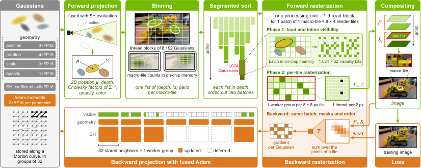
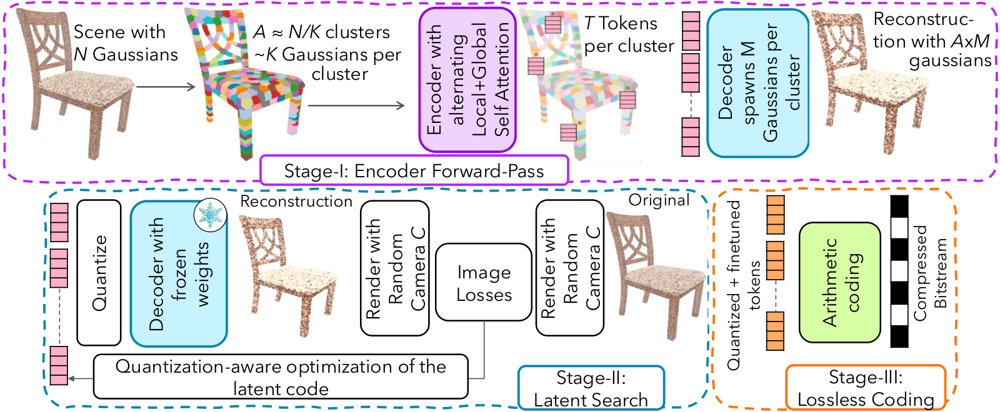
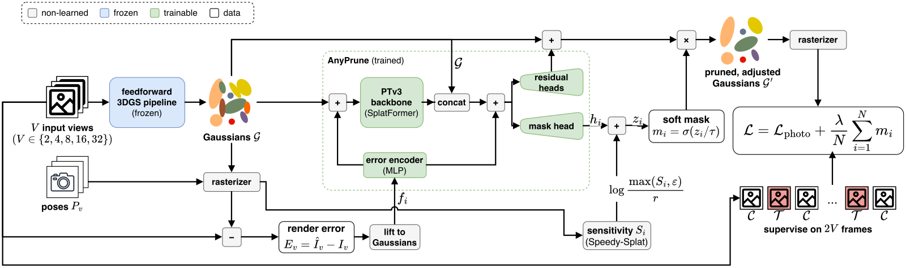
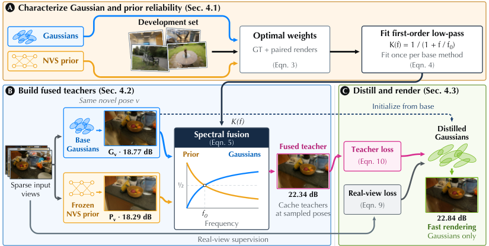

# 2026-11-26 科研日报

## 今日速览

周三 arXiv 公告里，最贴近主线的两篇必读分别对准**可微三维高斯溅射里「最密的那块屏幕瓦片拖住整帧」的调度问题**，以及**压缩已有高斯场时不必保留输入图元一一对应、而在解码端重生成一套标准高斯**。另选读一篇给任意前馈高斯管道做免优化剪枝的模块，以及一篇用频率域融合把前馈先验蒸馏回稀疏视图高斯的方法。

- **必读：[HiGS](#2026-11-26--higs)（NVIDIA）。** 现有三维高斯溅射（3DGS）光栅化通常让同一块屏幕瓦片同时承担分区、光栅和并行工作单位：分区希望瓦片大、光栅希望瓦片小，而「一块瓦片一个线程块」会让最密的那块决定整帧时间。HiGS 把这三者拆开：高斯按较粗的宏瓦片（macro-tile，一组相邻的精细渲染瓦片）做分箱和深度排序，再按有界深度批次光栅化，密区域只是多发几个批次，而不是把一整条无界列表塞进同一个工作单位；同一套批次也用于训练反传，优化器再融进反向、降低精度并推迟被剔除高斯的外观更新。读它的理由：这是正向渲染效率主线上少见的、同时改渲染和重建调度、并保持精确前到后 alpha 合成的系统工作。论文报告，在其评测的已发表实现上，标准场景渲染快 $1.5\times$–$5.6\times$，负载不均的驾驶视角快 $6.8\times$–$20.0\times$，重建快 $2.3\times$–$3.0\times$，显存约为对照中最省的方法的 $1/1.9$，图像质量持平。
- **必读：[SplatTok](#2026-11-26--splattok)（The University of Texas at Austin、Dolby Laboratories Inc.、University of Colorado Boulder）。** 常见压缩要么按已有图元编码，要么为每个场景单独优化一套紧凑表示，后者往往还要当初的训练图像。SplatTok 把一份高斯场看成场景的一种实现：编码器把场景切成空间锚点上的固定长度 token，共享解码器在每个锚点周围**重生成**一套新的标准高斯，不保留与输入图元的对应；压缩时只对场景码做量化感知的潜码搜索（latent search：网络冻结，只改码本身），监督可以是输入场的渲染，也可以是训练图像。读它的理由：这把「存储」从「如何更巧地编码现有那堆高斯」转到「如何在一个跨场景学到的潜空间里重画一场」，解码结果仍是任意 3DGS 渲染器都能显示的标准场。论文报告，不用训练图像时，文件约为前馈编解码器 FCGS 的 $1/4$–$1/6.5$、PSNR 相当，相对输入场约压缩 $75$–$110$ 倍；有训练图像时，PSNR 高于逐场景方法 HAC++，文件再小 $13\%$–$41\%$。
- **选读：[AnyPrune](#2026-11-26--anyprune)（University of Bologna、EPFL）。** 前馈 3DGS 一次前向就会给出远超忠实渲染所需的高斯，尤其是输入视图很多的时候；现有剪枝要么再优化（等于放弃「一次前向」），要么规则过粗。AnyPrune 是可接在任意冻结前馈管道上的点 Transformer：用输入视图上的渲染误差构造每颗高斯的特征，同时微调属性和「是否该留下」的 logit，推理时按预算取前 $k$ 个，或按模型建议的 $z_i>0$ 自行决定比例。读它的理由：它和昨日选读的 [LMnOP](https://rubatotree.github.io/research-daily/digests/2026-11-25#2026-11-25--lmnop) 正好分开——LMnOP 针对已经优化好的场、用留多法重估重要性；AnyPrune 针对前馈管道、且不必再做逐场景优化。论文报告，约 $160$ 万高斯的场在消费级 GPU 上大约 $5$ 秒即可剪完。
- **其他：** [Spectral Fusion GS](#2026-11-26--spectral-fusion-gs) 发现前馈先验和稀疏视图高斯分别擅长低频与高频，用一次拟合的一阶低通核做成教师再蒸馏回高斯；[Completion-Aware GS](#2026-11-26--completion-aware-gs) 按「文件还没传完时画面好不好」来分配码率，和 SplatTok 的整场重生成是不同问题。[View Management 3DGS](#2026-11-26--view-management-3dgs) 做在线建图的关键帧与中间视图管理；[Instant LiDAR](#2026-11-26--instant-lidar) 从前向高斯重建激光雷达仿真场；[GOLD-SLAM](#2026-11-26--gold-slam) 在球面域里做全景激光雷达深度高斯 SLAM；[ST-SfM](#2026-11-26--st-sfm) 用时空 SfM 给 4DGS 做初始化；[Tornado4D](#2026-11-26--tornado4d) 用旋转气流先验从单侧稀疏视频重建实验室龙卷风；[BendGS](#2026-11-26--bendgs)、[Horcrux](#2026-11-26--horcrux) 分别对应连续体机器人的观测条件高斯自建模，以及前馈手–物重建。[X-3DComposer](#2026-11-26--x-3dcomposer) 把任意资产、任意视角前馈组成场景；[CCNN-GS](#2026-11-26--ccnn-gs) 是今日替换列表中首次收录的修订稿，用坐标卷积网络在粗渲染上补残差，以避免为冲高 PSNR 而指数级堆图元。另需重提：[NIRJALA](#2026-11-26--nirjala) 作者已撤回，详见该条「为何重提」。圈内动态在覆盖日内未见需要新写一条的高信号。

---

## 重点论文深读

### HiGS · arXiv · 2026-11-24

三维高斯溅射要同时又快又精确，关键往往不是再换一种近似混合，而是不要让「最密的那一块瓦片」决定整帧和整个训练步的时间。

**论文：** *HiGS: A Hierarchical Architecture for Fast Differentiable 3D Gaussian Splatting*  
**作者：** Dawid Pająk、Martin Bisson、Rodolfo Lima、François Trudel  
**单位：** NVIDIA  
**投稿信息：** 投稿信息未标明  
**发表时间：** arXiv 首次挂出 2026-11-24（于 2026-11-25 公告）  
**链接：** [arXiv:2611.31918](https://arxiv.org/abs/2611.31918) · [HTML 全文](https://arxiv.org/html/2611.31918v1) · [PDF](https://arxiv.org/pdf/2611.31918)

*图：HiGS 原论文 Fig. 2。绿色是每帧都要走的渲染阶段，橙色是训练步额外加上的反传与优化；光栅化面板画出一个处理单位——宏瓦片上的一个有界深度批次——如何被加载到本地存储、再由工作组认领其中的精细渲染瓦片。*

#### 1. 解决的瓶颈与切入点

三维高斯溅射把场景写成许多显式高斯图元，用可微光栅化做新视角合成，训练时同一个光栅器要正向、反向各跑上万次，所以光栅化成本同时决定显示和重建。主流实现（包括 gsplat 等）大体共用一条流水线：高斯投影到屏幕，按重叠瓦片分箱，按「瓦片 + 深度」做一次全局排序，然后**一块瓦片一个线程块**去混合。

问题是这块瓦片同时做了三件互相打架的事：分区、光栅、并行工作单位。分区希望瓦片大，以减少「瓦片–高斯」对数和排序量；光栅希望瓦片小，以免在高斯有效支撑之外空算像素。无论取哪一种大小，只要「一块瓦片一条无界列表、一个线程块」，最密的那几块就会形成长尾，整帧时间被它们卡住，而不是被这一视窗里的总工作量卡住。全局基数排序在 4K 时还要对千万级记录排序。先前工作往往只改其中一两个角色，例如缩小排序粒度、给最密瓦片再分线程块，或用近似合成换速度；很少把同一套分解一路带到训练的反向过程。

HiGS 的切入点是给三个角色各自的粒度，并用同一种工作单位同时服务渲染和重建：在粗宏瓦片上分箱、排序，在细渲染瓦片上混合，并行工作单位则是「某个宏瓦片上的一个有界深度批次」。

#### 2. 输入、输出与前置条件

- **输入：** 与标准 3DGS 相同的高斯场景和相机；训练时沿用同一套初始化、训练视图顺序、损失、日程和致密化策略，只替换渲染器、反向、优化器与存储布局。
- **输出：** 实时可渲染的三维高斯场景；推理与训练共用同一套分层调度。论文强调混合仍是精确的前到后 alpha 合成，而不是改成近似混合来换速度。
- **前提：** 面向通用 GPU，不依赖定制硬件。评测在一块 NVIDIA RTX PRO 6000 Blackwell 上进行，对照为有公开实现的 3DGS、gsplat 和带融合优化器的 Faster-GS。

#### 3. 完整方法因果链与数据流

1. **宏瓦片与工作单位。** 精细渲染瓦片取 $8\times 8$ 像素。$M=32$ 块相邻渲染瓦片组成一个宏瓦片，按 $8\times 4$ 排列，覆盖 $64\times 32$ 像素。分箱和深度排序只在宏瓦片上进行，可见性与混合仍在渲染瓦片上做。每个宏瓦片的有序列表再切成至多 $B_r=1024$ 个高斯的批次；一个处理单位就是一对（宏瓦片，批次）。若某宏瓦片有 $n$ 个高斯，它会发出 $\lceil n/B_r\rceil$ 个单位。密区域因此是「多发几个单位」，而不是让一个单位消化整条无界列表。高斯数据按批次装入片上本地存储，并在该宏瓦片的 $M$ 块渲染瓦片之间复用。渲染瓦片由工作组从共享队列动态认领，使计算按高斯数量而不是按屏幕面积伸缩。

2. **分段深度排序。** 分箱在大小为 $B_p=8192$ 的分区批次里用本地直方图累计各宏瓦片的重叠数，再经层次前缀扫描得到写入偏移，避免在全局原子上串行。高斯与宏瓦片的配对采用不透明椭圆的按行保守扫描。排序变成各宏瓦片内部的分段排序，键只需 32-bit 深度，而不再是「瓦片编号 + 深度」的 64-bit 复合键，记录也从 12 字节收到 8 字节。论文报告，在 Mip-NeRF 360 上，1080p / 4K 的平均配对分别约 $1.51\mathrm{M}$ 与 $2.21\mathrm{M}$，明显少于 gsplat 在 $16\times 16$ 瓦片上的不透明包围盒配对。

3. **批次光栅与独立反传。** 每个批次在本地存储中按深度混合，再按深度顺序与其他批次合成。合成会给每个批次留下「它前面的透过率」和「从它起往后的颜色」，因此各批次可以像正向那样独立求梯度。训练步不再被「最密瓦片的那一条长列表」卡住。

4. **把优化器也做成跟视窗走的成本。** 调度问题解决之后，训练的主导开销变成优化器的显存与参数流量。HiGS 把优化器融进反向，直接更新低精度（如 FP16）参数与动量，并对本视窗剔除的高斯推迟外观更新，使这一部分也尽量只随「当前视窗看见什么」缩放。

#### 4. 结果、局限与阅读指引

在常用的 13 个 3DGS 评测场景、同一训练框架下，论文报告图像质量与对照持平，同时渲染在标准场景上比其评测的近期光栅器快 $1.5\times$–$5.6\times$，在负载明显不均的驾驶视角上快 $6.8\times$–$20.0\times$；重建比其评测中最快的方法快 $2.3\times$–$3.0\times$，显存约为其中最省方法的 $1/1.9$。这些数字都绑定在作者给出的对照实现、同一致密化策略和指定 GPU 上，不宜写成「快于所有已发表方法」的无条件结论，尤其是驾驶视角的大加速明确来自负载不均。

对课题而言，值得看的是它如何把「分区、光栅、并行单位」拆开，又如何把同一套有界批次用到精确合成的反向过程——这比只记一组加速比更有用。它攻的是正向（以及可微训练中的）批渲染效率，并不处理材质与光照分解。评测时未找到项目主页或公开代码。

---

### SplatTok · arXiv · 2026-11-24

压缩一份已经训好的高斯场，不必坚持「把原来那些图元更巧地编码下来」；也可以先承认它们只是场景的一种画法，然后在一个跨场景学到的潜空间里重画一场。

**论文：** *SplatTok: Data-Driven Compression of 3D Gaussian Splats with Scene-Level Tokens*  
**作者：** Sai Karthikey Pentapati、Shashank Nelamangala Sridhara、Birendra Kathariya、Peng Yin、Guandao Yang、Alan C. Bovik  
**单位：** The University of Texas at Austin（Sai Karthikey Pentapati、Guandao Yang）；Dolby Laboratories Inc.（Shashank Nelamangala Sridhara、Birendra Kathariya、Peng Yin）；University of Colorado Boulder（Alan C. Bovik）  
**投稿信息：** 投稿信息未标明  
**发表时间：** arXiv 首次挂出 2026-11-24（于 2026-11-25 公告）  
**链接：** [arXiv:2611.32202](https://arxiv.org/abs/2611.32202) · [HTML 全文](https://arxiv.org/html/2611.32202v1) · [PDF](https://arxiv.org/pdf/2611.32202) · [项目主页](https://karthikey97.github.io/splattok/)

*图：SplatTok 原论文 Fig. 2。输入高斯场被划分到空间锚点；编码器把每个锚点上的高斯汇总成固定数量的潜码 token；解码器根据这些 token 在锚点周围重生成固定数量的新高斯。编码时网络冻结，只对量化后的 token 做潜码搜索。*

#### 1. 解决的瓶颈与切入点

实时高斯溅射把场景存成数百万带有数十个属性的图元，一份场景动辄数百兆到超过 1 GB，既难下发到头显或手机，也难按资产库的规模保存。现有压缩大致分成两类：一类直接编码给定场里的那些图元（如前馈编解码器 FCGS）；一类为每个场景单独优化紧凑表示（如 HAC++、ContextGS），往往还要当初的训练图像，耗时以十分钟计，而且通常每个目标码率都要再训一遍。实际分发里，训练图像常常已经不在，接收端也希望解压后仍是标准 3DGS 格式。

作者的观察是：一份高斯场只是场景的一种实现，不同的图元排列可以画出几乎相同的视图。因此解码端不必重建「原来那一批高斯」，只要重生成一套看起来对的标准高斯。码的长度由此可以跟锚点数和 token 精度走，而不跟输入图元个数绑死。

#### 2. 输入、输出与前置条件

- **输入：** 一份已有的标准高斯场，以及该场自带的相机。训练图像不是必须的；有则可用于潜码搜索，没有就用该场自己的渲染作目标。编码前用与 gsplat 一致的相似变换，把不同场景归一到同一位置和尺度。
- **输出：** 一份量化、熵编码后的场景码；解码得到一套标准高斯，任意 3DGS 渲染器可直接显示。默认设置下，约每 128 个输入高斯一个锚点，每锚点 $T=16$ 个 $C=32$ 维 token，解码器每锚点生成 $M=160$ 个新高斯。
- **前提：** 编码器和解码器在大约 $9101$ 个 DL3DV 场景上联合训练，参数约 $57.3\mathrm{M}$，之后跨数据集、码率和场景都不再微调网络。潜码搜索需要用到输入场的相机（或训练图像）。

#### 3. 完整方法因果链与数据流

1. **按场景大小切锚点。** 锚点个数 $A$ 随输入高斯数 $N$ 成比例变化。锚点位置是所有高斯中心的 $k$-means 中心，成员过多的簇会再拆。每颗高斯先加入最近锚点，若该锚点成员还少于上限 $K$（文中 $K=640$），也加入次近锚点，使边界处有重叠。锚点还记录一个尺寸 $\sigma_k$（成员到中心距离的中位数，并加以封顶），锚点内的位置写成归一化偏移 $(\boldsymbol{\mu}_i-\mathbf{a}_k)/\sigma_k$。码里需要单独保存的几何旁信息，主要就是这些锚点位置和尺寸。

2. **编码器：每个锚点输出固定长度的 token。** 先把每颗高斯的非位置属性（尺度、单位四元数、不透明度、球谐系数）编成向量，再与归一化偏移的傅里叶嵌入拼在一起。一组共享的 $T$ 个查询（并加上锚点尺寸的嵌入）对锚点内成员做交叉注意力，因此无论成员有多少，输出永远是 $T$ 个 token。随后各锚点的 token 一起进入 Transformer：前几层只在锚点内做自注意力，后面的层在「锚点内」和「全场景」之间交替，全局层对锚点位置使用三维旋转位置编码，使注意力能看到空间邻近关系。这一步的关键是：锚点的码长与它里面原先有多少颗、怎么排无关，解码器因此被允许用另一套高斯去表示同一块区域。

3. **解码器：直接画出标准高斯。** 解码器把每个锚点的 token 映射为 $M$ 个新高斯，放在该锚点周围，得到 $\hat{\mathcal{G}}=D(\mathbf{Z})$。训练不要求这些新高斯与输入图元对齐，只在渲染图像上监督，所以目标是「看起来对」，不是「图元对上」。

4. **量化、熵编码与潜码搜索。** 存储时把 token 量化到 $b$ 比特并做熵编码。仅靠一次编码，量化会留下误差。压缩时因此再做量化感知的潜码搜索：网络保持冻结，只 refinement 场景码本身，用输入场的渲染或训练图像作目标，把编码器剩下的大部分误差补回来。同一套权重支持多种目标码率（文中主要报 $b=6$ 与 $b=8$），也可以靠改变锚点密度来调码率，而不必重训网络。

#### 4. 结果、局限与阅读指引

在标准基准上，不用训练图像、只搜索以输入场渲染为目标时，SplatTok 的 PSNR 与 FCGS 相当，文件约为后者的 $1/4$–$1/6.5$，相对输入场约压缩 $75$–$110$ 倍；有训练图像时，PSNR 高于 HAC++，文件再小 $13\%$–$41\%$。一组在 DL3DV 上训练的权重，可以泛化到未见过的、含数百万高斯的场景。用 3DGS-MCMC 输入场、并以训练图像为搜索目标时，Mip-NeRF 360 上低/高码率的平均 PSNR 分别为 $27.93\,\mathrm{dB}$ 与 $28.09\,\mathrm{dB}$。这些对比里，不用训练图像的表与有训练图像的表所用的输入场并不相同，不能直接横比两张表里的绝对数字。

局限也清楚：它压缩的是「已经得到的那份场」，质量上限仍受输入场约束；解码高斯与输入图元没有对应，想按原来的某一颗去编辑，并不能自动转到新场；潜码搜索需要相机或训练图像，不是纯比特流就能闭着眼睛搜。对课题而言，它更接近资产存储与分发，而不是把几何和材质拆开；但它提示了一条与剪枝（如 LMnOP、AnyPrune）不同的路——剪枝是在原场里做减法，SplatTok 是在学到的场景空间里重画。项目主页已公开，评测时未找到独立代码仓库。

---

## 选读

### AnyPrune · arXiv · 2026-11-24

前馈管道多给的那些高斯，不必再开一轮逐场景优化才能剪掉；先让一个为该管道学过冗余模式的模块，在一次前向里决定留下谁、以及要不要微调剩下的属性。

**论文：** *AnyPrune: Optimization-Free Pruning for Any Feedforward 3D Gaussian Splatting Pipeline*  
**作者：** Nicola Leonetti、Federico Stella、Aoxiang Fan、Saqib Javed、Pascal Fua、Luigi Di Stefano  
**单位：** University of Bologna（Nicola Leonetti、Luigi Di Stefano）；EPFL（Federico Stella、Aoxiang Fan、Saqib Javed、Pascal Fua）  
**投稿信息：** 投稿信息未标明  
**发表时间：** arXiv 首次挂出 2026-11-24（于 2026-11-25 公告）  
**链接：** [arXiv:2611.32735](https://arxiv.org/abs/2611.32735) · [HTML 全文](https://arxiv.org/html/2611.32735v1) · [PDF](https://arxiv.org/pdf/2611.32735)

*图：AnyPrune 原论文 Fig. 2。冻结的前馈 3DGS 管道先从输入视图预测高斯场并渲染；渲染误差用来构造每颗高斯的特征，经 MLP 与点 Transformer 处理后，残差头微调属性，掩膜头在 Speedy-Splat 敏感度分数上做对数域修正，得到保留 logit $z_i$。训练时用软掩膜乘到不透明度上，推理时则按预算取前 $k$ 个，或保留 $z_i>0$ 的高斯。*

#### 方法概要

前馈三维高斯溅射用一次网络前向从多视图直接预测高斯，本来就是为了避开逐场景优化。可预测结果常常过于稠密，尤其是输入视图很多的时候，显存和存储都会被拖大。若这时再做一轮优化式剪枝，等于把「一次前向」的优势吐回去；只按简单分数切割，又用不满输入图像和渲染误差里的信息。

AnyPrune 把前馈管道看成黑盒：只要它能给出可微光栅化所需的高斯，以及这组高斯对应的输入图像与相机（位姿自由的管道则应同时给出相机）。模块先把该场在输入位姿下渲染出来，用有符号误差 $E_v=\hat{I}_v-I_v$ 构造每颗高斯的特征，再进入点 Transformer。每个头既读骨干算出的特征，也通过残差连接读原始属性：一部分头预测属性修正，得到 refined 场 $\mathcal{G}'$；掩膜头则预测一个对数域修正 $h_i$，加到 Speedy-Splat 的敏感度分数 $S_i$ 上，得到保留 logit $z_i$。训练时不直接做硬剪枝，而是用 $m_i=\sigma(z_i/\tau)$ 去乘 refined 不透明度，再在输入视图和留出视图上算光度损失，并加上推动稀疏的项。推理时改用硬选择：要满足预算就保留 $z_i$ 最高的 $k$ 个，也可以只保留 $z_i>0$ 的高斯，作为模型自己建议的比例。它还可以和管道自带的剪枝叠用。

要让这个模块认识「这条管道通常会在哪里堆冗余」，需要在冻结的目标管道上做一次较短的单卡训练；换一条管道就需要按该管道再训，而不是完全零样本迁移。论文报告它在多数设置上优于已有免优化剪枝，并能泛化到未见数据集；约 $160$ 万高斯的场在消费级 GPU 上大约 $5$ 秒剪完，快于其对照中所有要合并高斯或再优化的方法。和昨日的 LMnOP 对照阅读时，应分清对象：LMnOP 处理的是已经优化好的场，AnyPrune 处理的是前馈一次给出的场，并且会同时微调留下的属性。评测时未找到项目主页或公开代码。

---

### Spectral Fusion GS · arXiv · 2026-11-23

稀疏视图下，前馈先验和优化式高斯往往分别擅长低频结构与高频细节；与其让其中一个单独硬扛，不如先在频率域里按一条简单的权重曲线把它们合成教师，再把教师蒸馏回只负责渲染的高斯。

**论文：** *Enhancing Sparse-View Gaussian Splatting with Feed-Forward Priors via Spectral Fusion and Distillation*  
**作者：** Weikai Lin、Jun Dai、Sheng Zhao、Junjie Zhao、Yuhao Zhu  
**单位：** University of Rochester  
**投稿信息：** 投稿信息未标明  
**发表时间：** arXiv 首次挂出 2026-11-23（于 2026-11-25 公告）  
**链接：** [arXiv:2611.31428](https://arxiv.org/abs/2611.31428) · [HTML 全文](https://arxiv.org/html/2611.31428v1) · [PDF](https://arxiv.org/pdf/2611.31428) · [项目主页](https://linwk20.github.io/spectral-fusion-gs/)

*图：Spectral Fusion GS 原论文 Fig. 6。（A）在开发集上一次性拟合融合核；（B）用该核把先验渲染与高斯渲染合成教师；（C）教师和新视角真实图像一起监督高斯。部署时只保留被蒸馏过的高斯，不再运行前馈先验。*

#### 方法概要

稀疏视图高斯重建常见一个分工：像 LagerNVS 这样的前馈先验更容易给出稳定的低频结构，而 StereoGS 等优化式高斯更擅长高频细节；单独看全图指标，往往看不出这种「分频段各有对错」。作者在频率环上测量两者相对真值的误差，证实这种分工，并求出每个频率上把两路渲染加权相加的最优权重。测量出的曲线在不同场景上形状相近，可以用带一个参数的一阶低通核拟合：

$$K(f)=\frac{1}{1+f/f_0}$$

其中 $f$ 是空间频率，$f_0$ 是权重为 $0.5$ 的交越频率。论文报告，该核在 StereoGS、DropGaussian、FSGS 上对实测最优权重的决定系数 $R^2$ 约为 $0.99$。教师图像在频率域里取

$$\widehat{T_v}(\mathbf{f})=K(|\mathbf{f}|)\,\widehat{P_v}(\mathbf{f})+\big(1-K(|\mathbf{f}|)\big)\,\widehat{G_v}(\mathbf{f})$$

也就是低频更多来自先验 $P$，高频更多来自高斯 $G$。一个例外是直流项（图像全局均值）：按上式会完全交给先验，但先验在域外场景上容易发生整体偏色，因此令 $K(0)=0$，把均值留给高斯。

教师在渲染时还要跑前馈模型，速度慢。于是再把教师蒸馏回高斯：在输入相机之间插值出一些教师位姿（并加少量扰动），用教师图像继续优化高斯，之后推理只渲染高斯。融合核只在开发集上拟合一次，测试场景不再使用测试真值去重估权重。这是在给已有稀疏视图高斯「补一层可用的前馈老师」，并不改高斯图元本身的表示，也不是新的逆渲染分解。值得留意的是：教师位姿取在输入相机之间，对远超出采集覆盖的视角，先验本身也可能不可靠；蒸馏之后前馈模型不再参与渲染，质量以蒸馏能留下的为准。项目主页已公开。

---

## 其他简讯

### Completion-Aware GS · arXiv · 2026-11-24

**论文：** *Completion-Aware Compression for Progressive 3D Gaussian Splatting*  
**作者：** Reagan Koo、Yeong-Gyu Kim、Eun-Seok Ryu  
**单位：** Sungkyunkwan University  
**投稿信息：** 投稿信息未标明  
**发表时间：** arXiv 首次挂出 2026-11-24（于 2026-11-25 公告）  
**链接：** [arXiv:2611.32628](https://arxiv.org/abs/2611.32628) · [HTML](https://arxiv.org/html/2611.32628v1) · [PDF](https://arxiv.org/pdf/2611.32628)

面向渐进传输：接收端往往还没拿到完整文件就要先出一张能看的图。方法先固定一份排好序的表示，再用「部分图像损失 + 完整图像损失」学习哪些高斯该留下、球谐阶数如何分配、以及传输优先级，使码流在到达过程中的失真尽可能小。它和 [SplatTok](#2026-11-26--splattok) 不同：这里优化的是同一套场在前缀码率下的观感，而不是用跨场景网络重生成新的图元。适合作为流式分发对照，而不是几何或材质分解。

### View Management 3DGS · arXiv · 2026-11-24

**论文：** *View Management with Gaussian Placement and Opacity Regularization for Online 3DGS*  
**作者：** Dong Hwi Kim、Sangwon Park、Chaehyeon Song、Ayoung Kim  
**单位：** Seoul National University  
**投稿信息：** 投稿信息未标明  
**发表时间：** arXiv 首次挂出 2026-11-24（于 2026-11-25 公告）  
**链接：** [arXiv:2611.32025](https://arxiv.org/abs/2611.32025) · [HTML](https://arxiv.org/html/2611.32025v1) · [PDF](https://arxiv.org/pdf/2611.32025)

在线高斯建图里，新高斯往哪放、哪些中间帧该参与更新，会直接决定场是否膨胀、深度是否漂。该方法用边缘引导的初始化把高斯放在图像细节需要的地方，再用视图管理把关键帧和中间视图一起纳入共享地图，并以自参照的不透明度正则抑制多余图元。关注点是在线建图的观测调度，而不是外观分解。

### Instant LiDAR · arXiv · 2026-11-24

**论文：** *Instant LiDAR: Feed-Forward Gaussian Reconstruction for LiDAR Simulation*  
**作者：** Xin Kang、Jiahui Huang、Jiawei Ren、Sipeng Zhang、Yu Chen、Weihua Zhang、Junjie Lai  
**单位：** NVIDIA  
**投稿信息：** 投稿信息未标明  
**发表时间：** arXiv 首次挂出 2026-11-24（于 2026-11-25 公告）  
**链接：** [arXiv:2611.32042](https://arxiv.org/abs/2611.32042) · [HTML](https://arxiv.org/html/2611.32042v1) · [PDF](https://arxiv.org/pdf/2611.32042)

自动驾驶仿真需要可重放、可外推的激光雷达场，但逐场景优化往往以分钟到小时计。Instant LiDAR 用距离和强度图做测量锚定的高斯预测，并按采样密度设置尺度，再经多帧合并得到可渲染场景。论文报告在 Waymo 上重建约 $66$ 秒，约为对照 NuRec 的 $1/70$，检测 AP 与一些逐场景优化方法相当。这是前馈高斯走向传感器仿真的一条路，几何外推和检测指标需要与真实扫描一起看，不宜只根据重建时间写成已经可以替换所有优化式激光雷达重建。

### GOLD-SLAM · arXiv · 2026-11-24

**论文：** *GOLD-SLAM: Gaussian-splatting Omnidirectional LiDAR-Depth SLAM*  
**作者：** Weicong Zhang、Yuan Huang、Yu Zheng、Chenxiao Lin、Yingying Li、Lilong Fan、Liangdong Zhuang、Yufan Chen、Ruiping Liu、Junwei Zheng、Jiaming Zhang  
**单位：** 湖南大学；清华大学（Weicong Zhang、Yingying Li、Liangdong Zhuang）；中国铁建大桥工程局集团有限公司（Lilong Fan）；Karlsruhe Institute of Technology（Yufan Chen、Ruiping Liu、Junwei Zheng）；University of Oxford（Yufan Chen）  
**投稿信息：** 投稿信息未标明  
**发表时间：** arXiv 首次挂出 2026-11-24（于 2026-11-25 公告）  
**链接：** [arXiv:2611.32335](https://arxiv.org/abs/2611.32335) · [HTML](https://arxiv.org/html/2611.32335v1) · [PDF](https://arxiv.org/pdf/2611.32335)

全景相机几乎能覆盖整球面，但激光雷达视场对不上，直接把透视高斯 SLAM 的深度先验搬过来会留下大块盲区。GOLD-SLAM 在球面域里做跟踪与建图，并在没有激光雷达覆盖的区域用被跟踪的视觉特征补位姿；增量建图时用深度感知的地图扩展与剪枝（DAEP）减少漏面和漂浮伪影。作者还用无人机平台采集了 WHOLE 数据集。论文报告相对已有全景基线，平均 PSNR 提高 $5.56$–$9.10\,\mathrm{dB}$，平均 Depth-L1 下降 $71.9\%$–$83.9\%$，并在 Jetson Orin NX（16 GB）上评估了嵌入式配置。适合作为全景机器人建图对照，需自行核对定位与几何误差在各场景上是否一致。

### ST-SfM · arXiv · 2026-11-24

**论文：** *ST-SfM: Spatio-Temporal Structure-from-Motion for Initialising 4D Gaussian Splatting*  
**作者：** Harshit、Sami S. Brandt  
**单位：** IT University of Copenhagen  
**投稿信息：** 投稿信息未标明  
**发表时间：** arXiv 首次挂出 2026-11-24（于 2026-11-25 公告）  
**链接：** [arXiv:2611.32231](https://arxiv.org/abs/2611.32231) · [HTML](https://arxiv.org/html/2611.32231v1) · [PDF](https://arxiv.org/pdf/2611.32231)

4D 高斯溅射对初始化很敏感，普通逐帧 SfM 很难同时把时间和空间的相机、点稳定下来。ST-SfM 做时空联合的运动恢复结构，给 4DGS 提供初始相机与点。它补的是动态重建的入口，而不是渲染或材质模型本身。

### Tornado4D · arXiv · 2026-11-23

**论文：** *Tornado4D: Physics-Guided 4D Gaussian Reconstruction of a Laboratory Tornado from Sparse One-Sided Videos*  
**作者：** Yucheng Zhu、Maria J. Molina、Christopher Metzler  
**单位：** University of Maryland, College Park  
**投稿信息：** 投稿信息未标明  
**发表时间：** arXiv 首次挂出 2026-11-23（于 2026-11-25 公告）  
**链接：** [arXiv:2611.31435](https://arxiv.org/abs/2611.31435) · [HTML](https://arxiv.org/html/2611.31435v1) · [PDF](https://arxiv.org/pdf/2611.31435)

实验室烟雾龙卷风是严重欠约束的动态重建：外观随视角变、运动非刚体，未看到的体积可以有许多几何解释。Tornado4D 利用已知的围箱几何，引入旋转气流场先验来约束 4D 高斯随时间的演化，并在留出相机上用新视角合成评估。它展示的是「把领域物理写成动态高斯先验」这一做法，场景特殊，不能直接外推到一般室内逆渲染。

### BendGS · arXiv · 2026-11-24

**论文：** *BendGS: Observation-Conditioned Gaussian Self-Modeling for Continuum Robots*  
**作者：** Jeong Woon Lee、Doungjun Kim、Namho Kim、Seungheon Chae、Jongwoo Kim、Hyoseok Hwang  
**单位：** Kyung Hee University  
**投稿信息：** 投稿信息未标明  
**发表时间：** arXiv 首次挂出 2026-11-24（于 2026-11-25 公告）  
**链接：** [arXiv:2611.31844](https://arxiv.org/abs/2611.31844) · [HTML](https://arxiv.org/html/2611.31844v1) · [PDF](https://arxiv.org/pdf/2611.31844)

连续体机器人难以用刚体连杆做自建模。BendGS 用观测条件的高斯表示机器人自身形态，把视觉观测和弯曲状态放到同一套可渲染模型里。对「高斯能否成为机器人本体的状态表示」有阅读价值，对象是连续体臂而不是室内场景的材质分解。

### Horcrux · arXiv · 2026-11-24

**论文：** *Generalizable Feed-Forward 3D Hand-Object Reconstruction with Coarse-to-Fine Contact Estimation*  
**作者：** Seonghwan Park、Yong-Hoon Kwon、Min-Gyu Park  
**单位：** Korea Electronics Technology Institute (KETI)  
**投稿信息：** 投稿信息未标明  
**发表时间：** arXiv 首次挂出 2026-11-24（于 2026-11-25 公告）  
**链接：** [arXiv:2611.31812](https://arxiv.org/abs/2611.31812) · [HTML](https://arxiv.org/html/2611.31812v1) · [PDF](https://arxiv.org/pdf/2611.31812) · [项目主页](https://shpark97.github.io/Horcrux)

前馈手–物重建的难点往往在接触，而不是再提高一手的网格分辨率。Horcrux 在冻结的基础模型特征上做联合推理，并用由粗到细的接触估计把接触区从粗定位收到更细的表面。适合作为具身操作里「手和物体是否真的挨上」的对照，不是场景级 3DGS 资产方法。

### X-3DComposer · arXiv · 2026-11-24

**论文：** *X-3DComposer: Feed-Forward 3D Scene Composition with Any Assets from Any Views*  
**作者：** Zidian Qiu、Ancong Wu  
**单位：** 中山大学  
**投稿信息：** 投稿信息未标明  
**发表时间：** arXiv 首次挂出 2026-11-24（于 2026-11-25 公告）  
**链接：** [arXiv:2611.32491](https://arxiv.org/abs/2611.32491) · [HTML](https://arxiv.org/html/2611.32491v1) · [PDF](https://arxiv.org/pdf/2611.32491)

把来自任意视角的现成三维资产前馈组成一个可渲染场景，目标是组合而不是从多视图重新优化整个房间。对「可编辑资产如何快速进场景」有阅读价值，几何一致性和物理接触仍需看全文中的定量与失败案例，不宜只根据摘要写成已经可替换扫描重建。

### CCNN-GS · arXiv · 2025-12-15

**论文：** *Beyond Primitive Bloat: High-Fidelity Gaussian Splatting via Coordinate-Convolution Neural Network*  
**作者：** Abhinav Kumar、Tristan Aumentado-Armstrong、Lazar Valkov、Gopal Sharma、Alex Levinshtein、Radek Grzeszczuk、Suren Kumar  
**单位：** Samsung Research America, AI Center – Mountain View（Abhinav Kumar、Gopal Sharma 等）；Samsung Research, AI Center – Toronto（Tristan Aumentado-Armstrong、Alex Levinshtein 等）  
**投稿信息：** 投稿信息未标明  
**发表时间：** arXiv 首次挂出 2025-12-15（v3 修订于 2026-11-24，并于 2026-11-25 的 cs.GR 替换列表中出现）  
**链接：** [arXiv:2512.12898](https://arxiv.org/abs/2512.12898) · [HTML](https://arxiv.org/html/2512.12898v3) · [PDF](https://arxiv.org/pdf/2512.12898) · [项目主页](https://abhi1kumar.github.io/qonvolution/)

为何现在收录：这是一篇 2025-12 的预印本，此前未见入选日报；今日作为替换稿 v3 出现在 cs.GR 列表中，增补幅度较大，故作首次收录。作者论证，离散高斯要把训练 PSNR 再抬高，所需图元数会指数增长，从而触发优化困难和验证过拟合。他们把细节恢复写成粗渲染上的连续神经场，并用坐标卷积网络（CCNN）联合卷积低保真渲染和二维像素坐标，预测残差。论文把该模块接到五种高斯溅射基线上，报告在保持实时渲染的同时提高保真度，训练和存储开销较小。这是「在光栅结果上补一个连续残差」而不是再堆图元，和 HiGS 攻调度、SplatTok 攻存储是不同切口。阅读时应注意：残差网络是否会把错误外观也补「圆」；以及它提高的是新视角图像保真，并不自动等于更好的几何或材质。

### NIRJALA · arXiv · 2026-11-17

**论文：** *NIRJALA: Draining the Sea out of Gaussian Splatting with Three-Path Optics and Reversible Physics*  
**作者：** Latchan Chhetri、Aman Kumar  
**单位：** Halo Mind Research Group；Sikkim Manipal Institute of Technology（据 [2026-11-20 日报](https://rubatotree.github.io/research-daily/digests/2026-11-20) 著录；撤回后的摘要页未再列出单位）  
**投稿信息：** 投稿信息未标明  
**发表时间：** arXiv 首次挂出 2026-11-17；v2（撤回）提交于 2026-11-24，并于 2026-11-25 的替换列表中公布  
**链接：** [arXiv:2611.23450](https://arxiv.org/abs/2611.23450)

**为何重提：** 该文曾在 [2026-11-20 日报](https://rubatotree.github.io/research-daily/digests/2026-11-20) 作为必读收录。作者于 2026-11-24 提交 v2 并撤回，Comments 写明：实验第 4–5 节的结果、表格与配图存在尚未解决的数据来源与授权问题，手稿在未完成核验的情况下提前提交。HTML 全文已不可用。这里只记录这一可核验的公开状态变化，不把撤回写成对方法推导本身的判决，也不再依据已撤回的图表讨论数值。此前对三路径成像与可逆物理锚点的阅读，应以作者未来是否重新提交、以及新版本如何说明数据与实验为准。

同日还可以留意：[RoMo Hands](https://arxiv.org/abs/2611.31766)（已接收为 NeurIPS 2026）提供约 $54.2$ 万条、带分层描述的野外双手运动数据，是灵巧操作合成的数据侧对照，与本课题的场景重建主线较远，不展开。cs.GR 其余新稿还包括读唇重建语音、个性化室内场景交互生成、少样本面部身份迁移、矢量字体生成、把视频模型当作运动模型，以及物理足球角色的多技能整合，与主线较远，不展开。

---

## 圈内新闻与社区反应

覆盖日内，Ke-Sen 的 SIGGRAPH Asia 2026 变更日志最近可核验更新仍为 2026-09-17，SIGGRAPH 2026 公开页面亦未见可核验的新条目。国内科技媒体与公开网页检索未发现 2026-11-25 当天与图形学 / 3DGS / 逆渲染主线直接相关的新高信号。Blender 5.3 原生导入 `.ply` / `.spz` 三维高斯已在 [11-24 日报](https://rubatotree.github.io/research-daily/digests/2026-11-24) 收录，本日不重复。上述新稿及 NIRJALA 撤回暂未找到可核实的社区原帖讨论。

---

## 覆盖说明

本期日报日期 2026-11-26（Asia/Hong_Kong），内容覆盖 2026-11-25。信息源包括 arXiv 周三新目（`cs.GR` 新投稿 1 篇、交叉 10 篇、替换 4 篇；`cs.CV` 新投稿 264 篇，按三维高斯、逆渲染、可重光照、前馈重建、压缩与剪枝等关键词筛选），以及公开网页检索、Ke-Sen 与国内科技媒体（机器之心、量子位、新智元）。必读与选读依据 HTML 全文和原文配图。已对照 `meta/seen-papers.json` 及近几期日报去重；替换稿中的 PhysSkin++ 此前已收录，本次未见需要重提的实质新进展说明；NIRJALA 因作者撤回而重提，CCNN-GS 为首次收录。长期记忆与兴趣笔记较上一日无变更，未改 `meta/` 规范正文。

**编写：** Cream
