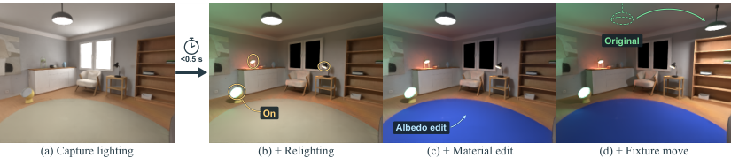
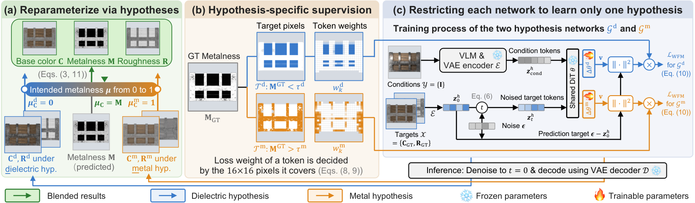
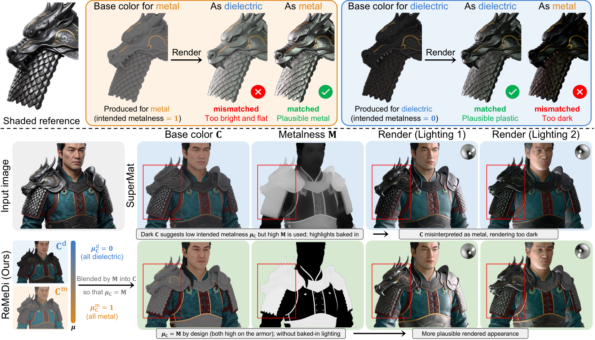
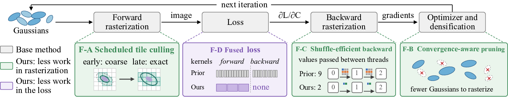

# 2026-11-27 科研日报

## 今日速览

周四 arXiv 公告里，最贴近主线的两篇必读分别对准**已重建室内高斯在换光时该预计算什么**，以及**单图估计 PBR 材质时基色与金属度如何按设计对齐**。另选读一篇在紧凑高斯模型上继续抠训练时间的系统工作。

- **必读：[LiveRelight](#2026-11-27--liverelight)（University of Copenhagen、Google DeepMind）。** 室内高斯一旦重建完成，外观往往锁在采集时的光照里；反过来，若每次改灯、改反照率或挪灯具都从头做路径追踪，编辑反馈就跟不上手。把每盏灯的光照响应预先存下来虽快，却把反射率和光源几何也一起烤进去，材质或灯具一改就失效。LiveRelight 改预计算**几何光交换**（谁能看见谁、能量如何传递），编辑时只把新的发射和反射送进一次廉价的传输求解。直射在重建得到的二维高斯上做考虑可见性的下一事件估计，漫反射互反射在三角形代理网格上用稀疏辐射度更新，再用拟合过的稀疏投影把代理解送回高斯的 alpha 合成。论文报告，在其合成测试套件的八种换光条件下，亚秒级编辑相对先前的路径追踪式编辑平均提高 $5\,\mathrm{dB}$ PSNR，延迟最多降约三个数量级；视觉反馈大约 $0.5$ 秒，真实室内采集也给出了可交互换光的定性结果。读它的理由：这是把「可重光照资产」从「再优化一次」推进到「当场改灯」的一步，而且作者之一正是三维高斯溅射的提出者 Bernhard Kerbl，对照路径也很清楚。
- **必读：[ReMeDi](#2026-11-27--remedi)（南京大学、北京大学、腾讯）。** 从单张图估计一套可换光的 PBR 贴图时，表面是金属还是电介质会决定反照率该怎么解释：电介质有自身颜色的漫反射和大约 $4\%$ 的无色高光，金属几乎没有漫反射、镜面反射又强又常带颜色。任何决定反照率的贴图都带着一种「它本来想描述哪种金属度」的判断，作者称为**意图金属度**。若直接预测的基色贴图像是为电介质准备的暗颜色，却配上一张偏高的金属度图，渲染就会把这块表面错当成过暗的金属。ReMeDi 把基色改写成金属度加权的两种假说变体——全电介质与全金属——并分别用两个网络来估，使得基色的意图金属度在设计上等于预测的金属度图。项目页已公开。读它的理由：这是材质解耦里一个很具体的一致性约束，和室内高斯换光、金属/镜面物体几何重建都直接相关。
- **选读：[SprintGS](#2026-11-27--sprintgs)（KDDI Research, Inc.）。** 在 FastGS 这类已经把高斯数量压下去的快速训练方法上，光栅化仍占总训练时间的大约 $64\%$，而按像素计算的损失占比会随着模型变紧凑从 $4\%$ 升到 $23\%$。SprintGS 用计划性瓦片剔除、收敛感知剪枝、更省的反传 shuffle，以及在前向里直接算出损失与图像梯度的融合损失，来同时砍掉这两块冗余。论文报告，在相当质量下比 FastGS 快 $2.15\times$，高质量设置下快 $1.81\times$，并且能加速其他快速训练方法，以及动态、稀疏视图和表面重建。它和昨日必读的 [HiGS](https://rubatotree.github.io/research-daily/digests/2026-11-26#2026-11-26--higs) 不在同一层：HiGS 改的是渲染与重建的调度粒度，SprintGS 改的是紧凑模型上仍然剩下的训练开销。
- **其他：** [AnyCam4D](#2026-11-27--anycam4d) 让原生四维高斯直接按光线积分，而不必先把鱼眼、广角画面校正回针孔；[FoundSurface](#2026-11-27--foundsurface)（NeurIPS 2026）从前馈点图再走一步，从无位姿图像恢复连续表面。[VersionGS](#2026-11-27--versiongs) 用版本化高斯应对快速运动；[FoamSurf](#2026-11-27--foamsurf) 用 Voronoi 面元在散射介质里做可微渲染。[3DSS](#2026-11-27--3dss) 是一篇 2026-05 的逆渲染表面溅射工作，此次以 v4 首次进入日报。[Second-Order 3DGS](#2026-11-27--second-order-3dgs)（ACCV 2026）把多视图批次和二阶更新放到一起。[SplatWAM](#2026-11-27--splatwam) 把世界动作模型建在三维高斯上；[FOCI](#2026-11-27--foci) 用高斯重叠积分直接在溅射场里做轨迹优化。[MEMO](#2026-11-27--memo) 为动态场景的每一帧提取网格；[What a Drop Reveals](#2026-11-27--what-a-drop-reveals) 从一段下落视频估计可变形体的刚度。[LuxAvatar](#2026-11-27--luxavatar) 做实时可重光照头部；[Multi-GPU 3DGS](#2026-11-27--multi-gpu-3dgs) 给出可扩展的多卡 PyTorch 后端，同属首次收录。

---

## 室内换光与材质一致性

今天的主菜都在「重建之后怎样改光、改材质」。一篇把室内高斯的全局光照编辑做到亚秒级，一篇把单图 PBR 估计里金属与电介质的基色假说拆开再混合。二者都不依赖新的采集光照，但处理的是同一条主线上前后相连的两步：先有可信的材质，再有跟得上手的换光。

### LiveRelight · arXiv · 2026-11-25

从单次光照下的多视图重建出发，把几何光交换预计算下来，使改灯、改反照率和挪灯具都能在大约半秒内带上直射与间接光照，而不必为每次编辑再做优化。

**论文：** *LiveRelight: Sub-Second Global Illumination Editing for Gaussian Interiors*  
**作者：** Noah Rothenberger、Dor Verbin、Serge Belongie、Bernhard Kerbl  
**单位：** University of Copenhagen（Noah Rothenberger、Serge Belongie、Bernhard Kerbl）；Google DeepMind（Dor Verbin）  
**投稿信息：** 投稿信息未标明  
**发表时间：** arXiv 首次挂出 2026-11-25  
**链接：** [arXiv:2611.34226](https://arxiv.org/abs/2611.34226) · [HTML](https://arxiv.org/html/2611.34226) · [PDF](https://arxiv.org/pdf/2611.34226)

**摘要中译：** 为重建得到的三维场景换光仍然困难，因为光传输本身很复杂：视觉反馈太慢或过于近似，编辑者就很难把结果调到满意。本文提出一种混合换光方法，无需按每次编辑再优化，就能对室内直射与间接光照做交互级、高保真的更新，并在房间尺度上支持多种换光编辑、近乎即时给出反馈。关键想法是预计算几何光交换，而不是预存光照响应，从而保留一次廉价的传输求解，以容纳发射和表面反射的变化。直射光照在重建得到的二维高斯上，通过对单侧发光体做考虑可见性的采样来计算；漫反射互反射则通过三角形代理上的稀疏辐射度传播。再通过高斯 alpha 合成拟合出的稀疏投影，把代理解转移到重建结果上。该式还支持快速的灯具变换和插入发光体：只要重新计算光源注入即可。在合成测试套件的八种换光条件下，亚秒级编辑相对先前的路径追踪式编辑平均提高 $5\,\mathrm{dB}$ PSNR，编辑延迟最多降低约三个数量级。定性结果进一步展示了在真实采集场景上的可交互换光。

*论文 Figure 1：同一新视角下，（a）采集光照；（b）点亮原先未亮的灯；（c）把地毯改成蓝色后天花板出现溢色；（d）移动吊灯并更新全局光照。混合渲染把高斯上的直射与预计算几何交换上的漫反射互反射合在一起。来源：[arXiv HTML](https://arxiv.org/html/2611.34226v1)。*

#### 1. 解决的瓶颈与切入点

基于图像的重建已经能把室内场景画得很像，但三维高斯溅射的外观通常锁在采集时看到的那套光照上。物理的逆渲染可以为神经场或高斯场解出可编辑的几何、材质和光照，可每次改条件都把多弹跳光传输从头算一遍，仍然太慢，编辑者等不及反馈。另一类做法预先存下每盏灯的光照响应，再线性组合，换光倒是快，但这些响应里已经编码了当前的反射率和光源摆放，改材质或挪灯具就会失效。LiveRelight 的切入点是：换光编辑几乎不改几何和可见性，因此可以预计算传输算子本身，并在编辑环里保留一次现场求解——发射和反射变了，就重新解互反射，而不必重新做昂贵的几何探索。

#### 2. 输入、输出与前置条件

输入是在**单一光照条件**下采集的多视图图像。方法先得到一套室内二维高斯重建，并准备一份由二维高斯经 TSDF 融合再网格化得到的三角形代理，用于漫反射互反射。编辑时的输入是灯具的开关、颜色和强度、表面反照率，以及对已重建灯具集合做平移、旋转、缩放，或插入新的发光体。输出是带有更新后直射与间接光照的新视图，不必为每个目标光照再拟合一场。论文写明源代码与数据将公开，当前摘要和项目信息中尚未给出仓库地址。

#### 3. 完整方法因果链与数据流

方法沿用经典的两遍渲染思路，按传输性格把图像拆开。直射分量锐利、且和当前视点绑定，于是在重建得到的高斯发光体上做下一事件估计（NEE）：只对**单侧**发光体做考虑可见性的采样，以避免把灯罩背面也当成发光面、把能量漏到天花板上——这是作者用来对照 EAG-PT 的一个具体修正。间接分量通常更平滑、以漫反射为主，于是在不透明的三角形代理上做稀疏辐射度更新；因为几何和可见性基本不变，预计算好的几何交换可以被反复使用，每次编辑只把新的发射和反射送进求解器。

高斯是半透明、按视点做 alpha 合成的图元，辐射度解却贴在网格面上，二者之间有一个表示鸿沟。作者用一组辐射探针，透过高斯的 alpha 合成去拟合一个稀疏投影，把代理上的辐射度转到高斯场上。灯具的几何操作被写成相似变换，直接作用在已重建的高斯灯具集合上，不必重拟合；变换之后更新可见性和光源注入，间接光照仍走同一套预计算交换。作者强调，这种分解利用的是室内重建「几何大体不动」的前提，并不依赖屏幕空间的时域复用，因此挡在画面外的表面仍然可以参与多弹跳。

#### 4. 结果、局限与阅读指引

在合成测试套件的八种换光条件下，论文报告亚秒级编辑相对先前路径追踪式编辑平均提高 $5\,\mathrm{dB}$ PSNR，延迟最多降约三个数量级；视觉反馈大约半秒。对厨房场景中的灯具几何编辑，天花板圆盘缩放到 $2\times$（可再叠加 $10$–$20\,\mathrm{cm}$ 平移）时，在其 Relit 2 条件下 PSNR 仍高于 $33.3\,\mathrm{dB}$；餐桌吊灯平移最远 $2\,\mathrm{m}$ 时，在 Relit 3 条件下高于 $36.3\,\mathrm{dB}$。真实室内采集给出了定性结果，例如关掉已有天花板灯盘、打开原先未亮的台灯，或插入新光源。阅读时应对照 LuxRemix 这类「按光源分解、再实时混合」的方法：后者改反射或改光源几何时不会重算传输。也应对照 RadiosityGS：它把辐射度直接做在半透明高斯面元上，作者指出其在房间尺度上仍有开放问题。局限同样明确：间接光照以代理网格上的漫反射为主，高光互反射和透明物体不是这一求解器的主场；几何被假设为基本静止，大范围改房间结构需要重新估计交换；代码与数据「将公开」，目前还不能按仓库复现。

**相关链接：** 项目主页与代码尚未在摘要中给出；论文写明源码与数据将公开。

### ReMeDi · arXiv · 2026-11-25

把基色写成「全金属 / 全电介质」两种假说的金属度加权混合，并用两个网络分别估计，从而在设计上让基色的意图金属度与金属度图一致。

**论文：** *ReMeDi: Single-Image PBR Material Estimation via Reparameterization between Metal and Dielectric Hypotheses*  
**作者：** Fan Fei、Xin Huang、Yixin Zhu、Jiawei Lu、Xin Yang、Jinglin Liang、Ruining Tang、Yifei Feng、Boxin Shi、Chunchao Guo  
**单位：** Fan Fei、Xin Huang、Yixin Zhu、Jiawei Lu、Xin Yang：南京大学；Jinglin Liang、Ruining Tang、Yifei Feng、Boxin Shi、Chunchao Guo：北京大学计算机学院（多媒体信息处理国家重点实验室、视觉技术国家工程研究中心）与腾讯（作者块将两所机构并列于第二组，未逐人标注；通讯作者为 Boxin Shi、Chunchao Guo）。Fan Fei、Yixin Zhu 于腾讯混元 3D 实习期间完成此项工作。  
**投稿信息：** 投稿信息未标明  
**发表时间：** arXiv 首次挂出 2026-11-25  
**链接：** [arXiv:2611.34284](https://arxiv.org/abs/2611.34284) · [HTML](https://arxiv.org/html/2611.34284) · [PDF](https://arxiv.org/pdf/2611.34284) · [项目主页](https://costrice.github.io/remedi/)

**摘要中译：** 基于物理的渲染（PBR）材质估计有助于换光、材质编辑和三维内容制作。表面反射强烈依赖于它是金属还是电介质，因此任何决定反照率的贴图都带有一种对金属度的判断，作者称之为该贴图的「意图金属度」。用与意图金属度不匹配的金属度图去渲染，会得到物理上不合理或被误读的材质。金属–粗糙度工作流把金属度写成显式通道，因而鼓励基色与之对齐，但并不强制这一点，尤其是在自动方法分别预测各张贴图的时候。为此，本文提出 ReMeDi，用两个组件来强制对齐。第一，把基色重新参数化为两种变体的金属度加权混合，这两种变体分别在「全是金属」和「全是电介质」的假说下估计。第二，由于现有监督无法让单个网络在每个像素上同时学会两种假说，作者用两个独立网络分别只承担一种假说，从而保证每个变体都遵循自己的假说。除了强制对齐，这也能把各张材质贴图本身估得更准。实验表明，ReMeDi 在材质精度和换光保真度上均优于现有方法。

*论文方法概览图：先按金属度把基色写成两种假说变体的混合；再按真值金属度为两种假说分别构造监督与 token 权重；训练时两个假说网络共享骨干、但只在各自假说下计算损失。来源：[arXiv HTML](https://arxiv.org/html/2611.34284v1)。*

*论文 Figure 1：上排说明同一套基色在「当作金属 / 当作电介质」渲染时只有与意图金属度一致才合理；下排对照 SuperMat 把偏暗的电介质基色配上高金属度、高光被烤进基色，以及 ReMeDi 按设计使 $\mu_C=M$ 后的换光结果。来源：[arXiv HTML](https://arxiv.org/html/2611.34284v1)。*

#### 1. 解决的瓶颈与切入点

单图 SVBRDF 估计已经能输出基色、金属度和粗糙度，但这些贴图常常是分开预测的。金属–粗糙度工作流把金属度写成显式通道，并不保证基色是「按照这张金属度图来理解」的那一种。一个典型失败是：网络给出一块偏暗、看起来像电介质油漆的基色，金属度图却把同一区域标成金属，渲染时漫反射被关掉、只留下被低估的镜面反射，物体就会变得过暗、发灰。作者把这种隐藏判断称为贴图的意图金属度：每一张决定反照率的图，在被画出来的时候就已经假定了自己在描述金属还是电介质。问题不在于「再加一个损失劝它们一致」，而在于参数化本身允许不一致发生。

#### 2. 输入、输出与前置条件

输入是一张图像，可以是照片或生成图。输出是一套用于金属–粗糙度工作流的 SVBRDF 贴图，至少包括基色、金属度和粗糙度，并可在新光照下重打。训练需要带材质真值的合成数据来分别监督两种假说；推理时不再需要真值金属度，只用网络预测的金属度把两种基色变体混合。项目页已公开，代码入口以项目页为准。

#### 3. 完整方法因果链与数据流

作者先把基色 $\mathbf{C}$ 写成金属度 $\mathbf{M}$ 加权的两种假说变体

$$
\mathbf{C}=(1-\mathbf{M})\,\mathbf{C}^{\mathrm{d}}+\mathbf{M}\,\mathbf{C}^{\mathrm{m}},
$$

其中 $\mathbf{C}^{\mathrm{d}}$ 是「全电介质」假说下的基色（意图金属度为 $0$），$\mathbf{C}^{\mathrm{m}}$ 是「全金属」假说下的基色（意图金属度为 $1$）。这样，混合后的 $\mathbf{C}$ 在设计上就具有 $\boldsymbol{\mu}_{\mathbf{C}}=\mathbf{M}$：金属度图既是混合权重，也是这张基色被怎样解释的声明。粗糙度等其他贴图也按同一思路在相应假说下估计。

接下来的困难是监督。现有数据并不能在同一个像素上同时告诉网络「假如这里是金属该是什么颜色」和「假如这里是电介质该是什么颜色」；若用一个网络同时输出两种变体，梯度会把两种假说搅在一起。ReMeDi 因此训练两个网络 $\mathcal{G}^{\mathrm{d}}$ 和 $\mathcal{G}^{\mathrm{m}}$，各自只在一种假说下接受监督。按真值金属度划分像素，并用 $16\times 16$ 的 token 覆盖范围来分配损失权重，使每个网络主要看到自己假说成立的区域。结构上，两个网络共享视觉语言与 VAE 编码以及一套扩散骨干，只在假说分支上分开计算损失；推理时把噪声解到 $t=0$，用 VAE 解码，再按预测的金属度混合。作者还指出，这种拆分有助于避免把高光烘焙进基色，因为金属假说和电介质假说不再需要用同一张基色去「将就」两种完全不同的反射机制。

#### 4. 结果、局限与阅读指引

论文在带材质真值的合成测试集以及无真值的野外图像上，对照近期单图材质方法（文中包括 SuperMat 等），报告材质精度和换光保真度均优于对照。定性结果里，铠甲等高金属度区域不再被渲染成过暗的塑料，高光也不再残留在基色里。阅读时应把它看作「单图材质估计的一致性约束」，而不是已经解决了室内多视图逆渲染：它不输出三维高斯场，也不处理多次反弹的环境光照分解。与主线的对照是：LiveRelight 假设已经有可用的反射率去换光；ReMeDi 关心的是这张反射率从一开始有没有和金属度说同一种语言。对金属、镜面物体的几何重建而言，这份讨论也提醒：把高光烤进反照率，会把后面的解耦一并带偏。局限在于，假说拆分依赖合成监督和金属–粗糙度参数化；混合像素、涂层、半透明或多层材质并不在这一二元假说里；项目页已给出，但投稿信息未标明。

**相关链接：** [项目主页](https://costrice.github.io/remedi/)

---

## 选读

### SprintGS · arXiv · 2026-11-25

在已经压缩过图元数量的快速训练方法上，继续去掉光栅化里的无效瓦片与几乎透明的高斯，并把损失计算融进前向，从而再缩短逐场景优化。

**论文：** *SprintGS: Eliminating Redundancy for Fast 3D Gaussian Splatting Training*  
**作者：** Ryosuke Watanabe、Tomoaki Konno  
**单位：** KDDI Research, Inc.  
**投稿信息：** 投稿信息未标明  
**发表时间：** arXiv 首次挂出 2026-11-25  
**链接：** [arXiv:2611.33796](https://arxiv.org/abs/2611.33796) · [HTML](https://arxiv.org/html/2611.33796) · [PDF](https://arxiv.org/pdf/2611.33796)

**摘要中译：** 三维高斯溅射能实时画出照片级新视角，但逐场景训练（优化）仍然偏慢。近期的 FastGS 等快速训练方法通过减少高斯数量，把训练缩短到数分钟。对 FastGS 做剖析后，作者发现紧凑模型里仍有两项开销：光栅化依然是最大头，且其中仍有冗余；损失计算并不随高斯数量下降，因而在紧凑模型里占比上升。SprintGS 是建立在 FastGS 上的训练框架，保持模型紧凑，同时降低这两项成本。对光栅化，计划性瓦片剔除把每颗高斯限制在它真正起作用的瓦片上，先用粗足迹再在训练结束前退火到精确足迹；收敛感知剪枝去掉已经收敛、近乎透明的高斯；一种更有利于 shuffle 的反传减少线程之间交换的数据。对损失，融合损失在前向中直接计算损失及其图像梯度，不再写出损失图，从而去掉大部分损失开销。SprintGS 在相当质量下比 FastGS 快 $2.15\times$，在高质量设置下快 $1.81\times$，并且也能加速其他快速训练方法以及动态、稀疏视图和表面重建。

*论文 Figure 3：灰色框是基线的一次训练迭代，彩色框是 SprintGS 插入的四个组件：计划性瓦片剔除、融合损失、shuffle 高效反传，以及收敛感知剪枝。来源：[arXiv HTML](https://arxiv.org/html/2611.33796v1)。*

#### 方法概要

作者在 Mip-NeRF 360、Deep Blending 和 Tanks & Temples 共十三组场景上对比 3DGS 与 FastGS 的训练时间构成。即使 FastGS 已经把高斯数量降下去，光栅化仍约占 $64\%$；与此同时，优化器与增密、剪枝的占比从 $25\%$ 降到 $10\%$，按像素计算的损失却几乎没有变便宜，占比从 $4\%$ 升到 $23\%$。于是 SprintGS 不把模型再放大，而是分别处理这两块。

计划性瓦片剔除针对「一颗高斯被分到许多它几乎没有贡献的瓦片」。训练前期用更粗的足迹做分箱，后期再退火到精确足迹，以免一开始就把需要的瓦片剪掉。收敛感知剪枝及早去掉已经收敛、近乎透明的高斯，并把腾出来的预算部分重新分配到重建较差的区域。反传沿用按高斯并行、在深度方向上做 warp shuffle 的路线，但减少线程间传递的量。损失一侧的关键观察是：一旦模型变紧凑，写出整张损失图再反传的成本就会显得突出；融合损失在前向里直接得到损失和图像梯度，不再保留这张中间图。因为这些步骤是许多 3DGS 训练器共用的，作者还把它们接到其他快速训练方法，以及动态、稀疏视图和表面重建任务上。论文报告，相对 FastGS-Base（并吸收 Faster-GS 的部分实现优化）在相当质量下快 $2.15\times$，高质量设置下快 $1.81\times$。阅读时应与昨日的 HiGS 区分：HiGS 重新划分宏瓦片与有界深度批次，服务的是渲染和反传的调度；SprintGS 服务的是「模型已经变小之后，训练里还剩哪些浪费」。它并不改变最终表示，也不直接提高可重光照质量。投稿信息未标明，代码入口亦未在摘要中给出。

---

## 其他简讯

### AnyCam4D · arXiv · 2026-11-25

**论文：** *AnyCam4D: Ray-Based 4D Gaussian Rendering for Arbitrary Camera Models*  
**作者：** Sascha Kirch、Rafael Pagés、Jan Ondřej、Clara Pérez-Molina、Sergio Martin  
**单位：** 单位未在摘要页标明  
**投稿信息：** 投稿信息未标明  
**发表时间：** arXiv 首次挂出 2026-11-25  
**链接：** [arXiv:2611.34223](https://arxiv.org/abs/2611.34223) · [PDF](https://arxiv.org/pdf/2611.34223) · [项目主页](https://sascha-kirch.github.io/anycam4d/)

真实相机往往不是针孔，但多数动态高斯溅射仍按针孔来渲染，于是视频要先去畸变，广角和鱼眼尤其会丢掉视场或细节。静态高斯溅射已经可以用基于光线的渲染适配任意相机；原生在时空中建模运动的四维高斯却不能直接套用，因为每颗高斯的运动是在三维欧氏空间里写的，和弯曲的投影模型对不上。AnyCam4D 把渲染改到射线上做，使四维高斯能够直接吃进未校正的任意相机模型。这和室内、机器人场景里常见的广角、鱼眼采集直接相关，值得作为动态重建的相机模型对照来读。

### FoundSurface · NeurIPS 2026 · 2026-11-25

**论文：** *FoundSurface: Feedforward Ray-Based 3D Scene Surface Reconstruction from Unposed Images*  
**作者：** Shenxing Wei、Jinxi Li、Zihui Zhang、Ajay Kumar、Wei Wang、Bo Yang  
**单位：** 单位未在摘要页标明  
**投稿信息：** 已接收为 NeurIPS 2026（据 arXiv Comments）  
**发表时间：** arXiv 首次挂出 2026-11-25  
**链接：** [arXiv:2611.34128](https://arxiv.org/abs/2611.34128) · [PDF](https://arxiv.org/pdf/2611.34128) · [项目主页](https://vlar-group.github.io/FoundSurface.html)

无位姿图像上的前馈重建近年来多用点图，表示是离散、稀疏的。FoundSurface 把点图接到一套基于光线的连续表面恢复流程里，声称可在不必先给相机位姿的情况下得到更高保真的三维表面。这是几何主线上「弱位姿、前馈、要表面而不仅是新视角」的一篇会议论文，适合和近期前馈高斯、表面对齐协方差等工作对照；它并不直接做材质或换光。

### VersionGS · arXiv · 2026-11-24

**论文：** *VersionGS: Compact and Motion-Robust Dynamic Gaussian Splatting via Versioned Gaussians*  
**作者：** Shihang Wei、Yichi Zhang、Fengqing Zhu  
**单位：** Purdue University  
**投稿信息：** 投稿信息未标明  
**发表时间：** arXiv 首次挂出 2026-11-24  
**链接：** [arXiv:2611.33374](https://arxiv.org/abs/2611.33374) · [HTML](https://arxiv.org/html/2611.33374) · [PDF](https://arxiv.org/pdf/2611.33374)

现有动态高斯常用时间的平滑函数或帧间约束更新来编码运动，快速动作下质量会掉一截：论文观察到，在有挑战性的舞蹈序列上，高运动帧相对低运动帧会掉 $1.1$–$4.0\,\mathrm{dB}$ PSNR。VersionGS 不再把运动写成必须遵守的轨迹模型，而是直接编码每帧的高斯状态，运动估计只用来引导重建。在一组帧里，未改变的高斯继续引用共享字典里的当前版本，改变的则追加为新版本；再用光流、照片差分或渲染误差来选择要 refinement 的高斯，以尽量复用旧版本。字典经过剪枝、带模拟量化的微调后编码成图像，剪枝比例可以在不重建字典的情况下权衡存储与质量。论文报告，在 DanceNet3D 的快速舞蹈序列上，前景 PSNR 比最强对照高 $2.7\,\mathrm{dB}$，最高运动帧上的下降小于 $0.3\,\mathrm{dB}$；在 N3DV 和 Technicolor 上，存储约为总体最强对照 TAD-GS 的 $1/6.0$ 和 $1/5.7$，PSNR 仍更高。回放只需标准三维高斯光栅器，不必再跑运动网络。

### FoamSurf · arXiv · 2026-11-24

**论文：** *FoamSurf: A Voronoi-Surfel Representation for Differentiable Rendering*  
**作者：** Grzegorz Wilczyński、Julia Farganus、Krzysztof Byrski、Rafał Tobiasz、Mikołaj Zieliński、Dominik Belter、Przemysław Spurek  
**单位：** 单位未在摘要页标明  
**投稿信息：** 投稿信息未标明  
**发表时间：** arXiv 首次挂出 2026-11-24  
**链接：** [arXiv:2611.33462](https://arxiv.org/abs/2611.33462) · [PDF](https://arxiv.org/pdf/2611.33462)

散射介质里的场景同时有固体表面（海床、岩石）和半透明介质（水、雾、烟）。近期基于高斯的方法可以把带介质的画面画得像，但只渲染表面时仍可能残留介质痕迹；神经场把表面和介质分得更开，训练和渲染又更慢。FoamSurf 提出一种 Voronoi 面元表示，用于这类场景的可微渲染，意图在高斯式的速度和神经场式的表面–介质分离之间取一个折中。它更靠近参与介质中的表面重建，而不是室内可重光照主线，但「把表面和介质分开表示再分别积分」这一点值得扫一眼。

### 3DSS · arXiv · 2026-05-07

**论文：** *3DSS: 3D Surface Splatting for Inverse Rendering*  
**作者：** Mae Younes、Adnane Boukhayma  
**单位：** 单位未在摘要页标明  
**投稿信息：** 投稿信息未标明  
**发表时间：** arXiv 首次挂出 2026-05-07（v4 修订于 2026-11-24，并于 2026-11-26 的 cs.GR 替换列表中出现）  
**链接：** [arXiv:2605.05876](https://arxiv.org/abs/2605.05876) · [PDF](https://arxiv.org/pdf/2605.05876)

为何现在收录：这是一篇 2026-05 的预印本，此前未见入选日报；今日作为 v4 出现在 cs.GR 替换列表以及 cs.CV 交叉列表中，故作首次收录。作者提出三维表面溅射（3DSS），作为从多视图图像做基于物理的逆渲染的可微表面溅射渲染器。核心观察是：覆盖同一像素的面元可以按它们所采样的是否为同一张表面来分组，而这一分组可以用重建核本身来写——当两个面元的核在物空间重叠，就视为采样同一张表面。这和把半透明高斯直接拿来做逆渲染不同，它先把「哪一些图元属于同一张不透明表面」说清楚，再在此基础上做物理渲染。阅读时应把它当作表面表示上的逆渲染对照，并核对该 v4 相对初稿改了哪些实验或方法说明；摘要页未给出项目主页。

### Second-Order 3DGS · ACCV 2026 · 2026-11-25

**论文：** *Efficient Scene-Distribution-Aware Second-Order Optimization for 3D Gaussian Splatting*  
**作者：** Hyunseung Son、Young Sun Choi、Youngsik Yun、Kibeom Hong、Youngjung Uh  
**单位：** Yonsei University（Hyunseung Son、Young Sun Choi、Youngsik Yun、Youngjung Uh）；Sookmyung Women’s University（Kibeom Hong）  
**投稿信息：** 已接收为 ACCV 2026（据 arXiv Comments）  
**发表时间：** arXiv 首次挂出 2026-11-25  
**链接：** [arXiv:2611.33698](https://arxiv.org/abs/2611.33698) · [HTML](https://arxiv.org/html/2611.33698) · [PDF](https://arxiv.org/pdf/2611.33698)

三维高斯溅射用 Adam 做数万次单视图更新仍然要数分钟。多视图批次能降低对单张训练图的依赖，二阶更新则希望用更大、更有结构的参数步数换更少的迭代；二者合在一起时，每一个批次都要渲染、反传并累加到二阶系统里，代价会随视图数上升。该文保留带球谐系数的完整耦合系统，先按相机轨迹挑选相互重叠更少的多视图批次，再把来自不同视图的采样光线打包，使反传和预条件子的扫描次数不再随视图数线性增长。它和 SprintGS 一样瞄准逐场景优化变快，但走的是「每一次更新覆盖得更广、步子更有结构」，而不是「把光栅化和损失里的冗余删掉」。已接收为 ACCV 2026。

### SplatWAM · arXiv · 2026-11-24

**论文：** *SplatWAM: Splatting World Action Models for Real-Time 3D Imagination*  
**作者：** Frank Tsu-Fang Lu、Karthik Sundar Senthilkumar、Christopher Thirgood、Oscar Mendez、Simon Hadfield  
**单位：** 单位未在摘要页标明  
**投稿信息：** 投稿信息未标明  
**发表时间：** arXiv 首次挂出 2026-11-24  
**链接：** [arXiv:2611.33467](https://arxiv.org/abs/2611.33467) · [PDF](https://arxiv.org/pdf/2611.33467)

世界模型通常在像素或潜空间里预测未来观测，并不直接表示三维场景如何演化。SplatWAM 把动作条件的动态学建在紧凑的三维高斯图元上：先用分词器把不定位姿的多视图编成固定预算的高斯，再在这一表示上生成动作条件下的未来。这是具身与世界模型方向上「把想象的下一帧写成可渲染的三维高斯」的一篇工作，和主线的可重光照资产不是同一问题，但和低成本仿真、合成数据回环可以交叉着看。

### FOCI · arXiv · 2026-11-24

**论文：** *FOCI: Trajectory Optimization on Gaussian Splats for Gaussian Robots*  
**作者：** Mario Gomez Andreu、Carlos Martinez Cuenca、Maximum Wilder-Smith、Victor Klemm、Vaishakh Patil、Marco Hutter、Jesus Tordesillas  
**单位：** ETH Zürich, Robotic Systems Lab（Mario Gomez Andreu、Maximum Wilder-Smith、Victor Klemm、Vaishakh Patil、Marco Hutter）；Trustworthy Robotics and AI Lab (TRAIL), IIT, Comillas（Carlos Martinez Cuenca、Jesus Tordesillas）  
**投稿信息：** 投稿信息未标明  
**发表时间：** arXiv 首次挂出 2026-11-24  
**链接：** [arXiv:2611.33380](https://arxiv.org/abs/2611.33380) · [HTML](https://arxiv.org/html/2611.33380) · [PDF](https://arxiv.org/pdf/2611.33380) · [代码](https://github.com/leggedrobotics/foci)

多数在高斯场景里做规划的方法仍用保守包围盒表示机器人，容易低估可通行缝隙。FOCI 用高斯之间的重叠积分来写碰撞，并把环境和机器人都表示成高斯溅射，从而可以做朝向敏感的轨迹优化，穿过很窄的空间。同一套式子适用于固定/移动基座机械臂、腿式机器人和无人机，也覆盖静态与动态的高斯环境。作者报告在合成和真实高斯场中，即使环境有数十万高斯，也可在数秒内算出无碰轨迹。这是具身侧「重建之后如何在高斯场里规划」的直接工作，代码已开源；它默认场景已经重建好，并不解决金属物体几何或可重光照质量。

### MEMO · arXiv · 2026-11-25

**论文：** *A Mesh for Every Moment*  
**作者：** Roy Or-El、Jeong Joon Park、Ira Kemelmacher-Shlizerman  
**单位：** 单位未在摘要页标明  
**投稿信息：** 投稿信息未标明  
**发表时间：** arXiv 首次挂出 2026-11-25  
**链接：** [arXiv:2611.34939](https://arxiv.org/abs/2611.34939) · [PDF](https://arxiv.org/pdf/2611.34939) · [项目主页](https://memo-4d.github.io)

MEMO 从多路同步相机重建完整动态场景的几何，并为每一帧提取一张网格。作者指出，现有动态高斯方法要么主要建模外观，要么依赖前景掩膜处理孤立物体，再靠 TSDF 融合或泊松重建出网格，这些后处理在完整动态场景上并不稳。该文把「每一刻都有一张网格」本身当成目标，而不是新视角图像质量的副产品，适合作为动态资产几何对照来读。

### What a Drop Reveals · arXiv · 2026-11-25

**论文：** *What a Drop Reveals: Sim-to-Real Material Estimation for Deformable Objects from Video*  
**作者：** Ziyue Peng、Yanxi Hu、Junyoung Kim、Andrew Chen、Jin Yang、Chandrajit L. Bajaj、Etienne Vouga、William T. Freeman、Qixing Huang、Brandon Y. Feng  
**单位：** 单位未在摘要页标明  
**投稿信息：** 投稿信息未标明  
**发表时间：** arXiv 首次挂出 2026-11-25  
**链接：** [arXiv:2611.34894](https://arxiv.org/abs/2611.34894) · [PDF](https://arxiv.org/pdf/2611.34894) · [项目主页](https://bjxdw.github.io/PhysReader/)

物体落地时的变形方式会泄露它是什么材料。该文从一段真实的下落视频出发，用只在仿真里训练的前馈预测器估计可变形体按密度归一化的刚度 $E/\rho$，并在出现塑性变形时估计屈服应力 $\sigma_Y/\rho$。真实视频没有材料标签，因此预测器的研发和验证都在仿真中完成，再迁移到真实录像。这是物理材质估计而不是 PBR 贴图估计，和 ReMeDi 的光学金属度不是同一件事，但和仿真到真实的材料识别、可变形资产有交叉。

### LuxAvatar · arXiv · 2026-11-25

**论文：** *LuxAvatar: Real-Time Relightable Head Avatars via Causal Neural Shading of 3D Intrinsic Proxies*  
**作者：** Yipengjing Sun、Chenyang Wang、Boyao Zhou、Jiapeng Zhu、Ka Leong Cheng、Shengping Zhang  
**单位：** 单位未在摘要页标明  
**投稿信息：** 投稿信息未标明  
**发表时间：** arXiv 首次挂出 2026-11-25  
**链接：** [arXiv:2611.34940](https://arxiv.org/abs/2611.34940) · [PDF](https://arxiv.org/pdf/2611.34940) · [项目主页](https://sypj-98.github.io/luxavatar/)

LuxAvatar 用三维内蕴代理上的因果神经着色，做实时可重光照头部头像。它落在头部资产而不是房间尺度的逆渲染，可作为「实时换光」在人像上的对照；与 LiveRelight 的室内全局光照编辑不是同一设定。

### Multi-GPU 3DGS · arXiv · 2026-06-09

**论文：** *Large-Scale Gaussian Splatting with a Multi-GPU PyTorch Backend*  
**作者：** Matthew Cong、Francis Williams、Jonathan Swartz、Mark Harris、Sanja Fidler、Ken Museth  
**单位：** 单位未在摘要页标明  
**投稿信息：** 投稿信息未标明  
**发表时间：** arXiv 首次挂出 2026-06-09（v2 修订于 2026-11-25，并于 2026-11-26 的替换列表中出现）  
**链接：** [arXiv:2606.11390](https://arxiv.org/abs/2606.11390) · [PDF](https://arxiv.org/pdf/2606.11390)

为何现在收录：这是一篇 2026-06 的预印本，此前未见入选日报；今日以 v2 出现在替换列表中，故作首次收录。高斯溅射常受单卡算力和显存限制，难以做到更高分辨率和更大场景。该文给出一套多 GPU 的高斯溅射方法，并把分布式实现的复杂性抽象进 PyTorch 后端。它是系统与工程侧的扩展性工作，不改变材质或换光模型，但对大场景训练和批渲染的卡点是直接对照。阅读时建议核对该 v2 相对初稿补充了哪些接口与规模数字。

同日还可以留意：[ArtTet](https://arxiv.org/abs/2611.33382) 从两个关节状态下的多视图重建出按刚体部件分开的水密网格；[CADENCE](https://arxiv.org/abs/2611.34549) 做传感器落地、世界一致的协同移动高斯 SLAM；[MERLoc](https://arxiv.org/abs/2611.34932) 在动态环境里用三维高斯参考做基于位姿检索的机器人定位；[Tortho-Gaussian++](https://arxiv.org/abs/2611.33905) 针对大范围航拍正射，抑制几何漂移与漂浮高斯；[Revisiting Monocular In-Hand Object Scanning](https://arxiv.org/abs/2611.33824) 提供 ToysRUs 手持扫描数据，并讨论小基线与手部遮挡下的 SfM。cs.GR 其余新稿还包括弦艺生成与钢琴铰链立体动画，与主线较远，不展开。替换稿中的 [Instant NuRec](https://arxiv.org/abs/2607.14203)、[LightFuse](https://arxiv.org/abs/2608.29269)、[CueSplat](https://arxiv.org/abs/2611.22095)、[GOLD-SLAM](https://arxiv.org/abs/2611.32335) 此前已收录，本次未见需要重提的实质新进展说明。

---

## 圈内新闻与社区反应

覆盖日内，Ke-Sen 的 SIGGRAPH Asia 2026 变更日志最近可核验更新仍为 2026-09-17，SIGGRAPH 2026 公开页面亦未见可核验的新条目。国内科技媒体与公开网页检索未发现 2026-11-26 当天与图形学 / 3DGS / 逆渲染主线直接相关的新高信号。Blender 5.3 原生导入 `.ply` / `.spz` 三维高斯已在 [11-24 日报](https://rubatotree.github.io/research-daily/digests/2026-11-24) 收录，本日不重复。上述新稿暂未找到可核实的社区原帖讨论。

---

## 覆盖说明

本期日报日期 2026-11-27（Asia/Hong_Kong），内容覆盖 2026-11-26。信息源包括 arXiv 周四新目（`cs.GR` 新投稿 3 篇、交叉 7 篇、替换 5 篇；`cs.CV` 新投稿 242 篇，交叉 46 篇，替换 114 篇，按三维高斯、逆渲染、可重光照、前馈重建、动态高斯与训练加速等关键词筛选；并核对 `cs.RO` 新目中与高斯场景规划、定位相关的条目），以及公开网页检索、Ke-Sen 与国内科技媒体（机器之心、量子位、新智元）。必读与选读依据 HTML 全文和原文配图。已对照 `meta/seen-papers.json` 及近几期日报去重；替换稿中的 Instant NuRec、LightFuse、CueSplat、GOLD-SLAM 此前已收录，本次未见需要重提的实质新进展说明；3DSS 与 Multi-GPU 3DGS 为首次收录。长期记忆与兴趣笔记较上一日无变更，未改 `meta/` 规范正文。

**编写：** Cream
