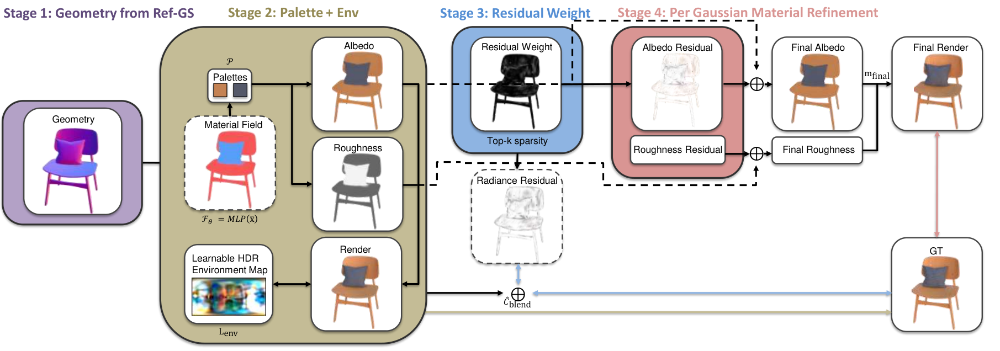
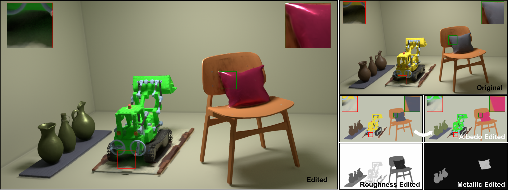

# 2026-11-28 科研日报

## 今日速览

周五没有独立的 arXiv 公告。本期回扫一篇此前从未写入日报、又紧贴「可重光照资产」主线的工作：它针对的不是又一种更准的光传输估计，而是**每个高斯各自估一套双向反射分布函数（BRDF）时，阴影和互反射太容易被写进材质**。

- **必读：[MaterialClusterGS](#2026-11-28--materialclustergs)（北京大学、中国科学技术大学）。** 现有高斯逆渲染多半给每个图元独立的基色、粗糙度和金属度。拟合原光照下的图像时，这种自由度很方便：几何不准、可见性有洞、间接光照估计有偏，都可以被局部材质悄悄吃掉；换光或改一块「应该是同一种材料」的表面时，成千上万套互不一致的参数就不会一起动。MaterialClusterGS 改在预训练的二维高斯场景上，用一小套共享的 BRDF 原型（调色盘）来解释整场材质，再由一个连续的空间材质场按位置做软分配。训练时联合优化调色盘、分配场和可学习的环境贴图，并在基于物理的渲染（PBR）目标下做分解；分解不够的地方，再用残差权重引导少量逐高斯修正。作者在 TensoIR 与 Synthetic4Relight 上报告了最好的反照率分解，换光质量接近但不超过 IRGS、SVG-IR 等最强基线。读它的理由：这和昨日必读的 [ReMeDi](https://rubatotree.github.io/research-daily/digests/2026-11-27#2026-11-27--remedi)、[LiveRelight](https://rubatotree.github.io/research-daily/digests/2026-11-27#2026-11-27--liverelight) 问的是同一条链上前后相连的问题——材质能不能从外观里干净地拆出来，拆完之后能不能一致地改。它选择的约束不是金属/电介质假说，也不是预计算几何光交换，而是「同类表面必须共享原型」。
- **其他：** [InitFree-SfM](#2026-11-28--initfree-sfm) 把无初始化的光束法平差接到学习到的对应与度量深度上，是本周视觉列表里漏收的几何前端，不是逆渲染。

---

## 调色盘式材质：先限制自由度，再谈换光和编辑

### MaterialClusterGS · arXiv · 2026-06-08

从预训练的二维高斯场景出发，用共享的 BRDF 原型代替逐图元独立材质，使分解出的属性既能换光，也能在调色盘一级被一致地编辑。

**论文：** *MaterialClusterGS: Palette-Based Material Decomposition and Physically-Based Relighting with 2D Gaussian Splatting*  
**作者：** Hao Zhang、Ang Li、Boyan Du、Junke Zhu、Fei Zhu、Meng Gai、Zhangjin Huang、Guoping Wang、Sheng Li  
**单位：** 北京大学（Hao Zhang、Ang Li、Fei Zhu、Meng Gai、Guoping Wang、Sheng Li）；中国科学技术大学（Boyan Du、Junke Zhu、Zhangjin Huang）  
**投稿信息：** 投稿信息未标明  
**发表时间：** arXiv 首次挂出 2026-06-08  
**链接：** [arXiv:2606.09018](https://arxiv.org/abs/2606.09018) · [HTML](https://arxiv.org/html/2606.09018) · [PDF](https://arxiv.org/pdf/2606.09018)

**摘要中译：** 本文提出 MaterialClusterGS，一种面向二维高斯溅射的调色盘式材质分解框架，用于基于物理的重光照与材质编辑。现有高斯逆渲染方法通常给每个图元独立的 BRDF 参数。这种局部拟合虽然灵活，却使材质恢复高度欠定：阴影、间接光照、几何误差和可见性残差，都可能被吸收进成千上万套略有差别的局部材质估计。与此同时，近年的调色盘外观方法只在 RGB 空间操作，并不建模物理材质或照明。为了弥合这一差距，本文用一套紧凑的全局共享 BRDF 原型表示场景材质，再通过连续的空间材质场完成分配。若没有共享的材质结构，编辑某一区域便无法一致地传播到所有同材质处，逐图元分解也就难以用于编辑。方法在基于物理的渲染目标下联合优化材质场、调色盘原型和环境光照，得到紧凑、空间连贯、可直接用于材质编辑、换光和迁移的属性。

*论文 Figure 3：Stage 1 提供预训练的二维高斯几何与辐射；Stage 2 引入可学习调色盘 $\mathcal{P}$、按位置分配原型的空间材质场 $\mathcal{F}_{\theta}$，以及用于 PBR 的 HDR 环境贴图；Stage 3 学习逐高斯残差权重，标出 PBR 解释不足的区域；Stage 4 冻结这些权重，只在需要处混入逐高斯直接材质。来源：[arXiv HTML](https://arxiv.org/html/2606.09018v1)。*

#### 1. 解决的瓶颈与切入点

三维高斯溅射把外观存成辐射，而不是可编辑的材质。后续的高斯逆渲染虽然给每个图元加上了基色、粗糙度和金属度，却把问题从「颜色不物理」转成了「材质太自由」：优化器遇到几何不准、阴影没建模好、互反射有偏差时，最省事的办法是改这个高斯自己的材质，而不是去修正光照。结果是：原视角还能拟合，换光或想把「同一块木头」一起改掉时，局部参数已经不再像内蕴 BRDF，更像把光照烤进去的外观缓存。

另一类调色盘方法把场景外观收成少量共享基底，编辑时能够整类一起动，但它们通常只在 RGB 上操作，并不分解反射、几何和光照。MaterialClusterGS 的切入点是把这两条线并到二维高斯上：用共享的 BRDF 原型取代逐图元独立材质，同时用 PBR 目标把照明和反射一起解释。选用二维高斯而不是三维高斯，是因为后续要做光线—表面求交以估计可见性和间接光照；作者沿用 IRGS 的观察，二维圆盘的交点更明确。

#### 2. 输入、输出与前置条件

输入是已经预训练好的二维高斯场景，几何与辐射初始化来自 Ref-GS。方法不从多视图图像重新建几何，也不需要真值材质标注。输出是一套共享的 BRDF 原型、每个高斯到这些原型的软分配、一份可学习的环境贴图，以及只在分解不足处启用的少量逐高斯修正。编辑时，改动某一个调色盘条目会传播到所有被分配到它的区域；分解完成后再用正向路径追踪，在新环境光下重光照。公开页面中暂未找到项目主页或代码仓库。

#### 3. 完整方法因果链与数据流

整条流水线分成四个阶段。

第一阶段只提供起点：预训练好的二维高斯，以及它已经学到的球谐辐射场。后面的分解都建立在这份几何和外观上，而不再回头大改图元布局。

第二阶段引入材质调色盘。每个原型存放基色、粗糙度和金属度，再经 sigmoid 与有界缩放映到物理范围内；基色被限制在 $[a_b, a_s+a_b]$（默认 $a_b=0.03$、$a_s=0.94$），以免优化器把基色压到接近零、用「特别黑的材质」去吸收缺失的光照。一个关键取舍是：**训练时金属度被固定**，以避免金属度与基色耦合、优化不稳。也就是说，反演阶段主要在估基色、粗糙度和环境光，而不是像 [ReMeDi](https://rubatotree.github.io/research-daily/digests/2026-11-27#2026-11-27--remedi) 那样把金属/电介质假说写成可学习的一致性约束。空间材质场是一个带正弦位置编码的浅层 MLP：把归一化后的三维坐标映成 $K$ 维 logits，再用温度为 $\tau$ 的 softmax 得到软分配。训练中 $\tau$ 从 $0.1$ 退火到 $0.01$，分配逐渐由混合变为更自信的归属；因为场在空间上连续，邻近高斯会自然得到相近的权重，不必再加成对平滑。调色盘先用球谐直流项做 MiniBatch K-Means 初始化，再预训练 MLP；训练过程中还会按激活后的参数距离合并过近的条目（阈值 $0.08$），让场景自己露出「真正有几种材料」。默认从 $K=8$ 出发。为了保留木纹、接缝这类局部变化，每个高斯还可以加幅度受限的残差，并用 $\ell_2$ 惩罚把它压小，以免调色盘名存实亡。

渲染时，先把各高斯的材质按与颜色相同的透射率合成泼溅到像素，再做 alpha 归一化，避免边缘发暗。法向不采用把各高斯法向 alpha 混合的结果，而是从深度图用有限差分叉积得到——作者引用的理由是：alpha 混合与漫反射可以交换，与非线性的镜面微面元 BRDF 不能。直射用斐波那契半球采样做蒙特卡洛积分：漫反射按朗伯项，镜面用 GGX 与 Schlick 菲涅尔，基底反射率在电介质 $F_0=0.04$ 与金属 $F_0=\mathbf{a}$ 之间由金属度插值。可见性通过对高斯圆盘生成的包围二十面体做 BVH 光线追踪得到。优化阶段的间接光照并不对多弹跳路径追踪反传，而是像 IRGS 那样，把击中的高斯上预训练球谐辐射当作间接缓存；材质分解并编辑之后，才改用从第二跳开始的波前路径追踪做前向换光，并配合下一事件估计与俄罗斯轮盘赌。环境光是可学习的经纬度 HDR 贴图，带按粗糙度索引的 mipmap 预滤波。

第三、四阶段处理「PBR 解释不完」的地方。第三阶段为每个高斯学一个残差权重，并把它与一份球谐残差场混合：权重高的像素更相信球谐，权重低的更相信 PBR。真正要留下的是这些权重，而不是混合图像；球谐残差场在本阶段结束后丢弃。权重还被一个稀疏掩膜约束，只允许前向中前 $\rho$ 比例（实验默认 $16\%$）的高斯非零，并被正则到与纯 PBR 的重建误差分布对齐，避免到处开后门。第四阶段冻结权重，只在权重高的高斯上混入可学习的直接材质，把局部细节补在调色盘确实不够的地方。

训练损失以 $\mathcal{L}_1$ 与 DSSIM 的重建项为主，辅以渲染法向与深度伪法向的一致性、只在第二阶段使用并逐渐退火的截断反照率平滑、防止调色盘塌缩的熵与「死条目」惩罚，以及第二阶段的直射光照平滑。不含第一阶段时，作者报告第二至四阶段分别约 $20$、$2.5$ 和 $17$ 分钟，合计约 $40$ 分钟。

#### 4. 结果、局限与阅读指引

在有真值材质和换光图的 TensoIR 与 Synthetic4Relight 上，作者报告该方法取得了最好的反照率分解，换光则接近但不领先最强基线。TensoIR 上，本文反照率 PSNR / SSIM / LPIPS 为 $34.16\,\mathrm{dB}$ / $0.960$ / $0.067$，高于 IRGS 的 $33.80$ / $0.954$ / $0.074$；换光 PSNR 为 $28.90\,\mathrm{dB}$，低于 SVG-IR 的 $30.29$ 与 IRGS 的 $29.91$。Synthetic4Relight 上，反照率 PSNR 为 $31.88\,\mathrm{dB}$、粗糙度 MSE 为 $0.007$，均为表内最好；换光 PSNR 为 $32.45\,\mathrm{dB}$，仍低于 IRGS 的 $34.90$。反照率的 SSIM 与 LPIPS 在该集上也不如 IRGS，作者把主要原因归到 Air Balloons 这类高频空间变化纹理：紧凑调色盘会把木纹、织物或风化表面抹平。与 PaletteNeRF、PaletteGaussian 这类只在 RGB 上做调色盘的方法相比，作者在 Lego 上用 FLIP 说明：BRDF 级调色盘更不容易把编辑漏到语义不同的区域。消融中，$K=8$ 并启用合并与 refinement 时，TensoIR 上新视角 PSNR 为 $32.19\,\mathrm{dB}$；从 $K=24$ 再合并，反而更容易把光照烤进不同条目，合并也更困难。$K=4$ 则会把不同材质挤进同一格，后续按条目编辑就会失效。

阅读时有几条边界需要一起记住。第一，金属度在训练中固定，反演并不试图解开金属/电介质歧义；文中展示的金属度编辑，是分解之后改调色盘条目再做前向换光，不能读成「已经从多视图里把金属度估准了」。第二，方法依赖 Ref-GS 的几何：法向、可见性或表面覆盖一旦偏了，PBR 着色会错，残差修正又可能把错误阴影写回基色——附录 Figure 9 在 Lego 上给出了这类例子。第三，调色盘假设材质可以收成少量共享原型，对分片均匀的材质很有效，对复杂空间变化纹理会过平滑或过分割。第四，优化阶段的间接光照来自球谐缓存，编辑后的换光才走路径追踪，两者并不相同。项目页和代码暂未公开。尽管如此，对主线的价值很明确：它把「材质有没有被光照污染」从逐图元拟合，改写成一个可编辑的全局结构先验，正好可以和昨日的材质一致性、室内换光预计算对照着读。

*论文 Figure 1：左侧为编辑后的场景；右上为编辑前；右下为编辑前后的反照率，以及编辑后的粗糙度与金属度。绿色插图突出低粗糙、高金属度编辑带来的镜面反射，红色插图标出由材质编辑引起的路径追踪间接光照，而不是把外观直接烤进基色。来源：[arXiv HTML](https://arxiv.org/html/2606.09018v1)。*

**相关链接：** [arXiv abs](https://arxiv.org/abs/2606.09018) / [HTML](https://arxiv.org/html/2606.09018) / [PDF](https://arxiv.org/pdf/2606.09018)（暂未找到项目主页或代码）

---

## 短列

### InitFree-SfM · arXiv · 2026-11-23

**论文：** *InitFree-SfM: When Initialization-Free Bundle Adjustment Meets Learned Structure-from-Motion*  
**作者：** Simon Weber、Mateo de Mayo、Je Hyeong Hong、Carl Olsson、Daniel Cremers、Ronald Clark  
**单位：** University of Oxford（Simon Weber、Ronald Clark）；Technical University of Munich 与 Munich Center for Machine Learning（Mateo de Mayo、Daniel Cremers）；Hanyang University（Je Hyeong Hong）；Lund University（Carl Olsson）  
**投稿信息：** 投稿信息未标明  
**发表时间：** arXiv 首次挂出 2026-11-23  
**链接：** [arXiv:2611.31516](https://arxiv.org/abs/2611.31516) · [PDF](https://arxiv.org/pdf/2611.31516) · [代码](https://github.com/simonwebertum/initfree-sfm)

为何现在收录：该文随 2026-11-24 的 arXiv 公告放出，近几期日报未写入 `seen-papers.json`，故作首次收录。无初始化的光束法平差（InitFree BA）希望从随机初值同时恢复相机位姿和三维点，而不先做相对位姿、旋转平均和三角化。作者指出，现有方法优化的对象空间误差（OSE）替代目标即使降得很低，也不等于重建准确；把学习到的对应、度量深度、深度一致的轨迹构造，以及沿视线约束路标位置的深度增强 OSE（dOSE）接进去之后，这条路线在现代 SfM 基准上才变得切实可行。在 ETH3D 每场景 20 张图的对照里，作者报告本文（LoMa 对应）的位姿 AUC@$5^{\circ}$ 为 $87.34\%$，对照 pOSE、GLOMAP 与 COLMAP（SP+LG）分别为 $0.00$、$37.36$ 与 $28.00$；与前馈方法相比，本文（RoMaV2 对应）为 $95.05\%$，对照 $\pi^{3}$、DA3 与 VGGT 分别为 $43.38$、$34.25$ 与 $10.83$。它提供的是更稳的相机与稀疏几何前端，并不估计材质或做高斯换光；对主线的帮助是间接的，适合作为「后面的逆渲染还要不要先有可靠位姿」的对照来读。

---

## 圈内新闻与社区反应

覆盖日内最值得记下的，是两条产品与开源发布，而不是新的会议论文列表。

**蚂蚁灵波开源流式三维重建 LingBot-Map 2.0，并把修正写进模型内部记忆。** 蚂蚁集团旗下具身公司 Robbyant 发布流式三维重建模型 LingBot-Map 2.0，以及建立在其上的空间记忆导航模型 LingBot-Navi，并公开技术报告、代码、权重和一份覆盖 $511$ 个真实采集场景的数据。英文通稿日期为 2026-11-26，国内报道集中在 2026-11-27。官方说法里，2.0 的关键不是事后再跑回环检测或位姿图优化，而是在推理时用几何上下文重塑（Geometric Context Reshaping, GCR）改写模型内部的空间记忆：复用已提取的局部几何，去对齐高层历史记忆，而不重新编码图像。通稿报告，在约 $5.2\,\mathrm{km}$、近 $19{,}000$ 帧的 VBR 城市场景上，平均轨迹误差（ATE，越小越好）从 1.0 的 $31.12\,\mathrm{m}$ 降到 $4.72\,\mathrm{m}$；Oxford Spires 与 KITTI 上的 ATE 分别为 $3.92\,\mathrm{m}$ 与 $9.42\,\mathrm{m}$；在单张 NVIDIA RTX 5090 上推理速度为 $27.51$ FPS。这些数字均来自官方通稿，未见独立复现。它解决的是长轨迹建图漂移和跨任务空间遗忘，是单目流式重建与导航，不是三维高斯或材质反演；对具身主线是直接信号，对可重光照资产则只提供「先有更稳的几何记忆」这一层对照。项目页与仓库已经公开：[LingBot-Map 2.0](https://technology.robbyant.com/lingbot-map-v2)、[GitHub](https://github.com/Robbyant/lingbot-map-v2)、[英文通稿](https://www.businesswire.com/news/home/20261126690702/en/Robbyant-Open-Sources-LingBot-Map-2.0-and-LingBot-Navi-Enabling-Long-Term-Spatial-Memory-and-Autonomous-Navigation-for-Robots)。

**腾讯混元发布 Hy3D 3.6，把宣传重点放到高模几何与可换光的 PBR 贴图。** 2026-11-27，腾讯混元发布 Hy3D 3.6，并上线腾讯云 Token Hub 的 API。产品页给出的规格包括：最高约 $200$ 万面的水密网格、可选 $2\mathrm{K}/4\mathrm{K}/8\mathrm{K}$ 贴图，以及金属度、粗糙度和法线等 PBR 通道，并写明做了减少原图光照影响的去光处理，以便后续重打光。这是生成式资产生成，不是从多视图照片里反演真实场景的材质；「能用」的宣传需要和实际拓扑、UV 与换光稳定性分开看，本文只记录官方规格与上线事实，不把宣传图当作评测结论。[腾讯云产品页](https://cloud.tencent.com/act/pro/hy3d-3.6) · [每经报道](https://www.nbd.com.cn/articles/2026-11-27/4660768.html)

**Blender 5.3 原生三维高斯仍然只吃 PLY / SPZ；KIRI Engine 放出补格式的免费插件。** 官方 [5.3 Rendering 说明](https://developer.blender.org/docs/release_notes/5.3/rendering/) 较近几期没有可核验的新接口或导出说明。KIRI Engine 于 2026-11-25 在 X 宣布一款免费插件，把 `.sog`、`.splat`、KSPLAT、压缩 PLY 以及 XGRIDS LCC / LCC2 接到 `File > Import`；2026-11-26 与 11-27 已有公开报道。开发者自己写明：插件是为内部工作快速写成的，可能有缺陷，目前只在 Windows 上测试过。它补的是分发格式缺口，并不改变原生高斯在 Cycles / EEVEE 里的颜色空间与 `Apply Transform` 限制，也不能读成已经解决了可重光照资产进入 Blender 的问题。[报道一](https://news.splatman.net/items/kiri-blender-sog-splat-import-addon/) · [报道二](https://renderu.com/en/news/post/28970)

Ke-Sen 的 [SIGGRAPH Asia 2026 变更日志](https://kesen.realtimerendering.com/siga2026-Changelog.htm) 最近可核验更新仍为 2026-09-17。覆盖日内，机器之心、量子位、新智元等中文科技媒体除上述产品发布外，未见与逆渲染或三维高斯主线直接相关的新高信号。上述论文暂未找到可核实的社区原帖讨论。

---

## 覆盖说明

本期日报日期 2026-11-28（Asia/Hong_Kong），内容覆盖 2026-11-27。当日无独立 arXiv 公告（arXiv 新目通常于周日到周四发布）。本期回扫尚未写入 `seen-papers.json`、又靠近真实场景逆渲染与可重光照资产主线的条目：MaterialClusterGS（2606.09018）于 2026-06-08 首次挂出，此前从未收入日报，本次依据 HTML 全文、主表与附录失败案例做完整收录，配图为原论文 Figure 3 与 Figure 1；InitFree-SfM（2611.31516）于 2026-11-23 首次挂出、随 2026-11-24 公告放出，近几期未收录，据摘要、题头方法图与作者报告的 ETH3D 对照简写。所有实验数字均为作者或官方通稿报告，未独立复现。信息源还包括公开网页检索、Ke-Sen、Blender 5.3 官方说明，以及国内科技媒体（机器之心、量子位、新智元）。长期记忆与兴趣笔记较上一日无变更，未改 `meta/` 规范正文。notes 至 `4b15b8c`、blog 至 `c29075d`、academic 至 `f19a697`。

**编写：** Cream
